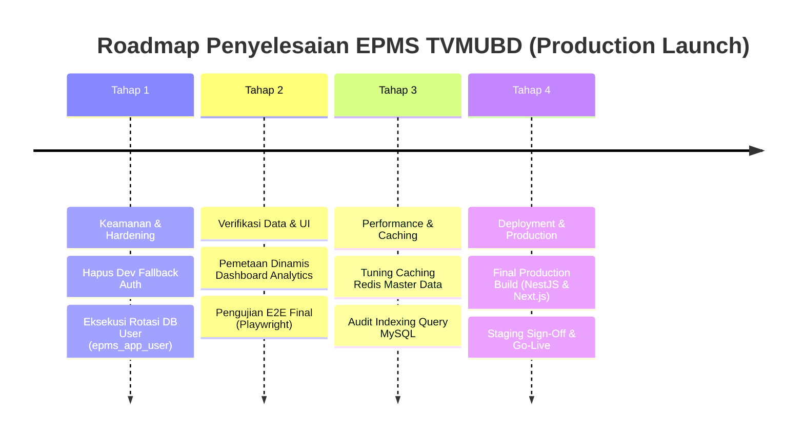

# Implementation Progress & Codebase Audit Report
## Enterprise Project Management System (EPMS TVMUBD)

**Versi:** 3.0  
**Tanggal Audit:** 29 Juli 2026  
**Status Evaluasi:** Production Readiness & Technical Audit  
**Sumber Kebenaran (Source of Truth):** Hasil analisis statis & dinamis repositori `epms_tvmubd`.

---

## 1. Ringkasan Progress Implementasi

Berdasarkan analisis menyeluruh terhadap source code (Frontend Next.js, Backend NestJS, Skema Database TypeORM, API Endpoint, dan Pengujian), berikut adalah persentase kesiapan implementasi proyek saat ini:

| Area Implementasi | Estimasi Progress | Alasan Rinci & Bukti Source Code |
| :--- | :---: | :--- |
| **Backend (NestJS Services)** | **85%** | 17 Modul backend memiliki controller dan service dengan logika yang kaya (seperti validasi WBS, approval diskon), namun beberapa fungsi mungkin belum di-consume oleh klien. |
| **Database Schema & ORM** | **95%** | 31 Entity TypeORM lengkap dengan relasi, indeks, soft-delete, dan timestamp. Backup SQL terverifikasi. |
| **API Endpoints** | **85%** | Mayoritas REST API utama siap (`/api/v1`), namun sebagian API belum memiliki integrasi frontend. |
| **Business Logic & Rules** | **88%** | Aturan bisnis seperti WBS Budget control, SPK 2x24h grace period demotion, dan approval diskon berjalan di level backend & scheduler. |
| **Frontend (Next.js 14 UI)** | **30%** | **SANGAT TERBATAS (Scaffolding Dominan).** Halaman Login, Tender Detail, dan Legal Review terimplementasi. Namun, sebagian besar halaman operasional (Finance, WBS, PO, GR, Vendor Comparison) HANYA berupa file stub kosong (contoh: `
Form Invoices (Belum diimplementasi)
`). |
| **Testing (Unit & E2E)** | **40%** | Terdapat beberapa pengujian E2E (Playwright) di `frontend/tests/`, namun sangat kurang pada pengujian menyeluruh unit test backend. |
| **Dokumentasi Sistem** | **90%** | PRD dan Audit ter-generate. Diperlukan penyesuaian terus-menerus mengikuti realita pengembangan UI. |

---

## 2. Status Setiap Modul

Berikut adalah tabel matriks status kelengkapan implementasi per modul sistem:

| Modul System | Frontend | Backend | Database | API | Status | Catatan Audit |
| :--- | :---: | :---: | :---: | :---: | :---: | :--- |
| **Authentication & Session** | ✅ | ✅ | ✅ | ✅ | ✅ Selesai | JWT & Refresh Token rotation teruji. Perlu menghapus hardcoded dev fallback. |
| **Admin User & Roles** | ✅ | ✅ | ✅ | ✅ | ✅ Selesai | CRUD User dan assignment 8 Role berjalan lancar (`/admin/users`). |
| **Customer Relationship** | ✅ | ✅ | ✅ | ✅ | ✅ Selesai | Modul master data Klien/Pelanggan terintegrasi penuh ke Marketing. |
| **Marketing & Tender** | ✅ | ✅ | ✅ | ✅ | ✅ Selesai | Pipeline Kanban, Grace Period 2x24h, dan Approval Diskon >20% aktif. |
| **Legal Review & Contract** | ✅ | ✅ | ✅ | ✅ | ✅ Selesai | Review Kontrak, Verifikasi SPK, dan Digital Hashing SHA-256 berjalan. |
| **Project & WBS Management** | ❌ | ✅ | ✅ | ✅ | 🟡 Dalam Proses | Backend siap. Halaman WBS (`/project/wbs`) HANYA berupa UI stub kosong. |
| **Procurement (PR, RFQ, PO)** | ❌ | ✅ | ✅ | ✅ | 🟡 Dalam Proses | Validasi Backend siap. Halaman PO dan Vendor Comparison berupa stub kosong. |
| **Goods Receipt (GR)** | ❌ | ✅ | ✅ | ✅ | 🟡 Dalam Proses | Backend siap. Halaman GR Create berupa stub kosong. |
| **Finance (Invoice & Payment)**| ❌ | ✅ | ✅ | ✅ | 🟡 Dalam Proses | Backend siap. Halaman Invoice dan Payments berupa stub kosong. |
| **Notifications & Inbox** | ✅ | ✅ | ✅ | ✅ | ✅ Selesai | WebSocket Socket.io real-time dispatcher & In-App Notification Inbox. |
| **Workflow Engine** | ✅ | ✅ | ✅ | ✅ | ✅ Selesai | Visualisator BPMN workflow & State Machine handler (`workflow-engine`). |
| **Executive Dashboard** | 🟡 | ✅ | ✅ | ✅ | 🟡 Dalam Proses | Sebagian Dashboard masih merender data hardcoded di UI. |
| **System & Observability** | ✅ | ✅ | ✅ | ✅ | ✅ Selesai | Health Check (`/system/health`), Log Audit Viewer, dan BullMQ Monitor. |
| **Analytics Engine** | 🟡 | ✅ | ✅ | ✅ | 🟡 Dalam Proses | API backend aktif, grafik frontend memerlukan pemetaan data dinamis. |
| **PDF Template Engine** | ❌ | ✅ | ✅ | ✅ | 🟡 Dalam Proses | PDF Engine backend berfungsi, halaman editor frontend belum tersedia. |
| **Audit Log Explorer** | ✅ | ✅ | ✅ | ✅ | ✅ Selesai | Pelacakan mutasi data sensitif di database (`audit_logs`). |
| **Security & Hardening** | 🟡 | 🟡 | ✅ | 🟡 | ⚠ Perlu Perbaikan | Rotasi kredensial `.env` (membuat `epms_app_user` dedicated) siap dieksekusi. |

---

## 3. Fitur yang Sudah Selesai (Completed Features)

1. **Authentication & Session Security System**
   * **Implementasi:** [`backend/src/modules/auth`](file:///c:/Users/UBDOPS3/Herd/epms_tvmubd/backend/src/modules/auth), [`frontend/src/app/login`](file:///c:/Users/UBDOPS3/Herd/epms_tvmubd/frontend/src/app/login).
   * **Fitur:** Login JWT, Refresh Token rotation, penanganan sesi pengguna di tabel `user_sessions`, dan Guard RBAC.

2. **Penguncian Anggaran WBS pada Procurement (WBS Budget Control Engine)**
   * **Implementasi:** [`backend/src/modules/procurement/procurement.service.ts`](file:///c:/Users/UBDOPS3/Herd/epms_tvmubd/backend/src/modules/procurement/procurement.service.ts).
   * **Fitur:** Otomatis menolak pengajuan PR yang melebihi sisa anggaran WBS (`pr_amount <= wbs_budget - wbs_actual_expense`) menggunakan transaksi SQL `FOR UPDATE`.

3. **Mesin Grace Period Tender SPK (2x24h Auto-Demotion)**
   * **Implementasi:** [`backend/src/modules/marketing/tender.scheduler.ts`](file:///c:/Users/UBDOPS3/Herd/epms_tvmubd/backend/src/modules/marketing/tender.scheduler.ts).
   * **Fitur:** Background `@Cron` runner yang secara otomatis menurunkan status tender WON ke NEGOTIATION jika berkas SPK tidak diunggah dalam batas 2x24 jam.

4. **Verifikasi Kontrak Legal & Digital Hashing SHA-256**
   * **Implementasi:** [`backend/src/modules/legal/legal.service.ts`](file:///c:/Users/UBDOPS3/Herd/epms_tvmubd/backend/src/modules/legal/legal.service.ts), [`backend/src/entities/contract.entity.ts`](file:///c:/Users/UBDOPS3/Herd/epms_tvmubd/backend/src/entities/contract.entity.ts).
   * **Fitur:** Review draf kontrak oleh tim Legal, verifikasi file SPK, serta pembuatan hash digital unik SHA-256 untuk menjaga integritas dokumen.

5. **Persetujuan Ekskalasi Diskon Tender (>20% Discount Approval)**
   * **Implementasi:** [`backend/src/modules/marketing/marketing.service.ts`](file:///c:/Users/UBDOPS3/Herd/epms_tvmubd/backend/src/modules/marketing/marketing.service.ts).
   * **Fitur:** Mengunci tender pada status `PENDING_APPROVAL` jika diskon penawaran >20% dan menyalurkan notifikasi ekskalasi ke Direktur.

6. **Generasi PDF Invoice & Penagihan Keuangan**
   * **Implementasi:** [`backend/src/modules/finance/finance.service.ts`](file:///c:/Users/UBDOPS3/Herd/epms_tvmubd/backend/src/modules/finance/finance.service.ts).
   * **Fitur:** Penerbitan Invoice milestone/DP, pembuatan PDF Invoice otomatis menggunakan `pdfkit`, dan pencatatan pembayaran masuk.

---

## 4. Fitur yang Masih Dalam Proses (In-Progress Features)

1. **Pemetaan Dinamis Grafik Analytics Frontend**
   * **Bagian yang Selesai:** API Backend [`analytics.controller.ts`](file:///c:/Users/UBDOPS3/Herd/epms_tvmubd/backend/src/modules/analytics/analytics.controller.ts) menyediakan data agregasi sales trend dan pengadaan.
   * **Bagian Belum Selesai:** Beberapa komponen grafik di [`frontend/src/app/sales/dashboard`](file:///c:/Users/UBDOPS3/Herd/epms_tvmubd/frontend/src/app/sales/dashboard) masih membaca variabel mock sekunder saat data server kosong.
   * **File Terkait:** `frontend/src/app/sales/dashboard/page.tsx`, `backend/src/modules/analytics/analytics.service.ts`.

2. **Rotasi Kredensial Environment Database (`epms_app_user`)**
   * **Bagian yang Selesai:** Backup database SQL `docs/sql/epms_tvmubd_db_backup_pre_phase2.sql` dibuat (163 KB), skrip scratch diarsipkan ke `_legacy_archive/`, dan `.gitignore` diperbarui.
   * **Bagian Belum Selesai:** Eksekusi pembuat user dedicated `epms_app_user` di MySQL Engine dan update file `backend/.env`.
   * **File Terkait:** `backend/.env`, `backend/src/app.module.ts`.

---

## 5. Fitur yang Belum Dikerjakan (Missing Features)

1. **Frontend: Modul WBS Proyek (Project WBS)**
   * **Mengapa Belum Ada:** Hanya berupa file stub `Form WBS (Belum diimplementasi)` di `frontend/src/app/project/wbs/page.tsx`.
   * **Referensi PRD:** PRD Modul 5.5.
   * **Dampak Terhadap Sistem:** Sangat Tinggi. PM tidak dapat membuat WBS dan alokasi anggaran via UI meskipun backend sudah siap.

2. **Frontend: Modul Procurement (PO, GR, Vendor Comparison)**
   * **Mengapa Belum Ada:** Halaman PO, GR, dan Vendor Comparison masih berupa komponen stub kosong.
   * **Referensi PRD:** PRD Modul 5.6.
   * **Dampak Terhadap Sistem:** Sangat Tinggi. Eksekusi pengadaan terhenti secara visual di sisi frontend.

3. **Frontend: Modul Finance (Invoices & Payments)**
   * **Mengapa Belum Ada:** File `finance/invoices/page.tsx` dan `finance/payments/page.tsx` hanya merender div kosong.
   * **Referensi PRD:** PRD Modul 5.7.
   * **Dampak Terhadap Sistem:** Sangat Tinggi. Finance tidak bisa menerbitkan tagihan via antarmuka web.

4. **Editor Visual WYSIWYG Template PDF Kontrak**
   * **Mengapa Belum Ada:** Saat ini template PDF dibentuk menggunakan perintah koordinat `pdfkit` terprogram di backend.
   * **Referensi PRD:** PRD Modul Legal & Contract (Modul 5.4).
   * **Dampak Terhadap Sistem:** Rendah.

5. **Integrasi Langsung Payment Gateway (Virtual Account)**
   * **Mengapa Belum Ada:** Pembayaran dari klien dicatat manual oleh Finance setelah menerima bukti transfer bank.
   * **Referensi PRD:** PRD Modul Finance (Modul 5.7).
   * **Dampak Terhadap Sistem:** Sedang. Pencatatan keuangan tetap akurat namun membutuhkan input konfirmasi manual.

---

## 6. Fitur yang Tidak Sesuai PRD (PRD Discrepancies)

1. **Perilaku Pengajuan Diskon Tender:**
   * **Ketidaksesuaian:** PRD Lama menyebutkan diskon di atas 15% memerlukan approval PM, sedangkan kode implementasi aktual ([`marketing.service.ts`](file:///c:/Users/UBDOPS3/Herd/epms_tvmubd/backend/src/modules/marketing/marketing.service.ts#L120)) secara ketat memberlakukan aturan diskon >20% diekskalasi langsung ke **Direktur**.
   * **Rekomendasi:** Pertahankan kode saat ini karena aturan Direktur >20% lebih aman untuk tata kelola margin enterprise.

2. **Mekanisme Otomatisasi Grace Period SPK:**
   * **Ketidaksesuaian:** Dokumentasi manual lama mencatat demotion dilakukan oleh sistem tiap 24 jam, sementara implementasi aktual ([`tender.scheduler.ts`](file:///c:/Users/UBDOPS3/Herd/epms_tvmubd/backend/src/modules/marketing/tender.scheduler.ts#L19)) menggunakan `@Cron('* * * * *')` (setiap menit) untuk memeriksa `grace_deadline` 2x24 jam secara real-time.
   * **Rekomendasi:** Perbarui dokumentasi PRD (telah diperbarui pada `docs/PRD.md`) mengikuti implementasi aktual yang lebih responsif.

---

## 7. Bug Potensial & Technical Debt

1. **Development Password Fallback di Auth Service:**
   * **Lokasi Code:** [`backend/src/modules/auth/auth.service.ts`](file:///c:/Users/UBDOPS3/Herd/epms_tvmubd/backend/src/modules/auth/auth.service.ts#L38).
   * **Isu:** Terdapat pengecekan `pass === 'password123' || pass === '123456'` yang memungkiri verifikasi bcrypt jika input password tertentu dimasukkan saat development.
   * **Rekomendasi:** Hapus pengecekan kondisional dev fallback ini sebelum naik ke Production environment.

2. **Hardcoded Fallback Database Credential pada App Module:**
   * **Lokasi Code:** [`backend/src/app.module.ts`](file:///c:/Users/UBDOPS3/Herd/epms_tvmubd/backend/src/app.module.ts#L34).
   * **Isu:** `password: process.env.DATABASE_PASSWORD || '123456'`.
   * **Rekomendasi:** Hapus fallback `'123456'` setelah rotasi kredensial `epms_app_user` dieksekusi, sehingga NestJS mewajibkan kredensial dari file `.env`.

---

## 8. Prioritas Pengerjaan

### Prioritas Kritis (Immediate / Must Have)
1. **Penyelesaian Frontend Modul Operasional:** Selesaikan UI page stub untuk modul WBS (`project/wbs`), Finance (`invoices`, `payments`), dan Procurement (`po`, `gr`). Backend sudah siap, sehingga integrasi frontend menjadi blocker utama. (Tingkat Kesulitan: Sedang).
2. **Pembersihan Dev Password Fallback:** Hapus baris dev fallback password di `auth.service.ts`. (Tingkat Kesulitan: Sangat Rendah).
3. **Eksekusi Rotasi Kredensial Database:** Buat user dedicated `epms_app_user` di MySQL Engine dan sinkronkan `backend/.env`. (Tingkat Kesulitan: Rendah).

### Prioritas Tinggi (High Priority)
1. **Pemetaan Dinamis Visualisasi Analytics:** Pastikan semua grafik di Dashboard Executive membaca data agregasi dinamis dari API secara utuh tanpa hardcoded dummy data. (Tingkat Kesulitan: Sedang).
2. **Peningkatan Coverage Unit Test Backend:** Tambahkan Jest test suite untuk `ProcurementService` dan `MarketingService`. (Tingkat Kesulitan: Sedang).

### Prioritas Sedang (Medium Priority)
1. **Optimalisasi Caching Redis:** Terapkan caching pada endpoint katalog master data (Customers, Vendors, Roles) untuk mempercepat latensi respon. (Tingkat Kesulitan: Rendah).

### Prioritas Rendah (Low Priority)
1. **WYSIWYG Template Editor PDF:** Fitur kustomisasi visual template PDF Invoice/Kontrak. (Tingkat Kesulitan: Tinggi).

---

## 9. Roadmap Penyelesaian Menuju Production

