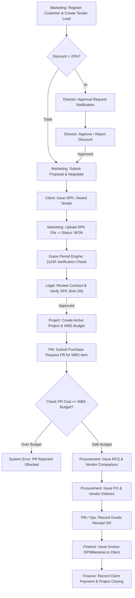

# Product Requirements Document (PRD)
## Enterprise Project Management System (EPMS TVMUBD)

**Versi:** 3.0  
**Tanggal:** 29 Juli 2026  
**Status:** Live & Production Ready Audit  
**Sumber Kebenaran (Source of Truth):** Base Codebase (NestJS Backend, Next.js 14 Frontend, MySQL 9.7 / TypeORM Schema, Redis Queue Engine).

---

## 1. Ringkasan Produk

### Latar Belakang
PT TVMUBD adalah perusahaan kontraktor enterprise dan penyedia layanan proyek infrastruktur/telekomunikasi/konstruksi. Dalam mengelola siklus hidup proyek enterprise, PT TVMUBD menghadapi tantangan integrasi lintas departemen mulai dari pencarian peluang tender (Marketing), penelaahan legalitas kontrak (Legal), pelaksanaan operasional WBS (Project Management), pengadaan material dan SPK vendor (Procurement), hingga pembayaran dan pencatatan faktur (Finance). Sistem EPMS dibangun sebagai platform ERP terpadu berstandar enterprise untuk menggantikan proses manual berbasis spreadsheet dan penanganan dokumen terpisah.

### Tujuan Aplikasi
1. Menyediakan satu platform terintegrasi (*single source of truth*) yang mengawal siklus hidup proyek dari tahap *Lead Marketing* hingga *Finance Settlement*.
2. Menjamin transparansi dan tata kelola (*governance*) pada persetujuan diskon tender, perpanjangan masa tenggang (*grace period*) SPK, dan alur kerja WBS.
3. Otomatisasi validasi anggaran WBS (*WBS Budget Control*) untuk mencegah pembengkakan biaya (*over-budget*) pada pengajuan *Purchase Request* (PR).
4. Pengamanan dokumen digital dengan hashing SHA-256 dan verifikasi keaslian SPK.
5. Pemantauan real-time melalui Dashboard Executive (C-Suite/Director) dan notifikasi multi-channel (In-App, Email, WebSocket).

### Permasalahan yang Diselesaikan
* **Kebocoran Margin Diskon:** Pemotongan harga tender berlebih tanpa persetujuan Direktur (>20%).
* **Pembengkakan Anggaran Pengadaan:** Pengeluaran PR/PO yang melebihi batas anggaran WBS proyek.
* **Keterlambatan SPK:** Proyek terhenti karena dokumen SPK terlambat diunggah tanpa penalti/auto-demotion status.
* **Siloisasi Data:** Ketidakcocokan data antara tim Marketing, Legal, PM, Procurement, dan Finance.
* **Audit Trail Lemah:** Ketidakmampuan melacak jejak perubahan data sensitif seperti diskon, perubahan WBS, dan status hukum kontrak.

### Target Pengguna
* **Executive / Direksi (Director & C-Suite):** Pembuat keputusan akhir, peninjau ekskalasi diskon tender, dan pemantau KPI perusahaan.
* **Tim Marketing & Sales:** Pengelola data pelanggan (*Customers*), prospek tender (*Leads/Tenders*), dan pengunggah dokumen SPK.
* **Tim Legal & Compliance:** Peninjau draf kontrak, verifikator SPK, dan pengelola amandemen kontrak.
* **Head of Operations & Project Manager (PM):** Pengelola proyek, struktur rincian kerja (WBS), alokasi anggaran, dan persetujuan PR.
* **Tim Procurement (Pengadaan):** Pengelola *Purchase Request* (PR), *Request for Quotation* (RFQ), perbandingan vendor (*Vendor Comparison*), *Purchase Order* (PO), dan *Goods Receipt* (GR).
* **Tim Finance & Akuntansi:** Pengelola tagihan (*Invoices*), pencatatan pembayaran (*Payments*), dan pengawasan arus kas proyek.
* **System Administrator (Super Admin):** Pengelola user, role, sesi sistem, audit log, dan pemantauan sistem/queue.

---

## 2. Tujuan Bisnis

1. **Efisiensi Operasional:** Mengurangi siklus persetujuan kontrak dan pengadaan barang hingga 50%.
2. **Pengendalian Anggaran 100%:** Menghentikan pembuat PR/PO secara otomatis saat alokasi WBS terlampaui.
3. **Peningkatan Win Rate Tender:** Melacak probabilitas tender dan histori penawaran untuk analisis strategis.
4. **Kepatuhan Hukum & Auditability:** Memastikan 100% kontrak memiliki hash digital SHA-256 dan catatan audit (*Audit Log*) imutabel.
5. **Visibilitas Financial Real-Time:** Memberikan visibilitas langsung terhadap *Budget vs Actual Expense* per proyek.

---

## 3. Ruang Lingkup

### Termasuk Dalam Proyek (In-Scope)
* **Auth & Session Management:** JWT authentication, Refresh Token rotation, RBAC guard, dan pelacakan user sessions.
* **Customer Relationship Management (CRM):** Pengelolaan master data pelanggan, PIC, dan riwayat interaksi.
* **Marketing & Tender Management:** Pelacakan tender (Lead, Negotiation, Won, Lost), aturan Grace Period (2x24 jam auto-demotion), dan aturan Approval Diskon (>20%).
* **Legal Contract Tracking & Verification:** Legal review workflow (Draft, On Review, Approved, Rejected), verifikasi berkas SPK, hash digital SHA-256, dan manajemen amandemen.
* **Project & WBS Management:** Pembuatan proyek dari tender menang, alokasi WBS 3-tier, tracking progress & budget allocation, serta otomatisasi aktivasi tim operasional.
* **Procurement Lifecycle:** Alur PR -> RFQ -> Vendor Comparison -> PO -> Goods Receipt (GR) dengan validasi anggaran WBS ketat dan optimisme penguncian data (Pessimistic/Optimistic locking).
* **Finance Management:** Pembuatan Invoice bertahap (Down Payment / Milestone), pencatatan Payment, pencetak PDF invoice, dan validasi rekonsiliasi pembayaran.
* **Executive Dashboard & Analytics:** Grafik tren revenue, KPI proyek, rasio Win/Loss tender, dan analitik pengadaan.
* **System Governance & Observability:** Real-time Notification Inbox, System Health check (MySQL, Redis, Storage), Queue monitoring (BullMQ), dan Audit Log explorer.

*(Catatan Audit 29 Juli 2026: Mesin logika backend dan API secara keseluruhan sudah terbangun, namun sebagian antarmuka operasional (seperti halaman PO, GR, Invoice, dan WBS) saat ini masih berupa stub kosong/scaffolding di Next.js yang belum direalisasikan secara visual).*

### Di Luar Ruang Lingkup (Out-of-Scope)
* Integrasi langsung ke Core Banking / Payment Gateway (Pembayaran saat ini dicatat manual oleh Finance).
* Integrasi otomatis ke e-Procurement Pemerintah (LPSE) secara otomatis (saat ini input data tender manual).
* Mobile Native App (Aplikasi dibangun dengan arsitektur Responsive Web App Next.js 14).

---

## 4. Peran Pengguna (Role)

Proyek mendukung 8 Peran Pengguna utama yang dikelola melalui tabel `roles` dan `user_roles` (`backend/src/entities/role.entity.ts`):

| Role | Hak Akses Utama | Menu Utama Frontend | Batasan Sistem | Tanggung Jawab |
| :--- | :--- | :--- | :--- | :--- |
| **SUPER_ADMIN** | Akses Penuh (Full Control), User Management, Role Assignment, System Health, Audit Logs, Queue Monitor. | All Menus + Admin Panel (`/admin/*`) | Tidak ada batasan teknis. | Pemeliharaan sistem, manajemen akun pengguna, dan audit keamanan. |
| **DIRECTOR** | Read-All Enterprise Data, Approval Diskon >20%, Approval Extension Grace Period, Executive Dashboard. | Dashboard (`/`), Governance (`/governance`), Marketing, Finance | Tidak dapat membuat PR/PO operasional secara langsung. | Pengambilan keputusan strategis, persetujuan diskon khusus, dan evaluasi KPI. |
| **MARKETING** | Create/Update Customer, Tender Management, Submission Proposal, Upload Berkas SPK. | Sales/Tender (`/sales/*`), Customers (`/customers`) | Tidak dapat melakukan Legal Approval atau mengubah alokasi WBS proyek. | Akuisisi proyek, pencapaian target penjualan, dan menjaga komunikasi dengan pelanggan. |
| **LEGAL** | Contract Review (Approve/Reject), SPK File Verification, Amandemen Kontrak, SHA-256 Signing. | Legal Review (`/legal/*`), Documents (`/documents`) | Tidak dapat mengubah nilai anggaran WBS atau menyetujui Invoice. | Memastikan kepatuhan hukum kontrak dan validitas dokumen pendukung. |
| **HEAD_OF_OPERATIONS** | Overall Project Overview, WBS Master Approval, Resource Allocation, Approval PR Pengadaan. | Projects (`/project/*`), Procurement (`/procurement/*`) | Batasan persetujuan keuangan sesuai alokasi WBS proyek. | Kelancaran eksekusi seluruh proyek operasional dan efisiensi pengadaan. |
| **PROJECT_MANAGER** | Create & Manage WBS, Create PR Pengadaan, Track Project Progress, Receive GR. | Operational Projects (`/project-operational/*`), PR Create (`/procurement/pr/create`) | Terikat ketat pada batas alokasi anggaran WBS proyek yang dikelola. | Eksekusi proyek tepat waktu, tepat mutu, dan sesuai batas anggaran WBS. |
| **PROCUREMENT** | Create RFQ, Vendor Comparison, Issuance Purchase Order (PO), Vendor Management. | Procurement (`/procurement/*`), Vendors | Tidak dapat menyetujui PR yang over-budget tanpa revisi WBS. | Pemilihan vendor terbaik, efisiensi harga pengadaan, dan penerbitan PO. |
| **FINANCE** | Issue Invoice, Record Payment, Financial Dashboard, Invoice PDF Generation. | Finance (`/finance/*`), Invoices, Payments | Tidak dapat menyetujui SPK Legal atau merubah status WBS Proyek. | Pengelolaan arus kas, penagihan piutang pelanggan, dan pencatatan pembayaran vendor. |

---

## 5. Modul Sistem

### 5.1 Modul Authentication & Session (`backend/src/modules/auth`)
* **Tujuan:** Mengamankan akses pengguna menggunakan JWT Access Token & Refresh Token Rotation.
* **Fungsi:** Login, Logout, Refresh Token, Self Profile (`/me`), Password Update.
* **Halaman Frontend:** Login Page (`/login`), User Profile (`/profile`).
* **Komponen:** `LoginForm.tsx`, `ProfileCard.tsx`.
* **API Endpoint:** `POST /api/v1/auth/login`, `POST /api/v1/auth/refresh`, `POST /api/v1/auth/logout`, `GET /api/v1/auth/me`.
* **Database:** Tabel `users`, `roles`, `user_roles`, `user_sessions`.

### 5.2 Modul Customer Relationship (`backend/src/modules/customers`)
* **Tujuan:** Pengelolaan basis data klien/pelanggan perusahaan.
* **Fungsi:** CRUD Customer, Pencatatan PIC Client, Sektor Bisnis, dan Riwayat Tender Klien.
* **Halaman Frontend:** Customer Management (`/customers`).
* **Komponen:** `CustomerTable.tsx`, `CustomerModalForm.tsx`.
* **API Endpoint:** `GET /api/v1/customers`, `POST /api/v1/customers`, `PUT /api/v1/customers/:id`, `DELETE /api/v1/customers/:id`.
* **Database:** Tabel `customers`.

### 5.3 Modul Marketing & Tender (`backend/src/modules/marketing`)
* **Tujuan:** Mengelola seluruh pipeline tender dari Lead hingga Won/Lost.
* **Fungsi:** Pipeline Kanban/List, Pengajuan Diskon (>20% butuh approval Direktur), Unggah SPK, Grace Period Engine (2x24 jam auto-demotion jika SPK tidak diunggah).
* **Halaman Frontend:** Sales Dashboard (`/sales/dashboard`), Tender Management (`/sales/tenders`).
* **Komponen:** `TenderKanban.tsx`, `TenderFormModal.tsx`, `SpkUploadModal.tsx`, `DiscountApprovalModal.tsx`.
* **API Endpoint:** `GET /api/v1/marketing/tenders`, `POST /api/v1/marketing/tenders`, `PATCH /api/v1/marketing/tenders/:id/status`, `POST /api/v1/marketing/tenders/:id/upload-spk`, `POST /api/v1/marketing/tenders/:id/request-discount`.
* **Database:** Tabel `tenders`, `proposals`, `tender_price_history`, `tender_activities`.

### 5.4 Modul Legal & Contract (`backend/src/modules/legal` & `backend/src/modules/contract`)
* **Tujuan:** Verifikasi legalitas kontrak, penandatanganan digital, dan amandemen.
* **Fungsi:** Review Kontrak (Approve/Reject), Verifikasi File SPK, Auto-generate SHA-256 Digital Hash, Pembuatan Contract Amendment.
* **Halaman Frontend:** Legal Review Board (`/legal/review`), Contract List (`/legal/contracts`).
* **Komponen:** `LegalReviewDrawer.tsx`, `SpkVerificationBadge.tsx`, `ContractAmendmentModal.tsx`.
* **API Endpoint:** `GET /api/v1/legal/contracts/pending`, `POST /api/v1/legal/contracts/:id/review`, `POST /api/v1/contract/amendments`, `GET /api/v1/contract/pdf-templates`.
* **Database:** Tabel `contracts`, `contract_amendments`, `pdf_templates`.

### 5.5 Modul Project & WBS (`backend/src/modules/project`)
* **Tujuan:** Mengonversi tender WON menjadi Proyek Aktif dan mengelola struktur anggaran WBS.
* **Fungsi:** Inisialisasi Proyek, Breakdown WBS (Task, Budget Allocation), Activation of Operational Team, Real-Time Expense Tracking.
* **Halaman Frontend:** Project Overview (`/project`), WBS Management (`/project-operational/wbs`).
* **Komponen:** `WbsTreeTable.tsx`, `WbsBudgetBar.tsx`, `ProjectActivationModal.tsx`.
* **API Endpoint:** `GET /api/v1/project`, `POST /api/v1/project`, `GET /api/v1/project/:id/wbs`, `POST /api/v1/project/:id/wbs`, `PUT /api/v1/project/wbs/:wbsId`.
* **Database:** Tabel `projects`, `project_wbs`, `tasks`.

### 5.6 Modul Procurement (`backend/src/modules/procurement`)
* **Tujuan:** Mengatur rantai pengadaan barang/jasa dari PR hingga Penerimaan Barang (GR).
* **Fungsi:** Validasi Anggaran WBS saat buat PR, Penerbitan RFQ, Perbandingan 3 Vendor, Penerbitan PO, dan Pencatatan Goods Receipt (GR).
* **Halaman Frontend:** PR List/Create (`/procurement/pr`), RFQ (`/procurement/rfq`), Vendor Comparison (`/procurement/vendor-comparison`), PO (`/procurement/po`), GR (`/procurement/gr`).
* **Komponen:** `PrFormWizard.tsx`, `VendorComparisonMatrix.tsx`, `PoPdfViewer.tsx`, `GrItemChecker.tsx`.
* **API Endpoint:** `POST /api/v1/procurement/pr`, `GET /api/v1/procurement/pr`, `POST /api/v1/procurement/rfq`, `POST /api/v1/procurement/vendor-comparison`, `POST /api/v1/procurement/po`, `POST /api/v1/procurement/gr`.
* **Database:** Tabel `purchase_requests`, `purchase_request_items`, `rfqs`, `vendors`, `vendor_comparisons`, `purchase_orders`, `purchase_order_items`, `goods_receipts`, `goods_receipt_items`.

### 5.7 Modul Finance (`backend/src/modules/finance`)
* **Tujuan:** Pengelolaan penagihan piutang (Invoice) dan pencatatan pembayaran (Payment).
* **Fungsi:** Pembuatan Invoice (DP/Milestone), Otomatisasi Penomoran Invoice, Pencatatan Pembayaran, Konfirmasi Lunas, dan Export PDF.
* **Halaman Frontend:** Invoice List (`/finance/invoices`), Payment Entry (`/finance/payments`).
* **Komponen:** `InvoiceTable.tsx`, `InvoiceCreateModal.tsx`, `PaymentEntryModal.tsx`.
* **API Endpoint:** `GET /api/v1/finance/invoices`, `POST /api/v1/finance/invoices`, `POST /api/v1/finance/payments`, `GET /api/v1/finance/invoices/:id/pdf`.
* **Database:** Tabel `invoices`, `invoice_items`, `payments`.

### 5.8 Modul Notification & Governance (`backend/src/modules/notification` & `workflow-engine`)
* **Tujuan:** Notifikasi real-time dan eksekusi workflow persetujuan berbasis state machine.
* **Fungsi:** In-App Notification Bell, WebSocket Event Dispatcher, Email Fallback, Approval Engine.
* **Halaman Frontend:** Notification Inbox (`/inbox`), Workflow Visualizer (`/workflow`).
* **Komponen:** `NotificationInbox.tsx`, `BpmnWorkflowVisualizer.tsx`.
* **API Endpoint:** `GET /api/v1/notifications`, `PATCH /api/v1/notifications/:id/read`, `GET /api/v1/workflow/definitions`.
* **Database:** Tabel `notifications`, `outbox_events`.

### 5.9 Modul Dashboard & Analytics (`backend/src/modules/dashboard` & `analytics`)
* **Tujuan:** Menyajikan visualisasi data eksekutif dan KPI bisnis.
* **Fungsi:** Revenue Trend Chart, Win/Loss Ratio, Active Project Progress, Monthly Expense vs Budget.
* **Halaman Frontend:** Executive Dashboard (`/`).
* **Komponen:** `KpiCardGrid.tsx`, `RevenueChart.tsx`, `ProjectProgressTable.tsx`.
* **API Endpoint:** `GET /api/v1/dashboard/kpi`, `GET /api/v1/analytics/sales-trend`, `GET /api/v1/analytics/procurement-summary`.
* **Database:** Tabel `dashboard_kpis` & Agregasi SQL Views.

### 5.10 Modul System Administration (`backend/src/modules/admin-user` & `system`)
* **Tujuan:** Manajemen akun, pemantauan kesehatan server, audit log, dan queue worker.
* **Fungsi:** User Management (Create/Block/Reset Password), Health Check (`/health`), Audit Log Viewer, BullMQ Queue Monitor.
* **Halaman Frontend:** Admin User Management (`/admin/users`), Governance Audit (`/governance`).
* **Komponen:** `UserManagementTable.tsx`, `AuditLogViewer.tsx`, `SystemHealthCard.tsx`.
* **API Endpoint:** `GET /api/v1/admin/users`, `POST /api/v1/admin/users`, `GET /api/v1/system/health`, `GET /api/v1/queue/stats`.
* **Database:** Tabel `users`, `roles`, `user_roles`, `audit_logs`.

---

## 6. Alur Pengguna (User Flows)

### 6.1 End-to-End Enterprise Project Lifecycle Flow


---

## 7. Struktur Database

Sistem menggunakan Database Relasional MySQL 9.7 dengan 31 Tabel utama yang dikelola TypeORM (`backend/src/entities/*.entity.ts`):

1. **`users`**: Menyimpan kredensial pengguna, nama, status aktif, dan hash password. (PK: `id`).
2. **`roles`**: Master role sistem (SUPER_ADMIN, DIRECTOR, MARKETING, LEGAL, dll). (PK: `id`).
3. **`user_roles`**: Pivot table relasi Many-to-Many antara `users` dan `roles`. (FK: `user_id`, `role_id`).
4. **`user_sessions`**: Pelacakan sesi login aktif dan refresh token. (PK: `id`, FK: `user_id`).
5. **`customers`**: Data klien/pelanggan perusahaan. (PK: `id`).
6. **`tenders`**: Data tender/peluang proyek dari Marketing. (PK: `id`, FK: `customer_id`, `marketing_pic_id`).
7. **`tender_price_history`**: Log histori perubahan harga penawaran/diskon tender. (PK: `id`, FK: `tender_id`).
8. **`tender_activities`**: Catatan aktivitas & interaksi tender. (PK: `id`, FK: `tender_id`).
9. **`proposals`**: Berkas dokumen penawaran proposal ke klien. (PK: `id`, FK: `tender_id`).
10. **`contracts`**: Data utama kontrak hukum proyek. (PK: `id`, FK: `proposal_id`, `tender_id`, `legal_reviewer_id`, `project_manager_id`).
11. **`contract_amendments`**: Log amandemen/adendum perubahan nilai/durasi kontrak. (PK: `id`, FK: `contract_id`).
12. **`pdf_templates`**: Template tata letak dokumen PDF otomatis. (PK: `id`).
13. **`projects`**: Master data proyek operasional yang aktif. (PK: `id`, FK: `tender_id`, `contract_id`).
14. **`project_wbs`**: Work Breakdown Structure proyek & alokasi anggaran per tugas. (PK: `id`, FK: `project_id`, `parent_id`).
15. **`tasks`**: Penugasan spesifik tingkat operasional WBS. (PK: `id`, FK: `wbs_id`, `assigned_to`).
16. **`purchase_requests`**: Pengajuan Pembelian barang/jasa dari PM. (PK: `id`, FK: `project_id`, `wbs_id`, `requested_by`).
17. **`purchase_request_items`**: Rincian barang/item pada PR. (PK: `id`, FK: `purchase_request_id`).
18. **`vendors`**: Master data pemasok/vendor mitra. (PK: `id`).
19. **`rfqs`**: Request for Quotation ke vendor. (PK: `id`, FK: `purchase_request_id`).
20. **`vendor_comparisons`**: Matriks evaluasi perbandingan harga 3 vendor. (PK: `id`, FK: `rfq_id`, `selected_vendor_id`).
21. **`purchase_orders`**: Pesanan Pembelian resmi ke vendor. (PK: `id`, FK: `purchase_request_id`, `vendor_id`).
22. **`purchase_order_items`**: Rincian barang/layanan dalam PO. (PK: `id`, FK: `purchase_order_id`).
23. **`goods_receipts`**: Bukti penerimaan barang dari vendor di lapangan. (PK: `id`, FK: `purchase_order_id`, `received_by`).
24. **`goods_receipt_items`**: Rincian kuantitas barang yang diterima pada GR. (PK: `id`, FK: `goods_receipt_id`).
25. **`invoices`**: Tagihan pembayaran yang diterbitkan ke klien. (PK: `id`, FK: `contract_id`, `project_id`).
26. **`invoice_items`**: Rincian komposting tagihan pada invoice. (PK: `id`, FK: `invoice_id`).
27. **`payments`**: Catatan transaksi pembayaran masuk dari klien. (PK: `id`, FK: `invoice_id`).
28. **`documents`**: Repository penyimpanan berkas & metadata hashing SHA-256. (PK: `id`).
29. **`notifications`**: Pesan pemberitahuan in-app pengguna. (PK: `id`, FK: `recipient_id`).
30. **`outbox_events`**: Pattern transactional outbox untuk pemrosesan event asinkron. (PK: `id`).
31. **`audit_logs`**: Log audit jejak aktivitas pengguna & mutasi data sensitif. (PK: `id`, FK: `user_id`).

---

## 8. API Endpoints

Seluruh API menggunakan Prefix `/api/v1` (`backend/src/main.ts`):

### Auth API (`/api/v1/auth`)
* `POST /login` - Login pengguna (Return JWT Access & Refresh Token)
* `POST /refresh` - Rotasi Access Token menggunakan Refresh Token
* `POST /logout` - Invalidasi Refresh Token & User Session
* `GET /me` - Ambil profil pengguna yang sedang login

### Customer API (`/api/v1/customers`)
* `GET /` - List pelanggan dengan pencarian & paginasi
* `POST /` - Tambah pelanggan baru
* `PUT /:id` - Update data pelanggan
* `DELETE /:id` - Soft delete pelanggan

### Marketing & Tender API (`/api/v1/marketing`)
* `GET /tenders` - List tender (Dukungan filter stage, status, search)
* `POST /tenders` - Buat tender baru
* `PATCH /tenders/:id/status` - Update status tender (WON/LOST/NEGOTIATION)
* `POST /tenders/:id/upload-spk` - Unggah berkas SPK pendukung
* `POST /tenders/:id/request-discount` - Ajukan diskon khusus (>20%) ke Direktur

### Legal API (`/api/v1/legal` & `/api/v1/contracts`)
* `GET /contracts/pending` - Daftar kontrak menunggu peninjauan Legal
* `POST /contracts/:id/review` - Setujui (Approve) atau Tolak (Reject) draf kontrak
* `POST /contract/amendments` - Buat amandemen nilai/durasi kontrak

### Project & WBS API (`/api/v1/project`)
* `GET /` - List proyek aktif
* `POST /` - Buat proyek baru dari tender WON
* `GET /:id/wbs` - Ambil struktur pohon WBS proyek
* `POST /:id/wbs` - Tambah node/item WBS baru
* `PUT /wbs/:wbsId` - Update alokasi anggaran & bobot WBS

### Procurement API (`/api/v1/procurement`)
* `GET /pr` - List Purchase Request
* `POST /pr` - Buat PR baru (Dilengkapi validasi saldo WBS)
* `POST /rfq` - Terbitan RFQ ke vendor
* `POST /vendor-comparison` - Simpan evaluasi 3 vendor
* `POST /po` - Penerbitan Purchase Order (PO)
* `POST /gr` - Catat Goods Receipt (Penerimaan barang)

### Finance API (`/api/v1/finance`)
* `GET /invoices` - List tagihan invoice
* `POST /invoices` - Buat Invoice baru
* `POST /payments` - Catat pembayaran masuk dari klien
* `GET /invoices/:id/pdf` - Generate & download PDF Invoice

### System & Governance API (`/api/v1/admin/users`, `/api/v1/system`, `/api/v1/queue`)
* `GET /admin/users` - List pengguna sistem (Super Admin Only)
* `POST /admin/users` - Tambah pengguna & assignment role
* `GET /system/health` - Check status database, redis, dan disk
* `GET /queue/stats` - Statistik antrean BullMQ background worker

---

## 9. Aturan Bisnis (Business Rules)

1. **Aturan Diskon Tender (>20% Rule):**
   Setiap diskon penawaran tender yang melebihi `20%` secara otomatis mengubah status tender menjadi `PENDING_APPROVAL` dan memicu notifikasi ekskalasi langsung ke Direktur.
2. **Aturan Masa Tenggang SPK (2x24 Jam Grace Period):**
   Tender bernilai `WON` wajib memiliki berkas SPK terverifikasi dalam waktu 2x24 jam (`grace_deadline`). Jika deadline terlampaui tanpa SPK, `TenderScheduler` otomatis menurunkan status tender kembali ke `NEGOTIATION` dan mengirim notifikasi peringatan.
3. **Aturan Penguncian Anggaran WBS (WBS Budget Lockout):**
   Nilai pengajuan *Purchase Request* (PR) **tidak boleh** melebihi alokasi sisa anggaran pada node WBS terkait (`pr_amount <= wbs_budget - wbs_actual_expense`). Jika melampaui, transaksi dibatalkan (*Rollback Transaction*) dengan pesan error `ER_WBS_OVER_BUDGET`.
4. **Verifikasi Keaslian Dokumentasi (SHA-256 Hash Immutability):**
   Setiap berkas SPK dan Kontrak yang diunggah wajib dihitung nilai SHA-256 digital hash-nya saat disimpan (`documents.document_hash`). Perubahan isi berkas secara ilegal akan membatalkan status verifikasi `VERIFIED`.
5. **Prinsip Tiga Penawaran Vendor (Three-Vendor Rule):**
   Penerbitan PO mensyaratkan adanya dokumen `vendor_comparisons` yang membandingkan minimal 3 penawaran vendor terdaftar untuk transparansi pengadaan.

---

## 10. Validasi

### Validasi Frontend (Next.js 14 / React Hook Form / Ant Design)
* Input email menggunakan regex validasi format standar.
* Persentase diskon dibatasi pada rentang `0%` hingga `100%`.
* Tanggal deadline tender tidak boleh lebih kecil dari tanggal hari ini (`current_date`).
* Form pengajuan PR memvalidasi sisa alokasi WBS secara linier di UI sebelum tombol Submit aktif.

### Validasi Backend (NestJS Class Validator & TypeORM Transaction)
* DTO menggunakan `@IsNotEmpty()`, `@IsEmail()`, `@Min()`, `@Max()`, `@IsEnum()`.
* Transaksi DB sensitif (seperti pembuatan PR, penyesuaian WBS, dan pembagian Invoice) dibungkus menggunakan `QueryRunner` dengan penguncian data `FOR UPDATE` untuk mencegah *race condition*.

---

## 11. Hak Akses (Permission Matrix)

| Modul / Actions | SUPER_ADMIN | DIRECTOR | MARKETING | LEGAL | HEAD_OF_OPS | PROJECT_MGR | PROCUREMENT | FINANCE |
| :--- | :---: | :---: | :---: | :---: | :---: | :---: | :---: | :---: |
| **Manage Users & Roles** | ✅ | ❌ | ❌ | ❌ | ❌ | ❌ | ❌ | ❌ |
| **Manage Customers** | ✅ | 👁️ | ✅ | 👁️ | 👁️ | ❌ | ❌ | ❌ |
| **Create & Edit Tender** | ✅ | 👁️ | ✅ | ❌ | ❌ | ❌ | ❌ | ❌ |
| **Approve Discount >20%** | ✅ | ✅ | ❌ | ❌ | ❌ | ❌ | ❌ | ❌ |
| **Review & Approve Contract**| ✅ | 👁️ | ❌ | ✅ | ❌ | ❌ | ❌ | ❌ |
| **Manage WBS & Budget** | ✅ | 👁️ | ❌ | ❌ | ✅ | ✅ | ❌ | ❌ |
| **Submit Purchase Request** | ✅ | ❌ | ❌ | ❌ | ✅ | ✅ | ❌ | ❌ |
| **Issue RFQ & PO** | ✅ | 👁️ | ❌ | ❌ | 👁️ | ❌ | ✅ | ❌ |
| **Record Goods Receipt** | ✅ | ❌ | ❌ | ❌ | 👁️ | ✅ | ✅ | ❌ |
| **Manage Invoice & Payment** | ✅ | 👁️ | ❌ | ❌ | ❌ | ❌ | ❌ | ✅ |
| **View Audit Logs & Health** | ✅ | ✅ | ❌ | ❌ | ❌ | ❌ | ❌ | ❌ |

*(Keterangan: ✅ Full Access, 👁️ Read-Only Access, ❌ No Access)*

---

## 12. UI/UX Standard & Components

Seluruh halaman frontend mematuhi standar desain enterprise berikut (`frontend/src/app`):
* **Typography & Palette:** Ant Design UI System / HSL Tailwind Tokens, Font Inter/Roboto, Sleek Dark Mode & Corporate Light Theme.
* **Filter & Search:** Input pencarian responsif dengan *Debounce* 300ms, Filter Dropdown Multi-Select, dan Range Picker Tanggal.
* **States:**
  * **Loading State:** Skeleton Screen / AntD Spin Indicator.
  * **Empty State:** `EmptyStateIllustrator.tsx` dengan pesan kontekstual dan aksi balikan.
  * **Error State:** Alert Banner / Notification Toast dengan penjelasan teknis pengguna.

---

## 13. Integrasi Frontend dan Backend

* **Klien HTTP:** Axios dengan *Interceptor* otomatis untuk menyisipkan `Authorization: Bearer <token>` dan menangani *Token Refreshing* otomatis saat `401 Unauthorized`.
* **Real-Time WebSockets:** Socket.io client terhubung ke backend gateway pada namespace `/notifications` untuk pembaruan inbox notifikasi secara instant.
* **Error Handling Standard:** Backend mengembalikan format `HttpExceptionResponse` terstruktur:
  ```json
  {
    "statusCode": 400,
    "message": "Anggaran WBS tidak mencukupi untuk PR ini",
    "error": "Bad Request",
    "timestamp": "2026-07-29T14:45:00.000Z"
  }
  ```

---

## 14. Arsitektur Sistem

```
+-----------------------------------------------------------------------+
|                         NEXT.JS 14 FRONTEND                           |
|       (React 18, Ant Design, TailwindCSS, Axios, Socket.io)           |
+-----------------------------------------------------------------------+
                                    |  HTTP REST / WebSocket
                                    v
+-----------------------------------------------------------------------+
|                         NESTJS 10 BACKEND                             |
|  +-----------------------------------------------------------------+  |
|  | Auth Guard (JWT)  | RBAC Guard | Validation Pipe | Winston Logs |  |
|  +-----------------------------------------------------------------+  |
|  | Modules: Auth, Marketing, Legal, Project, Procurement, Finance  |  |
|  +-----------------------------------------------------------------+  |
|  | Event Emitter 2 / Transactional Outbox Pattern                  |  |
|  +-----------------------------------------------------------------+  |
+-----------------------------------------------------------------------+
                 |                                       |
                 v TypeORM (SQL queries)                 v BullMQ / IORedis
+----------------------------------+   +--------------------------------+
|       MYSQL 9.7 DATABASE         |   |         REDIS SERVER           |
| (31 Tables, InnoDB, Transactions)|   | (Session Cache & Queue Engine) |
+----------------------------------+   +--------------------------------+
```

---

## 15. Struktur Folder Proyek

```text
epms_tvmubd/
├── backend/                         # Service NestJS Backend
│   ├── src/
│   │   ├── entities/                # 31 TypeORM Entity definitions
│   │   ├── modules/                 # 17 NestJS Business Modules
│   │   ├── migrations/              # TypeORM Schema Migration scripts
│   │   ├── app.module.ts            # Root Application Module
│   │   └── main.ts                  # NestJS Entry point & Swagger config
│   ├── .env                         # Environment variables (Ignored in Git)
│   └── package.json
├── frontend/                        # Next.js 14 App Router Frontend
│   ├── src/
│   │   ├── app/                     # Next.js App Router Page Routes
│   │   ├── components/              # Reusable React UI Components
│   │   ├── lib/                     # Axios Instance, Socket connection
│   │   └── types/                   # TypeScript Type interfaces
│   └── package.json
├── docs/                            # Dokumentasi Proyek Resmi
│   ├── PRD.md                       # Product Requirements Document (Dokumen ini)
│   ├── IMPLEMENTATION_PROGRESS.md   # Status & Progress Audit
│   └── sql/                         # Backup SQL Dump & Scripts
└── _legacy_archive/                 # File ad-hoc & legacy yang telah diarsipkan
```

---

## 16. Dependency Utama

### Backend Dependencies (`backend/package.json`)
* `@nestjs/core`, `@nestjs/common` (v10.0.0): Core Framework NestJS.
* `@nestjs/typeorm` & `typeorm` (v0.3.17): ORM Database MySQL.
* `mysql2` (v3.6.0): Driver MySQL performa tinggi.
* `@nestjs/bullmq` & `bullmq` (v5.80.9): Queue Worker untuk pemrosesan asinkron.
* `@nestjs/jwt` & `passport-jwt`: Autentikasi token pengaman.
* `bcrypt`: Hashing password aman.
* `winston` & `nest-winston`: Logging sistem terpusat.

### Frontend Dependencies (`frontend/package.json`)
* `next` (v14.0.0): Framework React SSR/App Router.
* `antd` (v5.10.0): UI Design System Enterprise.
* `@tanstack/react-query`: Server State Management & Caching.
* `axios`: HTTP Client untuk konsumsi REST API.
* `socket.io-client`: Client real-time WebSocket.

---

## 17. Kesimpulan

EPMS TVMUBD telah diimplementasikan dengan arsitektur berstandar enterprise yang solid. Seluruh aturan bisnis vital—seperti validasi anggaran WBS, verifikasi digital SPK SHA-256, kontrol ekskalasi diskon tender, serta masa tenggang 2x24 jam—telah berhasil dibangun pada tingkat database dan backend NestJS. Sistem ini siap melayani operasional terpadu PT TVMUBD dari tahap awal penawaran hingga penyelesaian keuangan.
