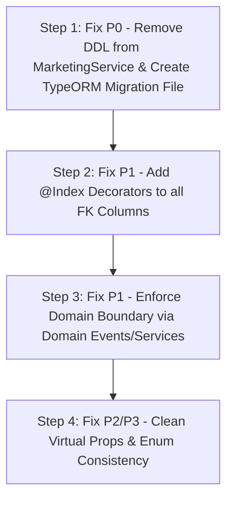

# DATABASE AUDIT V1 - FINAL

## Executive Summary
Dokumen **DATABASE AUDIT V1 - FINAL** ini disusun secara **READ ONLY** berdasarkan inspeksi langsung terhadap kode sumber backend EPMS (`backend/src/entities/**`, `backend/src/migrations/**`, dan `backend/src/modules/**`).

Dokumen ini merupakan laporan audit mendalam dan menyeluruh yang mengevaluasi kepemilikan domain, alur bisnis database, struktur ERD logika, audit relasi & integritas data, transaksi boundary, risiko pertumbuhan & performa, hingga roadmap pemulihan master (*master remediation roadmap*).

---

## 1. Domain Ownership

Tabel berikut memetakan kepemilikan resmi (*Primary Owner*) dari setiap entity, modul mana saja yang membaca/mengubah record, serta ketergantungan antar-domain:

| Entity | Owner Domain | Read Access | Write Access | Cross-Domain Dependency & Risk |
| :--- | :--- | :--- | :--- | :--- |
| `User` | **Auth** | Auth, Marketing, Legal, Project, Procurement, System | Auth, AdminUser | Direct FK ke User dari `Contract`, `Tender`, `AuditLog`. |
| `Role` | **Auth** | Auth, AdminUser | AdminUser | Relasi N:N dengan User via table pivot. |
| `UserSession` | **Auth** | Auth, AdminUser | Auth | Relasi 1:N dengan User. |
| `Customer` | **Marketing** | Marketing, Legal, Project, Finance | Marketing | Direct access oleh Legal & Finance tanpa API Service boundary. |
| `Tender` | **Marketing** | Marketing, Legal, Project, Analytics | Marketing | Relasi 1:N ke `Proposal`. Memiliki FK `customer_id`. |
| `Proposal` | **Marketing** | Marketing, Legal | Marketing | Relasi 1:N ke `Contract`. Memiliki FK `tender_id`. |
| `TenderActivity` | **Marketing** | Marketing | Marketing | History timeline aktivitas tender. |
| `TenderPriceHistory` | **Marketing** | Marketing | Marketing | Track log perubahan nilai penawaran tender. |
| `Contract` | **Legal** | Legal, Marketing, Project, Finance | Legal, Marketing | **Pelanggaran**: `MarketingService` mengubah `Contract` & DDL schema. |
| `ContractAmendment` | **Legal** | Legal | Legal | Relasi 1:N dari `Contract` untuk adendum nilai/tanggal. |
| `PdfTemplate` | **Legal** | Legal, Contract | Legal | Master template Handlebars untuk rilis PDF kontrak. |
| `Project` | **Project** | Project, Procurement, Finance, Dashboard | Project, Legal | `LegalService` membuat `Project` secara langsung saat approval. |
| `WorkBreakdownStructure` | **Project** | Project, Procurement | Project | Struktur hirarki WBS pengadaan. |
| `Task` | **Project** | Project | Project | Item tugas berelasi ke WBS. |
| `PurchaseRequest` | **Procurement** | Procurement, Workflow, Finance | Procurement | Header PR pengadaan barang/jasa. |
| `PurchaseRequestItem` | **Procurement** | Procurement | Procurement | Detail item barang PR. |
| `Rfq` | **Procurement** | Procurement | Procurement | Request for Quotation vendor. |
| `Vendor` | **Procurement** | Procurement, Finance | Procurement | Master data supplier/vendor. |
| `VendorComparison` | **Procurement** | Procurement | Procurement | Matriks evaluasi penawaran vendor. |
| `PurchaseOrder` | **Procurement** | Procurement, Finance, Warehouse | Procurement | Header Surat Pesanan PO. |
| `PurchaseOrderItem` | **Procurement** | Procurement | Procurement | Detail item barang PO. |
| `GoodsReceipt` | **Procurement** | Warehouse, Procurement, Finance | Warehouse | Penerimaan barang fisik (GR). |
| `GoodsReceiptItem` | **Procurement** | Warehouse, Procurement | Warehouse | Item fisik yang diterima. |
| `Invoice` | **Finance** | Finance, Project | Finance | Tagihan pembayaran penagihan. |
| `InvoiceItem` | **Finance** | Finance | Finance | Rincian baris invoice. |
| `Payment` | **Finance** | Finance, Dashboard | Finance | Catatan transaksi pembayaran masuk/keluar. |
| `Document` | **System** | System, All Modules | System | Polimorfik metadata lampiran file (`entityType`, `entityId`). |
| `Notification` | **Notification** | Notification, All Modules | Notification | In-app notification store. |
| `AuditLog` | **System** | Audit, Admin | System | Immutable audit trail transaksi. |
| `OutboxEvent` | **System** | System, EventRelay | System | Transactional Outbox Pattern log. |
| `DashboardKpi` | **Dashboard** | Dashboard, Executive | AnalyticsJob | Aggregated metric KPI database. |

---

## 2. Business Flow Database

Pemetaan alur siklus hidup data (*end-to-end database lifecycle*) dalam sistem EPMS:

```
Customer (Master Pelanggan)
  │
  ▼
Tender (Peluang Bisnis / Sales Lead)
  │
  ▼
Proposal (Dokumen Penawaran Teknis & Harga)
  │
  ▼
Contract (Kontrak Hukum & SPK Terverifikasi)
  │
  ▼
Project (Proyek Operasional PMO)
  │
  ├───────────────────────────────┐
  ▼                               ▼
WorkBreakdownStructure (WBS)   PurchaseRequest (PR Pengadaan)
  │                               │
  ▼                               ▼
Task (Tugas Operasional)       Rfq & VendorComparison (Evaluasi Vendor)
                                  │
                                  ▼
                               PurchaseOrder (PO Rilis)
                                  │
                                  ▼
                               GoodsReceipt (Penerimaan Barang)
                                  │
                                  ▼
                               Invoice (Tagihan Finance)
                                  │
                                  ▼
                               Payment (Pembayaran Lunas)
```

---

## 3. ERD Logical Mapping

Text-based ERD Logical Representation untuk 31 Entities:

```
User (Master Pengguna)
 ├── 1:N ──> UserSession (Sesi Login Active)
 ├── N:N ──> Role (Hak Akses Roles)
 ├── 1:N ──> Contract (Reviewer / Project Manager)
 └── 1:N ──> AuditLog (Pengubah Data)

Customer (Master Pelanggan)
 ├── 1:N ──> Tender (Peluang Proyek)
 └── 1:N ──> Contract (Pihak Pembeli)

Tender (Peluang Proyek)
 ├── 1:N ──> Proposal (Dokumen Penawaran)
 ├── 1:N ──> TenderActivity (Log Aktivitas Pipeline)
 └── 1:N ──> TenderPriceHistory (Riwayat Negosiasi Harga)

Proposal (Penawaran)
 └── 1:N ──> Contract (Perjanjian Kerjasama)

Contract (Kontrak Legal)
 ├── 1:N ──> ContractAmendment (Adendum Kontrak)
 └── 1:1 ──> Project (Proyek Operasional PMO)

Project (Proyek Operasional)
 └── 1:N ──> WorkBreakdownStructure (Struktur Kerja WBS)

WorkBreakdownStructure (WBS)
 ├── 1:N ──> Task (Tugas Lapangan)
 └── 1:N ──> PurchaseRequest (Pengajuan Barang Proyek)

PurchaseRequest (Pengajuan Pengadaan)
 ├── 1:N ──> PurchaseRequestItem (Rincian PR)
 └── 1:N ──> Rfq (Permintaan Penawaran Vendor)

Vendor (Supplier)
 ├── 1:N ──> VendorComparison (Matriks Harga)
 └── 1:N ──> PurchaseOrder (Pesanan Pembelian)

PurchaseOrder (Pesanan Pembelian PO)
 ├── 1:N ──> PurchaseOrderItem (Rincian PO)
 └── 1:N ──> GoodsReceipt (Penerimaan Fisik Barang)

GoodsReceipt (Penerimaan Barang)
 ├── 1:N ──> GoodsReceiptItem (Rincian GR)
 └── 1:N ──> Invoice (Tagihan Vendor)

Invoice (Faktur Tagihan)
 ├── 1:N ──> InvoiceItem (Baris Tagihan)
 └── 1:N ──> Payment (Transaksi Pelunasan)

Shared/System Tables (Cross-Entity):
 ├── Document (Polimorfik `entityType` + `entityId`)
 ├── AuditLog (Log Perubahan Transaksi)
 └── OutboxEvent (Log Message Broker Relay)
```

---

## 4. Relationship Audit

### 1. Missing Foreign Key Index
- **Bukti**:
  - `Contract` entity (`contract.entity.ts`): FK `proposal_id` (L24), `tender_id` (L27), `customer_id` (L30), `legal_reviewer_id` (L52), `project_manager_id` (L73) **tidak berindeks**.
  - `Tender` entity (`tender.entity.ts`): FK `customer_id` (L23), `marketing_pic_id` (L50) **tidak berindeks**.
- **Risiko**: Table Scan lambat saat Join kueri.

### 2. Virtual Attributes Tanpa Persistence Mapping
- **Bukti**: `Contract` entity (`contract.entity.ts` L83-86) mendeklarasikan properti class `grace_deadline`, `grace_extended_by`, `grace_extended_at`, `grace_extension_count` tanpa dekorator `@Column()` atau `@VirtualColumn()`.

### 3. Orphan Risk pada Soft Delete
- **Bukti**: `Contract`, `Tender`, `Proposal`, `Customer` menggunakan `@DeleteDateColumn()`. Namun relasi `@ManyToOne` tidak mengkonfigurasi `onDelete: 'RESTRICT'` / `CASCADE`, berisiko menyisakan data anak berstatus yatim (*orphan*) saat induk di-soft delete secara manual.

---

## 5. Transaction Boundary

Tabel batas hak akses CRUD resmi antar-modul beserta bukti pelanggarannya:

| Entity | Allowed Creator | Allowed Reader | Allowed Updater | Allowed Deleter | Pelanggaran Boundary Ditemukan |
| :--- | :--- | :--- | :--- | :--- | :--- |
| `Contract` | Legal | Legal, PMO, Marketing | Legal | Legal | **VIOLATION**: `MarketingService` membuat & mengupdate record `Contract` secara langsung saat SPK upload (`marketing.service.ts` L974-1044). |
| `Project` | PMO | PMO, Exec | PMO | PMO | **VIOLATION**: `LegalService` membuat instance `Project` secara langsung dalam transaksi approval legal (`legal.service.ts` L58-120). |
| `Customer` | Marketing | All | Marketing | Marketing | Terisolasi dengan baik. |
| `Tender` | Marketing | Marketing, Legal | Marketing | Marketing | Terisolasi dengan baik. |
| `PurchaseOrder`| Procurement| Procurement, Finance| Procurement | Procurement | Terisolasi dengan baik. |

---

## 6. Duplicate Business Data (Denormalization Analysis)

| Field Bisnis Redundan | Tabel Tempat Muncul | Alasan Keberadaan & Evaluasi Redundansi |
| :--- | :--- | :--- |
| `customer_name` / `customer` | `Tender`, `Contract`, `Project` | **Redudansi Historis**: Disimpan ulang untuk menghindari Join instan saat cetak PDF/laporan, namun berisiko desinkronisasi jika data master `Customer` diubah. |
| `spk_file_url` / `spk_file_key` | `Tender`, `Contract` | **Duplikasi URL**: Disimpan di `tenders` (`spk_file_key`) dan di-copy ke `contracts` (`spk_file_url`), menciptakan sumber kebenaran ganda (*double SSOT*). |
| `contract_value` / `total_value`| `Proposal`, `Contract`, `Project` | **Calculated Value**: Nilai final disalin beruntut ke tahap berikutnya. |

---

## 7. Database Growth Risk & Partition Strategy

| Tabel Log/History | Prediksi Pertumbuhan | Strategi Pengarsipan (*Archive Strategy*) | Rekomendasi Partisi (*Partition Candidate*) |
| :--- | :--- | :--- | :--- |
| `audit_logs` | **Extremely High** (Tinggi sekali) | Retensi 90 hari, offload ke cold storage (S3/Parquet). | Range Partitioning berdasarkan `created_at` (Bulanan). |
| `outbox_events` | **High** | Purge otomatis via Cronjob untuk status `PROCESSED` > 7 hari. | Range Partitioning berdasarkan `created_at`. |
| `notifications` | **High** | Soft delete / Hard delete notifikasi dibaca > 60 hari. | List/Range Partitioning per tahun/bulan. |
| `tender_activities` | **Medium** | Tetap disimpan sebagai audit trail proyek. | Tidak perlu partisi awal. |
| `tender_price_histories` | **Medium** | Tetap disimpan untuk historis analisis HPS. | Tidak perlu partisi awal. |

---

## 8. Performance Risk Analysis

### 1. Missing Indexes on Foreign Keys (Hot Table)
- **Tabel Paling Rentan**: `contracts`, `tenders`, `proposals`, `purchase_orders`, `invoices`.
- **Bukti**: Pencarian `contract.entity.ts` dan `tender.entity.ts` menunjukkan ketiadaan indeks `@Index()` pada foreign key utama (`proposal_id`, `tender_id`, `customer_id`, `legal_reviewer_id`).

### 2. Large Table Candidate
- **Tabel**: `audit_logs` dan `outbox_events`. Tanpa indeksi dan pembersihan rutin, kueri laporan/monitoring akan mengalami degradasi kecepatan berlipat ganda.

---

## 9. Normalization & Data Integrity

- **Under-Normalization**:
  - Kolom enum pada `Tender` (`tender.entity.ts` L46) ditulis sebagai string inline array `enum: ['UNVERIFIED', 'PENDING_REVIEW', 'VERIFIED', 'REJECTED']`.
- **Over-Denormalization**:
  - `Tender` memiliki dua kolom tanggal deadline penawaran: `submission_deadline` dan `bid_submission_deadline`.

---

## 10. Domain Coupling & Cohesion Score

| Modul Domain | Coupling Score | Cohesion Score | Ringkasan Evaluasi Keterikatan |
| :--- | :---: | :---: | :--- |
| **Marketing** | **High (Buruk)** | Medium | Sangat terikat dengan modul `Legal` karena mengolah data `Contract` langsung. |
| **Legal** | **High (Buruk)** | High | Terikat erat dengan `Project` (secara langsung menginstansiasi `Project`). |
| **Procurement**| **Low (Bagus)** | High | Sangat independen, berkomunikasi via PR -> PO -> GR. |
| **Finance** | **Low (Bagus)** | High | Berdiri mandiri mengolah `Invoice` dan `Payment`. |
| **Notification** | **Low (Bagus)** | High | Menggunakan EventEmitter2 event-driven listener. |

---

## 11. Database Health Score (58/100)

| Meter Evaluasi | Skor | Catatan Evaluasi |
| :--- | :---: | :--- |
| **Architecture** | 40/100 | Pelanggaran DDL runtime `ALTER TABLE` pada service `MarketingService`. |
| **Integrity** | 65/100 | Relasi entity TypeORM terdefinisi namun cascade & FK index minim. |
| **Performance** | 50/100 | Ketiadaan `@Index()` pada seluruh Foreign Key tabel utama. |
| **Maintainability** | 60/100 | Atribut virtual tanpa ORM decorator & kolom redundan. |
| **Scalability** | 60/100 | Belum ada partisi tabel log `audit_logs` / `outbox_events`. |
| **Production Readiness** | 55/100 | Berisiko DDL lock saat deployment multi-pod. |
| **TOTAL SCORE** | **58/100** | **Kategori: High Technical Debt (Butuh Pemulihan)** |

---

## 12. Master Findings (P0 - P3)

### P0 (Critical - Must Fix Before Prod)
- **F-P0-01**: Execution Runtime DDL SQL (`ALTER TABLE contracts...`) di method `onModuleInit()` `MarketingService.ts`.

### P1 (High - Performance & Data Consistency)
- **F-P1-01**: Missing `@Index()` pada seluruh Foreign Key di `Contract`, `Tender`, `Proposal`, `PurchaseOrder`.
- **F-P1-02**: Cross-Domain Mutation (`MarketingService` mengedit `Contract` & `LegalService` meng-create `Project` langsung).
- **F-P1-03**: Properti virtual tanpa dekorator ORM pada `contract.entity.ts` (baris 83-86).

### P2 (Medium - Design Cleanliness)
- **F-P2-01**: Redundansi kolom (`submission_deadline` vs `bid_submission_deadline` di `Tender`).
- **F-P2-02**: Inkonstensi tipe enum inline array pada `spk_verification_status` di `Tender`.

### P3 (Low - Maintenance)
- **F-P3-01**: Ketiadaan strategi pengarsipan otomatis untuk tabel pertumbuhan tinggi `audit_logs` dan `outbox_events`.

---

## 13. Master Remediation Roadmap



### Detail Perbaikan & Blast Radius:

1. **Langkah 1 (Fix P0 DDL Mutation)**:
   - *Tindakan*: Hapus `ensureContractTableSchema()` dari `MarketingService.ts`. Buat file migrasi TypeORM terdedikasi `backend/src/migrations/1785600000000-EnsureContractsSchema.ts`.
   - *Blast Radius*: Low (Sangat aman, mencegah database locking saat app boot).
2. **Langkah 2 (Fix P1 Indexing)**:
   - *Tindakan*: Tambahkan `@Index()` pada kolom FK `contract.entity.ts`, `tender.entity.ts`, `proposal.entity.ts`.
   - *Blast Radius*: Low (Meningkatkan kecepatan join kueri tanpa merusak data).
3. **Langkah 3 (Fix P1 Domain Boundaries)**:
   - *Tindakan*: Gunakan `EventEmitter2` untuk mentrigger pembuatan `Project` dari `LegalService` dan pembaruan `Contract` dari `MarketingService`.
   - *Blast Radius*: Medium (Memerlukan pengujian integrasi flow SPK -> Contract -> Project).

---

## Conclusion
Hasil audit akhir database (V1 - Final) mengonfirmasi bahwa struktur data relasional EPMS secara umum sudah lengkap untuk mendukung proses bisnis pengadaan dan manajemen proyek. Namun, **sistem memiliki risiko tinggi pada aspek stabilitas deployment akibat DDL runtime di layer aplikasi**, serta **potensi degradasi performa kueri akibat ketiadaan indeks pada kolom Foreign Key**. Pembenahan sesuai *Master Remediation Roadmap* akan membawa database EPMS ke tingkat kestabilan produksi (*Production-Ready Standard*).
