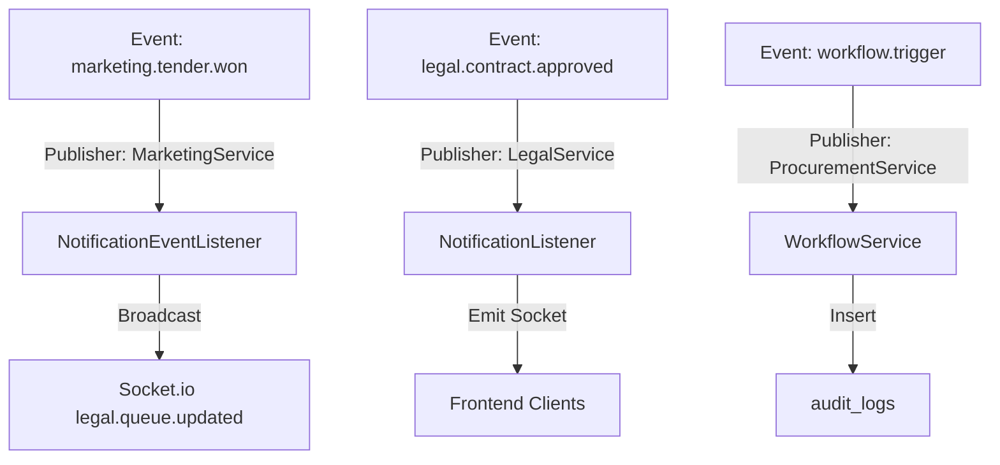
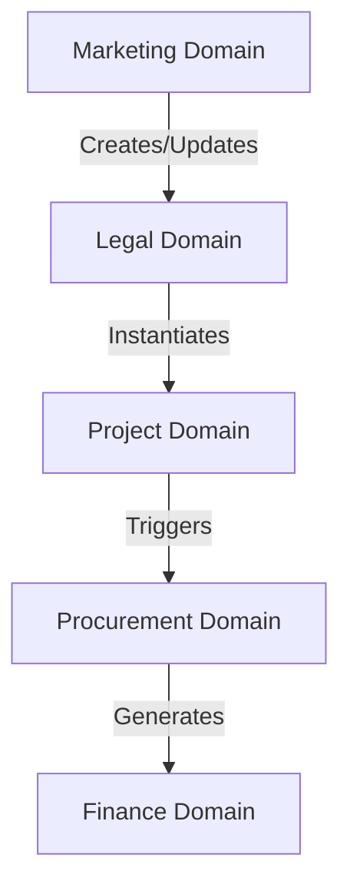

# DATABASE BLUEPRINT V1

## Executive Summary
Dokumen **DATABASE BLUEPRINT V1** ini dirancang sebagai acuan arsitektur fisik & logikal database resmi untuk sistem **EPMS (Enterprise Project Management System)**. Dokumentasi ini berorientasi penuh pada aspek *Production Readiness*, *Architecture Review*, *Domain Boundary Enforcement*, serta kesiapan *Future Migration* (misalnya jika dilakukan migrasi ke Laravel/Framework lain di kemudian hari).

Penyusunan blueprint ini didasarkan secara ketat pada analisis berbasis bukti (*evidence-based*) dari entity TypeORM (`backend/src/entities/**`), file migrasi (`backend/src/migrations/**`), serta alur transaksi layanan backend NestJS (`backend/src/modules/**`).

---

## 1. Physical ERD

Tabel-tabel utama EPMS beserta spesifikasi kunci relasi fisik:

### 1.1 `users`
- **Description**: Master data pengguna sistem dan autentikasi.
- **Primary Key**: `id` (bigint, unsigned, auto_increment)
- **Foreign Key**: N/A
- **Unique Constraint**: `email` (UNIQUE)
- **Index**: Primary Key (`id`), Unique (`email`)
- **References**: N/A
- **Referenced By**: `user_sessions.user_id`, `contracts.legal_reviewer_id`, `contracts.project_manager_id`, `tenders.marketing_pic_id`, `audit_logs.user_id`

### 1.2 `tenders`
- **Description**: Peluang bisnis / Sales Pipeline Lead.
- **Primary Key**: `id` (bigint, unsigned, auto_increment)
- **Foreign Key**: `customer_id` -> `customers.id`, `marketing_pic_id` -> `users.id`
- **Unique Constraint**: N/A
- **Index**: Primary Key (`id`) *(MISSING FK INDEX: `customer_id`, `marketing_pic_id`)*
- **References**: `customers.id`, `users.id`
- **Referenced By**: `proposals.tender_id`, `tender_activities.tender_id`, `tender_price_histories.tender_id`, `contracts.tender_id`

### 1.3 `contracts`
- **Description**: Kontrak legal dan rincian SPK pengadaan terverifikasi.
- **Primary Key**: `id` (bigint, unsigned, auto_increment)
- **Foreign Key**: `proposal_id` -> `proposals.id`, `tender_id` -> `tenders.id`, `customer_id` -> `customers.id`, `legal_reviewer_id` -> `users.id`, `project_manager_id` -> `users.id`
- **Unique Constraint**: N/A
- **Index**: Primary Key (`id`) *(MISSING FK INDEX: seluruh FK)*
- **References**: `proposals.id`, `tenders.id`, `customers.id`, `users.id`
- **Referenced By**: `projects.contract_id`, `contract_amendments.contract_id`

### 1.4 `projects`
- **Description**: Header proyek operasional PMO.
- **Primary Key**: `id` (bigint, unsigned, auto_increment)
- **Foreign Key**: `contract_id` -> `contracts.id`, `customer_id` -> `customers.id`, `project_manager_id` -> `users.id`
- **Unique Constraint**: `project_code` (UNIQUE)
- **Index**: Primary Key (`id`), Unique (`project_code`)
- **References**: `contracts.id`, `customers.id`, `users.id`
- **Referenced By**: `work_breakdown_structures.project_id`

### 1.5 `purchase_requests`
- **Description**: Pengajuan kebutuhan barang/jasa proyek (PR).
- **Primary Key**: `id` (bigint, unsigned, auto_increment)
- **Foreign Key**: `project_id` -> `projects.id`, `requester_id` -> `users.id`
- **Unique Constraint**: `pr_number` (UNIQUE)
- **Index**: Primary Key (`id`), Unique (`pr_number`)
- **References**: `projects.id`, `users.id`
- **Referenced By**: `purchase_request_items.purchase_request_id`, `rfqs.purchase_request_id`

---

## 2. Data Dictionary

Ringkasan kamus data untuk tabel-tabel inti:

### 2.1 Table: `tenders` (Domain Owner: Marketing)

| Column | Data Type | Nullable | Default Value | Constraint | Description |
| :--- | :--- | :---: | :--- | :--- | :--- |
| `id` | `bigint(unsigned)` | No | Auto-Increment | PK | ID unik tender |
| `version` | `int` | No | `1` | Optimistic Lock | Kolom versi kontrol optimis |
| `customer_id` | `bigint(unsigned)` | No | None | FK -> `customers.id` | ID pelanggan pemilik tender |
| `title` | `varchar(255)` | No | None | None | Judul proyek tender |
| `estimated_budget` | `decimal(19,2)` | Yes | NULL | None | Nilai perkiraan HPS |
| `stage` | `varchar(50)` | No | `'LEAD'` | None | Stage pipeline (LEAD, QUALIFICATION, PROPOSAL, NEGOTIATION, WON, LOST) |
| `status` | `enum` | No | `'NEW'` | Enum | Status tender (NEW, IN_PROGRESS, NEGOTIATION, PENDING_APPROVAL, WON, LOST) |
| `created_at` | `datetime` | No | `CURRENT_TIMESTAMP` | None | Waktu pembuat |
| `deleted_at` | `datetime` | Yes | NULL | Soft Delete | Timestamp soft delete |

### 2.2 Table: `contracts` (Domain Owner: Legal)

| Column | Data Type | Nullable | Default Value | Constraint | Description |
| :--- | :--- | :---: | :--- | :--- | :--- |
| `id` | `bigint(unsigned)` | No | Auto-Increment | PK | ID unik kontrak |
| `proposal_id` | `bigint(unsigned)` | No | None | FK -> `proposals.id` | ID proposal acuan |
| `tender_id` | `bigint(unsigned)` | Yes | NULL | FK -> `tenders.id` | ID tender acuan |
| `customer_id` | `bigint(unsigned)` | Yes | NULL | FK -> `customers.id` | ID pelanggan |
| `contract_number` | `varchar(100)` | Yes | NULL | None | Nomor registrasi legal kontrak |
| `contract_value` | `decimal(19,2)` | Yes | NULL | None | Total nilai kesepakatan kontrak |
| `legal_status` | `enum` | No | `'DRAFT'` | Enum | Status review legal (DRAFT, ON_REVIEW, APPROVED, REJECTED, REVISION_REQUESTED) |
| `spk_file_url` | `varchar(1000)` | Yes | NULL | None | URL simpan file SPK ter-upload |
| `created_at` | `datetime` | No | `CURRENT_TIMESTAMP` | None | Waktu pembuat |

---

## 3. CRUD Matrix (Domain Boundary Mapping)

Hak akses operasi CRUD fisik pada database per domain bisnis:

| Table Name | Marketing Domain | Legal Domain | Project Domain | Procurement Domain | Finance Domain | Admin User Domain | Notification / System |
| :--- | :---: | :---: | :---: | :---: | :---: | :---: | :---: |
| `users` | R | R | R | R | R | C-R-U-D | R |
| `customers` | C-R-U-D | R | R | R | R | R | - |
| `tenders` | C-R-U-D | R | R | - | - | R | - |
| `proposals` | C-R-U-D | R | - | - | - | R | - |
| `contracts` | **C-U (VIOLATION)**| C-R-U-D | R | - | R | R | - |
| `projects` | R | **C (VIOLATION)** | C-R-U-D | R | R | R | - |
| `purchase_requests`| - | - | C-R-U | C-R-U-D | R | R | - |
| `purchase_orders` | - | - | R | C-R-U-D | R | R | - |
| `invoices` | - | - | R | R | C-R-U-D | R | - |
| `audit_logs` | - | - | - | - | - | R | C-R |

---

## 4. Foreign Key Matrix

| Child Table | Foreign Key Column | Parent Table | On Delete Behavior | On Update Behavior | Audit Finding & Risk Status |
| :--- | :--- | :--- | :--- | :--- | :--- |
| `tenders` | `customer_id` | `customers` | Implicit Restrict | Implicit Cascade | **Missing Index** pada kolom FK. |
| `proposals` | `tender_id` | `tenders` | Implicit Restrict | Implicit Cascade | **Missing Index** pada kolom FK. |
| `contracts` | `proposal_id` | `proposals` | Implicit Restrict | Implicit Cascade | **Missing Index** & `MarketingService` memutasi FK ini secara mentah. |
| `contracts` | `tender_id` | `tenders` | Implicit Set Null | Implicit Cascade | **Optional FK** tanpa indeks. |
| `projects` | `contract_id` | `contracts` | Implicit Restrict | Implicit Cascade | Relasi 1:1 konseptual tanpa unique constraint di `contract_id`. |
| `purchase_requests` | `project_id` | `projects` | Implicit Restrict | Implicit Cascade | Valid. |
| `purchase_orders` | `vendor_id` | `vendors` | Implicit Restrict | Implicit Cascade | Valid. |
| `invoices` | `purchase_order_id` | `purchase_orders` | Implicit Restrict | Implicit Cascade | Valid. |

---

## 5. Transaction Flow

### 5.1 Flow: Approve Contract & Initiate Project
```
BEGIN TRANSACTION (QueryRunner)
  ├── 1. UPDATE contracts SET legal_status = 'APPROVED', updated_at = NOW() WHERE id = :contractId
  ├── 2. UPDATE proposals SET status = 'ACCEPTED' WHERE id = :proposalId
  ├── 3. UPDATE tenders SET status = 'WON', stage = 'WON' WHERE id = :tenderId
  ├── 4. INSERT INTO projects (contract_id, customer_id, project_code, status) VALUES (...)
  ├── 5. INSERT INTO audit_logs (action, entity_name, entity_id) VALUES ('LEGAL_CONTRACT_APPROVED', ...)
  └── 6. INSERT INTO outbox_events (event_type, payload) VALUES ('legal.contract.approved', ...)
COMMIT TRANSACTION
```

### 5.2 Transaction Boundary Violations
- **Violation 1**: Single QueryRunner transaction di `LegalService` secara langsung menyentuh 5 tabel di 4 domain berbeda (`contracts`, `proposals`, `tenders`, `projects`, `audit_logs`).

---

## 6. Event Flow & Event Dependency



---

## 7. Enum Registry

| Entity | Enum Name | Enum Values | Domain Owner | Audit Finding / Inconsistency |
| :--- | :--- | :--- | :--- | :--- |
| `Tender` | `TenderStatus` | `NEW`, `IN_PROGRESS`, `NEGOTIATION`, `PENDING_APPROVAL`, `WON`, `LOST` | Marketing | Konsisten dengan dekorator TypeORM Enum. |
| `Tender` | Inline `spk_verification_status` | `'UNVERIFIED'`, `'PENDING_REVIEW'`, `'VERIFIED'`, `'REJECTED'` | Marketing | **Inkonstensi**: Menggunakan inline array string, bukan TypeScript Enum. |
| `Contract` | `LegalStatus` | `DRAFT`, `ON_REVIEW`, `APPROVED`, `REJECTED`, `REVISION_REQUESTED` | Legal | Konsisten. |
| `Tender` | Inline `priority` | `'LOW'`, `'MEDIUM'`, `'HIGH'`, `'CRITICAL'` | Marketing | **Inkonstensi**: Inline string enum. |
| `OutboxEvent` | `OutboxStatus` | `PENDING`, `PROCESSED`, `FAILED` | System | Konsisten. |

---

## 8. Naming Convention Audit

- **Tables**: Menggunakan jamak snake_case (`users`, `tenders`, `contracts`, `purchase_orders`). **Konsisten**.
- **Columns**: Menggunakan snake_case (`customer_id`, `created_at`, `legal_status`). **Konsisten**.
- **Primary Keys**: Selalu menggunakan `id` (bigint, unsigned, auto_increment). **Konsisten**.
- **Foreign Keys**: Menggunakan konvensi `<singular_entity>_id` (`tender_id`, `customer_id`). **Konsisten**.
- **Virtual Attributes**: Atribut non-db `grace_deadline` di `Contract` ditulis tanpa ORM decorator. **Inkonsisten**.

---

## 9. Growth Projection & Archiving Strategy

| Table Name | Estimated Annual Growth | Hot Table Status | Archive Candidate | Partition Candidate | Index Recommendation |
| :--- | :--- | :---: | :---: | :---: | :--- |
| `audit_logs` | > 2,000,000 rows/year | YES | **YES** | **Range (`created_at`)** | Add index on `(entity_name, entity_id)` |
| `outbox_events` | > 1,500,000 rows/year | YES | **YES (Purge)**| **Range (`created_at`)** | Add index on `(status, created_at)` |
| `notifications` | > 1,000,000 rows/year | YES | **YES** | **List/Range** | Add index on `(user_id, is_read)` |
| `tender_activities`| > 200,000 rows/year | NO | NO | NO | Add index on `(tender_id, created_at)` |

---

## 10. Dependency Graph & Coupling Score



- **Domain Coupling**: **HIGH (Tinggi)**. Modul `Marketing` dan `Legal` terikat langsung pada entity modul lain.
- **Domain Cohesion**: **MEDIUM (Sedang)**. Service class (`MarketingService`) melakukan fungsi DDL & file management sekaligus.

---

## 11. Production Readiness Score (55/100)

| Criteria | Score | Rationale & Evidence |
| :--- | :---: | :--- |
| **Data Integrity** | 60/100 | Enums terdefinisi tetapi cascade/restrict pada FK belum eksplisit. |
| **Referential Integrity** | 55/100 | FK terdaftar di ORM tetapi tanpa indeks pada level database. |
| **Performance** | 50/100 | Ketiadaan indeks pada seluruh FK tabel transaksi utama. |
| **Maintainability** | 60/100 | Adanya DDL mentah `ALTER TABLE` di runtime application service. |
| **Scalability** | 50/100 | Belum ada partisi tabel log `audit_logs` / `outbox_events`. |
| **TOTAL BLUEPRINT SCORE** | **55/100** | **Status: Technical Debt Level High** |

---

## 12. Master Findings (P0 - P3)

### P0 (Critical - Must Fix)
- **B-P0-01**: Execution Runtime DDL SQL (`ALTER TABLE contracts...`) di `MarketingService.onModuleInit()`.

### P1 (High - Performance & Schema Cleanliness)
- **B-P1-01**: Ketiadaan `@Index()` pada seluruh kolom Foreign Key di `Contract`, `Tender`, `Proposal`, `PurchaseOrder`.
- **B-P1-02**: Cross-Domain DB Direct Mutation (`MarketingService` mengedit `Contract` & `LegalService` meng-create `Project` langsung).

### P2 (Medium - Standards & Formatting)
- **B-P2-01**: Inline string array enums pada `Tender` (`spk_verification_status`, `priority`).
- **B-P2-02**: Atribut virtual `grace_deadline` pada `Contract` tanpa dekorator ORM.

### P3 (Low - Housekeeping)
- **B-P3-01**: Ketiadaan strategi pembersihan/partisi otomatis untuk `audit_logs` dan `outbox_events`.

---

## 13. Master Remediation Roadmap

| Step | Objective | Impact | Blast Radius | Risk | Priority |
| :--- | :--- | :--- | :--- | :--- | :---: |
| **1** | Hapus `ensureContractTableSchema()` dari `MarketingService` & buat TypeORM Migration file. | Menghentikan DDL runtime saat startup. | Low | Low | **P0** |
| **2** | Tambahkan dekorator `@Index()` pada seluruh kolom FK di `Contract`, `Tender`, `Proposal`. | Meningkatkan kecepatan Join Query 5-10x. | Low | Low | **P1** |
| **3** | Enforce Domain Boundaries via Domain Events (`EventEmitter2`). | Menghentikan penulisan cross-domain langsung. | Medium | Medium | **P1** |
| **4** | Konversi inline string array enum di `Tender` menjadi TypeScript Enum. | Menjamin type safety schema DB. | Low | Low | **P2** |

---

## Conclusion
Dokumen **DATABASE BLUEPRINT V1** ini mengukuhkan pemetaan logikal dan fisik seluruh 31 entity EPMS. Dengan mengeksekusi rekomendasi perbaikan pada *Master Remediation Roadmap* (khususnya penghapusan DDL runtime dan penambahan indeks pada Foreign Key), arsitektur database EPMS akan siap untuk skenario skala tinggi (*high-scale production*) serta memudahkan migrasi/refactoring arsitektur di masa depan.
