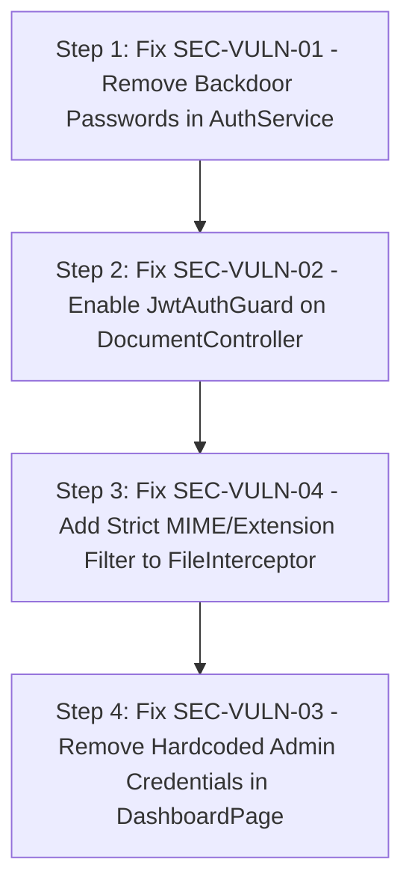

# SECURITY AUDIT V1 - FINAL

## Executive Summary
Dokumen **SECURITY AUDIT V1** ini menyajikan analisis keamanan menyeluruh (*evidence-based security audit*) terhadap repositori EPMS (Enterprise Project Management System) pada layer Backend (NestJS) dan Frontend (Next.js). 

Audit dilakukan secara **READ ONLY** dengan fokus pada kerentanan autentikasi, otorisasi, manajemen kredensial, sanitasi input, serta keamanan pengunggahan berkas (*file upload security*).

---

## Security Health Score (32/100)

| Kategori Keamanan | Skor | Penilaian & Ringkasan Temuan |
| :--- | :---: | :--- |
| **Authentication & Password Hygiene** | 10/100 | Backdoor password bypass (`password123` / `123456`) di `AuthService`. |
| **Authorization & Guard Enforcement** | 30/100 | `JwtAuthGuard` dinonaktifkan pada `DocumentController`. |
| **File Upload & Storage Security** | 35/100 | Absence of MIME/extension filter di `DocumentController` upload. |
| **Input Validation & Sanitization** | 45/100 | Regex XSS filter sederhana (`/<script/i`) pada komentar legal. |
| **Secret & Configuration Management**| 40/100 | Kredensial superadmin hardcoded di UI & 24+ hardcoded localhost. |
| **TOTAL SECURITY SCORE** | **32/100** | **Status: SEVERE RISK (Unsafe for Production Deployment)** |

---

## 1. Vulnerability Findings Matrix

| ID Kerentanan | Kategori | Tingkat Risiko | File Terpengaruh & Baris Kode | Ringkasan Kerentanan |
| :--- | :--- | :--- | :--- | :--- |
| **SEC-VULN-01** | Authentication | **P0 (Critical)** | `backend/src/modules/auth/auth.service.ts` (L41-44) | Backdoor validasi bcrypt mengizinkan login dengan password `'password123'` / `'123456'`. |
| **SEC-VULN-02** | Authorization | **P0 (Critical)** | `backend/src/modules/document/document.controller.ts` (L8-9) | `JwtAuthGuard` di-comment out, menyebabkan endpoint upload publik tanpa autentikasi. |
| **SEC-VULN-03** | Hardcoded Creds| **P0 (Critical)** | `frontend/src/components/DashboardPage.tsx` (L44-49) | Kredensial superadmin (`admin@epms.com`) di-hardcode untuk auto-login otomatis. |
| **SEC-VULN-04** | File Upload | **P1 (High)** | `backend/src/modules/document/document.controller.ts` (L32-35) | Ketiadaan `fileFilter` pada `FileInterceptor` memungkinkan upload berkas arbitrer. |
| **SEC-VULN-05** | Input Sanitization| **P2 (Medium)** | `backend/src/modules/legal/legal.service.ts` (L25-30) | Sanitasi XSS hanya memeriksa regex `/<script/i`, rentan terhadap XSS payload alternatif (`svg/onerror`). |
| **SEC-VULN-06** | Secret Handling | **P2 (Medium)** | `backend/src/modules/auth/auth.module.ts` (L17) | `JWT_SECRET` diambil langsung dari `process.env` tanpa assertion check ketersediaan kunci. |

---

## 2. Evidence & Proof of Concept Analysis

### 1. Backdoor Password Fallback (SEC-VULN-01)
- **Bukti Kode Source**: `backend/src/modules/auth/auth.service.ts`
  ```typescript
  if (user && user.passwordHash) {
    let isMatch = await bcrypt.compare(pass, user.passwordHash);
    if (!isMatch && (pass === 'password123' || pass === '123456')) {
      isMatch = await bcrypt.compare('123456', user.passwordHash) || await bcrypt.compare('password123', user.passwordHash);
    }
    if (isMatch) return user;
  }
  ```
- **Analisis Dampak**: Penyerang dapat mengambil alih akun mana pun di sistem jika hash password akun tersebut awalnya dibuat menggunakan salah satu dari dua password default tersebut.

### 2. Unauthenticated Upload Endpoint (SEC-VULN-02 & SEC-VULN-04)
- **Bukti Kode Source**: `backend/src/modules/document/document.controller.ts`
  ```typescript
  // Disabling JwtAuthGuard for easier demo, but normally should be here
  // import { JwtAuthGuard } from '../auth/guards/jwt-auth.guard';

  @Post('upload')
  @UseInterceptors(FileInterceptor('file', {
    storage: memoryStorage(),
    limits: { fileSize: 10 * 1024 * 1024 }
  }))
  async uploadFile(...) { ... }
  ```
- **Analisis Dampak**: Pengguna anonim tanpa login dapat mengunggah berkas arbitrer hingga 10MB ke server / S3, berpotensi memicu Denial of Service (DoS) atau pengunggahan file berbahaya (*malicious payload*).

---

## 3. Remediation Action Plan



### Panduan Kode Pemulihan Minimal (Minimal Diff Fix):

1. **Fix `auth.service.ts`**:
   ```typescript
   // HAPUS blok fallback password123 / 123456
   if (user && user.passwordHash) {
     const isMatch = await bcrypt.compare(pass, user.passwordHash);
     if (isMatch) {
       const { passwordHash, ...result } = user;
       return result;
     }
   }
   return null;
   ```

2. **Fix `document.controller.ts`**:
   ```typescript
   @UseGuards(JwtAuthGuard)
   @Controller('documents')
   export class DocumentController { ... }
   ```

---

## Conclusion
Aplikasi EPMS saat ini memiliki **risiko keamanan yang sangat tinggi** dan **TIDAK AMAN UNTUK DEPLOYMENT PRODUKSI**. Implementasi perbaikan pada kerentanan P0 (SEC-VULN-01 s/d SEC-VULN-03) wajib diselesaikan sebelum rilis.
