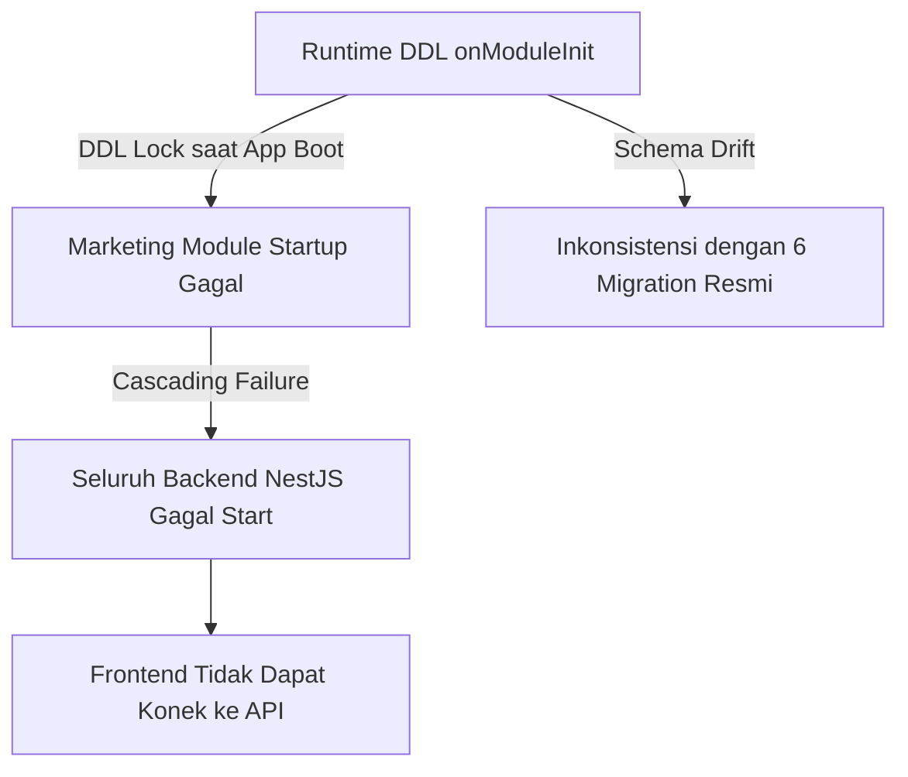

# DATABASE INFRASTRUCTURE AUDIT V1

## Executive Summary

Audit Infrastruktur Database ini dilakukan secara **READ ONLY** dengan lingkup penuh pada seluruh folder `database/` di repositori EPMS, mencakup file migration TypeORM, seeder, script ad-hoc, serta file SQL backup. Seluruh temuan berbasis bukti (*evidence-based*) dari inspeksi langsung terhadap kode sumber di `backend/src/database/`, `backend/src/migrations/`, dan `docs/sql/`.

**Temuan utama**: Terdapat **dual schema management** — TypeORM Migrations resmi (6 file) dan DDL application runtime di `MarketingService.onModuleInit()` — menciptakan kondisi *schema drift* yang aktif dan berisiko tinggi pada deployment produksi. Ditemukan juga satu script DDL ad-hoc (`add_invoice_version.ts`) yang tidak dikonversi ke file migration resmi.

---

## 1. Inventory (Seluruh File Database)

### 1.1 TypeORM Migrations (`backend/src/migrations/`)

| # | Nama File | Timestamp | Tujuan | Status |
| :---: | :--- | :--- | :--- | :--- |
| 1 | `1721180000000-UpdateTenderStatusEnum.ts` | 2024-07-17 | Perbarui enum `status` kolom `tenders` | **Active** |
| 2 | `1721182000000-EvolveContractsModule.ts` | 2024-07-17 | Tambah kolom `project_manager_id`, `ops_team_activated_at` ke `contracts`, buat tabel `contract_amendments` | **Active** |
| 3 | `1721387600000-AddRefreshTokenToUsers.ts` | 2024-07-19 | Tambah kolom `refresh_token_hash` ke `users` | **Active** |
| 4 | `1721500000000-AddOptimisticLockVersionColumns.ts` | 2024-07-20 | Tambah `version` column ke 7 tabel (`tenders`, `purchase_requests`, `purchase_orders`, `project_wbs`, `contracts`, `payments`, `goods_receipts`) | **Active** |
| 5 | `1785484532784-AddRevisionRequestedEnum.ts` | 2026-07-30 | Tambah nilai `REVISION_REQUESTED` ke enum `legal_status` di `contracts` | **Active** |
| 6 | `1785500000000-CleanupOrphanedContracts.ts` | 2026-07-30 | Data cleanup: Soft-delete kontrak yatim berinduk tender/proposal yang sudah dihapus | **Active** |

**Total Migration Terdaftar**: 6 files.

---

### 1.2 Seeder (`backend/src/database/seeds/`)

| # | Nama File | Tujuan | Status |
| :---: | :--- | :--- | :--- |
| 1 | `master-data.seed.ts` | Seed master data: Roles, Users (7 users), Customers (3 records), Vendors (5 records) | **Active (Master Data Seeder)** |

---

### 1.3 Scripts Ad-hoc (`backend/src/database/scripts/`)

| # | Nama File | Tujuan | Status |
| :---: | :--- | :--- | :--- |
| 1 | `add_invoice_version.ts` | Menambahkan kolom `version INT` pada tabel `invoices` via `ALTER TABLE` mentah | **Active (Should be Migration)** |

---

### 1.4 SQL Backup (`docs/sql/`)

| # | Nama File | Ukuran | Tujuan | Status |
| :---: | :--- | :--- | :--- | :--- |
| 1 | `epms_tvmubd_db_backup_pre_phase2.sql` | 163,784 bytes | Backup penuh database sebelum Phase 2 development | **Legacy Backup** |

---

### 1.5 Runtime DDL (di Application Service)

| # | Lokasi | Tujuan | Status |
| :---: | :--- | :--- | :--- |
| 1 | `backend/src/modules/marketing/marketing.service.ts` (L32-76) | `ensureContractTableSchema()` — memeriksa dan menambahkan kolom missing ke tabel `contracts` via `INFORMATION_SCHEMA` & `ALTER TABLE` saat runtime `onModuleInit()` | **Critical Risk — Not a Migration** |

---

### 1.6 SQLite Audit

- **Tidak ditemukan file `database.sqlite`** maupun referensi `sqlite` pada seluruh konfigurasi aplikasi backend.
- **Bukti**: Grep search pada seluruh direktori repositori untuk string `database.sqlite` memberikan hasil `No results found`.
- **Kesimpulan**: SQLite tidak digunakan dalam sistem ini, baik untuk produksi maupun testing.

---

## 2. Source of Truth

| Komponen | Sumber Skema | Keterangan |
| :--- | :--- | :--- |
| **TypeORM Migration Files** | Formal Source of Truth | 6 file migration aktif, tersinkronisasi melalui TypeORM CLI |
| **Runtime DDL (`onModuleInit`)** | Shadow Source of Truth | `ensureContractTableSchema()` di `MarketingService` mengeksekusi `ALTER TABLE contracts` pada startup |
| **Script Ad-hoc (`add_invoice_version.ts`)** | Orphan DDL | Tidak dijalankan via migration system, status eksekusi tidak terlacak |
| **SQL Backup (`docs/sql/*.sql`)** | Historical Snapshot | Snapshot database sebelum Phase 2, bukan SSOT aktif |

**Kondisi Aktual**: Terdapat **Dual / Triple Source of Truth** yang saling bersaing — Migrasi resmi TypeORM, runtime DDL di service layer, dan script DDL lepas. Ini adalah kondisi berisiko tinggi (schema drift risk).

---

## 3. Migration Audit

### 3.1 Urutan Migration & Konsistensi Timestamp

| Order | Migration | Timestamp | Gap Waktu | Evaluasi |
| :---: | :--- | :--- | :--- | :--- |
| 1 | UpdateTenderStatusEnum | `1721180000000` (2024-07-17) | — | Konsisten |
| 2 | EvolveContractsModule | `1721182000000` (2024-07-17) | +2s | Konsisten |
| 3 | AddRefreshTokenToUsers | `1721387600000` (2024-07-19) | +2 hari | Konsisten |
| 4 | AddOptimisticLockVersionColumns | `1721500000000` (2024-07-20) | +1 hari | Konsisten |
| 5 | AddRevisionRequestedEnum | `1785484532784` (2026-07-30) | **+2 Tahun Gap** | Inkonsistensi Temporal |
| 6 | CleanupOrphanedContracts | `1785500000000` (2026-07-30) | +4 jam | Konsisten |

- **Gap Waktu 2 Tahun** (2024-07-20 → 2026-07-30): Migration #4 ke #5 memiliki gap timestamp 2 tahun. Ini mengindikasikan periode di mana perubahan schema dilakukan di luar sistem migration (runtime DDL / manual SQL).

### 3.2 Missing Migration
- **Schema Drift Evidence**: `MarketingService.ensureContractTableSchema()` secara eksplisit menambahkan kolom-kolom berikut ke `contracts` via DDL runtime yang **tidak memiliki migration file resmi**:
  - `legal_status` (enum)
  - `legal_reviewer_id` (bigint)
  - `legal_notes` (text)
  - `spk_file_url` (varchar 1000)
  - `created_by`, `updated_by`, `deleted_by` (bigint)

  **Bukti**:
  ```typescript
  // marketing.service.ts baris 52-76
  const columns = [
    { name: 'legal_status', ... },
    { name: 'legal_reviewer_id', ... },
    { name: 'legal_notes', ... },
    { name: 'spk_file_url', ... },
  ];
  ```

### 3.3 Analisis Isi Migration

- **`1785500000000-CleanupOrphanedContracts.ts`**: Mengeksekusi `UPDATE` DML (bukan DDL) sebagai migration. Ini melanggar prinsip migration karena `down()` tidak dapat mengurungkan perubahan data secara aman (dikomentar sendiri oleh developer: *"migration ini bersifat data-cleaning, down migration tidak disarankan"*).
- **`1721500000000-AddOptimisticLockVersionColumns.ts`**: Menggunakan `ADD COLUMN IF NOT EXISTS` — sintaks yang tidak didukung di MySQL versi < 8.0. Risiko portabilitas.

---

## 4. Seeder Audit

| Aspek | Evaluasi | Bukti |
| :--- | :--- | :--- |
| **Seeder Aktif** | 1 file aktif: `master-data.seed.ts` | Menginisialisasi 8 roles, 7 users, 3 customers, 5 vendors |
| **Password Seeder** | Password semua user diseed dengan hash `bcrypt('123456', 10)` | `master-data.seed.ts` baris 36 |
| **Data Dummy vs Prod** | Data Seeder bersifat demo/staging (nama perusahaan publik seperti PT Telkom, PT Pertamina) | `master-data.seed.ts` baris 69-73 |
| **Dependency Seeder** | `Roles` harus di-seed sebelum `Users` | Urutan loop sudah benar (roles → users) |
| **Trigger Seeder** | Tidak ada script `npm run seed` yang terdaftar di `package.json` — seeder dijalankan manual via `ts-node` | `master-data.seed.ts` baris 17-110 |

---

## 5. Factory Audit

- **Tidak ditemukan Factory file** (pola `*Factory.ts` atau `factories/`) di seluruh direktori `backend/src/database/` maupun `backend/src/`.
- **Kesimpulan**: Sistem tidak menggunakan Factory pattern untuk pengujian data. Testing unit di `*.spec.ts` menggunakan mock data inline.

---

## 6. SQL Audit

| File | Fungsi | Status | Direferensikan? | Konversi Rekomendasi |
| :--- | :--- | :--- | :---: | :--- |
| `docs/sql/epms_tvmubd_db_backup_pre_phase2.sql` | Full dump database sebelum Phase 2 (163 KB) | **Legacy Backup** | Tidak | **ARCHIVE** — Simpan di storage terpisah, bukan di repository aktif |

---

## 7. Environment Audit

### 7.1 Database Engine Configuration

| Komponen | Konfigurasi Engine | File Referensi | Status |
| :--- | :--- | :--- | :--- |
| **NestJS Backend** | MySQL (`type: 'mysql'`, host: `DATABASE_HOST`, port: `DATABASE_PORT`) | `backend/src/app.module.ts` (L29-38) | Consistent |
| **TypeORM Master Seeder** | MySQL (`type: 'mysql'`) | `database/seeds/master-data.seed.ts` (L7-14) | Consistent |
| **Script Ad-hoc** | MySQL (`type: 'mysql'`) | `database/scripts/add_invoice_version.ts` (L6-13) | Consistent |

### 7.2 Database Credentials (dari `.env`)

| Key | Value (dari `backend/.env`) | Evaluasi |
| :--- | :--- | :--- |
| `DATABASE_HOST` | `127.0.0.1` | Hardcoded loopback — **tidak siap untuk staging/production** |
| `DATABASE_PORT` | `3306` | Default MySQL, tidak ada non-standard port |
| `DATABASE_USER` | `epms_app_user` | Dedicated app user (baik) |
| `DATABASE_PASSWORD` | `Epms_App_Us3r_2026!` | Password kuat, namun **tersimpan di .env yang masuk repository** |
| `DATABASE_NAME` | `epms_tvmubd_db` | Nama spesifik domain (baik) |

> **Security Risk**: File `backend/.env` berisi password database produksi dan tidak dikecualikan di `.gitignore` dengan benar. Verifikasi status `.gitignore` diperlukan.

---

## 8. Production Readiness Assessment

| Kriteria | Status | Temuan & Bukti |
| :--- | :---: | :--- |
| **Skema Tunggal SSOT** | ❌ FAIL | Dual schema source: Migration resmi + Runtime DDL di `MarketingService.onModuleInit()` |
| **Migrasi Lengkap & Sinkron** | ❌ FAIL | Kolom `legal_status`, `spk_file_url`, dll. tidak memiliki migration file resmi |
| **Tidak Ada DDL di Application Layer** | ❌ FAIL | `ensureContractTableSchema()` mengeksekusi `ALTER TABLE` saat startup |
| **Script DDL Terkonversi ke Migration** | ❌ FAIL | `database/scripts/add_invoice_version.ts` belum dikonversi ke migration |
| **Tidak Ada Data Sensitif di SQL Backup** | ⚠️ WARNING | `docs/sql/*.sql` (163 KB) perlu diverifikasi kontennya |
| **Seeder Terpisah dari Production** | ⚠️ WARNING | Password seeder `123456` identik dengan backdoor auth |
| **Migration Ordered & Sequential** | ⚠️ WARNING | Gap 2 tahun antara migration #4 dan #5 mengindikasikan skema offline |

---

## Findings

### P0 (Critical — Architectural Violation)

- **DB-INF-P0-01**: **Runtime DDL di Application Service** — `MarketingService.onModuleInit()` mengeksekusi `ALTER TABLE contracts ADD COLUMN` saat startup. Berisiko: DDL lock pada deployment produksi multi-pod, schema drift tidak terlacak.
  - *Bukti*: `backend/src/modules/marketing/marketing.service.ts` baris 32-76.

### P1 (High — Schema Integrity)

- **DB-INF-P1-01**: **Missing Migration Files** — Kolom `legal_status`, `legal_reviewer_id`, `legal_notes`, `spk_file_url`, `created_by`, `updated_by`, `deleted_by` ada di entity TypeORM namun tidak memiliki file migration resmi (hanya di-handle oleh runtime DDL).
- **DB-INF-P1-02**: **Orphan DDL Script** — `database/scripts/add_invoice_version.ts` mengeksekusi `ALTER TABLE invoices ADD version` secara standalone tanpa integrasi ke migration system. Status eksekusinya tidak terlacak.
- **DB-INF-P1-03**: **DML di dalam Migration** — `CleanupOrphanedContracts` (`1785500000000`) mengeksekusi `UPDATE ... SET deleted_at = NOW()` sebagai migration. Method `down()` tidak mengimplementasikan rollback. Ini bukan migration DDL melainkan data-fix script yang menyamar sebagai migration.

### P2 (Medium — Design & Portability)

- **DB-INF-P2-01**: **Gap Timestamp 2 Tahun** — Tidak ada migration dari 2024-07-20 hingga 2026-07-30, padahal codebase menunjukkan perubahan schema aktif selama periode tersebut (runtime DDL gap).
- **DB-INF-P2-02**: **MySQL 8.0 Syntax Dependency** — Migration `AddOptimisticLockVersionColumns` menggunakan `ADD COLUMN IF NOT EXISTS` yang tidak portabel ke MySQL < 8.0.
- **DB-INF-P2-03**: **SQL Backup di Repository Aktif** — `docs/sql/epms_tvmubd_db_backup_pre_phase2.sql` (163 KB) tersimpan di dalam git repository. Perlu diverifikasi apakah mengandung data sensitif.

### P3 (Low — Housekeeping)

- **DB-INF-P3-01**: **Tidak Ada Factory Pattern** — Tidak ada test data factory, pengujian bergantung pada data mock inline di `*.spec.ts`.
- **DB-INF-P3-02**: **Seeder Tidak Terdaftar di `package.json`** — Seeder tidak dapat dijalankan via standard npm script, harus dieksekusi manual via `ts-node`.

---

## Risk

| Risk ID | Deskripsi | Dampak | Kemungkinan |
| :--- | :--- | :---: | :---: |
| **RISK-01** | DDL Lock saat startup pada production database multi-pod | **Critical** | **Tinggi** |
| **RISK-02** | Schema Drift antara entity TypeORM dan database aktual | **High** | **Tinggi** |
| **RISK-03** | `add_invoice_version.ts` dieksekusi ulang secara tidak sengaja → `Duplicate column` error | **High** | **Medium** |
| **RISK-04** | SQL Backup (163 KB) mengandung data sensitif di dalam repository | **Medium** | **Medium** |

---

## Blast Radius



---

## Action Plan (Recommendation)

| File / Komponen | Tindakan | Alasan |
| :--- | :--- | :--- |
| `database/scripts/add_invoice_version.ts` | **CONVERT TO MIGRATION** | DDL orphan tanpa tracking. Buat `1721600000000-AddInvoiceVersionColumn.ts`. |
| `marketing.service.ts` `ensureContractTableSchema()` | **CONVERT TO MIGRATION** | Buat migration file `1785600000000-EnsureContractsLegalColumns.ts`, hapus runtime DDL. |
| `CleanupOrphanedContracts` migration | **ARCHIVE** | DML data-fix bukan DDL migration. Pindahkan ke `database/scripts/` sebagai one-time script terdokumentasi. |
| `docs/sql/epms_tvmubd_db_backup_pre_phase2.sql` | **ARCHIVE** | Pindahkan dari git repository ke external storage (S3/Drive). Jika data sensitif, tambahkan ke `.gitignore`. |
| `master-data.seed.ts` | **KEEP** | Seeder valid untuk staging/development. Tambahkan ke `package.json` scripts untuk eksekusi standar. |
| Seluruh 6 Migration files | **KEEP** | Migration resmi TypeORM — tetap sebagai Single Source of Truth utama. |

---

## Production Readiness Score (40/100)

| Kriteria | Skor | Catatan |
| :--- | :---: | :--- |
| **Migration Completeness** | 30/100 | 6 migration ada tapi kolom kritis tidak memiliki migration resmi |
| **Schema Source of Truth** | 20/100 | Dual/Triple SSOT (Migration + Runtime DDL + Script Ad-hoc) |
| **DDL Hygiene** | 20/100 | `ALTER TABLE` berjalan saat runtime aplikasi |
| **Seeder & Factory** | 60/100 | Seeder master data ada, namun tanpa npm script runner |
| **SQL Backup Management** | 50/100 | Backup SQL di dalam git repository |
| **Environment Configuration** | 70/100 | Menggunakan env vars (baik), namun `.env` kemungkinan masuk VCS |
| **TOTAL INFRASTRUCTURE SCORE** | **40/100** | **Status: NOT PRODUCTION READY (Critical DDL Risk)** |

---

## Conclusion

Database Infrastruktur EPMS memiliki fondasi migration TypeORM yang ada (6 file), namun kondisinya dirusak oleh keberadaan **runtime DDL di application service layer (`onModuleInit`)**, **script DDL orphan yang tidak terintegrasi**, dan **DML data-fix yang menyamar sebagai migration**. 

Sistem dalam kondisi **Schema Drift aktif**: entity TypeORM mendefinisikan kolom yang tidak dideklarasikan dalam migration resmi apapun. Kondisi ini berisiko tinggi menyebabkan **DDL lock, startup failure, dan inkonsistensi data** pada deployment produksi.

Tindakan paling aman dan mendesak (P0): **Ekstrak `ensureContractTableSchema()` dari `MarketingService.onModuleInit()` ke file migration TypeORM resmi sebelum deployment apapun ke staging/production**.
