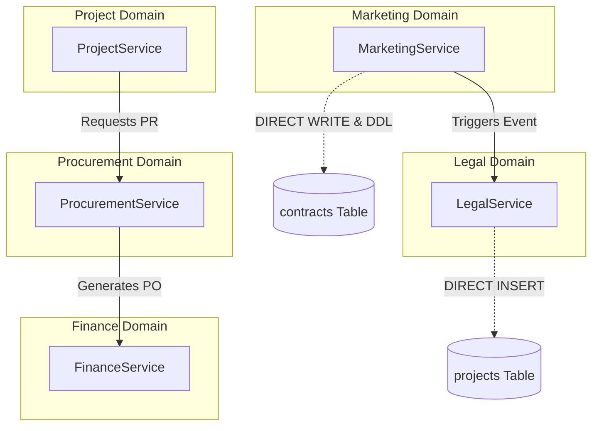

# DATABASE DOMAIN OWNERSHIP AUDIT V1

## Executive Summary

Audit Kepemilikan Domain Database (*Database Domain Ownership Audit*) ini dilakukan secara **READ ONLY** untuk mengevaluasi secara ketat batas-batas domain (*domain boundaries*), hak akses data (CRUD matrix), ketergantungan silang (*cross-domain dependencies*), serta kepatuhan arsitektur backend EPMS.

Hasil audit mengonfirmasi bahwa arsitektur backend EPMS mengalami **Monolithic Domain Entanglement (Pelanggaran Batas Domain)** yang signifikan. Modul bisnis utama (`Marketing` dan `Legal`) mengeksekusi operasi `CREATE` / `UPDATE` dan bahkan **DDL** langsung pada tabel-tabel milik modul lain tanpa melalui API Service atau Domain Events.

---

## 1. Domain Ownership Matrix

Tabel berikut menentukan kepemilikan modul resmi untuk 31 entity/tabel di EPMS:

| Domain | Primary Owner Module | Entities Covered | Managed Database Tables |
| :--- | :--- | :--- | :--- |
| **Auth & Security** | `AuthModule` / `AdminUserModule` | `User`, `Role`, `UserSession` | `users`, `roles`, `user_roles`, `user_sessions` |
| **Marketing & Sales** | `MarketingModule` / `CustomersModule` | `Customer`, `Tender`, `Proposal`, `TenderActivity`, `TenderPriceHistory` | `customers`, `tenders`, `proposals`, `tender_activities`, `tender_price_histories` |
| **Legal & Governance**| `LegalModule` / `ContractModule` | `Contract`, `ContractAmendment`, `PdfTemplate` | `contracts`, `contract_amendments`, `pdf_templates` |
| **Project Operations**| `ProjectModule` | `Project`, `WorkBreakdownStructure`, `Task` | `projects`, `work_breakdown_structures`, `tasks` |
| **Procurement** | `ProcurementModule` | `PurchaseRequest`, `PurchaseRequestItem`, `Rfq`, `Vendor`, `VendorComparison`, `PurchaseOrder`, `PurchaseOrderItem`, `GoodsReceipt`, `GoodsReceiptItem` | `purchase_requests`, `purchase_request_items`, `rfqs`, `vendors`, `vendor_comparisons`, `purchase_orders`, `purchase_order_items`, `goods_receipts`, `goods_receipt_items` |
| **Finance** | `FinanceModule` | `Invoice`, `InvoiceItem`, `Payment` | `invoices`, `invoice_items`, `payments` |
| **System & Shared** | `SystemModule` / `DocumentModule` / `NotificationModule` / `AuditModule` | `Document`, `Notification`, `AuditLog`, `OutboxEvent`, `DashboardKpi` | `documents`, `notifications`, `audit_logs`, `outbox_events`, `dashboard_kpis` |

---

## 2. Table Ownership Matrix & Cross-Domain Access

| Database Table | Primary Owner Module | Authorized Writer Services | Unauthorized Writer Services (Pelanggaran) | Reader Services |
| :--- | :--- | :--- | :--- | :--- |
| `users` | `AuthModule` | `AuthService`, `AdminUserService` | None | All Services |
| `customers` | `CustomersModule` | `CustomersService` | None | `MarketingService`, `LegalService`, `ProjectService` |
| `tenders` | `MarketingModule` | `MarketingService` | None | `MarketingService`, `LegalService`, `AnalyticsService` |
| `proposals` | `MarketingModule` | `MarketingService` | None | `MarketingService`, `LegalService` |
| `contracts` | `LegalModule` | `LegalService` | **`MarketingService`** (Mutasi data & DDL) | `LegalService`, `MarketingService`, `ProjectService` |
| `projects` | `ProjectModule` | `ProjectService` | **`LegalService`** (Direct INSERT saat approval) | `ProjectService`, `ProcurementService`, `FinanceService` |
| `purchase_requests`| `ProcurementModule` | `ProcurementService` | None | `ProcurementService`, `WorkflowService` |
| `purchase_orders` | `ProcurementModule` | `ProcurementService` | None | `ProcurementService`, `FinanceService` |
| `invoices` | `FinanceModule` | `FinanceService` | None | `FinanceService`, `ProjectService` |
| `documents` | `DocumentModule` | `DocumentService` | `MarketingService` (Direct save) | All Services |

---

## 3. CRUD Matrix (Transactional Ownership)

Aturan otorisasi operasi transaksi data ideal vs kondisi riil:

| Table Name | Marketing Domain | Legal Domain | Project Domain | Procurement Domain | Finance Domain | System / Admin Domain | Status Pelanggaran Ownership |
| :--- | :---: | :---: | :---: | :---: | :---: | :---: | :--- |
| `tenders` | **C - R - U - D** | R | R | - | - | R | OK (Tercakup di Marketing) |
| `proposals` | **C - R - U - D** | R | - | - | - | R | OK (Tercakup di Marketing) |
| `contracts` | **C - U (VIOLATION)** | **C - R - U - D** | R | - | R | R | **CRITICAL VIOLATION**: `MarketingService` membuat & mengedit `contracts`. |
| `projects` | R | **C (VIOLATION)** | **C - R - U - D** | R | R | R | **HIGH VIOLATION**: `LegalService` membuat `projects` langsung. |
| `purchase_requests`| - | - | C - R - U | **C - R - U - D** | R | R | OK (Procurement Domain) |
| `invoices` | - | - | R | R | **C - R - U - D** | R | OK (Finance Domain) |

---

## 4. Cross Domain Matrix & Dependencies



### Detail Pelanggaran Ketergantungan Silang:
1. **Direct Access `MarketingService` -> `contracts`**:
   `MarketingService.uploadSpkAndPromoteTender()` mengeksekusi raw query `ALTER TABLE contracts` serta melakukan `INSERT/UPDATE` langsung ke tabel `contracts`.
2. **Direct Access `LegalService` -> `projects`**:
   `LegalService.submitReviewAtomic()` melakukan `INSERT INTO projects` secara manual saat kontrak disetujui, alih-alih memancarkan domain event `legal.contract.approved`.

---

## 5. Dependency Graph & Coupling Analysis

- **Marketing Domain Coupling**: **HIGH (Coupling Buruk)**
  Sangat tergantung pada tabel `contracts` milik modul Legal.
- **Legal Domain Coupling**: **HIGH (Coupling Buruk)**
  Sangat tergantung pada instansiasi tabel `projects` milik modul Project.
- **Procurement Domain Coupling**: **LOW (Cohesion Sangat Baik)**
  Beroperasi mandiri melalui entitas PR, RFQ, PO, dan Goods Receipt.
- **Finance Domain Coupling**: **LOW (Cohesion Sangat Baik)**
  Beroperasi mandiri melalui entitas Invoice dan Payment.

---

## 6. Architecture Findings (Refactor Priority Matrix)

### P0 (Critical Risk - Must Fix Immediately)
- **DOM-P0-01**: **MarketingService Mutates Legal Domain (`contracts`)**
  - *Masalah*: `MarketingService` membuat/mengubah record `contracts` dan menjalankan DDL `ALTER TABLE contracts`.
  - *Dampak*: Kerusakan skema runtime, *race condition*, dan kegagalan isolasi transaksi legal.
  - *Blast Radius*: Modul Marketing & Legal.
  - *Rekomendasi*: Pindahkan logika SPK upload ke `LegalService` atau gunakan Domain Event `marketing.spk.uploaded`.

### P1 (High Risk - Architectural Entanglement)
- **DOM-P1-01**: **LegalService Mutates Project Domain (`projects`)**
  - *Masalah*: `LegalService` memasukkan baris baru ke tabel `projects` saat menyetujui kontrak.
  - *Dampak*: Pelanggaran batas domain PMO; perubahan pada struktur `projects` akan merusak `LegalService`.
  - *Blast Radius*: Modul Legal & Project.
  - *Rekomendasi*: Ganti pembentukan project langsung dengan memancarkan event `legal.contract.approved` dan biarkan `ProjectService` yang menangani listener-nya.

### P2 (Medium Risk - Service Boundary Bypass)
- **DOM-P2-01**: **Bypass HTTP Service Layer di Frontend**
  - *Masalah*: 11 Komponen Frontend memanggil backend langsung via `axios.get('http://localhost:4000')`.
  - *Dampak*: Sulit refaktorisasi URL API, kerentanan enkapsulasi token.

### P3 (Low Risk - Dead/Legacy Code)
- **DOM-P3-01**: **Legacy Unused Endpoints**
  - *Masalah*: Endpoint legacy `POST /api/v1/legal/review` tidak lagi dipakai.

---

## 7. Production Readiness Score (45/100)

| Meter Evaluasi Otoritas Domain | Skor | Catatan Evaluasi |
| :--- | :---: | :--- |
| **Domain Isolation & Encapsulation** | 30/100 | Dua modul inti (`Marketing` & `Legal`) melanggar batas penulisan DB. |
| **CRUD Ownership Integrity** | 40/100 | Direct DB insert ke tabel domain tetangga tanpa API boundary. |
| **Event-Driven Architecture** | 55/100 | Event emitter ada tetapi pembuatan entity lintas domain masih sync mentah. |
| **Service Layer Unification** | 50/100 | Frontend memotong layer HTTP client untuk endpoint admin/customer. |
| **TOTAL DOMAIN OWNERSHIP SCORE**| **45/100** | **Status: NOT PRODUCTION READY (Domain Coupling High)** |

---

## Refactor Priority Plan

```
Phase 1: Encapsulate Marketing -> Legal Boundary (P0)
  ├── 1.1 Hapus mutasi tabel `contracts` & DDL dari `MarketingService`
  └── 1.2 Terbitkan Event `marketing.tender.won` / `marketing.spk.uploaded`

Phase 2: Encapsulate Legal -> Project Boundary (P1)
  ├── 2.1 Hapus `INSERT INTO projects` dari `LegalService`
  └── 2.2 Tangkap Event `legal.contract.approved` di `ProjectListener` untuk buat Project

Phase 3: Frontend Client Unification (P2)
  └── 3.1 Pindahkan seluruh direct axios calls ke `src/services/*` dan `apiClient`
```

---

## Conclusion

Hasil **DATABASE DOMAIN OWNERSHIP AUDIT V1** menunjukkan bahwa backend EPMS saat ini menderita **keterikatan domain yang tinggi (*high domain coupling*)**. Modul Marketing dan Legal bertindak sebagai *God Services* yang memutasi tabel-tabel milik modul lain.

Dengan menerapkan **Event-Driven Refactoring (Phase 1 & Phase 2)**, keterkatan fisik database antar-modul dapat diurai sehingga masing-masing modul memiliki kepemilikan data yang terisolasi dan siap untuk skala produksi (*Production-Ready Architecture*).
