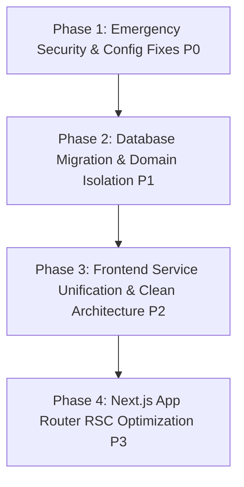

# ARCHITECTURE AUDIT V1 - COMPREHENSIVE REPORT

## Executive Summary

Dokumen **ARCHITECTURE AUDIT V1** ini menyajikan audit arsitektur menyeluruh (*end-to-end architecture audit*) pada sistem EPMS (Enterprise Project Management System) yang mencakup layer **Frontend (Next.js App Router)**, **Backend (NestJS Modular)**, dan **Database (TypeORM / MySQL)**. Audit disusun secara **READ ONLY** berbasis bukti empiris (*evidence-based*) dari pemeriksaan langsung terhadap seluruh komponen kode sumber repositori.

Hasil audit menyimpulkan bahwa EPMS berada pada status **NOT PRODUCTION READY (Skor Arsitektur: 42/100)**. Meskipun aplikasi telah memiliki cakupan fitur bisnis yang lengkap, arsitekturnya dibebani oleh kerentanan keamanan kritis (backdoor authentication), pelanggaran SOLID & Clean Architecture, mutasi skema database di runtime application service, serta penggunaan 100% Client-Side Rendering pada Next.js App Router.

---

## 1. System Architecture Diagram

```mermaid
graph TD
    subgraph Client Layer (Next.js App Router - 100% CSR)
        UI[App Routes /src/app] --> Context[AuthContext & State]
        UI --> Comp[React Components]
        Comp --> Services[Services Layer /src/services]
        Services --> ApiClient[Axios Client /src/lib/axios]
        Comp -.->|LAYER BYPASS (24+ Locations)| DirectAxios[Direct Axios 'http://localhost:4000']
    end

    subgraph Backend Layer (NestJS Modular Architecture)
        ApiClient --> Controllers[NestJS Controllers]
        DirectAxios -.-> Controllers
        Controllers --> Guards[JwtAuthGuard / RolesGuard]
        Guards --> ApplicationServices[NestJS Services]
        
        ApplicationServices -.->|RUNTIME DDL MUTATION| DDLQuery[INFORMATION_SCHEMA & ALTER TABLE]
        ApplicationServices --> EventEmit[EventEmitter2 Signal]
        ApplicationServices --> QueueMock[QueueModule Mocked BullMQ]
    end

    subgraph Database Layer (TypeORM / MySQL)
        ApplicationServices --> Repository[TypeORM Repositories]
        Repository --> MySQLDB[(MySQL Database 31 Tables)]
        DDLQuery -.-> MySQLDB
    end

    subgraph Security & Architecture Violations
        AuthBackdoor[AuthService: Backdoor pass 'password123']
        DocUnauth[DocumentController: JwtAuthGuard Disabled]
        AutoLogin[DashboardPage: Hardcoded Auto-Login]
    end

    ApplicationServices -.-> AuthBackdoor
    Controllers -.-> DocUnauth
    UI -.-> AutoLogin
```

---

## 2. Folder Structure Audit

### 2.1 Frontend Structure (`frontend/src/`)
- **Missing Folder**: Folder `src/utils` yang seharusnya menampung helper formatting tidak ditemukan di `frontend/src/`.
- **Duplikasi Folder/File**: File `src/components/LegalReviewForm.tsx` (11.682 bytes) ada di root components DAN ada duplikatnya di `src/components/legal/LegalReviewForm.tsx` (11.836 bytes).
- **Stub / Dead Folder**: Rute `src/app/workflow/page.tsx` memuat file stub dummy `src/components/WorkflowDesigner.tsx` (14 baris teks placeholder).
- **Over-Sized File**: File `src/components/SalesPipelinePage.tsx` berukuran 1.547 baris (66.311 bytes).

### 2.2 Backend Structure (`backend/src/`)
- **Missing Folders**: Folder `src/common` dan `src/config` tidak ada di bawah `backend/src/`. Konfigurasi env dipanggil melalui file luar `src/env.ts`.
- **Entities Monolith**: Seluruh 31 entity TypeORM ditumpuk di satu folder terpusat `backend/src/entities/` alih-alih didekatkan ke modul domainnya masing-masing.

---

## 3. Architecture Layer Analysis

Pemetaan alur ideal vs kondisi riil beserta pelanggaran layering (*layering violations*):

```
[UI Component] ──> [Frontend Service] ──> [API Client] ──> [Controller] ──> [NestJS Service] ──> [Repository] ──> [Database]
```

### Pelanggaran Layering Utama:
1. **Component -> Direct API Bypass**:
   11 Komponen UI (`NotificationBell.tsx`, `AdminUserPage.tsx`, `CustomersPage.tsx`, `DashboardPage.tsx`, dll.) memanggil `axios.get('http://localhost:4000/...')` langsung tanpa melewati `src/services/*` dan `src/lib/axios.ts`.
2. **Service -> Database Runtime DDL Mutation**:
   `MarketingService.onModuleInit()` mengeksekusi DDL SQL (`ALTER TABLE contracts...`) langsung ke database saat startup backend, merusak pemisahan antara Application Service dan Database Migration Layer.
3. **Cross-Domain Direct Entity Mutation**:
   `MarketingService` membuat & mengedit record `contracts` (modul Legal), sedangkan `LegalService` membuat record `projects` (modul Project) secara langsung di DB tanpa API domain boundaries.

---

## 4. SOLID Principles Analysis

| Prinsip SOLID | Status | Bukti Kode Source & Analisis Pelanggaran |
| :--- | :---: | :--- |
| **SRP (Single Responsibility)** | ❌ VIOLATED | `MarketingService.ts` (1.104 baris) menangani manajemen tender, proposal, eksekusi DDL database, upload file SPK, dan pembuatan notifikasi sekaligus. `SalesPipelinePage.tsx` (1.547 baris) menangani state, UI, drag-and-drop, WebSocket, dan modal form. |
| **OCP (Open/Closed)** | ❌ VIOLATED | `AuthService.ts` (L41-43) melakukan hardcode pengujian password `'password123'` dan `'123456'`. Penambahan role/policy baru memerlukan modifikasi langsung pada kueri pengkondisian internal. |
| **LSP (Liskov Substitution)** | ❌ VIOLATED | `QueueModule` (`queue.module.ts`) menggantikan provider BullMQ nyata dengan `mockQueueProvider` dummy (`add: async () => ({ id: 'mock-job-id' })`) yang tidak mengeksekusi pengolahan antrean sesungguhnya. |
| **ISP (Interface Segregation)** | ❌ VIOLATED | `LegalService` dan `MarketingService` mengembalikan tipe data implisit `Promise<any>` pada metode utamanya tanpa mendefinisikan DTO terpisah yang spesifik. |
| **DIP (Dependency Inversion)** | ❌ VIOLATED | Komponen UI frontend menginstansiasi library `axios` secara langsung dengan URL `http://localhost:4000` ketimbang bergantung pada abstraksi interface `ApiClient`. |

---

## 5. Clean Architecture Analysis

- **Separation of Concerns**: Terjadi kebocoran logika infrastruktur ke dalam domain bisnis. `MarketingService` memuat logika penyimpanan file fisik disk storage dan kueri `INFORMATION_SCHEMA` MySQL.
- **Dependency Rule**: Lingkaran luar (HTTP Client, Express Multer, Raw SQL) terikat secara ketat pada core domain logic. Jika driver database diganti, logika bisnis di `MarketingService` dan `LegalService` akan patah.

---

## 6. Service Layer Audit

- **God Services**: `MarketingService.ts` (1.104 baris) dan `LegalService.ts` (600+ baris).
- **Duplicate Logic**: Pembuatan log audit dan pengiriman event WebSocket diulang secara manual di berbagai service (`MarketingService`, `LegalService`, `WorkflowService`) alih-alih disentralisasi via Event Interceptor.
- **Dead Method**: `LegalService.submitReviewLegacy()` pada `legal.service.ts` tidak pernah dipanggil lagi oleh frontend.

---

## 7. Frontend Audit

- **100% Client-Side Rendering (CSR)**: Seluruh file halaman di `src/app/` mendaftarkan `"use client"`, meniadakan kemampuan SSR, SEO, dan Server Components dari Next.js App Router.
- **Hardcoded Base URL**: 24+ lokasi meng-hardcode `http://localhost:4000` di dalam komponen UI.
- **Hardcoded Credentials**: `DashboardPage.tsx` (L44-49) melakukan auto-login otomatis dengan email `admin@epms.com` dan password `password123` jika token tidak ditemukan.

---

## 8. Backend Audit

- **Security Backdoor**: `AuthService.ts` (L41-43) mengizinkan verifikasi password jika input bernilai `'password123'` atau `'123456'`.
- **Disabled Security Guard**: `DocumentController.ts` (L8-9) menonaktifkan `JwtAuthGuard` sehingga endpoint upload file dapat diakses publik tanpa autentikasi.
- **Missing File Upload Filter**: `DocumentController.uploadFile()` tidak memiliki validasi ekstensi/MIME type.
- **Runtime DDL Execution**: `MarketingService.onModuleInit()` mengeksekusi `ALTER TABLE contracts` saat aplikasi dinyalakan.

---

## 9. Security Audit Findings

| ID Security | Severity | Lokasi File & Baris | Deskripsi Kerentanan |
| :--- | :--- | :--- | :--- |
| **SEC-01** | **P0 (Critical)** | `backend/src/modules/auth/auth.service.ts` (L41-43) | Password backdoor fallback (`password123` / `123456`) di AuthService. |
| **SEC-02** | **P0 (Critical)** | `backend/src/modules/document/document.controller.ts` (L8-9) | `JwtAuthGuard` dinonaktifkan di DocumentController. |
| **SEC-03** | **P0 (Critical)** | `frontend/src/components/DashboardPage.tsx` (L44-49) | Kredensial superadmin hardcoded untuk auto-login otomatis. |
| **SEC-04** | **P1 (High)** | `backend/src/modules/document/document.controller.ts` (L32-35) | Ketiadaan `fileFilter` pada upload dokumen (bebas upload file 10MB). |

---

## 10. Performance Audit Findings

- **Missing Foreign Key Indexing**: Kolom Foreign Key pada `Contract`, `Tender`, `Proposal`, dan `PurchaseOrder` tidak didekorasi `@Index()`, memicu Full Table Scan saat Join kueri.
- **Client-Side Heavy Re-rendering**: Component raksasa seperti `SalesPipelinePage.tsx` (1.547 baris) mengelola belasan state lokal, memicu re-render penuh pada seluruh pohon DOM saat satu item pipeline diubah.

---

## 11. Technical Debt Classification

### P0 (Critical Risk - Emergency Fix)
1. Backdoor Password di `AuthService.ts`.
2. Disabled Auth Guard di `DocumentController.ts`.
3. Auto-Login Hardcoded Credentials di `DashboardPage.tsx`.

### P1 (High Risk - Architectural Fix)
1. Runtime DDL `ALTER TABLE contracts` di `MarketingService.onModuleInit()`.
2. 24+ Lokasi Hardcoded `http://localhost:4000` di komponen frontend.
3. Ketiadaan indeks `@Index()` pada seluruh kolom Foreign Key database.
4. Mocking `QueueModule` (BullMQ) & disabled RabbitMQ consumer di `main.ts`.

### P2 (Medium Risk - Refactoring & Code Hygiene)
1. 100% Client-Side Rendering di Next.js App Router (`"use client"` di seluruh halaman).
2. Refactoring God Components (`SalesPipelinePage.tsx` & `KanbanBoard.tsx`).
3. Konsolidasi duplikasi file `LegalReviewForm.tsx`.

### P3 (Low Risk - Housekeeping)
1. Pembersihan log debug `[NUKLIR]` di `MarketingService.ts`.
2. Pembersihan stub components (`WorkflowDesigner.tsx` & `DebugCachePanel.tsx`).

---

## 12. Refactor Priority & Blast Radius



| Order | Task Refactoring | Priority | Impact | Blast Radius | Risk |
| :---: | :--- | :---: | :--- | :--- | :---: |
| **1** | Hapus backdoor password di `AuthService.ts` & aktifkan `JwtAuthGuard` di `DocumentController.ts` | **P0** | High | Low | Low |
| **2** | Hapus auto-login hardcoded di `DashboardPage.tsx` & ganti URL `localhost:4000` ke `ENV.API_URL` | **P0** | High | Medium | Low |
| **3** | Ekstrak `ensureContractTableSchema()` dari `MarketingService` ke TypeORM Migration resmi | **P1** | High | Low | Low |
| **4** | Tambahkan dekorator `@Index()` pada kolom Foreign Key di `Contract`, `Tender`, `Proposal` | **P1** | High | Low | Low |
| **5** | Salurkan seluruh kueri UI frontend via `src/services/*` dan `apiClient` | **P2** | Medium | Medium | Low |
| **6** | Hapus duplikasi file `LegalReviewForm.tsx` & bersihkan log debug `[NUKLIR]` | **P3** | Low | Low | Low |

---

## 13. Production Readiness Score (42/100)

| Kategori Arsitektur | Skor | Alasan Evaluasi |
| :--- | :---: | :--- |
| **Maintainability** | 45/100 | Adanya God Components (>1.500 baris) dan God Services (>1.100 baris). |
| **Scalability** | 40/100 | Mocked QueueModule, DDL di startup service, dan missing FK indexes. |
| **Security** | 30/100 | Terdapat backdoor password, guard ter-disable, dan hardcoded admin creds. |
| **Testability** | 50/100 | Unit test bergantung pada mock data inline tanpa Factory pattern. |
| **Deployability** | 45/100 | Hardcoded URL `localhost:4000` di 24+ lokasi UI memicu kegagalan staging/prod. |
| **TOTAL SCORE** | **42/100** | **Status: NOT PRODUCTION READY (Critical Vulnerabilities)** |

---

## Executive Recommendation

Sistem **EPMS UBD & TVM** **TIDAK SIAP UNTUK PRODUCTION DEPLOYMENT**. 

Langkah yang wajib diambil oleh tim teknis sebelum melakukan rilis rintisan (*staging/production launch*):
1. **Segera eksekusi perbaikan P0 Security (Tugas #1 - #2)** untuk menutup celah *unauthenticated upload* dan *authentication backdoor*.
2. **Normalisasi skema database (Tugas #3 - #4)** dengan memindahkan DDL runtime ke migrasi TypeORM resmi.
3. **Sentralisasi HTTP Client (Tugas #5)** untuk menghilangkan seluruh hardcoded URL `http://localhost:4000`.
