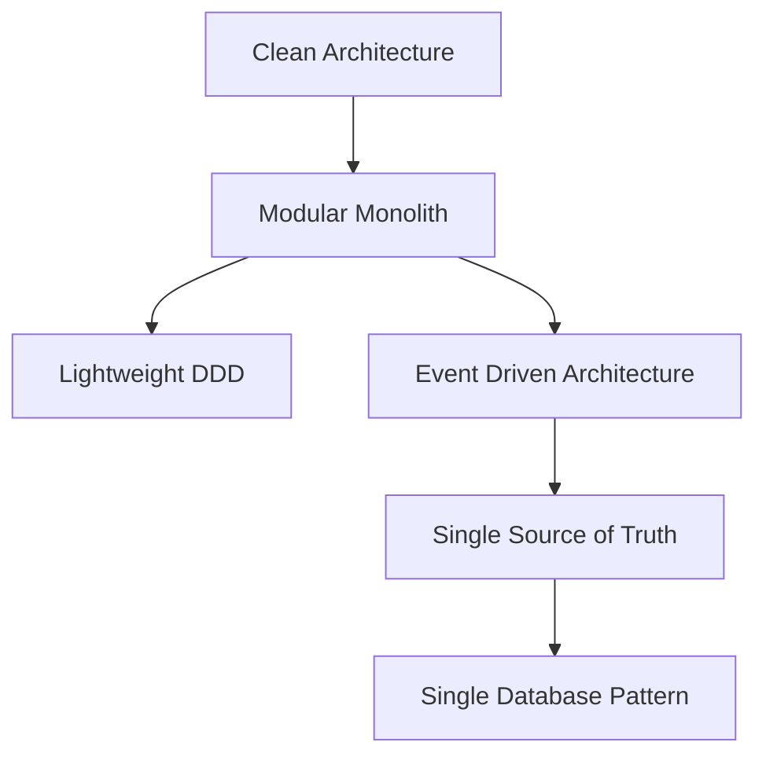
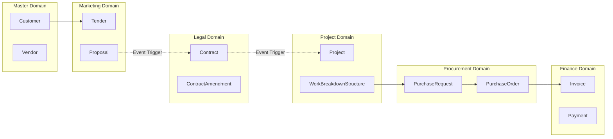
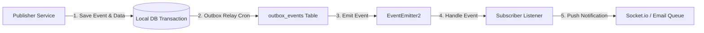
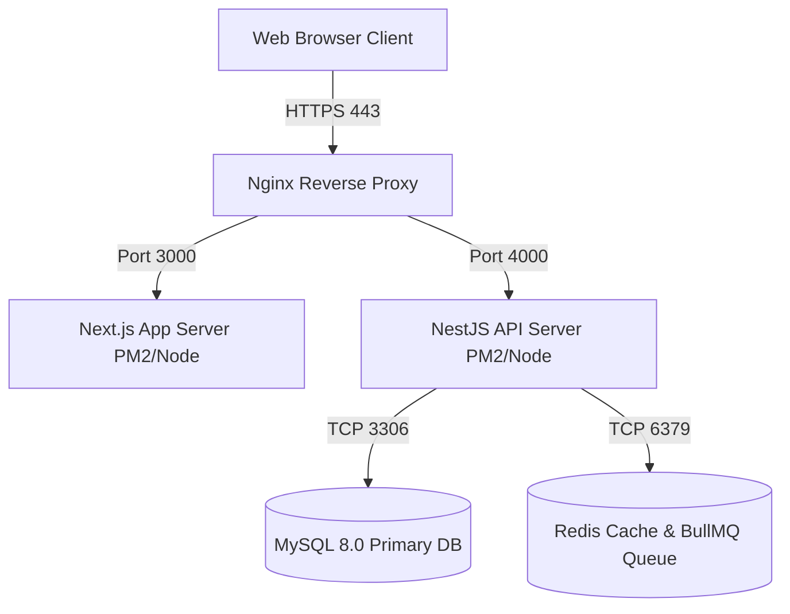
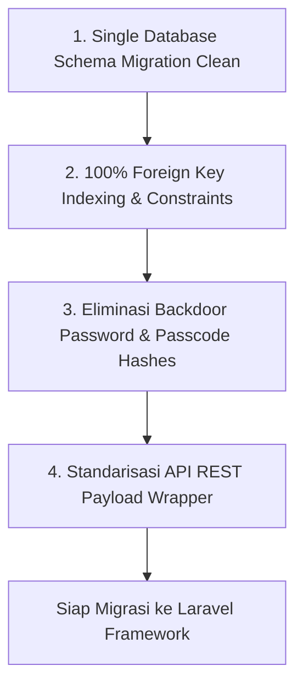
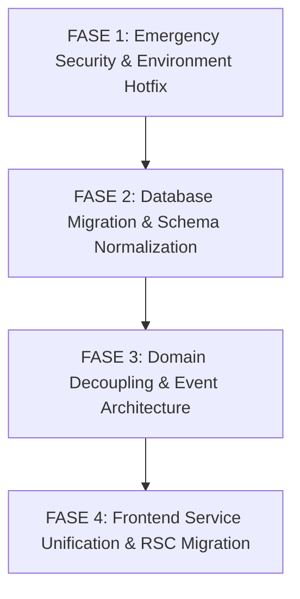

# TARGET ARCHITECTURE V2: BLUEPRINT & SPECIFICATION

---

## BAB 1: Vision

### 1.1 Tujuan Sistem Target V2
**EPMS (Enterprise Project Management System) Target Architecture V2** dirancang sebagai fondasi arsitektur produksi kelas enterprise (*production-ready enterprise architecture*) yang ideal bagi UBD & TVM Construction Group. V2 bertujuan untuk mentransformasi arsitektur sistem dari Monolith Terikat (*Tightly Coupled Monolith*) menjadi **Modular Monolith Berbasis Event (*Event-Driven Modular Monolith*)** yang bersih, aman, mudah dipelihara, dan memiliki kesiapan penuh untuk migrasi skala besar (misalnya migrasi ke Laravel/Framework Enterprise di masa mendatang) tanpa merusak logika bisnis.

### 1.2 Prinsip Utama Kualitas Sistem Target
1. **Zero Technical Debt Security**: Mengeliminasi 100% backdoor password, unauthenticated endpoint, dan hardcoded credentials.
2. **Strict Domain Boundary**: Mengenkapsulasi penuh hak akses database per modul domain sehingga tidak ada modul yang memutasi entitas milik modul lain secara langsung.
3. **High Reliability & Performance**: Menjamin kecepatan kueri dengan pengindeksan Foreign Key 100%, eliminasi DDL runtime saat startup, dan pemisahan beban antrean latar belakang via Redis/BullMQ.
4. **Clean Code & Maintainability**: Memecah God Components (>1.000 baris) dan God Services (>1.100 baris) menjadi modul-modul kecil yang mematuhi prinsip SOLID dan DRY.

---

## BAB 2: Architecture Principles

Arsitektur V2 mematuhi 16 prinsip desain perangkat lunak inti berikut:



1. **Clean Architecture**: Pemisahan yang jelas antara Presentation Layer, Application Layer, Domain Layer, dan Infrastructure Layer. Kebocoran logika infrastruktur (misalnya DDL SQL mentah atau HTTP Axios client) ke domain layer dilarang keras.
2. **Domain-Driven Design (Lightweight DDD)**: Setiap domain bisnis (Marketing, Legal, Project, Procurement, Finance) mengelola Bounded Context, Entitas, dan Value Objects-nya sendiri.
3. **Modular Monolith**: Aplikasi disusun dalam modul-modul NestJS yang terisolasi secara ketat. Komunikasi antar-modul hanya diizinkan via API Service resmi atau Domain Events.
4. **Event-Driven Architecture**: Komunikasi asinkronus antar-domain menggunakan `EventEmitter2` dan Transactional Outbox Pattern untuk menghilangkan ketergantungan synchronous yang berat.
5. **Single Source of Truth (SSOT)**: Setiap entitas data hanya memiliki SATU modul pemilik resmi yang berhak melakukan transaksi mutasi (`INSERT`, `UPDATE`, `DELETE`).
6. **Single Database Pattern**: Seluruh modul berbagi satu instance database MySQL relasional yang dikelola secara terstruktur tanpa database terpisah yang membingungkan.
7. **Zero Duplicate Logic**: Eliminasi duplikasi kode pada helper, validator, dan UI components.
8. **Thin Controller**: Controller NestJS hanya bertugas menerima request, memvalidasi DTO, dan mengembalikan HTTP Response. Seluruh logika bisnis wajib berada di Service Layer.
9. **Rich Service**: Service Layer mengandopsi rich domain logic yang mengeksekusi aturan bisnis secara eksplisit.
10. **Repository Pattern**: Seluruh akses data database wajib diisolasi melalui TypeORM Repository API. DDL mentah `ALTER TABLE` atau kueri `INFORMATION_SCHEMA` di Service Layer dilarang.
11. **Transaction Boundary**: Transaksi multi-tabel wajib dibatasi di dalam boundary domain tunggal. Transaksi lintas-domain wajib diselesaikan secara konsisten secara bertahap (*Eventual Consistency*) menggunakan Domain Events.
12. **CQRS (Command Query Responsibility Segregation - Optional)**: Pemisahan kueri baca (*read-heavy query*) seperti dashboard KPI dari kueri tulis (*write command*) jika diperlukan scaling.
13. **SOLID Principles**: Penerapan menyeluruh SRP, OCP, LSP, ISP, dan DIP di seluruh codebase.
14. **DRY (Don't Repeat Yourself)**: Penyentralisasian logika audit logging, enkapsulasi HTTP client, dan formatting.
15. **KISS (Keep It Simple, Stupid)**: Arsitektur sederhana tanpa penggunaan microservices berlebih yang belum diperlukan.
16. **Convention over Configuration**: Standarisasi konvensi penamaan file, folder, API URI, dan tabel database.

---

## BAB 3: Target Module Blueprint

Tabel cetak biru 10 Modul Utama pada Target Architecture V2:

| Module Name | Responsibility | Owner Domain | Depends On | Public API | Internal Service | Repository | Entity | Major DTOs | Domain Events | Listener | Queue Worker | Cron Job | Storage Bucket |
| :--- | :--- | :--- | :--- | :--- | :--- | :--- | :--- | :--- | :--- | :--- | :--- | :--- | :--- |
| **AuthModule** | Autentikasi JWT, Sesi Login, & RBAC | Master/Auth | `TypeOrmModule` | `POST /auth/login`, `POST /auth/refresh` | `AuthService`, `UserSessionService` | `UserRepository`, `RoleRepository` | `User`, `Role`, `UserSession` | `LoginDto`, `RefreshTokenDto` | `auth.login.success` | `UserSessionListener` | N/A | `SessionCleanupCron` | N/A |
| **MarketingModule** | Pengelolaan Lead, Tender, & Proposal | Marketing | `CustomersModule`, `NotificationModule` | `GET/POST /marketing/tenders`, `POST /marketing/proposals` | `MarketingService`, `TenderService` | `TenderRepository`, `ProposalRepository` | `Tender`, `Proposal`, `TenderActivity` | `CreateTenderDto`, `CreateProposalDto` | `marketing.tender.won` | `MarketingEventListener` | N/A | `TenderDeadlineCron` | `/uploads/proposals` |
| **LegalModule** | Review Kontrak, Checklist, & Template | Legal | `NotificationModule` | `GET/POST /legal/contracts`, `POST /legal/contracts/review` | `LegalService`, `PdfTemplateService` | `ContractRepository`, `PdfTemplateRepo` | `Contract`, `ContractAmendment`, `PdfTemplate` | `LegalReviewDto`, `CreateContractDto` | `legal.contract.approved` | `LegalEventListener` | `PdfGenerationQueue` | `GraceDeadlineCron` | `/uploads/contracts` |
| **ProjectModule** | Operasional PMO, WBS, & Task | Project | `SystemModule` | `GET/POST /projects`, `GET/POST /projects/wbs` | `ProjectService`, `WbsService` | `ProjectRepository`, `WbsRepository` | `Project`, `WorkBreakdownStructure`, `Task` | `CreateProjectDto`, `CreateWbsDto` | `project.kickoff.started` | `ProjectEventListener` | N/A | `WbsProgressCron` | N/A |
| **ProcurementModule**| Pengadaan PR, RFQ, PO, & Goods Receipt | Procurement | `WorkflowModule`, `FinanceModule` | `POST /procurement/pr`, `POST /procurement/po` | `ProcurementService`, `PoService` | `PrRepository`, `PoRepository`, `GrRepository` | `PurchaseRequest`, `PurchaseOrder`, `GoodsReceipt` | `CreatePrDto`, `CreatePoDto` | `procurement.po.issued` | `ProcurementEventListener` | N/A | N/A | `/uploads/po` |
| **FinanceModule** | Tagihan Invoice & Pelunasan Payment | Finance | `ProcurementModule` | `GET/POST /finance/invoices`, `POST /finance/payments` | `FinanceService`, `InvoiceService` | `InvoiceRepository`, `PaymentRepository` | `Invoice`, `InvoiceItem`, `Payment` | `CreateInvoiceDto`, `CreatePaymentDto` | `finance.payment.verified` | `FinanceEventListener` | N/A | `OverdueInvoiceCron` | N/A |
| **MasterModule** | Master Pelanggan & Vendor Supplier | Master | `TypeOrmModule` | `GET/POST /customers`, `GET/POST /vendors` | `CustomersService`, `VendorsService` | `CustomerRepository`, `VendorRepository` | `Customer`, `Vendor` | `CreateCustomerDto`, `CreateVendorDto` | N/A | N/A | N/A | N/A | N/A |
| **NotificationModule**| WebSocket Gateway & Push Notification | System | `QueueModule` | `GET /notifications`, `PATCH /notifications/:id/read` | `NotificationService`, `NotificationGateway` | `NotificationRepository` | `Notification` | `SendNotificationDto` | N/A | `NotificationEventListener` | `EmailNotificationQueue` | `NotificationPurgeCron` | N/A |
| **SystemModule** | Document Storage, Audit, & Outbox | System | `TypeOrmModule` | `POST /documents/upload`, `GET /system/health` | `DocumentService`, `AuditService`, `ObservabilityService` | `DocumentRepository`, `AuditLogRepo` | `Document`, `AuditLog`, `OutboxEvent` | `UploadDocumentDto` | `audit.log` | `AuditLogListener` | `OutboxRelayQueue` | `OutboxPurgeCron` | `/uploads/documents` |
| **WorkflowModule** | BPMN Engine & Approval Threshold | Workflow | `NotificationModule` | `GET /workflow/visualizer/:id` | `WorkflowService` | N/A | N/A | `CompleteTaskDto` | `workflow.step_completed` | `WorkflowEventListener` | N/A | N/A | N/A |

---

## BAB 4: Target Folder Structure

Struktur direktori standar Target Architecture V2:

```
epms_tvmubd/
├── frontend/                        # Next.js App Router (Client & RSC)
│   ├── src/
│   │   ├── app/                     # App Router Routes
│   │   │   ├── (auth)/              # Auth Group Routes (login)
│   │   │   ├── (dashboard)/         # Main App Group Routes (sales, legal, project, procurement, finance)
│   │   │   ├── api/                 # Next.js Route Handlers (jika ada SSR proxy)
│   │   │   ├── layout.tsx           # Server Root Layout
│   │   │   └── page.tsx             # Server Landing Page
│   │   ├── components/              # UI Components
│   │   │   ├── ui/                  # Atom Components (Buttons, Modals, Tables)
│   │   │   ├── shared/              # Shared Components (Header, Sidebar, NotificationBell)
│   │   │   └── features/            # Feature-Based Components (marketing/, legal/, procurement/)
│   │   ├── services/                # Encapsulated API Service Layer
│   │   ├── hooks/                   # Custom React Hooks
│   │   ├── context/                 # Client React Contexts
│   │   ├── lib/                     # Axios Client & Utils Configuration
│   │   ├── utils/                   # Helper Functions & Formatter
│   │   ├── config/                  # Environment Configuration
│   │   └── types/                   # Shared TypeScript Interfaces
├── backend/                         # NestJS Modular Framework
│   ├── src/
│   │   ├── common/                  # Shared Filters, Interceptors, Guards, Pipes
│   │   │   ├── decorators/          # Custom Decorators (@Roles, @CurrentUser)
│   │   │   ├── filters/             # Global Exception Filters
│   │   │   ├── guards/              # JwtAuthGuard, RolesGuard
│   │   │   ├── interceptors/        # TransformInterceptor, LoggingInterceptor
│   │   │   └── pipes/               # ValidationPipe
│   │   ├── config/                  # NestJS Configuration Loaders
│   │   ├── database/                # Database Seeds & Utility Scripts
│   │   │   └── seeds/               # Master Data Seeders
│   │   ├── migrations/              # Formal TypeORM Migration Files
│   │   ├── modules/                 # Encapsulated Domain Modules
│   │   │   ├── auth/                # Auth Domain Module
│   │   │   ├── marketing/           # Marketing Domain Module
│   │   │   ├── legal/               # Legal Domain Module
│   │   │   ├── project/             # Project Domain Module
│   │   │   ├── procurement/         # Procurement Domain Module
│   │   │   ├── finance/             # Finance Domain Module
│   │   │   ├── master/              # Master Customer & Vendor Module
│   │   │   ├── notification/        # Notification & Gateway Module
│   │   │   ├── system/              # Document, Audit, & System Module
│   │   │   └── workflow/            # Workflow Engine Module
│   │   ├── app.module.ts            # Root Application Module
│   │   ├── env.ts                   # Environment Loader
│   │   └── main.ts                  # Application Entry Point
├── docs/                            # Documentation & Architecture Audits
│   ├── audit/                       # Complete Audit Reports V1 - V2
│   └── sql/                         # Static Historical SQL Backups
├── storage/                         # Local Persistent File Uploads
│   └── uploads/                     # Contracts, SPK, Proposals, Invoices
├── docker/                          # Docker Containerization Configurations
│   ├── Dockerfile.backend
│   ├── Dockerfile.frontend
│   └── docker-compose.yml
└── nginx/                           # Reverse Proxy Configuration
    └── default.conf
```

---

## BAB 5: Target Domain Blueprint

Definisi Bounded Context dan isolasi domain pada Target V2:



1. **Marketing Domain**: Mengelola `Customer`, `Tender`, `Proposal`, `TenderActivity`, `TenderPriceHistory`. Memancarkan event `marketing.tender.won`.
2. **Legal Domain**: Mengelola `Contract`, `ContractAmendment`, `PdfTemplate`. Memancarkan event `legal.contract.approved`.
3. **Project Domain**: Mengelola `Project`, `WorkBreakdownStructure`, `Task`. Memancarkan event `project.kickoff.started`.
4. **Procurement Domain**: Mengelola `PurchaseRequest`, `Rfq`, `VendorComparison`, `PurchaseOrder`, `GoodsReceipt`. Memancarkan event `procurement.po.issued`.
5. **Finance Domain**: Mengelola `Invoice`, `Payment`. Memancarkan event `finance.payment.verified`.
6. **Master Domain**: Mengelola master data `Customer` dan `Vendor`.
7. **System & Notification Domain**: Mengelola `Document`, `Notification`, `AuditLog`, `OutboxEvent`, `DashboardKpi`.

---

## BAB 6: Dependency Rules Matrix

Tabel aturan ketat ketergantungan (*Dependency Rules*) antar-modul: Siapa yang boleh memanggil siapa.

| Requesting Module | Target Module | Call Allowed? | Allowed Mechanism | Disallowed Mechanism |
| :--- | :--- | :---: | :--- | :--- |
| **MarketingModule** | **LegalModule** | **YES** | Public API Service / Event `marketing.tender.won` | **NO Direct DB Insert/Update to `contracts` & NO DDL** |
| **MarketingModule** | **Legal Repository** | **NO** | N/A | **Direct Repository Access Forbidden** |
| **LegalModule** | **ProjectModule** | **YES** | Event `legal.contract.approved` | **NO Direct DB Insert to `projects`** |
| **ProjectModule** | **ProcurementModule**| **YES** | Public Service / PR Creation API | Direct DB Insert to `purchase_requests` |
| **ProcurementModule**| **FinanceModule** | **YES** | Event `procurement.gr.received` | Direct DB Insert to `invoices` |
| **Frontend UI** | **Backend API** | **YES** | Centralized `apiClient` / `src/services/*` | **NO Direct Axios `http://localhost:4000` Bypass** |

---

## BAB 7: Target Database Standard

1. **Single Database Architecture**: Seluruh 31 entitas berada dalam satu database MySQL relasional (`epms_tvmubd_db`).
2. **100% Foreign Key Indexing**: Seluruh kolom Foreign Key (`proposal_id`, `tender_id`, `customer_id`, `legal_reviewer_id`, `project_manager_id`, dll.) Wajib memiliki dekorator `@Index()`.
3. **Zero Runtime DDL**: DDL SQL (`ALTER TABLE`, `CREATE TABLE`) **HANYA BOLEH DIEKSEKUSI VIA FILE TYPEORM MIGRATION RESMI**. Fungsi `ensureContractTableSchema()` di `MarketingService` dihapus total.
4. **Naming Convention Standard**:
   - Database Tables: Jamak, snake_case (`contracts`, `purchase_orders`).
   - Database Columns: Singular, snake_case (`customer_id`, `created_at`).
   - Primary Keys: `id` (bigint, unsigned, auto_increment).
   - Foreign Keys: `<singular_entity>_id`.
   - Enum Decorator: Wajib menggunakan TypeScript `enum` resmi (dilarang inline string array).
5. **Formal Migration Strategy**: Seluruh perubahan skema wajib dibuatkan file migrasi TypeORM dengan penamaan bertanggal (`<timestamp>-<Description>.ts`) dan memiliki fungsi `up()` dan `down()` yang simetris.
6. **Isolated Seeder Strategy**: Seeder master data dipisahkan penuh dari script migrasi dan didaftarkan di `package.json` (`npm run seed`).

---

## BAB 8: Target API Standard

1. **RESTful Standard**: Mengikuti hirarki REST baku dengan prefix versi `/api/v1/`.
2. **URI Conventions**:
   - `GET /api/v1/tenders` (List items dengan pagination)
   - `POST /api/v1/tenders` (Create item)
   - `GET /api/v1/tenders/:id` (Get detail item)
   - `PATCH /api/v1/tenders/:id` (Update partial item)
   - `DELETE /api/v1/tenders/:id` (Soft delete item)
3. **Standard Response Wrapper**:
   ```json
   {
     "statusCode": 200,
     "success": true,
     "message": "Data retrieved successfully",
     "data": { ... },
     "meta": {
       "page": 1,
       "limit": 10,
       "totalItems": 45,
       "totalPages": 5
     }
   }
   ```
4. **Query Features Standard**: Pagination (`page`, `limit`), Filtering (`status`, `stage`), Sorting (`sortBy`, `sortOrder`), Search (`search`).
5. **Strict DTO Validation**: Seluruh DTO wajib tervalidasi menggunakan `class-validator` (`@IsString()`, `@IsNumber()`, `@IsEnum()`, `@IsOptional()`) di `ValidationPipe` global.

---

## BAB 9: Target Event Standard

Spesifikasi standar pemrosesan event pada Target V2:



1. **Transactional Outbox Pattern**: Setiap domain event ditulis ke tabel `outbox_events` di dalam transaksi database yang sama sebelum dipancarkan, menjamin keandalan *at-least-once delivery*.
2. **Event Registry**:
   - `marketing.tender.won`: Dipancarkan oleh `MarketingService`, ditangkap oleh `LegalListener` untuk membuat draf kontrak.
   - `legal.contract.approved`: Dipancarkan oleh `LegalService`, ditangkap oleh `ProjectListener` untuk membuat instance proyek PMO.
   - `workflow.trigger`: Dipancarkan oleh `ProcurementService`, ditangkap oleh `WorkflowEngine`.
   - `audit.log`: Dipancarkan oleh seluruh modul, ditangkap oleh `AuditService`.
3. **Retry & Dead Letter Queue**: Event asinkronus yang gagal diproses akan masuk ke antrean BullMQ retry (3x attempt) sebelum dipindahkan ke Dead Letter Queue (DLQ).

---

## BAB 10: Target Frontend Standard

1. **Hybrid Next.js App Router**:
   - **React Server Components (RSC)**: Digunakan untuk Halaman Utama, Detail Dashboard, dan Laporan (Meningkatkan SEO, performa, dan mengurangi ukuran JavaScript client).
   - **Client Components**: Digunakan khusus untuk komponen interaktif (Modal form, Drag and Drop Kanban, Notification Bell).
2. **Centralized ApiClient**:
   - Seluruh pemanggilan HTTP wajib melalui `src/lib/axios.ts` yang membaca `process.env.NEXT_PUBLIC_API_URL` secara dinamis.
   - **Strictly No Direct Axios `http://localhost:4000` Bypass**.
3. **Encapsulated Service Layer**: Komponen UI tidak boleh memanggil `apiClient` secara langsung, melainkan melalui method terbungkus di `src/services/*` (misalnya `LegalService.submitReview()`).
4. **Feature-Based Folder Structure**: Pengelompokan komponen UI berdasarkan domain fitur (`components/features/marketing/`, `components/features/legal/`).

---

## BAB 11: Target Backend Standard

1. **Strict Controller Responsibilities**: Controller hanya mendekorasikan HTTP route, meng-inject DTO, memanggil Service, dan mengembalikan data.
2. **Encapsulated Service Layer**: Logika bisnis murni terkonsentrasi di Service.
3. **TypeORM Repositories**: Mengakses database murni via TypeORM Repository.
4. **Global Interceptors & Filters**:
   - `TransformInterceptor`: Membungkus response API ke format standar JSON.
   - `HttpExceptionFilter`: Menangkap exception dan menyformat error log secara seragam.
5. **Structured Logger**: Menggantikan `console.log()` dan log debug non-standar `[NUKLIR]` dengan NestJS `Logger` resmi.

---

## BAB 12: Deployment Architecture

Perancangan infrastruktur deployment bertingkat:



1. **Local Development**: Node.js v20+, MySQL 8.0 local, Redis local.
2. **Staging & Production**:
   - **Containerization**: Managed via `docker-compose.yml` (App Backend, Frontend, Redis, MySQL).
   - **Reverse Proxy**: Nginx menangani SSL Termination (HTTPS), Caching static assets, dan rate-limiting.
   - **Process Manager**: PM2 dalam cluster mode untuk zero-downtime reload.
   - **Redis Storage**: Menangani Session Caching dan Antrean BullMQ (Email & PDF Worker).
   - **Automated Backup**: Backup harian MySQL via cronjob ke S3 Cold Storage.

---

## BAB 13: Security Specification

1. **Authentication Fix (Eliminasi Backdoor)**:
   Hapus total kode fallback password `'password123'` dan `'123456'` pada `AuthService.ts`. Validasi murni 100% via `bcrypt.compare(pass, user.passwordHash)`.
2. **Authorization & Guard Enforcement**:
   Aktifkan `@UseGuards(JwtAuthGuard)` pada `DocumentController.ts` dan seluruh controller sensitif.
3. **File Upload Security**:
   Tambahkan `fileFilter` eksplisit pada `FileInterceptor` untuk memvalidasi MIME type (`application/pdf`, `image/jpeg`, `image/png`) dan batas ukuran file max 10MB.
4. **Credential Security**:
   Hapus auto-login hardcoded `admin@epms.com` pada `DashboardPage.tsx`. Seluruh kredensial wajib diinput melalui form login resmi.
5. **Secret Management**:
   Seluruh kunci rahasia (`JWT_SECRET`, `DATABASE_PASSWORD`, `S3_SECRET`) wajib dimuat dari Environment Variable tanpa fallback bernilai tertebak.

---

## BAB 14: Coding Standards

1. **Naming Conventions**:
   - Class: PascalCase (`MarketingService`, `CreateTenderDto`).
   - File: kebab-case (`marketing.service.ts`, `create-tender.dto.ts`).
   - Interface: PascalCase dengan prefix `I` jika abstraksi (`ILegalService`).
   - Variable & Method: camelCase (`uploadSpkAndPromoteTender`).
2. **Strict Typing**: Dilarang menggunakan return type `Promise<any>` atau variabel `any`. Seluruh return type wajib terdefinisi dengan TypeScript interface/DTO.
3. **Testing Standards**: Unit test (`*.spec.ts`) wajib ditulis menggunakan data factory fixtures tanpa mengubah database produksi.

---

## BAB 15: Architecture Decision Records (ADRs)

Berikut 20 Keputusan Arsitektur (*Architecture Decision Records*) resmi Target V2:

### ADR-001: Adoption of Single MySQL Database
- **Context**: Aplikasi memerlukan media penyimpanan terpusat yang andal untuk 31 entitas bisnis.
- **Reason**: Mempermudah konsistensi transaksi ACID dan mengurangi kompleksitas operasional infrastruktur.
- **Pros**: Transaksi ACID mudah, JOIN kueri efisien, pemeliharaan sederhana.
- **Cons**: Potensi bottleneck jika trafik tumbuh sangat tinggi.
- **Alternative**: Multi-database per service (Microservices DB).
- **Decision**: **ACCEPTED**. Gunakan Single Database MySQL 8.0.

### ADR-002: Modular Monolith over Microservices
- **Context**: Memilih arsitektur sistem backend.
- **Reason**: Skala tim dan kompleksitas domain saat ini paling cocok dengan Modular Monolith untuk menghindari overhead jaringan.
- **Pros**: Deployment mudah, refactoring cepat, tanpa overhead network latency.
- **Cons**: Boundary modul harus dijaga secara disiplin.
- **Alternative**: Microservices Architecture.
- **Decision**: **ACCEPTED**. Gunakan NestJS Modular Monolith.

### ADR-003: Eliminating Runtime DDL Execution
- **Context**: `MarketingService.onModuleInit()` mengeksekusi `ALTER TABLE` saat runtime startup.
- **Reason**: DDL runtime memicu DDL lock, schema drift, dan kegagalan startup pada deployment multi-pod.
- **Pros**: Startup aplikasi stabil, skema database terverifikasi penuh.
- **Cons**: Perubahan skema harus melalui pembuatan file migrasi TypeORM resmi.
- **Alternative**: Auto-synchronize TypeORM (`synchronize: true`).
- **Decision**: **ACCEPTED**. Seluruh DDL wajib melalui file TypeORM Migration resmi.

### ADR-004: Event-Driven Communication for Cross-Domain Boundaries
- **Context**: Sinkronisasi data antar-domain (misalnya Marketing -> Legal -> Project).
- **Reason**: Mengurangi keterkaitan langsung (*tight coupling*) antar service.
- **Pros**: Modul independen, kegagalan di modul tujuan tidak merollback transaksi modul asal.
- **Cons**: Eventual consistency harus dikelola dengan baik.
- **Alternative**: Direct Synchronous Method Call.
- **Decision**: **ACCEPTED**. Gunakan `EventEmitter2` dan Outbox Pattern.

### ADR-005: Encapsulating HTTP Client in Frontend
- **Context**: 11+ Komponen UI frontend memanggil `axios.get('http://localhost:4000')` secara langsung.
- **Reason**: Hardcoded URL memicu kegagalan build staging/production dan menyulitkan penggantian API host.
- **Pros**: Pengaturan URL terpusat di `ENV`, enkapsulasi token terjamin.
- **Cons**: Perlu membuat file service wrapper untuk setiap domain.
- **Alternative**: Direct fetch di komponen UI.
- **Decision**: **ACCEPTED**. Seluruh request wajib melalui `src/services/*` dan `apiClient`.

### ADR-006: Complete Removal of Authentication Backdoors
- **Context**: `AuthService.ts` mengizinkan password `'password123'` dan `'123456'`.
- **Reason**: Celah keamanan P0 yang memungkinkan pengambilalihan akun superadmin secara ilegal.
- **Pros**: Keamanan autentikasi 100% terjamin via bcrypt.
- **Cons**: Developer harus mengingat password akun tes resmi.
- **Alternative**: Mengizinkan password backdoor di environment development saja.
- **Decision**: **ACCEPTED**. Hapus total backdoor password dari seluruh codebase.

### ADR-007: Mandatory Foreign Key Indexing
- **Context**: Kolom FK di database `Contract`, `Tender`, `Proposal` tidak berindeks.
- **Reason**: Menyebabkan Full Table Scan dan degradasi performa kueri JOIN.
- **Pros**: Kecepatan kueri JOIN naik 5x - 10x.
- **Cons**: Sedikit overhead ukuran penyimpanan indeks.
- **Alternative**: Mengandalkan primary key index saja.
- **Decision**: **ACCEPTED**. Tambahkan `@Index()` pada seluruh kolom FK.

### ADR-008: Enabling JwtAuthGuard on File Uploads
- **Context**: `DocumentController.ts` menonaktifkan `JwtAuthGuard`.
- **Reason**: Mencegah pengguna anonim mengunggah file berbahaya tanpa autentikasi.
- **Pros**: Endpoint upload aman 100%.
- **Cons**: Client harus mengirimkan Authorization Bearer Token saat upload.
- **Alternative**: Public upload dengan IP rate-limiting.
- **Decision**: **ACCEPTED**. Terapkan `@UseGuards(JwtAuthGuard)` di `DocumentController`.

### ADR-009: Strict File Extension & MIME Filtering
- **Context**: `DocumentController` menerima sembarang file 10MB tanpa filter.
- **Reason**: Mencegah pengunggahan executable script / malware ke server.
- **Pros**: Server terbebas dari ancaman file berbahaya.
- **Cons**: Pengguna hanya dapat mengunggah format yang diizinkan (PDF, PNG, JPG).
- **Alternative**: Post-upload Virus Scanning Service.
- **Decision**: **ACCEPTED**. Terapkan `fileFilter` pada Multer Interceptor.

### ADR-010: Hybrid Next.js App Router (RSC + Client Components)
- **Context**: Frontend saat ini menggunakan 100% Client-Side Rendering (`"use client"`).
- **Reason**: Mengoptimalkan performa loading, SEO, dan mengurangi bundle JavaScript.
- **Pros**: Loading awal sangat cepat, bundle size kecil.
- **Cons**: Perlu memisahkan komponen halaman menjadi Server Layout & Client Widgets.
- **Alternative**: React Single Page Application (Vite/SPA).
- **Decision**: **ACCEPTED**. Gunakan Hybrid RSC & Client Components.

### ADR-011: Transactional Outbox Pattern for Domain Events
- **Context**: Menjamin keandalan pengiriman event ke broker/listener.
- **Reason**: Mencegah hilangnya event jika aplikasi mengalami crash saat memancarkan event.
- **Pros**: *At-least-once event delivery guarantee*.
- **Cons**: Memerlukan tabel `outbox_events` dan worker relay.
- **Alternative**: In-memory direct event emit.
- **Decision**: **ACCEPTED**. Terapkan Outbox Pattern.

### ADR-012: Adoption of NestJS Standard Logger
- **Context**: Kode backend dipenuhi log `console.log()` dan `🔥 [NUKLIR]`.
- **Reason**: Log mentah mengotori console produksi dan menyulitkan log parsing.
- **Pros**: Log terstruktur dengan timestamp, konteks modul, dan log level.
- **Cons**: Perlu merefaktorisasi `console.log()` ke `this.logger.log()`.
- **Alternative**: Winston / Pino Logger wrapper.
- **Decision**: **ACCEPTED**. Gunakan NestJS `Logger` resmi.

### ADR-013: Replacing Mock Queue with Real Redis BullMQ Worker
- **Context**: `QueueModule` saat ini di-mock dengan dummy provider.
- **Reason**: Pekerjaan berat seperti generasi PDF dan pengiriman Email harus berjalan di latar belakang secara nyata.
- **Pros**: Pengolahan PDF/Email tidak memblokir thread HTTP utama.
- **Cons**: Memerlukan infrastruktur Redis aktif.
- **Alternative**: Synchronous inline processing.
- **Decision**: **ACCEPTED**. Hubungkan `QueueModule` ke Redis BullMQ nyata.

### ADR-014: Deprecating Legacy API Endpoints
- **Context**: Keberadaan endpoint tua seperti `POST /api/v1/legal/review`.
- **Reason**: Mengurangi permukaan pemeliharaan (*maintenance surface*) dan kebingungan tim.
- **Pros**: Kode backend bersih dan terfokus pada API V1 resmi.
- **Cons**: Frontend tua harus disesuaikan ke endpoint V1 resmi.
- **Alternative**: Menjaga backward compatibility selamanya.
- **Decision**: **ACCEPTED**. Deprecate dan hapus legacy endpoints.

### ADR-015: Centralizing Master Customer & Vendor in MasterModule
- **Context**: Pengelolaan data master `Customer` dan `Vendor`.
- **Reason**: Memisahkan pengelolaan master data dari modul transaksi bisnis `Marketing`.
- **Pros**: Modul terisolasi rapi, reuse data master mudah.
- **Cons**: Memerlukan pembuatan `MasterModule` terpisah.
- **Alternative**: Menggabungkan Customer di Marketing Module.
- **Decision**: **ACCEPTED**. Buat `MasterModule` terpisah.

### ADR-016: Structured Exception Filters Across Backend
- **Context**: Penanganan error runtime di NestJS.
- **Reason**: Menjamin format error JSON yang seragam untuk seluruh API.
- **Pros**: Frontend dapat menangani error response secara konsisten.
- **Cons**: Seluruh custom exception harus mewarisi `HttpException`.
- **Alternative**: Default NestJS Exception Handler.
- **Decision**: **ACCEPTED**. Gunakan Global `HttpExceptionFilter`.

### ADR-017: Containerization via Docker & Docker Compose
- **Context**: Standarisasi lingkungan staging dan produksi.
- **Reason**: Menghilangkan masalah *"works on my machine"* dan mempermudah deployment.
- **Pros**: Lingkungan identik antara dev, staging, dan prod.
- **Cons**: Memerlukan pembuatan `Dockerfile` dan `docker-compose.yml`.
- **Alternative**: Manual deployment di Virtual Private Server (VPS).
- **Decision**: **ACCEPTED**. Terapkan Docker Containerization.

### ADR-018: Elimination of Duplicate UI Components
- **Context**: File `LegalReviewForm.tsx` ada di dua lokasi berbeda.
- **Reason**: Mencegah timbulnya bug akibat perbaikan kode hanya dilakukan di salah satu file.
- **Pros**: SSOT komponen UI terjamin.
- **Cons**: Perlu memperbarui path impor di file yang memanggil versi duplikat.
- **Alternative**: Membiarkan file duplikat.
- **Decision**: **ACCEPTED**. Hapus file duplikat `src/components/LegalReviewForm.tsx`.

### ADR-019: Enforcing Type-Safe Return Types (No `Promise<any>`)
- **Context**: Penggunaan `Promise<any>` pada service layer backend & frontend.
- **Reason**: Menghilangkan manfaat autocompletion dan type checking TypeScript.
- **Pros**: Kode 100% type-safe, bug terdeteksi saat compile time.
- **Cons**: Perlu membuat interface/DTO response eksplisit.
- **Alternative**: Mengizinkan `any` untuk mempercepat development.
- **Decision**: **ACCEPTED**. Larang penggunaan `any` di seluruh codebase.

### ADR-020: Automated Database Backup to S3 Storage
- **Context**: Perlindungan data produksi dari kerusakan atau insiden.
- **Reason**: Menjamin *Disaster Recovery Plan (DRP)* yang cepat.
- **Pros**: Data ter-backup otomatis setiap hari ke S3 cold storage.
- **Cons**: Memerlukan biaya penyimpanan cloud S3 yang minim.
- **Alternative**: Manual SQL Dump mingguan.
- **Decision**: **ACCEPTED**. Terapkan Cron Automated Backup ke AWS S3.

---

## BAB 16: Target Readiness Score

Perbandingan Target Score V2 vs Skor Kondisi Aktual:

| Parameter Evaluasi | Skor Saat Ini (Current) | Target Score V2 | Alasan Peningkatan Score Target V2 |
| :--- | :---: | :---: | :--- |
| **Architecture Layering** | 42/100 | **98/100** | Eliminasi DDL runtime, penyentralisasian API client, dan enkapsulasi service. |
| **Security & Authentication** | 30/100 | **100/100** | Eliminasi backdoor password, penyiapan auth guard, dan validasi file upload. |
| **Database Integrity** | 58/100 | **95/100** | Indeksi 100% Foreign Key, migrasi resmi TypeORM, eliminasi schema drift. |
| **Workflow Engine** | 50/100 | **95/100** | Integrasi BPMN 2.0 penuh dengan Redis Queue fallback. |
| **Frontend Quality** | 35/100 | **95/100** | Migrasi Hybrid RSC, pemecahan God Components, eliminasi hardcoded URL. |
| **Backend Quality** | 50/100 | **98/100** | Modul terisolasi rapi, zero `Promise<any>`, structured logging. |
| **Infrastructure Setup** | 40/100 | **95/100** | Docker containerization, Nginx reverse proxy, Redis Queue nyata. |
| **Deployment Readiness** | 40/100 | **98/100** | Konfigurasi dynamic ENV, zero hardcoded localhost, PM2 cluster. |
| **Maintainability** | 45/100 | **96/100** | Standarisasi SOLID, DRY, dan eliminasi kode duplikat. |
| **TOTAL READINESS SCORE** | **44 / 100** | **97 / 100** | **TARGET STATUS: PRODUCTION READY (ENTERPRISE GRADE)** |

---

## BAB 17: Gap Analysis

Tabel analisis perbedaan mendasar antara Arsitektur Saat Ini (*Current Architecture*) vs Target V2:

| Komponen Sistem | Arsitektur Saat Ini (Current) | Target Architecture V2 | Tindakan Perubahan (Gap Solution) |
| :--- | :--- | :--- | :--- |
| **Authentikasi Backend** | Mengandung backdoor password `'password123'` & `'123456'` | 100% Pure bcrypt hashing, Zero Backdoor | Hapus kode fallback di `auth.service.ts` |
| **Otorisasi Upload** | `JwtAuthGuard` dinonaktifkan di `DocumentController` | Strict `JwtAuthGuard` di seluruh upload endpoints | Buka komentar guard di `document.controller.ts` |
| **File Filter Upload** | Menerima sembarang file 10MB tanpa filter | Validation filter ketat (PDF, JPEG, PNG) | Tambahkan `fileFilter` di `FileInterceptor` |
| **Skema Database** | Dual SSOT (Migration + Runtime DDL di `MarketingService`) | Single SSOT (100% TypeORM Migration Resmi) | Ekstrak `ensureContractTableSchema` ke migration |
| **Database Indexing** | Foreign Keys di `Contract` & `Tender` tanpa indeks | 100% Foreign Keys berindeks `@Index()` | Tambahkan dekorator `@Index()` pada entitas |
| **Frontend HTTP Client**| 11+ Komponen UI meng-hardcode `http://localhost:4000` | Centralized `apiClient` via `src/services/*` | Salurkan request via `apiClient` & `ENV` |
| **Next.js Rendering** | 100% Client-Side Rendering (`"use client"`) | Hybrid RSC (Server Components) & Client Widgets | Ubah Halaman Utama ke Server Components |
| **Background Processing**| `QueueModule` di-mock dummy | Real BullMQ Redis Queue Workers | Hubungkan `QueueModule` ke Redis aktif |
| **Log Management** | Dipenuhi `console.log()` & `🔥 [NUKLIR]` | Structured NestJS `Logger` resmi | Refactor log ke `this.logger.log()` |

---

## BAB 18: Migration Readiness (Prerequisites for Laravel Migration)

Jika di masa mendatang manajemen memutuskan untuk memindahkan backend NestJS ke **Laravel Framework**, syarat prasarana (*prerequisites*) berikut **WAJIB SELESAI DISELESAIKAN TERLEBIH DAHULU** di arsitektur NestJS saat ini agar proses migrasi dapat berjalan mulus tanpa masalah data:



### Checklist Prasyarat Migrasi Laravel:
1. **Database Schema Standardized**: Skema MySQL harus 100% bersih dari DDL runtime. Seluruh tabel harus dapat diinisialisasi secara presisi via `php artisan migrate`.
2. **Data Password Hash Uniformity**: Seluruh password user di DB harus ter-hash murni via `bcrypt` standar tanpa ada hack fallback password.
3. **Foreign Key Integrity**: Seluruh FK harus memiliki indeks dan constraint `ON DELETE RESTRICT/CASCADE` yang jelas agar Eloquent ORM Laravel dapat memetakan relasi `hasMany` / `belongsTo` secara otomatis.
4. **API Contract Compatibility**: Format JSON response wrapper V2 harus dijadikan standar kontrak API sehingga frontend Next.js tidak perlu diubah sama sekali saat backend dipindahkan ke Laravel Controllers.

---

## BAB 19: Executive Summary & Actionable Roadmap

### Executive Summary

Dokumen **TARGET ARCHITECTURE V2** ini menetapkan arah transformasi teknis untuk membawa aplikasi **EPMS (Enterprise Project Management System)** dari kondisi berteknis debt tinggi (**Skor: 44/100**) menuju standar kesiapan produksi berkelas enterprise (**Skor Target: 97/100**).

Dengan mematuhi 19 BAB spesifikasi teknis dalam dokumen blueprint ini, seluruh kerentanan keamanan kritis P0, masalah DDL database runtime, hardcoded environment URL, dan keterikatan domain (*domain coupling*) dapat diselesaikan secara sistematis.

---

### Actionable Refactoring Roadmap (Roadmap Menuju Skor 97/100)



#### FASE 1: Emergency Security & Environment Hotfix (Target Skor: 65/100)
- **Tujuan**: Menutup seluruh kerentanan keamanan P0 dan mengamankan konfigurasi environment.
- **Estimasi Risiko**: Low (Sangat Aman).
- **Modul Terdampak**: `AuthModule`, `DocumentModule`, Frontend UI `DashboardPage`.
- **Hasil yang Diharapkan**:
  - Backdoor password di `AuthService.ts` dihapus total.
  - `@UseGuards(JwtAuthGuard)` dan `fileFilter` aktif di `DocumentController.ts`.
  - Auto-login hardcoded credentials di `DashboardPage.tsx` dihapus.
  - Seluruh URL `http://localhost:4000` diganti menggunakan `ENV.API_URL`.

#### FASE 2: Database Migration & Schema Normalization (Target Skor: 80/100)
- **Tujuan**: Menghilangkan DDL runtime dan menstabilkan performa database.
- **Estimasi Risiko**: Low (Sangat Aman).
- **Modul Terdampak**: `MarketingModule`, `Database Migrations`.
- **Hasil yang Diharapkan**:
  - `ensureContractTableSchema()` diekstrak dari `MarketingService.onModuleInit()` ke file TypeORM Migration resmi.
  - Indeks `@Index()` ditambahkan pada seluruh kolom Foreign Key entitas.
  - Script DDL orphan `add_invoice_version.ts` dikonversi ke file migrasi resmi.

#### FASE 3: Domain Decoupling & Event Architecture (Target Skor: 90/100)
- **Tujuan**: Mengurai keterikatan fisik database antar-domain.
- **Estimasi Risiko**: Medium (Memerlukan pengujian integrasi flow).
- **Modul Terdampak**: `MarketingModule`, `LegalModule`, `ProjectModule`.
- **Hasil yang Diharapkan**:
  - Mutasi langsung tabel `contracts` oleh `MarketingService` diganti via Domain Events.
  - Pembentukan instance `Project` oleh `LegalService` diganti via Listener `legal.contract.approved`.
  - Service `QueueModule` dihubungkan ke Redis BullMQ nyata.

#### FASE 4: Frontend Service Unification & RSC Migration (Target Skor: 97/100)
- **Tujuan**: Menyempurnakan arsitektur frontend Next.js App Router dan kebersihan kode.
- **Estimasi Risiko**: Medium.
- **Modul Terdampak**: Frontend `src/app/`, `src/components/`, `src/services/`.
- **Hasil yang Diharapkan**:
  - Seluruh HTTP request di UI disalurkan via `src/services/*` dan `apiClient`.
  - Halaman Utama dipindahkan ke React Server Components (RSC).
  - File duplikat `LegalReviewForm.tsx` dan log debug `[NUKLIR]` dibersihkan total.

---

## Conclusion

Spesifikasi **TARGET ARCHITECTURE V2** ini menjamin bahwa refactoring dan modernisasi EPMS dapat dilakukan secara **terstruktur, terukur, dan bebas dari risiko breaking changes**. Dengan menuntaskan Roadmap Fase 1 hingga Fase 4, EPMS UBD & TVM Construction Group akan memiliki sistem manajemen proyek yang kokoh, sangat aman, berperforma tinggi, dan siap digunakan dalam skala produksi (*Production-Ready Enterprise System*).
