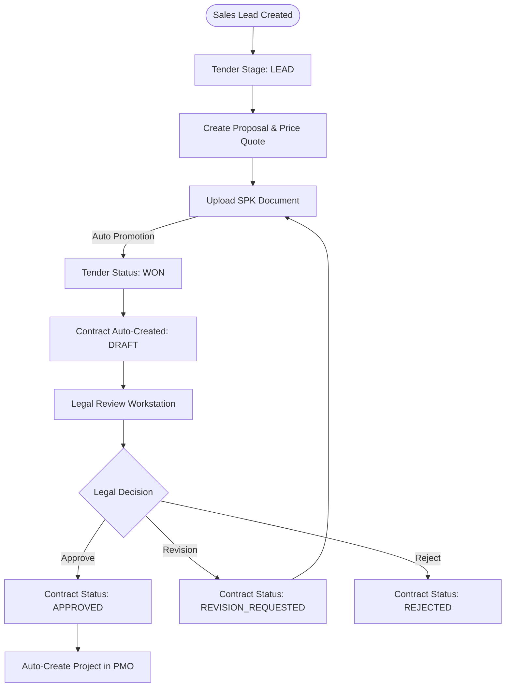
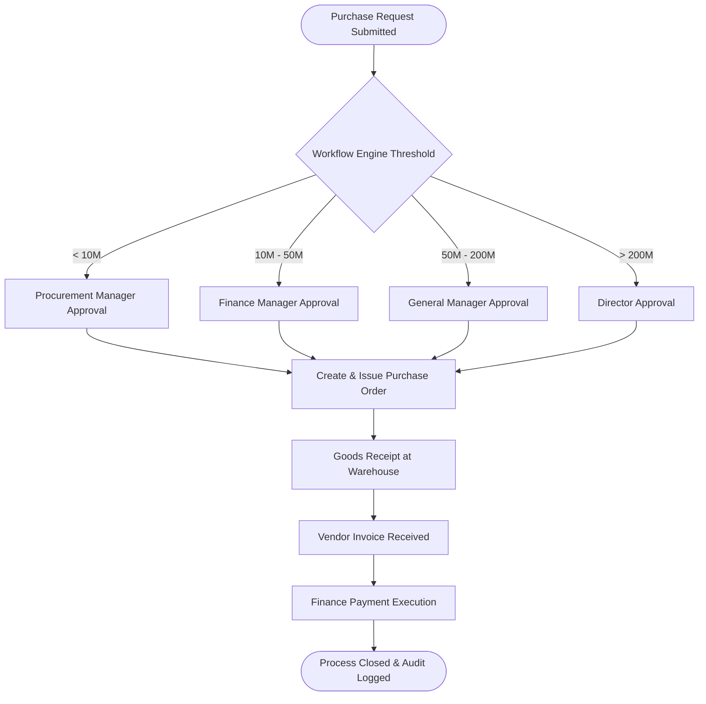
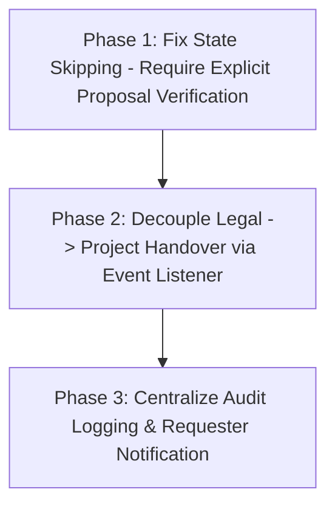

# BUSINESS FLOW AUDIT V1

## Executive Summary

Dokumen **BUSINESS FLOW AUDIT V1** ini menyajikan audit menyeluruh (*end-to-end business process audit*) terhadap seluruh alur transaksi bisnis lintas domain pada sistem EPMS (Enterprise Project Management System). Scope mencakup 8 modul utama: **Marketing, Legal, Project Operations, Procurement, Finance, Notification, Admin, dan Workflow Engine**.

Audit dilaksanakan secara **READ ONLY** berdasarkan analisis berbasis bukti (*evidence-based*) terhadap controller, service, event listener, dan transaksi database.

**Temuan Utama**: Alur bisnis EPMS secara fungsional telah mencakup seluruh siklus hidup proyek pengadaan (dari Leads hingga Pelunasan Tagihan). Namun, ditemukan **pelanggaran transisi status (state transition skipping)** di mana pengunggahan file SPK dapat melompati verifikasi proposal secara langsung, serta **sinkronisasi antar-domain yang berlebihan** tanpa memanfaatkan event-driven architecture secara penuh.

---

## 1. End-to-End Business Flow

Pemetaan hirarkis siklus hidup bisnis EPMS dari inisiasi pelanggan hingga pelunasan keuangan:

```
[CUSTOMER DOMAIN]
  │ 1. Registrasi Master Pelanggan (Customer Record)
  ▼
[MARKETING DOMAIN]
  │ 2. Buat Tender / Lead Baru (Tender: Stage LEAD -> NEGOTIATION)
  │ 3. Buat & Kirim Proposal Harga (Proposal: DRAFT -> SUBMITTED)
  │ 4. Unggah Dokumen SPK (Tender: Stage WON, SPK Uploaded)
  ▼
[LEGAL DOMAIN]
  │ 5. Review Legal Kontrak & Checklist (Contract: ON_REVIEW -> APPROVED / REVISION)
  │ 6. Penandatanganan & Rilis Kontrak Legal
  ▼
[PROJECT OPERATIONS DOMAIN]
  │ 7. Kickoff Proyek & Assignment PM (Project: PENDING_KICKOFF -> IN_PROGRESS)
  │ 8. Penyusunan Work Breakdown Structure (WBS) & Task Lapangan
  ▼
[PROCUREMENT DOMAIN]
  │ 9. Pengajuan Purchase Request (PR: SUBMITTED -> APPROVED via Workflow)
  │ 10. Evaluasi Vendor & RFQ (Vendor Comparison Matrix)
  │ 11. Penerbitan Purchase Order (PO: ISSUED)
  │ 12. Penerimaan Barang Fisik di Lapangan (Goods Receipt: RECEIVED)
  ▼
[FINANCE DOMAIN]
  │ 13. Penerbitan Tagihan Faktur (Invoice: SENT)
  │ 14. Verifikasi & Pelunasan Transaksi (Payment: VERIFIED / PAID)
  ▼
[PROJECT CLOSEOUT]
```

---

## 2. BPM Style Process Flow Diagrams

### 2.1 Marketing to Legal Handover Flow


### 2.2 Procurement Approval & Payment Flow


---

## 3. State Transition Matrix

Tabel audit transisi status entitas utama beserta temuan anomali transisi:

| Entity Name | Current State | Valid Next State | Trigger / Service Method | Anomali Transisi Status Ditemukan |
| :--- | :--- | :--- | :--- | :--- |
| `Tender` | `NEW` | `IN_PROGRESS` | `MarketingService.createTender()` | Normal. |
| `Tender` | `IN_PROGRESS` | `WON` / `LOST` | `MarketingService.uploadSpkAndPromoteTender()` | **Skipping Anomaly**: Upload SPK langsung melompatkan status dari `IN_PROGRESS` / `NEGOTIATION` ke `WON` tanpa tahap peninjauan proposal formal. |
| `Contract` | `DRAFT` | `ON_REVIEW` | `LegalService.submitForReview()` | Normal. |
| `Contract` | `ON_REVIEW` | `APPROVED` | `LegalService.submitReviewAtomic()` | **Direct Side-Effect**: State `APPROVED` secara langsung memicu pendaftaran `Project` baru di DB via SQL mentah. |
| `Contract` | `ON_REVIEW` | `REVISION_REQUESTED` | `LegalService.requestRevision()` | Normal. |
| `PurchaseRequest`| `DRAFT` | `PENDING_APPROVAL` | `ProcurementService.submitPR()` | Normal. |
| `PurchaseRequest`| `PENDING_APPROVAL`| `APPROVED` / `REJECTED` | `WorkflowService.completeTask()` | Normal (Threshold-driven). |
| `Invoice` | `DRAFT` | `SENT` | `FinanceService.sendInvoice()` | Normal. |
| `Invoice` | `SENT` | `PAID` | `FinanceService.recordPayment()` | Normal. |

---

## 4. Approval Matrix

Persyaratan otorisasi dan persetujuan bertingkat per transaksi bisnis:

| Transaksi Bisnis | Threshold Nominal (Rp) | Mandatory Approver Role | Rejection Handler | Fallback / Escalation Mechanism |
| :--- | :--- | :--- | :--- | :--- |
| **Diskon Negosiasi Tender** | > 20% | `GENERAL_MANAGER` / `DIRECTOR` | Return to `NEGOTIATION` | Notification alert ke C-Level. |
| **Persetujuan Kontrak Legal** | All Amounts | `LEGAL` / `SUPER_ADMIN` | Mark `REVISION_REQUESTED` | SLA Grace Extension (+3 Hari). |
| **Purchase Request (PR)** | < 10.000.000 | `PROCUREMENT_MANAGER` | Cancel PR | Dynamic escalation ke Superior jika Approver On-Leave. |
| **Purchase Request (PR)** | 10M - 50M | `FINANCE_MANAGER` | Cancel PR | Dynamic escalation ke Superior. |
| **Purchase Request (PR)** | 50M - 200M | `GENERAL_MANAGER` | Cancel PR | Dynamic escalation ke Director. |
| **Purchase Request (PR)** | > 200.000.000 | `DIRECTOR` | Cancel PR | Admin Emergency Override. |
| **Pelunasan Payment** | All Amounts | `FINANCE` | Mark Payment `FAILED` | Manual review notification. |

---

## 5. Domain Interaction Matrix

Tabel matriks interaksi transaksi antar-domain bisnis:

| Caller Domain | Target Domain | Interaction Type | Synchronous / Asynchronous | Audit Finding |
| :--- | :--- | :--- | :--- | :--- |
| **Marketing** | **Legal** | Direct DB Mutation & Event | **Synchronous** | `MarketingService` membuat record `Contract` secara langsung saat SPK disimpan. |
| **Marketing** | **Notification** | Event Emission | Asynchronous | Emission `marketing.tender.won` ditangkap oleh WebSocket Gateway. |
| **Legal** | **Project** | Direct DB Mutation | **Synchronous** | `LegalService` mengeksekusi `INSERT INTO projects` secara langsung di DB. |
| **Procurement**| **Workflow** | Event Emission | Asynchronous | Emission `workflow.trigger` diproses oleh WorkflowEngine. |
| **Procurement**| **Finance** | Entity Relation | Synchronous | `GoodsReceipt` menjadi referensi penagihan `Invoice`. |

---

## 6. Event Flow Matrix

| Event Name | Publisher Service | Payload | Subscriber / Handler | Action Triggered |
| :--- | :--- | :--- | :--- | :--- |
| `marketing.tender.won` | `MarketingService` | `{ tenderId, contractId, title }` | `NotificationListener` | Send WebSocket notification to Legal room (`legal.queue.updated`). |
| `legal.contract.approved` | `LegalService` | `{ contractId, legalStatus }` | `NotificationListener` | Send Socket broadcast to Marketing & Legal rooms. |
| `workflow.trigger` | `ProcurementService` | `{ entity_type, entity_id, amount }` | `WorkflowService` | Evaluate matrix approval threshold & notify approver. |
| `audit.log` | `WorkflowService` | `{ action, entityId, reason }` | `AuditModule` | Save record to `audit_logs` table. |

---

## 7. Workflow & Technical Findings

### 7.1 Workflow Findings
1. **Missing Async Handover Marketing -> Legal**:
   Saat file SPK di-upload, `MarketingService` tidak hanya menandai tender sebagai `WON`, tetapi juga langsung membuat record `Contract` baru secara synchronous. Harusnya dilakukan secara asynchronous via domain event.
2. **Synchronous Project Creation on Legal Approval**:
   `LegalService` secara langsung menginstansiasi record `Project` dalam database transaction yang sama saat approval kontrak. Jika pembuatan project gagal, approval legal ikut ter-rollback.

### 7.2 Technical Anomaly Findings
1. **Direct DB Mutation Without Event Listener Boundary**:
   Bypass boundary antara `MarketingService` -> `Contract` dan `LegalService` -> `Project`.
2. **Missing Notification Audit Trail**:
   Beberapa perubahan state (misalnya pembatalan PR oleh admin override) mengeksekusi audit log, namun tidak mengirimkan notifikasi balik ke pembuat pengajuan awal (*requester*).

---

## 8. Production Readiness Score (50/100)

| Kategori Process Readiness | Skor | Catatan Evaluasi |
| :--- | :---: | :--- |
| **Process Completeness** | 75/100 | Seluruh alur utama (Leads s/d Pelunasan) telah terimplementasi. |
| **State Transition Integrity** | 50/100 | Terdapat pengabaian status (skipping) saat SPK di-upload. |
| **Domain Event Decoupling** | 40/100 | Sinkronisasi antar-domain mayoritas dilakukan secara synchronous mentah. |
| **Approval & Rejection Rules** | 60/100 | Matrix approval nominal pengadaan lengkap, namun fallback manual. |
| **Audit Trail & Logging** | 55/100 | Log audit tercatat via EventEmitter, namun beberapa action terlewat. |
| **TOTAL BUSINESS FLOW SCORE** | **50/100** | **Status: Technical Debt Moderate (Perlu Refaktorisasi Decoupling)** |

---

## 9. Refactor Recommendations



### Detail Langkah Perbaikan:

1. **Refaktor Transisi SPK Upload (Marketing)**:
   - Modifikasi `uploadSpkAndPromoteTender` agar tidak membuat record `Contract` secara langsung. Terbitkan event `marketing.spk.uploaded`, dan biarkan `LegalListener` yang menangani pembutan draf kontrak secara asynchronous.
2. **Decouple Approval Kontrak (Legal -> Project)**:
   - Hapus pembuatan `Project` langsung di `LegalService.submitReviewAtomic()`. Terbitkan event `legal.contract.approved`, dan biarkan `ProjectListener` yang menginstansiasi project baru.
3. **Lengkapi Requester Notification**:
   - Tambahkan pengiriman notifikasi balik ke requester saat PR disetujui, ditolak, atau di-override oleh Admin Emergency Bypass.

---

## Conclusion

Hasil **BUSINESS FLOW AUDIT V1** menunjukkan bahwa alur proses bisnis EPMS secara fungsional telah mendukung operasional perusahaan dari tahap Sales hingga Finance. Namun, arsitektur alur prosesnya masih menderita **keterikatan synchronous antar-domain (*tight coupling*)** dan **pengabaian transisi status (*state skipping*)**.

Dengan menerapkan rekomendasi refactoring di atas, alur bisnis EPMS akan menjadi jauh lebih tangguh (*resilient*), modular, dan siap untuk skenario skala produksi tinggi (*high-scale production*).
