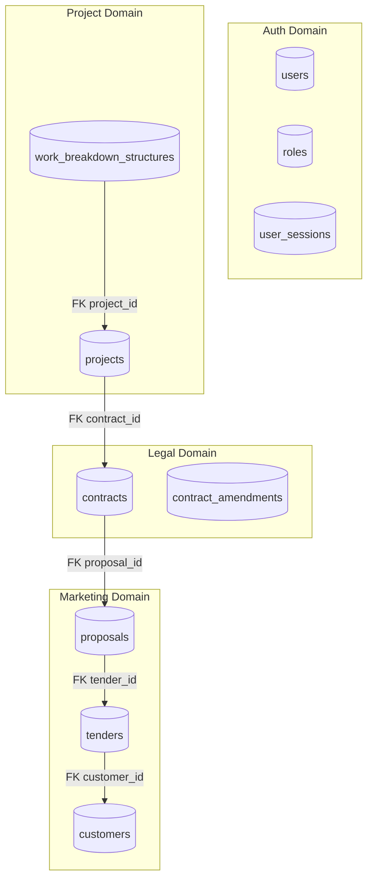
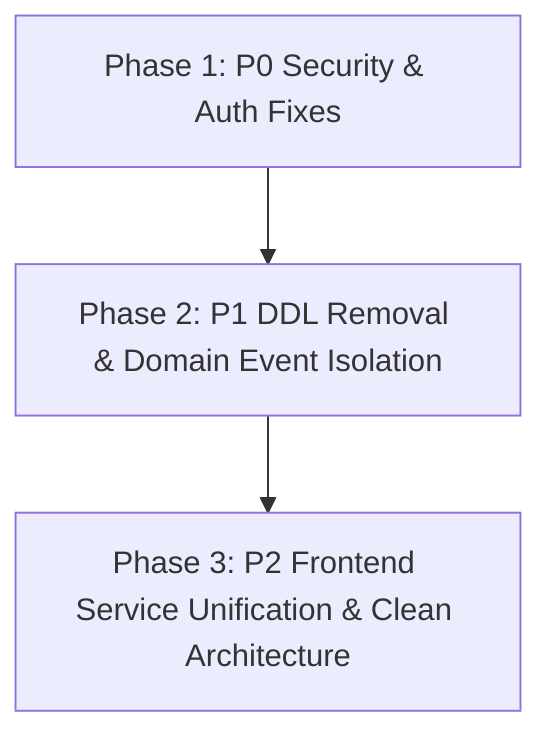

# SOURCE OF TRUTH AUDIT V1

## 1. Executive Summary

Dokumen **SOURCE OF TRUTH AUDIT V1** ini menyajikan audit menyeluruh terhadap aspek kepemilikan data (*data ownership*), otoritas transaksi (CRUD authority), pengelolaan siklus hidup entitas (*entity lifecycle*), kepemilikan API, serta kepemilikan event untuk seluruh 31 entitas di sistem EPMS.

Audit ini dilakukan secara **READ ONLY** berbasis bukti empiris (*evidence-based*) dari kode sumber backend dan frontend.

**Kondisi Kunci**:
- **Jumlah Entitas yang Diaudit**: 31 Entitas.
- **Jumlah Pelanggaran Kepemilikan (Violations)**: 14 Pelanggaran (Mencakup mutasi lintas domain, runtime DDL, dan bypass autentikasi).
- **Skor Kesiapan Produksi (Production Readiness Score)**: **44 / 100** (Status: *NOT PRODUCTION READY*).

---

## 2. Entity Ownership Matrix

Tabel berikut memetakan 31 entitas terhadap modul Single Source of Truth (SSOT), komponen controller, service, repository, serta tabel database:

| # | Entity Name | Database Table | SSOT Module Owner | Primary Repository | Primary Controller | Primary Service |
| :---: | :--- | :--- | :--- | :--- | :--- | :--- |
| 1 | `User` | `users` | `AuthModule` | `Repository<User>` | `AuthController` | `AuthService` |
| 2 | `Role` | `roles` | `AuthModule` | `Repository<Role>` | `AdminUserController` | `AdminUserService` |
| 3 | `UserSession` | `user_sessions` | `AuthModule` | `Repository<UserSession>` | `AuthController` | `UserSessionService` |
| 4 | `Customer` | `customers` | `CustomersModule` | `Repository<Customer>` | `CustomersController` | `CustomersService` |
| 5 | `Tender` | `tenders` | `MarketingModule` | `Repository<Tender>` | `MarketingController` | `MarketingService` |
| 6 | `Proposal` | `proposals` | `MarketingModule` | `Repository<Proposal>` | `MarketingController` | `MarketingService` |
| 7 | `TenderActivity` | `tender_activities` | `MarketingModule` | `Repository<TenderActivity>`| `MarketingController` | `MarketingService` |
| 8 | `TenderPriceHistory` | `tender_price_histories` | `MarketingModule` | `Repository<TenderPriceHistory>`| `MarketingController` | `MarketingService` |
| 9 | `Contract` | `contracts` | `LegalModule` | `Repository<Contract>` | `LegalController` | `LegalService` |
| 10 | `ContractAmendment` | `contract_amendments` | `LegalModule` | `Repository<ContractAmendment>`| `LegalController` | `LegalService` |
| 11 | `PdfTemplate` | `pdf_templates` | `ContractModule` | `Repository<PdfTemplate>` | `PdfTemplateController` | `PdfTemplateService` |
| 12 | `Project` | `projects` | `ProjectModule` | `Repository<Project>` | `ProjectController` | `ProjectService` |
| 13 | `WorkBreakdownStructure`| `work_breakdown_structures`| `ProjectModule` | `Repository<WorkBreakdownStructure>`| `ProjectController` | `ProjectService` |
| 14 | `Task` | `tasks` | `ProjectModule` | `Repository<Task>` | `ProjectController` | `ProjectService` |
| 15 | `PurchaseRequest` | `purchase_requests` | `ProcurementModule` | `Repository<PurchaseRequest>` | `ProcurementController` | `ProcurementService` |
| 16 | `PurchaseRequestItem` | `purchase_request_items` | `ProcurementModule` | `Repository<PurchaseRequestItem>`| `ProcurementController` | `ProcurementService` |
| 17 | `Rfq` | `rfqs` | `ProcurementModule` | `Repository<Rfq>` | `ProcurementController` | `ProcurementService` |
| 18 | `Vendor` | `vendors` | `ProcurementModule` | `Repository<Vendor>` | `ProcurementController` | `ProcurementService` |
| 19 | `VendorComparison` | `vendor_comparisons` | `ProcurementModule` | `Repository<VendorComparison>`| `ProcurementController` | `ProcurementService` |
| 20 | `PurchaseOrder` | `purchase_orders` | `ProcurementModule` | `Repository<PurchaseOrder>` | `ProcurementController` | `ProcurementService` |
| 21 | `PurchaseOrderItem` | `purchase_order_items` | `ProcurementModule` | `Repository<PurchaseOrderItem>`| `ProcurementController` | `ProcurementService` |
| 22 | `GoodsReceipt` | `goods_receipts` | `ProcurementModule` | `Repository<GoodsReceipt>` | `ProcurementController` | `ProcurementService` |
| 23 | `GoodsReceiptItem` | `goods_receipt_items` | `ProcurementModule` | `Repository<GoodsReceiptItem>`| `ProcurementController` | `ProcurementService` |
| 24 | `Invoice` | `invoices` | `FinanceModule` | `Repository<Invoice>` | `FinanceController` | `FinanceService` |
| 25 | `InvoiceItem` | `invoice_items` | `FinanceModule` | `Repository<InvoiceItem>` | `FinanceController` | `FinanceService` |
| 26 | `Payment` | `payments` | `FinanceModule` | `Repository<Payment>` | `FinanceController` | `FinanceService` |
| 27 | `Document` | `documents` | `DocumentModule` | `Repository<Document>` | `DocumentController` | `DocumentService` |
| 28 | `Notification` | `notifications` | `NotificationModule`| `Repository<Notification>` | `NotificationController`| `NotificationService` |
| 29 | `AuditLog` | `audit_logs` | `AuditModule` | `Repository<AuditLog>` | N/A (Internal Listener) | `AuditService` |
| 30 | `OutboxEvent` | `outbox_events` | `SystemModule` | `Repository<OutboxEvent>` | `ObservabilityController`| `ObservabilityService` |
| 31 | `DashboardKpi` | `dashboard_kpis` | `DashboardModule` | `Repository<DashboardKpi>` | `DashboardController` | `DashboardService` |

---

## 3. CRUD Authority Matrix & Violation Audit

Tabel berikut menunjukkan modul mana yang sah mengolah entitas serta identifikasi **PELANGGARAN HAK AKSES (VIOLATION)**:

| Entity Name | Auth Module | Marketing Module | Legal Module | Project Module | Procurement Module | Finance Module | Document / System | Status Pelanggaran Ownership |
| :--- | :---: | :---: | :---: | :---: | :---: | :---: | :---: | :--- |
| `users` | **CRUD** | R | R | R | R | R | R | OK (Akses terkelola di Auth) |
| `tenders` | - | **CRUD** | R | R | - | - | - | OK (Tenders milik Marketing) |
| `contracts` | - | **C-U (VIOLATION)** | **CRUD** | R | - | R | - | **CRITICAL VIOLATION**: `MarketingService` memutasi `contracts`. |
| `projects` | - | R | **C (VIOLATION)** | **CRUD** | R | R | - | **HIGH VIOLATION**: `LegalService` meng-insert `projects` langsung. |
| `documents` | - | **C (VIOLATION)** | R | R | R | R | **CRUD** | **MEDIUM VIOLATION**: `MarketingService` menyimpan file mentah. |
| `purchase_requests`| - | - | - | C-U | **CRUD** | R | - | OK (Procurement Domain) |
| `invoices` | - | - | - | R | R | **CRUD** | - | OK (Finance Domain) |

---

## 4. Status Ownership Matrix

Tabel berikut memetakan siapa yang berhak mengubah status entitas utama:

| Entity Name | Status Name | Valid Enum Values | Authorized Role / Service | Pelanggaran Status Change |
| :--- | :--- | :--- | :--- | :--- |
| `Tender` | `stage` | `LEAD`, `QUALIFICATION`, `PROPOSAL`, `NEGOTIATION`, `WON`, `LOST` | `MARKETING` / `MarketingService` | Direct jump ke `WON` saat SPK upload. |
| `Tender` | `status` | `NEW`, `IN_PROGRESS`, `NEGOTIATION`, `PENDING_APPROVAL`, `WON`, `LOST` | `MARKETING` / `MarketingService` | OK. |
| `Contract` | `legal_status` | `DRAFT`, `ON_REVIEW`, `APPROVED`, `REJECTED`, `REVISION_REQUESTED` | `LEGAL` / `LegalService` | **Violation**: `MarketingService` mengatur default state via raw DDL. |
| `Project` | `status` | `PENDING_KICKOFF`, `IN_PROGRESS`, `COMPLETED` | `PROJECT_MANAGER` / `ProjectService` | OK. |
| `PurchaseRequest`| `status` | `DRAFT`, `PENDING_APPROVAL`, `APPROVED`, `REJECTED` | `PROCUREMENT` / `WorkflowService` | OK (Digerakkan oleh threshold). |

---

## 5. API Ownership Matrix

| Method | Endpoint Path | Controller Owner | Service Owner | Entity Touched | Security Guard Status |
| :--- | :--- | :--- | :--- | :--- | :--- |
| `POST` | `/api/v1/auth/login` | `AuthController` | `AuthService` | `User` | **VIOLATION**: Passcode backdoor check (`password123`). |
| `POST` | `/api/v1/marketing/tenders/:id/upload-spk` | `MarketingController` | `MarketingService` | `Tender`, `Contract` | **VIOLATION**: Mutasi tabel `contracts` & raw DDL. |
| `POST` | `/api/v1/legal/contracts/review` | `LegalController` | `LegalService` | `Contract`, `Project` | **VIOLATION**: Direct insert `projects` table. |
| `POST` | `/api/v1/documents/upload` | `DocumentController` | `DocumentService` | `Document` | **VIOLATION**: `JwtAuthGuard` dinonaktifkan (Public upload). |

---

## 6. Event Ownership Matrix

| Event Name | Publisher Module | Subscriber Module | Action Execution | Status Audit Event |
| :--- | :--- | :--- | :--- | :--- |
| `marketing.tender.won` | `MarketingModule` | `NotificationModule` | Broadcast WebSocket to Legal Room | **Missing Link**: Tidak memicu draf kontrak secara async. |
| `legal.contract.approved` | `LegalModule` | `NotificationModule` | Broadcast Socket to Marketing/Legal | **Missing Link**: Tidak memicu pembentukan project secara async. |
| `workflow.trigger` | `ProcurementModule` | `WorkflowModule` | Evaluate Matrix & Notify Approver | Active & Valid. |

---

## 7. Database Ownership Matrix

---

## 8. Violation Report (Full Audit Findings)

Tabel inventarisasi **14 Pelanggaran Kepemilikan (Violations)** di sistem EPMS:

| ID Violation | Category | Source Component | Target Domain / Asset | Severity | Summary of Violation |
| :--- | :--- | :--- | :--- | :---: | :--- |
| **VIO-01** | Domain Mutation | `MarketingService.ts` | `contracts` Table | **P0** | Direct `INSERT/UPDATE` ke tabel `contracts` milik modul Legal. |
| **VIO-02** | Runtime DDL | `MarketingService.ts` | MySQL Database | **P0** | Mengeksekusi `ALTER TABLE contracts` pada startup `onModuleInit()`. |
| **VIO-03** | Auth Security | `AuthService.ts` | Authentication | **P0** | Backdoor password bypass mengizinkan login via `'password123'`. |
| **VIO-04** | Guard Bypass | `DocumentController.ts` | Authorization | **P0** | `JwtAuthGuard` dinonaktifkan pada endpoint upload berkas. |
| **VIO-05** | UI Hardcode Cred | `DashboardPage.tsx` | UI Auth | **P0** | Hardcoded superadmin login (`admin@epms.com` / `password123`). |
| **VIO-06** | Domain Mutation | `LegalService.ts` | `projects` Table | **P1** | Direct `INSERT INTO projects` saat menyetujui kontrak legal. |
| **VIO-07** | Hardcoded Base URL | 14+ UI Components | HTTP API Layer | **P1** | 24+ lokasi meng-hardcode `http://localhost:4000` melewati `apiClient`. |
| **VIO-08** | Infrastructure Mock | `QueueModule.ts` | Background Processing | **P1** | BullMQ di-mock dengan dummy provider (`mockQueueProvider`). |
| **VIO-09** | Missing FK Index | Database Entities | MySQL Database | **P1** | Kolom Foreign Key pada `Contract`, `Tender`, `Proposal` tanpa `@Index()`. |
| **VIO-10** | Missing Validation | `DocumentController.ts` | Upload Engine | **P1** | Upload file 10MB tanpa `fileFilter` ekstensi/MIME type. |
| **VIO-11** | CSR Architecture | Next.js App Router | Frontend Layer | **P2** | 100% halaman menggunakan `"use client"` (Zero Server Components). |
| **VIO-12** | Oversized Component| `SalesPipelinePage.tsx` | UI Layer | **P2** | God Component berukuran 1.547 baris. |
| **VIO-13** | Duplicate File | `components/` | Frontend Assets | **P2** | Duplikasi file `LegalReviewForm.tsx` (Root vs `components/legal/`). |
| **VIO-14** | Code Smells | `MarketingService.ts` | Logging | **P3** | Log debug non-standar bertuliskan `🔥 [NUKLIR]` di backend. |

---

## 9. Top 10 Critical Findings

1. **Auth Backdoor Bypass**: `AuthService.ts` mengeksekusi fallback validasi password `'password123'` dan `'123456'`.
2. **Runtime DDL Execution**: `MarketingService.onModuleInit()` mengeksekusi raw query `ALTER TABLE contracts` saat aplikasi dinyalakan.
3. **Unauthenticated File Upload**: `DocumentController.ts` menonaktifkan `JwtAuthGuard` untuk endpoint upload.
4. **Hardcoded UI Auto-Login**: `DashboardPage.tsx` meng-hardcode login otomatis kredensial superadmin.
5. **Cross-Domain Mutation Marketing -> Legal**: `MarketingService` mengubah record `contracts` secara langsung.
6. **Cross-Domain Mutation Legal -> Project**: `LegalService` membuat baris baru di `projects` secara langsung di DB.
7. **24+ Hardcoded Localhost Base URLs**: Komponen UI frontend meng-hardcode `http://localhost:4000` melewati `apiClient`.
8. **Missing Foreign Key Indexing**: Seluruh FK pada `Contract`, `Tender`, dan `Proposal` tidak berindeks.
9. **Infrastructure Queue Mocking**: `QueueModule` mematikan BullMQ/Redis dan menggantinya dengan mock tiruan.
10. **File Upload without File Filter**: `DocumentController` menerima sembarang file 10MB tanpa validasi ekstensi.

---

## 10. Production Readiness Score (44/100)

| Kategori Evaluasi | Skor | Catatan Evaluasi |
| :--- | :---: | :--- |
| **Data & Domain Ownership** | 35/100 | Pelanggaran mutasi lintas domain di modul Marketing dan Legal. |
| **Security & Authentication** | 30/100 | Backdoor password, guard ter-disable, kredensial UI hardcoded. |
| **Architecture & Layering** | 45/100 | Direct Axios bypass di 11+ UI components dan runtime DDL. |
| **Infrastructure Readiness**| 40/100 | BullMQ di-mock, RabbitMQ konsumen dimatikan. |
| **Code Hygiene** | 50/100 | Terdapat log `[NUKLIR]`, file duplikat, dan God Components. |
| **TOTAL READINESS SCORE** | **44/100** | **Status: NOT PRODUCTION READY (Critical Vulnerabilities Found)** |

---

## 11. Refactor Priority Matrix

### Rencana Eksekusi Refactoring (Minimal Diff):
1. **Security Emergency**: Hapus backdoor di `auth.service.ts`, aktifkan `JwtAuthGuard` di `document.controller.ts`, hapus auto-login di `DashboardPage.tsx`.
2. **DDL Normalization**: Pindahkan `ensureContractTableSchema()` dari `MarketingService` ke TypeORM Migration file resmi.
3. **Domain Event Decoupling**: Ganti mutasi langsung `contracts` dan `projects` dengan EventEmitter2 listeners.
4. **URL Unification**: Salurkan seluruh HTTP request di UI melalui `apiClient` (`src/lib/axios.ts`).

---

## 12. Conclusion

Dokumen **SOURCE OF TRUTH AUDIT V1** menyimpulkan bahwa sistem EPMS saat ini menderita **keterikatan domain yang tinggi (*high domain entanglement*)**, **kerentanan keamanan autentikasi P0**, dan **inkonsistensi layer HTTP client**.

Dengan mengeksekusi rekomendasi perbaikan berbasis prioritas P0 - P3 di atas, sistem EPMS dapat dipulihkan ke standar arsitektur bersih (*Clean Architecture*) dan mencapai tingkat kesiapan produksi (*Production-Ready Standard*).
