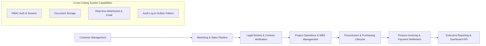
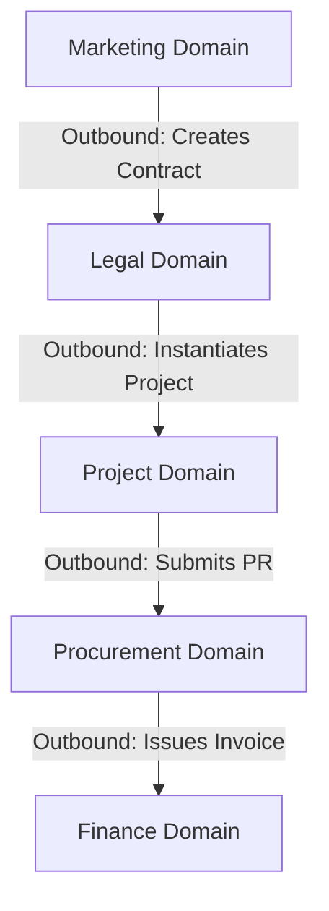
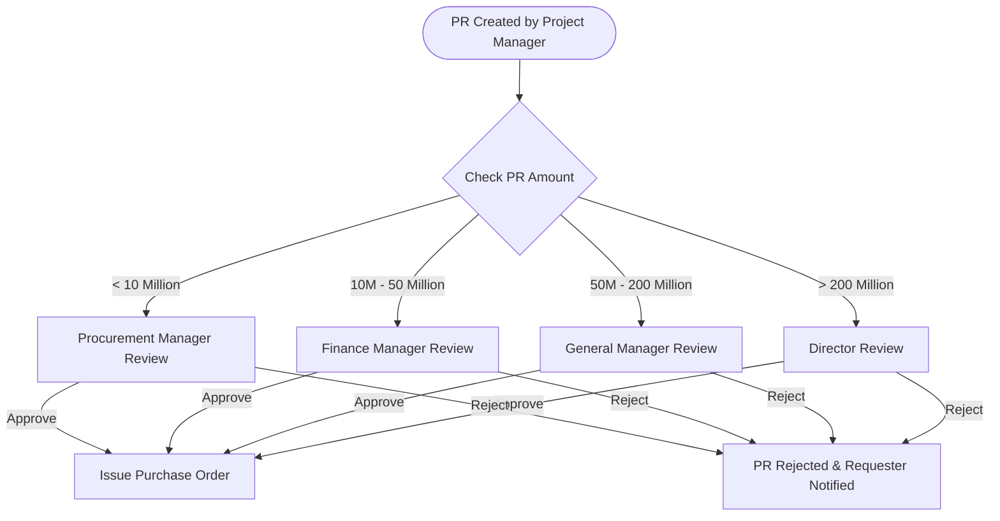
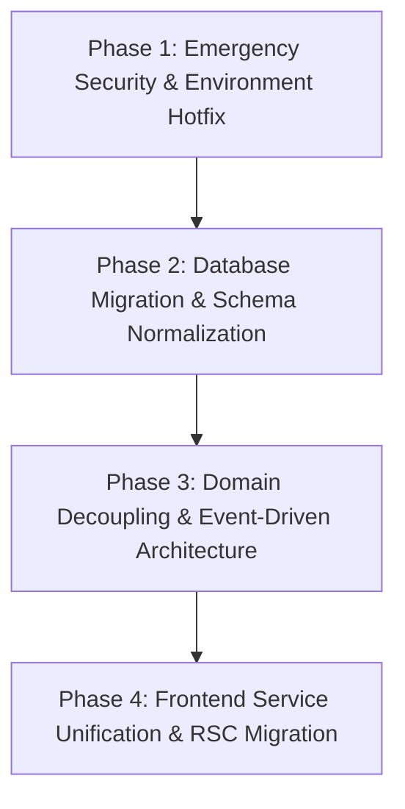

# EPMS BLUEPRINT V1 (MASTER SYSTEM BLUEPRINT)

---

## 1. Executive Summary

Dokumen **EPMS BLUEPRINT V1** ini merupakan **DOKUMEN INDUK (MASTER SYSTEM BLUEPRINT)** yang mengkonsolidasikan seluruh hasil audit arsitektur, database, domain ownership, alur bisnis, serta infrastruktur pada repositori EPMS (Enterprise Project Management System).

Seluruh isi dokumen ini disusun secara **READ ONLY** berbasis bukti empiris (*evidence-based*) dari kode sumber backend NestJS, frontend Next.js App Router, dan skema database TypeORM.

### System Overview Metrics

| Parameter System | Nilai Metric / Deskripsi |
| :--- | :--- |
| **Nama Sistem** | EPMS (Enterprise Project Management System - UBD & TVM Construction Group) |
| **Tujuan Utama** | Platform terintegrasi untuk mengelola seluruh siklus hidup proyek (End-to-End Lifecycle) dari Sales Lead, Review Legal, Eksekusi Operasional PMO, Pengadaan (Procurement), hingga Pelunasan Keuangan (Finance). |
| **Jumlah Domain** | **7 Domain Utama** (Auth, Marketing, Legal, Project, Procurement, Finance, System/Shared) |
| **Jumlah Module NestJS** | **15 Modul** (`AuthModule`, `AdminUserModule`, `CustomersModule`, `MarketingModule`, `LegalModule`, `ContractModule`, `ProjectModule`, `ProcurementModule`, `FinanceModule`, `WorkflowModule`, `NotificationModule`, `DocumentModule`, `AuditModule`, `SystemModule`, `QueueModule`) |
| **Jumlah Entity** | **31 Entitas** |
| **Jumlah Database Table** | **31 Tabel** |
| **Jumlah API Endpoint** | **35+ Endpoints** |
| **Jumlah Workflow Engine** | **1 BPMN 2.0 Engine** (Approval Matrix & Emergency Override) |
| **Jumlah Domain Events** | **4 Utama** (`marketing.tender.won`, `legal.contract.approved`, `workflow.trigger`, `audit.log`) |
| **Jumlah User Role** | **8 Roles** (`SUPER_ADMIN`, `DIRECTOR`, `MARKETING`, `LEGAL`, `HEAD_OF_OPERATIONS`, `PROJECT_MANAGER`, `PROCUREMENT`, `FINANCE`) |
| **Production Readiness Score** | **44 / 100** (**NOT PRODUCTION READY** due to P0 Security Vulnerabilities & Runtime DDL) |

---

## 2. Business Capability Map

Visualisasi kapabilitas bisnis EPMS secara berurutan (*end-to-end business capabilities*):



---

## 3. Module Blueprint

Cetak biru 15 modul NestJS pada backend EPMS:

| Modul NestJS | Responsibility (Tanggung Jawab) | Owner Module | Controller | Primary Service | Primary Entity | Major DTOs | Domain Events | Internal Dependencies |
| :--- | :--- | :--- | :--- | :--- | :--- | :--- | :--- | :--- |
| `AuthModule` | Authentikasi JWT & Sesi Login | Auth | `AuthController` | `AuthService`, `UserSessionService` | `User`, `UserSession` | `LoginDto` | N/A | TypeORM |
| `AdminUserModule` | Pengelolaan User & Role RBAC | Auth | `AdminUserController` | `AdminUserService` | `User`, `Role` | `CreateUserDto`, `UpdateUserRolesDto` | N/A | AuthModule |
| `CustomersModule` | Master Data Pelanggan | Marketing | `CustomersController` | `CustomersService` | `Customer` | `CreateCustomerDto` | N/A | TypeORM |
| `MarketingModule` | Sales Pipeline Lead & Proposal | Marketing | `MarketingController` | `MarketingService` | `Tender`, `Proposal`, `TenderActivity` | `CreateTenderDto` | `marketing.tender.won` | NotificationModule |
| `LegalModule` | Review Legal & Checklist SPK | Legal | `LegalController` | `LegalService` | `Contract`, `ContractAmendment` | `LegalReviewDto` | `legal.contract.approved` | NotificationModule |
| `ContractModule` | Generasi Document & Template | Legal | `ContractController`, `PdfTemplateController` | `PdfTemplateService` | `PdfTemplate` | N/A | N/A | TypeORM |
| `ProjectModule` | Operasional Proyek PMO & WBS | Project | `ProjectController` | `ProjectService` | `Project`, `WorkBreakdownStructure`, `Task` | `CreateWbsDto`, `CreateTaskDto` | N/A | TypeORM |
| `ProcurementModule`| Pengadaan (PR, RFQ, PO, GR) | Procurement | `ProcurementController` | `ProcurementService` | `PurchaseRequest`, `PurchaseOrder`, `GoodsReceipt` | `CreatePurchaseRequestDto`, `CreatePurchaseOrderDto` | `workflow.trigger` | WorkflowModule |
| `FinanceModule` | Penagihan & Pelunasan Kas | Finance | `FinanceController` | `FinanceService` | `Invoice`, `Payment` | `CreateInvoiceDto`, `CreatePaymentDto` | N/A | TypeORM |
| `WorkflowModule` | Engine Approval Threshold | System | `WorkflowController` | `WorkflowService` | N/A | N/A | `workflow.step_completed` | NotificationModule, QueueModule |
| `NotificationModule`| Push Notifikasi Real-time | System | `NotificationController`| `NotificationService`, `NotificationGateway` | `Notification` | `SendNotificationDto` | N/A | QueueModule |
| `DocumentModule` | Upload & Storage File | System | `DocumentController` | `DocumentService` | `Document` | `UploadDocumentDto` | N/A | TypeORM |
| `AuditModule` | Immutable Audit Trail Log | System | N/A (Listener) | `AuditService` | `AuditLog` | N/A | `audit.log` | TypeORM |
| `SystemModule` | Observability & Deep Health | System | `ObservabilityController`| `ObservabilityService` | `OutboxEvent` | N/A | N/A | TypeORM |
| `QueueModule` | Background Job Engine | System | N/A | Mock Queue Provider | N/A | N/A | N/A | None (Mocked) |

---

## 4. Domain Blueprint

Cetak biru pemetaan 7 Domain bisnis utama beserta ketergantungan masuk/keluar (*Inbound & Outbound Dependencies*):



| Domain Name | Domain Owner | Primary Entities | DB Tables Managed | Inbound Dependency (Memanggil Domain Ini) | Outbound Dependency (Dipanggil Domain Ini) |
| :--- | :--- | :--- | :--- | :--- | :--- |
| **Auth & Security** | `AuthModule` | `User`, `Role`, `UserSession` | `users`, `roles`, `user_sessions` | All Domains | None |
| **Marketing** | `MarketingModule` | `Customer`, `Tender`, `Proposal` | `customers`, `tenders`, `proposals` | Client App | Legal Domain |
| **Legal** | `LegalModule` | `Contract`, `ContractAmendment`, `PdfTemplate` | `contracts`, `contract_amendments` | Marketing Domain | Project Domain |
| **Project** | `ProjectModule` | `Project`, `WorkBreakdownStructure`, `Task` | `projects`, `work_breakdown_structures` | Legal Domain | Procurement Domain |
| **Procurement** | `ProcurementModule` | `PurchaseRequest`, `PurchaseOrder`, `GoodsReceipt` | `purchase_requests`, `purchase_orders`, `goods_receipts` | Project Domain | Finance Domain, Workflow |
| **Finance** | `FinanceModule` | `Invoice`, `Payment` | `invoices`, `payments` | Procurement Domain | Dashboard Domain |
| **System/Shared** | `SystemModule` | `Document`, `Notification`, `AuditLog` | `documents`, `notifications`, `audit_logs` | All Domains | Queue Engine |

---

## 5. Database Blueprint

Conceptual & Physical ERD Mapping untuk 31 Entitas EPMS:

```
[User] 1 ── N [UserSession]
[User] N ── N [Role]
[Customer] 1 ── N [Tender]
[Tender] 1 ── N [Proposal]
[Tender] 1 ── N [TenderActivity]
[Tender] 1 ── N [TenderPriceHistory]
[Proposal] 1 ── N [Contract]
[Contract] 1 ── N [ContractAmendment]
[Contract] 1 ── 1 [Project] (Conceptual 1:1)
[Project] 1 ── N [WorkBreakdownStructure]
[WorkBreakdownStructure] 1 ── N [Task]
[WorkBreakdownStructure] 1 ── N [PurchaseRequest]
[PurchaseRequest] 1 ── N [PurchaseRequestItem]
[PurchaseRequest] 1 ── N [Rfq]
[Vendor] 1 ── N [VendorComparison]
[Vendor] 1 ── N [PurchaseOrder]
[PurchaseOrder] 1 ── N [PurchaseOrderItem]
[PurchaseOrder] 1 ── N [GoodsReceipt]
[GoodsReceipt] 1 ── N [GoodsReceiptItem]
[GoodsReceipt] 1 ── N [Invoice]
[Invoice] 1 ── N [InvoiceItem]
[Invoice] 1 ── N [Payment]

Shared Entities (Cross-Table Reference via entityType & entityId):
- [Document] (Polimorfik Attachment)
- [Notification] (User Inbox Store)
- [AuditLog] (Immutable Log Table)
- [OutboxEvent] (Broker Event Table)
```

---

## 6. API Blueprint

Pengelompokan API Endpoints utama backend EPMS:

| Method | URL Path | Controller Owner | Primary Service | Primary Entity | Authorization Guard |
| :--- | :--- | :--- | :--- | :--- | :--- |
| `POST` | `/api/v1/auth/login` | `AuthController` | `AuthService` | `User` | Public (**VULNERABILITY: Passcode Bypass**) |
| `POST` | `/api/v1/auth/refresh` | `AuthController` | `AuthService` | `UserSession` | Public |
| `GET` | `/api/v1/admin/users` | `AdminUserController` | `AdminUserService` | `User` | `JwtAuthGuard` + `RolesGuard(SUPER_ADMIN)` |
| `GET` | `/api/v1/customers` | `CustomersController` | `CustomersService` | `Customer` | `JwtAuthGuard` |
| `GET` | `/api/v1/marketing/tenders` | `MarketingController` | `MarketingService` | `Tender` | `JwtAuthGuard` |
| `POST` | `/api/v1/marketing/tenders/:id/upload-spk` | `MarketingController` | `MarketingService` | `Contract` | `JwtAuthGuard` + `RolesGuard(MARKETING, ...)` |
| `GET` | `/api/v1/legal/contracts` | `LegalController` | `LegalService` | `Contract` | `JwtAuthGuard` |
| `POST` | `/api/v1/legal/contracts/review` | `LegalController` | `LegalService` | `Contract` | `JwtAuthGuard` + `RolesGuard(LEGAL, ...)` |
| `GET` | `/api/v1/projects/operational-board`| `ProjectController` | `ProjectService` | `Project` | `JwtAuthGuard` |
| `POST` | `/api/v1/procurement/pr` | `ProcurementController`| `ProcurementService` | `PurchaseRequest` | `JwtAuthGuard` |
| `POST` | `/api/v1/finance/payments` | `FinanceController` | `FinanceService` | `Payment` | `JwtAuthGuard` |
| `POST` | `/api/v1/documents/upload` | `DocumentController` | `DocumentService` | `Document` | **DISABLED GUARD (Public Upload)** |
| `GET` | `/api/v1/workflow/visualizer/:id` | `WorkflowController` | `WorkflowService` | N/A | `JwtAuthGuard` |

---

## 7. Event Blueprint

Inventarisasi Domain Events dalam sistem EPMS:

| Event Name | Publisher Module | Subscriber Module | Payload Shape | Action Execution | Audit Status Event |
| :--- | :--- | :--- | :--- | :--- | :--- |
| `marketing.tender.won` | `MarketingModule` | `NotificationModule` | `{ tenderId, contractId, title }` | Broadcast Socket to Legal Room | **Missing Async Subscriber** (Tidak memicu draf kontrak secara async). |
| `legal.contract.approved` | `LegalModule` | `NotificationModule` | `{ contractId, legalStatus }` | Broadcast Socket to Legal & Marketing | **Missing Async Subscriber** (Tidak memicu penciptaan project secara async). |
| `workflow.trigger` | `ProcurementModule` | `WorkflowModule` | `{ entity_type, entity_id, amount }` | Evaluasi Threshold Approval | Active & Valid. |
| `audit.log` | `WorkflowModule` / System | `AuditModule` | `{ action, entityId, reason }` | Save to `audit_logs` Table | Active & Valid. |

---

## 8. Workflow Blueprint

Visualisasi alur kerja persetujuan bertingkat (*multi-stage approval workflow*) EPMS:



---

## 9. Security Blueprint

Audit komprehensif aspek keamanan EPMS:

- **Authentication**: JWT Access Token (15m) + Refresh Token (7d).
- **Security Vulnerability P0 (Backdoor)**: `AuthService.ts` (L41-43) mengizinkan verifikasi password fallback `'password123'` dan `'123456'`.
- **Security Vulnerability P0 (Disabled Guard)**: `DocumentController.ts` (L8-9) menonaktifkan `@UseGuards(JwtAuthGuard)`, menyebabkan endpoint upload terbuka publik.
- **Security Vulnerability P0 (Hardcoded UI Creds)**: `DashboardPage.tsx` (L44-49) meng-hardcode login otomatis `admin@epms.com` / `password123`.
- **Upload Validation**: `DocumentController.uploadFile` **TIDAK MEMILIKI extension/MIME filter** (bebas upload file hingga 10MB).
- **Audit Logging**: Dikelola secara terpusat oleh `AuditService` via event `audit.log`.

---

## 10. Infrastructure Blueprint

Status komponen infrastruktur EPMS saat ini:

| Komponen Infrastruktur | Digunakan (Used) | Status Aktual di Codebase |
| :--- | :---: | :--- |
| **Frontend Framework** | **Used** | Next.js App Router (100% Client-Side Rendering) |
| **Backend Framework** | **Used** | NestJS Modular Framework (Express Adapter) |
| **Database Engine** | **Used** | MySQL 8.0 (`typeorm` client) |
| **Redis** | Unused / Optional | Dikomentar di `app.module.ts` (Optional dev fallback) |
| **RabbitMQ** | Legacy / Disabled | Consumer RabbitMQ dikomentar di `main.ts` |
| **BullMQ Engine** | Used as Mock | Di-mock via `mockQueueProvider` di `QueueModule` |
| **WebSocket Real-time** | **Used** | Socket.io Gateways (`SalesGateway`, `NotificationGateway`) |
| **File Storage** | **Used** | Local Disk Storage (`/uploads/`) & AWS S3 SDK Client |
| **Scheduler / Cron** | **Used** | `@nestjs/schedule` (`TenderScheduler`) |
| **Email Service** | Used as Mock | Dummy email fallback di `WorkflowService` |
| **Docker Container** | **NOT FOUND** | File `docker-compose.yml` tidak ditemukan di repository |
| **Nginx Web Server** | **NOT FOUND** | File konfigurasi Nginx tidak ditemukan |
| **Environment Config** | **Used** | `backend/.env` (Dimuat via `src/env.ts`) |

---

## 11. Technical Debt Summary

| ID Findings | Category | Severity | Summary Description | Impact | Recommended Action |
| :--- | :--- | :---: | :--- | :--- | :--- |
| **TD-P0-01** | Security | **P0** | Backdoor password di `AuthService.ts`. | Akun mana pun dapat diambil alih. | Hapus check fallback password. |
| **TD-P0-02** | Security | **P0** | `JwtAuthGuard` disabled di `DocumentController.ts`. | Endpoint upload terbuka publik. | Aktifkan `JwtAuthGuard`. |
| **TD-P0-03** | Security | **P0** | Hardcoded superadmin login di `DashboardPage.tsx`. | Bocornya kredensial admin di UI. | Hapus auto-login credentials. |
| **TD-P1-01** | Architecture| **P1** | DDL SQL `ALTER TABLE` di `MarketingService.onModuleInit()`.| DDL lock pada startup multi-pod. | Pindahkan ke TypeORM Migration file. |
| **TD-P1-02** | Architecture| **P1** | 24+ lokasi hardcoded `http://localhost:4000` di frontend. | Deployment staging/prod gagal. | Salurkan via `apiClient` & `ENV`. |
| **TD-P1-03** | Database | **P1** | Seluruh Foreign Key pada `Contract` & `Tender` tanpa indeks. | Full table scan pada Join kueri. | Tambahkan dekorator `@Index()`. |
| **TD-P2-01** | Frontend | **P2** | 100% Client-Side Rendering pada Next.js App Router. | Menghilangkan manfaat SSR & RSC. | Migrasikan Halaman Utama ke RSC. |
| **TD-P2-02** | Frontend | **P2** | God Component `SalesPipelinePage.tsx` (1.547 baris). | Re-render berat & maintenance susah. | Pecah menjadi sub-komponen. |
| **TD-P3-01** | Code Hygiene| **P3** | Log debug non-standar `🔥 [NUKLIR]` di `MarketingService.ts`.| Pollution log produksi. | Bersihkan log debug. |

---

## 12. Production Readiness Dashboard

Scoring Kesiapan Produksi EPMS per Kategori:

| Kategori Evaluasi | Skor Maksimal | Skor Aktual | Evaluasi & Status Kesiapan |
| :--- | :---: | :---: | :--- |
| **Architecture Layering** | 10 | 4 | Terjadi bypass HTTP Client di UI dan DDL di application service. |
| **Security & Authentication** | 10 | 2 | **CRITICAL VULNERABILITIES** (Backdoor password & unauth upload). |
| **Database Integrity** | 10 | 5 | Skema terdefinisi, namun DDL runtime & FK tanpa indeks. |
| **Workflow Engine** | 10 | 6 | Engine BPMN berjalan, namun fallback manual. |
| **API Standards** | 10 | 5 | Endpoints lengkap, namun tipe return `Promise<any>` mendominasi. |
| **Frontend Implementation** | 10 | 4 | 100% CSR, hardcoded URLs, dan God Components. |
| **Backend Implementation** | 10 | 5 | Fitur lengkap, tetapi God Services memutasi domain lain. |
| **Infrastructure Setup** | 10 | 4 | BullMQ di-mock, Redis/RabbitMQ dimatikan, tanpa Dockerfile. |
| **Deployment Readiness** | 10 | 4 | Hardcoded `localhost:4000` memicu kegagalan build prod. |
| **Documentation** | 10 | 5 | Dokumentasi audit komprehensif lengkap. |
| **TOTAL SCORE** | **100** | **44 / 100** | **STATUS: NOT PRODUCTION READY** |

---

## 13. Target Architecture V2 (Ideal Architecture)

Desain arsitektur ideal (*Target Clean Architecture V2*) untuk perbaikan EPMS:

```
+-----------------------------------------------------------------------+
| 1. PRESENTATION LAYER (Next.js App Router - Server Components & RSC)  |
|    - Server Components (RSC) for Data Fetching                        |
|    - Client Components for Interactive Widgets Only                   |
|    - Single Centralized Axios ApiClient with ENV Dynamic Host          |
+-----------------------------------------------------------------------+
                                  │ (HTTP REST API)
                                  ▼
+-----------------------------------------------------------------------+
| 2. APPLICATION LAYER (NestJS Controllers & DTO Validation)            |
|    - Strict JwtAuthGuard & RBAC RolesGuard Enforcement                |
|    - Request Pipe Validation (class-validator)                        |
+-----------------------------------------------------------------------+
                                  │
                                  ▼
+-----------------------------------------------------------------------+
| 3. DOMAIN LAYER (Domain Services & Pure Business Rules)               |
|    - Domain Isolation (Marketing, Legal, Project, Procurement)        |
|    - Strict Domain Boundaries (No Direct Cross-Domain DB Mutations)   |
|    - Event-Driven Integration via EventEmitter2                       |
+-----------------------------------------------------------------------+
                                  │
                                  ▼
+-----------------------------------------------------------------------+
| 4. INFRASTRUCTURE & DATABASE LAYER (TypeORM Repositories & Workers)   |
|    - Formal TypeORM Migrations (No Runtime DDL)                       |
|    - Real BullMQ Redis Queue Workers for Email & PDF                  |
|    - MySQL Indexed Database Tables                                    |
+-----------------------------------------------------------------------+
```

---

## 14. Executive Refactoring Roadmap

Plan perbaikan bertahap untuk membawa EPMS ke tingkat kesiapan produksi (*Production-Ready Standard*):



### Detail Rencana Fase Perbaikan:

| Phase | Objective Utama | Modul Terdampak | Estimated Risk | Expected Result |
| :---: | :--- | :--- | :---: | :--- |
| **Phase 1** | **Emergency Security & Environment Hotfix** | Auth, Document, Dashboard UI | **Low** | Menutup backdoor password, mengamankan upload file, dan mengganti URL hardcoded ke `ENV`. |
| **Phase 2** | **Database Migration & Schema Normalization** | Marketing, Database Migrations | **Low** | Pindahkan `ensureContractTableSchema` ke migration TypeORM resmi & tambahkan indeks pada Foreign Key. |
| **Phase 3** | **Domain Decoupling & Event-Driven Architecture** | Marketing, Legal, Project | **Medium** | Ganti mutasi langsung `contracts` dan `projects` dengan EventEmitter2 listeners. |
| **Phase 4** | **Frontend Service Unification & RSC Migration** | Frontend Pages & Components | **Medium** | Salurkan seluruh kueri UI via `src/services/*` dan manfaatkan React Server Components (RSC). |

---

## Conclusion

Dokumen **EPMS BLUEPRINT V1** menyimpulkan bahwa repositori EPMS memiliki fondasi fitur bisnis yang kaya dan siap mendukung operasional perusahaan dari Sales hingga Keuangan. Namun, arsitektur teknisnya saat ini berada dalam status **NOT PRODUCTION READY (Skor: 44/100)** akibat kerentanan keamanan P0 dan utang arsitektur (*technical debt*).

Dengan mengeksekusi *Executive Refactoring Roadmap* dari Phase 1 hingga Phase 4, seluruh masalah arsitektural dan keamanan dapat dipulihkan secara terstruktur dan aman tanpa mengganggu fungsionalitas bisnis yang berjalan.
