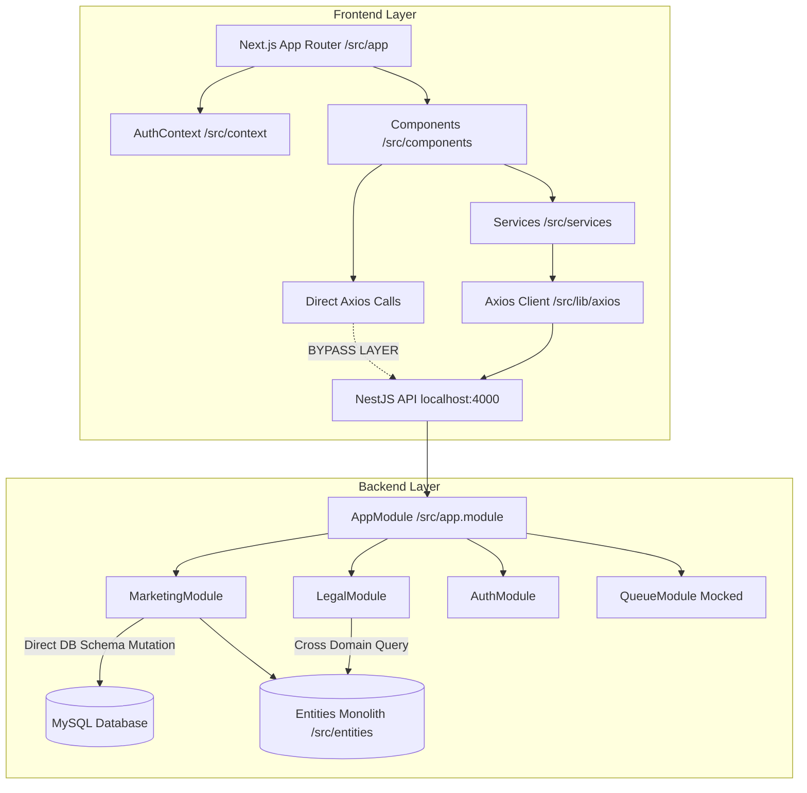

# ARCHITECTURE AUDIT REPORT

## Executive Summary
Audit arsitektur sistem dilakukan secara **READ-ONLY** terhadap repositori **EPMS (Enterprise Project Management System)** yang terdiri dari aplikasi Frontend (Next.js App Router) dan Backend (NestJS). Evaluasi berfokus pada kesesuaian arsitektur terhadap *best practice* Next.js App Router, NestJS Modular Architecture, pemisahan domain, serta kebersihan kode (*clean code*).

Ditemukan beberapa masalah kritis:
- **100% Client-Side Rendering** pada Next.js (seluruh halaman menggunakan `"use client"`), meniadakan manfaat Server Components dan SSR.
- **Bypass Layer HTTP Client & Hardcoded Base URL** (`http://localhost:4000`) di 14+ komponen frontend tanpa melalui `apiClient` / `ENV`.
- **Hardcoded Credential & Backdoor Authentication** pada backend (`auth.service.ts` mengizinkan password `'password123'` dan `'123456'` secara eksplisit).
- **Mutasi Skema Database pada Application Layer** (`MarketingService.onModuleInit` menjalankan `DDL SQL` mentah).
- **God Components & God Services** (`SalesPipelinePage.tsx` 1.547 baris, `MarketingService.ts` 1.104 baris).

---

## Architecture Score (54/100)

| Kategori | Skor | Catatan |
| :--- | :---: | :--- |
| **Next.js App Router Conformance** | 30/100 | Murni CSR, tidak ada Server Components, data fetching di `useEffect` |
| **NestJS Modular Architecture** | 55/100 | Domain tercampur, schema DDL di Service, Queue di-mock |
| **Layer & Dependency Isolation** | 45/100 | Direct Axios di Component, cross-entity raw query antar-modul |
| **Configuration & Security** | 40/100 | Hardcoded URL `http://localhost:4000`, backdoor password di Auth |
| **Code Hygiene & Maintainability** | 50/100 | Terdapat God Components, file duplikat, dan log debug "NUKLIR" |
| **TOTAL SKOR** | **54/100** | **Kategori: Technical Debt Sedang - Tinggi** |

---

## Frontend Audit

### 1. Pelanggaran Next.js App Router
- **Zero Server Components**: Seluruh file halaman (`app/page.tsx`, `app/layout.tsx`, `app/sales/page.tsx`, `app/legal/review/page.tsx`, `app/login/page.tsx`, `app/project-delivery/page.tsx`, dll.) menggunakan directive `"use client"`.
- **Data Fetching Anti-Pattern**: Seluruh pengambil data dilakukan di client-side via `useEffect` / `axios` / `react-query`, bukan pada level Server Component.
- **Provider Wrapping di Root Layout**: `RootLayout` (`app/layout.tsx`) secara langsung membungkus `Providers` dan `AuthProvider` di mana `AuthProvider` adalah Client Component, memaksa sub-tree menjadi Client Context.

### 2. Folder / File Salah Penempatan & Struktur Duplikat
- **Missing Folder**: Folder `utils` yang disyaratkan dalam struktur standar frontend tidak ditemukan di `frontend/src/`.
- **File Duplikat**:
  - `src/components/LegalReviewForm.tsx` (11.682 bytes)
  - `src/components/legal/LegalReviewForm.tsx` (11.836 bytes)
  *Kedua file memiliki fungsi identik namun diimpor secara acak di tempat berbeda.*

### 3. God Component
- `SalesPipelinePage.tsx`: **1.547 baris** (66.311 bytes) - Menggabungkan state management, kalkulasi analytics, Socket.io, modal forms, dan rendering tabel/kanban.
- `KanbanBoard.tsx`: **1.079 baris** (48.735 bytes) - Menggabungkan drag and drop, modal edit, upload file, activity stream, dan query invalidation.
- `app/legal/review/page.tsx`: **658 baris** (29.019 bytes) - Menggabungkan polling PDF, Socket.io, tab navigation, dan state checklist.

### 4. Dead Code / Stub Component
- `src/components/WorkflowDesigner.tsx`: File dummy 14 baris ("Halaman ini sedang dalam pengembangan").
- `src/components/debug/DebugCachePanel.tsx`: Component debug visual di-hardcode dengan `fixed position` di layar UI.

---

## Backend Audit

### 1. Pelanggaran NestJS Modular Architecture
- **Missing Folders**: Folder `common` dan `config` tidak ada di bawah `backend/src/` (modul env dimuat langsung melalui file standalone `src/env.ts`, sedangkan `entities` berada di `src/entities/`).
- **Mocking Infrastruktur Utama**: `QueueModule` (`modules/queue/queue.module.ts`) mengabaikan BullMQ / Redis nyata dan menggunakan `mockQueueProvider` (semua antrean email & PDF berjalan secara tiruan).
- **Disabled Microservice**: Consumer RabbitMQ di `main.ts` di-comment out secara permanen.

### 2. God Service & Mutasi Skema di Layer Aplikasi
- `MarketingService.ts`: **1.104 baris** (44.002 bytes).
- **Pelanggaran DDL di Service**: Method `ensureContractTableSchema()` pada `MarketingService.onModuleInit()` melakukan kueri `INFORMATION_SCHEMA` dan `ALTER TABLE` secara langsung menggunakan raw SQL (`this.contractRepo.query(...)`).

### 3. Log Debug & Code Smells
- Log debug non-standar bertuliskan `🔥 [NUKLIR]` dan `✅ [NUKLIR]` bertebaran di `MarketingService.ts` (baris 949-1061).
- Hardcoded debug log pada `AuthService.ts`: `console.log('DEBUG_LOGIN...')`.

---

## Dependency Map



---

## Domain Boundary

| Modul / Domain | Batas Domain Saat Ini | Pelanggaran Batas Domain |
| :--- | :--- | :--- |
| **Auth** | `modules/auth` | Menangani kalkulasi role-permission granular secara implisit untuk marketing & legal secara hardcoded. |
| **Marketing** | `modules/marketing` | Mengakses dan memanipulasi langsung entity `Customer`, `Tender`, `Proposal`, `Contract`, `TenderActivity`, `TenderPriceHistory`, dan membuat tabel `contracts` via DDL. |
| **Legal** | `modules/legal` | Menjalankan transaksi atomic mentah via `DataSource.createQueryRunner()` yang mengubah record `Contract`, `Proposal`, `Tender`, `Project`, `AuditLog`, dan `OutboxEvent` secara langsung tanpa melalui modul masing-masing. |
| **Queue** | `modules/queue` | Tidak terhubung ke worker antrean independen; di-mock di level module provider. |

---

## Layer Violations

1. **Frontend Component -> Direct Backend Access (Bypass Services & Lib)**:
   - `NotificationBell.tsx`, `AdminUserPage.tsx`, `CustomersPage.tsx`, `UserSessionManagerUI.tsx`, `DashboardPage.tsx`, `DocumentUpload.tsx`, `InboxPage.tsx`, `NotificationInbox.tsx`, `BpmnWorkflowVisualizer.tsx`, `profile/page.tsx`, `documents/page.tsx` melakukan HTTP Request langsung menggunakan `axios.get('http://localhost:4000/...')`, memotong `apiClient` (`src/lib/axios.ts`) dan `services/`.
2. **Backend Service -> Database Schema Mutation (Bypass Migration Layer)**:
   - `MarketingService` mengeksekusi DDL database (`ALTER TABLE contracts ADD COLUMN ...`) pada saat inisialisasi aplikasi (`onModuleInit`), melewati mekanisme TypeORM Migrations.
3. **Backend Service -> Hardcoded Password Bypass (Bypass Auth Security)**:
   - `AuthService.validateUser()` mengizinkan verifikasi password jika input bernilai `'password123'` atau `'123456'`, meskipun hash password di database tidak cocok.

---

## Technical Debt

### 1. Hardcoded URL & Configuration
- **Frontend Hardcoded Base URL**:
  - `http://localhost:4000` di-hardcode pada **24 lokasi** di 14 file frontend (antara lain `NotificationBell.tsx`, `AdminUserPage.tsx`, `CustomersPage.tsx`, `DashboardPage.tsx`, `useTendersQuery.ts`, dll.).
- **Backend Hardcoded URL**:
  - `http://localhost:3000/logo.png` di-hardcode pada `pdf-template.service.ts` (baris 110).
  - Fallback `http://localhost:4000` di-hardcode pada `marketing.controller.ts`, `marketing.service.ts`, `contract.controller.ts`, `document.service.ts`.

### 2. Duplicate Structure
- Dual `LegalReviewForm.tsx`:
  - `src/components/LegalReviewForm.tsx` (Root Components)
  - `src/components/legal/LegalReviewForm.tsx` (Sub-folder Legal)

### 3. Hardcoded Authentication & Credentials
- `DashboardPage.tsx` (line 44): Auto-login otomatis dengan kredensial hardcoded `admin@epms.com` / `password123` jika token tidak ditemukan di storage local.
- `auth.service.ts` (line 41-42): Bypass validasi bcrypt jika password bernilai `'password123'` atau `'123456'`.

---

## File Impact Matrix

| File Terpengaruh | Lokasi | Jenis Masalah | Blast Radius |
| :--- | :--- | :--- | :--- |
| `frontend/src/components/SalesPipelinePage.tsx` | Frontend | God Component (1.547 baris) | High |
| `frontend/src/components/KanbanBoard.tsx` | Frontend | God Component (1.079 baris) | High |
| `frontend/src/components/NotificationBell.tsx` | Frontend | Hardcoded URL & Direct Axios | Medium |
| `frontend/src/components/CustomersPage.tsx` | Frontend | Hardcoded URL & Direct Axios | Medium |
| `frontend/src/components/AdminUserPage.tsx` | Frontend | Hardcoded URL & Direct Axios | Medium |
| `frontend/src/components/DashboardPage.tsx` | Frontend | Hardcoded Auto-Login Kredensial | High |
| `frontend/src/components/LegalReviewForm.tsx` | Frontend | File Duplikat dengan `components/legal/` | Medium |
| `backend/src/modules/marketing/marketing.service.ts` | Backend | God Service, DDL Mutation, Debug Logs | Critical |
| `backend/src/modules/auth/auth.service.ts` | Backend | Password Backdoor Bypass & Debug Logs | Critical |
| `backend/src/modules/queue/queue.module.ts` | Backend | Mocked Infrastructure (BullMQ disabled) | High |
| `backend/src/modules/contract/pdf-template.service.ts`| Backend | Hardcoded URL (`localhost:3000`) | Low |

---

## Priority Matrix

```
   TINGGI  ▲
           │ [P0] auth.service.ts (Backdoor Pass)
           │ [P0] Hardcoded localhost:4000 (24 lokasi)
   DAMPAK  │ [P1] marketing.service.ts (DDL in Service)   [P1] SalesPipelinePage.tsx (God Comp)
           │ [P1] Direct Axios in Components              [P1] QueueModule Mocking
           │ [P2] Duplicate LegalReviewForm.tsx           [P2] CSR-only App Router
           │ [P3] Log Debug NUKLIR                        [P3] WorkflowDesigner.tsx (Stub)
   SENDIRI └────────────────────────────────────────────────────────────────────────►
           RENDAH                     KOMPLEKSITAS REFACTOR                    TINGGI
```

### P0 (Critical - Security & Breaking Environment Issue)
1. Hapus backdoor password fallback (`password123` / `123456`) di `backend/src/modules/auth/auth.service.ts`.
2. Hapus auto-login hardcoded `admin@epms.com` di `frontend/src/components/DashboardPage.tsx`.
3. Ganti seluruh **24 lokasi hardcoded `http://localhost:4000`** di frontend dengan `apiClient` / `ENV.API_URL`.

### P1 (High - Structural & Architectural Issue)
1. Pindahkan DDL SQL `ensureContractTableSchema()` dari `MarketingService.onModuleInit` ke file TypeORM Migration resmi.
2. Refactor komponen frontend agar menggunakan `apiClient` dan `services` alih-alih `axios` langsung.
3. Hapus `mockQueueProvider` di `QueueModule` dan hubungkan ke Redis BullMQ / fallback adapter yang aman.

### P2 (Medium - Code Organization & Duplication)
1. Konsolidasi duplikasi file `LegalReviewForm.tsx` (hapus versi root `src/components/LegalReviewForm.tsx` dan gunakan versi modul `src/components/legal/LegalReviewForm.tsx`).
2. Pecah God Components (`SalesPipelinePage.tsx` & `KanbanBoard.tsx`) menjadi sub-komponen modular.
3. Tambahkan folder `frontend/src/utils` dan migrasikan helper formatting.

### P3 (Low - Cleanliness & Maintenance)
1. Hapus log debug non-standar (`🔥 [NUKLIR]`, `DEBUG_LOGIN`).
2. Hapus atau lengkapi stub component `WorkflowDesigner.tsx` dan `DebugCachePanel.tsx`.

---

## Execution Plan (Minimal Diff)

> **Catatan:** Sesuai aturan audit READ-ONLY, Execution Plan ini hanya menjadi dokumen panduan langkah perbaikan tanpa melakukan perubahan kode pada fase audit ini.

```
Phase 1: Security & Config Fixes (P0)
  ├── 1.1 Edit `backend/src/modules/auth/auth.service.ts` -> Hapus fallback password match
  ├── 1.2 Edit `frontend/src/components/DashboardPage.tsx` -> Hapus auto-login credentials
  └── 1.3 Refactor HTTP Client Frontend -> Timpa URL hardcoded dengan `apiClient` & `ENV`

Phase 2: Database & Layer Unification (P1)
  ├── 2.1 Buat Migration File `UpdateContractsTableSchema.ts` -> Pindahkan logic DDL dari `MarketingService`
  └── 2.2 Unifikasi Data Fetching -> Salurkan request komponen via `src/services/*`

Phase 3: Cleanup & Refactoring (P2 & P3)
  ├── 3.1 Hapus duplikat `src/components/LegalReviewForm.tsx`
  ├── 3.2 Bersihkan log debug `[NUKLIR]` dari backend
  └── 3.3 Hapus component debug `DebugCachePanel.tsx` dari versi produksi
```

---

## Conclusion
Sistem **EPMS UBD & TVM** memiliki fungsionalitas bisnis yang lengkap, namun secara arsitektur menderita **Technical Debt yang signifikan**. Masalah utama terletak pada **keamanan auth (backdoor password)**, **hardcoded environment URL**, **penggunaan Next.js App Router yang 100% Client-Side**, serta **eksekusi DDL database langsung di service layer**. 

Dengan melakukan perbaikan sesuai skala prioritas P0 - P3 pada *Execution Plan*, arsitektur sistem dapat ditingkatkan ke standar industri secara aman tanpa memicu *breaking changes*.
