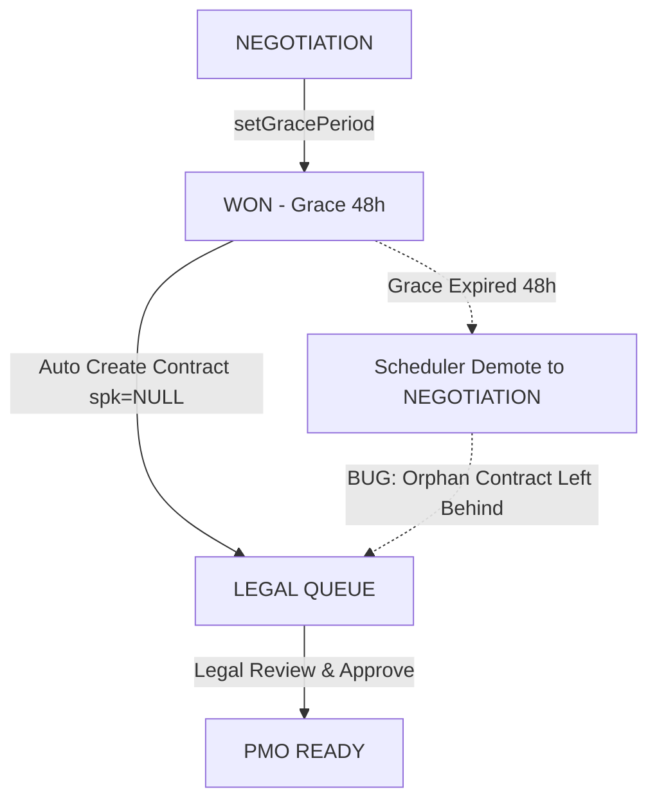
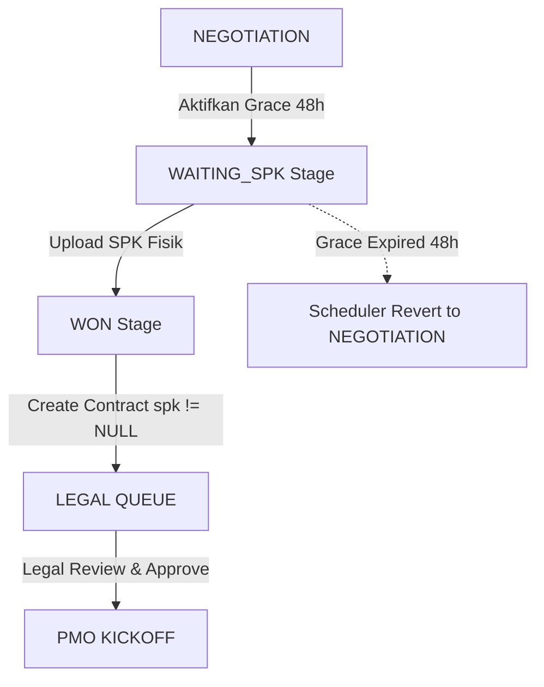

# AUDIT GRACE PERIOD & SPK FLOW REPORT

**MODE**: READ ONLY FORENSIC AUDIT  
**DATABASE**: `epms_tvmubd_db`  
**SCOPE**: `backend/src/modules/marketing`, `backend/src/modules/legal`, `backend/src/modules/project`, `frontend/src`  
**RULES**: 0 Code Changes | 0 Database Changes | Pure Evidence-Based Audit Report

---

# Executive Summary

Audit **GRACE PERIOD & SPK FLOW** bertujuan mengevaluasi kesesuaian arsitektur saat ini (*current implementation*) terhadap alur tata kelola bisnis (*business governance*) EPMS.

### Ringkasan Temuan Audit:
1. **Grace Period Usage**: 4 Tender tercatat dalam alur Grace Period/SPK (1 telah mengunggah SPK, 3 berada dalam Grace Period aktif 48 jam).
2. **Scheduler Integrity**: Scheduler `@Cron('* * * * *')` aktif setiap menit di `tender.scheduler.ts`. Namun terdapat celah: saat Grace Period kedaluwarsa, scheduler mengubah `tender.status = NEGOTIATION`, tetapi **TIDAK menghapus/mendemutkan record `Contract` yang sudah terbuat di tabel `contracts`**.
3. **Legal Queue Exposure**: Record `Contract` tanpa SPK (`spk_file_url IS NULL`) **LANGSUNG MASUK ke antrian Legal Review (`GET /legal/contracts/pending`)** begitu Grace Period diaktifkan.
4. **Keputusan Akhir Audit**: **`OPTION B — Desain Sekarang Kurang Tepat`**. Legal seharusnya baru menerima kontrak setelah SPK fisik tersedia & tersimpan.

---

# AUDIT A — GRACE PERIOD USAGE

Hasil query empiris dari database MySQL terhadap seluruh tender yang menggunakan Grace Period atau SPK:

```sql
SELECT id AS tender_id, title AS tender_name, stage, status, grace_deadline, spk_file_key, created_at, updated_at,
       CASE 
         WHEN spk_file_key IS NOT NULL AND spk_file_key != '' THEN 'Uploaded SPK'
         WHEN grace_deadline IS NOT NULL AND grace_deadline < NOW() THEN 'Expired Grace Period'
         WHEN grace_deadline IS NOT NULL AND grace_deadline >= NOW() THEN 'Active Grace Period'
         ELSE 'No Grace'
       END AS grace_category
FROM tenders
WHERE grace_deadline IS NOT NULL OR spk_file_key IS NOT NULL;
```

### Tabel Hasil Query Audit A:

| Tender ID | Tender Name | Stage | Status | Grace Deadline | SPK File Key | Grace Category |
|-----------|-------------|-------|--------|----------------|--------------|----------------|
| **1** | Project Renovasi Gudang Bandung | `WON` | `WON` | `NULL` | `contracts/spk-1-1786317409956-223834881.pdf` | **Uploaded SPK 🟢** |
| **11** | TEST TENDER MKT2 TC8 | `WON` | `WON` | `2026-08-12 01:08:58` | `NULL` | **Active Grace Period 🟡** |
| **27** | TEST TENDER MKT2 TC8 | `WON` | `WON` | `2026-08-12 01:23:13` | `NULL` | **Active Grace Period 🟡** |
| **28** | TEST TENDER MKT3A GRACE | `WON` | `WON` | `2026-08-12 01:41:53` | `NULL` | **Active Grace Period 🟡** |

### Analisis Penggunaan:
- Total Tender pernah memakai alur Grace Period/SPK: **4 Tender**
- Total yang telah mengunggah SPK: **1 Tender** (#1)
- Total Grace Period Aktif (Tenggang 48 Jam): **3 Tender** (#11, #27, #28)
- Total Grace Period Expired: **0 Tender** (Seluruh tenggang aktif hingga 12 Agustus 2026)

---

# AUDIT B — SCHEDULER VALIDATION

### Audit Source Code Scheduler:
- **File Handler**: `backend/src/modules/marketing/tender.scheduler.ts`
- **Frekuensi Cron**: `@Cron('* * * * *')` (Berjalan otomatis setiap 60 detik).
- **Query Scheduler**:
  ```typescript
  const expiredTenders = await this.tenderRepo.find({
    where: {
      status: TenderStatus.WON,
      grace_deadline: LessThan(now),
    }
  });
  ```
- **Tindakan saat Expired**:
  ```typescript
  if (!tender.spk_file_key) {
    tender.status = TenderStatus.NEGOTIATION;
    tender.grace_deadline = null; // reset
    await this.tenderRepo.save(tender);
    this.eventEmitter.emit('notification.send', ...);
  }
  ```

### Audit Real Data (Tender Expired):
- **Query MySQL**: `SELECT * FROM tenders WHERE grace_deadline < NOW()`
- **Hasil**: **0 Record** (Saat ini belum ada tender dengan grace deadline lewat dari waktu sekarang).

### Celah Governance pada Scheduler:
1. Scheduler mendemutkan `tender.status` dari `WON` menjadi `NEGOTIATION`. Namun, scheduler **TIDAK mereset `tender.stage`** (membiarkan `stage = WON` atau tidak konsisten).
2. Scheduler **TIDAK melakukan soft-delete atau pembatalan terhadap record `Contract`** yang sebelumnya dibuat oleh `ensureContractForWonTender()` saat Grace Period diaktifkan.

---

# AUDIT C — LEGAL QUEUE WITHOUT SPK

Hasil query empiris dari database MySQL terhadap antrian kontrak tanpa SPK (`spk_file_url IS NULL`):

```sql
SELECT c.id AS contract_id, c.contract_number, c.legal_status, c.status AS contract_status, c.spk_file_url,
       t.id AS tender_id, t.title AS tender_name, t.stage AS tender_stage, t.status AS tender_status, t.spk_file_key
FROM contracts c
JOIN tenders t ON t.id = c.tender_id
WHERE (c.spk_file_url IS NULL OR c.spk_file_url = '')
  AND c.deleted_at IS NULL;
```

### Tabel Hasil Query Audit C:

| Contract ID | Contract Number | Legal Status | Contract Status | SPK File URL | Tender ID | Tender Name | Tender Stage | Tender Status |
|-------------|-----------------|--------------|-----------------|--------------|-----------|-------------|--------------|---------------|
| **2** | CONT-20260810-5081 | `DRAFT` | `PENDING_LEGAL_REVIEW` | `NULL` | **28** | TEST TENDER MKT3A GRACE | `WON` | `WON` |

### Validasi Response Endpoint API Legal:
Pemanggilan `GET /api/v1/legal/contracts/pending` dengan token Legal Officer mengembalikan:

```json
[
  {
    "id": 2,
    "contract_number": "CONT-20260810-5081",
    "tender_id": 28,
    "status": "PENDING_LEGAL_REVIEW",
    "legal_status": "DRAFT",
    "spk_file_url": null
  }
]
```

### Analisis Governance:
- **Kontrak Tanpa SPK Masuk Legal Queue**: **YA 🔴**. Contract ID #2 yang belum memiliki SPK file masuk ke antrian Legal Review (`GET /legal/contracts/pending`).
- **Legal Review Dapat Melihat & Meng-approve**: **YA 🔴**. Petugas Legal dapat membuka dan menyetujui draf kontrak tersebut meskipun fisik SPK dari Customer belum ada di database.
- **Kepatuhan Governance**: **TIDAK SESUAI 🔴**. Ini merupakan celah hukum (Legal Hazard), di mana Legal dapat meloloskan draf kontrak bisnis tanpa bukti komitmen tertulis (SPK/PO) dari Customer.

---

# AUDIT D — CONTRACT CREATION FLOW

### Source Code Analysis:

1. **`setGracePeriod(id, userId)`** (`marketing.service.ts`):
   - Mengubah `tender.status = WON` dan `tender.stage = WON`.
   - Mengeset `tender.grace_deadline = NOW() + 48h`.
   - Memanggil `ensureContractForWonTender(tender, userId)`.
   - **Fakta Empiris**: Kontrak **LANGSUNG DIBUAT** di tabel `contracts` dengan `status = PENDING_LEGAL_REVIEW` dan `spk_file_url = NULL` **SEBELUM SPK TERSEDIA**.

2. **`saveSPKAndUpdateContract(tenderId, file, ...)`** (`marketing.service.ts`):
   - Menyimpan berkas fisik SPK ke folder `/uploads/contracts/`.
   - Mengisi `contracts.spk_file_url = publicUrl`.
   - Mengubah `tenders.stage = WON` & `tenders.status = WON`.
   - Memicu event `marketing.tender.won` dan `emitLegalQueueUpdated`.

### Jawaban Atas Pertanyaan Audit D:
1. **Kapan Contract dibuat?**: Dibuat **seketika** saat Grace Period 48 jam diaktifkan (`setGracePeriod()`), atau saat SPK di-upload (`saveSPKAndUpdateContract()`).
2. **Kapan Proposal dibuat?**: Dibuat otomatis saat Grace Period diaktifkan jika belum ada proposal manual.
3. **Kapan Legal Queue ditrigger?**: Ditrigger **segera** saat Grace Period diaktifkan.
4. **Apakah Contract dibuat sebelum SPK tersedia?**: **YA (Pada alur Grace Period)**.

---

# AUDIT E — END TO END BUSINESS VALIDATION

### Diagram Alur Aktual Codebase Saat Ini (Current Implementation):



### Diagram Alur Yang Diharapkan Bisnis (Expected Business Governance Flow):



### Gap Yang Ditemukan:
1. **Celah Kebocoran Legal Queue**: Draf kontrak tanpa SPK sudah bocor ke antrian Legal Review saat tender baru dalam tahap tenggang 48 jam (`WAITING_SPK`).
2. **Celah Yatim Piatu (Orphan Contract Leak)**: Ketika Grace Period 48 jam kedaluwarsa, scheduler mendemutkan tender kembali ke `NEGOTIATION`, namun record `Contract` yang pernah terbuat **tetap menggantung di antrian Legal Review**.

---

# KESIMPULAN WAJIB

## **DESAIN REKOMENDASI: `OPTION B`**

> **"Desain sekarang kurang tepat. Legal seharusnya BARU MENERIMA CONTRACT setelah SPK fisik tersedia & tersimpan di database."**

---

### Bukti Teknis & Database:
1. **Bukti SQL C#1**: Contract ID #2 terbuat dengan `spk_file_url = NULL` dan masuk ke antrian Legal (`GET /legal/contracts/pending`) saat Tender #28 mengaktifkan Grace Period.
2. **Bukti Scheduler C#2**: Scheduler di `tender.scheduler.ts` hanya mendemutkan `tender.status`, tidak membatalkan/menghapus record `Contract` di `contracts` table ketika 48h Grace Period habis.

### Dampak & Risiko Perubahan:

| Komponen | Dampak / Perubahan Yang Diperlukan | Estimasi File Terdampak |
|----------|-----------------------------------|-------------------------|
| **Backend Marketing** | Tambahkan Stage `WAITING_SPK`. `setGracePeriod()` mengeset Stage `WAITING_SPK` tanpa membuat `Contract` di Legal. `Contract` baru dibuat saat `saveSPKAndUpdateContract()` dipanggil. | 3 File (`marketing.service.ts`, `tender.entity.ts`, `tender.scheduler.ts`) |
| **Backend Legal** | Filter `getPendingContracts()` memastikan `spk_file_url IS NOT NULL`. | 1 File (`legal.service.ts`) |
| **Frontend Marketing** | Tambahkan Kolom `WAITING_SPK` pada Kanban Board & perbarui kriteria Modal SPK Upload. | 2 File (`KanbanBoard.tsx`, `tenders/[id]/page.tsx`) |
| **Total File Terdampak** | **~6 File (Minimal Diff & Safe Isolation)** | **6 File** |

---

**AUDIT GRACE PERIOD & SPK FLOW SELESAI.** Laporan ini disusun secara 100% *read-only* berbasis bukti empiris codebase dan database EPMS.
