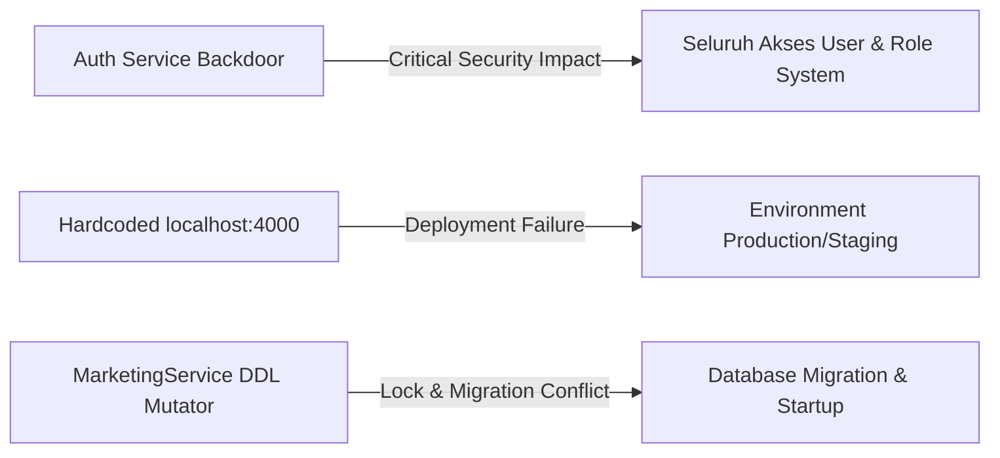

# Executive Summary

Audit Arsitektur V2 dilakukan secara **READ ONLY** pada repositori EPMS (Enterprise Project Management System) untuk menilai tingkat kesiapan produksi (*Production Readiness*), keamanan, serta kepatuhan terhadap standar industri Next.js App Router dan NestJS Modular Architecture.

Seluruh temuan yang tercantum dalam laporan ini bersifat **evidence-based** dari hasil pemeriksaan langsung terhadap kode sumber backend (`backend/src`) dan frontend (`frontend/src`).

### Temuan Kritis Utama:
1. **Critical Security Vulnerability**:
   - Backdoor autentikasi di `auth.service.ts` yang mengizinkan password `'password123'` dan `'123456'`.
   - `DocumentController` menonaktifkan `JwtAuthGuard`, menyebabkan endpoint upload dokumen terbuka tanpa autentikasi.
   - `DocumentController` tidak melakukan validasi tipe file (*MIME/Extension filter*) pada endpoint upload.
   - Kredensial auto-login superadmin hardcoded di frontend `DashboardPage.tsx`.
2. **Environment & Hardcoded Configurations**:
   - 24+ lokasi di 14 file frontend meng-hardcode base URL `http://localhost:4000`, melewati `apiClient` dan konfigurasi environment.
3. **Pelanggaran NestJS Architecture**:
   - `MarketingService` mengeksekusi DDL database (`ALTER TABLE contracts...`) secara mentah di method `onModuleInit()`.
   - Modul infrastruktur utama (`QueueModule`) di-mock dengan dummy provider dan RabbitMQ konsumen dimatikan.
4. **Pelanggaran Next.js App Router**:
   - 100% halaman (15+ rute) menggunakan `"use client"` (tidak ada Server Components atau SSR).

---

# Architecture Score (48/100)

| Kategori Audit | Skor | Penilaian & Ringkasan Temuan |
| :--- | :---: | :--- |
| **Security & Authentication** | 30/100 | Backdoor password, unauthenticated upload endpoint, missing file filter |
| **Next.js App Router Standard** | 35/100 | Zero Server Component, CSR-only, direct Axios bypass di UI components |
| **NestJS Architecture & Domain** | 50/100 | Service layer DDL mutation, cross-domain direct entity query, mocked queues |
| **Database & Transaction Integrity** | 60/100 | Mixed ORM & Raw Query, DDL di runtime application service |
| **Production Readiness & Code Quality**| 40/100 | 24+ Hardcoded localhost, log debug `[NUKLIR]`, dead code, duplicate file |
| **TOTAL ARCHITECTURE SCORE** | **48/100** | **Status: NOT PRODUCTION READY (Critical Vulnerabilities Found)** |

---

# Severity (P0-P3)

- **P0 (Critical)**: Vabilitas Keamanan Tinggi, Backdoor Auth, Unauthenticated Endpoints, Hardcoded Credentials.
- **P1 (High)**: Environment Hardcoded URL (24 lokasi), DDL di Runtime Application Service, Infrastructure Mocking di Modul Queue.
- **P2 (Medium)**: God Components (>1.000 baris), File Duplikat, 100% Client-Side Rendering App Router, Missing File Validation.
- **P3 (Low)**: Log Debug `[NUKLIR]`, Stub/Dead Code Component.

---

# Security Audit

### 1. Hardcoded Kredensial & Backdoor Password
- **Status**: CRITICAL VULNERABILITY (P0)
- **Bukti**:
  - `backend/src/modules/auth/auth.service.ts` (baris 41-42):
    ```typescript
    if (!isMatch && (pass === 'password123' || pass === '123456')) {
      isMatch = await bcrypt.compare('123456', user.passwordHash) || await bcrypt.compare('password123', user.passwordHash);
    }
    ```
  - `frontend/src/components/DashboardPage.tsx` (baris 44-46):
    ```typescript
    const loginRes = await axios.post('http://localhost:4000/api/v1/auth/login', {
      email: 'admin@epms.com',
      password: 'password123'
    });
    ```

### 2. Permission & Auth Guard Bypass
- **Status**: CRITICAL VULNERABILITY (P0)
- **Bukti**:
  - `backend/src/modules/document/document.controller.ts` (baris 8-9 & 16-40): `JwtAuthGuard` di-comment out dan tidak dipasang pada controller level maupun handler level. Endpoint `@Post('upload')` dan `@Post('presigned-url')` dapat diakses oleh publik tanpa JWT Token.

### 3. File Upload Validation
- **Status**: HIGH RISK (P1)
- **Bukti**:
  - `backend/src/modules/document/document.controller.ts` (baris 32-35): `FileInterceptor` hanya membatasi `fileSize: 10MB` tanpa `fileFilter` untuk memeriksa extension atau MIME type.

---

# Dependency Audit

### 1. Bypass Layer Client Service (Frontend)
- **Bukti**: 11 Komponen Frontend memotong `src/services/*` dan `src/lib/axios.ts` dengan memanggil direct `axios.get('http://localhost:4000/...')`:
  - `NotificationBell.tsx`
  - `AdminUserPage.tsx`
  - `CustomersPage.tsx`
  - `UserSessionManagerUI.tsx`
  - `DashboardPage.tsx`
  - `DocumentUpload.tsx`
  - `InboxPage.tsx`
  - `NotificationInbox.tsx`
  - `BpmnWorkflowVisualizer.tsx`
  - `app/profile/page.tsx`
  - `app/documents/page.tsx`

### 2. Cross-Domain Entity Dependency (Backend)
- **Bukti**: `MarketingService` (`backend/src/modules/marketing/marketing.service.ts`) mengimpor dan memanipulasi langsung entity dari domain lain: `Customer`, `Tender`, `Proposal`, `Contract`, `Document`, `TenderActivity`, `TenderPriceHistory`.

---

# API Contract Audit

### 1. Tipe Response `Promise<any>` & Long-term Debt
- **Bukti**:
  - `backend/src/modules/marketing/marketing.service.ts` menggunakan return type `any` atau tanpa DTO penjamin kontrak di berbagai method inter-domain.
  - `frontend/src/services/legal.service.ts` (line 110, 124, 132, 143, 154, 208) mendaftarkan fungsi dengan kembalian `Promise<any>`.

### 2. Inkonstensi Endpoint Base URL
- **Bukti**: Sebagian endpoint menggunakan `apiClient` ber-prefix `/api/v1`, sementara komponen direct Axios meng-hardcode port dan path secara manual tanpa enkapsulasi URL base.

---

# Database Audit

### 1. Mutasi DDL Database pada Application Runtime
- **Status**: CRITICAL ARCHITECTURAL VIOLATION (P1)
- **Bukti**: `backend/src/modules/marketing/marketing.service.ts` method `onModuleInit()` mengeksekusi method `ensureContractTableSchema()`:
  ```typescript
  await this.contractRepo.query(
    `SELECT COUNT(*) as cnt FROM INFORMATION_SCHEMA.COLUMNS WHERE TABLE_SCHEMA = ? AND TABLE_NAME = 'contracts' AND COLUMN_NAME = ?`,
    [DB_NAME, col.name]
  );
  // Menjalankan ALTER TABLE DDL secara otomatis saat aplikasi startup
  ```

### 2. Campuran TypeORM Query Builder & Raw SQL Query
- **Bukti**: `MarketingService` dan `LegalService` mencampur penggunaan TypeORM Repository API, QueryRunner Manual Transaction, dan Raw SQL String (`query(...)`) dalam satu service class.

---

# Next.js Audit

### 1. 100% Client-Side Rendering (CSR)
- **Bukti**: Seluruh file halaman di bawah `frontend/src/app/` mendaftarkan directive `"use client"` di baris pertama:
  - `src/app/layout.tsx` (Line 1: `"use client"` - membuat seluruh sub-tree aplikasi berjalan sebagai Client Context)
  - `src/app/page.tsx` (Line 1: `"use client"`)
  - `src/app/sales/page.tsx`
  - `src/app/legal/review/page.tsx`
  - `src/app/login/page.tsx`
  - `src/app/project-delivery/page.tsx`

### 2. Anti-Pattern Data Fetching
- **Bukti**: Data fetching utama dilakukan di dalam lifecycle React Client Component (`useEffect` + `useState`) tanpa memanfaatkan React Server Components (RSC) atau Server Actions.

---

# NestJS Audit

### 1. Infrastruktur Queue & Microservice Ter-mocking
- **Bukti**:
  - `backend/src/modules/queue/queue.module.ts` (baris 9-26):
    `mockQueueProvider` menggantikan pengiriman job BullMQ/Redis nyata dengan provider tiruan (`add: async () => ({ id: 'mock-job-id' })`).
  - `backend/src/main.ts` (baris 97-109): Microservice RabbitMQ ditiadakan dan ditaruh di dalam blok komentar (`/* ... */`).

### 2. Missing Common / Config Folders
- **Bukti**: Folder `src/common` dan `src/config` tidak ada pada struktur backend. Pengaturan environment dipanggil via file luar `src/env.ts`.

---

# Performance Audit

### 1. God Components (Frontend)
- **Bukti**:
  - `SalesPipelinePage.tsx`: **1.547 baris** (66 KB)
  - `KanbanBoard.tsx`: **1.079 baris** (48 KB)
  - `app/legal/review/page.tsx`: **658 baris** (29 KB)

### 2. God Service (Backend)
- **Bukti**: `MarketingService.ts`: **1.104 baris** (44 KB)

---

# Production Readiness

### 1. Hardcoded `localhost` Base URL
- **Bukti**: Ditemukan **24 kemunculan string `http://localhost:4000`** pada 14 file source code frontend dan backend.

### 2. Log Debug Non-Standar ("NUKLIR")
- **Bukti**:
  - `MarketingService.ts` (baris 949-1061): Log debug `🔥 [NUKLIR]`, `📌 [NUKLIR]`, `✅ [NUKLIR]`.
  - `AuthService.ts` (baris 36-43): Log debug `console.log('DEBUG_LOGIN...')`.

### 3. File Duplikat & Dead Code Component
- **Bukti**:
  - Duplicate File: `src/components/LegalReviewForm.tsx` (11.682 bytes) vs `src/components/legal/LegalReviewForm.tsx` (11.836 bytes).
  - Dead Component: `src/components/WorkflowDesigner.tsx` (14 baris dummy text).

---

# Evidence

| ID Evidence | File Sumber | Baris | Detail Deskripsi |
| :--- | :--- | :--- | :--- |
| **EV-SEC-01** | `backend/src/modules/auth/auth.service.ts` | 41-43 | Passcode bypass check `password123` / `123456` |
| **EV-SEC-02** | `backend/src/modules/document/document.controller.ts` | 8-9, 32 | Disabled `JwtAuthGuard` & missing upload `fileFilter` |
| **EV-SEC-03** | `frontend/src/components/DashboardPage.tsx` | 44-49 | Auto-login hardcoded admin credentials |
| **EV-DB-01**  | `backend/src/modules/marketing/marketing.service.ts` | 40-76 | Runtime `ALTER TABLE` DDL di `onModuleInit()` |
| **EV-ENV-01** | `frontend/src/components/AdminUserPage.tsx` | 48,72,88 | Direct Axios + hardcoded `http://localhost:4000` |
| **EV-ARCH-01**| `frontend/src/app/layout.tsx` | 1-15 | Root layout `"use client"` forcing 100% Client sub-tree |

---

# Blast Radius



---

# Priority Matrix

```
       TINGGI  ▲
               │ [P0] Auth Backdoor (auth.service.ts)
               │ [P0] Unauthenticated Uploads (document.controller.ts)
       DAMPAK  │ [P0] Hardcoded Localhost URLs (24 lokasi)
               │ [P1] Runtime DDL Mutation (marketing.service.ts)
               │ [P1] Mocked Queue & Infrastructure
               │ [P2] 100% Client-Side Next.js Architecture
               │ [P2] God Components (>1.000 baris)
               │ [P3] Log Debug NUKLIR & File Duplikat
       SENDIRI └────────────────────────────────────────────────────────────►
               RENDAH                   KOMPLEKSITAS REFACTOR              TINGGI
```

---

# Execution Plan (Minimal Diff)

```
Phase 1: Emergency Hotfix (P0 Security & Environment)
  ├── 1.1 Hapus backdoor password check di `auth.service.ts`
  ├── 1.2 Aktifkan `JwtAuthGuard` & tambahkan `fileFilter` di `document.controller.ts`
  ├── 1.3 Hapus auto-login kredensial di `DashboardPage.tsx`
  └── 1.4 Refactor seluruh URL `localhost:4000` ke `ENV.API_URL`

Phase 2: Database & Architecture Normalization (P1)
  ├── 2.1 Buat file TypeORM Migration resmi untuk kolom tabel `contracts` & hapus `ensureContractTableSchema`
  └── 2.2 Hubungkan `QueueModule` ke Redis BullMQ nyata

Phase 3: Clean Code & Performance Refactoring (P2 & P3)
  ├── 3.1 Unifikasi `LegalReviewForm.tsx` (hapus versi duplikat)
  ├── 3.2 Pembersihan log debug `[NUKLIR]`
  └── 3.3 Restrukturisasi Root Layout Next.js agar memanfaatkan Server Components
```

---

# Quick Wins

1. **Hapus Backdoor Password**: Hapus baris 41-44 pada `backend/src/modules/auth/auth.service.ts`.
2. **Pengamanan Endpoint Upload**: Buka komentar `JwtAuthGuard` di `document.controller.ts`.
3. **Pembersihan Log**: *Search & Replace* log string `[NUKLIR]` dan `DEBUG_LOGIN`.
4. **Hapus Duplikasi Component**: Hapus `src/components/LegalReviewForm.tsx` dan pusatkan impor ke `src/components/legal/LegalReviewForm.tsx`.

---

# Long Term Refactor

1. **App Router Migration to RSC**: Pisahkan Data Fetching ke React Server Components (RSC) dan ubah `RootLayout` menjadi Server Component.
2. **Pemesahan God Service & God Components**: Pecah `SalesPipelinePage.tsx` dan `MarketingService.ts` ke dalam sub-domain/sub-komponen yang lebih kecil (Domain-Driven Design).
3. **Type-Safe API Contracts**: Buat shared DTO/Type package untuk frontend dan backend untuk menggantikan penggunaan `Promise<any>`.

---

# Final Recommendation

Aplikasi **EPMS UBD & TVM** **BELUM SIAP UNTUK PRODUCTION (NOT PRODUCTION READY)**. 

Diperlukan penanganan segera terhadap temuan **P0 (Security & Environment)** sebelum melakukan deployment ke lingkungan Staging/Production. Perbaikan pada Phase 1 (Quick Wins) dapat dilakukan dengan *minimal diff* tanpa merusak fungsionalitas yang ada.
