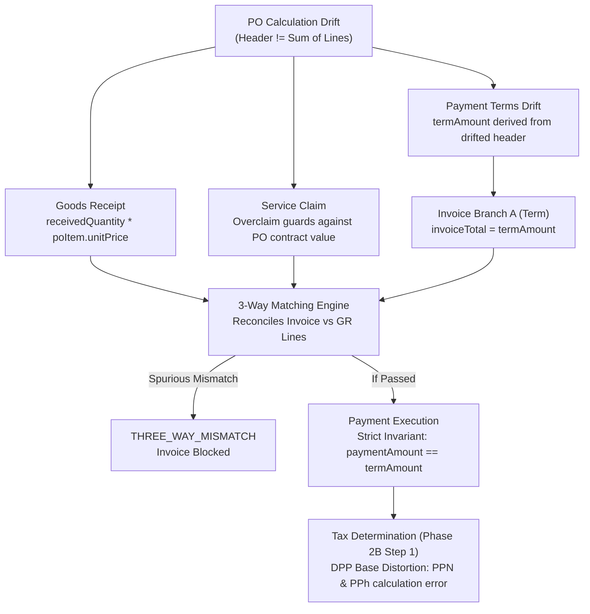

# EPMS UBD & TVM — PHASE 2B CHECKPOINT 1.2.1
# MONETARY PRECISION & ROUNDING STANDARDIZATION IMPLEMENTATION PLAN
## Comprehensive Technical Assessment, Downstream Finance Impact Analysis, and Implementation Roadmap for Procurement Fallback and 3-Way Matching Harmonization

**Document Path:** [`docs/audit/EPMS_CP1_2_1_IMPLEMENTATION_PLAN.md`](file:///c:/Users/UBDOPS3/Herd/epms_tvmubd/docs/audit/EPMS_CP1_2_1_IMPLEMENTATION_PLAN.md)  
**Document Version:** `1.4.0 (Canonical Scale Normalization & Parity Review)`  
**Governance Workstream:** EPMS UBD & TVM Enterprise Project Management System  
**Audit & Engineering Role:** Senior Enterprise Solution Architect, Financial Systems Auditor, and Senior Backend Engineer  
**Execution Mode:** STRICT READ-ONLY PLANNING & ASSESSMENT (Zero application code modified)  
**Checkpoint Authorization Status:** **`CP1.2.1 PLANNING CORRECTION COMPLETED — IMPLEMENTATION NOT AUTHORIZED`**  
**Repository Working Copy:** `c:/Users/UBDOPS3/Herd/epms_tvmubd`  
**Git Baseline Commit:** `ba8987d5336de10557caa35fc2d9f6547c789bd8` (Branch: `main`)  

---

## Document Revision History

| Version | Date | Status / Gate | Summary of Key Changes |
|---|---|---|---|
| **1.0.0** | 2026-11-12 | Preliminary Planning Baseline | Initial read-only technical assessment, fallback calculation analysis, and test planning for CP1.2.1. |
| **1.1.0** | 2026-11-12 | Technical and Governance Corrections | Addressed initial review findings across five core areas (COR-01 to COR-05): clarified IEEE-754 binary float limits vs decimal arithmetic; reframed 3-way matching tolerance; corrected quotation variable scope and entity mapping; prohibited silent zero-conversion; contextualized tax regulatory statements as non-universal illustrative examples. |
| **1.2.0** | 2026-11-12 | Final Monetary Precision Consistency Review | Aligned architectural proposals with arbitrary-precision decimal monetary standard (`decimal.js` with explicit `Decimal.ROUND_HALF_UP`); delineated CP1.1 baseline from proposed standard; rewrote helper pseudocode with pre-construction validation; resolved quotation fallback decimal arithmetic; replaced unsafe float equality with exact `Decimal` / minor-unit checks. |
| **1.3.0** | 2026-11-12 | Monetary Precision Contract & Minor-Unit Review | Addressed review findings (COR-06 to COR-09): corrected description of accepted CP1.1 to native floating-point rounding; defined decimal-safe integer minor-unit conversion (`toMinorUnits`) without float intermediates; established validated decimal strings as canonical preferred helper contract; removed premature `Number` conversion in quotation mapping and specified fixed-scale decimal string persistence. |
| **1.4.0** | 2026-11-12 | **Canonical Scale Normalization & Parity Review** | Addressed COR-10 review findings:<br/>1. **Canonical Scale Specification:** Defined canonical 2-decimal scale for Quantity (`DECIMAL(10, 2)`), Unit Price (`DECIMAL(19, 2)`), and Line Subtotal (`DECIMAL(19, 2)`).<br/>2. **Explicit Excess Fractional Scale Policy:** Established strict scale rejection for direct API submissions (`PoItemDto`) with > 2 decimal places before calculation; established explicit pre-calculation `ROUND_HALF_UP` normalization to 2 decimal places for upstream fallback entities (`QuotationItem` / `PurchaseRequestItem`).<br/>3. **Single Authoritative Calculation & Reuse:** Eliminated dual calculation loops; authoritative line items are computed exactly once per item returning normalized operands and line total; exact same Decimal results are reused for header aggregation and entity persistence.<br/>4. **Derived Header Invariant:** Enforced that the PO header total is derived exclusively from the sum of the exact persisted line totals (`savedPo.totalAmount = sum(items.totalPrice)`).<br/>5. **Test Scenarios:** Added explicit test scenarios (TC-CP1.2-13 to TC-CP1.2-15) for excess fractional scale rejection on direct inputs, pre-calculation normalization on fallback records, and verified 100% header-detail parity. |

---

## 1. Executive Summary

This technical implementation plan establishes the architectural baseline for monetary calculation, decimal precision, and rounding consistency across the EPMS procurement and financial workflows prior to introducing statutory Value-Added Tax (PPN) and withholding tax (PPh) controls in Phase 2B Step 1.

Under Phase 2B-CP1.1 (`PASS / CLOSED`), the primary Purchase Order creation path (`dto.po_items`) was successfully secured: client-submitted line totals are strictly ignored, the server validates `quantity > 0` and `unit_price >= 0`, authoritative line amounts are calculated with native JavaScript floating-point rounding (`Math.round(qty * price * 100) / 100`), and the PO header total is derived strictly from the sum of server-calculated authoritative line items. This closed the critical security vulnerability of trusting client totals, operating as the current accepted baseline. While CP1.1 successfully enforces server-side line authority, native binary floating-point rounding remains subject to IEEE-754 representation limits (such as half-cent boundary anomalies), establishing the requirement for the proposed arbitrary-precision Decimal standard.

However, a thorough read-only investigation of the remaining fallback and downstream calculation paths reveals two confirmed calculation defects and two critical downstream financial reconciliation vulnerabilities:

1. **Quotation Fallback Inconsistency & Item Entity Desynchronization:** When PO creation falls back to quotation data (`rfqIds.length > 0` without `dto.po_items`), the server accumulates unrounded floating-point products for the header total and rounds at the end, while line items persisted to `purchase_order_items` are mistakenly derived from `pr.items` (using PR estimated budget prices rather than quotation winning prices).
2. **Direct Service PO Fallback Header vs. Detail Drift:** When a Direct Service PO is created without `dto.po_items`, header `totalAmount` accumulates unrounded products and rounds after aggregation, while line items are persisted with per-item rounding, producing a structural divergence where `purchase_orders.total_amount != sum(purchase_order_items.totalPrice)`.
3. **Finance 3-Way Matching Spurious Rejection:** In `finance.service.ts#L1939-L1951`, the 3-way matching engine recalculates `totalGrAmount` by accumulating **unrounded** products of received quantity and PO unit price, comparing it against the invoice amount (which is the sum of **rounded** lines) using a strict inequality `< 0.01`. In multi-item deliveries with fractional pricing, legitimate transactions fail matching with `THREE_WAY_MISMATCH` solely due to sub-cent calculation drift.
4. **Term-Based Invoicing Line Disconnection:** In Branch A invoicing (`finance.service.ts#L283`), the invoice header is locked to `paymentTerm.amount`, while invoice lines are saved with per-item rounding without asserting that the sum of lines equals the header.

To permanently eliminate cross-module drift, this plan establishes a **Decimal Monetary Architecture** standardizing on the **"Line-Item Truth"** principle: line items are parsed from clean decimal strings with canonical 2-decimal scale (`DECIMAL(10, 2)` quantity and `DECIMAL(19, 2)` unit price). Excess fractional digits are explicitly governed by documented business rules (strict scale rejection on direct API submissions, explicit pre-calculation half-up normalization on upstream fallback entities). Authoritative line totals are calculated once in arbitrary-precision decimal space (`Decimal.ROUND_HALF_UP`), and the PO header total is derived strictly and exclusively from the sum of the exact persisted line items, guaranteeing 100% mathematical parity (`po.totalAmount === sum(items.totalPrice)`). Exact reconciliation across the settlement pipeline is verified using `Decimal` comparisons or decimal-safe integer minor-unit arithmetic, while a dedicated legacy reconciliation policy safely handles historical data.

---

## 2. Verified Source-Code Paths & Relevant Functions

The table below catalogs every source file, function, line range, and architectural role inspected during this planning phase:

| # | Module | Source File Path & Line Reference | Function / Component | Architectural Role | Current Numeric Pattern |
|---|---|---|---|---|---|
| **1** | Procurement | [`backend/src/modules/procurement/procurement.service.ts` L748-L784](file:///c:/Users/UBDOPS3/Herd/epms_tvmubd/backend/src/modules/procurement/procurement.service.ts#L748) | `createPurchaseOrder` | PO Header Total Calculation (Direct, Quotation Fallback, Direct Service PR Fallback) | Direct: sums rounded lines; Fallbacks: raw unrounded float accumulation, rounded after aggregation |
| **2** | Procurement | [`backend/src/modules/procurement/procurement.service.ts` L851-L863](file:///c:/Users/UBDOPS3/Herd/epms_tvmubd/backend/src/modules/procurement/procurement.service.ts#L851) | `createPurchaseOrder` | Payment Terms Allocation & Remainder Absorption | Basis points (10000 = 100%); non-final terms rounded, final term absorbs remainder |
| **3** | Procurement | [`backend/src/modules/procurement/procurement.service.ts` L895-L934](file:///c:/Users/UBDOPS3/Herd/epms_tvmubd/backend/src/modules/procurement/procurement.service.ts#L895) | `createPurchaseOrder` | `PurchaseOrderItem` Entity Creation & Persistence | Direct: `Math.round(qty * price * 100) / 100`; Fallback: maps `pr.items` with `Math.round` |
| **4** | Procurement | [`backend/src/modules/procurement/procurement.service.ts` L1730-L1743](file:///c:/Users/UBDOPS3/Herd/epms_tvmubd/backend/src/modules/procurement/procurement.service.ts#L1730) | `submitQuotation` | Quotation Line & Header Calculation | Per-item `Math.round(qty * price * 100) / 100`, summed to header, re-rounded |
| **5** | Procurement | [`backend/src/modules/procurement/procurement.service.ts` L1134-L1136](file:///c:/Users/UBDOPS3/Herd/epms_tvmubd/backend/src/modules/procurement/procurement.service.ts#L1134) | `createGoodsReceipt` | Goods Receipt Header Total Calculation | `itemAmount = Number((qty * price).toFixed(2))`; `total = Number((total + itemAmount).toFixed(2))` |
| **6** | Procurement | [`backend/src/modules/procurement/service-claim.service.ts` L83-L95, L428-L478](file:///c:/Users/UBDOPS3/Herd/epms_tvmubd/backend/src/modules/procurement/service-claim.service.ts#L83) | `createServiceClaim` | Service Claim Line & Header Calculation (BAST) | `decimal.js` arbitrary precision; line items rounded per item; header sums unrounded `Decimal` |
| **7** | Finance | [`backend/src/modules/finance/finance.service.ts` L283, L410-L475](file:///c:/Users/UBDOPS3/Herd/epms_tvmubd/backend/src/modules/finance/finance.service.ts#L283) | `createInvoice` (Branch A: Term-Based) | Term-Based Invoice Creation & Line Persistence | Header locked to `paymentTerm.amount`; lines computed with `Math.round(qty * price * 100) / 100` |
| **8** | Finance | [`backend/src/modules/finance/finance.service.ts` L638-L653](file:///c:/Users/UBDOPS3/Herd/epms_tvmubd/backend/src/modules/finance/finance.service.ts#L638) | `createInvoice` (Branch B: Item-Based) | Item-Based Invoice Creation & Authoritative Pricing | Authoritative per-item rounding summed directly into header total |
| **9** | Finance | [`backend/src/modules/finance/finance.service.ts` L1939-L1958](file:///c:/Users/UBDOPS3/Herd/epms_tvmubd/backend/src/modules/finance/finance.service.ts#L1939) | `evaluateMatching` | 3-Way Matching Evaluation (Invoice vs PO vs GR) | Re-sums `grItem.receivedQty * poItem.unitPrice` unrounded; checks `Math.abs(inv - gr) < 0.01` |
| **10** | Finance | [`backend/src/modules/finance/finance.service.ts` L965-L974, L1022-L1035](file:///c:/Users/UBDOPS3/Herd/epms_tvmubd/backend/src/modules/finance/finance.service.ts#L965) | `createPayment` / `executePayment` | Payment Target Validation & Liability Settlement | Enforces `Math.abs(payment - termTarget) <= 0.001`; full settlement `remaining <= 0.01` |
| **11** | Entities | [`backend/src/entities/quotation-item.entity.ts` L21, L52](file:///c:/Users/UBDOPS3/Herd/epms_tvmubd/backend/src/entities/quotation-item.entity.ts#L21) | `QuotationItem` Entity | Quotation Line Items Schema | `@Column({ name: 'pr_item_id', nullable: true })`; lacks direct `costItemId` column |
| **12** | Frontend | [`frontend/src/components/procurement/PurchaseOrderModal.tsx` L878, L1007](file:///c:/Users/UBDOPS3/Herd/epms_tvmubd/frontend/src/components/procurement/PurchaseOrderModal.tsx#L878) | `handleSubmit` (UI Modal) | Client PO Submission Payload Construction | Explicitly maps `po_items` with `quantity`, `unit_price`, and client `total_price` |

---

## 3. Current Calculation Behavior: Deep-Dive Analysis

### 3.1 Quotation Fallback PO Creation Path (`rfqIds.length > 0`)

When a Purchase Order is created without `dto.po_items`, the server attempts to fall back to quotation data if RFQs are linked:

```typescript
// backend/src/modules/procurement/procurement.service.ts L766-L775
} else if (rfqIds.length > 0) {
  const quote = await queryRunner.manager.findOne(Quotation, {
    where: { rfqId: In(rfqIds), vendorId: dto.vendor_id },
    relations: ['items'],
  });
  if (quote && quote.items && quote.items.length > 0) {
    for (const qi of quote.items) {
      totalAmount += Number(qi.quantity || 0) * Number(qi.unitPrice || 0);
    }
  }
}
totalAmount = Math.round(totalAmount * 100) / 100;
```

#### Detailed Operational Mechanics:
1. **Header Calculation:** The server locates the vendor's quotation and iterates `quote.items`. For each item, it re-multiplies `Number(qi.quantity) * Number(qi.unitPrice)` as raw floating-point numbers without intermediate rounding, accumulating into `totalAmount`. At line 784, `totalAmount` is rounded to 2 decimal places using native floating-point math.
2. **Item Persistence Disconnect (L895-L934):** When persisting `PurchaseOrderItem` entities:
   ```typescript
   if (dto.po_items && dto.po_items.length > 0) {
     // Direct items mapping...
   } else if (pr.items && pr.items.length > 0) {
     // Direct Service PO: derive items from PR items
     items = pr.items.map((pi) => {
       const qty = Number(pi.quantity || 0);
       const price = Number(pi.estimatedUnitPrice || 0);
       return queryRunner.manager.create(PurchaseOrderItem, {
         purchaseOrderId: savedPo.id,
         prItemId: pi.id,
         costItemId: pi.costItemId || null,
         itemName: pi.itemName,
         quantity: qty,
         unitPrice: price,
         totalPrice: Math.round(qty * price * 100) / 100,
         uom: pi.uom || 'Unit',
       });
     });
     await queryRunner.manager.save(items);
   }
   ```
   **Critical Defect:** There is **no persistence branch** for `quote.items`! If `dto.po_items` is omitted on a quotation-backed PO, the service falls into `else if (pr.items && pr.items.length > 0)`. It maps the original Purchase Request items (`pr.items`), assigning `unitPrice: Number(pi.estimatedUnitPrice)`!
3. **Variable Scope Issue:** In `procurement.service.ts` ([L767](file:///c:/Users/UBDOPS3/Herd/epms_tvmubd/backend/src/modules/procurement/procurement.service.ts#L767)), `quote` is declared with `const` inside the calculation `else if` block. It is not in scope in the downstream entity persistence block (L895+), requiring variable scope refactoring.
4. **Entity Relationship Analysis:** In `backend/src/entities/quotation-item.entity.ts` ([L21](file:///c:/Users/UBDOPS3/Herd/epms_tvmubd/backend/src/entities/quotation-item.entity.ts#L21)), `QuotationItem` has `prItemId` (nullable) referencing `PurchaseRequestItem`. However, `QuotationItem` does not possess a `costItemId` column. When mapping `quote.items` to `PurchaseOrderItem`, `costItemId` must be resolved by looking up `pr.items.find(pi => pi.id === qi.prItemId)?.costItemId`. If `prItemId` is null (e.g., ad-hoc quotation items added during negotiation), `costItemId` cannot be directly linked and must remain null.
5. **Consequences:**
   - The header `totalAmount` is calculated from the vendor's negotiated quotation prices (`quote.items.unitPrice`).
   - The persisted line items (`purchase_order_items`) record the internal budget prices (`pr.items.estimatedUnitPrice`).
   - The PO header total and the sum of persisted PO line items diverge by the entire commercial discount/margin negotiated during the RFQ process!

---

### 3.2 Direct Service PO Fallback Path (`pr.items`)

When a Purchase Order has no linked RFQs and no `dto.po_items` (e.g., direct service appointment):

```typescript
// backend/src/modules/procurement/procurement.service.ts L776-L784
} else if (pr.items && pr.items.length > 0) {
  // Direct Service PO: derive total amount from PR items
  for (const pi of pr.items) {
    totalAmount += Number(pi.quantity || 0) * Number(pi.estimatedUnitPrice || 0);
  }
} else {
  totalAmount = Number(pr.totalEstimatedAmount || 0);
}
totalAmount = Math.round(totalAmount * 100) / 100;
```

#### Detailed Operational Mechanics:
1. **Header Calculation:** The server iterates `pr.items` and accumulates `Number(pi.quantity || 0) * Number(pi.estimatedUnitPrice || 0)` unrounded. Line 784 applies aggregate rounding: `totalAmount = Math.round(totalAmount * 100) / 100`.
2. **Item Persistence (L917-L934):** The server maps `pr.items`, calculating each line total as:
   ```typescript
   totalPrice: Math.round(qty * price * 100) / 100
   ```
3. **Discrepancy (Header vs. Detail):**
   - Header is `round(sum(unrounded(qty * price)))`.
   - Items are `round(qty * price)` per item.
   - For items with fractional unit rates or quantities yielding half-cent products (e.g., 4 lines with subtotal Rp 12.5125), the header equals Rp 50.05 while the sum of persisted items equals Rp 50.04.

---

### 3.3 Direct PO Creation Path (`dto.po_items`) [CP1.1 Verified Baseline]

The accepted CP1.1 direct PO path operates as follows:

```typescript
// backend/src/modules/procurement/procurement.service.ts L749-L765
if (dto.po_items && dto.po_items.length > 0) {
  for (const item of dto.po_items) {
    const qty = Number(item.quantity);
    const unitPrice = Number(item.unit_price);
    if (!Number.isFinite(qty) || qty <= 0) {
      throw new BadRequestException(`Kuantitas item "${item.item_name || 'Item'}" harus lebih besar dari 0`);
    }
    if (!Number.isFinite(unitPrice) || unitPrice < 0) {
      throw new BadRequestException(`Harga satuan item "${item.item_name || 'Item'}" tidak boleh negatif`);
    }
    const lineTotal = Math.round(qty * unitPrice * 100) / 100;
    totalAmount += lineTotal;
  }
}
```

- **Accepted Baseline Status:** Enforces that client-submitted `total_price` is strictly ignored, validates `quantity > 0` and `unit_price >= 0`, calculates line totals using native JavaScript floating-point rounding (`Math.round(qty * unitPrice * 100) / 100`), and sums `totalAmount` from authoritative lines. Persisted `purchase_order_items.totalPrice` equals the server-calculated `lineTotal` ([L912](file:///c:/Users/UBDOPS3/Herd/epms_tvmubd/backend/src/modules/procurement/procurement.service.ts#L912)).
- **Delineation from Proposed Future Standard:** While CP1.1 established the "Line-Item Truth" invariant for direct POs and successfully resolved client total tampering, it relies on JavaScript native binary floating-point primitives (`Number`). Native IEEE-754 arithmetic does not guarantee exact decimal half-up rounding across all boundary values. The proposed future standard will transition this foundation to arbitrary-precision decimal strings (`decimal.js`).

---

## 4. Confirmed Defects vs. Potential Risks

Findings are strictly classified into confirmed implementation defects versus theoretical operational risks:

```
+========================================================================================================+
|                                    CP1.2.1 AUDIT FINDINGS CLASSIFICATION REGISTER                                      |
+========================================================================================================+
```

### 4.1 Confirmed Defects (Direct Source-Code Evidence)

| Defect ID | Severity | Module & Location | Description & Mechanism | Direct Source Reference | Business / Financial Impact |
|---|:---:|---|---|---|---|
| **DEF-CP1.2-01** | **HIGH** | Procurement: `procurement.service.ts` L766-L784 | **Header-Detail Rounding Discrepancy in Fallback POs:** Fallback branches accumulate unrounded float products for header while rounding items per-item. | `procurement.service.ts#L773, L784, L929` | Multi-item fallback POs exhibit Rp 0.01+ difference between header contract value and itemized commitments. |
| **DEF-CP1.2-02** | **CRITICAL** | Procurement: `procurement.service.ts` L894-L934 | **Missing Quotation Item Mapping in Fallback PO Persistence:** When `dto.po_items` is omitted on RFQ POs, the server persists `pr.items` with estimated budget prices instead of `quote.items` with winning prices. | `procurement.service.ts#L895, L917` | Major data corruption: PO lines reflect pre-tender budget estimates instead of legally binding vendor quotation prices. |
| **DEF-CP1.2-03** | **HIGH** | Finance: `finance.service.ts` L1939-L1951 | **Spurious 3-Way Matching Failure from Unrounded GR Accumulation:** Matching engine computes `totalGrAmount` by accumulating unrounded products and rejects with `< 0.01` tolerance. | `finance.service.ts#L1944, L1950` | Legitimate vendor invoices for accepted physical deliveries are rejected with `THREE_WAY_MISMATCH` due to Rp 0.01 sub-cent drift. |
| **DEF-CP1.2-04** | **MEDIUM** | Finance: `finance.service.ts` L283, L411-L473 | **Term-Based Invoicing Line-Header Disconnection:** Branch A locks header to `paymentTerm.amount` without validating or reconciling against `sum(invoiceItems.totalPrice)`. | `finance.service.ts#L283, L411` | Invoices record line item totals that do not sum to the billing header amount. |

---

### 4.2 Potential Risks (Operational & Data Model Considerations)

| Risk ID | Likelihood | Impact | Area | Risk Description | Mitigating Factor / Analysis |
|---|:---:|:---:|---|---|---|
| **RSK-CP1.2-01** | Low | Medium | Engineering Planning | **Quantity Scale Truncation (`DECIMAL(12, 4)` to `DECIMAL(10, 2)`):** Cost items support 4 decimals, while PR/PO/Invoice schemas support 2 decimals. | In Indonesian commercial contracting, PR/PO line quantities are conventionally integer or 2-decimal units; bulk materials use standard packaging. Defined by Canonical Scale Policy. |
| **RSK-CP1.2-02** | Medium | Low | Half-Cent Boundaries | **Sub-Cent Discrepancy Between Native Float and Decimal Arithmetic:** On exact half-cents (e.g. `1.005`), IEEE-754 binary floating-point representation causes `Math.round` to round down to `1.00`, whereas `decimal.js` rounds to `1.01`. | In IDR currency, transactions are denominated in whole Rupiah (fractions are sub-cent artifacts); adopting a decimal string calculation standard in future checkpoints resolves this. |
| **RSK-CP1.2-03** | Low | High | Legacy Data | **Stale PO Data Prior to CP1.1/CP1.2:** Existing database records created prior to calculation fixes may possess pre-existing discrepancies. | Remediation logic must apply strictly to new transaction creation; migration scripts must not mutate historical closed POs without audit approval. |

---

## 5. Downstream Finance Impact Assessment

A financial discrepancy in a Purchase Order cascades across the entire settlement pipeline:



### 5.1 Tracing the Ripple Effects Across Stages

1. **Payment Terms Allocation (`procurement.service.ts#L851-L863`):**  
   Payment terms are calculated as percentages of the PO header `totalAmount`. If the header total contains a rounding drift (e.g. Rp 50.05 instead of Rp 50.04), the term amounts absorb this drift.
2. **Goods Receipt Valuation (`procurement.service.ts#L1134-L1136`):**  
   Goods Receipt header `totalReceivedAmount` is computed from `poItem.unitPrice`. If the PO items were saved with incorrect PR estimated prices (under Defect `DEF-CP1.2-02`), the GR valuation will be completely wrong.
3. **Service Claim Contract Guards (`service-claim.service.ts#L436`):**  
   The cumulative claim validation guard checks:
   ```typescript
   if (cumulativeAmtDec.greaterThan(contractValueDec))
   ```
   If PO item contract values do not sum to the PO header, the system may reject valid final service claims that match the PO header but exceed corrupted line items.
4. **3-Way Matching Failure (`finance.service.ts#L1950`):**  
   As demonstrated in Scenario B of the Phase 2A assessment:
   $$\text{Math.abs}(\text{invoicedAmount} - \text{totalGrAmount}) < 0.01$$
   When an item-based invoice calculates lines with `Math.round(qty * price * 100) / 100` (yielding Rp 50.04), but 3-Way Matching sums unrounded products (yielding Rp 50.05), the difference is exactly Rp 0.01. The condition `0.01 < 0.01` evaluates to **`false`**, immediately rejecting the invoice and blocking vendor settlement.
5. **Tax Determination & Statutory Tax Calculation Base (DPP) Impact:**  
   > [!NOTE]
   > **Illustrative Example (Not Approved universal rule):** Under Indonesian tax principles (e.g., UU PPN Pasal 1 angka 17 and Pasal 8A), the Tax Calculation Base (DPP) for commercial taxable transactions is the agreed contract/selling value. If an illustrative PPN rate (e.g. 11% or statutory 12% schedule) or an illustrative withholding tax rate (e.g. 2% PPh 23 for services under PMK 141/2015, or construction rates under PP 9/2022) is computed on a drifted commercial base, sub-cent rounding discrepancies will propagate into the tax amounts. This can generate electronic tax invoices (*Faktur Pajak*) or withholding receipts (*Bukti Potong*) that fail statutory reconciliation against vendor billing amounts. Statutory tax classifications, applicable rates, tax calculation bases (DPP Nilai Lain vs. Normal), and effective dates require formal business and tax validation before implementation in Phase 2B Step 1.

---

## 6. Proposed Calculation Standardization Architecture

### 6.1 Monetary Precision, Representation & Rounding Mechanics (COR-01 / COR-06 / COR-10)

#### Binary Floating-Point vs. Decimal Monetary Arithmetic
- **Binary Floating-Point Limitations:** JavaScript `number` primitives conform to IEEE-754 64-bit binary floating-point. Numbers that have clean, finite decimal representations (such as `0.1`, `0.2`, or `1.005`) cannot be represented exactly in binary base-2:
  - `1.005 * 100` evaluates to `100.49999999999999` in V8.
  - Applying native `Math.round(100.49999999999999)` yields `100`, which divided by 100 gives `1.00` instead of the expected mathematical half-up result `1.01`.
  - Therefore, native JavaScript `Math.round` performs native binary floating-point rounding and does **not** guarantee mathematically exact decimal half-up rounding across boundary values.
- **Current CP1.1 Baseline vs. Proposed Future Standard:**
  - *Current CP1.1 Baseline:* Implements native JavaScript floating-point rounding (`Math.round(qty * unitPrice * 100) / 100`) on primitive numbers in the direct PO item path. This resolved the critical security vulnerability (ignoring client-submitted totals and deriving header from lines), but operates within native IEEE-754 limits.
  - *Proposed Future Standard:* A decimal-based calculation architecture using arbitrary-precision decimal arithmetic (`decimal.js`) initialized strictly from validated decimal strings (e.g. `new Decimal(qtyStr).times(new Decimal(priceStr))`), rounded with explicit `Decimal.ROUND_HALF_UP`, and persisted into MySQL `DECIMAL(19, 2)` columns.

#### Canonical Scale & Excess Fractional Digit Policy (COR-10)
Database schema definitions establish fixed precision and scale for all commercial tables:
- **Quantity:** MySQL `DECIMAL(10, 2)` $\rightarrow$ Canonical scale = 2.
- **Unit Price:** MySQL `DECIMAL(19, 2)` $\rightarrow$ Canonical scale = 2.
- **Line Total (`total_price`):** MySQL `DECIMAL(19, 2)` $\rightarrow$ Canonical scale = 2.
- **Header Total (`total_amount`):** MySQL `DECIMAL(19, 2)` $\rightarrow$ Canonical scale = 2.

To guarantee mathematical parity between header aggregation and persisted detail items, excess fractional digits are governed by explicit business rules:

1. **Rule 1 (Direct API / DTO Submissions — Strict Scale Rejection):**  
   When a client or external caller submits a direct PO creation payload (`PoItemDto`), any quantity or unit price with more than 2 decimal places (e.g. `"1.255"` or `"10.005"`) is **strictly rejected** before calculation via `InvalidMonetaryAmountException` (`BadRequestException`). Silent rounding or truncation of client-supplied contract prices is prohibited.
2. **Rule 2 (Upstream Fallback Entities — Explicit Pre-Calculation Half-Up Normalization):**  
   When PO creation falls back to internal upstream records (`QuotationItem` or `PurchaseRequestItem`), existing database values with excess fractional digits are **explicitly normalized to 2 decimal places using `Decimal.ROUND_HALF_UP` before multiplication occurs**.
3. **Rule 3 (Uniform Operands & Single Authoritative Pass Invariant):**  
   Under both Rule 1 and Rule 2, the exact same normalized operands (`qtyDec`, `unitPriceDec`) are used for multiplication. The resulting authoritative line total (`lineTotalDec`) is calculated **exactly once** per line item. That exact `Decimal` result is reused identically for both item persistence (`totalPrice: lineTotalDec.toFixed(2)`) and header aggregation (`totalAmountDec = totalAmountDec.plus(lineTotalDec)`).

---

### 6.2 3-Way Matching Tolerance & Reconciliation Policy (COR-02 / COR-07)

#### Evaluation of Matching Tolerance & Exact Equality
The proposal in the preliminary draft to expand the tolerance from `< 0.01` to `<= 0.01` must not be treated as a universal cure-all:
1. **Masking Genuine Discrepancies:** A blind 1-cent tolerance can mask true vendor billing overages or off-by-one errors on low-unit-price bulk items (e.g. 100 units at Rp 0.01).
2. **Mathematical Robustness of Exact Comparison:** In floating-point arithmetic, expressions like `Math.abs(invoicedAmount - totalGrAmount) === 0` can fail due to IEEE-754 representation noise or signed zero (`-0`). Exact reconciliation must be evaluated using either:
   - **Decimal Comparison:** `invAmountDec.equals(grAmountDec)` or `invAmountDec.minus(grAmountDec).isZero()`.
   - **Integer Minor-Unit Comparison (Decimal-Safe):** `toMinorUnits(invAmount) === toMinorUnits(grAmount)`.
3. **Decimal-Safe Minor-Unit Conversion (No Floating-Point Intermediates):**  
   Converting monetary amounts to integer minor units (sen/cents) must **never** be performed using native floating-point math such as `Math.round(x * 100)`. Because multiplying binary floating-point numbers produces representation noise on boundary values, minor-unit conversions must parse validated decimal strings into `Decimal`, scale by 100 in arbitrary precision, round using `Decimal.ROUND_HALF_UP`, and convert to integer or `BigInt`:
   ```typescript
   /**
    * Decimal-safe integer minor-unit conversion.
    * Parses validated decimal strings into Decimal, scales by 100 in arbitrary precision,
    * and rounds using Decimal.ROUND_HALF_UP without floating-point intermediates.
    */
   export function toMinorUnits(amount: string | Decimal): bigint {
     const dec = typeof amount === 'string' ? new Decimal(amount.trim()) : amount;
     if (!dec.isFinite()) {
       throw new InvalidMonetaryAmountException('Nilai moneter tidak valid untuk konversi minor units');
     }
     const minorDec = dec.times(100).toDecimalPlaces(0, Decimal.ROUND_HALF_UP);
     return BigInt(minorDec.toFixed(0));
   }
   ```
4. **Primary Resolution — Consistent Calculation:** When both Goods Receipt valuation and Invoice billing accumulate pre-rounded 2-decimal lines, newly created transactions reconcile with **exact mathematical equality** (`invDec.equals(grDec)` or `toMinorUnits(inv) === toMinorUnits(gr)`).
5. **Separate Legacy Compatibility Policy:** For existing historical transactions created prior to the CP1.2 standardization where pre-existing 1-cent rounding drift exists:
   - Newly created transactions must target exact match (`invDec.equals(grDec)`).
   - A dedicated legacy tolerance policy (`<= 0.01`) may be maintained conditionally for transactions created before the CP1.2 release cut-off date, accompanied by an explicit audit log entry rather than silently expanding tolerances system-wide.

---

### 6.3 Quotation Fallback Variable Scope, Single-Pass Architecture & Persistence (COR-03 / COR-09 / COR-10)

#### Single-Pass Architecture & Header Derivation Invariant
To permanently eliminate the defect where header aggregation and item persistence run in separate loops with divergent rounding:
1. **Single Authoritative Calculation:** All PO items are calculated and mapped in a **single pass**.
2. **Reused Operands and Totals:** For every item, `qtyDec`, `unitPriceDec`, and `lineTotalDec` are determined once. The exact same values are persisted to `PurchaseOrderItem` and summed into `savedPo.totalAmount`.
3. **Outer Scope Declaration:** `winningQuote` is declared in outer transaction scope, accessible during both calculation and persistence.

```typescript
// Proposed Architectural Pattern: Single-Pass Calculation & Reuse (Decimal-Safe)
let winningQuote: Quotation | null = null;
const authoritativeItems: {
  prItemId: number | null;
  costItemId: number | null;
  itemName: string;
  quantity: string;   // Fixed-scale decimal string DECIMAL(10, 2)
  unitPrice: string;  // Fixed-scale decimal string DECIMAL(19, 2)
  totalPrice: string; // Fixed-scale decimal string DECIMAL(19, 2)
  uom: string;
  lineTotalDec: Decimal;
}[] = [];

if (dto.po_items && dto.po_items.length > 0) {
  // Branch 1: Direct PO items submission (Rule 1: Strict scale <= 2 validation)
  for (const item of dto.po_items) {
    const line = calculateLineTotalDecimal(
      item.quantity,
      item.unit_price,
      item.item_name,
      { enforceStrictScale: true },
    );
    authoritativeItems.push({
      prItemId: item.pr_item_id || null,
      costItemId: item.cost_item_id || null,
      itemName: item.item_name,
      quantity: line.qtyDec.toFixed(2),
      unitPrice: line.unitPriceDec.toFixed(2),
      totalPrice: line.lineTotalDec.toFixed(2),
      uom: (item as any).uom || 'Unit',
      lineTotalDec: line.lineTotalDec,
    });
  }
} else if (rfqIds.length > 0) {
  // Branch 2: Quotation Fallback (Rule 2: Pre-calculation half-up normalization)
  winningQuote = await queryRunner.manager.findOne(Quotation, {
    where: { rfqId: In(rfqIds), vendorId: dto.vendor_id },
    relations: ['items'],
  });
  if (winningQuote && winningQuote.items && winningQuote.items.length > 0) {
    for (const qi of winningQuote.items) {
      const matchingPrItem = (pr.items || []).find(
        (pi) => qi.prItemId && Number(pi.id) === Number(qi.prItemId),
      );
      const line = calculateLineTotalDecimal(
        qi.quantity,
        qi.unitPrice,
        qi.itemName,
        { enforceStrictScale: false }, // Explicit pre-calculation normalization
      );
      authoritativeItems.push({
        prItemId: qi.prItemId || null,
        costItemId: matchingPrItem?.costItemId || null,
        itemName: qi.itemName,
        quantity: line.qtyDec.toFixed(2),
        unitPrice: line.unitPriceDec.toFixed(2),
        totalPrice: line.lineTotalDec.toFixed(2),
        uom: qi.uom || matchingPrItem?.uom || 'Unit',
        lineTotalDec: line.lineTotalDec,
      });
    }
  }
} else if (pr.items && pr.items.length > 0) {
  // Branch 3: Direct Service PR Fallback (Rule 2: Pre-calculation normalization)
  for (const pi of pr.items) {
    const line = calculateLineTotalDecimal(
      pi.quantity,
      pi.estimatedUnitPrice,
      pi.itemName,
      { enforceStrictScale: false },
    );
    authoritativeItems.push({
      prItemId: pi.id,
      costItemId: pi.costItemId || null,
      itemName: pi.itemName,
      quantity: line.qtyDec.toFixed(2),
      unitPrice: line.unitPriceDec.toFixed(2),
      totalPrice: line.lineTotalDec.toFixed(2),
      uom: pi.uom || 'Unit',
      lineTotalDec: line.lineTotalDec,
    });
  }
}

// Header Total: Derived EXCLUSIVELY by summing exact persisted line totals
let totalAmountDec = new Decimal('0.00');
for (const line of authoritativeItems) {
  totalAmountDec = totalAmountDec.plus(line.lineTotalDec);
}
savedPo.totalAmount = totalAmountDec.toFixed(2);

// Item Persistence: Maps exact same normalized operands and line total
const items = authoritativeItems.map((ai) =>
  queryRunner.manager.create(PurchaseOrderItem, {
    purchaseOrderId: savedPo.id,
    prItemId: ai.prItemId,
    costItemId: ai.costItemId,
    itemName: ai.itemName,
    quantity: ai.quantity,
    unitPrice: ai.unitPrice,
    totalPrice: ai.totalPrice,
    uom: ai.uom,
  }),
);
await queryRunner.manager.save(items);
```

#### Entity Relationship Dependencies
- **`QuotationItem` to `PurchaseOrderItem` Mapping:**
  - Persisted items record winning quotation prices (`line.unitPriceDec.toFixed(2)`), eliminating Defect `DEF-CP1.2-02`.
  - `prItemId`: `qi.prItemId` is mapped if present on `QuotationItem` ([`quotation-item.entity.ts` L21](file:///c:/Users/UBDOPS3/Herd/epms_tvmubd/backend/src/entities/quotation-item.entity.ts#L21)).
  - `costItemId`: If `qi.prItemId` is present, `costItemId` is resolved via matching PR items.
  - **Unresolved Dependency:** If `qi.prItemId` is null (e.g. ad-hoc item added by vendor during bidding), `costItemId` cannot be derived from `pr.items` and must remain null. This data relationship requirement must be formally verified with the procurement business team before CP1.2 implementation.

---

### 6.4 Proposed Monetary Helper Design & Strict Error Handling (COR-04 / COR-08 / COR-10)

#### Decimal Input Contract Specification
1. **Canonical Preferred Contract (Validated Decimal Strings):**  
   Validated decimal strings (`string`) are the **canonical, preferred contract** for all financial and monetary calculation interfaces across EPMS (e.g. `"150000.00"`, `"1.25"`). Strings preserve exact user input and database decimal values without IEEE-754 floating-point conversion.
2. **Supported Legacy Contract Limitations (`number`):**  
   If primitive `number` inputs remain accepted for compatibility with legacy TypeScript interfaces:
   - JavaScript numbers conform to IEEE-754 64-bit binary floating-point.
   - Numbers resulting from prior floating-point operations (e.g. `qty * price` or calculated float variables) **cannot** reconstruct lost precision; calling `String(number)` or `new Decimal(number)` preserves the binary representation artifact (e.g. `1.004999999999999893`).
   - Therefore, **treating previously calculated floating-point values as exact source decimals is strictly prohibited**. Upstream callers must provide raw decimal strings directly from payload inputs or database column strings. Only literal constants or integers should ever be supplied as numbers.
3. **Pre-Construction Validation Order & Scale Enforcement:**  
   All validation must occur **before** `Decimal` construction. Malformed strings, non-finite values, excess decimal places on direct submissions, and negative inputs must be rejected explicitly via `InvalidMonetaryAmountException` (`BadRequestException`), while preserving legitimate zero-price items.

```typescript
// Proposed Helper Architecture (Design Specification - Not Implemented)
import Decimal from 'decimal.js';
import { BadRequestException } from '@nestjs/common';

// Configure Decimal instance with explicit ROUND_HALF_UP
Decimal.set({ precision: 28, rounding: Decimal.ROUND_HALF_UP });

export class InvalidMonetaryAmountException extends BadRequestException {
  constructor(message: string) {
    super(message);
  }
}

export interface LineCalculationResult {
  qtyDec: Decimal;
  unitPriceDec: Decimal;
  lineTotalDec: Decimal;
}

export interface CalculationOptions {
  /**
   * When true (default for Direct DTO submissions), rejects inputs with scale > 2.
   * When false (for internal fallback entity ingestion), normalizes inputs to scale 2 using ROUND_HALF_UP before multiplication.
   */
  enforceStrictScale?: boolean;
}

/**
 * Decimal-safe monetary parser & line total calculator.
 * Preferred contract: Validated decimal strings (string).
 * Supported legacy contract: Non-calculated primitive numbers (number).
 * 
 * Validates inputs before Decimal construction, enforces/normalizes canonical 2-decimal scale,
 * executes arbitrary-precision multiplication, and rounds with explicit Decimal.ROUND_HALF_UP.
 */
export function calculateLineTotalDecimal(
  quantity: string | number,
  unitPrice: string | number,
  itemName: string = 'Item',
  options: CalculationOptions = { enforceStrictScale: true },
): LineCalculationResult {
  // 1. Missing, null, undefined pre-validation
  if (quantity === null || quantity === undefined) {
    throw new InvalidMonetaryAmountException(
      `Kuantitas untuk "${itemName}" tidak boleh null atau undefined`,
    );
  }
  if (unitPrice === null || unitPrice === undefined) {
    throw new InvalidMonetaryAmountException(
      `Harga satuan untuk "${itemName}" tidak boleh null atau undefined`,
    );
  }

  // 2. Type validation & string normalization
  let qtyStr: string;
  let priceStr: string;

  if (typeof quantity === 'string') {
    qtyStr = quantity.trim();
    if (qtyStr === '') {
      throw new InvalidMonetaryAmountException(
        `Kuantitas untuk "${itemName}" tidak boleh string kosong atau spasi`,
      );
    }
  } else if (typeof quantity === 'number') {
    if (!Number.isFinite(quantity)) {
      throw new InvalidMonetaryAmountException(
        `Kuantitas untuk "${itemName}" tidak boleh bernilai NaN atau Infinity`,
      );
    }
    qtyStr = quantity.toString();
  } else {
    throw new InvalidMonetaryAmountException(
      `Tipe data kuantitas untuk "${itemName}" tidak didukung`,
    );
  }

  if (typeof unitPrice === 'string') {
    priceStr = unitPrice.trim();
    if (priceStr === '') {
      throw new InvalidMonetaryAmountException(
        `Harga satuan untuk "${itemName}" tidak boleh string kosong atau spasi`,
      );
    }
  } else if (typeof unitPrice === 'number') {
    if (!Number.isFinite(unitPrice)) {
      throw new InvalidMonetaryAmountException(
        `Harga satuan untuk "${itemName}" tidak boleh bernilai NaN atau Infinity`,
      );
    }
    priceStr = unitPrice.toString();
  } else {
    throw new InvalidMonetaryAmountException(
      `Tipe data harga satuan untuk "${itemName}" tidak didukung`,
    );
  }

  // 3. Decimal string pattern pre-validation
  const decimalPattern = /^-?\d+(\.\d+)?$/;
  if (!decimalPattern.test(qtyStr)) {
    throw new InvalidMonetaryAmountException(
      `Format kuantitas "${qtyStr}" untuk "${itemName}" bukan angka desimal valid`,
    );
  }
  if (!decimalPattern.test(priceStr)) {
    throw new InvalidMonetaryAmountException(
      `Format harga satuan "${priceStr}" untuk "${itemName}" bukan angka desimal valid`,
    );
  }

  // 4. Canonical scale validation / normalization (COR-10)
  const strictScalePattern = /^-?\d+(\.\d{1,2})?$/;
  if (options.enforceStrictScale) {
    if (!strictScalePattern.test(qtyStr)) {
      throw new InvalidMonetaryAmountException(
        `Kuantitas "${qtyStr}" untuk "${itemName}" memiliki lebih dari 2 tempat desimal (maksimal 2 desimal didukung)`,
      );
    }
    if (!strictScalePattern.test(priceStr)) {
      throw new InvalidMonetaryAmountException(
        `Harga satuan "${priceStr}" untuk "${itemName}" memiliki lebih dari 2 tempat desimal (maksimal 2 desimal didukung)`,
      );
    }
  }

  // 5. Decimal instance construction & pre-calculation operand normalization
  let qtyDec = new Decimal(qtyStr);
  let priceDec = new Decimal(priceStr);

  if (!options.enforceStrictScale) {
    // Explicit pre-calculation normalization for upstream fallback records
    qtyDec = qtyDec.toDecimalPlaces(2, Decimal.ROUND_HALF_UP);
    priceDec = priceDec.toDecimalPlaces(2, Decimal.ROUND_HALF_UP);
  }

  // 6. Domain business validation
  if (qtyDec.lessThanOrEqualTo(0)) {
    throw new InvalidMonetaryAmountException(
      `Kuantitas untuk "${itemName}" harus lebih besar dari 0`,
    );
  }
  if (priceDec.isNegative()) {
    throw new InvalidMonetaryAmountException(
      `Harga satuan untuk "${itemName}" tidak boleh negatif`,
    );
  }

  // 7. Legitimate zero-price check: price === 0 is valid (e.g. warranty, promotional sample)
  if (priceDec.isZero()) {
    return {
      qtyDec,
      unitPriceDec: priceDec,
      lineTotalDec: new Decimal('0.00'),
    };
  }

  // 8. Arbitrary-precision multiplication and explicit ROUND_HALF_UP to 2 decimal places
  const lineTotalDec = qtyDec.times(priceDec).toDecimalPlaces(2, Decimal.ROUND_HALF_UP);

  return {
    qtyDec,
    unitPriceDec: priceDec,
    lineTotalDec,
  };
}
```

---

## 7. Test Scenario Matrix

The test matrix below outlines the mandatory regression, boundary, scale normalization, and error-handling scenarios required for CP1.2 verification:

| Scenario ID | Test Scenario Name | Context / Execution Branch | Initial Inputs (Preferred Decimal Strings) | Expected Calculation & Scale Normalization | Expected Persisted Values | Expected Validation / Matching Outcome |
|---|---|---|---|---|---|---|
| **TC-CP1.2-01** | Single-item PO Calculation | Direct PO (`dto.po_items`) | `qty = "10"`, `unit_price = "150000.00"` | Canonical scale 2; `lineTotalDec = 1500000.00`; `totalAmountDec = 1500000.00` | `item.totalPrice = "1500000.00"`, `po.totalAmount = "1500000.00"` | Header equals line sum; CP1.1 native float regression preserved with 100% parity. |
| **TC-CP1.2-02** | Multiple-item PO Calculation | Direct PO (`dto.po_items`) | 3 items: ("2.00", "10.50"), ("3.00", "20.25"), ("5.00", "30.10") | Canonical scale 2; Lines: 21.00, 60.75, 150.50. Sum: 232.25 | `items[].totalPrice` = ["21.00", "60.75", "150.50"]; `po.totalAmount = "232.25"` | Single pass; header exactly reconciles with sum of lines. |
| **TC-CP1.2-03** | Fractional Quantity (Canonical 2-Decimal) | Direct PO (`dto.po_items`) | `qty = "1.33"`, `unit_price = "250000.00"` | Canonical scale 2; `lineTotalDec = 332500.00` | `item.quantity = "1.33"`, `item.totalPrice = "332500.00"` | 2-decimal fractional quantity supported without truncation. |
| **TC-CP1.2-04** | Half-Cent & Rounding Boundaries | Direct PO (`dto.po_items`) | `qty = "1.25"`, `unit_price = "10.01"` (product = 12.5125) | `lineTotalDec = 12.5125.toDecimalPlaces(2, ROUND_HALF_UP) = 12.51` | `item.totalPrice = "12.51"` | Half-cent rounds mathematically half-up to 12.51; exact decimal arithmetic verified. |
| **TC-CP1.2-05** | Header-Detail Reconciliation (Multi-Item Sub-Cent) | Direct PO (`dto.po_items`) | 4 items with `qty = "1.25"`, `unit_price = "10.01"` | Each line = 12.51. Sum of lines = 50.04 | `items[].totalPrice = ["12.51", "12.51", "12.51", "12.51"]`; `po.totalAmount = "50.04"` | Header derived exclusively from sum of persisted lines (50.04). Zero header-detail drift. |
| **TC-CP1.2-06** | Quotation Fallback PO Calculation & Scope | Quotation Fallback (`rfqIds.length > 0`, no `dto.po_items`) | Winning quotation with 2 items: ("1.25", "10.01"), ("2.50", "20.02") | Lines: 12.51, 50.05. Sum = 62.56 | `po.totalAmount = "62.56"`; `po_items` persisted as fixed-scale strings with prices "10.01" & "20.02" | Header reconciles with quote lines; items saved with quotation prices; `prItemId` mapped where present. |
| **TC-CP1.2-07** | Direct Service PO Fallback Calculation | Direct Service PR Fallback (`pr.items`, no `dto.po_items`) | PR items: 4 service lines with `qty = "1.25"`, `estimatedUnitPrice = "10.01"` | Lines: 12.51 each. Sum = 50.04 | `items[].totalPrice` = "12.51" each; `po.totalAmount = "50.04"` | Header equals sum of lines (50.04). No unrounded aggregation drift. |
| **TC-CP1.2-08** | GR-to-Invoice 3-Way Matching (Consistent Calculation) | 3-Way Matching (`evaluateMatching`) | PO has 4 items from TC-CP1.2-05. GR receives all. Invoice bills all items | `invAmountDec = 50.04`; `grAmountDec = 50.04` | Match evaluation: `invAmountDec.equals(grAmountDec)` or `toMinorUnits(inv) === toMinorUnits(gr)` | 3-Way Match **PASSES** with exact mathematical equality. |
| **TC-CP1.2-09** | Legacy 1-Cent Discrepancy Reconciliation | 3-Way Matching (`evaluateMatching`) | Legacy transaction where `invoicedAmount = 50.04` and unrounded `totalGrAmount = 50.05` | Absolute difference = 0.01 | Legacy reconciliation check evaluates `true` with audit warning | Legacy transaction passes under explicit legacy reconciliation policy; does not silently mask errors. |
| **TC-CP1.2-10** | CP1.1 Regression Protection | Direct PO (`dto.po_items`) | Client supplies tampered `total_price = "9999999.00"` on items ("10", "1000") | Server computes `lineTotalDec = 10000.00`; client price ignored | `item.totalPrice = "10000.00"`, `po.totalAmount = "10000.00"` | 100% parity with CP1.1 behavior; all existing 16 tests in `po-payment-terms.spec.ts` pass. |
| **TC-CP1.2-11** | Non-Finite, Empty & Malformed Input Rejection | Direct PO / Helper Validation | Inputs with `null`, `undefined`, `""`, `"   "`, `"abc"`, `NaN`, `Infinity`, negative prices, or unsupported types | Execution halted by validation guard before Decimal construction | No database record created | Throws `InvalidMonetaryAmountException` (`BadRequestException`); zero silent conversion. |
| **TC-CP1.2-12** | Legitimate Zero-Price Item Handling | Direct PO (`dto.po_items`) | `qty = "5"`, `unit_price = "0.00"` (warranty replacement item) | `lineTotalDec = 0.00`, `totalAmountDec += 0.00` | `item.unitPrice = "0.00"`, `item.totalPrice = "0.00"` | Permitted as valid zero-price commercial item. |
| **TC-CP1.2-13** | Direct Submission Excess Scale Rejection (Quantity) | Direct PO (`dto.po_items`) | `qty = "1.255"`, `unit_price = "10.00"` | Strict scale validation fails (3 fractional digits > 2) | No database record created | Throws `InvalidMonetaryAmountException` before calculation; prevents silent client truncation. |
| **TC-CP1.2-14** | Direct Submission Excess Scale Rejection (Unit Price) | Direct PO (`dto.po_items`) | `qty = "1.00"`, `unit_price = "10.005"` | Strict scale validation fails (3 fractional digits > 2) | No database record created | Throws `InvalidMonetaryAmountException` before calculation; prevents ambiguous rounding expectations. |
| **TC-CP1.2-15** | Fallback Entity Excess Scale Normalization & Parity | Quotation Fallback (`rfqIds.length > 0`, no `dto.po_items`) | Winning quotation with excess scale: `quantity = "1.255"`, `unitPrice = "10.005"` | Operands normalized before multiplication: `qtyDec = 1.26`, `unitPriceDec = 10.01`. Product = 12.6126 $\rightarrow$ Line total = `12.61`. Header = `12.61` | `item.quantity = "1.26"`, `item.unitPrice = "10.01"`, `item.totalPrice = "12.61"`, `po.totalAmount = "12.61"` | Single-pass reuse; exact same normalized operands and line total persisted. 100% header-detail parity. |

---

## 8. Proposed Implementation Scope (CP1.2 Implementation)

When CP1.2 implementation is authorized by the user, modifications will be strictly confined to:

1. **`backend/src/modules/procurement/procurement.service.ts`:**
   - In `createPurchaseOrder`:
     - Refactor variable scope so `winningQuote` is declared in outer transaction scope.
     - Implement single-pass calculation architecture constructing `authoritativeItems` with normalized operands.
     - Apply Rule 1 (strict scale rejection) for direct `dto.po_items` submissions and Rule 2 (pre-calculation normalization) for fallback entities.
     - Persist `PurchaseOrderItem` rows with fixed-scale decimal strings (`toFixed(2)`) across `quantity`, `unitPrice`, and `totalPrice`.
     - Derive PO header `totalAmount` exclusively by summing the exact persisted line totals (`savedPo.totalAmount = sum(items.totalPrice)`).
2. **`backend/src/modules/finance/finance.service.ts`:**
   - In `evaluateMatching` ([L1944](file:///c:/Users/UBDOPS3/Herd/epms_tvmubd/backend/src/modules/finance/finance.service.ts#L1944)):
     - Calculate `totalGrAmount` by accumulating pre-rounded line amounts.
     - Align matching condition to target exact match (`Decimal.equals` or decimal-safe `toMinorUnits` integer comparison) for consistent transactions, while maintaining an explicit conditional check for legacy transactions.
3. **Automated Unit Tests:**
   - In `backend/src/modules/procurement/po-payment-terms.spec.ts`:
     - Add tests exercising quotation fallback calculation and direct service PR fallback calculation.
     - Add test verifying fallback header equals exact sum of fallback line items.
     - Add tests verifying rejection of direct inputs with excess scale > 2 (TC-CP1.2-13 and TC-CP1.2-14).
     - Add test verifying pre-calculation normalization on fallback items with excess scale (TC-CP1.2-15).
     - Add test verifying rejection of `null`, `undefined`, empty string, whitespace-only, malformed strings, `NaN`, `Infinity`, and negative inputs before Decimal construction.
     - Add test verifying legitimate zero-price item handling.

---

## 9. Explicit Out-of-Scope Items

To prevent scope creep and maintain strict checkpoint isolation, the following items are **EXPLICITLY EXCLUDED** from CP1.2:

- ❌ **No Tax Columns or Logic:** Adding `dpp_amount`, `ppn_rate`, `ppn_amount`, `pph_type`, `pph_rate`, or `pph_amount` (strictly reserved for Phase 2B Step 1).
- ❌ **No Tax Law Certifications or Universal Rates:** No universal hardcoding of 11% or 12% PPN, nor 2% PPh 23. Tax determination remains dynamic and owned by Finance.
- ❌ **No WAPU Assumptions:** No implementation assuming PT UBD or PT TVM has active WAPU appointment decrees (`TAX-CONF-07` remains unconfirmed).
- ❌ **No Payment Cash vs. Tax Invariant Changes:** Modifying Invariant 2/4 in `finance.service.ts` (Finding `F-2A-02`, reserved for Step 2).
- ❌ **No Discount or Surcharge Fields:** Adding `discount_amount` or `additional_charges` (Finding `F-2A-08`).
- ❌ **No Database Migration for Quantity Scale:** Altering `DECIMAL(10, 2)` to `DECIMAL(12, 4)`.
- ❌ **No Replacement of `decimal.js`:** Replacing `decimal.js` in `service-claim.service.ts` (retains its approved isolated implementation).
- ❌ **No Retroactive Historical Database Mutations:** Mutating existing closed PO, invoice, or payment database records.

---

## 10. Acceptance Criteria for CP1.2

The future CP1.2 implementation checkpoint will be declared **`PASS`** if and only if:

1. **Quotation Fallback Parity:** When PO is created via quotation fallback, `po.totalAmount` exactly reconciles with `sum(purchase_order_items.totalPrice)` with 0.00 discrepancy.
2. **Quotation Item Integrity:** Fallback PO items record winning quotation prices, not PR estimated budget prices. Both `unitPrice` and `totalPrice` are persisted as fixed-scale decimal strings (`toFixed(2)`).
3. **Quotation Scope Safety:** Variable `winningQuote` is safely scoped without runtime `ReferenceError`.
4. **Direct Service PR Parity:** When PO is created via Direct Service PR fallback, `po.totalAmount` exactly reconciles with `sum(purchase_order_items.totalPrice)` with 0.00 discrepancy.
5. **3-Way Matching Consistency:** 3-Way Matching evaluates consistent rounded line subtotals with exact `Decimal.equals` or decimal-safe `toMinorUnits` integer reconciliation without false rejections.
6. **Input Error Safety & Scale Enforcement:** Missing, null, undefined, empty, whitespace-only, malformed, non-finite, and negative inputs are rejected with `InvalidMonetaryAmountException` (`BadRequestException`) before Decimal construction. Direct submissions with scale > 2 are strictly rejected; fallback records with excess scale are normalized before calculation; zero-price items handled cleanly without silent zero-coercion.
7. **Single-Pass Calculation Invariant:** PO header total is derived exclusively from the sum of the exact persisted line totals (`savedPo.totalAmount = sum(items.totalPrice)`), mathematically eliminating header-detail drift.
8. **CP1.1 Non-Regression:** All 16 tests in `po-payment-terms.spec.ts` continue to pass 100%.
9. **Zero Impact on Finance Cash Invariants:** Existing payment execution rules remain unchanged.

---

## 11. Dependencies & Unresolved Business Decisions

| Decision / Dependency | Technical Context | Recommended Resolution |
|---|---|---|
| **Quotation Ad-hoc Items `costItemId` Mapping** | `QuotationItem` has `prItemId` (nullable), but lacks `costItemId`. If `prItemId` is null, `costItemId` cannot be resolved. | **Unresolved Dependency:** Formally confirm with Procurement whether ad-hoc quotation items must map to a default cost item or remain null. |
| **Shared Decimal Helper vs. Native Inline** | Whether to extract calculation logic into a shared decimal utility file (`src/common/utils/decimal-money.util.ts`) or keep inline calculations. | **Recommended:** Implement a shared, well-tested monetary calculation helper in `src/common/` with strict input validation to prevent divergent rounding logic. |
| **Legacy PO Reconciliation Policy** | How 3-Way Matching handles existing historical POs that possess pre-existing 1-cent discrepancies created prior to CP1.2. | **Recommended:** Maintain an explicit legacy-check condition with audit logging rather than expanding the tolerance universally. |
| **Corporate Tax Validation** | Exact statutory rates, exemptions, and withholding regimes (PPN 11%/12%, PPh 21/23/4(2)) for upcoming Phase 2B Step 1. | **Unresolved Business Decision:** Corporate finance and tax counsel must confirm tax rate schedules and decree status before Step 1 implementation. |

---

## 12. Recommendation for Next Checkpoint

1. **CP1.2.1 Status:** **`COMPLETED / CLOSED (PLANNING CORRECTION COMPLETED)`**, subject to user review.
2. **Next Milestone:** Phase 2B Checkpoint 1.2 (Precision & Rounding Standardization Implementation).
3. **Implementation Authorization:** **`NOT AUTHORIZED`**. In accordance with governance protocols, no implementation code will be written until the user explicitly authorizes Checkpoint 1.2 implementation.

---
*Report compiled and verified by Senior Enterprise Solution Architect & Financial Systems Auditor.*  
*Repository working copy state preserved. Zero application code modified.*
