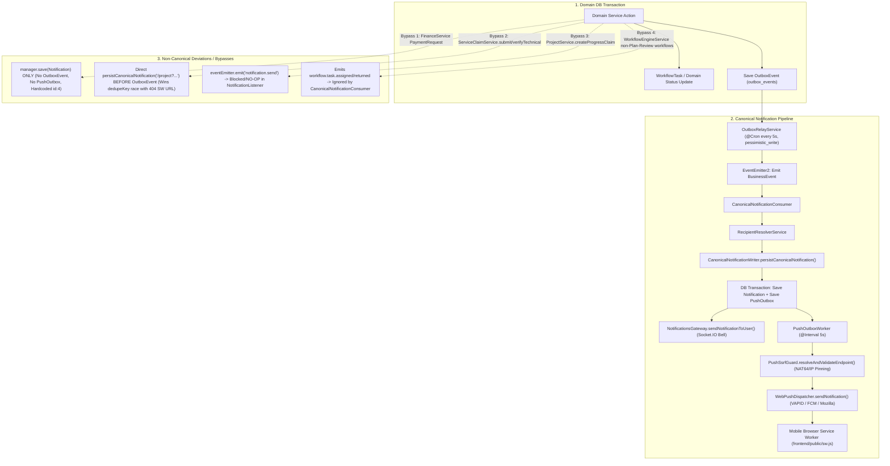

# EPMS UBD–TVM — FULL BUSINESS FLOW & NOTIFICATION CONSISTENCY AUDIT
**MODE: AUDIT ONLY — READ ONLY — NO SOURCE / DATABASE MODIFICATION**

---

## 5.A. REPOSITORY & DATABASE BASELINE

### 1. Git & Working Tree Baseline
- **Active Branch**: `main`
- **HEAD Commit**: `8c7d504b81bd39c790d2a15bdfa92b0431cce21f` (*"checkpoint(recovery): save verified notification, security, and project review state — 2026-10-29"*)
- **Modified Tracked Files (11)**:
  1. [`jwt.strategy.ts`](file:///c:/Users/UBDOPS3/Herd/epms_tvmubd/backend/src/modules/auth/jwt.strategy.ts)
  2. [`contract.service.ts`](file:///c:/Users/UBDOPS3/Herd/epms_tvmubd/backend/src/modules/contract/contract.service.ts)
  3. [`marketing.service.ts`](file:///c:/Users/UBDOPS3/Herd/epms_tvmubd/backend/src/modules/marketing/marketing.service.ts)
  4. [`canonical-notification-project.spec.ts`](file:///c:/Users/UBDOPS3/Herd/epms_tvmubd/backend/src/modules/notification/canonical-notification-project.spec.ts)
  5. [`canonical-notification.consumer.ts`](file:///c:/Users/UBDOPS3/Herd/epms_tvmubd/backend/src/modules/notification/canonical-notification.consumer.ts)
  6. [`pm-revision-resubmit-gate.spec.ts`](file:///c:/Users/UBDOPS3/Herd/epms_tvmubd/backend/src/modules/project/pm-revision-resubmit-gate.spec.ts)
  7. [`project.service.ts`](file:///c:/Users/UBDOPS3/Herd/epms_tvmubd/backend/src/modules/project/project.service.ts)
  8. [`workflow-recipient-isolation.spec.ts`](file:///c:/Users/UBDOPS3/Herd/epms_tvmubd/backend/src/modules/workflow-engine/__tests__/workflow-recipient-isolation.spec.ts)
  9. [`workflow-definition.service.ts`](file:///c:/Users/UBDOPS3/Herd/epms_tvmubd/backend/src/modules/workflow-engine/workflow-definition.service.ts)
  10. [`workflow-engine.service.ts`](file:///c:/Users/UBDOPS3/Herd/epms_tvmubd/backend/src/modules/workflow-engine/workflow-engine.service.ts)
  11. [`ProjectMasterPage.tsx`](file:///c:/Users/UBDOPS3/Herd/epms_tvmubd/frontend/src/components/ProjectMasterPage.tsx)
- **Untracked Directory**: `backend/src/modules/project/__tests__/`
- **Audit Integrity Guarantee**: **0** source files, **0** database rows, and **0** configurations were modified during this audit.

### 2. Database Baseline (`epms_tvmubd_db` — Read-Only Inspection)
- **Published Workflow Definitions (`workflow_definitions`)**:

| ID | Workflow Key | Version | Status | Wiring Status in Application Code |
| :--- | :--- | :--- | :--- | :--- |
| `22` | `PURCHASE_REQUEST_WORKFLOW` | `v2` | `PUBLISHED` | **WIRED** via [`ProcurementService.createPR`](file:///c:/Users/UBDOPS3/Herd/epms_tvmubd/backend/src/modules/procurement/procurement.service.ts#L168-L176) |
| `25` | `PROJECT_PLAN_REVIEW_WORKFLOW` | `v1` | `PUBLISHED` | **WIRED** via [`ProjectService.submitForReview`](file:///c:/Users/UBDOPS3/Herd/epms_tvmubd/backend/src/modules/project/project.service.ts#L1943-L1955) |
| `27` | `TENDER_GO_NOGO_WORKFLOW` | `v1` | `PUBLISHED` | **WIRED** via [`MarketingService.submitTender`](file:///c:/Users/UBDOPS3/Herd/epms_tvmubd/backend/src/modules/marketing/marketing.service.ts#L1677-L1686) |
| `28` | `DISCOUNT_APPROVAL_WORKFLOW` | `v1` | `PUBLISHED` | **UNWIRED** — seeded in [`WorkflowDefinitionService.seedDefaultWorkflows`](file:///c:/Users/UBDOPS3/Herd/epms_tvmubd/backend/src/modules/workflow-engine/workflow-definition.service.ts#L221-L263), never started in [`MarketingService.negotiatePrice`](file:///c:/Users/UBDOPS3/Herd/epms_tvmubd/backend/src/modules/marketing/marketing.service.ts#L1949-L2016) |
| `29` | `LEGAL_REVIEW_WORKFLOW` | `v1` | `PUBLISHED` | **WIRED** via [`MarketingService.uploadSpkContract`](file:///c:/Users/UBDOPS3/Herd/epms_tvmubd/backend/src/modules/marketing/marketing.service.ts#L2231-L2240) |
| `30` | `PROJECT_INITIATION_WORKFLOW` | `v1` | `PUBLISHED` | **UNWIRED** — seeded in [`WorkflowDefinitionService.seedDefaultWorkflows`](file:///c:/Users/UBDOPS3/Herd/epms_tvmubd/backend/src/modules/workflow-engine/workflow-definition.service.ts#L316-L361), never started by Legal or Project services |
| `31` | `PROJECT_CLOSURE` | `v1` | `PUBLISHED` | **WIRED** via [`ProjectClosureService.requestClosure`](file:///c:/Users/UBDOPS3/Herd/epms_tvmubd/backend/src/modules/project/project-closure.service.ts#L365-L378) |

- **Active User & Role Topology (`users` + `user_roles`)**:
  - `DIRECTOR`: User ID `4` (`director@epms.com`)
  - `FINANCE`: User ID `3` (`finance@epms.com`) — **Single active user** (critical impact on Maker-Checker-Payer Segregation of Duties)
  - `PROCUREMENT`: User ID `41` (`procurement@epms.com`)
  - `LEGAL`: User ID `10` (`legal@epms.com`)
  - `PMO`: User ID `769` (`pmo@epms.com`)
  - `HEAD_OF_OPERATIONS`: User IDs `52` (`hoo@epms.com`), `58` (`gm@epms.com`, also `GENERAL_MANAGER`)
  - `PROJECT_MANAGER`: User IDs `2`, `879`, `4703`, `4704`, `4708`
  - `MARKETING`: User IDs `7`, `9`, `4709`
  - `SUPER_ADMIN`: User IDs `1`, `39`

---

## 5.B. END-TO-END BUSINESS FLOW INVENTORY (DOMAINS A – I)

| Domain | Process / Activity | Actor | Initial Status | Action / Endpoint / Method | Final Status | Next Actor / Role | SSOT Mechanism |
| :--- | :--- | :--- | :--- | :--- | :--- | :--- | :--- |
| **A. Marketing & Tender** | 1. Lead / Tender Creation | `MARKETING` | `(New)` | `POST /marketing/tenders` → [`MarketingService.createTender`](file:///c:/Users/UBDOPS3/Herd/epms_tvmubd/backend/src/modules/marketing/marketing.service.ts#L1035-L1200) | `LEAD` / `DRAFT` | `MARKETING` (`marketing_pic_id`) | Domain Table (`tenders`) |
| **A. Marketing & Tender** | 2. Submit Tender for Go/No-Go | `MARKETING` | `LEAD` / `DRAFT` | `POST /marketing/tenders/:id/submit` → [`MarketingService.submitTender`](file:///c:/Users/UBDOPS3/Herd/epms_tvmubd/backend/src/modules/marketing/marketing.service.ts#L1645-L1720) | `GO_NO_GO_PENDING` (`WAITING_GO_NO_GO`) | `DIRECTOR` | Workflow (`TENDER_GO_NOGO_WORKFLOW` `node_go_nogo`) + `OutboxEvent` (`marketing.tender.submitted`) |
| **A. Marketing & Tender** | 3a. Director Go/No-Go: **GO** | `DIRECTOR` | `GO_NO_GO_PENDING` | `POST /marketing/tenders/:id/go-no-go` (`decision='GO'`) → [`MarketingService.submitGoNoGo`](file:///c:/Users/UBDOPS3/Herd/epms_tvmubd/backend/src/modules/marketing/marketing.service.ts#L1725-L1855) | `PROPOSAL_IN_PROGRESS` (`QUOTATION`) | `MARKETING` (`marketing_pic_id`) | Workflow (`END` `COMPLETED`) + `OutboxEvent` (`marketing.tender.go_no_go_decided`) |
| **A. Marketing & Tender** | 3b. Director Go/No-Go: **NO_GO (Return)** | `DIRECTOR` | `GO_NO_GO_PENDING` | `POST /marketing/tenders/:id/go-no-go` (`decision='NO_GO'`) → [`MarketingService.submitGoNoGo`](file:///c:/Users/UBDOPS3/Herd/epms_tvmubd/backend/src/modules/marketing/marketing.service.ts#L1725-L1790) | `DRAFT` (`REVISION_REQUIRED`) | `MARKETING` (`marketing_pic_id`) | Workflow (`node_go_nogo_revision`) — **No OutboxEvent emitted** |
| **A. Marketing & Tender** | 3c. Marketing Resubmit Go/No-Go | `MARKETING` | `DRAFT` (`REVISION_REQUIRED`) | `POST /marketing/tenders/:id/submit` or `POST /workflow/tasks/:id/transition` (`RESUBMIT`) | `GO_NO_GO_PENDING` | `DIRECTOR` | Workflow (`node_go_nogo`) + `OutboxEvent` (`marketing.tender.submitted` only if via `submitTender`) |
| **A. Marketing & Tender** | 4a. Negotiate Price (Discount ≤ 20%) | `MARKETING` | `PROPOSAL_IN_PROGRESS` / `NEGOTIATION` | `PATCH /marketing/tenders/:id/negotiate` → [`MarketingService.negotiatePrice`](file:///c:/Users/UBDOPS3/Herd/epms_tvmubd/backend/src/modules/marketing/marketing.service.ts#L1949-L2016) | `NEGOTIATION` | `MARKETING` | Domain Table (`tenders`) |
| **A. Marketing & Tender** | 4b. Negotiate Price (Discount > 20%) | `MARKETING` | `PROPOSAL_IN_PROGRESS` / `NEGOTIATION` | `PATCH /marketing/tenders/:id/negotiate` → [`MarketingService.negotiatePrice`](file:///c:/Users/UBDOPS3/Herd/epms_tvmubd/backend/src/modules/marketing/marketing.service.ts#L1949-L2016) | `PENDING_APPROVAL` | `DIRECTOR` | Domain Table (`tenders`) + `OutboxEvent` (`marketing.discount.requested`) — **No Workflow / No Inbox To-Do** |
| **A. Marketing & Tender** | 4c. Director Approve Discount | `DIRECTOR` | `PENDING_APPROVAL` | `POST /marketing/tenders/:id/approve-discount` → [`MarketingService.approveDiscount`](file:///c:/Users/UBDOPS3/Herd/epms_tvmubd/backend/src/modules/marketing/marketing.service.ts#L2021-L2067) | `NEGOTIATION` (`discountApproved=true`) | `MARKETING` (`marketing_pic_id`) | Domain Table + `OutboxEvent` (`marketing.discount.approved`) |
| **A. Marketing & Tender** | 4d. Director Reject Discount | `DIRECTOR` | `PENDING_APPROVAL` | `POST /marketing/tenders/:id/reject-discount` → [`MarketingService.rejectDiscount`](file:///c:/Users/UBDOPS3/Herd/epms_tvmubd/backend/src/modules/marketing/marketing.service.ts#L2072-L2126) | `NEGOTIATION` (`discountApproved=false`) | `MARKETING` (`marketing_pic_id`) | Domain Table + `OutboxEvent` (`marketing.discount.rejected`) |
| **A. Marketing & Tender** | 5. Tender WON / LOST | `MARKETING` / `DIRECTOR` | `NEGOTIATION` | `PATCH /marketing/tenders/:id/status` → [`MarketingService.updateTenderStatus`](file:///c:/Users/UBDOPS3/Herd/epms_tvmubd/backend/src/modules/marketing/marketing.service.ts#L1254-L1475) | `WON` (`SPK_PENDING`) / `LOST` | `MARKETING` (if `WON`, upload SPK) | Domain Table (`tenders` + `contracts`) — **No OutboxEvent** |
| **A. Marketing & Tender** | 6. Upload SPK / Contract | `MARKETING` | `WON` (`SPK_PENDING` / `REVISION_REQUIRED`) | `POST /marketing/tenders/:id/upload-spk` → [`MarketingService.uploadSpkContract`](file:///c:/Users/UBDOPS3/Herd/epms_tvmubd/backend/src/modules/marketing/marketing.service.ts#L2131-L2295) | `LEGAL_REVIEW` (`contract.legalStatus = 'SUBMITTED'`) | `LEGAL` | Workflow (`LEGAL_REVIEW_WORKFLOW` `node_legal_review`) + `OutboxEvent` (`marketing.spk.uploaded`) |
| **A. Marketing & Tender** | 7. SLA / Grace Period Cron Checks | `SYSTEM` (Cron) | Various | [`SlaService`](file:///c:/Users/UBDOPS3/Herd/epms_tvmubd/backend/src/modules/marketing/sla.service.ts) / [`MarketingService`](file:///c:/Users/UBDOPS3/Herd/epms_tvmubd/backend/src/modules/marketing/marketing.service.ts#L2610-L2840) | `EXPIRED` / `FROZEN` / Reminder | `MARKETING` (`marketing_pic_id`), `DIRECTOR` | `OutboxEvent` (`system.sla.spk_grace_expired`, `revision_reminder_h1`, `revision_expired`, `discount_timeout`, `lead_escalated`) |
| **B. Commercial & Budget** | 1. Proposal & Initial RAB / BOQ | `MARKETING` | `PROPOSAL_IN_PROGRESS` | `PATCH /marketing/tenders/:id` | `PROPOSAL_IN_PROGRESS` | `MARKETING` | Embedded JSON/columns on `tenders` (`NOT IMPLEMENTED` as standalone approval workflow) |
| **C. Legal & Contract** | 1a. Legal Approve SPK / Contract | `LEGAL` | `SUBMITTED` / `IN_REVIEW` | `POST /legal/contracts/:id/review` (`decision='APPROVED'`) → [`LegalService.reviewContract`](file:///c:/Users/UBDOPS3/Herd/epms_tvmubd/backend/src/modules/legal/legal.service.ts#L156-L360) | `APPROVED` (`project.status = 'PLANNING'`) | `PMO` (to assign PM), `MARKETING`, `DIRECTOR` | Workflow (`LEGAL_REVIEW_WORKFLOW` `END`) + `OutboxEvent` (`legal.contract.approved`) |
| **C. Legal & Contract** | 1b. Legal Request Revision (Return) | `LEGAL` | `SUBMITTED` / `IN_REVIEW` | `POST /legal/contracts/:id/review` (`decision='REVISION_REQUIRED'`) → [`LegalService.reviewContract`](file:///c:/Users/UBDOPS3/Herd/epms_tvmubd/backend/src/modules/legal/legal.service.ts#L156-L360) | `REVISION_REQUIRED` (`tender.contractStatus = 'REVISION_REQUIRED'`) | `MARKETING` (`marketing_pic_id`) | Workflow (`node_spk_revision`) + `OutboxEvent` (`legal.contract.revision_requested`) |
| **C. Legal & Contract** | 1c. Legal Reject SPK / Contract | `LEGAL` | `SUBMITTED` / `IN_REVIEW` | `POST /legal/contracts/:id/review` (`decision='REJECTED'`) → [`LegalService.reviewContract`](file:///c:/Users/UBDOPS3/Herd/epms_tvmubd/backend/src/modules/legal/legal.service.ts#L156-L360) | `REJECTED` | `MARKETING` (`marketing_pic_id`), `DIRECTOR` | Workflow (`END` `REJECTED`) + `OutboxEvent` (`legal.contract.rejected` only if via `LegalService`; **missing** if via `WorkflowEngineService.syncBusinessEntity`) |
| **D. Project Workspace** | 1. PMO Assign Project Manager | `PMO` / `DIRECTOR` | `PLANNING` (`managerId = NULL`) | `PATCH /projects/:id/assign-pm` → [`ProjectService.assignPm`](file:///c:/Users/UBDOPS3/Herd/epms_tvmubd/backend/src/modules/project/project.service.ts#L1808-L1899) | `PLANNING` (`managerId = <pmUserId>`) | Assigned `PROJECT_MANAGER` | Domain Table (`projects` + `contracts`) + `OutboxEvent` (`project.pm.assigned`) |
| **D. Project Workspace** | 2a. PM Reject Charter (Return to Legal/Marketing) | `PROJECT_MANAGER` | `PLANNING` | `POST /projects/:id/reject-charter` → [`ProjectService.rejectProjectCharter`](file:///c:/Users/UBDOPS3/Herd/epms_tvmubd/backend/src/modules/project/project.service.ts#L2472-L2588) | `PM_RETURNED` / `REVISION_REQUIRED` | `LEGAL` / `MARKETING` | Domain Table (`projects`, `contracts`) — **Emits unsubscribed `contract.pm_returned` only** |
| **D. Project Workspace** | 2b. Resubmit Charter to PM | `LEGAL` / `MARKETING` | `PM_RETURNED` | `POST /projects/:id/resubmit-charter` → [`ProjectService.resubmitProjectCharter`](file:///c:/Users/UBDOPS3/Herd/epms_tvmubd/backend/src/modules/project/project.service.ts#L2590-L2711) | `PLANNING` | Assigned `PROJECT_MANAGER` | Domain Table (`projects`, `contracts`) — **Emits unsubscribed `contract.resubmitted` only** |
| **D. Project Workspace** | 3. 4/4 Baseline Setup (WBS, Cost/RAB, Gantt, Initial Condition) | `PROJECT_MANAGER` | `PLANNING` | `POST /projects/:id/wbs`, `budget`, `schedule`, `initial-condition` | `PLANNING` (4/4 Ready) | Assigned `PROJECT_MANAGER` | Domain Tables (`wbs_nodes`, `project_budgets`, etc.) |
| **D. Project Workspace** | 4a. PM Submit Management Review | `PROJECT_MANAGER` | `PLANNING` (`reviewStatus = DRAFT/REVISION_REQUIRED`) | `POST /projects/:id/submit-review` → [`ProjectService.submitForReview`](file:///c:/Users/UBDOPS3/Herd/epms_tvmubd/backend/src/modules/project/project.service.ts#L1904-L2020) | `UNDER_REVIEW` (`OPS_REVIEW`) | `HEAD_OF_OPERATIONS` | Workflow (`PROJECT_PLAN_REVIEW_WORKFLOW` `node_ops_review`) + `OutboxEvent` (`project.plan.submitted` / `workflow.task.assigned`) |
| **D. Project Workspace** | 4b. HOPS Approve Management Review | `HEAD_OF_OPERATIONS` | `UNDER_REVIEW` (`node_ops_review`) | `POST /workflow/tasks/:id/transition` (`APPROVE`) → [`WorkflowEngineService.transitionTask`](file:///c:/Users/UBDOPS3/Herd/epms_tvmubd/backend/src/modules/workflow-engine/workflow-engine.service.ts#L420-L790) | `UNDER_REVIEW` (`PROCUREMENT_REVIEW`) | `PROCUREMENT` | Workflow (`node_procurement_review`) + `OutboxEvent` (`workflow.task.assigned`) |
| **D. Project Workspace** | 4c. Procurement Approve Management Review | `PROCUREMENT` | `UNDER_REVIEW` (`node_procurement_review`) | `POST /workflow/tasks/:id/transition` (`APPROVE`) | `UNDER_REVIEW` (`FINANCE_REVIEW`) | `FINANCE` | Workflow (`node_finance_review`) + `OutboxEvent` (`workflow.task.assigned`) |
| **D. Project Workspace** | 4d. Finance Approve Management Review | `FINANCE` | `UNDER_REVIEW` (`node_finance_review`) | `POST /workflow/tasks/:id/transition` (`APPROVE`) | `UNDER_REVIEW` (`FINAL_APPROVAL`) | `DIRECTOR` | Workflow (`node_final_approval`) + `OutboxEvent` (`workflow.task.assigned`) |
| **D. Project Workspace** | 4e. Any Reviewer (HOPS / Proc / Fin / Director) **RETURN** | `HEAD_OF_OPERATIONS` / `PROCUREMENT` / `FINANCE` / `DIRECTOR` | `UNDER_REVIEW` | `POST /workflow/tasks/:id/transition` (`RETURN`) | `REVISION_REQUIRED` (`node_pm_revision`) | Assigned `PROJECT_MANAGER` (`project.manager_id`) | Workflow (`node_pm_revision` `ASSIGNED_PM`) + `OutboxEvent` (`workflow.task.returned`) |
| **D. Project Workspace** | 4f. PM **RESUBMIT** Management Review | `PROJECT_MANAGER` | `REVISION_REQUIRED` (`node_pm_revision`) | `POST /projects/:id/submit-review` or `POST /workflow/tasks/:id/transition` (`RESUBMIT`) | `UNDER_REVIEW` (`node_ops_review`) | `HEAD_OF_OPERATIONS` | Workflow (`node_ops_review`) + `OutboxEvent` (`workflow.task.assigned`) |
| **D. Project Workspace** | 4g. Director Final **APPROVE** Management Review | `DIRECTOR` | `UNDER_REVIEW` (`node_final_approval`) | `POST /workflow/tasks/:id/transition` (`APPROVE`) | `READY_FOR_KICKOFF` (`reviewStatus = APPROVED`) | Assigned `PROJECT_MANAGER` (`project.manager_id`) | Workflow (`END` `COMPLETED`) + `OutboxEvent` (`workflow.instance.completed`) + Operational To-Do (`PROJECT_KICKOFF` in `InboxService`) |
| **D. Project Workspace** | 5. Formal Project Kickoff | `PROJECT_MANAGER` / `PMO` / `DIRECTOR` | `PLANNING` (`reviewStatus = APPROVED`) | `POST /projects/:id/kickoff` → [`ProjectService.kickoffProject`](file:///c:/Users/UBDOPS3/Herd/epms_tvmubd/backend/src/modules/project/project.service.ts#L2025-L2120) | `IN_PROGRESS` | Assigned `PROJECT_MANAGER`, `PMO`, `HEAD_OF_OPERATIONS`, `DIRECTOR` | Domain Table (`projects`) + `OutboxEvent` (`project.kickoff.executed`) |
| **D. Project Workspace** | 6a. Submit Critical / Downward Progress Claim | `PROJECT_MANAGER` | `IN_PROGRESS` | `POST /projects/:id/progress-claims` → [`ProjectService.createProgressClaim`](file:///c:/Users/UBDOPS3/Herd/epms_tvmubd/backend/src/modules/project/project.service.ts#L4861-L5002) | `ProgressLog.status = 'PENDING'` | `HEAD_OF_OPERATIONS` / `PMO` | Domain Queue (`PROGRESS_CLAIM_VERIFICATION` in `InboxService`) — **Emits deprecated `notification.send` only** |
| **D. Project Workspace** | 6b. Verify / Reject Progress Claim | `HEAD_OF_OPERATIONS` / `PMO` / `DIRECTOR` | `ProgressLog.status = 'PENDING'` | `PATCH /projects/progress-logs/:logId/verify` → [`ProjectService.verifyProgressLog`](file:///c:/Users/UBDOPS3/Herd/epms_tvmubd/backend/src/modules/project/project.service.ts#L5007-L5146) | `VERIFIED` / `REJECTED` | Assigned `PROJECT_MANAGER` | Domain Table (`progress_logs`) — **Emits `audit.log` only** |
| **E. Material Procurement** | 1. PM Submit Material Package | `PROJECT_MANAGER` | `DRAFT` | `POST /procurement/packages/:id/submit` → [`ProcurementPackageService.submitPackage`](file:///c:/Users/UBDOPS3/Herd/epms_tvmubd/backend/src/modules/procurement/procurement-package.service.ts#L315-L453) | `SUBMITTED` | `PROCUREMENT` | Domain Table (`procurement_packages`) — **No Workflow / No Inbox To-Do / No OutboxEvent** |
| **E. Material Procurement** | 2. Purchasing Create & Submit PR | `PROCUREMENT` / `PROJECT_MANAGER` | `(New)` | `POST /procurement/prs` → [`ProcurementService.createPR`](file:///c:/Users/UBDOPS3/Herd/epms_tvmubd/backend/src/modules/procurement/procurement.service.ts#L85-L234) | `SUBMITTED` | `FINANCE` | Workflow (`PURCHASE_REQUEST_WORKFLOW` `node_finance_verification`) + `OutboxEvent` (`procurement.pr.submitted`) |
| **E. Material Procurement** | 3a. Finance Approve PR | `FINANCE` | `SUBMITTED` (`node_finance_verification`) | `POST /workflow/tasks/:id/transition` (`APPROVE`) | `SUBMITTED` (`node_director_approval`) | `DIRECTOR` | Workflow (`node_director_approval`) — **`CanonicalNotificationConsumer` ignores `PURCHASE_REQUEST_WORKFLOW`** |
| **E. Material Procurement** | 3b. Finance / Director Return PR | `FINANCE` / `DIRECTOR` | `SUBMITTED` | `POST /workflow/tasks/:id/transition` (`RETURN`) | `REVISION_REQUIRED` (`node_procurement_revision`) | `PROCUREMENT` | Workflow (`node_procurement_revision`) — **`CanonicalNotificationConsumer` ignores `PURCHASE_REQUEST_WORKFLOW`** |
| **E. Material Procurement** | 3c. Finance / Director Reject PR | `FINANCE` / `DIRECTOR` | `SUBMITTED` | `POST /workflow/tasks/:id/transition` (`REJECT`) | `REJECTED` (`END`) | `PROCUREMENT` / Submitter | Workflow (`END` `REJECTED`) — **No OutboxEvent handled** |
| **E. Material Procurement** | 3d. Director Final Approve PR | `DIRECTOR` | `SUBMITTED` (`node_director_approval`) | `POST /workflow/tasks/:id/transition` (`APPROVE`) → [`WorkflowEngineService.syncBusinessEntity`](file:///c:/Users/UBDOPS3/Herd/epms_tvmubd/backend/src/modules/workflow-engine/workflow-engine.service.ts#L1142-L1199) | `APPROVED` | `PROCUREMENT` | Workflow (`END`) + Operational To-Do (`CREATE_RFQ` in `InboxService`) + `OutboxEvent` (`procurement.pr.approved`) |
| **E. Material Procurement** | 4. Purchasing Create / Release / Award RFQ | `PROCUREMENT` | `PR.status = 'APPROVED'` | `POST /procurement/rfqs`, `PATCH /procurement/rfqs/:id/status` → [`ProcurementService`](file:///c:/Users/UBDOPS3/Herd/epms_tvmubd/backend/src/modules/procurement/procurement.service.ts#L285-L539) | `DRAFT` → `ISSUED` → `CLOSED` / `AWARDED` | `PROCUREMENT` | Domain Table (`rfqs`) — **No OutboxEvent** |
| **E. Material Procurement** | 5. Purchasing Issue Material PO | `PROCUREMENT` | `RFQ AWARDED` / `PR APPROVED` | `POST /procurement/pos` → [`ProcurementService.createPO`](file:///c:/Users/UBDOPS3/Herd/epms_tvmubd/backend/src/modules/procurement/procurement.service.ts#L597-L812) | `PO.status = 'ISSUED'` | `PROJECT_MANAGER`, `FINANCE`, `DIRECTOR` | Domain Table (`purchase_orders`) + `OutboxEvent` (`procurement.po.issued`) |
| **E. Material Procurement** | 6. Configure PO Payment Terms (`PoPaymentTerm`) | `PROCUREMENT` / `FINANCE` | `PO.status = 'ISSUED'` | `POST /procurement/pos/:id/payment-terms` → [`ProcurementService.savePoPaymentTerms`](file:///c:/Users/UBDOPS3/Herd/epms_tvmubd/backend/src/modules/procurement/procurement.service.ts#L1149-L1249) | `PoPaymentTerm.status = 'DRAFT'/'LOCKED'` | `FINANCE` (once GR complete) | Domain Table (`po_payment_terms`) — **No OutboxEvent** |
| **E. Material Procurement** | 7. Record Goods Receipt (GR) | `PROJECT_MANAGER` / `PROCUREMENT` | `PO.status = 'ISSUED'` | `POST /procurement/goods-receipts` → [`ProcurementService.createGoodsReceipt`](file:///c:/Users/UBDOPS3/Herd/epms_tvmubd/backend/src/modules/procurement/procurement.service.ts#L906-L1089) | `GR.status = 'RECEIVED'` (triggers `CREATE_INVOICE` if PO 100% allocated) | `FINANCE` | Domain Table (`goods_receipts`) + Operational To-Do (`CREATE_INVOICE` in `InboxService`) + `OutboxEvent` (`procurement.gr.created`) |
| **F. Service Procurement** | 1. Purchasing Create Service SPK / WO | `PROCUREMENT` | `Service PO ISSUED` | `POST /procurement/service-orders` → [`ProcurementService.createServiceOrder`](file:///c:/Users/UBDOPS3/Herd/epms_tvmubd/backend/src/modules/procurement/procurement.service.ts#L814-L866) | `ServiceOrder.status = 'DRAFT'` | `PROCUREMENT` | Domain Table (`service_orders`) — **No OutboxEvent** |
| **F. Service Procurement** | 2. Purchasing Issue Service SPK / WO | `PROCUREMENT` | `ServiceOrder.status = 'DRAFT'` | `POST /procurement/service-orders/:id/issue` → [`ProcurementService.issueServiceOrder`](file:///c:/Users/UBDOPS3/Herd/epms_tvmubd/backend/src/modules/procurement/procurement.service.ts#L868-L904) | `ServiceOrder.status = 'ISSUED'` | `PROJECT_MANAGER` | Domain Table (`service_orders`) — **No OutboxEvent** |
| **F. Service Procurement** | 3a. Submit Service Claim (Mandor/Vendor Progress) | `PROJECT_MANAGER` / `PROCUREMENT` | `ServiceClaim.status = 'DRAFT'` | `POST /procurement/service-claims/:id/submit` → [`ServiceClaimService.submit`](file:///c:/Users/UBDOPS3/Herd/epms_tvmubd/backend/src/modules/procurement/service-claim.service.ts#L900-L1021) | `SUBMITTED` | Assigned `PROJECT_MANAGER` (`project.manager_id`) | Operational To-Do (`VERIFY_SERVICE_CLAIM_TECHNICAL` in `InboxService`) + **Dual Write** (`notificationWriter` + `OutboxEvent` `procurement.service_claim.submitted`) |
| **F. Service Procurement** | 3b. PM Technical Verify Service Claim (`APPROVE`) | `PROJECT_MANAGER` | `SUBMITTED` | `POST /procurement/service-claims/:id/verify-technical` (`APPROVE`) → [`ServiceClaimService.verifyTechnical`](file:///c:/Users/UBDOPS3/Herd/epms_tvmubd/backend/src/modules/procurement/service-claim.service.ts#L1095-L1254) | `VERIFIED_BY_PM` | `PROCUREMENT` | Operational To-Do (`VERIFY_SERVICE_CLAIM_COMMERCIAL` in `InboxService`) + `OutboxEvent` (`procurement.service_claim.verified_technical`) |
| **F. Service Procurement** | 3c. PM Technical Verify Service Claim (`RETURN` / `REJECT`) | `PROJECT_MANAGER` | `SUBMITTED` | `POST /procurement/service-claims/:id/verify-technical` (`RETURN` / `REJECT`) | `RETURNED` / `REJECTED` | `createdById` (Submitter) | **Dual Write** (`notificationWriter` + `OutboxEvent` `procurement.service_claim.returned` / `rejected`) |
| **F. Service Procurement** | 3d. Purchasing Commercial Verify (`APPROVE`) | `PROCUREMENT` | `VERIFIED_BY_PM` | `POST /procurement/service-claims/:id/verify-commercial` (`APPROVE`) → [`ServiceClaimService.verifyCommercial`](file:///c:/Users/UBDOPS3/Herd/epms_tvmubd/backend/src/modules/procurement/service-claim.service.ts#L1256-L1415) | `APPROVED_FOR_INVOICE` | `FINANCE` | Operational To-Do (`CREATE_INVOICE` in `InboxService`) + `OutboxEvent` (`procurement.service_claim.approved_for_invoice`) |
| **F. Service Procurement** | 3e. Purchasing Commercial Verify (`RETURN` / `REJECT`) | `PROCUREMENT` | `VERIFIED_BY_PM` | `POST /procurement/service-claims/:id/verify-commercial` (`RETURN` / `REJECT`) | `RETURNED` / `REJECTED` | `createdById` (Submitter) | `OutboxEvent` (`procurement.service_claim.returned` / `rejected`) |
| **G. Finance & Payment** | 1. Submit Vendor Invoice | `FINANCE` / `PROCUREMENT` | `(New)` | `POST /finance/invoices` → [`FinanceService.submitInvoice`](file:///c:/Users/UBDOPS3/Herd/epms_tvmubd/backend/src/modules/finance/finance.service.ts#L345-L625) | `Invoice.status = 'SUBMITTED'` | `FINANCE` (Checker ≠ Maker) | Domain Table (`invoices`) + `OutboxEvent` (`finance.invoice.submitted`) — **No Inbox To-Do for Verify Invoice** |
| **G. Finance & Payment** | 2. Verify Vendor Invoice (3-Way Match) | `FINANCE` (Checker ≠ `createdBy`) | `Invoice.status = 'SUBMITTED'` | `PATCH /finance/invoices/:id/verify` → [`FinanceService.verifyInvoice`](file:///c:/Users/UBDOPS3/Herd/epms_tvmubd/backend/src/modules/finance/finance.service.ts#L844-L1083) | `VERIFIED` / `REJECTED` | `FINANCE` (to create Payment Request) | Domain Table (`invoices`) — **No Inbox To-Do / No OutboxEvent** |
| **G. Finance & Payment** | 3. Submit Payment Request to Director | `FINANCE` (`requestedBy` ≠ `verifiedBy`) | `Invoice.status = 'VERIFIED'` | `POST /finance/payment-requests` → [`FinanceService.submitPaymentRequest`](file:///c:/Users/UBDOPS3/Herd/epms_tvmubd/backend/src/modules/finance/finance.service.ts#L2446-L2595) | `PaymentRequest.status = 'SUBMITTED_TO_DIRECTOR'` | `DIRECTOR` | Operational To-Do (`PAYMENT_REQUEST_APPROVAL` in `InboxService`) + **Direct DB write to `Notification` (bypasses Outbox & PushOutbox)** |
| **G. Finance & Payment** | 4a. Director Approve Payment Request | `DIRECTOR` | `SUBMITTED_TO_DIRECTOR` | `POST /finance/payment-requests/:id/decision` (`APPROVE`) → [`FinanceService.decidePaymentRequest`](file:///c:/Users/UBDOPS3/Herd/epms_tvmubd/backend/src/modules/finance/finance.service.ts#L2650-L2765) | `APPROVED_FOR_PAYMENT` | `FINANCE` (`requestedBy`) | **Direct DB write to `Notification` (bypasses Outbox & PushOutbox; no Inbox To-Do)** |
| **G. Finance & Payment** | 4b. Director Return / Reject Payment Request | `DIRECTOR` | `SUBMITTED_TO_DIRECTOR` | `POST /finance/payment-requests/:id/decision` (`RETURN` / `REJECT`) | `REVISION_REQUIRED` / `REJECTED` | `FINANCE` (`requestedBy`) | Operational To-Do (`PAYMENT_REQUEST_REVISION` in `InboxService` if `RETURN`) + **Direct DB write to `Notification` (bypasses Outbox & PushOutbox)** |
| **G. Finance & Payment** | 4c. Finance Resubmit Payment Request | `FINANCE` | `REVISION_REQUIRED` | `POST /finance/payment-requests/:id/resubmit` → [`FinanceService.resubmitPaymentRequest`](file:///c:/Users/UBDOPS3/Herd/epms_tvmubd/backend/src/modules/finance/finance.service.ts#L2767-L2875) | `SUBMITTED_TO_DIRECTOR` | `DIRECTOR` | Operational To-Do (`PAYMENT_REQUEST_APPROVAL`) + **Direct DB write to `Notification` (bypasses Outbox & PushOutbox)** |
| **G. Finance & Payment** | 5. Finance Execute Payment | `FINANCE` (Payer ≠ Maker/Checker/Requester) | `APPROVED_FOR_PAYMENT` / `Invoice.VERIFIED` | `POST /finance/payments` → [`FinanceService.recordPayment`](file:///c:/Users/UBDOPS3/Herd/epms_tvmubd/backend/src/modules/finance/finance.service.ts#L1085-L1325) | `PaymentRequest.PAID` / `Invoice.PAID` | `PROJECT_MANAGER`, `PROCUREMENT`, `DIRECTOR` | Domain Tables (`payments`, `invoices`, `payment_requests`) + `OutboxEvent` (`finance.payment.recorded`) |
| **H. Vendor & Delivery** | Vendor CRUD | `PROCUREMENT` | `(New)` / `ACTIVE` | `POST /procurement/vendors` → [`ProcurementService.createVendor`](file:///c:/Users/UBDOPS3/Herd/epms_tvmubd/backend/src/modules/procurement/procurement.service.ts#L50-L83) | `ACTIVE` | N/A | Master Data (`vendors`) |
| **I. Closure & Handover** | 1a. PM Submit Project Closure | `PROJECT_MANAGER` | `IN_PROGRESS` (Readiness gates passed) | `POST /projects/:id/closure/request` → [`ProjectClosureService.requestClosure`](file:///c:/Users/UBDOPS3/Herd/epms_tvmubd/backend/src/modules/project/project-closure.service.ts#L285-L450) | `CLOSURE_REQUESTED` (`PENDING_HOO_REVIEW`) | `HEAD_OF_OPERATIONS` | Workflow (`PROJECT_CLOSURE` `node_hoo_review`) + `OutboxEvent` (`project.closure.submitted`) |
| **I. Closure & Handover** | 1b. HOO Review Closure (`APPROVE`) | `HEAD_OF_OPERATIONS` | `PENDING_HOO_REVIEW` | `POST /projects/:id/closure/hoo-review` (`APPROVE`) → [`ProjectClosureService.reviewByHoo`](file:///c:/Users/UBDOPS3/Herd/epms_tvmubd/backend/src/modules/project/project-closure.service.ts#L455-L605) | `PENDING_DIRECTOR_APPROVAL` | `DIRECTOR` | Workflow (`node_director_approval`) + `OutboxEvent` (`project.closure.hoo_approved`) |
| **I. Closure & Handover** | 1c. HOO Review Closure (`RETURN`) | `HEAD_OF_OPERATIONS` | `PENDING_HOO_REVIEW` | `POST /projects/:id/closure/hoo-review` (`RETURN`) | `REVISION_REQUIRED` (`node_pm_revision`) | Assigned `PROJECT_MANAGER` | Workflow (`node_pm_revision`) + `OutboxEvent` (`project.closure.returned`) |
| **I. Closure & Handover** | 1d. Director Final Closure (`APPROVE`) | `DIRECTOR` | `PENDING_DIRECTOR_APPROVAL` | `POST /projects/:id/closure/director-decision` (`APPROVE`) → [`ProjectClosureService.decideByDirector`](file:///c:/Users/UBDOPS3/Herd/epms_tvmubd/backend/src/modules/project/project-closure.service.ts#L610-L810) | `CLOSED` (`COMPLETED`) | Assigned `PROJECT_MANAGER`, `HEAD_OF_OPERATIONS`, `FINANCE`, `PROCUREMENT` | Workflow (`END` `COMPLETED`) + `OutboxEvent` (`project.closure.approved`) |
| **I. Closure & Handover** | 1e. Director Final Closure (`RETURN`) | `DIRECTOR` | `PENDING_DIRECTOR_APPROVAL` | `POST /projects/:id/closure/director-decision` (`RETURN`) | `REVISION_REQUIRED` (`node_pm_revision`) | Assigned `PROJECT_MANAGER` | Workflow (`node_pm_revision`) + `OutboxEvent` (`project.closure.returned`) |
| **I. Closure & Handover** | 1f. PM Resubmit Closure | `PROJECT_MANAGER` | `REVISION_REQUIRED` (`node_pm_revision`) | `POST /projects/:id/closure/resubmit` → [`ProjectClosureService.resubmitClosure`](file:///c:/Users/UBDOPS3/Herd/epms_tvmubd/backend/src/modules/project/project-closure.service.ts#L815-L950) | `PENDING_HOO_REVIEW` | `HEAD_OF_OPERATIONS` | Workflow (`node_hoo_review`) + `OutboxEvent` (`project.closure.resubmitted`) |

---

## 5.C. NOTIFICATION PIPELINE TRACE (CANONICAL VS DEVIATIONS)

### 1. Canonical Pipeline Components
1. **Transactional Outbox (`outbox_events`)**: Saved inside the domain service's database transaction and polled every 5 seconds by [`OutboxRelayService.processOutbox`](file:///c:/Users/UBDOPS3/Herd/epms_tvmubd/backend/src/modules/system/outbox-relay.service.ts#L24-L123) using `pessimistic_write` locking. If no listener returns `{ accepted: true }`, the row remains `PENDING` (increments `retryCount`) rather than silently marking `PROCESSED`.
2. **Consumer & Recipient Resolution**: [`CanonicalNotificationConsumer`](file:///c:/Users/UBDOPS3/Herd/epms_tvmubd/backend/src/modules/notification/canonical-notification.consumer.ts#L1-L2382) handles subscribed `BusinessEvent` payloads and resolves active user IDs via [`RecipientResolverService`](file:///c:/Users/UBDOPS3/Herd/epms_tvmubd/backend/src/modules/notification/recipient-resolver.service.ts).
3. **Atomic Bell + PushOutbox Persistence**: [`CanonicalNotificationWriter.persistCanonicalNotification`](file:///c:/Users/UBDOPS3/Herd/epms_tvmubd/backend/src/modules/notification/canonical-notification.writer.ts#L86-L270) executes a single `dataSource.transaction` that:
   - Inserts into `notifications` with `dedupe_key = "${eventId}:${recipientId}:${purpose}"`.
   - Inserts into `push_outbox` with `dedupe_key = "${eventId}:${recipientId}:${purpose}:PUSH"`.
   - Emits real-time WebSocket event `new_notification` via [`NotificationsGateway.sendNotificationToUser`](file:///c:/Users/UBDOPS3/Herd/epms_tvmubd/backend/src/modules/notification/notifications.gateway.ts).
4. **Web Push Dispatch & SSRF Guard**: [`PushOutboxWorker`](file:///c:/Users/UBDOPS3/Herd/epms_tvmubd/backend/src/modules/notification/push-outbox.worker.ts#L45-L321) polls `push_outbox`, validates each subscription endpoint via [`PushSsrfGuard.resolveAndValidateEndpoint`](file:///c:/Users/UBDOPS3/Herd/epms_tvmubd/backend/src/modules/notification/push-ssrf.guard.ts) (enforcing HTTPS, public IPv4 / validated DNS64-NAT64 prefix correlation, and IP pinning), and dispatches via [`WebPushDispatcher`](file:///c:/Users/UBDOPS3/Herd/epms_tvmubd/backend/src/modules/notification/web-push.dispatcher.ts).
5. **Legacy Listeners Status**:
   - [`NotificationListener.handleSendNotification`](file:///c:/Users/UBDOPS3/Herd/epms_tvmubd/backend/src/modules/notification/notification.listener.ts#L28-L85) (`@OnEvent('notification.send')`) is **intentionally disabled/NO-OP** (logs a warning and returns).
   - [`ManagementNotificationConsumer`](file:///c:/Users/UBDOPS3/Herd/epms_tvmubd/backend/src/modules/notification/management-notification.consumer.ts) and [`NotificationEventListener`](file:///c:/Users/UBDOPS3/Herd/epms_tvmubd/backend/src/modules/notification/notification-event.listener.ts) are **not registered** in [`NotificationModule`](file:///c:/Users/UBDOPS3/Herd/epms_tvmubd/backend/src/modules/notification/notification.module.ts#L1-L65) (dead code).

### 2. Four Architectural Deviations Discovered
1. **Deviation 1 — Direct `manager.save(Notification)` in `FinanceService` Payment Requests**:
   - [`FinanceService.submitPaymentRequest`](file:///c:/Users/UBDOPS3/Herd/epms_tvmubd/backend/src/modules/finance/finance.service.ts#L2559-L2580), [`decidePaymentRequest`](file:///c:/Users/UBDOPS3/Herd/epms_tvmubd/backend/src/modules/finance/finance.service.ts#L2721-L2751), and [`resubmitPaymentRequest`](file:///c:/Users/UBDOPS3/Herd/epms_tvmubd/backend/src/modules/finance/finance.service.ts#L2843-L2863) write directly to the `notifications` table using `manager.save(Notification, ...)` with hardcoded `where: { id: 4 }` for Director, `dedupeKey: null`, no Socket.IO emission, no `OutboxEvent`, and **zero `PushOutbox` records**.
2. **Deviation 2 — Synchronous Dual-Write Race in `ServiceClaimService`**:
   - [`ServiceClaimService.submit`](file:///c:/Users/UBDOPS3/Herd/epms_tvmubd/backend/src/modules/procurement/service-claim.service.ts#L962-L983) and [`ServiceClaimService.verifyTechnical`](file:///c:/Users/UBDOPS3/Herd/epms_tvmubd/backend/src/modules/procurement/service-claim.service.ts#L1164-L1198) call `this.notificationWriter.persistCanonicalNotification` directly inside the transaction with `actionTarget: '/project?projectId=${claim.projectId}&claimId=${savedClaim.id}'`, and *also* save an `OutboxEvent` with the same `eventId`. Because the direct call runs first and claims the `dedupe_key` (`${eventId}:${recipientId}:ACTION_REQUIRED`), the subsequent [`CanonicalNotificationConsumer`](file:///c:/Users/UBDOPS3/Herd/epms_tvmubd/backend/src/modules/notification/canonical-notification.consumer.ts#L1217-L1354) call (which has the valid `/project-delivery?projectId=...&serviceClaimId=...` URL) hits `ER_DUP_ENTRY` and is dropped.
3. **Deviation 3 — Deprecated `notification.send` Emission in `ProjectService.createProgressClaim`**:
   - [`ProjectService.createProgressClaim`](file:///c:/Users/UBDOPS3/Herd/epms_tvmubd/backend/src/modules/project/project.service.ts#L4966-L4980) emits `this.eventEmitter?.emit('notification.send', ...)` instead of saving an `OutboxEvent`. Because `NotificationListener` blocks `notification.send`, critical/downward progress claims never produce Bell or Mobile Push notifications.
4. **Deviation 4 — Over-Scoped Workflow Event Consumer (`PROJECT_PLAN_REVIEW_WORKFLOW` Only)**:
   - [`CanonicalNotificationConsumer.handleWorkflowTaskAssigned`](file:///c:/Users/UBDOPS3/Herd/epms_tvmubd/backend/src/modules/notification/canonical-notification.consumer.ts#L1692-L1708), [`handleWorkflowTaskReturned`](file:///c:/Users/UBDOPS3/Herd/epms_tvmubd/backend/src/modules/notification/canonical-notification.consumer.ts#L1814-L1830), and [`handleWorkflowInstanceCompleted`](file:///c:/Users/UBDOPS3/Herd/epms_tvmubd/backend/src/modules/notification/canonical-notification.consumer.ts#L1904-L1921) immediately return `{ accepted: false, reason: 'SKIPPED_NON_MANAGEMENT_REVIEW_WORKFLOW' }` whenever `workflowKey !== 'PROJECT_PLAN_REVIEW_WORKFLOW'`. As a result, workflow transitions in `PURCHASE_REQUEST_WORKFLOW` (Finance → Director, Finance/Director Return/Reject) and `TENDER_GO_NOGO_WORKFLOW` (Director `NO_GO` Return, Marketing Resubmit via workflow task) create `WorkflowTask` To-Dos but produce **zero Bell and zero Mobile Push notifications**.

---

## 5.D. MASTER AUDIT MATRIX (ALL DOMAINS A – I)

> [!IMPORTANT]
> Every row below evaluates **To-Do**, **Bell**, and **Mobile Push** as independent mechanisms based on source-code and database evidence.

| Domain | Flow | Trigger | Actor | Next Actor | Status Transition | To-Do | Bell | Mobile Push | Recipient | Deep Link | Duplicate Protection | Authorization | Evidence |
| :--- | :--- | :--- | :--- | :--- | :--- | :--- | :--- | :--- | :--- | :--- | :--- | :--- | :--- |
| **A. Marketing** | 1. Submit Tender (Go/No-Go) | `submitTender` (`marketing.tender.submitted`) | `MARKETING` | `DIRECTOR` | `DRAFT/LEAD` → `GO_NO_GO_PENDING` | **PASS** (`WorkflowTask` `GO_NO_GO_APPROVAL`) | **PASS** | **PASS** (User-Verified on Android) | `resolveByRole('DIRECTOR')` (excludes actor) | `/sales?tab=1&tenderId={id}` | `dedupeKey`: `{eventId}:{uid}:ACTION_REQUIRED[:PUSH]` | `DIRECTOR` role (`RolesGuard`) | [`marketing.service.ts`](file:///c:/Users/UBDOPS3/Herd/epms_tvmubd/backend/src/modules/marketing/marketing.service.ts#L1645-L1720), [`canonical-notification.consumer.ts`](file:///c:/Users/UBDOPS3/Herd/epms_tvmubd/backend/src/modules/notification/canonical-notification.consumer.ts#L152-L194) |
| **A. Marketing** | 2a. Go/No-Go Decision: **GO** | `submitGoNoGo('GO')` (`marketing.tender.go_no_go_decided`) | `DIRECTOR` | `MARKETING` (PIC) | `GO_NO_GO_PENDING` → `PROPOSAL_IN_PROGRESS` | **N/A** (Informational / Proposal work on board) | **PASS** | **PASS** | `marketing_pic_id` (fallback `resolveByRole('MARKETING')`) | `/sales?tab=1&tenderId={id}` | `dedupeKey`: `{eventId}:{uid}:DECISION[:PUSH]` | `DIRECTOR` role | [`marketing.service.ts`](file:///c:/Users/UBDOPS3/Herd/epms_tvmubd/backend/src/modules/marketing/marketing.service.ts#L1725-L1855), [`canonical-notification.consumer.ts`](file:///c:/Users/UBDOPS3/Herd/epms_tvmubd/backend/src/modules/notification/canonical-notification.consumer.ts#L196-L246) |
| **A. Marketing** | 2b. Go/No-Go Decision: **NO_GO (Return)** | `submitGoNoGo('NO_GO')` (`workflow.task.returned`) | `DIRECTOR` | `MARKETING` (PIC) | `GO_NO_GO_PENDING` → `DRAFT` (`REVISION_REQUIRED`) | **PASS** (`WorkflowTask` `GO_NOGO_REVISION` to `INITIATOR`) | **GAP** | **GAP** | To-Do: `marketing_pic_id`; Bell/Push: **None** (`submitGoNoGo` only emits Outbox on `'GO'`; consumer skips `TENDER_GO_NOGO_WORKFLOW`) | To-Do `/inbox` → `/sales?tab=1&tenderId={id}` | Workflow task unique per node | `DIRECTOR` role | [`marketing.service.ts`](file:///c:/Users/UBDOPS3/Herd/epms_tvmubd/backend/src/modules/marketing/marketing.service.ts#L1772-L1845), [`canonical-notification.consumer.ts`](file:///c:/Users/UBDOPS3/Herd/epms_tvmubd/backend/src/modules/notification/canonical-notification.consumer.ts#L1814-L1830) |
| **A. Marketing** | 2c. Go/No-Go **Resubmit** via Workflow Task | `transitionTask('RESUBMIT')` (`workflow.task.assigned`) | `MARKETING` | `DIRECTOR` | `DRAFT` → `GO_NO_GO_PENDING` | **PASS** (`WorkflowTask` `GO_NO_GO_APPROVAL`) | **GAP** (if via `/workflow/tasks/:id/transition`); **PASS** (if via `submitTender`) | **GAP** (if via `/workflow/tasks/:id/transition`); **PASS** (if via `submitTender`) | `DIRECTOR` | `/sales?tab=1&tenderId={id}` | Workflow task lock | `INITIATOR` (`marketing_pic_id`) | [`workflow-engine.service.ts`](file:///c:/Users/UBDOPS3/Herd/epms_tvmubd/backend/src/modules/workflow-engine/workflow-engine.service.ts#L690-L750), [`canonical-notification.consumer.ts`](file:///c:/Users/UBDOPS3/Herd/epms_tvmubd/backend/src/modules/notification/canonical-notification.consumer.ts#L1692-L1708) |
| **A. Marketing** | 3a. Request Discount (> 20%) | `negotiatePrice` (`marketing.discount.requested`) | `MARKETING` | `DIRECTOR` | `NEGOTIATION` → `PENDING_APPROVAL` | **GAP** (`DISCOUNT_APPROVAL_WORKFLOW` unwired; no `InboxService` queue) | **PASS** | **PASS** | `resolveByRole('DIRECTOR')` | `/sales?tab=1&tenderId={id}` | `dedupeKey`: `{eventId}:{uid}:ACTION_REQUIRED[:PUSH]` | `MARKETING` / `DIRECTOR` | [`marketing.service.ts`](file:///c:/Users/UBDOPS3/Herd/epms_tvmubd/backend/src/modules/marketing/marketing.service.ts#L1949-L2016), [`canonical-notification.consumer.ts`](file:///c:/Users/UBDOPS3/Herd/epms_tvmubd/backend/src/modules/notification/canonical-notification.consumer.ts#L611-L654) |
| **A. Marketing** | 3b. Approve Discount | `approveDiscount` (`marketing.discount.approved`) | `DIRECTOR` | `MARKETING` (PIC) | `PENDING_APPROVAL` → `NEGOTIATION` (`discountApproved=true`) | **N/A** | **PASS** | **PASS** | `marketing_pic_id` | `/sales?tab=1&tenderId={id}` | `dedupeKey`: `{eventId}:{uid}:DECISION[:PUSH]` | `DIRECTOR` role | [`marketing.service.ts`](file:///c:/Users/UBDOPS3/Herd/epms_tvmubd/backend/src/modules/marketing/marketing.service.ts#L2021-L2067), [`canonical-notification.consumer.ts`](file:///c:/Users/UBDOPS3/Herd/epms_tvmubd/backend/src/modules/notification/canonical-notification.consumer.ts#L656-L700) |
| **A. Marketing** | 3c. Reject Discount | `rejectDiscount` (`marketing.discount.rejected`) | `DIRECTOR` | `MARKETING` (PIC) | `PENDING_APPROVAL` → `NEGOTIATION` (`discountApproved=false`) | **GAP** (No revision To-Do in `/inbox`) | **PASS** | **PASS** | `marketing_pic_id` | `/sales?tab=1&tenderId={id}` | `dedupeKey`: `{eventId}:{uid}:ACTION_REQUIRED[:PUSH]` | `DIRECTOR` role | [`marketing.service.ts`](file:///c:/Users/UBDOPS3/Herd/epms_tvmubd/backend/src/modules/marketing/marketing.service.ts#L2072-L2126), [`canonical-notification.consumer.ts`](file:///c:/Users/UBDOPS3/Herd/epms_tvmubd/backend/src/modules/notification/canonical-notification.consumer.ts#L702-L747) |
| **A. Marketing** | 4. Mark Tender WON / LOST | `updateTenderStatus` | `MARKETING` / `DIRECTOR` | `MARKETING` (if `WON`) | `NEGOTIATION` → `WON` (`SPK_PENDING`) / `LOST` | **GAP** (No `UPLOAD_SPK` initial To-Do in `/inbox`) | **GAP** | **GAP** | None (no `OutboxEvent` emitted) | N/A | N/A | `MARKETING` / `DIRECTOR` | [`marketing.service.ts`](file:///c:/Users/UBDOPS3/Herd/epms_tvmubd/backend/src/modules/marketing/marketing.service.ts#L1254-L1475) |
| **A. Marketing** | 5. Upload / Resubmit SPK Contract | `uploadSpkContract` (`marketing.spk.uploaded`) | `MARKETING` | `LEGAL` | `SPK_PENDING` / `REVISION_REQUIRED` → `LEGAL_REVIEW` (`SUBMITTED`) | **PASS** (`WorkflowTask` `LEGAL_CONTRACT_REVIEW`) | **PASS** | **PASS** (User-Verified on Android) | `resolveByRole('LEGAL')` | `/legal/review?contractId={contractId}` | `dedupeKey`: `{eventId}:{uid}:ACTION_REQUIRED[:PUSH]` | `MARKETING` / `DIRECTOR` | [`marketing.service.ts`](file:///c:/Users/UBDOPS3/Herd/epms_tvmubd/backend/src/modules/marketing/marketing.service.ts#L2131-L2295), [`canonical-notification.consumer.ts`](file:///c:/Users/UBDOPS3/Herd/epms_tvmubd/backend/src/modules/notification/canonical-notification.consumer.ts#L248-L280) |
| **A. Marketing** | 6. SLA Cron Events (`spk_grace_expired`, `revision_reminder_h1`, `revision_expired`, `discount_timeout`, `lead_escalated`) | `SlaService` / `MarketingService` Cron | `SYSTEM` | `MARKETING` (PIC), `DIRECTOR` | `WON/REVISION/PENDING` → `EXPIRED/FROZEN/ESCALATED` | **N/A** (SLA alerts) | **PASS** | **PASS** | `marketing_pic_id` + `resolveByRole('DIRECTOR')` | `/sales/tenders/{id}` (**PARTIAL**: read-only page for SPK/Discount actions) | `dedupeKey`: `{eventId}:{uid}:{purpose}[:PUSH]` | System Cron | [`canonical-notification.consumer.ts`](file:///c:/Users/UBDOPS3/Herd/epms_tvmubd/backend/src/modules/notification/canonical-notification.consumer.ts#L450-L609), [`sales/tenders/[id]/page.tsx`](file:///c:/Users/UBDOPS3/Herd/epms_tvmubd/frontend/src/app/%28dashboard%29/sales/tenders/%5Bid%5D/page.tsx#L1-L240) |
| **B. Commercial** | Proposal & Initial RAB / BOQ Review | Inline edit on Tender | `MARKETING` | `MARKETING` | `PROPOSAL_IN_PROGRESS` | **NOT IMPLEMENTED** | **NOT IMPLEMENTED** | **NOT IMPLEMENTED** | N/A | N/A | N/A | `MARKETING` | [`marketing.service.ts`](file:///c:/Users/UBDOPS3/Herd/epms_tvmubd/backend/src/modules/marketing/marketing.service.ts) |
| **C. Legal** | 1a. Legal Approve SPK / Contract | `reviewContract('APPROVED')` (`legal.contract.approved`) | `LEGAL` | `PMO` (action), `MARKETING` & `DIRECTOR` (info) | `SUBMITTED` → `APPROVED` (`Project` created in `PLANNING`) | **GAP** (`PROJECT_INITIATION_WORKFLOW` unwired; no `ASSIGN_PM` queue in `InboxService`) | **PASS** | **PASS** (User-Verified on Android) | `PMO` (`ACTION_REQUIRED`), `marketing_pic_id` & `DIRECTOR` (`FYI`) | `/project-delivery?projectId={projectId}` | `dedupeKey`: `{eventId}:{uid}:{purpose}[:PUSH]` | `LEGAL` role | [`legal.service.ts`](file:///c:/Users/UBDOPS3/Herd/epms_tvmubd/backend/src/modules/legal/legal.service.ts#L156-L360), [`canonical-notification.consumer.ts`](file:///c:/Users/UBDOPS3/Herd/epms_tvmubd/backend/src/modules/notification/canonical-notification.consumer.ts#L365-L448) |
| **C. Legal** | 1b. Legal Request Revision (Return) | `reviewContract('REVISION_REQUIRED')` (`legal.contract.revision_requested`) | `LEGAL` | `MARKETING` (PIC) | `SUBMITTED` → `REVISION_REQUIRED` | **PASS** (`WorkflowTask` `SPK_REVISION` to `INITIATOR`) | **PASS** | **PASS** | `marketing_pic_id` (fallback `MARKETING` role) | `/sales/tenders/{tenderId}` (**PARTIAL**: lacks SPK upload drawer; drawer is on `/sales?tab=1&tenderId={id}`) | `dedupeKey`: `{eventId}:{uid}:ACTION_REQUIRED[:PUSH]` | `LEGAL` role | [`legal.service.ts`](file:///c:/Users/UBDOPS3/Herd/epms_tvmubd/backend/src/modules/legal/legal.service.ts#L250-L320), [`canonical-notification.consumer.ts`](file:///c:/Users/UBDOPS3/Herd/epms_tvmubd/backend/src/modules/notification/canonical-notification.consumer.ts#L282-L325) |
| **C. Legal** | 1c. Legal Reject SPK / Contract | `reviewContract('REJECTED')` (`legal.contract.rejected`) | `LEGAL` | `MARKETING` (PIC), `DIRECTOR` | `SUBMITTED` → `REJECTED` | **N/A** (Terminal) | **PARTIAL** (**PASS** via `LegalService`; **GAP** via `WorkflowEngineService.syncBusinessEntity`) | **PARTIAL** (**PASS** via `LegalService`; **GAP** via `WorkflowEngineService.syncBusinessEntity`) | `marketing_pic_id` + `DIRECTOR` | `/sales/tenders/{tenderId}` | `dedupeKey`: `{eventId}:{uid}:DECISION[:PUSH]` | `LEGAL` role | [`legal.service.ts`](file:///c:/Users/UBDOPS3/Herd/epms_tvmubd/backend/src/modules/legal/legal.service.ts#L300-L345), [`workflow-engine.service.ts`](file:///c:/Users/UBDOPS3/Herd/epms_tvmubd/backend/src/modules/workflow-engine/workflow-engine.service.ts#L1201-L1231) |
| **D. Project** | 1. PMO Assign PM | `assignPm` (`project.pm.assigned`) | `PMO` / `DIRECTOR` | Assigned `PROJECT_MANAGER` | `PLANNING` (`managerId`: `NULL` → `pmUserId`) | **GAP** (No `SETUP_BASELINE` To-Do in `/inbox` until review/kickoff) | **PASS** | **PASS** (User-Verified on Android) | Explicit `pmUserId` (`resolveByUserIds([pmUserId])`) | `/project-delivery?projectId={projectId}` | `dedupeKey`: `{eventId}:{uid}:ACTION_REQUIRED[:PUSH]` | `PMO` / `DIRECTOR` | [`project.service.ts`](file:///c:/Users/UBDOPS3/Herd/epms_tvmubd/backend/src/modules/project/project.service.ts#L1808-L1899), [`canonical-notification.consumer.ts`](file:///c:/Users/UBDOPS3/Herd/epms_tvmubd/backend/src/modules/notification/canonical-notification.consumer.ts#L749-L793) |
| **D. Project** | 2a. PM Reject Charter | `rejectProjectCharter` | `PROJECT_MANAGER` | `LEGAL` / `MARKETING` | `PLANNING` → `PM_RETURNED` | **GAP** | **GAP** | **GAP** | None (emits unsubscribed `contract.pm_returned`) | N/A | N/A | Assigned `PROJECT_MANAGER` | [`project.service.ts`](file:///c:/Users/UBDOPS3/Herd/epms_tvmubd/backend/src/modules/project/project.service.ts#L2472-L2588) |
| **D. Project** | 2b. Resubmit Charter to PM | `resubmitProjectCharter` | `LEGAL` / `MARKETING` | Assigned `PROJECT_MANAGER` | `PM_RETURNED` → `PLANNING` | **GAP** | **GAP** | **GAP** | None (emits unsubscribed `contract.resubmitted`) | N/A | N/A | `LEGAL` / `MARKETING` | [`project.service.ts`](file:///c:/Users/UBDOPS3/Herd/epms_tvmubd/backend/src/modules/project/project.service.ts#L2590-L2711) |
| **D. Project** | 3a. Management Review: PM Submit → HOPS | `submitForReview` (`workflow.task.assigned` / `project.plan.submitted`) | `PROJECT_MANAGER` | `HEAD_OF_OPERATIONS` | `DRAFT` → `UNDER_REVIEW` (`node_ops_review`) | **PASS** (`WorkflowTask` `OPS_REVIEW`) | **PASS** | **PASS** | `resolveByRole('HEAD_OF_OPERATIONS')` (`workflow.task.assigned` deduplicates with `project.plan.submitted` via deterministic `plan-review-task-{taskId}`) | `/governance/tasks?projectId={id}&taskId={taskId}` | `dedupeKey`: `plan-review-task-{taskId}:{uid}:ACTION_REQUIRED[:PUSH]` | Assigned `PROJECT_MANAGER` | [`project.service.ts`](file:///c:/Users/UBDOPS3/Herd/epms_tvmubd/backend/src/modules/project/project.service.ts#L1904-L2020), [`canonical-notification.consumer.ts`](file:///c:/Users/UBDOPS3/Herd/epms_tvmubd/backend/src/modules/notification/canonical-notification.consumer.ts#L795-L845) |
| **D. Project** | 3b. Management Review: HOPS → Procurement → Finance → Director | `transitionTask('APPROVE')` (`workflow.task.assigned`) | `HEAD_OF_OPERATIONS` → `PROCUREMENT` → `FINANCE` | Next Stage Role (`PROCUREMENT` / `FINANCE` / `DIRECTOR`) | `node_ops_review` → `node_procurement_review` → `node_finance_review` → `node_final_approval` | **PASS** (`WorkflowTask` per stage) | **PASS** | **PASS** | Stage role via `resolveByRole(assigneeRole)` | `/governance/tasks?projectId={id}&taskId={taskId}` | `dedupeKey`: `plan-review-task-{taskId}:{uid}:ACTION_REQUIRED[:PUSH]` | Active `WorkflowTask` assignee role | [`workflow-engine.service.ts`](file:///c:/Users/UBDOPS3/Herd/epms_tvmubd/backend/src/modules/workflow-engine/workflow-engine.service.ts#L690-L750), [`canonical-notification.consumer.ts`](file:///c:/Users/UBDOPS3/Herd/epms_tvmubd/backend/src/modules/notification/canonical-notification.consumer.ts#L1685-L1805) |
| **D. Project** | 3c. Management Review: Any Stage **RETURN** to PM | `transitionTask('RETURN')` (`workflow.task.returned`) | `HEAD_OF_OPERATIONS` / `PROCUREMENT` / `FINANCE` / `DIRECTOR` | Assigned `PROJECT_MANAGER` (`project.manager_id`) | `UNDER_REVIEW` → `REVISION_REQUIRED` (`node_pm_revision`) | **PASS** (`WorkflowTask` `PM_REVISION` with `assignmentRule: 'ASSIGNED_PM'`) | **PASS** | **PASS** | Strict `project.manager_id` (no submitter fallback; aborts if unassigned) | `/project-delivery?projectId={id}&tab=governance` | `dedupeKey`: `{eventId}:{pmId}:ACTION_REQUIRED[:PUSH]` | Reviewer role | [`workflow-engine.service.ts`](file:///c:/Users/UBDOPS3/Herd/epms_tvmubd/backend/src/modules/workflow-engine/workflow-engine.service.ts#L989-L1024), [`canonical-notification.consumer.ts`](file:///c:/Users/UBDOPS3/Herd/epms_tvmubd/backend/src/modules/notification/canonical-notification.consumer.ts#L1807-L1895) |
| **D. Project** | 3d. Management Review: PM **RESUBMIT** → HOPS | `submitForReview` / `transitionTask('RESUBMIT')` (`workflow.task.assigned`) | Assigned `PROJECT_MANAGER` | `HEAD_OF_OPERATIONS` | `REVISION_REQUIRED` → `UNDER_REVIEW` (`node_ops_review`) | **PASS** (`WorkflowTask` `OPS_REVIEW`) | **PASS** | **PASS** | `resolveByRole('HEAD_OF_OPERATIONS')` | `/governance/tasks?projectId={id}&taskId={taskId}` | `dedupeKey`: `plan-review-task-{taskId}:{uid}:ACTION_REQUIRED[:PUSH]` | Strict `project.manager_id` | [`project.service.ts`](file:///c:/Users/UBDOPS3/Herd/epms_tvmubd/backend/src/modules/project/project.service.ts#L1943-L2015), [`canonical-notification.consumer.ts`](file:///c:/Users/UBDOPS3/Herd/epms_tvmubd/backend/src/modules/notification/canonical-notification.consumer.ts#L1685-L1805) |
| **D. Project** | 3e. Management Review: Director Final **APPROVE** (Ready for Kickoff) | `transitionTask('APPROVE')` (`workflow.instance.completed`) | `DIRECTOR` | Assigned `PROJECT_MANAGER` (`project.manager_id`) | `UNDER_REVIEW` → `READY_FOR_KICKOFF` (`reviewStatus = APPROVED`) | **PASS** (`InboxService` operational queue `PROJECT_KICKOFF`) | **PASS** | **PASS** | Strict `project.manager_id` | `/project-delivery?projectId={id}&tab=governance` | `dedupeKey`: `{eventId}:{pmId}:ACTION_REQUIRED[:PUSH]` | `DIRECTOR` role | [`workflow-engine.service.ts`](file:///c:/Users/UBDOPS3/Herd/epms_tvmubd/backend/src/modules/workflow-engine/workflow-engine.service.ts#L596-L625), [`canonical-notification.consumer.ts`](file:///c:/Users/UBDOPS3/Herd/epms_tvmubd/backend/src/modules/notification/canonical-notification.consumer.ts#L1897-L1988), [`inbox.service.ts`](file:///c:/Users/UBDOPS3/Herd/epms_tvmubd/backend/src/modules/inbox/inbox.service.ts#L698-L756) |
| **D. Project** | 4. Formal Project Kickoff | `kickoffProject` (`project.kickoff.executed`) | `PROJECT_MANAGER` / `PMO` / `DIRECTOR` | `PROJECT_MANAGER`, `PMO`, `HEAD_OF_OPERATIONS`, `DIRECTOR` | `PLANNING` → `IN_PROGRESS` | **N/A** (Project active) | **PASS** | **PASS** | `project.manager_id` + `PMO` + `HEAD_OF_OPERATIONS` + `DIRECTOR` (excludes actor) | `/project-delivery?projectId={id}` | `dedupeKey`: `{eventId}:{uid}:FYI[:PUSH]` | `PROJECT_MANAGER` / `PMO` / `DIRECTOR` | [`project.service.ts`](file:///c:/Users/UBDOPS3/Herd/epms_tvmubd/backend/src/modules/project/project.service.ts#L2025-L2120), [`canonical-notification.consumer.ts`](file:///c:/Users/UBDOPS3/Herd/epms_tvmubd/backend/src/modules/notification/canonical-notification.consumer.ts#L847-L905) |
| **D. Project** | 5a. Submit Critical / Downward Progress Claim | `createProgressClaim` | `PROJECT_MANAGER` | `HEAD_OF_OPERATIONS` / `PMO` | `ProgressLog.status = 'PENDING'` | **PASS** (`InboxService` `PROGRESS_CLAIM_VERIFICATION`) | **GAP** (Emits deprecated `notification.send` only) | **GAP** | To-Do: `HEAD_OF_OPERATIONS` / `PMO`; Bell/Push: **None** | To-Do `/inbox` → `/project-delivery?projectId={id}&tab=governance` | Domain row `progress_logs.id` | Assigned `PROJECT_MANAGER` | [`project.service.ts`](file:///c:/Users/UBDOPS3/Herd/epms_tvmubd/backend/src/modules/project/project.service.ts#L4966-L4980), [`inbox.service.ts`](file:///c:/Users/UBDOPS3/Herd/epms_tvmubd/backend/src/modules/inbox/inbox.service.ts#L596-L652) |
| **D. Project** | 5b. Verify / Reject Progress Claim | `verifyProgressLog` | `HEAD_OF_OPERATIONS` / `PMO` / `DIRECTOR` | Assigned `PROJECT_MANAGER` | `PENDING` → `VERIFIED` / `REJECTED` | **N/A** | **GAP** | **GAP** | None (emits `audit.log` only) | N/A | N/A | `HEAD_OF_OPERATIONS` / `PMO` / `DIRECTOR` | [`project.service.ts`](file:///c:/Users/UBDOPS3/Herd/epms_tvmubd/backend/src/modules/project/project.service.ts#L5007-L5146) |
| **E. Material Proc.** | 1. PM Submit Material Package | `submitPackage` | `PROJECT_MANAGER` | `PROCUREMENT` | `DRAFT` → `SUBMITTED` | **GAP** | **GAP** | **GAP** | None (no Workflow, no Inbox queue, no `OutboxEvent`) | N/A | N/A | `PROJECT_MANAGER` | [`procurement-package.service.ts`](file:///c:/Users/UBDOPS3/Herd/epms_tvmubd/backend/src/modules/procurement/procurement-package.service.ts#L315-L453) |
| **E. Material Proc.** | 2. Create & Submit PR | `createPR` (`procurement.pr.submitted`) | `PROCUREMENT` / `PROJECT_MANAGER` | `FINANCE` (To-Do + Bell/Push), `PROCUREMENT` (Bell/Push if PM created) | `(New)` → `SUBMITTED` (`node_finance_verification`) | **PASS** (`WorkflowTask` `FINANCE_PR_VERIFICATION`) | **PASS** | **PASS** | `resolveByRole(['PROCUREMENT', 'FINANCE'])` (excludes actor) | `/procurement?tab=pr&prId={id}` | `dedupeKey`: `{eventId}:{uid}:ACTION_REQUIRED[:PUSH]` | `PROCUREMENT` / `PROJECT_MANAGER` | [`procurement.service.ts`](file:///c:/Users/UBDOPS3/Herd/epms_tvmubd/backend/src/modules/procurement/procurement.service.ts#L168-L220), [`canonical-notification.consumer.ts`](file:///c:/Users/UBDOPS3/Herd/epms_tvmubd/backend/src/modules/notification/canonical-notification.consumer.ts#L907-L953) |
| **E. Material Proc.** | 3a. Finance Approve PR → Director | `transitionTask('APPROVE')` (`workflow.task.assigned`) | `FINANCE` | `DIRECTOR` | `node_finance_verification` → `node_director_approval` | **PASS** (`WorkflowTask` `DIRECTOR_PR_APPROVAL`) | **GAP** (`CanonicalNotificationConsumer` skips `PURCHASE_REQUEST_WORKFLOW`) | **GAP** | To-Do: `DIRECTOR`; Bell/Push: **None** | To-Do `/inbox` → `/procurement?tab=pr&prId={id}` | Workflow task lock | `FINANCE` role | [`workflow-definition.service.ts`](file:///c:/Users/UBDOPS3/Herd/epms_tvmubd/backend/src/modules/workflow-engine/workflow-definition.service.ts#L76-L148), [`canonical-notification.consumer.ts`](file:///c:/Users/UBDOPS3/Herd/epms_tvmubd/backend/src/modules/notification/canonical-notification.consumer.ts#L1692-L1708) |
| **E. Material Proc.** | 3b. Finance / Director **RETURN** PR | `transitionTask('RETURN')` (`workflow.task.returned`) | `FINANCE` / `DIRECTOR` | `PROCUREMENT` | `SUBMITTED` → `REVISION_REQUIRED` (`node_procurement_revision`) | **PASS** (`WorkflowTask` `PROCUREMENT_PR_REVISION`) | **GAP** (`CanonicalNotificationConsumer` skips `PURCHASE_REQUEST_WORKFLOW`) | **GAP** | To-Do: `PROCUREMENT`; Bell/Push: **None** | To-Do `/inbox` → `/procurement?tab=pr&prId={id}` | Workflow task lock | `FINANCE` / `DIRECTOR` | [`canonical-notification.consumer.ts`](file:///c:/Users/UBDOPS3/Herd/epms_tvmubd/backend/src/modules/notification/canonical-notification.consumer.ts#L1814-L1830) |
| **E. Material Proc.** | 3c. Finance / Director **REJECT** PR | `transitionTask('REJECT')` | `FINANCE` / `DIRECTOR` | `PROCUREMENT` / Submitter | `SUBMITTED` → `REJECTED` (`END`) | **N/A** (Terminal) | **GAP** | **GAP** | None | N/A | N/A | `FINANCE` / `DIRECTOR` | [`workflow-engine.service.ts`](file:///c:/Users/UBDOPS3/Herd/epms_tvmubd/backend/src/modules/workflow-engine/workflow-engine.service.ts#L1142-L1199) |
| **E. Material Proc.** | 3d. Director Final **APPROVE** PR | `transitionTask('APPROVE')` (`procurement.pr.approved`) | `DIRECTOR` | `PROCUREMENT` (Action: Create RFQ), `requester_id` (Info) | `SUBMITTED` → `APPROVED` (`END`) | **PASS** (`InboxService` operational queue `CREATE_RFQ`) | **PASS** | **PASS** | `PROCUREMENT` (`ACTION_REQUIRED`) + `requester_id` (`DECISION`) | `/procurement?tab=pr&prId={id}` | `dedupeKey`: `{eventId}:{uid}:{purpose}[:PUSH]` | `DIRECTOR` role | [`workflow-engine.service.ts`](file:///c:/Users/UBDOPS3/Herd/epms_tvmubd/backend/src/modules/workflow-engine/workflow-engine.service.ts#L1168-L1198), [`canonical-notification.consumer.ts`](file:///c:/Users/UBDOPS3/Herd/epms_tvmubd/backend/src/modules/notification/canonical-notification.consumer.ts#L955-L1028), [`inbox.service.ts`](file:///c:/Users/UBDOPS3/Herd/epms_tvmubd/backend/src/modules/inbox/inbox.service.ts#L758-L808) |
| **E. Material Proc.** | 4. Create / Release / Cancel / Award RFQ | `createRFQ`, `updateRFQStatus` | `PROCUREMENT` | `PROCUREMENT` | `DRAFT` → `ISSUED` → `AWARDED` / `CANCELLED` | **N/A** (Resolves `CREATE_RFQ` To-Do when RFQ created) | **GAP** | **GAP** | None (no `OutboxEvent` emitted) | N/A | N/A | `PROCUREMENT` role | [`procurement.service.ts`](file:///c:/Users/UBDOPS3/Herd/epms_tvmubd/backend/src/modules/procurement/procurement.service.ts#L285-L539) |
| **E. Material Proc.** | 5. Issue Purchase Order (PO) | `createPO` (`procurement.po.issued`) | `PROCUREMENT` | `PROJECT_MANAGER`, `FINANCE`, `DIRECTOR` | `(New)` → `ISSUED` | **N/A** | **PASS** | **PASS** | `project.manager_id` + `FINANCE` + `DIRECTOR` (excludes actor) | `/procurement?tab=po&poId={id}` | `dedupeKey`: `{eventId}:{uid}:FYI[:PUSH]` | `PROCUREMENT` role | [`procurement.service.ts`](file:///c:/Users/UBDOPS3/Herd/epms_tvmubd/backend/src/modules/procurement/procurement.service.ts#L597-L812), [`canonical-notification.consumer.ts`](file:///c:/Users/UBDOPS3/Herd/epms_tvmubd/backend/src/modules/notification/canonical-notification.consumer.ts#L1030-L1094) |
| **E. Material Proc.** | 6. Configure PO Payment Terms (`PoPaymentTerm`) | `savePoPaymentTerms` | `PROCUREMENT` / `FINANCE` | `FINANCE` | `DRAFT` / `LOCKED` | **GAP** (Until GR recorded + 100% terms allocated) | **GAP** | **GAP** | None (no `OutboxEvent`) | N/A | N/A | `PROCUREMENT` / `FINANCE` | [`procurement.service.ts`](file:///c:/Users/UBDOPS3/Herd/epms_tvmubd/backend/src/modules/procurement/procurement.service.ts#L1149-L1249) |
| **E. Material Proc.** | 7. Record Goods Receipt (GR) | `createGoodsReceipt` (`procurement.gr.created`) | `PROJECT_MANAGER` / `PROCUREMENT` | `FINANCE` (Action: Create Invoice), `PROCUREMENT` & `PM` | `(New)` → `RECEIVED` | **PARTIAL** (`InboxService` `CREATE_INVOICE` requires GR `RECEIVED` **AND** `PoPaymentTerm` sum = 100%) | **PASS** | **PASS** | `FINANCE` + `PROCUREMENT` + `project.manager_id` (excludes actor) | `/procurement?tab=gr&grId={id}` (To-Do links to `/finance/invoices?action=create&poId={poId}`) | `dedupeKey`: `{eventId}:{uid}:FYI[:PUSH]` | `PROJECT_MANAGER` / `PROCUREMENT` | [`procurement.service.ts`](file:///c:/Users/UBDOPS3/Herd/epms_tvmubd/backend/src/modules/procurement/procurement.service.ts#L906-L1089), [`inbox.service.ts`](file:///c:/Users/UBDOPS3/Herd/epms_tvmubd/backend/src/modules/inbox/inbox.service.ts#L878-L962) |
| **F. Service Proc.** | 1. Create & Issue Service SPK / WO (`ServiceOrder`) | `createServiceOrder`, `issueServiceOrder` | `PROCUREMENT` | `PROJECT_MANAGER` | `DRAFT` → `ISSUED` | **GAP** | **GAP** | **GAP** | None (no `OutboxEvent` emitted) | N/A | N/A | `PROCUREMENT` role | [`procurement.service.ts`](file:///c:/Users/UBDOPS3/Herd/epms_tvmubd/backend/src/modules/procurement/procurement.service.ts#L814-L904) |
| **F. Service Proc.** | 2a. Submit Service Claim (Mandor Progress) | `ServiceClaimService.submit` (`procurement.service_claim.submitted`) | `PROJECT_MANAGER` / `PROCUREMENT` | Assigned `PROJECT_MANAGER` (`project.manager_id`) | `DRAFT` → `SUBMITTED` | **PASS** (`InboxService` `VERIFY_SERVICE_CLAIM_TECHNICAL`) | **PARTIAL** (**PASS** if submitted by `PROCUREMENT`; **suppressed** if PM submits own claim due to `excludeUserIds: [actorId]`) | **PARTIAL** (**BROKEN DEEP LINK `/project?...` 404 in `sw.js`**; suppressed if PM submits own claim) | `project.manager_id` (excludes `actorId`) | Saved as `/project?projectId={pid}&claimId={cid}` (**404 on Mobile Push click**; normalized on Web Bell click) | `dedupeKey`: `{eventId}:{uid}:ACTION_REQUIRED[:PUSH]` (Direct write wins race over Consumer) | `PROJECT_MANAGER` / `PROCUREMENT` | [`service-claim.service.ts`](file:///c:/Users/UBDOPS3/Herd/epms_tvmubd/backend/src/modules/procurement/service-claim.service.ts#L962-L1012), [`canonical-notification.consumer.ts`](file:///c:/Users/UBDOPS3/Herd/epms_tvmubd/backend/src/modules/notification/canonical-notification.consumer.ts#L1217-L1265), [`sw.js`](file:///c:/Users/UBDOPS3/Herd/epms_tvmubd/frontend/public/sw.js#L64-L96) |
| **F. Service Proc.** | 2b. PM Technical Verify Service Claim (`APPROVE`) | `verifyTechnical('APPROVE')` (`procurement.service_claim.verified_technical`) | Assigned `PROJECT_MANAGER` | `PROCUREMENT` | `SUBMITTED` → `VERIFIED_BY_PM` | **PASS** (`InboxService` `VERIFY_SERVICE_CLAIM_COMMERCIAL`) | **PASS** | **PASS** | `resolveByRole('PROCUREMENT')` | `/project-delivery?projectId={pid}&serviceClaimId={cid}` | `dedupeKey`: `{eventId}:{uid}:ACTION_REQUIRED[:PUSH]` | Assigned `PROJECT_MANAGER` | [`service-claim.service.ts`](file:///c:/Users/UBDOPS3/Herd/epms_tvmubd/backend/src/modules/procurement/service-claim.service.ts#L1095-L1254), [`canonical-notification.consumer.ts`](file:///c:/Users/UBDOPS3/Herd/epms_tvmubd/backend/src/modules/notification/canonical-notification.consumer.ts#L1267-L1308) |
| **F. Service Proc.** | 2c. PM Technical Verify Service Claim (`RETURN` / `REJECT`) | `verifyTechnical('RETURN'/'REJECT')` (`procurement.service_claim.returned`/`rejected`) | Assigned `PROJECT_MANAGER` | `createdById` (Submitter) | `SUBMITTED` → `RETURNED` / `REJECTED` | **GAP** (No revision To-Do in `/inbox`) | **PASS** | **PARTIAL** (**BROKEN DEEP LINK `/project?...` 404 in `sw.js`**) | `claim.createdById` | Saved as `/project?projectId={pid}&claimId={cid}` (Direct write wins race) | `dedupeKey`: `{eventId}:{uid}:{purpose}[:PUSH]` | Assigned `PROJECT_MANAGER` | [`service-claim.service.ts`](file:///c:/Users/UBDOPS3/Herd/epms_tvmubd/backend/src/modules/procurement/service-claim.service.ts#L1164-L1198) |
| **F. Service Proc.** | 2d. Purchasing Commercial Verify (`APPROVE`) | `verifyCommercial('APPROVE')` (`procurement.service_claim.approved_for_invoice`) | `PROCUREMENT` | `FINANCE` | `VERIFIED_BY_PM` → `APPROVED_FOR_INVOICE` | **PASS** (`InboxService` `CREATE_INVOICE`) | **PASS** | **PASS** | `resolveByRole('FINANCE')` + `project.manager_id` | `/finance/invoices?action=create&serviceClaimId={cid}` | `dedupeKey`: `{eventId}:{uid}:{purpose}[:PUSH]` | `PROCUREMENT` role | [`service-claim.service.ts`](file:///c:/Users/UBDOPS3/Herd/epms_tvmubd/backend/src/modules/procurement/service-claim.service.ts#L1256-L1415), [`canonical-notification.consumer.ts`](file:///c:/Users/UBDOPS3/Herd/epms_tvmubd/backend/src/modules/notification/canonical-notification.consumer.ts#L1310-L1354), [`inbox.service.ts`](file:///c:/Users/UBDOPS3/Herd/epms_tvmubd/backend/src/modules/inbox/inbox.service.ts#L810-L876) |
| **F. Service Proc.** | 2e. Purchasing Commercial Verify (`RETURN` / `REJECT`) | `verifyCommercial('RETURN'/'REJECT')` (`procurement.service_claim.returned`/`rejected`) | `PROCUREMENT` | `createdById` & `project.manager_id` | `VERIFIED_BY_PM` → `RETURNED` / `REJECTED` | **GAP** (No revision To-Do in `/inbox`) | **PASS** | **PASS** | `claim.createdById` + `project.manager_id` | `/project-delivery?projectId={pid}&serviceClaimId={cid}` | `dedupeKey`: `{eventId}:{uid}:{purpose}[:PUSH]` | `PROCUREMENT` role | [`service-claim.service.ts`](file:///c:/Users/UBDOPS3/Herd/epms_tvmubd/backend/src/modules/procurement/service-claim.service.ts#L1345-L1410), [`canonical-notification.consumer.ts`](file:///c:/Users/UBDOPS3/Herd/epms_tvmubd/backend/src/modules/notification/canonical-notification.consumer.ts#L1356-L1445) |
| **G. Finance** | 1. Submit Vendor Invoice | `submitInvoice` (`finance.invoice.submitted`) | `FINANCE` / `PROCUREMENT` | `FINANCE` (Checker), `DIRECTOR` | `(New)` → `SUBMITTED` | **GAP** (No `VERIFY_INVOICE` To-Do in `InboxService`) | **PARTIAL** (**Suppressed for Finance user `3`** if Finance user `3` submitted the invoice due to `excludeUserIds: [actorId]` and single Finance user in DB!) | **PARTIAL** (Same single-Finance-user self-suppression) | `resolveByRole(['FINANCE', 'DIRECTOR'])` (excludes `actorId`) | `/finance/invoices?tab=invoices_list&invoiceId={id}` (**PARTIAL**: `invoices/page.tsx` ignores `invoiceId` param) | `dedupeKey`: `{eventId}:{uid}:ACTION_REQUIRED[:PUSH]` | `FINANCE` / `PROCUREMENT` | [`finance.service.ts`](file:///c:/Users/UBDOPS3/Herd/epms_tvmubd/backend/src/modules/finance/finance.service.ts#L580-L620), [`canonical-notification.consumer.ts`](file:///c:/Users/UBDOPS3/Herd/epms_tvmubd/backend/src/modules/notification/canonical-notification.consumer.ts#L1150-L1195), [`finance/invoices/page.tsx`](file:///c:/Users/UBDOPS3/Herd/epms_tvmubd/frontend/src/app/%28dashboard%29/finance/invoices/page.tsx#L137-L163) |
| **G. Finance** | 2. Verify Vendor Invoice (3-Way Match) | `verifyInvoice` | `FINANCE` (Checker ≠ `createdBy`) | `FINANCE` (Requester) | `SUBMITTED` → `VERIFIED` / `REJECTED` | **GAP** (No `SUBMIT_PAYMENT_REQUEST` To-Do in `InboxService`) | **GAP** | **GAP** | None (no `OutboxEvent` emitted) | N/A | N/A | Strict SoD: `verifiedBy !== createdBy` (**Deadlock with 1 Finance user unless Procurement created invoice**) | [`finance.service.ts`](file:///c:/Users/UBDOPS3/Herd/epms_tvmubd/backend/src/modules/finance/finance.service.ts#L844-L1083) |
| **G. Finance** | 3. Submit Payment Request to Director | `submitPaymentRequest` | `FINANCE` (`requestedBy` ≠ `verifiedBy`) | `DIRECTOR` | `VERIFIED` → `SUBMITTED_TO_DIRECTOR` | **PASS** (`InboxService` `PAYMENT_REQUEST_APPROVAL`) | **PARTIAL** (Direct DB write to `notifications` with **hardcoded `user.id = 4`**, no WebSocket push) | **GAP** (Bypasses `OutboxEvent` & `PushOutbox`) | Hardcoded `User.id = 4` (`director@epms.com`) | `/finance/payments?paymentRequestId={id}` | **NONE** (`dedupeKey: null` on direct `manager.save(Notification)`) | Strict SoD: `requestedBy !== verifiedBy` (**Deadlock with 1 Finance user!**) | [`finance.service.ts`](file:///c:/Users/UBDOPS3/Herd/epms_tvmubd/backend/src/modules/finance/finance.service.ts#L2480-L2585), [`inbox.service.ts`](file:///c:/Users/UBDOPS3/Herd/epms_tvmubd/backend/src/modules/inbox/inbox.service.ts#L502-L548) |
| **G. Finance** | 4a. Director **APPROVE** Payment Request | `decidePaymentRequest('APPROVE')` | `DIRECTOR` | `FINANCE` (`requestedBy`) | `SUBMITTED_TO_DIRECTOR` → `APPROVED_FOR_PAYMENT` | **GAP** (No `EXECUTE_PAYMENT` To-Do in `InboxService`) | **PARTIAL** (Direct DB write to `notifications`, no WebSocket push) | **GAP** (Bypasses `OutboxEvent` & `PushOutbox`) | `paymentRequest.requestedBy` | `/finance/payments?paymentRequestId={id}` | **NONE** (`dedupeKey: null`) | `DIRECTOR` role | [`finance.service.ts`](file:///c:/Users/UBDOPS3/Herd/epms_tvmubd/backend/src/modules/finance/finance.service.ts#L2650-L2765) |
| **G. Finance** | 4b. Director **RETURN** / **REJECT** Payment Request | `decidePaymentRequest('RETURN'/'REJECT')` | `DIRECTOR` | `FINANCE` (`requestedBy`) | `SUBMITTED_TO_DIRECTOR` → `REVISION_REQUIRED` / `REJECTED` | **PASS** (if `RETURN`: `InboxService` `PAYMENT_REQUEST_REVISION`; `N/A` if `REJECT`) | **PARTIAL** (Direct DB write to `notifications`, no WebSocket push) | **GAP** (Bypasses `OutboxEvent` & `PushOutbox`) | `paymentRequest.requestedBy` | `/finance/payments?paymentRequestId={id}` | **NONE** (`dedupeKey: null`) | `DIRECTOR` role | [`finance.service.ts`](file:///c:/Users/UBDOPS3/Herd/epms_tvmubd/backend/src/modules/finance/finance.service.ts#L2721-L2751), [`inbox.service.ts`](file:///c:/Users/UBDOPS3/Herd/epms_tvmubd/backend/src/modules/inbox/inbox.service.ts#L550-L594) |
| **G. Finance** | 4c. Finance **RESUBMIT** Payment Request | `resubmitPaymentRequest` | `FINANCE` | `DIRECTOR` | `REVISION_REQUIRED` → `SUBMITTED_TO_DIRECTOR` | **PASS** (`InboxService` `PAYMENT_REQUEST_APPROVAL`) | **PARTIAL** (Direct DB write with **hardcoded `user.id = 4`**, no WebSocket push) | **GAP** (Bypasses `OutboxEvent` & `PushOutbox`) | Hardcoded `User.id = 4` | `/finance/payments?paymentRequestId={id}` | **NONE** (`dedupeKey: null`) | `FINANCE` (`requestedBy`) | [`finance.service.ts`](file:///c:/Users/UBDOPS3/Herd/epms_tvmubd/backend/src/modules/finance/finance.service.ts#L2767-L2875) |
| **G. Finance** | 5. Execute Payment (`recordPayment`) | `recordPayment` (`finance.payment.recorded`) | `FINANCE` (Payer) | `PROJECT_MANAGER`, `PROCUREMENT`, `DIRECTOR` | `APPROVED_FOR_PAYMENT` → `PAID` | **N/A** (Terminal) | **PASS** | **PASS** | `project.manager_id` + `PROCUREMENT` + `DIRECTOR` (excludes actor) | `/finance/payments?paymentId={id}` | `dedupeKey`: `{eventId}:{uid}:FYI[:PUSH]` | Strict SoD (`paidBy` ≠ Maker/Checker/Requester) | [`finance.service.ts`](file:///c:/Users/UBDOPS3/Herd/epms_tvmubd/backend/src/modules/finance/finance.service.ts#L1085-L1325), [`canonical-notification.consumer.ts`](file:///c:/Users/UBDOPS3/Herd/epms_tvmubd/backend/src/modules/notification/canonical-notification.consumer.ts#L1197-L1215) |
| **I. Closure** | 1a. PM Submit Project Closure | `requestClosure` (`project.closure.submitted`) | Assigned `PROJECT_MANAGER` | `HEAD_OF_OPERATIONS` | `IN_PROGRESS` → `CLOSURE_REQUESTED` (`PENDING_HOO_REVIEW`) | **PASS** (`WorkflowTask` `HOO_CLOSURE_REVIEW`) | **PASS** | **PASS** | `resolveByRole('HEAD_OF_OPERATIONS')` | `/project-delivery?projectId={id}&tab=closure` | `dedupeKey`: `{eventId}:{uid}:ACTION_REQUIRED[:PUSH]` | Assigned `PROJECT_MANAGER` + 100% physical/procurement/finance readiness gates | [`project-closure.service.ts`](file:///c:/Users/UBDOPS3/Herd/epms_tvmubd/backend/src/modules/project/project-closure.service.ts#L285-L450), [`canonical-notification.consumer.ts`](file:///c:/Users/UBDOPS3/Herd/epms_tvmubd/backend/src/modules/notification/canonical-notification.consumer.ts#L1447-L1500) |
| **I. Closure** | 1b. HOO Approve Closure → Director | `reviewByHoo('APPROVE')` (`project.closure.hoo_approved`) | `HEAD_OF_OPERATIONS` | `DIRECTOR` (Action), Assigned `PROJECT_MANAGER` (Info) | `PENDING_HOO_REVIEW` → `PENDING_DIRECTOR_APPROVAL` | **PASS** (`WorkflowTask` `DIRECTOR_CLOSURE_APPROVAL`) | **PASS** | **PASS** | `DIRECTOR` (`ACTION_REQUIRED`) + `project.manager_id` (`FYI`) | `/project-delivery?projectId={id}&tab=closure` | `dedupeKey`: `{eventId}:{uid}:{purpose}[:PUSH]` | `HEAD_OF_OPERATIONS` role | [`project-closure.service.ts`](file:///c:/Users/UBDOPS3/Herd/epms_tvmubd/backend/src/modules/project/project-closure.service.ts#L455-L605), [`canonical-notification.consumer.ts`](file:///c:/Users/UBDOPS3/Herd/epms_tvmubd/backend/src/modules/notification/canonical-notification.consumer.ts#L1502-L1565) |
| **I. Closure** | 1c. HOO / Director **RETURN** Closure to PM | `reviewByHoo('RETURN')` / `decideByDirector('RETURN')` (`project.closure.returned`) | `HEAD_OF_OPERATIONS` / `DIRECTOR` | Assigned `PROJECT_MANAGER` (`project.manager_id`) | `PENDING_*` → `REVISION_REQUIRED` (`node_pm_revision`) | **PASS** (`WorkflowTask` `PM_CLOSURE_REVISION`) | **PASS** | **PASS** | `project.manager_id` (or `requestedById`) | `/project-delivery?projectId={id}&tab=closure` | `dedupeKey`: `{eventId}:{uid}:ACTION_REQUIRED[:PUSH]` | `HEAD_OF_OPERATIONS` / `DIRECTOR` | [`project-closure.service.ts`](file:///c:/Users/UBDOPS3/Herd/epms_tvmubd/backend/src/modules/project/project-closure.service.ts#L540-L790), [`canonical-notification.consumer.ts`](file:///c:/Users/UBDOPS3/Herd/epms_tvmubd/backend/src/modules/notification/canonical-notification.consumer.ts#L1567-L1620) |
| **I. Closure** | 1d. PM **RESUBMIT** Closure → HOO | `resubmitClosure` (`project.closure.resubmitted`) | Assigned `PROJECT_MANAGER` | `HEAD_OF_OPERATIONS` | `REVISION_REQUIRED` → `PENDING_HOO_REVIEW` | **PASS** (`WorkflowTask` `HOO_CLOSURE_REVIEW`) | **PASS** | **PASS** | `resolveByRole('HEAD_OF_OPERATIONS')` | `/project-delivery?projectId={id}&tab=closure` | `dedupeKey`: `{eventId}:{uid}:ACTION_REQUIRED[:PUSH]` | Assigned `PROJECT_MANAGER` | [`project-closure.service.ts`](file:///c:/Users/UBDOPS3/Herd/epms_tvmubd/backend/src/modules/project/project-closure.service.ts#L815-L950), [`canonical-notification.consumer.ts`](file:///c:/Users/UBDOPS3/Herd/epms_tvmubd/backend/src/modules/notification/canonical-notification.consumer.ts#L1622-L1655) |
| **I. Closure** | 1e. Director Final **APPROVE** Closure | `decideByDirector('APPROVE')` (`project.closure.approved`) | `DIRECTOR` | Assigned `PROJECT_MANAGER`, `HEAD_OF_OPERATIONS`, `FINANCE`, `PROCUREMENT` | `PENDING_DIRECTOR_APPROVAL` → `CLOSED` (`COMPLETED`) | **N/A** (Terminal) | **PASS** | **PASS** | `project.manager_id` + `HEAD_OF_OPERATIONS` + `FINANCE` + `PROCUREMENT` | `/project-delivery?projectId={id}&tab=closure` | `dedupeKey`: `{eventId}:{uid}:DECISION[:PUSH]` | `DIRECTOR` role | [`project-closure.service.ts`](file:///c:/Users/UBDOPS3/Herd/epms_tvmubd/backend/src/modules/project/project-closure.service.ts#L610-L810), [`canonical-notification.consumer.ts`](file:///c:/Users/UBDOPS3/Herd/epms_tvmubd/backend/src/modules/notification/canonical-notification.consumer.ts#L1657-L1683) |

---

## 5.E. RECIPIENT CONSISTENCY & ISOLATION AUDIT

### 1. Hardcoded User IDs vs Dynamic Role/Assignment Resolution
- **CRITICAL FINDING (`GAP-REC-01`) — Hardcoded `User.id = 4` in `FinanceService`**:
  - In [`FinanceService.submitPaymentRequest`](file:///c:/Users/UBDOPS3/Herd/epms_tvmubd/backend/src/modules/finance/finance.service.ts#L2560-L2563) and [`FinanceService.resubmitPaymentRequest`](file:///c:/Users/UBDOPS3/Herd/epms_tvmubd/backend/src/modules/finance/finance.service.ts#L2844-L2847), the Director recipient is queried via `await manager.findOne(User, { where: { id: 4 } })`. If another Director user is added or User ID `4` is deactivated, Payment Request notifications break or go to the wrong user.
- **Verified Dynamic Assignment Resolution (`PASS`)**:
  - **PMO → PM Assignment**: [`CanonicalNotificationConsumer.handlePmAssigned`](file:///c:/Users/UBDOPS3/Herd/epms_tvmubd/backend/src/modules/notification/canonical-notification.consumer.ts#L749-L793) resolves strictly `[payload.pmUserId]` via `resolveByUserIds([pmUserId], { excludeUserIds: [actorId] })`. Other PMs (`2, 879, 4703, 4704, 4708`) are completely isolated and do not receive To-Do, Bell, or Mobile Push for another PM's project.
  - **Management Review Return & Completion**: [`WorkflowEngineService.resolveNodeAssignment`](file:///c:/Users/UBDOPS3/Herd/epms_tvmubd/backend/src/modules/workflow-engine/workflow-engine.service.ts#L989-L1024) (`assignmentRule: 'ASSIGNED_PM'`) and [`CanonicalNotificationConsumer.handleWorkflowTaskReturned`](file:///c:/Users/UBDOPS3/Herd/epms_tvmubd/backend/src/modules/notification/canonical-notification.consumer.ts#L1844-L1854) / [`handleWorkflowInstanceCompleted`](file:///c:/Users/UBDOPS3/Herd/epms_tvmubd/backend/src/modules/notification/canonical-notification.consumer.ts#L1930-L1940) resolve strictly `project.manager_id` from the `projects` table without falling back to the submitter (`userId`).
  - **Marketing PIC Isolation**: [`MarketingService`](file:///c:/Users/UBDOPS3/Herd/epms_tvmubd/backend/src/modules/marketing/marketing.service.ts) and [`LegalService`](file:///c:/Users/UBDOPS3/Herd/epms_tvmubd/backend/src/modules/legal/legal.service.ts) pass `marketingPicId: tender.marketing_pic_id` in event payloads; [`CanonicalNotificationConsumer`](file:///c:/Users/UBDOPS3/Herd/epms_tvmubd/backend/src/modules/notification/canonical-notification.consumer.ts#L208-L215) targets only the assigned `marketingPicId` (falling back to the `MARKETING` role only if `marketingPicId` is null).

### 2. Self-Notification Exclusion & Single-User Role Deadlocks
- [`RecipientResolverService`](file:///c:/Users/UBDOPS3/Herd/epms_tvmubd/backend/src/modules/notification/recipient-resolver.service.ts) strips `excludeUserIds: [event.actorId]` by default.
- **Side-Effect 1 — Service Claim Submitted by Assigned PM (`GAP-REC-02`)**:
  - When the assigned PM creates and submits a `ServiceClaim` on their own project ([`ServiceClaimService.submit`](file:///c:/Users/UBDOPS3/Herd/epms_tvmubd/backend/src/modules/procurement/service-claim.service.ts#L950-L983)), `actorId === project.managerId`. Because `excludeUserIds: [userId]` is passed, `recipientIds` becomes empty `[]`. The PM receives the `VERIFY_SERVICE_CLAIM_TECHNICAL` To-Do in `/inbox`, but **zero Bell and zero Mobile Push**.
- **Side-Effect 2 — Finance Single-User Role & Maker-Checker-Payer SoD Deadlock (`GAP-SOD-01`)**:
  - Database inspection proves there is only **one** active `FINANCE` user (`id: 3`, `finance@epms.com`).
  - However, [`FinanceService`](file:///c:/Users/UBDOPS3/Herd/epms_tvmubd/backend/src/modules/finance/finance.service.ts) enforces strict multi-person Segregation of Duties:
    1. [`verifyInvoice`](file:///c:/Users/UBDOPS3/Herd/epms_tvmubd/backend/src/modules/finance/finance.service.ts#L868-L879): `invoice.createdBy === userId` throws `ForbiddenException('Segregation of Duties violation: Invoice maker cannot verify their own invoice')`.
    2. [`submitPaymentRequest`](file:///c:/Users/UBDOPS3/Herd/epms_tvmubd/backend/src/modules/finance/finance.service.ts#L2478-L2492): `invoice.verifiedBy === userId` throws `ForbiddenException('Segregation of Duties violation: Invoice verifier (checker) cannot submit the payment request')`.
    3. [`recordPayment`](file:///c:/Users/UBDOPS3/Herd/epms_tvmubd/backend/src/modules/finance/finance.service.ts#L1130-L1150): `paidBy` cannot equal `createdBy`, `verifiedBy`, or `requestedBy`.
  - With only User ID `3` holding the `FINANCE` role, a single Finance user **cannot complete the Invoice → Verify → Payment Request → Record Payment chain** in production without at least 3 distinct `FINANCE` accounts!

---

## 5.F. NOTIFICATION LIFECYCLE AUDIT (ALL 11 LIFECYCLE STATES)

| Lifecycle Stage | To-Do / Workflow Task Behavior | Bell Notification Behavior | Mobile Push Behavior | Identified Gaps |
| :--- | :--- | :--- | :--- | :--- |
| **1. Submit** | Creates `WorkflowTask` (`PENDING`/`IN_PROGRESS`) for Go/No-Go, SPK Legal Review, Management Review, PR, Closure; creates Domain Queue To-Do for Service Claim, Progress Claim, Payment Request. | Created via `CanonicalNotificationWriter` for Tender, SPK, Management Review, PR, Service Claim, Invoice, Closure; direct DB write for Payment Request. | Created in `push_outbox` for all canonical flows. | **GAP**: PM Submit Material Package (`procurement_packages`), Progress Claim (`createProgressClaim`), and Payment Request (no Push). |
| **2. Assign** | Multi-stage `WorkflowTask` created on node entry; PMO → PM assignment sets `project.manager_id`. | `project.pm.assigned` & Management Review `workflow.task.assigned` create Bell. | `project.pm.assigned` & Management Review `workflow.task.assigned` create Push. | **GAP**: `PURCHASE_REQUEST_WORKFLOW` Finance → Director step (`node_director_approval`) creates `WorkflowTask` To-Do, but **no Bell and no Push**. |
| **3. Approve** | Marks current `WorkflowTask` `COMPLETED` (`completedAt`, `completedBy`); advances instance to next node or `END`. | Emits decision/FYI Bell for Go/No-Go (`GO`), Discount Approve, Legal Approve, Plan Review Final Approve, PR Final Approve, Service Claim Approve, Closure Approve. | Same as Bell, except Payment Request Approve (no Push). | **GAP**: Verify Invoice (`verifyInvoice`), Verify Progress Claim (`verifyProgressLog`), Payment Request Approve (no Push, no `EXECUTE_PAYMENT` To-Do). |
| **4. Reject** | Terminal `END` (`REJECTED`) in workflows; closes active `WorkflowTask`. | Emitted for Discount Reject, Legal Reject (via `LegalService`), Service Claim Reject, Payment Request Reject (Bell only). | Emitted for Discount Reject, Legal Reject, Service Claim Reject. | **GAP**: PR Reject (`PURCHASE_REQUEST_WORKFLOW`), Legal Reject via `WorkflowEngineService`, Progress Claim Reject, Payment Request Reject (no Push). |
| **5. Return / Revision** | Transitions workflow to revision node (`node_go_nogo_revision`, `node_spk_revision`, `node_pm_revision`, `node_procurement_revision`) or sets `REVISION_REQUIRED` (`PAYMENT_REQUEST_REVISION`). | Emitted for Legal Revision, Management Review Return, Service Claim Return, Closure Return, Payment Request Return (Bell only). | Emitted for Legal Revision, Management Review Return, Service Claim Return, Closure Return. | **GAP**: Tender `NO_GO` Return (`submitGoNoGo`), PR Return (`PURCHASE_REQUEST_WORKFLOW`), Charter Reject (`rejectProjectCharter`), Payment Request Return (no Push). |
| **6. Resubmit** | Completes revision `WorkflowTask` and creates new reviewer `WorkflowTask` (`node_ops_review`, `node_legal_review`, `node_hoo_review`, etc.). | Emitted for SPK Re-upload, Management Review Resubmit, Closure Resubmit, Payment Request Resubmit (Bell only). | Emitted for SPK Re-upload, Management Review Resubmit, Closure Resubmit. | **GAP**: Go/No-Go Resubmit via `/workflow/tasks/:id/transition`, PR Resubmit (`PURCHASE_REQUEST_WORKFLOW`), Charter Resubmit, Payment Request Resubmit (no Push). |
| **7. Reassign** | `ProjectService.assignPm` updates `project.manager_id`. | Emits `project.pm.assigned` to new PM. | Emits `project.pm.assigned` Push to new PM. | Existing `node_pm_revision` `WorkflowTask` has static `assignedUserId` from creation time if PM is reassigned mid-revision. |
| **8. Cancel** | RFQ Cancel (`updateRFQStatus('CANCELLED')`), Service Claim Cancel. | **GAP**: No cancellation notifications emitted. | **GAP**: No cancellation Push emitted. | Silent status change. |
| **9. Complete** | Marks `WorkflowInstance.status = 'COMPLETED'`; removes completed items from `InboxService.getTodos`. | Emitted for Management Review Ready-for-Kickoff, Project Kickoff, Payment Recorded, Project Closure Approved. | Emitted for Management Review Ready-for-Kickoff, Project Kickoff, Payment Recorded, Project Closure Approved. | Consistent cleanup of completed `WorkflowTask` rows in `InboxService`. |
| **10. Overdue / SLA** | `SlaService` updates tender/contract SLA flags (`FROZEN`, `EXPIRED`). | Emits `system.sla.*` Bell notifications. | Emits `system.sla.*` Push notifications. | Deep links point to `/sales/tenders/{id}` (read-only for SPK/Discount actions). |

---

## 5.G. DEEP LINK & TARGET PAGE ACTIONABILITY AUDIT

| Notification / To-Do Flow | Generated `actionLink` / `actionTarget` | Frontend `resolveNotificationTarget` Mapping | Target Page Component & `useSearchParams` Handling | Actionable UI on Target Page? | Verdict |
| :--- | :--- | :--- | :--- | :--- | :--- |
| **Tender Go/No-Go Submit / Decided / Discount Request / Decided** | `/sales?tab=1&tenderId={id}` | Passes through `/sales?tab=1&tenderId={id}` ([`notificationSync.ts`](file:///c:/Users/UBDOPS3/Herd/epms_tvmubd/frontend/src/lib/notificationSync.ts#L150-L185)) | [`sales/page.tsx`](file:///c:/Users/UBDOPS3/Herd/epms_tvmubd/frontend/src/app/%28dashboard%29/sales/page.tsx#L165-L210) → [`KanbanBoard.tsx`](file:///c:/Users/UBDOPS3/Herd/epms_tvmubd/frontend/src/components/KanbanBoard.tsx#L418-L465) reads `tenderId` & auto-opens detail/approval modal | **YES** (Go/No-Go modal, Discount Approve/Reject buttons, SPK Upload drawer) | **PASS** |
| **Legal Revision Requested / Rejected / SLA Expired (`spk_grace_expired`, `revision_expired`, `revision_reminder_h1`, `discount_timeout`)** | `/sales/tenders/{tenderId}` ([`canonical-notification.consumer.ts`](file:///c:/Users/UBDOPS3/Herd/epms_tvmubd/backend/src/modules/notification/canonical-notification.consumer.ts#L295-L581)) | Passes through `/sales/tenders/{tenderId}` unchanged ([`notificationSync.ts`](file:///c:/Users/UBDOPS3/Herd/epms_tvmubd/frontend/src/lib/notificationSync.ts#L150-L152)) | [`sales/tenders/[id]/page.tsx`](file:///c:/Users/UBDOPS3/Herd/epms_tvmubd/frontend/src/app/%28dashboard%29/sales/tenders/%5Bid%5D/page.tsx#L1-L240) | **PARTIAL**: Renders tender summary, Edit modal, and Mark WON/LOST, but **lacks the SPK Re-upload drawer and Discount Approval modal** (which live on `/sales?tab=1&tenderId={id}`) | **PARTIAL (`GAP-DL-01`)** |
| **Marketing Upload SPK → Legal Review** | `/legal/review?contractId={contractId}` | Passes through `/legal/review?contractId={contractId}` | [`legal/review/page.tsx`](file:///c:/Users/UBDOPS3/Herd/epms_tvmubd/frontend/src/app/%28dashboard%29/legal/review/page.tsx#L95-L150) reads `contractId` & auto-selects contract for Approve / Request Revision / Reject | **YES** | **PASS** |
| **Legal Approve → PMO Assign PM / PMO Assign PM → PM / Kickoff** | `/project-delivery?projectId={projectId}` | Passes through `/project-delivery?projectId={projectId}` | [`project-delivery/page.tsx`](file:///c:/Users/UBDOPS3/Herd/epms_tvmubd/frontend/src/app/%28dashboard%29/project-delivery/page.tsx#L80-L155) reads `projectId` & opens project workspace | **YES** (Assign PM button for PMO; 4/4 Baseline & Kickoff buttons for PM) | **PASS** |
| **Management Review Reviewer Stages (HOPS → Proc → Fin → Director)** | `/governance/tasks?projectId={id}&taskId={taskId}` | Passes through `/governance/tasks?projectId={id}&taskId={taskId}` | [`governance/tasks/page.tsx`](file:///c:/Users/UBDOPS3/Herd/epms_tvmubd/frontend/src/app/%28dashboard%29/governance/tasks/page.tsx#L1-L40) → [`ProjectGovernanceTaskCenter.tsx`](file:///c:/Users/UBDOPS3/Herd/epms_tvmubd/frontend/src/components/governance/ProjectGovernanceTaskCenter.tsx#L90-L165) reads `projectId` & `taskId` | **YES** (Approve & Return buttons with mandatory notes) | **PASS** |
| **Management Review Return to PM & Ready for Kickoff** | `/project-delivery?projectId={id}&tab=governance` | Passes through `/project-delivery?projectId={id}&tab=governance` | [`project-delivery/page.tsx`](file:///c:/Users/UBDOPS3/Herd/epms_tvmubd/frontend/src/app/%28dashboard%29/project-delivery/page.tsx#L80-L155) opens Governance tab | **YES** (Resubmit Plan Review button & Formal Kickoff button) | **PASS** |
| **PR Submitted / Approved & `CREATE_RFQ` To-Do** | `/procurement?tab=pr&prId={id}` | Passes through `/procurement?tab=pr&prId={id}` | [`ProcurementPage.tsx`](file:///c:/Users/UBDOPS3/Herd/epms_tvmubd/frontend/src/components/ProcurementPage.tsx#L180-L260) reads `tab=pr` & `prId` | **YES** (PR approval actions & Create RFQ button) | **PASS** |
| **PO Issued / GR Created** | `/procurement?tab=po&poId={id}` / `/procurement?tab=gr&grId={id}` | Passes through | [`ProcurementPage.tsx`](file:///c:/Users/UBDOPS3/Herd/epms_tvmubd/frontend/src/components/ProcurementPage.tsx#L180-L260) switches to `po` or `gr` tab | **YES** | **PASS** |
| **Service Claim Submit / PM Return (`ServiceClaimService` Direct Write)** | `/project?projectId={pid}&claimId={cid}` ([`service-claim.service.ts`](file:///c:/Users/UBDOPS3/Herd/epms_tvmubd/backend/src/modules/procurement/service-claim.service.ts#L971)) | Web Bell click: [`notificationSync.ts`](file:///c:/Users/UBDOPS3/Herd/epms_tvmubd/frontend/src/lib/notificationSync.ts#L147-L149) rewrites `/project?` → `/project-delivery?`. **Mobile Push click**: [`sw.js`](file:///c:/Users/UBDOPS3/Herd/epms_tvmubd/frontend/public/sw.js#L64-L96) opens raw `data.actionLink` (`/project?projectId=...`) directly! | `/project` route **does not exist** in Next.js `app/(dashboard)` (**HTTP 404** on Mobile Push click!) | **NO on Mobile Push (404)**; **PARTIAL on Web** (`claimId` param instead of `serviceClaimId`) | **GAP (`GAP-DL-02`)** |
| **Invoice Submitted (`finance.invoice.submitted`)** | `/finance/invoices?tab=invoices_list&invoiceId={id}` ([`finance.service.ts`](file:///c:/Users/UBDOPS3/Herd/epms_tvmubd/backend/src/modules/finance/finance.service.ts#L604)) | Passes through | [`finance/invoices/page.tsx`](file:///c:/Users/UBDOPS3/Herd/epms_tvmubd/frontend/src/app/%28dashboard%29/finance/invoices/page.tsx#L137-L163) reads `action`, `poId`, `serviceClaimId`, `projectId`, but **does NOT read `tab` or `invoiceId`** | **PARTIAL**: Lands on `/finance/invoices` default tab without auto-opening `invoiceId` | **PARTIAL (`GAP-DL-03`)** |
| **`CREATE_INVOICE` To-Do (from GR or Service Claim)** | `/finance/invoices?action=create&poId={poId}` or `&serviceClaimId={cid}` ([`inbox.service.ts`](file:///c:/Users/UBDOPS3/Herd/epms_tvmubd/backend/src/modules/inbox/inbox.service.ts#L858-L950)) | Passes through | [`finance/invoices/page.tsx`](file:///c:/Users/UBDOPS3/Herd/epms_tvmubd/frontend/src/app/%28dashboard%29/finance/invoices/page.tsx#L137-L163) reads `action=create`, `poId`, `serviceClaimId` & opens invoice creation form | **YES** | **PASS** |
| **Payment Request Submit / Approve / Return / Resubmit & Payment Recorded** | `/finance/payments?paymentRequestId={id}` or `?paymentId={id}` | Passes through | [`finance/payments/page.tsx`](file:///c:/Users/UBDOPS3/Herd/epms_tvmubd/frontend/src/app/%28dashboard%29/finance/payments/page.tsx#L90-L150) | **YES** (Payment Request decision modal & Record Payment drawer) | **PASS** |
| **Project Closure Submit / HOO Review / Return / Resubmit / Director Approve** | `/project-delivery?projectId={id}&tab=closure` | Passes through | [`project-delivery/page.tsx`](file:///c:/Users/UBDOPS3/Herd/epms_tvmubd/frontend/src/app/%28dashboard%29/project-delivery/page.tsx#L80-L155) opens Closure tab | **YES** | **PASS** |

---

## 5.H. IDEMPOTENCY, OUTBOX RELAY & SUBSCRIPTION LIFECYCLE AUDIT

1. **Outbox Relay Concurrency & Unhandled Event Safety (`PASS`)**:
   - [`OutboxRelayService.processOutbox`](file:///c:/Users/UBDOPS3/Herd/epms_tvmubd/backend/src/modules/system/outbox-relay.service.ts#L24-L123) runs inside a `dataSource.transaction`, locking up to 50 `PENDING` rows with `.setLock('pessimistic_write')`.
   - It inspects listener return values: if no listener returns `{ accepted: true }`, it increments `retryCount` and leaves `status = 'PENDING'` (up to 5 retries before `FAILED`), preventing silent loss of unhandled events.
2. **Notification & PushOutbox Deduplication (`PASS` on Canonical Path / `GAP` on `FinanceService` Direct Writes)**:
   - [`CanonicalNotificationWriter.persistCanonicalNotification`](file:///c:/Users/UBDOPS3/Herd/epms_tvmubd/backend/src/modules/notification/canonical-notification.writer.ts#L105-L245) computes:
     - `notificationDedupeKey = "${input.eventId}:${recipientId}:${input.purpose}"` (unique index on `notifications.dedupe_key`)
     - `pushDedupeKey = "${notificationDedupeKey}:PUSH"` (unique index on `push_outbox.dedupe_key`)
   - Duplicate deliveries catch `ER_DUP_ENTRY` (`errno === 1062`) and gracefully skip without throwing or emitting duplicate WebSocket events.
   - **Management Review Dual-Event Deduplication (`PASS`)**: When [`ProjectService.submitForReview`](file:///c:/Users/UBDOPS3/Herd/epms_tvmubd/backend/src/modules/project/project.service.ts#L1943-L2015) starts `PROJECT_PLAN_REVIEW_WORKFLOW`, both `workflow.task.assigned` and `project.plan.submitted` derive the deterministic event ID `plan-review-task-${taskId}` ([`canonical-notification.consumer.ts`](file:///c:/Users/UBDOPS3/Herd/epms_tvmubd/backend/src/modules/notification/canonical-notification.consumer.ts#L812-L819), [`L1724`](file:///c:/Users/UBDOPS3/Herd/epms_tvmubd/backend/src/modules/notification/canonical-notification.consumer.ts#L1724)), guaranteeing exactly 1 Bell and 1 Mobile Push notification for HOPS.
   - **Finance Payment Request Direct Writes (`GAP`)**: [`FinanceService.submitPaymentRequest`](file:///c:/Users/UBDOPS3/Herd/epms_tvmubd/backend/src/modules/finance/finance.service.ts#L2559-L2580), [`decidePaymentRequest`](file:///c:/Users/UBDOPS3/Herd/epms_tvmubd/backend/src/modules/finance/finance.service.ts#L2721-L2751), and [`resubmitPaymentRequest`](file:///c:/Users/UBDOPS3/Herd/epms_tvmubd/backend/src/modules/finance/finance.service.ts#L2843-L2863) save `Notification` rows with `dedupeKey: null`.
3. **Web Push Worker Retry, SSRF/NAT64 Guard & Dead Subscription Cleanup (`PASS`)**:
   - [`PushOutboxWorker.processBatch`](file:///c:/Users/UBDOPS3/Herd/epms_tvmubd/backend/src/modules/notification/push-outbox.worker.ts#L70-L260) claims `PENDING`/`FAILED` rows where `attempts < maxAttempts` (`3`) and `nextAttemptAt <= NOW()`.
   - When a user has **0 active subscriptions** in `push_subscriptions`, the outbox item is marked `SKIPPED` (`NO_ACTIVE_SUBSCRIPTION`).
   - When the push provider returns HTTP `404` or `410` (`Gone`), [`PushOutboxWorker`](file:///c:/Users/UBDOPS3/Herd/epms_tvmubd/backend/src/modules/notification/push-outbox.worker.ts#L195-L215) automatically marks that `PushSubscription` row as `isActive = false` (`revokedAt = new Date()`, `failureReason = 'HTTP_410_GONE'`) so dead mobile subscriptions are never retried.
   - Transient network/5xx errors schedule exponential backoff (`nextAttemptAt = now + 2^attempts * 30s`) up to `maxAttempts = 3`.
4. **Stale To-Do Cleanup (`PASS`)**:
   - [`WorkflowEngineService.transitionTask`](file:///c:/Users/UBDOPS3/Herd/epms_tvmubd/backend/src/modules/workflow-engine/workflow-engine.service.ts#L530-L610) updates the transitioned `WorkflowTask` to `COMPLETED` inside the same transaction that creates the next stage's `WorkflowTask`.
   - [`InboxService.getTodos`](file:///c:/Users/UBDOPS3/Herd/epms_tvmubd/backend/src/modules/inbox/inbox.service.ts#L210-L265) queries only `WorkflowTask` rows with `status IN ('PENDING', 'IN_PROGRESS')` on `ACTIVE` workflow instances, and operational domain queues filter out completed downstream states (e.g., `CREATE_RFQ` disappears as soon as an `RFQ` row exists for `pr.id`).

---

## 5.I. SIX-TIER TESTING & VERIFICATION MATRIX

> [!NOTE]
> Per audit rules, **Physical Android Device Receipt (Tier 6)** is marked **`PASS`** **only** for the 4 flows explicitly attested by the user in prior live testing, **`GAP`** where source code proves no `PushOutbox` is created (or the Service Worker URL is a 404), and **`UNKNOWN / NOT VERIFIED`** for flows where `PushOutbox` generation is code-verified (`PASS` at Tiers 1–2) but physical phone receipt has not yet been manually attested.

| Business Flow / Event | Tier 1: Static Code Inspection | Tier 2: Automated Unit / Integration Tests | Tier 3: API Contract Verification | Tier 4: Live Browser E2E | Tier 5: Mobile Browser / PushOutbox Pipeline | Tier 6: Physical Android Device Receipt |
| :--- | :--- | :--- | :--- | :--- | :--- | :--- |
| **1. Marketing → Director (Submit Tender Go/No-Go)** | **PASS** | **PASS** (`canonical-notification-pipeline.spec.ts`) | **PASS** | **PASS** | **PASS** | **PASS** *(User-Attested)* |
| **2. Director → Marketing (Go/No-Go = `GO`)** | **PASS** | **PASS** | **PASS** | **UNKNOWN / NOT VERIFIED** | **PASS** (`PushOutbox` created) | **UNKNOWN / NOT VERIFIED** |
| **3. Director → Marketing (Go/No-Go = `NO_GO` Return)** | **PARTIAL** (To-Do `PASS`, Bell/Push `GAP`) | **GAP** | **PARTIAL** | **UNKNOWN / NOT VERIFIED** | **GAP** (No `PushOutbox` created) | **GAP** (Cannot receive Push) |
| **4. Marketing → Director (Discount Request > 20%)** | **PARTIAL** (To-Do `GAP`, Bell/Push `PASS`) | **PASS** (Bell/Push unit test) | **PARTIAL** | **UNKNOWN / NOT VERIFIED** | **PASS** (`PushOutbox` created) | **UNKNOWN / NOT VERIFIED** |
| **5. Director → Marketing (Discount Approve / Reject)** | **PASS** (Bell/Push `PASS`, Reject To-Do `GAP`) | **PASS** | **PASS** | **UNKNOWN / NOT VERIFIED** | **PASS** (`PushOutbox` created) | **UNKNOWN / NOT VERIFIED** |
| **6. Marketing → Legal (Upload SPK Contract)** | **PASS** | **PASS** (`canonical-notification-pipeline.spec.ts`) | **PASS** | **PASS** | **PASS** | **PASS** *(User-Attested)* |
| **7. Legal → PMO / Marketing / Director (Contract Approved)** | **PARTIAL** (To-Do in `/inbox` `GAP`, Bell/Push `PASS`) | **PASS** (`canonical-notification-pipeline.spec.ts`) | **PASS** | **PASS** | **PASS** | **PASS** *(User-Attested)* |
| **8. Legal → Marketing (Contract Revision / Reject)** | **PARTIAL** (Deep link `/sales/tenders/{id}` lacks SPK drawer) | **PASS** | **PASS** | **UNKNOWN / NOT VERIFIED** | **PASS** (`PushOutbox` created) | **UNKNOWN / NOT VERIFIED** |
| **9. PMO → Assigned PM (`assignPm`)** | **PASS** | **PASS** (`canonical-notification-project.spec.ts`) | **PASS** | **PASS** | **PASS** | **PASS** *(User-Attested)* |
| **10. PM Reject / Resubmit Charter** | **GAP** (No To-Do, No Bell, No Push) | **GAP** | **GAP** | **GAP** | **GAP** | **GAP** |
| **11. Management Review (PM → HOPS → Proc → Fin → Director Approve/Return/Resubmit/Ready-for-Kickoff)** | **PASS** (All stages To-Do + Bell + Push + Strict `project.manager_id`) | **PASS** (`canonical-notification-project.spec.ts`, `pm-revision-resubmit-gate.spec.ts`, `workflow-recipient-isolation.spec.ts`) | **PASS** | **UNKNOWN / NOT VERIFIED** | **PASS** (`PushOutbox` created for every stage) | **UNKNOWN / NOT VERIFIED** |
| **12. Project Kickoff (`project.kickoff.executed`)** | **PASS** | **PASS** (`canonical-notification-project.spec.ts`) | **PASS** | **UNKNOWN / NOT VERIFIED** | **PASS** (`PushOutbox` created) | **UNKNOWN / NOT VERIFIED** |
| **13. Progress Claim Submit & Verify (`ProgressLog`)** | **PARTIAL** (Submit To-Do `PASS`, Bell/Push `GAP`; Verify `GAP`) | **GAP** | **PARTIAL** | **UNKNOWN / NOT VERIFIED** | **GAP** (Uses blocked `notification.send`) | **GAP** |
| **14. Material PR Submit (`procurement.pr.submitted`) & Final Approve (`procurement.pr.approved`)** | **PASS** (To-Do + Bell + Push + `CREATE_RFQ` To-Do) | **PASS** (`canonical-notification-procurement-finance.spec.ts`) | **PASS** | **UNKNOWN / NOT VERIFIED** | **PASS** (`PushOutbox` created) | **UNKNOWN / NOT VERIFIED** |
| **15. Material PR Intermediate Transitions (Finance → Director, Return, Reject)** | **PARTIAL** (To-Do `PASS`, Bell/Push `GAP`) | **GAP** | **PARTIAL** | **UNKNOWN / NOT VERIFIED** | **GAP** (Skipped by `CanonicalNotificationConsumer`) | **GAP** |
| **16. Material Package Submit / RFQ Release / `PoPaymentTerm` Save / Service SPK-WO Issue** | **GAP** (No To-Do, No Bell, No Push) | **GAP** | **GAP** | **GAP** | **GAP** | **GAP** |
| **17. PO Issued (`procurement.po.issued`) & GR Created (`procurement.gr.created`)** | **PASS** | **PASS** (`canonical-notification-procurement-finance.spec.ts`) | **PASS** | **UNKNOWN / NOT VERIFIED** | **PASS** (`PushOutbox` created) | **UNKNOWN / NOT VERIFIED** |
| **18. Service Claim Submit & PM Technical Return/Reject** | **PARTIAL** (Dual write saves `/project?...` 404 URL into `PushOutbox`) | **PARTIAL** | **PARTIAL** | **UNKNOWN / NOT VERIFIED** | **GAP** (`sw.js` navigates to 404 `/project?projectId=...`) | **GAP** (404 on Mobile Push tap) |
| **19. Service Claim PM Approve (`VERIFIED_BY_PM`) & Purchasing Approve (`APPROVED_FOR_INVOICE`)** | **PASS** (To-Do + Bell + Push + `CREATE_INVOICE` To-Do) | **PASS** (`service-claim.service.spec.ts`) | **PASS** | **UNKNOWN / NOT VERIFIED** | **PASS** (`PushOutbox` created with valid URL) | **UNKNOWN / NOT VERIFIED** |
| **20. Finance Invoice Submit (`finance.invoice.submitted`)** | **PARTIAL** (No Verify To-Do; single Finance user `3` self-suppresses Bell/Push; `invoiceId` param ignored on page) | **PASS** (`canonical-notification-procurement-finance.spec.ts`) | **PARTIAL** | **UNKNOWN / NOT VERIFIED** | **PARTIAL** (`PushOutbox` created for `DIRECTOR`, suppressed if actor is sole `FINANCE` user) | **UNKNOWN / NOT VERIFIED** |
| **21. Finance Invoice Verify (`verifyInvoice`)** | **GAP** (No To-Do, No Bell, No Push + Single-Finance-User SoD Deadlock) | **PASS** (`finance-maker-checker-authority.spec.ts` tests SoD with mocked user IDs) | **GAP** | **GAP** | **GAP** | **GAP** |
| **22. Finance Payment Request (Submit, Director Approve/Return/Reject, Resubmit)** | **PARTIAL** (To-Do `PASS` for Submit/Return; Bell direct DB write with hardcoded `id: 4` & no `dedupeKey`; Mobile Push `GAP`) | **GAP** (No Push test) | **PARTIAL** | **UNKNOWN / NOT VERIFIED** | **GAP** (Zero `PushOutbox` rows created) | **GAP** (Cannot receive Push) |
| **23. Finance Payment Recorded (`finance.payment.recorded`)** | **PASS** | **PASS** (`canonical-notification-procurement-finance.spec.ts`) | **PASS** | **UNKNOWN / NOT VERIFIED** | **PASS** (`PushOutbox` created) | **UNKNOWN / NOT VERIFIED** |
| **24. Project Closure (PM Submit → HOO Review → Director Approve / Return / Resubmit)** | **PASS** (All stages To-Do + Bell + Push) | **PASS** (`canonical-notification-project.spec.ts`) | **PASS** | **UNKNOWN / NOT VERIFIED** | **PASS** (`PushOutbox` created for all stages) | **UNKNOWN / NOT VERIFIED** |

---

## EXECUTIVE SUMMARY OF PRIORITIZED GAPS FOR NEXT REMEDIATION PHASE

1. **`GAP-WF-01` (High — Workflow Consumer Over-Scoping)**: [`CanonicalNotificationConsumer`](file:///c:/Users/UBDOPS3/Herd/epms_tvmubd/backend/src/modules/notification/canonical-notification.consumer.ts#L1692-L1921) ignores `workflow.task.assigned`, `workflow.task.returned`, and `workflow.instance.completed` for `PURCHASE_REQUEST_WORKFLOW` (Finance → Director approval, Finance/Director return/reject) and `TENDER_GO_NOGO_WORKFLOW` (Director `NO_GO` return, Marketing resubmit).
2. **`GAP-FIN-01` (High — Payment Request Bypasses Canonical Pipeline & Hardcodes Director ID `4`)**: [`FinanceService.submitPaymentRequest`](file:///c:/Users/UBDOPS3/Herd/epms_tvmubd/backend/src/modules/finance/finance.service.ts#L2559-L2580), [`decidePaymentRequest`](file:///c:/Users/UBDOPS3/Herd/epms_tvmubd/backend/src/modules/finance/finance.service.ts#L2721-L2751), and [`resubmitPaymentRequest`](file:///c:/Users/UBDOPS3/Herd/epms_tvmubd/backend/src/modules/finance/finance.service.ts#L2843-L2863) write directly to `notifications` with `where: { id: 4 }`, `dedupeKey: null`, no WebSocket emission, and **zero Mobile Push (`PushOutbox`)**.
3. **`GAP-SOD-01` (High — Single `FINANCE` User Operational Deadlock)**: Only 1 active `FINANCE` user (`id: 3`) exists in `epms_tvmubd_db`, which deadlocks the strict 4-person Maker ≠ Checker ≠ Requester ≠ Payer Segregation of Duties in [`FinanceService`](file:///c:/Users/UBDOPS3/Herd/epms_tvmubd/backend/src/modules/finance/finance.service.ts#L868-L1150) and suppresses Bell/Push when `actorId === 3`.
4. **`GAP-SC-01` & `GAP-DL-02` (High — Service Claim Dual Write Wins Dedupe Race with 404 Mobile Push URL)**: [`ServiceClaimService.submit`](file:///c:/Users/UBDOPS3/Herd/epms_tvmubd/backend/src/modules/procurement/service-claim.service.ts#L962-L983) and [`verifyTechnical`](file:///c:/Users/UBDOPS3/Herd/epms_tvmubd/backend/src/modules/procurement/service-claim.service.ts#L1164-L1198) synchronously write `actionTarget: '/project?projectId=...'` before the `OutboxEvent` consumer runs, causing Mobile Push clicks in [`sw.js`](file:///c:/Users/UBDOPS3/Herd/epms_tvmubd/frontend/public/sw.js#L64-L96) to hit a 404 `/project` route.
5. **`GAP-TODO-01` (Medium — Missing Inbox To-Do Queues for Actionable States)**:
   - Discount Approval > 20% (`DISCOUNT_APPROVAL_WORKFLOW` unwired / no `InboxService` queue for `DIRECTOR`).
   - Legal Contract Approved → PMO Assign PM (`PROJECT_INITIATION_WORKFLOW` unwired / no `InboxService` queue for `PMO`).
   - Invoice Submitted → Verify Invoice (`no InboxService` queue for `FINANCE` checker).
   - Payment Request Approved → Execute Payment (`no InboxService` queue for `FINANCE` payer).
   - Service Claim Returned → Revise Service Claim (`no InboxService` queue for submitter).
6. **`GAP-PROG-01` (Medium — Progress Claim Uses Deprecated `notification.send` & Charter Reject/Resubmit Unsubscribed)**: [`ProjectService.createProgressClaim`](file:///c:/Users/UBDOPS3/Herd/epms_tvmubd/backend/src/modules/project/project.service.ts#L4966-L4980) emits `notification.send` (blocked NO-OP), [`verifyProgressLog`](file:///c:/Users/UBDOPS3/Herd/epms_tvmubd/backend/src/modules/project/project.service.ts#L5007-L5146) emits only `audit.log`, and [`rejectProjectCharter`](file:///c:/Users/UBDOPS3/Herd/epms_tvmubd/backend/src/modules/project/project.service.ts#L2472-L2588) / [`resubmitProjectCharter`](file:///c:/Users/UBDOPS3/Herd/epms_tvmubd/backend/src/modules/project/project.service.ts#L2590-L2711) emit unsubscribed in-memory events.
7. **`GAP-DL-01` & `GAP-DL-03` (Medium — Deep Link Target UI Gaps)**:
   - Legal revision/rejection and SLA notifications link to `/sales/tenders/{id}` instead of `/sales?tab=1&tenderId={id}` (where the SPK upload drawer and Discount modal reside).
   - [`finance/invoices/page.tsx`](file:///c:/Users/UBDOPS3/Herd/epms_tvmubd/frontend/src/app/%28dashboard%29/finance/invoices/page.tsx#L137-L163) does not parse `invoiceId` or `tab` from `useSearchParams()`.

