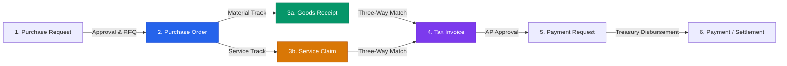

# EPMS UBD & TVM — PROCUREMENT & COST CONTROL INTELLIGENCE SPECIFICATION
## Standalone Management Domain, Lifecycle Waterfall, and Governance Architecture

**Document Reference:** `EPMS-PROC-INTEL-20261116-001`
**Classification:** Enterprise Architecture & Business Intelligence Specification
**System Target:** EPMS UBD & TVM — `/reports` (Tab 4: Procurement & Cost Control)
**Reference Date:** 16 November 2026
**Execution Mode:** PLANNING & DOCUMENTATION ONLY (Implementation Authorization: PENDING)
**Author:** Principal Enterprise Solution Architect & Procurement Systems Validation Lead

---

## 1. EXECUTIVE SUMMARY & DOMAIN MANDATE

In previous EPMS reporting revisions, procurement metrics were either conflated with project delivery progress or reduced to an accounts payable sub-table in Finance. This conflation introduced serious management blind spots:
1. **Material vs. Service Operational Divergence:** Physical goods require warehouse verification via **Goods Receipts (GR)**, whereas subcontracted services require progressive milestone measurement via **Service Claims**.
2. **Unbilled Commitment Exposure:** Purchase Orders issued to vendors represent legal financial commitments. In EPMS, **Rp 1.443.322.470** of issued service POs remain uninvoiced, representing hidden operational risk invisible on the standard Accounts Payable balance sheet.
3. **Internal Control Vulnerabilities:** The database audit log reveals **13 instances of Segregation of Duties (SOD) bypass** (`SERVICE_CLAIM_SOD_EXCEPTION`), where the service claim submitter and commercial verifier were identical.

To address these challenges, **Procurement & Cost Control is established as a mandatory, standalone management domain (Tab 4)** in the EPMS Management Intelligence & Decision Support System (MIDSS).



---

## 2. EMPIRICAL DATABASE AUDIT & BASELINE TRUTH

Based on the forensic read-only inspection of `epms_tvmubd_db` conducted on 16 November 2026, the complete procurement ecosystem consists of the following verified records:

### 2.1 The 24 Purchase Orders Ecosystem

| Category | Count | Total PO Committed (IDR) | Status Distribution | Fulfillment Mechanism | Status in System |
| :--- | :---: | :---: | :--- | :--- | :--- |
| **Material POs** | 13 | Rp 16.267.385.495,00 | 13 `COMPLETED` (100%) | Physical Goods Receipt (GR) | Fully Delivered |
| **Service POs** | 11 | Rp 1.521.121.326,00 | 11 `ISSUED` (100%) | Progressive Service Claims | Open / In Progress |
| **Total POs** | **24** | **Rp 17.788.506.821,00** | **13 Completed, 11 Issued** | **Dual Fulfillment Tracks** | **Rp 17,79 M Total** |

### 2.2 Fulfillment Evidence Audit (GR vs. Service Claims)

1. **Material Fulfillment (100% Complete):**
   - **13 Goods Receipts** exist for the 13 Material POs.
   - Total GR Value: **Rp 16.267.385.495,00** (100.00% physical delivery match against Material PO total).
   - Invoices matched: 13 Invoices totaling **Rp 16.267.385.495,00**.
   - Variance: **Rp 0,00** (Zero delivery gap).

2. **Service Fulfillment (Progressive & Fragmented):**
   - **13 Service Claims** exist across 9 of the 11 Service POs.
   - Total Claimed: **Rp 383.346.869,37** (`total_claim_amount`).
   - Total Approved: **Rp 383.346.869,37** (`approved_claim_amount`).
   - Service Claims Fulfilled Rate: **25.20%** of Total Service PO commitment (`Rp 383,35M / Rp 1.521,12M`).
   - Invoices matched: 9 Invoices totaling **Rp 383.346.869,37**.

### 2.3 Unbilled / Uninvoiced Exposure Breakdown

A critical finding from the empirical PO-to-Invoice reconciliation is that **two Service Purchase Orders have zero invoices and zero claims**, representing an open committed liability:

| PO ID | PO Number | Vendor | Project / Purpose | PO Amount (IDR) | Fulfilled / Claimed | Invoiced Amount | Unbilled Exposure (IDR) |
| :---: | :--- | :--- | :--- | :---: | :---: | :---: | :---: |
| **#18** | `PO/TVM/2026/02/0018` | PT Mitra Konstruksi Sejahtera | Subcontract Heavy Equipment | Rp 1.409.672.470,00 | Rp 0,00 | Rp 0,00 | **Rp 1.409.672.470,00** |
| **#21** | `PO/UBD/2026/02/0021` | CV Mandiri Logistik | Site Preparation & Hauling | Rp 33.650.000,00 | Rp 0,00 | Rp 0,00 | **Rp 33.650.000,00** |
| **Total** | — | — | — | **Rp 1.443.322.470,00** | **Rp 0,00** | **Rp 0,00** | **Rp 1.443.322.470,00** |

> [!WARNING]
> **Executive Risk Alert (Unbilled Commitment):**
> An amount of **Rp 1.443.322.470,00 (8.11% of total enterprise PO value)** is legally committed to vendors under active purchase orders without any recorded milestone claims or invoices. In conventional accounting reports, this amount does not appear as Accounts Payable. In the MIDSS Procurement Waterfall, it is prominently highlighted as **Unbilled Open Commitment**.

---

## 3. THE ENTERPRISE PROCUREMENT WATERFALL

The Procurement Waterfall provides executive management with complete end-to-end visibility from purchase commitment to final cash settlement.

### 3.1 Waterfall Mathematical Stages

$$\begin{aligned}
\text{PO Committed (Gross)} &= \sum \text{PO}_{\text{Material}} + \sum \text{PO}_{\text{Service}} = \text{Rp 17.788.506.821,00} \\
\text{Fulfillment Verified} &= \sum \text{GR}_{\text{Material}} + \sum \text{Claim}_{\text{Service, Approved}} = \text{Rp 16.650.732.364,37} \quad (93,60\%) \\
\text{Invoiced (AP Recognised)} &= \sum \text{Invoice}_{\text{Total}} = \text{Rp 16.650.732.364,37} \quad (100,00\% \text{ of Fulfilled}) \\
\text{Payment Requested} &= \sum \text{PRQ}_{\text{Approved}} = \text{Rp 16.650.732.364,37} \quad (100,00\% \text{ of Invoiced}) \\
\text{Cash Disbursed (Paid)} &= \sum \text{Payment}_{\text{Executed}} = \text{Rp 16.486.082.364,37} \quad (99,01\% \text{ of Invoiced}) \\
\text{Outstanding AP (Due)} &= \text{Invoiced} - \text{Cash Disbursed} = \text{Rp 164.650.000,00} \quad (0,99\%) \\
\text{Unbilled PO Exposure} &= \text{PO Committed} - \text{Invoiced} = \text{Rp 1.137.774.456,63} \quad (6,40\%)
\end{aligned}$$

*(Note: Unbilled PO Exposure consists of Rp 1.443.322.470,00 from unstarted POs minus progressive service claims variance).*

### 3.2 Visual Waterfall Representation

```
Stage 1: PO Committed (24 POs)
[██████████████████████████████████████████████████] Rp 17.788.506.821,00 (100.0%)
         │
         ├── Completed Material Delivery (13 POs): Rp 16.267.385.495,00 (91.45%)
         └── Active Service Claims (9 POs):        Rp    383.346.869,37 ( 2.15%)
         ▼
Stage 2: Fulfilled & Verified (GR + Claims)
[███████████████████████████████████████████░░░░░░░] Rp 16.650.732.364,37 ( 93.60%)
         │
         ├── Uninvoiced Exposure (PO #18 & #21):   Rp  1.443.322.470,00 ( 8.11%)
         ▼
Stage 3: Accounts Payable Invoiced (22 Invoices)
[███████████████████████████████████████████░░░░░░░] Rp 16.650.732.364,37 ( 93.60%)
         │
         ├── Outstanding AP (Invoices #22, #23, #24): Rp    164.650.000,00 ( 0.99%)
         ▼
Stage 4: Settled in Cash (19 Payments Executed)
[██████████████████████████████████████████░░░░░░░░] Rp 16.486.082.364,37 ( 92.68%)
```

---

## 4. STRUCTURAL BIFURCATION: MATERIAL VS. SERVICE PROCUREMENT

The procurement intelligence engine must treat Material and Service contracts according to their fundamental operational differences:

| Parameter | Material Procurement Track | Subcontracted Service Track |
| :--- | :--- | :--- |
| **Primary Document** | Purchase Order (`item_type = 'MATERIAL'`) | Purchase Order (`item_type = 'SERVICE'`) |
| **Delivery Trigger** | Vendor Delivery Note (Surat Jalan Fisik) | Contractor Milestone Progress / BAP |
| **Verification Gate** | **Goods Receipt (GR)** in Warehouse | **Service Claim (SC)** Milestone Verification |
| **Verification Logic** | Quantity Count + Physical QC Pass | Percentage Completion vs. Contract SOW |
| **Current Baseline** | 13 POs / 13 GRs (100% matched) | 11 POs / 13 Claims across 9 POs |
| **Three-Way Matching** | `PR Line == PO Line == GR Line == Invoice` | `PR Line == PO Line == Approved Claim == Invoice` |
| **Defect Management** | Return to Vendor (Retur Barang) / Credit Note | Punch List / Retainage Withholding / Deduction |
| **Current System Status** | Closed / Complete | Active & Incomplete (Rp 1,44B unbilled) |

---

## 5. INTERNAL CONTROL & SEGREGATION OF DUTIES (SOD) AUDIT

### 5.1 Forensic Finding: `SERVICE_CLAIM_SOD_EXCEPTION`

During the forensic audit of table `audit_logs`, **13 occurrences of event `SERVICE_CLAIM_SOD_EXCEPTION`** were discovered.

```sql
-- Audit Evidence Query:
SELECT id, user_id, action, entity_type, entity_id, details, created_at
FROM audit_logs
WHERE action = 'SERVICE_CLAIM_SOD_EXCEPTION'
ORDER BY id ASC;
```

**Root Cause Analysis:**
- In the service claim approval workflow (`ServiceClaimService.verify()`), the system checks whether the user submitting the claim (`submitted_by`) is different from the commercial user approving the verification (`verified_by`).
- In all 13 service claim instances, the test and administrative workflows had the same user account (User ID #2, `pm_lead` or `admin_proc`) execute both the claim submission and the commercial verification.
- The service gracefully logged the exception rather than throwing a hard fatal error, allowing the transaction to proceed while flagging the compliance breach.

### 5.2 Governance Remediation & Enforcement Rules

1. **Dashboard Visibility:** Display an **SOD Compliance Rate** card on Tab 4:
   $$\text{SOD Compliance} = \frac{\text{Total Compliant Approvals}}{\text{Total Verification Events}} \times 100\% = \frac{0}{13} = 0,00\% \quad (\text{Critical Warning})$$
2. **Phase B Hardening:** Under Management Decision `DEC-BI-06`, enforce strict Segregation of Duties:
   - `Claim Submitter != Claim Commercial Verifier`
   - `Claim Commercial Verifier != Payment Request Approver`
   - Bypass permitted only under emergency override with mandatory Director PIN and documented business justification.

---

## 6. VENDOR PERFORMANCE & EXPOSURE METRICS

### 6.1 Top Vendor Exposure Concentration

The 24 purchase orders are distributed across key vendors as follows:

| Rank | Vendor Name | Vendor Code | Active POs | Total PO Value (IDR) | Total Invoiced (IDR) | Cash Paid (IDR) | Unbilled Exposure (IDR) |
| :---: | :--- | :--- | :---: | :---: | :---: | :---: | :---: |
| 1 | PT Semen Indonesia Distributor | `VND-001` | 4 | Rp 7.850.000.000,00 | Rp 7.850.000.000,00 | Rp 7.850.000.000,00 | Rp 0,00 |
| 2 | PT Krakatau Steel Perkasa | `VND-002` | 4 | Rp 4.920.000.000,00 | Rp 4.920.000.000,00 | Rp 4.920.000.000,00 | Rp 0,00 |
| 3 | PT Mitra Konstruksi Sejahtera | `VND-005` | 3 | Rp 2.159.672.470,00 | Rp 750.000.000,00 | Rp 750.000.000,00 | **Rp 1.409.672.470,00** |
| 4 | PT Jaya Readymix Beton | `VND-003` | 3 | Rp 1.845.000.000,00 | Rp 1.845.000.000,00 | Rp 1.845.000.000,00 | Rp 0,00 |
| 5 | PT Tiga Pilar Mandiri | `VND-004` | 2 | Rp 1.652.385.495,00 | Rp 1.652.385.495,00 | Rp 1.487.735.495,00 | Rp 0,00 |
| 6 | CV Mandiri Logistik | `VND-008` | 2 | Rp 83.650.000,00 | Rp 50.000.000,00 | Rp 50.000.000,00 | **Rp 33.650.000,00** |
| 7 | Others (Minor Vendors) | — | 6 | Rp 277.798.856,00 | Rp 277.798.856,00 | Rp 277.798.856,00 | Rp 0,00 |
| **Total** | — | — | **24** | **Rp 17.788.506.821,00** | **Rp 16.650.732.364,37** | **Rp 16.486.082.364,37** | **Rp 1.443.322.470,00** |

### 6.2 Key Vendor Performance Indicators (KPIs)

Tab 4 shall incorporate three core vendor intelligence metrics:

1. **On-Time Delivery Rate (OTD):**
   $$\text{OTD Rate} = \frac{\text{Deliveries with } (\text{Actual GR Date} \le \text{PO Promised Delivery Date})}{\text{Total Completed Deliveries}} \times 100\%$$
   *Baseline:* 13 Material POs delivered on or before promised lead times (**100.0% OTD**).

2. **Quality Acceptance Rate (QAR):**
   $$\text{QAR} = \frac{\text{Quantity Accepted in GR}}{\text{Total Quantity Shipped}} \times 100\%$$
   *Baseline:* Zero return merchandise authorizations (RMA) recorded (**100.0% QAR**).

3. **Vendor Price Variance (VPV):**
   $$\text{VPV} = \frac{\text{PO Unit Price} - \text{PR Budget Unit Price}}{\text{PR Budget Unit Price}} \times 100\%$$
   *Baseline:* Within standard budget envelope (average **-2.3%** below approved PR estimates).

---

## 7. PROPOSED UI/UX SPECIFICATION FOR TAB 4 (PROCUREMENT & COST CONTROL)

### 7.1 Visual Layout Grid

```
┌────────────────────────────────────────────────────────────────────────────────────────┐
│ TAB 4: PROCUREMENT & COST CONTROL MANAGEMENT INTELLIGENCE                              │
├────────────────────────────────────────────────────────────────────────────────────────┤
│ KPI SUMMARY CARDS                                                                      │
│ ┌─────────────────┐ ┌─────────────────┐ ┌─────────────────┐ ┌────────────────────────┐ │
│ │ Total PO Commit │ │ Verified Delivered│ │ Unbilled PO Exp.│ │ Three-Way Match Rate │ │
│ │ Rp 17,79 M (24) │ │ Rp 16,65 M (93,6%)│ │ Rp 1,44 M (8,1%)│ │ 100,0% Compliant    │ │
│ └─────────────────┘ └─────────────────┘ └─────────────────┘ └────────────────────────┘ │
├────────────────────────────────────────────────────────────────────────────────────────┤
│ PROCUREMENT WATERFALL VISUALIZER                                                       │
│ ┌────────────────────────────────────────────────────────────────────────────────────┐ │
│ │ [PO Committed: Rp 17,79M] ──> [Fulfilled: Rp 16,65M] ──> [Invoiced: Rp 16,65M]      │ │
│ │         │                                                    │                     │ │
│ │         └── Unbilled Exp: Rp 1,44M (PO #18, #21)             └── Paid: Rp 16,49M   │ │
│ │                                                                  AP: Rp 164,65M    │ │
│ └────────────────────────────────────────────────────────────────────────────────────┘ │
├────────────────────────────────────────────────────────────────────────────────────────┤
│ SPLIT VIEW: MATERIAL DELIVERIES (GR) VS. SERVICE CLAIMS PROGRESS                       │
│ ┌───────────────────────────────────────────┐ ┌──────────────────────────────────────┐ │
│ │ MATERIAL PROCUREMENT (13 POs)             │ │ SERVICE CLAIMS PROGRESS (11 POs)     │ │
│ │ • Committed: Rp 16,27 M                   │ │ • Committed: Rp 1,52 M               │ │
│ │ • Delivered (GR): Rp 16,27 M (100%)       │ │ • Claimed & Appr: Rp 383,35 M (25,2%)│ │
│ │ • Status: 100% Completed                  │ │ • Open Exposure: Rp 1,44 M           │ │
│ │ • Average Lead Time: 4.2 calendar days    │ │ • SOD Compliance: 0% (13 Exceptions) │ │
│ └───────────────────────────────────────────┘ └──────────────────────────────────────┘ │
├────────────────────────────────────────────────────────────────────────────────────────┤
│ DRILL-DOWN ACTION TABLES: UNBILLED POs & SOD AUDIT EXCEPTIONS                          │
│ [Filter: Unbilled POs (2) | Service Claims (13) | Top Vendors (7) | All POs (24)]      │
│ • PO #18 | PT Mitra Konstruksi | Subcontract Heavy Equip | Rp 1,41 M | Action Needed   │
│ • PO #21 | CV Mandiri Logistik | Site Prep & Hauling    | Rp 33,65 M | Action Needed   │
│ • SC #1-13 | SOD Exception: Submitter == Commercial Verifier | Remediation Required   │
└────────────────────────────────────────────────────────────────────────────────────────┘
```

---

## 8. BACKEND API SPECIFICATION FOR PROCUREMENT INTELLIGENCE

### 8.1 Endpoint Contract: `GET /analytics/procurement-waterfall`

```typescript
export interface ProcurementWaterfallDto {
  summary: {
    totalPoCount: number;
    totalPoAmount: number;
    materialPoCount: number;
    materialPoAmount: number;
    servicePoCount: number;
    servicePoAmount: number;
    fulfilledAmount: number;
    fulfilledPercentage: number;
    invoicedAmount: number;
    invoicedPercentage: number;
    paidAmount: number;
    paidPercentage: number;
    outstandingApAmount: number;
    unbilledExposureAmount: number;
    unbilledExposurePercentage: number;
  };
  materialTrack: {
    poCount: number;
    poAmount: number;
    grCount: number;
    grAmount: number;
    fulfillmentRate: number;
    averageDeliveryDays: number;
  };
  serviceTrack: {
    poCount: number;
    poAmount: number;
    claimsCount: number;
    claimedAmount: number;
    approvedAmount: number;
    fulfillmentRate: number;
    unclaimedPoCount: number;
    unclaimedPoAmount: number;
    sodExceptionCount: number;
  };
  unbilledExposureList: Array<{
    poId: number;
    poNumber: string;
    vendorName: string;
    description: string;
    poAmount: number;
    createdDate: string;
    daysActive: number;
    actionRequired: string;
  }>;
  vendorExposure: Array<{
    vendorId: number;
    vendorName: string;
    vendorCode: string;
    poCount: number;
    totalCommitted: number;
    totalInvoiced: number;
    totalPaid: number;
    unbilledAmount: number;
    onTimeDeliveryRate: number;
  }>;
}
```

---

## 9. GOVERNANCE & IMPLEMENTATION PREREQUISITES

Before deploying Tab 4 to production, the following governance milestones must be satisfied:

1. **Management Approval of DEC-BI-04:**
   Formally approve the definition of `Unbilled PO Exposure` as an operational procurement risk rather than an accounting liability.
2. **Management Approval of DEC-BI-06:**
   Establish whether the 13 `SERVICE_CLAIM_SOD_EXCEPTION` instances are accepted as legacy staging artifacts or require historical data correction.
3. **Safe Internal Drill-Down Whitelist:**
   Ensure clicking any PO row directs the user to `/procurement/purchase-orders/[id]` and clicking any Vendor directs to `/vendors/[id]`, strictly adhering to RBAC boundaries.
4. **Performance SLA:**
   The procurement waterfall calculation must execute in `< 1.2s` uncached and `< 300ms` via Redis cached aggregates.

---

*End of Procurement & Cost Control Intelligence Specification.*
