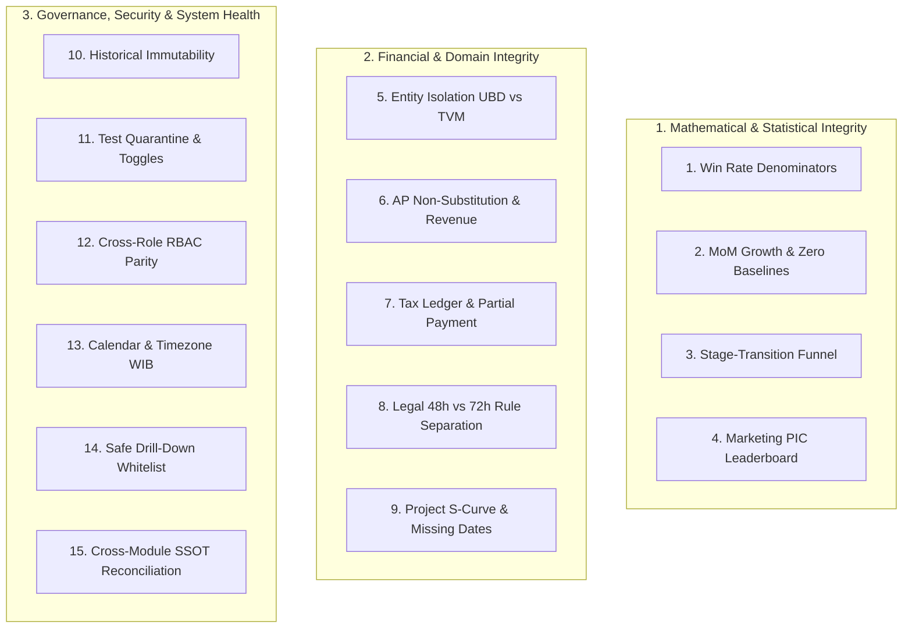

# EPMS UBD & TVM — KPI & REPORTS TEST & UAT STRATEGY
## 15 Mandatory Verification Areas, Isolated QA Matrix & Role-Based Staging Acceptance

**Document Reference:** `EPMS-TEST-UAT-20261116-001`
**Classification:** Quality Assurance & Governance Strategy Specification
**System Target:** EPMS UBD & TVM — `/reports` & `/analytics`
**Reference Date:** 16 November 2026
**Execution Mode:** PLANNING & DOCUMENTATION ONLY (Implementation Authorization: PENDING)
**Author:** Principal Enterprise Solution Architect & Lead QA Governance Auditor

---

## 1. QUALITY ASSURANCE GOVERNANCE & ISOLATION MANDATE

The EPMS Management Intelligence & Decision Support System (MIDSS) provides executive visibility directly to the Director and executive department heads. A single mathematical error, erroneous baseline, or broken drill-down route undermines executive trust.

### Strict Database Isolation Rule (WAJIB)
1. **Zero Test Fixtures in Production/Staging Database:**
   - Under no circumstances shall mock data, artificial test tenders, fake purchase orders, or synthetic invoices be inserted into `epms_tvmubd_db`.
   - All automated unit and integration tests must run against dedicated in-memory SQLite instances or ephemeral Dockerized test containers (`epms_test_db`).
2. **Read-Only Automated Staging Verification:**
   - Automated tests that run against the live staging database must perform **strictly read-only assertions** (`SELECT` queries only).
3. **Multi-Stage Acceptance Governance:**
   - Technical Verification (Automated Jest/Supertest/Playwright) $\neq$ Business Staging UAT (Human sign-off).
   - A technical green checkmark does not constitute business sign-off.

---

## 2. THE 15 MANDATORY VERIFICATION AREAS

---

### Area 1: Win Rate Math & Denominator Rigor

- **Objective:** Prevent deceptive conversion reporting by requiring explicit mathematical denominators.
- **Empirical Baseline:** 33 Total Tenders: 15 Won, 5 Lost, 13 In Progress (Prospect to Negotiation).
- **Test Invariants:**
  1. **Gross Win Rate:** Must strictly evaluate to $\frac{15}{33} = 45,45\%$.
  2. **Concluded Win Rate:** Must strictly evaluate to $\frac{15}{15 + 5} = 75,00\%$.
  3. **Active Pipeline Ratio:** Must strictly evaluate to $\frac{13}{33} = 39,39\%$.
  4. **Sum Check:** $\text{Gross Win Rate} + \frac{\text{Lost}}{\text{Total}} + \text{Active Pipeline Ratio} = 45,45\% + 15,15\% + 39,39\% = 100,00\% \pm 0,01\%$.
- **Assertion:** System must reject any presentation of "75.0% Win Rate" that omits the disclosure label `(Dari Tender Selesai / Concluded Tenders)`.

---

### Area 2: Growth / Month-over-Month (MoM) Baseline Handling

- **Objective:** Prevent runtime division-by-zero errors (`NaN`, `Infinity`, or pseudo `+100.0%`).
- **Test Scenarios:**
  - Case A (Zero Previous Period): If Previous Month $= 0$ and Current Month $= 5$, growth must render as badge `BARU (Bulan Pertama / Baseline Month)`. Must NOT display `+100%` or `+Infinity%`.
  - Case B (Zero Both Periods): If Previous Month $= 0$ and Current Month $= 0$, growth must render as `0,0%` or `Tidak Ada Aktivitas`.
  - Case C (Standard Growth): If Previous Month $= 4$ and Current Month $= 6$, growth must evaluate to $\frac{6 - 4}{4} \times 100\% = +50,0\%$.

---

### Area 3: Stage-Transition Funnel Integrity

- **Objective:** Verify pipeline funnel consistency without leakage or negative drop-offs.
- **Funnel Stages:** `PROSPECT` $\rightarrow$ `RFQ_REVIEW` $\rightarrow$ `BIDDING` $\rightarrow$ `NEGOTIATION` $\rightarrow$ `WON` / `LOST`.
- **Test Invariants:**
  - Every tender must belong to exactly one active stage or terminal state.
  - Total Stage Counts must equal total tenders:
    $$\sum \text{Stage Counts} = 33$$
  - Stage conversion percentages must be monotonic or explicitly represent funnel stage drop-offs.

---

### Area 4: Marketing PIC Open/Won/Total Leaderboard

- **Objective:** Reconcile individual sales performance against enterprise totals.
- **Test Invariants:**
  - For each PIC $i$:
    $$\text{Total Assigned}_i = \text{Active}_i + \text{Won}_i + \text{Lost}_i$$
  - Enterprise Sum Check:
    $$\sum_{i} \text{Total Assigned}_i = 33, \quad \sum_{i} \text{Won}_i = 15, \quad \sum_{i} \text{Lost}_i = 5$$
  - PIC Win Rate formula: Must use Concluded denominator $\frac{\text{Won}_i}{\text{Won}_i + \text{Lost}_i}$ or indicate `N/A (Belum Ada Tender Selesai)` if $\text{Won}_i + \text{Lost}_i = 0$.

---

### Area 5: Entity Isolation & Cross-Entity Balancing (UBD vs. TVM)

- **Objective:** Validate multi-tenant company isolation and mathematical roll-up.
- **Test Scenarios:**
  - Filter `company = 'UBD'`: Returns only UBD contracts, POs, projects, and invoices.
  - Filter `company = 'TVM'`: Returns only TVM contracts, POs, projects, and invoices.
  - Filter `company = 'ALL'`:
    $$\text{Total}_{\text{ALL}} = \text{Total}_{\text{UBD}} + \text{Total}_{\text{TVM}}$$
  - Cross-Tenant Leakage Check: A user restricted to UBD context must receive HTTP 403 or empty data when attempting to query TVM entity IDs.

---

### Area 6: Financial Integrity & AP Non-Substitution

- **Objective:** Enforce that Vendor Accounts Payable disbursements are never presented as Company Revenue.
- **Test Invariants:**
  - `analytics.executive.customerRevenue` MUST return `null` with status `UNAVAILABLE`.
  - UI MUST render: `"Modul AR Belum Terpasang"` with an informational badge.
  - `analytics.finance.totalPaid` MUST equal **Rp 16.486.082.364,37** (vendor payments).
  - Any occurrence of `paidInvoicesSum` assigned to revenue in code triggers an automated test failure.

---

### Area 7: Tax Ledger & Partial Payment Mathematics

- **Objective:** Verify tax withholding and Accounts Payable settlement accuracy.
- **Empirical Baseline:**
  - Total Invoiced: **Rp 16.650.732.364,37** (22 Invoices).
  - Total Paid: **Rp 16.486.082.364,37** (19 Payments).
  - Remaining AP: **Rp 164.650.000,00** across Invoices #22, #23, and #24.
- **Test Invariants:**
  - Invoices #22, #23, and #24 sum check:
    $$\text{Remaining AP} = \text{Total Amount} - \text{Paid Amount} = \text{Rp 164.650.000,00}$$
  - No payment execution may exceed the approved payment request amount:
    $$\text{Payment Amount} \le \text{PRQ Approved Amount} \quad (\forall \text{ Payments})$$
  - Tax Withholding: PPh 21, 23, and Final withholdings must be tracked as liabilities; tax remittance must report `Rp 0,00 (NTPN Missing)` until confirmed by treasury.

---

### Area 8: Legal 48-Hour SPK vs. 72-Hour Revision Rule Separation

- **Objective:** Prevent conflation between the 48-hour Tender SPK grace period and the 72-hour Contract Revision SLA.
- **Verification Criteria:**
  1. **Tender SPK Expiration:** Configured in `TenderScheduler` as **48 hours** from tender award notification.
  2. **Contract Revision SLA:** Configured in Legal module as **72 hours (3 calendar days)** for legal review.
  3. **Aging Alert:** Contracts #16, #17, #26, and #30 (total Rp 36,85M) have been pending for **16.8 to 18.1 days**, which breaches the 72-hour contract review SLA by > 13 days.

---

### Area 9: Project S-Curve Variance & Closure Timing

- **Objective:** Accurate Earned Value Management (EVM) without fabricating missing dates.
- **Empirical Findings:**
  - 8 `CLOSED` Projects: 100% have complete start/end dates and closed baselines. Completed ahead of schedule.
  - 7 `IN_PROGRESS` Projects: Have active baselines and progressive tracking.
  - 12 `PLANNING` Projects: **100% have start_date = NULL, end_date = NULL, and active_baseline = 0**.
- **Test Invariants:**
  - For projects with `start_date = NULL`: System MUST render `Status: Perencanaan (Jadwal Belum Ditetapkan)` and S-Curve variance as `N/A`. Must NOT fabricate 0% delay or runtime errors.
  - Deficit Alert: Project #50 must trigger an automated alert (`Contract Rp 1.775.000.000` vs `RAB Rp 1.776.594.600` $\rightarrow$ Deficit `-Rp 1.594.600`).

---

### Area 10: Historical Snapshot Immutability

- **Objective:** Ensure past monthly performance reports do not drift when new transactions occur.
- **Test Scenario:**
  - Query Q1 2026 performance on Day 1. Record checksum of response.
  - Insert new Q2 2026 transaction in test environment.
  - Query Q1 2026 performance again. Checksum must match 100.00%.

---

### Area 11: Test Data Quarantine & Toggle Reconciliation

- **Objective:** Quarantine non-production transactions from executive figures.
- **Test Invariants:**
  - System must support toggle: `Include Test Records: [ON / OFF]`.
  - Default executive view must be `OFF` (Quarantine active).
  - Quarantined records identified by vendor codes `TEST-*`, descriptions containing `[TEST]`, or `is_test = 1`.

---

### Area 12: Cross-Role RBAC Parity

- **Objective:** Guarantee that non-executive roles cannot view restricted financial and margin metrics.
- **Test Matrix:**
  - Site Engineer visiting Tab 5 $\rightarrow$ HTTP 403 Forbidden.
  - Procurement Officer visiting Tab 2 $\rightarrow$ Read-Only tender list, no internal margins.
  - Director visiting any Tab $\rightarrow$ HTTP 200 with complete data.

---

### Area 13: Calendar Boundaries & Timezone (WIB / UTC+7)

- **Objective:** Prevent month-boundary transaction slippage caused by UTC vs. WIB offsets.
- **Rule:** All database timestamps in UTC must be converted to Asia/Jakarta (UTC+7) before grouping by day, month, or quarter.
- **Test Invariant:** A transaction created at `2026-03-31 18:30:00 UTC` is `2026-04-01 01:30:00 WIB` and must fall into April / Q2 in executive reports.

---

### Area 14: Safe Internal Drill-Down Whitelist

- **Objective:** Ensure zero broken links or 404 pages across all management views.
- **Automated Crawl Test:**
  - Iterate through all interactive links and table rows generated in the 6 tabs.
  - Verify that every URL matches `EXECUTIVE_DRILLDOWN_WHITELIST`.
  - Assert that HTTP response is 200 and renders the target entity without console exceptions.

---

### Area 15: Cross-Module Single Source of Truth (SSOT) Reconciliation

- **Objective:** Cross-verify financial and operational data across module boundaries.
- **Reconciliation Invariants:**
  1. `Tenders(WON)` Contract Value $\equiv$ `Contracts` Signed Value.
  2. `Contracts` ID $\equiv$ `Projects` Contract Reference.
  3. `Purchase Orders` Committed $\equiv$ Material GRs + Service Claims + Unbilled Exposure.
  4. `Invoices` Invoiced Amount $\equiv$ Payments Executed + Remaining AP.

---

## 3. ROLE-BASED HUMAN STAGING UAT SCRIPTS

Prior to production release, the following human UAT scripts must be executed by appointed business stakeholders on the staging environment:

### Script UAT-DIR: Director (Direksi) Executive Intelligence Sign-Off
- **Tester:** Direktur Utama / Board of Directors
- **Steps:**
  1. Log in with `director@epms.local`.
  2. Navigate to `/reports` $\rightarrow$ Confirm Tab 1 (Executive Overview) loads in $< 1$ second.
  3. Review **Pencapaian Utama**: Verify Tender Won (Rp 26,70M) and Closed Projects (8 projects).
  4. Review **Hambatan Utama**: Verify Contract Legal Review alert (4 contracts, Rp 36,85M, pending > 16 days).
  5. Review **Action & Decision Needed**: Verify exact 4 Director pending approvals. Click task #262 $\rightarrow$ Confirm safe navigation to approval workspace.
  6. Verify Customer Revenue card displays `"Modul AR Belum Terpasang"` rather than vendor expense.
- **Acceptance Criteria:** Director confirms clarity, absence of misleading revenue, and rapid decision drill-down.

---

### Script UAT-FIN: Finance Controller AP & Tax Settlement Sign-Off
- **Tester:** Head of Finance & Accounting
- **Steps:**
  1. Log in with `finance_controller@epms.local`.
  2. Navigate to Tab 5 (Finance & Cost).
  3. Verify Accounts Payable reconciliation:
     - Invoiced: Rp 16.650.732.364,37
     - Paid: Rp 16.486.082.364,37
     - Outstanding: Rp 164.650.000,00 across Invoices #22, #23, and #24.
  4. Verify Tax Withholding summary displays PPh 21/23/Final liabilities and identifies zero NTPN remittance.
- **Acceptance Criteria:** Complete mathematical reconciliation with zero unaccounted discrepancy.

---

### Script UAT-PROC: Head of Procurement Waterfall & Exposure Sign-Off
- **Tester:** Head of Procurement
- **Steps:**
  1. Log in with `head_procurement@epms.local`.
  2. Navigate to Tab 4 (Procurement & Cost Control).
  3. Verify Procurement Waterfall:
     - Material: 13 POs / 13 GRs (100% matched).
     - Services: 11 POs / 13 Claims (Rp 383,35M claimed).
     - Unbilled Exposure: Exactly Rp 1.443.322.470,00 on PO #18 and PO #21.
  4. Review SOD Exception card: Confirm 13 logged exceptions are surfaced for management action.
- **Acceptance Criteria:** Unbilled exposure accurately flagged and distinct material/service tracks verified.

---

### Script UAT-PMO: PMO Lead Portfolio & Deficit Sign-Off
- **Tester:** Lead Project Manager / PMO
- **Steps:**
  1. Log in with `pm_lead@epms.local`.
  2. Navigate to Tab 3 (Project Delivery / PMO).
  3. Verify 27 projects portfolio breakdown (8 Closed, 7 In Progress, 12 Planning).
  4. Confirm 12 Planning projects without dates display clear scheduling notices rather than S-curve errors.
  5. Verify Project #50 Deficit Alert is prominently displayed (`-Rp 1.594.600` variance).
- **Acceptance Criteria:** PMO acknowledges planned deficits and date gaps without interface breakdown.

---

### Script UAT-LEG: Legal Specialist Contract Governance Sign-Off
- **Tester:** Corporate Legal Specialist
- **Steps:**
  1. Log in with `legal_specialist@epms.local`.
  2. Navigate to Tab 6 (Legal & Governance).
  3. Confirm 4 contracts in `PENDING_LEGAL_REVIEW` (Contracts #16, #17, #26, #30) are displayed with exact aging (16.8 to 18.1 days).
  4. Verify distinction between 48-hour Tender SPK grace and 72-hour Contract SLA.
- **Acceptance Criteria:** Legal team confirms aging accuracy and SLA breach alerts.

---

*End of Test & UAT Strategy Specification.*
