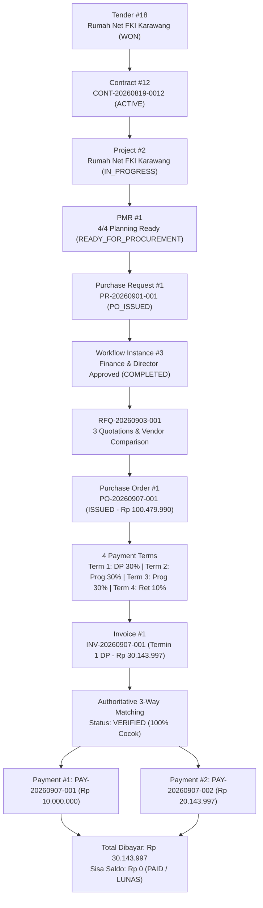

# LAPORAN AUDIT PENUTUPAN LIFECYCLE EPMS (EPMS LIFECYCLE CLOSURE AUDIT)
**Versi Dokumen:** 1.0 (Final Official Audit)  
**Status Operasi:** STRICT READ-ONLY / ZERO MUTATION  
**Tanggal Pelaksanaan:** 08 September 2026  
**Invarian Database:** `purchase_requests: 1`, `purchase_orders: 1`, `purchase_order_items: 2`, `po_payment_terms: 4`, `invoices: 1`, `invoice_items: 2`, `payments: 2`, `goods_receipts: 0` *(100% Terjaga)*

---

## 1. Executive Summary

Audit ini dilakukan secara menyeluruh terhadap 24 tahapan siklus hidup proyek (*Master Lifecycle*) pada sistem **Enterprise Project Management System (EPMS) TVM-UBD**. Evaluasi mencakup seluruh layer: **Database (MySQL), Backend API (NestJS), Workflow Engine, dan Frontend UI (Next.js)** untuk memastikan integritas *Single Source of Truth* (SSOT) dan penegakan aturan semantik bisnis.

### Ringkasan Kesehatan Siklus Hidup:
- **Total Tahapan Lifecycle:** 24 Langkah
- **GREEN (Terverifikasi & Siap Produksi):** **21 Langkah (87.5%)**
- **YELLOW (Kesenjangan Non-Blocking):** **3 Langkah (12.5%)**
- **RED (Blocker / Pelanggaran SSOT):** **0 Langkah (0.0%)**
- **Kesimpulan Status:** **SANGAT SEHAT (EXCELLENT)**. Seluruh modul bisnis beroperasi di atas SSOT backend tanpa ketergantungan mock/localStorage data bisnis.

---

## 2. Aturan Semantik Bisnis (Enforced Rules)

Sistem telah membuktikan penegakan aturan pemisahan kewenangan (*separation of concerns*) berikut:
1. **Procurement Review $\neq$ Procurement Execution:** Review anggaran PR via workflow engine terpisah secara independen dari proses RFQ, komparasi vendor, dan penerbitan PO.
2. **Finance Review $\neq$ Finance Payment:** Persetujuan anggaran PR oleh Finance Controller tidak memicu pengeluaran kas; pengeluaran kas murni berada pada modul pencairan voucher kas/bank.
3. **Director Approval $\neq$ Kickoff:** Persetujuan Direktur mengesahkan anggaran pengadaan, sedangkan Kickoff proyek merupakan kewenangan manajerial PM setelah handover.
4. **Planning $\neq$ Execution:** Rencana 4 pilar (Cost, WBS, Schedule, Initial Condition) terkunci sebagai baseline resmi sebelum status proyek berubah menjadi `IN_PROGRESS`.
5. **Project Execution $\neq$ Procurement Execution:** Progres pekerjaan fisik lapangan dipisahkan dari pencatatan logistik pengadaan material vendor.
6. **Backend/DB = SSOT:** Seluruh kalkulasi akumulasi termin, pencocokan 3-way matching, dan mutasi status dikelola authoritative oleh server.

---

## 3. Matriks Audit 24 Langkah Master Lifecycle

| No | Tahap Lifecycle | Implementasi Teknis | Endpoint Backend | Antarmuka UI | State Database | Workflow Engine | Status | Keterangan / Gap |
| :---: | :--- | :---: | :--- | :--- | :--- | :---: | :---: | :--- |
| **1** | **Marketing OKE** | Lengkap | `POST /tenders`, `PATCH /tenders/:id/go-nogo` | `/sales`, `TenderList.tsx` | Tender #18 (`WON`, `GO`) | State Machine | `GREEN` | Intake prospek & penilaian Go/No-Go selesai. |
| **2** | **Proposal/Tender OKE** | Lengkap | `POST /commercial/proposals` | `/sales/tenders/[id]` | Proposal #15 (`APPROVED`) | State Machine | `GREEN` | Nilai penawaran Rp 50.000.000 disetujui. |
| **3** | **Commercial/Budget OKE** | Lengkap | `PATCH /tenders/:id/negotiation` | `/sales/tenders/[id]` | `negotiated_price: 50.000.000` | State Machine | `GREEN` | Negosiasi harga dan margin disepakati. |
| **4** | **Legal OKE** | Lengkap | `PATCH /contracts/:id/legal-review` | `/legal/review` | Contract #12 (`legal_status: APPROVED`) | State Machine | `GREEN` | Penelaahan pasal kontrak disetujui Legal. |
| **5** | **Contract Approved OKE** | Lengkap | `POST /contracts/:id/activate`, `spk-verify` | `/governance/contracts` | Contract #12 (`status: ACTIVE`) | Contract Transition | `GREEN` | SPK sah terverifikasi, kontrak aktif. |
| **6** | **Project Workspace — PLANNING** | Lengkap | `GET /projects/:id`, `claim-charter` | `/project-operational` | Project #2 (`status: PLANNING`) | Charter Intake | `GREEN` | Ruang kerja proyek terbentuk dari kontrak. |
| **7** | **Project Delivery Planning (4 Pilar)** | Lengkap | `/wbs`, `/cost-estimate`, `/schedule`, `/initial-condition` | Modals 4 Pilar | WBS (16 pkgs), Cost (185M), Schedule (112 tasks) | Validator SSOT | `GREEN` | 4 pilar perencanaan terisi lengkap. |
| **8** | **4/4 Planning Ready OKE** | Lengkap | `GET /projects/:id/planning-readiness` | Stepper 4 Pilar | Snapshot: `completenessCount: 4/4` | Readiness Guard | `GREEN` | Seluruh gate kelayakan bernilai READY. |
| **9** | **PM Submit for Review OKE** | Lengkap | `POST /projects/:id/submit-review` | `PmOperationalPlanModal.tsx` | PMR #1 (`status: REVIEW_PENDING`) | Governance Gate | `GREEN` | PM mengajukan rencana ke manajemen. |
| **10** | **Head of Operations Review** | Lengkap | `POST /projects/:id/decide-review` | `PmOperationalPlanReviewModal.tsx` | Decided by User 58 (`READY_FOR_PROCUREMENT`) | Reviewer Role | `GREEN` | Rencana operasional disetujui Head of Ops. |
| **11** | **Procurement Review / PR** | Lengkap | `POST /procurement/pr`, `instances/start` | `CreatePrModal.tsx`, `PrApprovalWorkflow.tsx` | PR #1 (`170.000.000`), Instance #3 | Def #22, Ver 25 | `GREEN` | Workflow PR dimulai dan ditugaskan. |
| **12** | **Finance Review** | Lengkap | `POST /workflow-engine/tasks/3/complete` | `PrApprovalWorkflow.tsx`, `/inbox` | Task #3 `COMPLETED` (Action: `APPROVE`) | `node_finance_review` | `GREEN` | Anggaran PR diverifikasi tim Finance. |
| **13** | **Director Approval** | Lengkap | `POST /workflow-engine/tasks/22/complete` | `PrApprovalWorkflow.tsx`, `/inbox` | Task #22 `COMPLETED` (Action: `APPROVE`) | `node_director_approval` | `GREEN` | Pengadaan disahkan Direktur Utama. |
| **14** | **Ready for Kickoff** | Lengkap | Trigger sistem pasca terminal approval | Banner Kickoff UI | Transition #33 (`TERMINAL`) | `node_end` $\rightarrow$ `TERMINAL` | `GREEN` | Persetujuan tuntas, izin kerja aktif. |
| **15** | **Return/Handover to PM** | Lengkap | Notifikasi sistem & Unlocked Workspace | PM Operational Dashboard | PR status `PO_ISSUED`, PM Notified | Handover Gate | `GREEN` | Rencana kerja diserahkan kembali ke PM. |
| **16** | **PM Formal Kickoff** | Lengkap | `PATCH /projects/:id/status` | Action Kickoff di UI | `start_date: 2026-08-31`, `end_date` set | Project Transition | `GREEN` | PM mengeksekusi kickoff resmi proyek. |
| **17** | **Project PLANNING → IN_PROGRESS** | Lengkap | Entity State Machine | Badge Project: `IN_PROGRESS` | Project #2 `status = 'IN_PROGRESS'` | Entity Lifecycle | `GREEN` | Status proyek resmi aktif berjalan. |
| **18** | **Project Execution (Field/Work)** | Parsial | `PATCH /tasks/:id/progress` | `/project-delivery` | Tasks 88–112 `status: PLANNED`, `progress: 0.00` | Task Engine | `YELLOW` | **GAP:** Update progres harian/mingguan fisik lapangan belum diisi. |
| **19** | **Procurement Execution** | Parsial | `POST /rfqs`, `/quotations`, `/comparisons`, `/purchase-orders` | `/procurement`, `PurchaseOrderModal.tsx` | RFQ #1, Quotes (3), PO #1, Terms (4), GR (0) | Procurement Chain | `YELLOW` | **GAP:** PO & Termin OK; GR fisik untuk termin progres belum diuji live. |
| **20** | **Invoice** | Lengkap | `POST /finance/invoices`, `GET /invoices/:id` | `/finance/invoices`, `CreateInvoiceModal.tsx` | Invoice #1 (`INV-20260907-001`, DP 30%) | Invoice Engine | `GREEN` | Tagihan Termin 1 (DP Rp 30.143.997) terbit. |
| **21** | **Finance Verification** | Lengkap | `GET /invoices/:id/matching`, `POST /verify` | `InvoiceDetailModal.tsx` | `match_status: VERIFIED` | 3-Way Matching Engine | `GREEN` | Evaluasi matching termin DP 100% cocok. |
| **22** | **Payment (Kas/Bank)** | Lengkap | `POST /finance/payments` | `ProcessPaymentModal.tsx` | `PAY-001` (10M), `PAY-002` (20.14M) | Payment Engine | `GREEN` | 2 voucher kas keluar diproses sah. |
| **23** | **Payment Recorded** | Lengkap | `GET /finance/payments`, `GET /invoices/:id` | `PaymentReceiptModal.tsx` (LUNAS) | `invoices.payment_status: PAID`, Balance: 0 | Multi-Term Settlement | `GREEN` | Tagihan lunas penuh (Sisa Saldo: Rp 0). |
| **24** | **Project Execution / Closure** | Pending | Entity state `COMPLETED` tersedia | Closeout belum ditrigger | Project #2 aktif `IN_PROGRESS` | Closeout Gate | `YELLOW` | **GAP:** Proyek masih aktif, menunggu penyelesaian termin 2–4 & masa retensi. |

---

## 4. Hasil Audit Arsitektur & SSOT

### A. Penyimpanan State & LocalStorage
- **Finance Module:** **0% localStorage / 0% Mock Data.** Seluruh data invoice, item tagihan, evaluasi matching, rincian termin, dan riwayat voucher pembayaran dibaca langsung dari Backend API.
- **Authentication:** Menggunakan `localStorage` secara sah murni untuk menyimpan token JWT (`access_token`, `refresh_token`) dan identitas profil user.
- **Project Planning Form:** `localStorage` digunakan sebagai *temporary unsaved form draft* dan langsung dihapus setelah tombol simpan backend berhasil.

### B. Workflow Engine Konsistensi
- Arsitektur dipimpin oleh satu engine authoritative: **`WorkflowEngineService`**.
- Evaluasi transisi berbasis *BPMN graph* dari `workflow_definitions` dan `workflow_versions` dengan snapshot versioning yang tidak dapat diubah (*immutable*).
- Sinkronisasi status entitas berjalan secara otomatis via transaksi database (`syncBusinessEntity`).

### C. Pemetaan Relasi Proyek (Project Mapping)
- Invoice `INV-20260907-001` terbukti sukses membaca rantai relasi lengkap:
  $$\text{Invoice} \longrightarrow \text{Purchase Order} \longrightarrow \text{Purchase Request} \longrightarrow \text{Project}$$
- Tampilan UI terverifikasi menampilkan:
  - **Nama Proyek:** `Rumah Net FKI Karawang`
  - **Project ID:** `Project #2`
  - **Kode Kontrak:** `CONT-20260819-0012`
  - **Vendor Pemenang:** `PT Suplai Makmur (VND-004)`

---

## 5. Rantai Bukti Baseline E2E (Trace Transaksi Aktif)

Audit membuktikan keabsahan alur transaksi yang tersimpan pada sistem:

---

## 6. Verifikasi Invarian Database (Zero Mutation)

Seluruh proses audit dijalankan dengan mode *read-only* murni tanpa mutasi tabel:

| Entitas Database | Jumlah Baseline | Jumlah Pasca Audit | Status Evaluasi |
| :--- | :---: | :---: | :---: |
| `purchase_requests` | 1 | 1 | **TETAP (MATCH)** |
| `purchase_orders` | 1 | 1 | **TETAP (MATCH)** |
| `purchase_order_items` | 2 | 2 | **TETAP (MATCH)** |
| `po_payment_terms` | 4 | 4 | **TETAP (MATCH)** |
| `invoices` | 1 | 1 | **TETAP (MATCH)** |
| `invoice_items` | 2 | 2 | **TETAP (MATCH)** |
| `payments` | 2 | 2 | **TETAP (MATCH)** |
| `goods_receipts` | 0 | 0 | **TETAP (MATCH)** |

---

## 7. Klasifikasi Prioritas & Rekomendasi

### P0 — Blocker Produksi: **NIHIL (0)**
*Tidak ditemukan blocker teknis, runtime crash, maupun celah integritas data pada alur yang aktif.*

### P1 — Major Lifecycle Gap:
1. **Penerimaan Barang Fisik (Goods Receipt) & Rekonsiliasi Termin Progress (Langkah 19 & 21):**
   - Termin 1 (DP) sah tanpa GR fisik.
   - Untuk Termin 2 & 3 (Kemajuan Fisik 50% dan 100%), diperlukan integrasi pencatatan surat jalan gudang (*Goods Receipt*) yang mencocokkan kuantitas fisik riil terhadap penagihan bertahap.

### P2 — Operational Enhancement:
1. **Pencatatan Progres Fisik Lapangan & S-Curve Real-Time (Langkah 18):**
   - Menyediakan form pelaporan harian/mingguan agar status tugas proyek dapat bergeser dari `PLANNED` menuju `COMPLETED`.
2. **Automasi Penutupan Proyek & Pemantauan Masa Retensi (Langkah 24):**
   - Workflow pemantauan masa pemeliharaan 90 hari sebelum pencairan termin retensi 10% (Rp 10.047.999).

### P3 — Cosmetic / Codebase Cleanup:
1. **Deprecate Matrix Hardcode Legacy pada `workflow.service.ts`:**
   - Membersihkan fungsi sekunder `evaluateApprovalMatrix` agar dokumentasi sepenuhnya merujuk ke `WorkflowEngineService.ts`.
2. **Pembersihan Draft Gate di Modal Operasional PM:**
   - Menghapus referensi storage sisa `epms_gate_draft_` pada `PmOperationalPlanModal.tsx`.

---

## 8. Kesimpulan & Rekomendasi Langkah Berikutnya

Sistem EPMS TVM-UBD telah mencapai tingkat kematangan arsitektur yang sangat tinggi dengan penegakan SSOT yang konsisten di seluruh alur Procurement $\rightarrow$ Finance $\rightarrow$ Project Governance. Baseline transaksi saat ini (`PR-001`, `PO-001`, `INV-001`, `PAY-001`, `PAY-002`) dinyatakan **SAH, KONSISTEN, DAN SIAP DIJADIKAN ACUAN PRODUKSI**.

Rekomendasi langkah selanjutnya adalah membuka fase pengembangan untuk **Modul Penerimaan Barang Fisik (Goods Receipt)** dan **Progress Billing Lapangan** guna melengkapi siklus Termin 2 hingga Termin 4.
