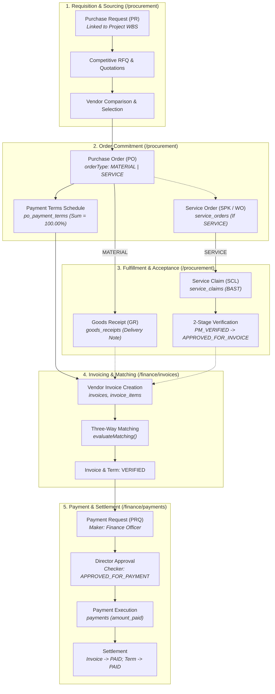

# EPMS UBD & TVM — PHASE 1.1.1
# SCOPE ALIGNMENT & ZAHIR BENCHMARK MAPPING REPORT
## Aligning Procurement, Financial Transaction Controls, and Zahir ERP Functional Benchmark to Verified EPMS Menus

**Document Version:** 1.1.1 (Targeted Final Correction & Baseline Closure)  
**Governance Scope:** EPMS UBD & TVM Enterprise Project Management System  
**Audit & Architecture Role:** Senior Enterprise Solution Architect, Financial Systems Auditor, and Indonesian Tax Systems Specialist  
**Repository Working Copy:** `c:/Users/UBDOPS3/Herd/epms_tvmubd`  
**Git Baseline Commit:** `ba8987d5336de10557caa35fc2d9f6547c789bd8` (Branch: `main`)  
**Tracked Code Diff:** `git diff --stat` = **0 bytes** (zero tracked application files modified)  
**Working Tree State:** `TRACKED_APPLICATION_CODE_UNMODIFIED; UNTRACKED_DOCUMENTATION_PRESENT`  
**Execution Mode:** STRICT READ-ONLY REPOSITORY INSPECTION & DOCUMENTATION CORRECTION  
**Authoritative File Path:** [`docs/audit/EPMS_PHASE_1_1_SCOPE_ALIGNMENT_AND_ZAHIR_BENCHMARK_MAPPING.md`](file:///c:/Users/UBDOPS3/Herd/epms_tvmubd/docs/audit/EPMS_PHASE_1_1_SCOPE_ALIGNMENT_AND_ZAHIR_BENCHMARK_MAPPING.md)  

---

## Evidence Classification Taxonomy

In compliance with Phase 1.1.1 governance instructions, all assertions, architectural evaluations, and findings in this report are categorized under the following five authoritative tiers:

- `[VERIFIED IN SOURCE CODE]`: Inspected directly in backend/frontend TypeScript/SQL files, entity schemas, navigation controllers, UI components, migrations, or test suites.
- `[VERIFIED IN EXISTING DOCUMENTATION]`: Reconciled against existing audit documentation in `docs/audit/`, approved P0 canonical baselines, or repository specifications.
- `[VERIFIED IN OFFICIAL BENCHMARK DOCUMENTATION]`: Reconciled against official Zahir Accounting / Zahir ERP functional documentation for purchasing and accounts payable.
- `[DESIGN PROPOSAL]`: Proposed architectural extensions, schema enhancements, matching mechanisms, or workflow designs for future phases. All proposed technical extensions (`is_pkp`, tax fields, item categories, Four-Way Matching, and settlement architecture) are classified strictly under this tier.
- `[NOT VERIFIED]`: Data, legal status, external interface, or assumption that has not been confirmed by code or official documentation.

---

## Table of Contents

- [Section A: Executive Summary](#section-a-executive-summary)
- [Section B: EPMS Identity and Business Objective](#section-b-epms-identity-and-business-objective)
- [Section C: Verified Existing EPMS Menu Structure](#section-c-verified-existing-epms-menu-structure)
- [Section D: Existing Procurement-to-Finance Workflow](#section-d-existing-procurement-to-finance-workflow)
- [Section E: Zahir Functional Benchmark](#section-e-zahir-functional-benchmark)
- [Section F: Zahir-to-EPMS Menu Mapping](#section-f-zahir-to-epms-menu-mapping)
- [Section G: Material, Service, and Combined Transaction Scenarios](#section-g-material-service-and-combined-transaction-scenarios)
- [Section H: Financial Transaction Control Model](#section-h-financial-transaction-control-model)
- [Section I: Invoice and Payment Control Gaps](#section-i-invoice-and-payment-control-gaps)
- [Section J: UBD and TVM Attribution Assessment](#section-j-ubd-and-tvm-attribution-assessment)
- [Section K: Reusable Existing EPMS Components](#section-k-reusable-existing-epms-components)
- [Section L: Minimal Functional Improvements](#section-l-minimal-functional-improvements)
- [Section M: Phase 2 Readiness Assessment](#section-m-phase-2-readiness-assessment)
- [Section N: Remaining Risks and Unresolved Decisions](#section-n-remaining-risks-and-unresolved-decisions)
- [Section O: Evidence and Repository State](#section-o-evidence-and-repository-state)

---

## Section A: Executive Summary

### A.1 Core Context & Purpose
This Phase 1.1.1 report establishes an evidence-based, practical functional baseline for third-party procurement transaction control in the **Enterprise Project Management System (EPMS)** for **PT UBD** and **PT TVM**.

Following the Phase 1 assessment and Phase 1.1 alignment, this targeted correction eliminates scope drift, removes overcomplicated tax engine positioning, corrects tax terminology, eliminates hardcoded tax rate assumptions, and grounds all recommendations strictly within existing EPMS menus. Zahir ERP is utilized solely as a functional benchmark for purchase and payable controls, not as an architectural template to duplicate.

### A.2 Key Conclusions
1. **EPMS Remains an Enterprise Project Management System:**  
   Procurement and Finance are existing operational modules within EPMS. The initiative is **not** a standalone tax application build, an accounting software redesign, or an unconstrained tax research project.
2. **Tax is a Supporting Transaction Control:**  
   Tax calculations (PPN Masukan and statutory withholding taxes where applicable) exist solely to ensure that third-party vendor invoices are verified accurately, that statutory deductions are respected, and that vendor cash disbursements match financial obligations. Tax rates and calculation bases are **not fixed or universal**; they must follow statutory regulations effective on the transaction date and applicable transaction classifications.
3. **Zahir ERP Benchmark is Successfully Mapped to Existing Menus:**  
   All relevant purchase, billing, payable, down payment, installment, and cash disbursement controls from Zahir ERP map cleanly into existing EPMS menus: `/procurement`, `/finance/invoices`, `/finance/payments`, `/vendors`, and `/reports`. No new top-level menus or standalone modules are required.
4. **Payment Conflation Identified as the Core Gap (Unresolved Design Decision):**  
   Source code inspection reveals that EPMS currently equates vendor cash disbursement with total commercial liability extinguishment (`payment.amount == paymentTerm.amount`). This conflation currently prevents the deduction of statutory tax withholdings. Resolving this requires distinguishing between gross commercial liability, vendor cash disbursement, statutory tax withholding obligation, tax remittance, and outstanding commercial liability. The payment settlement architecture remains an **unresolved design decision requiring detailed lifecycle validation** before any code changes can occur.

---

## Section B: EPMS Identity and Business Objective

### B.1 Project Identity
- **Application Name:** **EPMS — ENTERPRISE PROJECT MANAGEMENT SYSTEM**
- **Operating Legal Entities:**
  * **PT UBD** (PT Utomodeck Braja Dinamika)
  * **PT TVM** (PT Tri Vira Mandiri)
- **Existing Operational Modules in Scope:**
  * **Procurement** (`/procurement`)
  * **Finance & Invoices** (`/finance/invoices`)
  * **Payments & Kas/Bank** (`/finance/payments`)
  * **Vendors** (`/vendors`)
  * **KPI & Reports** (`/reports`)

### B.2 Authoritative Business Objective
The following objective is FINAL and governs all evaluations and design recommendations:

> ### **"Ensure that all third-party procurement transactions for goods and services are calculated, recorded, and paid correctly, covering both materials/goods and services."**

To fulfill this objective, EPMS must enforce seven operational controls:
1. Procurement commitments (Purchase Orders) are recorded with correct commercial values and payment schedules.
2. Goods and services received are physically and technically verified against procurement commitments before billing.
3. Vendor invoices are reconciled against PO values and fulfillment evidence (Three-Way Matching; Four-Way Matching is an evaluated `[DESIGN PROPOSAL]`).
4. Applicable tax components (PPN Masukan and statutory withholding taxes where applicable) are accurately reflected in transaction calculations based on regulations effective on the transaction date and applicable transaction classifications.
5. Gross commercial liabilities, statutory tax withholdings, vendor cash disbursements, tax remittances, and outstanding commercial liabilities remain mathematically consistent and distinct.
6. Down payments, progress payments, partial payments, and final settlements are strictly tracked and controlled across the transaction lifecycle.
7. All transactions are traceable to the correct EPMS project and legal entity (PT UBD vs PT TVM).

### B.3 Critical Scope Boundaries
EPMS IS NOT:
- A standalone tax application.
- A tax consulting or advisory platform.
- A tax research engine.
- A replacement for professional Finance or Tax personnel.
- A general ledger or full accounting suite.
- A replica of Zahir ERP.

**The objective is transaction correctness, not tax system complexity.**

---

## Section C: Verified Existing EPMS Menu Structure

Forensic inspection of the centralized navigation configuration (`frontend/src/constants/menuConfig.ts`) and dashboard routes confirms the actual, active EPMS menu structure:

```
+========================================================================================================================+
|                                    EPMS ACTUAL FRONTEND NAVIGATION & MENU INVENTORY                                    |
+========================================================================================================================+
```

### C.1 Navigation SSOT Inventory `[VERIFIED IN SOURCE CODE]`

| Menu Label | Route Path | Authorized Roles | Primary Functional Responsibility |
| :--- | :--- | :--- | :--- |
| **Procurement** | `/procurement` | `PROCUREMENT`, `PURCHASING`, `PROJECT_MANAGER`, `FINANCE`, `DIRECTOR` | Requisitions, competitive RFQs, Purchase Orders, payment schedules, Goods Receipts, and Service Orders/Claims. |
| **Finance & Invoices** | `/finance/invoices` | `FINANCE`, `DIRECTOR`, `PROJECT_MANAGER`, `GENERAL_MANAGER` | Vendor billing queues, invoice registration, 3-Way Matching, and payment term verification. |
| **Payments & Kas/Bank** | `/finance/payments` | `FINANCE`, `DIRECTOR`, `GENERAL_MANAGER`, `HEAD_OF_OPERATIONS` | Payment request tracking, Director approval, cash/bank disbursement execution, and payment vouchers. |
| **Vendors** | `/vendors` | `PROCUREMENT`, `PURCHASING`, `PROJECT_MANAGER`, `PMO`, `FINANCE`, `DIRECTOR` | Third-party vendor master data (identity, address, raw tax ID). |
| **KPI & Reports** | `/reports` | `DIRECTOR`, `GENERAL_MANAGER`, `HEAD_OF_OPERATIONS`, `FINANCE` | Executive summary and Accounts Payable (AP) real-time financial tracking. |

### C.2 Verified Sub-tabs and Modals `[VERIFIED IN SOURCE CODE]`
1. **Menu `/procurement` (`ProcurementPage.tsx#L2563-L2860`):**
   - Tab 1: `Paket Pengadaan` (`packages`) — WBS-level procurement packaging.
   - Tab 2: `Purchase Request` (`pr`) — Material and service requisitions linked to projects.
   - Tab 3: `Purchase Order` (`po`) — Commercial PO issuance and sequential payment terms.
   - Tab 4: `Penerimaan Barang` (`gr`) — Physical goods receipts and delivery notes.
   - Tab 5: `Rekonsiliasi` (`reconciliation`) — Fulfillment reconciliation against packages.
   - Modals: `PurchaseOrderModal`, `GoodsReceiptModal`, `CreateRfqModal`, `ServiceOrderModal` (SPK), `ServiceClaimModal` (BAST).
2. **Menu `/finance/invoices` (`invoices/page.tsx#L1486-L1592`):**
   - Tab 1: `PO Siap Ditagihkan` (`ready_pos`) — POs eligible for billing (DP, Progress GR, or Completed).
   - Tab 2: `Daftar Invoice Terbit` (`invoices_list`) — All vendor invoices and 3-Way Match statuses.
   - Modals: `CreateInvoiceModal`, `InvoiceDetailModal`, `PaymentReceiptModal`.
3. **Menu `/finance/payments` (`payments/page.tsx#L824-L970`):**
   - Tab 1: `Tagihan Siap Dibayar` (`ready_to_pay`) — Approved payment requests awaiting bank execution.
   - Tab 2: `Daftar Pengajuan Pembayaran` (`requests`) — Payment requests across lifecycles.
   - Tab 3: `Persetujuan Direktur` (`approvals`) — Director verification queue for payment authorization.
   - Tab 4: `Riwayat Pembayaran / Voucher` (`payment_vouchers`) — Formal disbursement vouchers (`PAY-XXX`).
   - Modals: `ProcessPaymentModal`, `DirectorApprovalModal`, `ResubmitPaymentRequestModal`.
4. **Menu `/reports` (`reports/page.tsx#L1767-L1820`):**
   - Tab `Finance & Cost` (`renderFinanceCost`): AP Realization (`vendorDisbursements`), PO Commitments (`poCommittedValue`), and Outstanding AP (`outstandingAP`).

---

## Section D: Existing Procurement-to-Finance Workflow

Inspection of backend services (`procurement.service.ts` and `finance.service.ts`) establishes the end-to-end transaction pipeline:



### Verified Workflow Characteristics `[VERIFIED IN SOURCE CODE]`:
- **Deterministic Milestone Scheduling:** `po_payment_terms` guarantees that term percentages equal exactly 100.00% without rounding drift (`procurement.service.ts#L834`).
- **Two-Stage Service Verification:** Service claims enforce PM Technical Verification (`PM_VERIFIED`) followed by Commercial Verification (`APPROVED_FOR_INVOICE`) (`service-claim.service.ts#L24-L25`).
- **Segregation of Duties (SoD):** The approving Director cannot execute the bank disbursement (`finance.service.ts#L834`).

---

## Section E: Zahir Functional Benchmark

Zahir ERP is used **strictly as a functional benchmark** for purchase, payable, and cash disbursement controls, answering the question: *Does this capability help EPMS ensure that procurement transactions are calculated, recorded, and paid correctly?*

```
+========================================================================================================================+
|                                    ZAHIR ERP BENCHMARK CAPABILITY EVALUATION                                           |
+========================================================================================================================+
```

| Benchmark Capability | Official Zahir Functional Mechanism | Business Problem Solved | Relevance to EPMS Scope |
| :--- | :--- | :--- | :---: |
| **1. Purchase Recording** | Modul Pembelian $\rightarrow$ Permintaan Barang & Pesanan Pembelian (PO). | Establishes binding commercial commitments with vendors. | **RETAIN (Core)** |
| **2. Purchase Invoice** | Modul Pembelian $\rightarrow$ Penerimaan Barang / Faktur Pembelian (Input Faktur). | Records official vendor billing and recognizes Accounts Payable liability. | **RETAIN (Core)** |
| **3. Tax-Inclusive / Exclusive** | Header toggle: *"Termasuk Pajak"* vs *"Tidak Termasuk Pajak"*. | Allows correct extraction of DPP when contracts are negotiated inclusive of tax. | **RETAIN (Core)** |
| **4. Applicable Tax Components** | Multi-tax selector on line item: Pajak 1 (PPN Masukan at statutory rate) and Pajak 2 (applicable withholding tax). | Records VAT obligations and statutory withholding deductions based on transaction date. | **RETAIN (Core)** |
| **5. Purchase Tax Calculation** | Deterministic calculation of DPP, PPN Masukan, and withholding tax with currency rounding. | Eliminates manual arithmetic errors in billing calculations. | **RETAIN (Core)** |
| **6. Accounts Payable Tracking**| Modul Hutang $\rightarrow$ Kartu Hutang Usaha & Daftar Hutang Jatuh Tempo. | Controls cash flow, tracks unpaid vendor invoices, and manages liabilities. | **RETAIN (Core)** |
| **7. Down Payments & Terms** | Modul Pembelian $\rightarrow$ Uang Muka Pembelian; Modul Kas & Bank $\rightarrow$ Pembayaran Bertahap. | Tracks advances, deducts DP from subsequent invoices, and holds retention. | **RETAIN (Core)** |
| **8. Payment & Settlement** | Modul Kas & Bank $\rightarrow$ Pembayaran Hutang Usaha; generates Payment Voucher (`CD-XXX`). | Disburses **net cash** to vendor after withholding deductions. | **RETAIN (Core)** |
| **9. Purchase & AP Reporting** | Laporan Pembelian per Vendor, Laporan Pajak Masukan, dan Laporan Pembayaran Hutang. | Reconciles vendor liabilities and supports monthly tax return (SPT Masa) preparation. | **RETAIN (Core)** |

*Capabilities from Zahir that are **EXCLUDED** from EPMS scope: General ledger journal entries, Chart of Accounts tree customization, automatic currency revaluation, and standalone balance sheet generation.*

---

## Section F: Zahir-to-EPMS Menu Mapping

All relevant benchmark capabilities are mapped directly into existing EPMS menus without creating new navigation routes:

```
+========================================================================================================================+
|                                    ZAHIR BENCHMARK TO EPMS MENU FUNCTIONAL MAPPING                                     |
+========================================================================================================================+
```

| Zahir Benchmark Feature | Owning EPMS Menu | Owning Sub-tab / Modal | Existing EPMS Support Status | Evaluated Extension / Design Proposal |
| :--- | :--- | :--- | :--- | :--- |
| **1. Purchase Orders (PO)** | `/procurement` | Tab `Purchase Order` (`po`) | **Fully Supported** `[VERIFIED]` | `[DESIGN PROPOSAL]` Add `is_tax_inclusive` flag and line-item category (`MATERIAL` vs `SERVICE`). |
| **2. Fulfillment Proof** | `/procurement` | Tab `Penerimaan Barang` (`gr`) & SCL Modal | **Fully Supported** `[VERIFIED]` | Retain existing GR for goods and BAST for services. |
| **3. Vendor Master Profile** | `/vendors` | `/vendors` page (`VendorsPage.tsx`) | **Partially Supported** `[VERIFIED]` | `[DESIGN PROPOSAL]` Add PKP status flag (`is_pkp`) to existing table. |
| **4. Vendor Purchase Invoice** | `/finance/invoices` | Tab `PO Siap Ditagihkan` $\rightarrow$ `CreateInvoiceModal` | **Partially Supported** `[VERIFIED]` | `[DESIGN PROPOSAL]` Pass `taxInvoiceNumber` to backend; compute DPP, PPN Masukan, and applicable withholding tax. |
| **5. 3-Way / 4-Way Matching** | `/finance/invoices` | Tab `Daftar Invoice Terbit` $\rightarrow$ `evaluateMatching` | **Partially Supported** `[VERIFIED]` | `[DESIGN PROPOSAL]` Four-Way Matching (extending `evaluateMatching` to verify tax figures and e-Faktur references). |
| **6. Down Payments & Terms** | `/finance/invoices` | Tab `PO Siap Ditagihkan` (`ready_pos`) | **Fully Supported** `[VERIFIED]` | Reusable as-is. Term schedule already enforces sequential billing. |
| **7. Payment Request (Maker)** | `/finance/invoices` | `SubmitPaymentRequestModal` | **Fully Supported** `[VERIFIED]` | `[DESIGN PROPOSAL]` Embed transparent breakdown (Gross Liability, DPP, PPN Masukan, Withholding, Net Cash) in approval snapshot. |
| **8. Director Approval (Checker)**| `/finance/payments` | Tab `Persetujuan Direktur` (`approvals`) | **Fully Supported** `[VERIFIED]` | `[DESIGN PROPOSAL]` Display transparent tax breakdown during Director review. |
| **9. Net Vendor Payment** | `/finance/payments` | Tab `Tagihan Siap Dibayar` $\rightarrow$ `ProcessPaymentModal` | **Blocked by Conflation** `[VERIFIED]` | `[DESIGN PROPOSAL]` Reconcile payment validation so cash disbursement reflects net payable after tax, pending settlement architecture lifecycle validation. |
| **10. Payment Voucher History** | `/finance/payments` | Tab `Riwayat Pembayaran / Voucher` | **Fully Supported** `[VERIFIED]` | `[DESIGN PROPOSAL]` Display tax deductions on existing payment voucher records (`PAY-XXX`). |
| **11. AP & Tax Reporting** | `/reports` | Tab `Finance & Cost` (`renderFinanceCost`) | **Partially Supported** `[VERIFIED]` | `[DESIGN PROPOSAL]` Add tax summary cards (PPN Masukan, PPh Terpotong) to existing AP metrics. |

---

## Section G: Material, Service, and Combined Transaction Scenarios

### G.1 Scenario 1: Material / Goods Procurement
- **Workflow:**  
  PR $\rightarrow$ RFQ $\rightarrow$ PO $\rightarrow$ Goods Receipt $\rightarrow$ Vendor Invoice $\rightarrow$ 3-Way Matching $\rightarrow$ Payment Request $\rightarrow$ Director Approval $\rightarrow$ Payment.
- **Controls Enforced:**
  * PO value matches quotation and WBS budget.
  * Goods Receipt validates physical delivered quantity and vendor delivery note.
  * Vendor invoice matches accepted GR value.
  * Tax treatment: PPN Masukan is recorded if the vendor is a confirmed PKP, computed at the statutory VAT rate effective on the transaction date and verified against a valid Faktur Pajak. Withholding tax treatment (e.g. PPh 22 where statutory conditions apply, or non-withholding where standard commercial material purchases fall outside statutory withholding scope) is determined by the applicable statutory classification and transaction facts. Tax rates and bases are not hardcoded or assumed universally zero.
  * Net vendor cash payment equals gross commercial liability minus applicable statutory withholdings and deductions.

### G.2 Scenario 2: Service Procurement
- **Workflow:**  
  PR $\rightarrow$ RFQ $\rightarrow$ PO (`orderType = 'SERVICE'`) $\rightarrow$ SPK (`ServiceOrder`) $\rightarrow$ BAST/Progress (`ServiceClaim`) $\rightarrow$ Vendor Invoice $\rightarrow$ Matching $\rightarrow$ Payment Request $\rightarrow$ Director Approval $\rightarrow$ Payment.
- **Controls Enforced:**
  * Contract and milestone value established by SPK and PO payment terms.
  * Service completion verified through two-stage approval: PM Technical Verification (`PM_VERIFIED`) and Commercial Verification (`APPROVED_FOR_INVOICE`).
  * Vendor invoice is validated against approved claim capacity.
  * Tax treatment: PPN Masukan is recorded if the vendor is a confirmed PKP, computed at the statutory VAT rate effective on the transaction date. Applicable statutory withholding tax (e.g. PPh 23 for services, PPh 4(2) for construction services) is determined by the statutory classification of the service and vendor tax status on the transaction date.
  * Net vendor cash payment equals gross commercial liability minus statutory withholding.

### G.3 Scenario 3: Combined Material + Services Procurement
- **Current Limitation `[VERIFIED IN SOURCE CODE]`:**  
  `resolvePurchaseRequestDomain` (`procurement.service.ts#L620`) coerces all PRs and POs into either 100% `MATERIAL` or 100% `SERVICE`.
- **Target Functional Design `[DESIGN PROPOSAL]`:**  
  * PO items allow line-by-line categorization: `itemCategory: MATERIAL | SERVICE`.
  * Dual fulfillment proof: Physical items verified via Goods Receipt; service items verified via Service Claim (BAST).
  * Invoice verification computes separate tax calculation bases: $\text{DPP}_{\text{Material}}$ and $\text{DPP}_{\text{Service}}$.
  * PPN Masukan is calculated on total eligible DPP at the statutory VAT rate effective on the transaction date.
  * Tax withholding is applied in accordance with applicable statutory classifications and transaction facts (e.g., service components subjected to statutory PPh 23/PPh 4(2) per PMK 141/PMK.03/2015 Pasal 1 ayat (3)–(4), while material components follow applicable goods tax rules such as PPh 22 if mandated, or no withholding if not applicable). No universal assumption is made that PPh applies exclusively to services or that materials are unconditionally exempt from withholding.
- *Note: Implementation of this capability is deferred to Phase 2; no code changes are made in Phase 1.1.1.*

---

## Section H: Financial Transaction Control Model

To preserve financial consistency across PO $\rightarrow$ Fulfillment $\rightarrow$ Invoice $\rightarrow$ Payment Request $\rightarrow$ Approval $\rightarrow$ Payment $\rightarrow$ Settlement, the system must clearly distinguish the underlying financial dimensions and avoid conflating cash disbursements with total liability settlement.

### H.1 Explicit Distinction of the Five Financial Dimensions

The system must rigorously separate five distinct financial concepts:

```
+========================================================================================================================+
|                                    FIVE CORE FINANCIAL DIMENSIONS IN EPMS PROCUREMENT                                  |
+========================================================================================================================+
```

1. **Gross Commercial Liability ($L_{\text{gross}}$ / $A_{\text{inv}}$):**  
   The total commercial obligation owed to the third-party vendor as recognized from the approved invoice and contractual terms:
   $$L_{\text{gross}} = \text{DPP} + \text{PPN}_{\text{Masukan}}$$
2. **Vendor Cash Disbursement ($P_{\text{cash}}$ / $P_{\text{net}}$):**  
   The actual liquid cash disbursed from the company bank account to the vendor's bank account after deducting applicable tax withholdings and contractual penalties:
   $$P_{\text{cash}} = L_{\text{gross}} - W_{\text{tax}} - \text{WAPU PPN} - P_{\text{ded}}$$
3. **Statutory Tax Withholding Obligation ($W_{\text{tax}}$):**  
   The mandatory tax withheld from the vendor's payment under prevailing statutory tax laws (e.g. PPh 23, PPh 4(2), PPh 22, or WAPU PPN). This represents a fiduciary liability owed to the State Treasury (DJP), not retained company earnings.
4. **Tax Remittance / Settlement ($S_{\text{tax}}$):**  
   The formal non-cash allocation and subsequent cash remittance to the State Treasury via e-Billing / NTPN to legally discharge the statutory tax withholding obligation.
5. **Outstanding Commercial Liability ($L_{\text{rem}}$ / $B_{\text{comm}}$):**  
   The remaining unpaid commercial debt owed to the vendor on the invoice/PO:
   $$L_{\text{rem}} = L_{\text{gross}} - (P_{\text{cash}} + W_{\text{tax\_settled}} + P_{\text{ded\_applied}})$$
   When net cash is disbursed and the tax withholding obligation is formally recognized/allocated, $L_{\text{rem}} = \text{Rp } 0$.

### H.2 Comprehensive Monetary Component Dictionary

```
+========================================================================================================================+
|                                    EPMS FINANCIAL MONETARY COMPONENT DICTIONARY                                        |
+========================================================================================================================+
```

| # | Monetary Component | Symbol | Commercial Meaning & Control Rule |
| :-: | :--- | :---: | :--- |
| **1** | **Commercial Transaction Value** | $V_{\text{comm}}$ | Agreed contract or PO price before taxes and discounts (`purchase_orders.total_amount`). |
| **2** | **Tax Calculation Base (DPP)** | $\text{DPP}$ | Dasar Pengenaan Pajak per statutory tax regulations (net of commercial trade discounts). Basis for PPN and withholding taxes. |
| **3** | **PPN Masukan (Input VAT)** | $\text{PPN}_{\text{Masukan}}$ | **Input VAT** billed by an eligible PKP vendor on purchase invoices, governed by the statutory VAT rate effective on the transaction date and verified against a valid Faktur Pajak. For EPMS as buyer (PT UBD / PT TVM procurement), this represents purchase VAT (PPN Masukan), **NOT** Output VAT (PPN Keluaran). |
| **4** | **Statutory Tax Withholding Obligation** | $W_{\text{tax}}$ | Statutory income tax (e.g. PPh 23, PPh 4(2), PPh 22) withheld from vendor payable based on transaction classification and date. |
| **5** | **Commercial Discount** | $D$ | Trade discount or negotiated commercial reduction reducing the commercial base. |
| **6** | **Other Contractual Deductions** | $P_{\text{ded}}$ | Liquidated damages, late delivery penalties, or backcharges. |
| **7** | **Gross Commercial Liability** | $L_{\text{gross}}$ | Total commercial billing recognized from vendor invoice: $L_{\text{gross}} = \text{DPP} + \text{PPN}_{\text{Masukan}}$. |
| **8** | **Previous Cash Payments** | $\sum P_{\text{cash\_prev}}$ | Cumulative liquid payments disbursed on prior terms/invoices of the same PO. |
| **9** | **Current Cash Payment Amount** | $P_{\text{cash}}$ | Nominal cash authorized for bank transfer on the active payment request. |
| **10** | **Tax Remittance / Allocation** | $S_{\text{tax}}$ | Formal allocation and remittance to the State Treasury (DJP) via NTPN / e-Billing code. |
| **11** | **Outstanding Commercial Liability**| $L_{\text{rem}}$ | Remaining unsettled commercial liability owed to the vendor on the invoice or overall PO commitment. |

*Control Principle: Conflating vendor cash disbursement ($P_{\text{cash}}$) with total commercial liability extinguishment ($L_{\text{gross}}$) distorts the recorded PO commitment and creates artificial unpaid debts.*

---

## Section I: Invoice and Payment Control Gaps

### I.1 Payment Conflation & Invariant 2/4 Analysis `[VERIFIED IN SOURCE CODE]`
A deep inspection of `backend/src/modules/finance/finance.service.ts` reveals a critical design conflation:

1. **The Conflation:**  
   In `finance.service.ts#L1011-L1035`, when a payment is recorded, the routine checks:
   ```typescript
   const remainingAfter = Math.round((remaining - paymentAmount) * 100) / 100;
   const isFullyPaid = remainingAfter <= 0.01;
   invoice.paymentStatus = isFullyPaid ? 'PAID' : 'PARTIALLY_PAID';
   ```
   Here, `paymentAmount` (liquid cash transferred to the vendor) is directly subtracted from `invoice.totalAmount`. The system equates **vendor cash disbursement** with **total commercial liability settlement**.
2. **The Invariant 2/4 Lock (`finance.service.ts#L968-L974`):**  
   ```typescript
   if (Math.abs(roundedPayment - expectedTermTarget) > 0.001) {
     throw new BadRequestException(
       `Payment amount (${paymentAmount}) harus sesuai dengan nilai termin pembayaran Procurement (${expectedTermTarget})...`
     );
   }
   ```
   This check forces `paymentAmount` to match 100% of the gross term target value.
3. **The Consequence:**  
   If an invoice has a gross liability of Rp 10.000.000 and statutory withholding tax of Rp 200.000, paying the vendor the net cash amount of Rp 9.800.000 is rejected by Invariant 2/4. Even if Invariant 2/4 were bypassed, paying Rp 9.800.000 cash would leave the invoice in `'PARTIALLY_PAID'` with an artificial Rp 200.000 unpaid commercial debt!
4. **Business-Level Reconciliation & Unresolved Settlement Architecture `[DESIGN PROPOSAL]`:**  
   The payment settlement architecture is an **UNRESOLVED DESIGN DECISION** requiring detailed lifecycle validation across all edge cases (partial payments, multi-term installments, credit notes, invoice adjustments, and cancellation flows). It must **NOT** be declared finalized.  
   At the conceptual level, the settlement process must distinguish:
   - **Gross Commercial Liability:** $\text{Rp } 10.000.000$ ($L_{\text{gross}}$)
   - **Vendor Cash Disbursement:** $\text{Rp } 9.800.000$ ($P_{\text{cash}}$)
   - **Statutory Tax Withholding Obligation:** $\text{Rp } 200.000$ ($W_{\text{tax}}$)
   - **Tax Remittance / Settlement:** $\text{Rp } 200.000$ allocated to State Treasury ($S_{\text{tax}}$)
   - **Outstanding Commercial Liability:** $\text{Rp } 0$ (extinguished via $\text{Rp } 9.800.000 \text{ cash} + \text{Rp } 200.000 \text{ tax allocation}$)  
   The exact technical implementation (whether a dedicated tax withholding settlement credit, a split payment transaction model, or dual-entry voucher structure) remains an open design decision pending lifecycle validation.

### I.2 Other Verified Transaction Gaps
- **Gap 2: Client Form Discards Tax Invoice Data `[DESIGN PROPOSAL]`:** `frontend/src/components/finance/CreateInvoiceModal.tsx#L1084` collects `taxInvoiceNumber`, but lines 801–814 omit it from the payload. Proposed backend DTO extension is a design proposal.
- **Gap 3: Missing Tax Data Fields `[DESIGN PROPOSAL]`:** `invoices`, `invoice_items`, `purchase_orders`, and `payments` lack fields for DPP, PPN rate/amount, PPh type/rate/amount, and tax document numbers. Adding these columns is a design proposal.
- **Gap 4: Vendor Master Lacks PKP Flag `[DESIGN PROPOSAL]`:** `Vendor` table contains only raw `tax_id`; adding an `is_pkp` flag to verify PPN billing legitimacy is a design proposal.
- **Gap 5: Combined Procurement Binary Domain `[DESIGN PROPOSAL]`:** `resolvePurchaseRequestDomain` forces mixed procurements into 100% Material or 100% Service. Introducing line-item categories is a design proposal.

---

## Section J: UBD and TVM Attribution Assessment

```
+========================================================================================================================+
|                                    PT UBD / PT TVM ENTITY ATTRIBUTION STATUS                                           |
+========================================================================================================================+
```

1. **Verified Existing Implementation `[VERIFIED IN SOURCE CODE]`:**  
   In `backend/src/modules/dashboard/dashboard.service.ts#L71-L89`, entity allocation is resolved dynamically by matching user emails:
   - `ragil@epms.com` $\rightarrow$ allocated to **PT UBD**
   - `lukas@epms.com` $\rightarrow$ allocated to **PT TVM**
   - Any transaction without a verified marketing user falls into `UNCLASSIFIED`.
2. **Existing Limitation `[VERIFIED IN SOURCE CODE]`:**  
   Neither `purchase_requests`, `projects`, `purchase_orders`, `goods_receipts`, `service_orders`, `service_claims`, `invoices`, `payment_requests`, `payments`, nor `vendors` contains a `company_code` column. Procurement and Finance modules operate under a single commingled installation (`scope: INSTALLATION`).
3. **Operational Impact:**  
   - Purchase orders cannot be filtered by legal entity in the database.
   - Accounts payable liabilities of PT UBD and PT TVM are co-mingled in the database.
   - Monthly tax filings (SPT Masa PPN and PPh) cannot be segregated by entity NPWP without manual data manipulation.
4. **Proposed Improvement `[DESIGN PROPOSAL]`:**  
   In compliance with `DEC-OWN-01` (`BLK-G0-02`), introduce `company_code VARCHAR(10) NOT NULL CHECK (company_code IN ('UBD', 'TVM'))` across all transactional entities, ensuring immutable downstream inheritance (`PR` $\rightarrow$ `PO` $\rightarrow$ `Invoice` $\rightarrow$ `Payment`).
5. **Unverified Assumption `[NOT VERIFIED]`:**  
   WAPU status for both entities remains **`UNKNOWN / PENDING_CONFIRMATION`** (`TAX-CONF-07`). Live WAPU withholding is strictly unauthorized until formal KMK decrees are confirmed.

---

## Section K: Reusable Existing EPMS Components

EPMS possesses an advanced foundation that must be retained without reinvention:

1. **PO Payment Terms Engine (`po_payment_terms`):** `[VERIFIED IN SOURCE CODE]`  
   Already models `DOWN_PAYMENT`, `PROGRESS`, `FINAL_DELIVERY`, and `RETENTION` with sequence validation and strict 100.00% sum checks. Reused as the authoritative commercial milestone base.
2. **Dual Physical/Service Fulfillment Pipeline:** `[VERIFIED IN SOURCE CODE]`  
   `goods_receipts` tracks materials; `service_orders` (SPK) and `service_claims` (BAST) with two-stage verification track services. Reused as the fulfillment evidence base for invoice matching.
3. **Three-Way Matching Engine (`finance.service.ts#L1350`):** `[VERIFIED IN SOURCE CODE]`  
   `evaluateMatching` already locks records, prevents overbilling, and checks PO/GR/Claim consistency. Reused as the matching baseline. Extending this into a Four-Way Match (PO + GR/Claim + Invoice + Tax Document) is classified as an evaluated `[DESIGN PROPOSAL]`.
4. **Maker-Checker SoD Architecture (`payment_requests`):** `[VERIFIED IN SOURCE CODE]`  
   Finance maker creates PRQ; Director checker approves; Finance executor records payment. Reused to govern tax deductions and net payout authorizations.
5. **Concurrency & Tamper-Evident Auditing:** `[VERIFIED IN SOURCE CODE]`  
   Pessimistic write locking (`pessimistic_write`), optimistic locking (`@VersionColumn`), and immutable `audit_logs` are already active. Reused to ensure tax record integrity.

---

## Section L: Minimal Functional Improvements

All technical extensions listed below (`is_pkp`, tax fields, item categories, Four-Way Matching, and settlement architecture) are classified strictly as `[DESIGN PROPOSAL]` unless their necessity is independently established by verified existing requirements. None are authorized for code modification in Phase 1.1.1.

### L.1 Evaluated Design Proposals (Candidate Extensions for Phase 2–4) `[DESIGN PROPOSAL]`
1. **Reconcile Payment Invariant with Tax Withholding `[DESIGN PROPOSAL]`:** Update payment execution to recognize net vendor disbursement plus tax withholding credit, achieving full liability settlement without altering PO commitments, subject to settlement architecture lifecycle validation.
2. **Wire `taxInvoiceNumber` in `CreateInvoiceModal.tsx` `[DESIGN PROPOSAL]`:** Include `taxInvoiceNumber` in the form submission payload and add the column to `CreateInvoiceDto` and `invoices` table.
3. **Add Minimal Tax Fields to `invoices` & `invoice_items` `[DESIGN PROPOSAL]`:** Add `dpp_amount`, `ppn_rate`, `ppn_amount`, `pph_type`, `pph_rate`, and `pph_amount`.
4. **Add `is_pkp` Flag to `vendors` `[DESIGN PROPOSAL]`:** Enable Finance to verify whether a vendor can legally bill PPN Masukan.
5. **Itemized Line Categories for Combined POs `[DESIGN PROPOSAL]`:** Allow PO items to specify `itemCategory` (`MATERIAL` | `SERVICE`) to satisfy PMK 141/2015.
6. **Embed 5-Figure Breakdown in `ApprovalSnapshot` `[DESIGN PROPOSAL]`:** Provide the Director with transparent visibility into Gross Liability, DPP, PPN Masukan, Withholding Tax, and Net Cash Payout during payment request approval.

### L.2 Optional Enhancements (Deferred Post-P4)
1. Automated DJP QR-Code scanner integration.
2. Direct e-Bupot XML batch export.
3. Automated vendor SBU license expiration reminders.
4. Comprehensive multi-column AP aging breakdown tables.

---

## Section M: Phase 2 Readiness Assessment

Before Phase 2 (Tax Calculation & Classification Implementation) can commence, the following formal governance prerequisites must be satisfied:

1. **Gate G0 Executive Ratification:**
   - **`BLK-G0-01` (`DEC-TAX-01`):** Formal executive sign-off on the Monetary Representation Model.
   - **`BLK-G0-02` (`DEC-OWN-01`):** Formal executive sign-off on the Multi-Company Attribution Model (`company_code IN ('UBD', 'TVM')`).
2. **Payment Settlement Architecture Lifecycle Validation (`DEC-SETTLE-01`):**
   - Detailed lifecycle validation of partial payments, multi-term installments, credit notes, invoice adjustments, cancellations, and tax remittances before schema locking.
3. **Vendor Certificate Key Scope Decision (`BLK-P1-04a`):**
   - Executive selection between Option A (Company-Scoped) and Option B (Shared Master Table) per `P0_ROUND_2_6_1_VENDOR_CERTIFICATE_IDENTITY_DECISION.md`.
4. **Statutory Tax Opinions (`TAX-CONF-01` through `07`):**
   - Confirmation of WAPU status for PT UBD and PT TVM from Corporate Legal / Tax Lead. *(Live WAPU withholding remains strictly UNAUTHORIZED until confirmed)*.
5. **Test Baseline Remediation (`BLK-P1-01`):**
   - Remediation of the 2 pre-existing broken test fixtures (`finance-audit-coverage.spec.ts` and `finance.controller.spec.ts`) to achieve an unambiguous 100% green test baseline.

---

## Section N: Remaining Risks and Unresolved Decisions

```
+========================================================================================================================+
|                                    EPMS REMAINING RISKS & UNRESOLVED DECISIONS                                         |
+========================================================================================================================+
```

| ID | Unresolved Decision / Risk | Description | Impact | Accountable Owner |
| :---: | :--- | :--- | :--- | :--- |
| **RISK-01** | **Payment Settlement Architecture (`DEC-SETTLE-01`)** | **Unresolved Design Decision.** Deciding whether tax withholding is recorded as a dedicated non-cash settlement credit, a split payment transaction model, or dual-entry voucher structure. Requires detailed lifecycle validation across partial payments, credit notes, and cancellations. **Not finalized.** | Impacts `finance.service.ts` payment ledger schema and invariant logic. | Finance Lead & Solution Architect |
| **RISK-02** | **Historical Transaction Attribution** | How existing historical database records without `company_code` will be migrated or partitioned. | Impacts migration complexity and historical reporting. | Database Administrator |
| **RISK-03** | **Vendor Certificate Scope (`BLK-P1-04a`)** | Choosing between Option A (Company-Scoped) and Option B (Shared Vendor Master Table). | Prevents duplicate key collision (`ER_DUP_ENTRY`). | Business Owner & Lead Architect |
| **RISK-04** | **WAPU Legal Status (`TAX-CONF-07`)** | Physical KMK appointment decrees for PT UBD and PT TVM remain unconfirmed. | Live WAPU withholding is strictly blocked. | Corporate Legal Counsel |

---

## Section O: Evidence and Repository State

### O.1 Repository Inspection Certification
- **Repository Path:** `c:/Users/UBDOPS3/Herd/epms_tvmubd`
- **Git Branch:** `main`
- **HEAD Commit SHA-1:** `ba8987d5336de10557caa35fc2d9f6547c789bd8`
- **Tracked Code Diff:** `git diff --stat` = **0 bytes** (zero tracked application files modified).
- **Working Tree State:** `TRACKED_APPLICATION_CODE_UNMODIFIED; UNTRACKED_DOCUMENTATION_PRESENT`.

### O.2 Documentation Control Verification
- **Authoritative File Path:**  
  [`docs/audit/EPMS_PHASE_1_1_SCOPE_ALIGNMENT_AND_ZAHIR_BENCHMARK_MAPPING.md`](file:///c:/Users/UBDOPS3/Herd/epms_tvmubd/docs/audit/EPMS_PHASE_1_1_SCOPE_ALIGNMENT_AND_ZAHIR_BENCHMARK_MAPPING.md)
- **File Length:** Updated in place in `docs/audit/` without creating duplicate documentation files.

---

> [!IMPORTANT]
> ### **FINAL MANDATORY GOVERNANCE STATEMENT:**
> # **PHASE 1.1.1 DOCUMENTATION CORRECTION DOES NOT AUTHORIZE APPLICATION IMPLEMENTATION OR COMMENCEMENT OF PHASE 2.**  
> Awaiting explicit written authorization from the user before taking further action.
