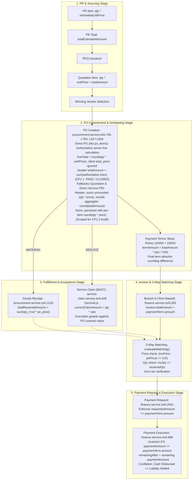

# EPMS UBD & TVM — PHASE 2A
# TRANSACTION CALCULATION CONTROL ASSESSMENT REPORT
## Comprehensive Repository-Based Assessment of Existing Transaction Calculations, Commercial Business Logic, Statutory Tax Framework Alignment, and Mandatory Tax Calculation Placement

**Document Version:** 1.4.2 (CP1.2.0-R1 Final Documentation Closure)  
**Governance Workstream:** EPMS UBD & TVM Enterprise Project Management System  
**Audit & Architecture Role:** Senior Enterprise Solution Architect, Database Architect, Financial Systems Auditor, and Indonesian Tax Systems Specialist  
**Repository Working Copy:** `c:/Users/UBDOPS3/Herd/epms_tvmubd`  
**Git Baseline Commit:** `ba8987d5336de10557caa35fc2d9f6547c789bd8` (Branch: `main`)  
**Tracked Code Diff (Historical Phase 2A Closure):** `git diff --stat -- backend frontend` = **0 bytes**  
**Tracked Code Diff (Active Working Tree / CP1.1 Accepted):** `git diff --stat -- backend` = **3 files changed, 143 insertions(+), 8 deletions(-)** (authorized CP1.1 implementation only; zero other application code modified)  
**Working Tree State:** `CP1.1_IMPLEMENTATION_VERIFIED; TARGET_AUDIT_DOCUMENT_UPDATED; OTHER_UNTRACKED_AUDIT_DOCUMENTS_UNTOUCHED`  
**Execution Mode:** STRICT READ-ONLY REPOSITORY INSPECTION & DOCUMENTATION CORRECTION  
**Authoritative File Path:** [`docs/audit/EPMS_PHASE_2A_TRANSACTION_CALCULATION_CONTROL_ASSESSMENT.md`](file:///c:/Users/UBDOPS3/Herd/epms_tvmubd/docs/audit/EPMS_PHASE_2A_TRANSACTION_CALCULATION_CONTROL_ASSESSMENT.md)  

---

## Document Revision History

| Version | Date | Status / Gate | Summary of Key Changes |
|---|---|---|---|
| **1.0.0** | 2026-11-12 | Preliminary Assessment | Comprehensive repository assessment of commercial calculations, tax framework, and placement architecture. |
| **1.1.0** | 2026-11-12 | Technical Alignment | Aligned statutory PPN rates, removed hardcoded PPN 11% assumptions, distinguished buyer-side PPN Masukan. |
| **1.2.0** | 2026-11-12 | Scope Alignment | Enforced strict SoD between Procurement (commercial commitment) and Finance (tax determination and settlement). |
| **1.3.0** | 2026-11-12 | Statutory Correction | Reflected PMK 81/2024 revocation of PMK 61/2022 (KMS); PPh 21 timing under PMK 168/2023 Art. 19. |
| **1.3.1** | 2026-11-12 | Consistency Review | Aligned Besaran Tertentu mechanisms (PMK 71/2022) and non-creditable input tax distinctions. |
| **1.3.2** | 2026-11-12 | Final Closure | Phase 2A Final Consistency Closure; aligned Six-Dimension executive summary formula and PPh down payment timing. Phase 2A closed. |
| **1.4.0** | 2026-11-12 | CP1.2.0-R1 Audit Correction | Documents Phase 2B Checkpoint 1 progression: CP1.0 (read-only baseline), CP1.1 (direct PO validation & scope narrowing to `dto.po_items`), and CP1.2.0-R1 (monetary precision & rounding baseline audit: establishes MySQL 8 architecture, clarifies `decimal.js` technical limits, and inventories calculation drift scenarios). |
| **1.4.1** | 2026-11-12 | CP1.2.0-R1 Final Consistency Closure | Resolves Git baseline ambiguity by delineating historical Phase 2A 0-byte baseline from active CP1.1 working tree state (+143/-8 lines); distinguishes target audit document update from other untouched untracked audit documents; qualifies `Number.EPSILON` suitability requirements; and corrects the `@IsNumber()` explanation using verified `ValidationPipe` and `class-transformer` pipeline evidence. |
| **1.4.2** | 2026-11-12 | **CP1.2.0-R1 Final Documentation Closure** | Refines Section 21.7 to accurately explain `decimal.js` constructor string-conversion mechanics (`String(n)` for literals vs float-contaminated expressions) and reiterates exact decimal-string initialization; restructures Section 5.1 and Finding `F-2A-01` in Section 16 to clearly delineate the historical pre-CP1.1 defect from the post-CP1.1 remediated direct PO creation path (`PASS / CLOSED`), isolating remaining quotation and PR fallback calculation parity to the CP1.2 audit scope; aligns Section 4 lifecycle diagram and Section 4.1 calculation breakdown with the verified CP1.1 direct PO implementation, verified Section 21.4 fallback rounding mechanics (per-item line rounding vs aggregate header rounding), and header-detail discrepancy analysis. |

---

## Evidence & Statutory Classification Taxonomy

In compliance with Phase 2A correction and governance instructions, all assertions, technical evaluations, calculations, and legal references in this report are categorized under the following six authoritative tiers:

- `[VERIFIED IN SOURCE CODE]`: Inspected directly in backend/frontend TypeScript/SQL files, entity schemas, navigation controllers, UI components, migrations, or test suites.
- `[VERIFIED STATUTORY PROVISION]`: Reconciled against official Indonesian tax statutes (Undang-Undang, Peraturan Pemerintah, Peraturan Menteri Keuangan, Peraturan Direktur Jenderal Pajak) with explicit citations, article references, and effective dates.
- `[VERIFIED IN EXISTING DOCUMENTATION]`: Reconciled against existing audit documentation in `docs/audit/`, approved P0/Phase 1 canonical baselines, or repository specifications.
- `[DESIGN PROPOSAL]`: Proposed architectural extensions, schema enhancements, matching mechanisms, or workflow designs for future phases.
- `[OBSERVED TEST FAILURES — BASELINE VERIFICATION PENDING]`: Test failures observed during test execution whose status requires baseline comparison and verification before concluding root cause; test source code or fixtures must not be modified.
- `[UNRESOLVED STATUTORY / BUSINESS ISSUE]`: A tax-law interpretation, legal decree, or business decision that cannot be confirmed from repository evidence or official documentation and requires formal executive or legal sign-off.

---

## Table of Contents

- [Section 1: Executive Summary](#section-1-executive-summary)
- [Section 2: Assessment Objective](#section-2-assessment-objective)
- [Section 3: Assessment Scope](#section-3-assessment-scope)
- [Section 4: Existing Transaction Calculation Architecture](#section-4-existing-transaction-calculation-architecture)
- [Section 5: Commercial Calculation Findings](#section-5-commercial-calculation-findings)
- [Section 6: PPN Masukan & Statutory VAT Framework Assessment](#section-6-ppn-masukan--statutory-vat-framework-assessment)
- [Section 7: PPh Withholding & Statutory Timing Assessment](#section-7-pph-withholding--statutory-timing-assessment)
- [Section 8: Tax Calculation Placement Matrix](#section-8-tax-calculation-placement-matrix)
- [Section 9: Recommended Tax Calculation Architecture](#section-9-recommended-tax-calculation-architecture)
- [Section 10: Material Transaction Assessment (Scenario A)](#section-10-material-transaction-assessment-scenario-a)
- [Section 11: Service Transaction Assessment (Scenario B)](#section-11-service-transaction-assessment-scenario-b)
- [Section 12: Combined Transaction Assessment (Scenario C)](#section-12-combined-transaction-assessment-scenario-c)
- [Section 13: End-to-End Value Reconciliation](#section-13-end-to-end-value-reconciliation)
- [Section 14: Financial Separation and Six-Dimension Settlement Model](#section-14-financial-separation-and-six-dimension-settlement-model)
- [Section 15: Procurement and Finance Responsibility Boundary](#section-15-procurement-and-finance-responsibility-boundary)
- [Section 16: Mandatory Findings Register](#section-16-mandatory-findings-register)
- [Section 17: Functional Gaps](#section-17-functional-gaps)
- [Section 18: Risks and Dependencies](#section-18-risks-and-dependencies)
- [Section 19: Recommendations for Phase 2B](#section-19-recommendations-for-phase-2b)
- [Section 20: EPMS Roadmap Status & Phase 2A Final Gate](#section-20-epms-roadmap-status--phase-2a-final-gate)
- [Section 21: Phase 2B Checkpoint Progression & CP1.2.0-R1 Monetary Precision & Rounding Baseline Audit](#section-21-phase-2b-checkpoint-progression--cp120-r1-monetary-precision--rounding-baseline-audit)

---

## Section 1: Executive Summary

### 1.1 Core Mission & Purpose
This corrected Phase 2A report delivers an evidence-based, repository-grounded, and statutory-compliant assessment of commercial transaction calculations, financial controls, and tax treatment within the **Enterprise Project Management System (EPMS)** for **PT UBD** and **PT TVM**.

The governing business objective of EPMS is:
> **"To ensure that all third-party procurement transactions for goods/materials and services are calculated, recorded, reconciled, and paid correctly."**

This revision enforces the latest authoritative business-scope decision:
> **"Procurement and Finance must operate strictly within their respective business responsibilities. Their workflows may exchange data, but their functional ownership must not overlap."**

This document resolves remaining technical inconsistencies, eliminates proposed tax estimation from the Procurement scope, integrates the authoritative Indonesian VAT (*PPN*) framework (including **PMK 131/2024**, **PMK 11/2025**, and its amendment **PMK 53/2025**), separates distinct Income Tax Withholding (*PPh Pot/Put*) regimes independently, formalizes the **Six-Dimension Financial Settlement Model**, and reclassifies automated test failure observations pending baseline verification.

### 1.2 Key Findings & Validated Conclusions
1. **Strict Segregation of Procurement and Finance Responsibilities:**  
   - **Procurement Ownership:** Owns commercial procurement activities: Purchase Requisition (PR), Request for Quotation (RFQ), vendor quotation and negotiation, Purchase Order (PO), commercial contract values ($V_{\\text{comm}}$), Goods Receipt (GR), Service Order (SPK), and BAST / fulfillment evidence. Procurement is **NOT** responsible for estimating PPN or PPh, calculating tax amounts, determining tax rates or classifications, validating tax invoices, or calculating vendor net payments. The previously proposed PO Tax Estimate / PO Tax Calculation responsibility is **completely removed** from the Procurement scope. A PO represents a commercial commitment, not an authoritative tax calculation document.
   - **Finance & Invoices Ownership:** Owns financial invoice verification and tax controls: vendor invoice registration, verification of supporting tax documents (e-Faktur, SKB, Suket, SBU), DPP determination, PPN Masukan validation and calculation, PPh object identification and calculation, tax treatment validation, 3-Way matching against PO and fulfillment evidence, and determination of the payable amount. Authoritative tax calculation resides strictly within the Finance & Invoices workflow, **before invoice issuance**, subject to statutory tax events and validation requirements.
   - **Payments & Kas/Bank Ownership:** Owns Payment Request, Maker-Checker payment approval workflow, Payment Execution, net vendor cash disbursement ($D_{\\text{cash}}$), recording of statutory tax withholding obligations ($W_{\\text{tax}}$), tax remittance to the State Treasury (*Kas Negara*), and settlement reconciliation (including NTPN). Tax withholding recognition is kept strictly separate from actual tax remittance.
2. **Complete Absence of Tax Data Architecture in Existing Database Entities:**  
   Inspection of `purchase_orders`, `purchase_order_items`, `invoices`, `invoice_items`, `payment_requests`, `payments`, and `vendors` confirms that **zero** tax fields (`dpp_amount`, `ppn_rate`, `ppn_amount`, `pph_type`, `pph_rate`, `pph_amount`, `is_pkp`) currently exist in the database.
3. **Statutory PPN Framework Alignment (PMK 131/2024, PMK 11/2025, PMK 53/2025):**  
   PPN calculations cannot be reduced to a single fixed formula or universal rate. In accordance with **UU PPN (UU 8/1983 stdtd UU 7/2021 HPP)**, **PMK 131/2024**, **PMK 11/2025**, and **PMK 53/2025**, EPMS must distinguish between Standard Tax Base (*DPP Harga Jual/Penggantian*), Other Tax Base (*DPP Nilai Lain*), and Deemed/Special Calculation Mechanisms (*Besaran Tertentu* per Pasal 9A UU PPN). Input VAT (*PPN Masukan*) must be segregated into **creditable** (*dapat dikreditkan*) and **non-creditable** (*tidak dapat dikreditkan* per Pasal 9 ayat (8) UU PPN). Creditable Input VAT is a balance-sheet asset offsetting Output VAT, having zero net commercial expense impact for active taxable enterprises. Unverified categories are classified as unresolved issues rather than fitted into generic formulas.
4. **Statutory PPh Withholding Timing & Independent Regime Separation:**  
   PP No. 94 Tahun 2010 Pasal 15 applies specifically to PPh Pasal 23 and PPh Pasal 26, and is **not** a universal timing rule for other regimes. Each regime is governed independently by its statutory decree:
   - **PPh 21:** Personal services per PMK 168/2023 Pasal 19 ayat (1) & PP 58/2023 Pasal 2; triggered *saat pembayaran atau saat terutangnya penghasilan, mana yang lebih dahulu terjadi*.
   - **PPh 22:** Designated goods procurement per PMK 34/2017 stdtd PMK 41/2022 Pasal 4(1); triggered *saat pembayaran* (WAPU) or *saat penjualan* (manufacturers).
   - **PPh 23:** Corporate domestic services per PP 94/2010 Pasal 15(1)&(3); triggered end of month of payment, availability, or contractual maturity, whichever earlier.
   - **PPh Final Pasal 4 ayat (2) Jasa Konstruksi:** Construction works governed strictly by **PP No. 51/2008 stdtd PP No. 9/2022 Pasal 5 ayat (1)**; triggered *pada saat pembayaran* (upon each payment disbursement), legally exempt from PPh 23.
   - **PPh Final UMKM:** Micro/small vendors under **PP No. 55 Tahun 2022 Pasal 6**; triggered *saat pembayaran* with valid Suket PP 55.
   - **PPh Final Rental:** Land/building leases under **PP No. 34 Tahun 2017 Pasal 3(1)**; triggered upon payment or contractual maturity.
   Internal invoice verification must be strictly distinguished from contractual payment due dates, statutory withholding events, and sovereign tax remittance events.
5. **Retention Tax Timing Reassessment:**  
   Retention is a commercial performance guarantee deferral. Definite timing of withholding tax on retained amounts depends on contractual terms, statutory classifications, and legal precedent (distinguishing actual payment, payment availability, contractual maturity, and formal release upon BAPST). EPMS must **not** assert an unverified universal retention tax formula; retention withholding timing is formally classified as an `[UNRESOLVED STATUTORY / BUSINESS ISSUE]` requiring formal corporate tax counsel sign-off.
6. **Establishment of the Six-Dimension Financial Settlement Model:**  
   EPMS strictly separates six financial dimensions to prevent financial distortion and tax non-compliance: (1) Gross Commercial Liability ($L_{\text{comm}} = \text{DPP} + \text{PPN}_{\text{Masukan}}$), (2) Vendor Cash Disbursement ($D_{\text{cash}} = L_{\text{comm}} - W_{\text{tax}} - W_{\text{wapu\_ppn}} - P_{\text{ded}}$), (3) Statutory Withholding Obligations Recognized ($W_{\text{tax}}$ and conditional $W_{\text{wapu\_ppn}}$), (4) Actual Sovereign Tax Remittance to State Treasury ($S_{\text{tax}}$), (5) Outstanding Commercial Liability ($L_{\text{rem\_comm}} = L_{\text{comm}} - [D_{\text{cash}} + W_{\text{tax}} + W_{\text{wapu\_ppn}} + P_{\text{ded}}]$), and (6) Outstanding Statutory Tax Liability ($L_{\text{tax\_stat}} = \sum [W_{\text{tax}} + W_{\text{wapu\_ppn}}] - \sum S_{\text{tax}}$). Liquid cash disbursement extinguishes commercial debt owed to the vendor ($L_{\text{rem\_comm}} = \text{Rp } 0$), while sovereign tax liability remains active until legally discharged via DJP e-Billing and NTPN ($L_{\text{tax\_stat}} = \text{Rp } 0$). In standard non-WAPU operations, $W_{\text{wapu\_ppn}} = 0$; live WAPU logic remains strictly blocked until formal appointment decrees are verified. Internal invoice verification establishes commercial liability but does not create an actual statutory sovereign tax liability if the regime-specific statutory withholding trigger has not occurred.

7. **Payment Conflation & Invariant 2/4 Blocker Identified:**  
   In `finance.service.ts#L968-L974` and `L1022-L1035`, the system equates vendor cash disbursement with total commercial liability settlement (`payment.amount == paymentTerm.amount`). Under Invariant 2/4, deducting statutory withholding tax triggers an immediate `BadRequestException`.
8. **Observed Test Failure Classification:**  
   The six failing tests across `finance.controller.spec.ts` (2) and `finance-audit-coverage.spec.ts` (4) are formally reclassified as **`OBSERVED TEST FAILURES — BASELINE VERIFICATION PENDING`**. Without a reproducible baseline comparison, no claims are made regarding whether they are pre-existing or unrelated. Test code and fixtures remain untouched.
9. **Multi-Entity Transaction Attribution Risk Preserved:**  
   Inspection confirms that transaction tables (`purchase_orders`, `invoices`, `payments`) lack `company_code`. Entity attribution currently relies on dashboard heuristics. Multi-entity attribution between PT UBD and PT TVM remains an open high-severity governance risk (`RISK-2A-02`).

---

## Section 2: Assessment Objective

The objectives of this Phase 2A assessment review are:
1. Conduct a deep, read-only forensic inspection of all calculation logic in EPMS across Procurement, Fulfillment, Finance, Payments, and Vendor management.
2. Align functional boundaries with the approved business decision: Procurement owns commercial transactions without tax estimation; Finance owns tax determination and settlement.
3. Reassess commercial arithmetic, subtotal derivations, pricing toggles, decimal precisions, and roundings against verified source code.
4. Align PPN and PPh calculation rules with the official Indonesian statutory framework (PMK 131/2024, PMK 11/2025, PMK 53/2025, PP 94/2010, PP 9/2022), avoiding oversimplified or universal formulas.
5. Determine the architectural placement of authoritative tax calculations within the existing Finance & Invoices workflow before invoice issuance.
6. Formulate an auditable **Six-Dimension Settlement Model** covering down payments, installments, partial payments, retention, credit notes, and cancellations.
7. Document and reclassify observed test failures as baseline-verification-pending, without modifying application source code or test suites.

---

## Section 3: Assessment Scope

The assessment covered the following repository components:

### 3.1 Inspected Database Entities `[VERIFIED IN SOURCE CODE]`
- Procurement: `purchase-request.entity.ts`, `purchase-request-item.entity.ts`, `rfq.entity.ts`, `quotation.entity.ts`, `quotation-item.entity.ts`, `vendor-comparison.entity.ts`, `purchase-order.entity.ts`, `purchase-order-item.entity.ts`, `po-payment-term.entity.ts`.
- Fulfillment: `goods-receipt.entity.ts`, `goods-receipt-item.entity.ts`, `service-order.entity.ts`, `service-claim.entity.ts`, `service-claim-item.entity.ts`.
- Finance & Payments: `invoice.entity.ts`, `invoice-item.entity.ts`, `payment-request.entity.ts`, `payment.entity.ts`.
- Master Data: `vendor.entity.ts`.

### 3.2 Inspected DTOs & Validation Logic `[VERIFIED IN SOURCE CODE]`
- Procurement: `create-pr.dto.ts`, `create-rfq.dto.ts`, `create-quotation.dto.ts`, `create-po.dto.ts`, `create-po-payment-term.dto.ts`, `create-gr.dto.ts`, `create-service-claim.dto.ts`, `technical-verification.dto.ts`, `commercial-verification.dto.ts`.
- Finance: `create-invoice.dto.ts`, `verify-invoice.dto.ts`, `submit-payment-request.dto.ts`, `decide-payment-request.dto.ts`, `create-payment.dto.ts`.

### 3.3 Inspected Backend Services & Controllers `[VERIFIED IN SOURCE CODE]`
- `backend/src/modules/procurement/procurement.service.ts` & `procurement.controller.ts`
- `backend/src/modules/procurement/service-claim.service.ts`
- `backend/src/modules/finance/finance.service.ts` & `finance.controller.ts`
- `backend/src/modules/dashboard/dashboard.service.ts`

### 3.4 Inspected Frontend Calculation Components `[VERIFIED IN SOURCE CODE]`
- `frontend/src/components/ProcurementPage.tsx`
- `frontend/src/components/procurement/PurchaseOrderModal.tsx`
- `frontend/src/components/procurement/GoodsReceiptModal.tsx`
- `frontend/src/components/finance/CreateInvoiceModal.tsx`
- `frontend/src/components/finance/ProcessPaymentModal.tsx`
- `frontend/src/app/(dashboard)/finance/invoices/page.tsx`
- `frontend/src/app/(dashboard)/finance/payments/page.tsx`
- `frontend/src/app/(dashboard)/reports/page.tsx`

---

## Section 4: Existing Transaction Calculation Architecture

```
+========================================================================================================================+
|                                    EPMS TRANSACTION CALCULATION LIFECYCLE MAP                                          |
+========================================================================================================================+
```



### 4.1 Detailed Calculation Breakdown by Stage `[VERIFIED IN SOURCE CODE]`

| Stage | Input Parameters | Formula / Calculation Logic | Responsible Class / Function | Persistence Location | Precision / Rounding |
| :--- | :--- | :--- | :--- | :--- | :--- |
| **PR Item** | `quantity`, `estimatedUnitPrice` | `total_price = quantity * estimatedUnitPrice` | Virtual / stored column | `purchase_request_items.total_price` | `decimal(19,2)` |
| **Quotation** | `quantity`, `unitPrice` | `totalAmount = quantity * unitPrice` | Client & server sum | `quotation_items.total_amount` | `decimal(19,2)` |
| **PO Item (Direct PO)** | `quantity` (> 0), `unit_price` (>= 0), optional `total_price` | Authoritative server calculation: `lineTotal = Math.round(qty * unitPrice * 100) / 100`; client-submitted `total_price` strictly ignored | `procurement.service.ts#L749-L755`, `create-po.dto.ts` | `purchase_order_items.total_price` | `Math.round(val * 100) / 100`; `decimal(19,2)` (`CP1.1 — PASS / CLOSED`) |
| **PO Item (Fallbacks)** | `quotationItems` (RFQ, `qi.quantity`, `qi.unitPrice`) or `pr.items` (Direct Service PR, `pi.quantity`, `pi.estimatedUnitPrice`) | **Per-item rounded calculation:**<br/>- Quotation fallback: item total is rounded per item via `Math.round(qty * price * 100) / 100` (`procurement.service.ts#L1734`).<br/>- Direct Service PR fallback: item total is rounded per item via `totalPrice = Math.round(qty * price * 100) / 100` (`procurement.service.ts#L929`). | `procurement.service.ts#L920-L933, L1730-L1743` | `purchase_order_items.total_price` | Per-item `Math.round(qty * price * 100) / 100`; `decimal(19,2)` (`Scoped for CP1.2 Audit`) |
| **PO Header (Direct PO)** | Array of validated direct PO items (`dto.po_items`) | Authoritative sum of server-calculated line totals: `totalAmount = sum(authoritativeLineTotal)` | `procurement.service.ts#L752` | `purchase_orders.total_amount` | Sum of rounded lines; `decimal(19,2)` (`CP1.1 — PASS / CLOSED`) |
| **PO Header (Fallbacks)** | Quotation items (`qi`) or PR service items (`pi`) | **Aggregate header rounding with unrounded accumulation:**<br/>- Header accumulation uses unrounded quantity × price products: `totalAmount += Number(qty || 0) * Number(price || 0)` (`procurement.service.ts#L773, L779`).<br/>- Final header amount is rounded after aggregation: `totalAmount = Math.round(totalAmount * 100) / 100` (`procurement.service.ts#L784`).<br/>- **Header-Detail Discrepancy:** Summing unrounded products at the header while rounding items per-item can cause a difference between `purchase_orders.total_amount` and `sum(purchase_order_items.total_price)` (Section 21.4 Finding 2). | `procurement.service.ts#L766-L784` | `purchase_orders.total_amount` | Unrounded product accumulation, rounded after aggregation (`Math.round(val * 100) / 100`); `decimal(19,2)` (`Scoped for CP1.2 Audit`) |
| **Payment Term** | `percentage`, `totalAmount` | `termAmount = round(totalAmount * pct / 100)`; final term absorbs remainder | `procurement.service.ts#L841-L850` | `po_payment_terms.amount` | Strict basis points; `decimal(19,2)` |
| **Goods Receipt** | `receivedQuantity`, `poItem.unitPrice` | `totalReceivedAmount = sum(receivedQty * unitPrice)` | `procurement.service.ts#L1118-L1120` | `goods_receipts.total_received_amount` | `Number((qty * price).toFixed(2))` |
| **Service Claim** | `currentClaimQuantity`, `contractUnitRate` | `currentAmountDec = claimQtyDec.times(contractRateDec)` | `service-claim.service.ts#L428` | `service_claim_items.current_claim_amount` | `decimal.js` `ROUND_HALF_UP` |
| **Invoice (Term)** | `paymentTermId` | `invoice.totalAmount = paymentTerm.amount` | `finance.service.ts#L283` | `invoices.total_amount` | `decimal(19,2)` |
| **Invoice (Full)** | `items[].quantity`, `poItem.unitPrice` | `totalPrice = round(qty * poItem.unitPrice)` | `finance.service.ts#L639-L650` | `invoices.total_amount` | `Math.round(val * 100) / 100` |
| **3-Way Match** | Invoice vs PO & GR/Claim | Checks price ($\le 0.01$), qty, and term cap | `finance.service.ts#L1350-L1620` | In-memory evaluation | Tolerance `0.01` |
| **Payment Request**| `invoice.totalAmount`, `paymentTerm.amount`| Enforces `requestedAmount == paymentTerm.amount` | `finance.service.ts#L2561` | `payment_requests.requested_amount` | `Math.round(val * 100) / 100` |
| **Payment Execution**| `paymentAmount`, `paymentTerm.amount` | Enforces `paymentAmount == paymentTerm.amount`; `remainingAfter = remaining - paymentAmount` | `finance.service.ts#L968-L1025` | `payments.amount_paid` | `Math.round(val * 100) / 100` |

---

## Section 5: Commercial Calculation Findings

### 5.1 Quantity × Unit Price and Subtotal Handling

#### 5.1.1 Historical Pre-CP1.1 Baseline Defect (`F-2A-01`)
- **Historical Baseline PO Creation:** In the original pre-CP1.1 codebase (`procurement.service.ts#L749-L752`), when client supplied `dto.po_items`, the server accumulated client-supplied line totals directly:
  ```typescript
  for (const item of dto.po_items) {
    totalAmount += Number(item.total_price);
  }
  ```
  And persisted in item entity creation (formerly line 896):
  ```typescript
  totalPrice: item.total_price
  ```
  **Original Confirmed Defect (`F-2A-01`):** The server did NOT recalculate or validate that `item.quantity * item.unit_price == item.total_price`. If the frontend submitted a tampered, zero, or erroneous `total_price`, the server persisted it directly and summed the PO header total from unvalidated client inputs.

#### 5.1.2 Current Remediated State (Phase 2B-CP1.1 — `PASS / CLOSED`)
- **Direct PO Creation Path Remediated:** Under Phase 2B-CP1.1, the direct PO `dto.po_items` creation flow was remediated, verified, and closed:
  1. **DTO Validation:** `CreatePoItemDto` in `backend/src/modules/procurement/dto/create-po.dto.ts` enforces `@IsNumber()`, `@Min(0.01)` (`quantity > 0`), `@Min(0)` (`unit_price >= 0`), and marks `total_price` as `@IsOptional()`.
  2. **Authoritative Line Total Calculation:** In `procurement.service.ts`, the service explicitly validates `qty > 0` and `unit_price >= 0` (throwing `BadRequestException`), ignores client-submitted `total_price`, and computes the authoritative line total:
     ```typescript
     const lineTotal = Math.round(qty * unitPrice * 100) / 100;
     totalAmount += lineTotal;
     ```
  3. **Authoritative Entity Persistence:** When creating `PurchaseOrderItem`, the entity is persisted with `totalPrice: lineTotal`, ensuring client-supplied totals are never stored.
  4. **Header Total Summation:** PO header `totalAmount` is calculated strictly by summing server-calculated authoritative line totals.
  5. **Automated Test Evidence:** 5 dedicated unit tests (Tests 12–16 in `po-payment-terms.spec.ts`) verify that tampered client totals are ignored, zero unit prices are permitted, invalid quantities/negative prices throw `BadRequestException`, and header equals the sum of lines. Direct PO path status: `PASS / CLOSED`.

#### 5.1.3 Remaining CP1.2 Audit Scope (Fallback Calculation Paths)
- **Procurement Fallback Paths:** While the direct `dto.po_items` path is fully remediated under CP1.1, two historical fallback creation branches in `procurement.service.ts` intentionally preserved their pre-CP1.1 calculation expressions to maintain strict CP1.1 scope containment:
  1. **Quotation Fallback (`rfqIds.length > 0`):**
     ```typescript
     for (const item of quotationItems) {
       totalAmount += Number(item.unit_price || 0) * Number(item.quantity || 0);
     }
     ```
  2. **Direct Service PO Fallback (`pr.items`):**
     ```typescript
     for (const item of pr.items) {
       totalAmount += Number(item.estimated_price || 0) * Number(item.quantity || 0);
     }
     ```
  Both fallback branches accumulate raw floating-point products without intermediate rounding. Standardizing rounding and calculation precision across these fallback paths to achieve full parity with the direct PO path is part of the CP1.2 audit scope documented in Section 21.

#### 5.1.4 Invoice Creation Authoritative Handling (Branch B)
- In `finance.service.ts#L637-L639`, the backend correctly enforces authoritative pricing:
  ```typescript
  const authoritativeUnitPrice = Number(poItem.unitPrice || 0);
  const authoritativeTotalPrice = Math.round(itemQty * authoritativeUnitPrice * 100) / 100;
  ```
  Client-submitted prices are strictly ignored in Branch B.

### 5.2 Commercial Discounts and Additional Charges
- **Absence of Discount Model (`F-2A-08`):** Neither `purchase_orders`, `purchase_order_items`, `invoices`, nor `invoice_items` contains a discount column (`discount_amount`, `discount_rate`). Under **UU PPN Pasal 1 angka 17**, trade discounts (*rabat/potongan harga*) reduce the Tax Calculation Base (DPP) only if stated explicitly in the Faktur Pajak. Omitting discount fields forces manual pre-discounting into unit prices.
- **Absence of Additional Charges:** Freight, handling, and insurance cannot be itemized as separate non-inventory cost components.

### 5.3 Tax-Inclusive vs Tax-Exclusive Pricing & Project Cost Impact
- **Absence of Pricing Toggle:** No `is_tax_inclusive` flag exists on `purchase_orders` or `invoices`.
- **Reassessment of Cost Impact & Input VAT Eligibility (Finding 8):** The previous claim that tax-inclusive pricing "artificially inflates project cost" is corrected:
  - Under **UU PPN Pasal 9**, if PT UBD or PT TVM is an active PKP conducting taxable business operations, Input VAT (*PPN Masukan*) paid to vendors is a **creditable tax asset** on the balance sheet, offset against Output VAT (*PPN Keluaran*). It does **not** become an expense or inflate project commercial cost.
  - Creditability depends strictly on:
    1. Statutory eligibility under **UU PPN Pasal 9 ayat (8)** (must have a direct relation to the business activities of producing, managing, distributing, and marketing taxable goods or services).
    2. Valid statutory documentation: an official electronic tax invoice (**e-Faktur Pajak**) with an authentic 16-digit Nomor Seri Faktur Pajak (NSFP) compliant with **PER-03/PJ/2022 stdtd PER-11/PJ/2022**.
    3. Vendor taxable enterprise status: the vendor must be a confirmed, active PKP on the transaction date.
    4. Transaction facts: if the purchase relates to VAT-exempt activities, non-business use, or is unsupported by valid documentation, the Input VAT is non-creditable and *must* be capitalized into asset/project cost or expensed.
  - Internal accounting treatments (capitalizing vs expensing non-creditable VAT) must not be confused with statutory tax creditability rules.
  - The true architectural defect of missing an `is_tax_inclusive` toggle is that the system cannot cleanly extract DPP ($\text{DPP} = \text{Gross} / (1 + r)$) when vendors submit inclusive billings, risking commercial value distortion.

### 5.4 Decimal Precision & Rounding Discrepancies
- The system employs three distinct rounding approaches:
  1. `Math.round(val * 100) / 100` in `procurement.service.ts` and `finance.service.ts`.
  2. `decimal.js` with `ROUND_HALF_UP` in `service-claim.service.ts`.
  3. `Number(val.toFixed(2))` in `procurement.service.ts#L1119` (Goods Receipt).
- While database schemas use standard `decimal(19,2)`, inconsistent JavaScript arithmetic across modules creates a risk of sub-cent rounding divergence.

---

## Section 6: PPN Masukan & Statutory VAT Framework Assessment

### 6.1 Current Repository State
- Inspection confirms that PPN Masukan is **completely unrepresented** in the codebase.
- In `frontend/src/components/finance/CreateInvoiceModal.tsx#L1084`, the form renders an input for `taxInvoiceNumber`, but lines 801–814 omit it from the payload sent to `FinanceService.createInvoice`. The backend entity `invoices` has no column for it.

### 6.2 Procurement Commercial Scope vs Finance Tax Placement
In strict adherence to the governing business decision:
1. **Procurement Commercial Role (PO Stage):**  
   A Purchase Order (PO) represents the **commercial commitment** between the company and the vendor. It is **NOT** an authoritative tax calculation document and is **NOT** a tax estimation engine. Procurement is strictly **NOT** responsible for estimating PPN or PPh, calculating tax figures, determining tax rates, or classifying tax objects. All proposals assigning tax calculation or estimation to the PO or Procurement workflow are **formally removed**.
2. **Finance & Invoices Ownership (Authoritative Tax Recognition):**  
   The authoritative tax calculation must reside within the **Finance process**, not Procurement. The proposed placement is within the existing **Finance & Invoices workflow, before invoice issuance**, subject to the applicable statutory tax event and validation requirements. When the vendor submits a commercial billing accompanied by an official tax invoice (**e-Faktur / Faktur Pajak**), Finance performs:
   - **Format Validation:** Checking NSFP structure (e.g. 16-digit numerical format per PER-03/PJ/2022).
   - **Required-Field Validation:** Validating Faktur Pajak number, date, DPP, PPN amount, and vendor NPWP.
   - **Issuer Identity Verification:** Cross-referencing vendor identity and NPWP on the Faktur Pajak against verified vendor master data.
   - **Supporting Document Verification:** Manual inspection and attachment of the PDF e-Faktur.
   - **External DJP Integration Status `[VERIFIED IN SOURCE CODE]`:** **CONFIRMED: ZERO external DJP integrations exist in the repository.** No direct API, DJP QR scanner, or web service to DJP is implemented. EPMS verification is currently an internal administrative control.

### 6.3 Statutory VAT Calculation Mechanisms (Finding 1 Correction)
Under the Indonesian VAT framework (**UU PPN UU 8/1983 stdtd UU 7/2021 HPP**, **PMK 131/2024**, **PMK 11/2025**, and its amendment **PMK 53/2025**), EPMS must not hardcode a single universal PPN formula or rate. The system must support the prevailing statutory mechanisms based on the transaction date, statutory classification, and applicable ministerial decrees:

```
+========================================================================================================================+
|                                    INDONESIAN STATUTORY VAT FRAMEWORK & CALCULATION MECHANISMS                         |
+========================================================================================================================+
```

1. **Standard Tax Base (*DPP Harga Jual / Penggantian*) — UU PPN Pasal 1 angka 17 & 18, Pasal 8A ayat (1):**
   *Applicability Scope:* Applies **strictly** to standard taxable transactions where the statutory tax base is the full contractual selling price or consideration agreed between the parties. The generic formulas below apply **only** to this category and are **not universally applicable** across all procurement:
   - *Tax-Exclusive Procurement:*
     $$\text{DPP} = V_{\text{comm}} - D$$
     $$\text{PPN}_{\text{Masukan}} = \text{round}(\text{DPP} \times r_{\text{stat}}(t))$$
     $$A_{\text{inv}} = \text{DPP} + \text{PPN}_{\text{Masukan}}$$
   - *Tax-Inclusive Procurement:*
     $$\text{DPP} = \text{round}\left(\frac{A_{\text{inv}}}{1 + r_{\text{stat}}(t)}\right)$$
     $$\text{PPN}_{\text{Masukan}} = A_{\text{inv}} - \text{DPP}$$
     *(Where $r_{\text{stat}}(t)$ is the general statutory VAT rate in effect on transaction date $t$ pursuant to UU PPN Pasal 7 ayat (1), PMK 131/2024, PMK 11/2025, and PMK 53/2025).*
2. **Other Tax Base (*DPP Nilai Lain*) — UU PPN Pasal 8A ayat (2), PMK 75/PMK.03/2010 stdtd PMK 121/PMK.03/2015, and PMK 81/2024:**  
   Statutory provisions prescribe a deemed substitute tax base rather than the gross consideration for specified transactions. General statutory VAT rate $r_{\text{stat}}(t)$ is applied to this deemed base. Crucially, input VAT incurred by the PKP vendor in producing these supplies remains **creditable** under standard Pasal 9 rules (unless explicitly restricted). Examples include:
   - *Own Use (*Pemakaian Sendiri*):* Cost of Goods Sold (*Harga Pokok Penjualan* / HPP) or selling price minus gross profit.
   - *Free Goods / Gifts (*Pemberian Cuma-Cuma*):* Selling price minus gross profit.
   - *Inter-Branch Asset Transfers (*Penyerahan Antarcabang*):* Cost of Goods Sold (HPP) or acquisition cost.
   - *Auction Sales (*Penyerahan melalui Juru Lelang*):* Auction price.
   *Critical Distinction:* DPP Nilai Lain modifies the tax base, not the statutory calculation method itself. Input VAT incurred in acquiring taxable goods/services remains creditable unless specifically restricted by law.
3. **Deemed/Special Calculation Mechanisms (*Besaran Tertentu*) — UU PPN Pasal 9A (UU HPP No. 7/2021), PMK 71/PMK.03/2022, PMK 81/2024:**  
   Pursuant to UU PPN Pasal 9A, PKP collects and remits VAT calculated using a statutory prescribed percentage (*besaran tertentu*) directly or via an effective rate fraction.  
   - **Critical Statutory Restriction — UU PPN Pasal 9A ayat (2):**  
     *Pajak Masukan atas perolehan BKP dan/atau JKP yang berhubungan dengan penyerahan dengan besaran tertentu TIDAK DAPAT DIKREDITKAN oleh PKP yang menyerahkan.* (Input VAT incurred in relation to supplies subject to Besaran Tertentu cannot be credited by the selling vendor).  
   - **Reclassification of Freight Forwarding Services (*Jasa Pengurusan Transportasi*):**  
     * Freight forwarding under **PMK 71/PMK.03/2022 Pasal 2 ayat (2) huruf a & Pasal 3** is legally classified as a **Besaran Tertentu mechanism** (governed by Pasal 9A UU PPN, NOT DPP Nilai Lain).  
     * The statutory Besaran Tertentu is:  
       $$\text{Besaran Tertentu} = 10\% \times \text{tarif PPN Pasal 7 ayat (1)}$$  
     * Under the 11% statutory VAT rate, the effective rate was **1.1%** ($10\% \times 11\%$) of the total amount billed.  
     * Under the 12% statutory VAT rate, the effective rate is **1.2%** ($10\% \times 12\%$) of the total amount billed.  
     * EPMS Finance invoice verification must classify freight forwarding under Besaran Tertentu and must not apply generic standard VAT formulas or treat 10% as a DPP Nilai Lain.
4. **Current Legal Framework for Self-Construction Activities (*Kegiatan Membangun Sendiri / KMS*):**  
   - **PMK 61/PMK.03/2022 was formally revoked effective 1 January 2025 by PMK No. 81 Tahun 2024** (Ketentuan Perpajakan dalam rangka Pelaksanaan Sistem Inti Administrasi Perpajakan / Coretax).  
   - Reassessed legal framework: Governed by **UU PPN Pasal 16C** and **PMK 81/2024**.  
   - KMS applies to self-construction of permanent buildings with a gross floor area of $\ge 200\text{ m}^2$ undertaken not within the scope of business of a certified construction contractor.  
   - Tax base: Deemed tax base of 20% of total construction costs incurred in each month (excluding land acquisition cost).  
   - Calculation:  
     $$\text{PPN KMS} = 20\% \times r_{\text{stat}}(t) \times \text{Biaya Pembangunan (tanpa tanah)}$$  
     *(Effective rate: $20\% \times 11\% = 2.2\%$ prior to 2025; $20\% \times 12\% = 2.4\%$ under the 12% statutory rate).*  
   - **Statutory Status:** PPN KMS is self-assessed (*setor sendiri*) and is **strictly non-creditable input VAT** (*Pajak Masukan tidak dapat dikreditkan*).
5. **Statutory Rate Progression & PMK 131/2024 Article 3 (The 12% × 11/12 Mechanism):**  
   - Statutory rate progression under UU HPP Pasal 7 ayat (1) establishes 11% effective 1 April 2022, and the 12% statutory rate provision.  
   - Implementing and transitional regulations: **PMK 131/2024**, **PMK 11/2025**, and its amendment **PMK 53/2025**.  
   - **Scope and Mechanism Under PMK 131/2024 Article 3:**  
     Pursuant to **PMK 131/2024 Pasal 3**, for:  
     a. Penyerahan Barang Kena Pajak (BKP) di dalam Daerah Pabean selain BKP yang tergolong mewah;  
     b. Impor BKP tertentu selain BKP yang tergolong mewah;  
     c. Penyerahan Jasa Kena Pajak (JKP) di dalam Daerah Pabean;  
     d. Pemanfaatan BKP Tidak Berwujud atau JKP dari luar Daerah Pabean di dalam Daerah Pabean;  
     PPN terutang dihitung dengan menerapkan tarif umum 12% terhadap **Dasar Pengenaan Pajak (DPP) berupa Nilai Lain sebesar 11/12 (sebelas per dua belas)** dari harga jual, nilai impor, atau penggantian:  
     $$\text{DPP Nilai Lain} = \frac{11}{12} \times \text{Harga Jual / Nilai Impor / Penggantian}$$  
     $$\text{PPN Terutang} = 12\% \times \text{DPP Nilai Lain} = 12\% \times \left(\frac{11}{12} \times \text{Nilai Transaksi}\right) = 11\% \times \text{Nilai Transaksi}$$  
     - **Critical Scope Alignment:** This mechanism is **NOT** restricted to specialized *PPN Ditanggung Pemerintah (DTP)* or narrow incentive schemes; it is the **authoritative statutory transitional mechanism under PMK 131/2024 Article 3** broadly covering non-luxury BKP, standard JKP, and offshore intangible/service utilization in Indonesia.  
     - **Separation of Tax Bases:** Separately regulated DPP Nilai Lain (such as own use / free gifts at HPP per PMK 75/2010 stdtd PMK 121/2015, KMS under UU PPN Pasal 16C and PMK 81/2024) and Besaran Tertentu mechanisms (such as freight forwarding under PMK 71/2022) are governed by their own specific statutory decrees and must remain distinct.
6. **Input VAT Creditability Assessment (Supplier Restriction vs Purchaser Creditability):**  
   Finance categorizes recorded PPN Masukan based strictly on verifiable statutory criteria and transaction facts:  
   - **Supplier Restriction Under PMK 71/2022 Article 5 & UU PPN Pasal 9A ayat (2):**  
     The statutory prohibition against crediting Input VAT applies **exclusively to the PKP supplier/vendor** making supplies subject to Besaran Tertentu (e.g. freight forwarding provider, parcel delivery service).  
   - **Purchaser Input VAT Creditability Analysis:**  
     When EPMS entities (PT UBD or PT TVM) procure goods or services from a vendor who bills PPN using Besaran Tertentu (e.g. freight forwarding with Faktur Pajak Kode Transaksi 05), the **purchaser's Input VAT is NOT automatically non-creditable**, nor is it **automatically creditable** simply by virtue of the invoice transaction code.  
     The purchaser's Input VAT must be assessed strictly under the applicable buyer-side statutory creditability rules of **UU PPN Pasal 9 ayat (8)** and verifiable transaction facts:  
     * **Creditable Input VAT:** Procurement directly related to business operations (*berhubungan langsung dengan kegiatan usaha yang melakukan penyerahan terutang pajak*), supported by a valid electronic tax invoice (*Faktur Pajak*) that is complete, accurate, and not defective, properly reported in the relevant tax period (*SPT Masa PPN*), and not subject to statutory exclusions under Pasal 9 ayat (8). Recorded as a creditable tax asset offsetting Output VAT liability.  
     * **Non-Creditable Input VAT:** Procurements without direct business relation, expenditures for personal/management consumption, defective or unverified tax invoices, transactions relating to exempt activities, or expenditures barred under Pasal 9 ayat (8); capitalized to project/asset cost or expensed pursuant to financial accounting policy.  
   - **Strict Architecture Rule:** EPMS Finance must **never make automatic creditability determinations** based solely on the supplier's Besaran Tertentu scheme or Faktur Pajak transaction code (05); affirmative verification of all applicable purchaser-side statutory conditions and transaction facts is mandatory.

7. **Treatment of Unverified Categories & Prohibition of Universal Formulas:**  
   If the exact statutory tax base, rate, or calculation mechanism for a specific procurement category cannot be determined from verified procurement facts and official statutory regulations, EPMS Finance must classify the treatment as an **`[UNRESOLVED STATUTORY / BUSINESS ISSUE]`** requiring formal tax counsel validation, rather than applying an invented or generic formula.

---

## Section 7: PPh Withholding & Statutory Timing Assessment

### 7.1 Current Repository State
- PPh withholding is **completely absent** from all database tables and business logic.
- Vendor master data (`vendors`) contains only raw text `tax_id` (NPWP). It lacks tax residency, legal classification, withholding type profile, and tax exemption certificates.

### 7.2 Operational & Statutory Event Segregation
Internal invoice verification must **NOT** be automatically equated with statutory tax liability or withholding timing. The system must maintain strict distinction across four operational and statutory events:
1. **Internal Invoice Verification & Commercial Liability Accrual (Finance & Invoices):** Administrative matching and validation of vendor invoice against PO and fulfillment evidence by Finance. Establishes commercial liability accrual ($L_{\text{comm}}$), but is an internal operational control, not a sovereign tax trigger. Fiduciary tax liability to the State Treasury is not yet legally recognized.
2. **Contractual Payment Due Date:** The maturity milestone agreed in the contract/PO payment terms (*jatuh tempo pembayaran*).
3. **Statutory Tax Withholding Event (Finance / Tax Accounting):** The specific legal trigger under prevailing tax law that legally obligates the company to withhold tax from the vendor. **PP No. 94 Tahun 2010 Pasal 15 applies specifically to PPh Pasal 23 and PPh Pasal 26, and is NOT a universal timing rule across all withholding taxes.** Each regime is governed strictly by its own statutory decree.
4. **Vendor Cash Payment Execution (Payments & Kas/Bank):** Actual liquid cash transfer ($D_{\text{cash}}$) to the vendor. Extinguishes remaining commercial debt owed to the vendor ($L_{\text{rem\_comm}} = 0$). Does not conflate cash disbursement with the statutory withholding trigger if withholding was already legally recognized.
5. **Sovereign Tax Remittance Event (Payments & Kas/Bank):** The discharge of the accrued sovereign tax liability to the State Treasury (*Kas Negara*) via DJP e-Billing and receipt of an official NTPN ($S_{\text{tax}}$), extinguishing sovereign tax liability ($L_{\text{tax\_stat}} = 0$).

### 7.3 Independent PPh Withholding Regime Analysis (Finding 2 Correction)
Universal assumptions regarding PPh 23 or generic withholding must not be applied. EPMS must handle distinct statutory regimes individually based on verified statutory regulations, articles, triggering events, and effective dates:

```
+========================================================================================================================+
|                                    STATUTORY PPH WITHHOLDING REGIMES IN PROCUREMENT                                    |
+========================================================================================================================+
```

| Tax Regime | Governing Regulation | Relevant Article | Statutory Triggering Event | Effective Date | Applicable Scope & Statutory Rates |
| :--- | :--- | :--- | :--- | :--- | :--- |
| **PPh Pasal 21** | UU PPh Pasal 21; PP 58/2023; PMK 168/2023; PER-16/PJ/2016 | **PMK 168/2023 Pasal 19 ayat (1)**; PP 58/2023 Pasal 2 | **Saat dilakukannya pembayaran atau saat terutangnya penghasilan yang bersangkutan, mana yang lebih dahulu terjadi** (*payment or when income becomes due, whichever occurs first*) | 1 Jan 2024 | Personal services rendered by individuals (*WPOP*), experts, freelancers. Progressive Art 17 / TER rates. If compensation becomes legally due (*terutang*) prior to payment, withholding is triggered at due date. |
| **PPh Pasal 22** | UU PPh Pasal 22; PMK 34/2017 stdtd PMK 41/2022 | PMK 34/2017 Pasal 4(1) | Point a (WAPU): *saat pembayaran*; Point b (Imports): *penyelesaian dokumen impor*; Point c (Manufacturers): *saat penjualan*; Point d (Mining/Forestry): *saat pembelian* | 30 Mar 2022 | Procurement of designated materials/goods (cement 0.25%, steel 0.3%, paper 0.1%, automotive 0.45%, fuel) from domestic manufacturers, or supplies to WAPU. In standard corporate procurement, manufacturer collects upon sale; EPMS buyer does not withhold unless appointed pemungut. |
| **PPh Pasal 23** | UU PPh Pasal 23; PP 94/2010 stdtd PP 45/2019; PMK 141/2015 | PP 94/2010 Pasal 15(1)&(3); PMK 141/2015 Pasal 1 | **Akhir bulan saat pembayaran, penyediaan pembayaran, atau jatuh tempo pembayaran, mana yang lebih dahulu terjadi** (*end of month of payment, provision of funds, or maturity, whichever earlier*) | PP 94: 30 Dec 2010; PP 45: 26 Jun 2019 | Corporate domestic services (62 services in PMK 141), rentals of assets other than land/building, royalties. Rate: 2% (4% without NPWP). Legally exempts construction services. |
| **PPh Final 4(2) Konstruksi** | UU PPh Pasal 4(2)(c); PP 51/2008 stdtd PP 9/2022 | **PP 51/2008 stdtd PP 9/2022 Pasal 5(1)** | **Dipotong oleh Pengguna Jasa pada saat pembayaran** (*strictly upon payment by service user*) | 21 Feb 2022 | Construction execution (1.75%–4%), consulting (3.5%–6%), and EPC (2.65%–4%) based on LPJK SBU accreditation. Does not follow PP 94/2010 Pasal 15. Maturity without payment does not trigger withholding. |
| **PPh Final UMKM** | PP 55/2022 | PP 55/2022 Pasal 6(1)&(4) | **Dipotong pada saat pembayaran penghasilan** (*upon payment of income*) with valid Suket PP 55 | 20 Dec 2022 | Qualifying micro/small enterprises with turnover up to Rp 4.8B. Rate: 0.5% PPh Final. |
| **PPh Final 4(2) Sewa** | UU PPh Pasal 4(2)(d); PP 34/2017 | PP 34/2017 Pasal 3(1) & Pasal 4 | **Dipotong pada saat pembayaran uang sewa atau saat terutangnya sewa, mana yang lebih dahulu terjadi** (*upon payment of rental or when rental becomes due, whichever occurs first*) | 2 Nov 2017 | Land and/or building leases (site offices, warehouses). Rate: 10% on gross rental value. |
| **Other Regimes** | Statutory tax treaties / PPh 26 / Specialized decrees | Applicable statutory decrees | Specific statutory triggers | Varies | Cross-border payments, international logistics. Classified strictly as `[UNRESOLVED STATUTORY / BUSINESS ISSUE]` requiring corporate tax counsel sign-off. |

### 7.4 Scope of PMK 141/PMK.03/2015
PMK 141 Pasal 1 ayat (3)–(4) provides that for PPh 23 other services, material/goods costs may be excluded from the gross withholding base *only if* backed by separate purchase invoices or itemized contracts. If unseparated, withholding applies to total gross billing. PMK 141 is a **deduction rule for PPh 23**, not a universal mandate for EPMS's internal data model.

### 7.5 Legal Facts & Documents Required for Automated Tax Determination
Before automated tax determination can be executed in EPMS, Finance must capture seven verifiable legal facts:
1. Vendor NPWP / NIK and valid master tax profile.
2. Tax Residency: Domestic (*WPDN*) vs Foreign (*WPLN* / PPh 26 / DTA Form DGT).
3. Entity Classification: Badan (Corporate) vs Orang Pribadi (PPh 21).
4. Active LPJK / SBU Certificate for construction contractors (determining PP 9/2022 rate tiers).
5. Valid Tax Exemption Certificates: *Surat Keterangan Bebas (SKB)* or *Suket PP 55/2022*.
6. Detailed BoQ / Billing Breakdown distinguishing labor fees from material reimbursements.
7. Official e-Faktur Pajak validated via internal invoice inspection.

---

## Section 8: Tax Calculation Placement Matrix

```
+========================================================================================================================+
|                                    EPMS TAX CALCULATION & LIFECYCLE PLACEMENT MATRIX                                   |
+========================================================================================================================+
```

| Lifecycle Stage | Responsible Module | Functional Scope & Ownership | Calculation / Action | Input Data & Evidence | Statutory / Business Baseline |
| :--- | :--- | :--- | :--- | :--- | :--- |
| **PO Commitment** | **Procurement** (`/procurement`) | Commercial commitment only. **Strictly zero tax calculation or estimation.** | Records commercial contract value ($V_{\text{comm}}$) and payment schedule. | Approved PR, RFQ, winning quotation. | PO represents commercial commitment, not a tax calculation document. |
| **Fulfillment Verification** | **Procurement** (`/procurement`) | Physical delivery & service progress verification. | Verifies received quantities ($Q_{\text{rcvd}}$) or approved claim progress. | Delivery notes (Surat Jalan), joint measurement sheets (BAST). | Precondition for invoice matching. |
| **Tax Classification & Commercial Accrual** | **Finance & Invoices** (`/finance/invoices`) | Financial invoice verification and tax control (**before invoice approval**). | Authoritative determination of DPP, PPN Masukan, and indicative PPh withholding classification/rate. Accrues gross commercial liability ($L_{\text{comm}}$). | Vendor commercial invoice, e-Faktur Pajak, vendor tax certificates (SKB, Suket, SBU). | UU PPN Pasal 13; PP 94/2010; PP 9/2022; PMK 131/2024; PMK 11/2025; PMK 53/2025. |
| **Statutory Withholding Recognition** | **Finance / Tax Accounting** (`/finance/invoices` or `/finance/payments`) | Recognition of sovereign tax withholding liability. | Formally recognizes $W_{\text{tax}}$ upon occurrence of the **regime-specific statutory legal trigger** (maturity/due date for PPh 23 or PPh 21, or payment date for PPh Final Construction). Establishes $L_{\text{tax\_stat}} \mathrel{+}= W_{\text{tax}}$ and adjusts net commercial payable $L_{\text{rem\_comm}} \mathrel{-}= W_{\text{tax}}$. **Occurs strictly by operation of law and is never determined or delayed by internal approval stages.** | Verified invoice tax classification, statutory trigger event (maturity milestone / income due date / payment execution). | PP 94/2010 Pasal 15; PMK 168/2023 Pasal 19; PP 9/2022 Pasal 5(1). |
| **Internal Payment Authorization & Snapshot** | **Finance & Executive** (`/finance/invoices` or `/finance/payments`) | Internal financial governance and fund release control. | Generates immutable snapshot: Gross Liability ($L_{\text{comm}}$), DPP, PPN Masukan, Recognized Withholding, Net Commercial Payable ($D_{\text{cash}}$). Validates payment voucher and obtains Director Approval. **Does NOT determine or delay statutory withholding timing.** | Approved invoice, verified tax calculation, payment schedule milestone. | Maker-Checker governance; Director payment approval ceiling. |
| **Net Cash Disbursement Execution** | **Payments & Kas/Bank** (`/finance/payments`) | Liquid cash disbursement to vendor. | Disburses net liquid cash ($D_{\text{cash}}$) to vendor; extinguishes remaining commercial debt ($L_{\text{rem\_comm}} = 0$). Does not conflate cash disbursement with withholding recognition if withholding was already legally recognized. | Approved Payment Request, bank payment voucher. | `finance.service.ts#L968` Invariant 2/4 must be reconciled (`DEC-SETTLE-01`). |
| **Actual Sovereign Tax Remittance** | **Payments & Kas/Bank** (`/finance/payments`) | Sovereign tax discharge to State Treasury. | Remits cumulative withholding to Kas Negara via DJP e-Billing; records official NTPN. Discharges sovereign tax liability ($L_{\text{tax\_stat}} = 0$). | Monthly tax summary, DJP billing code, NTPN receipt. | UU KUP Pasal 10; distinct from commercial vendor payment. |

---

## Section 9: Recommended Tax Calculation Architecture

### Answers to the Eight Authoritative Architecture Questions:

1. **Centralized vs Distributed Logic:**  
   Tax calculation logic must be **centralized exclusively in the Finance service** (`finance.service.ts` or a dedicated Finance utility `tax-calculator.ts`). Procurement does **NOT** perform tax calculations or tax estimations; Procurement records purely commercial contract values.
2. **Procurement vs Finance Ownership:**  
   - **Procurement** strictly owns commercial procurement activities: PR, RFQ, vendor quotations, PO commitments, commercial contract values, Goods Receipts, Service Orders, and BAST fulfillment evidence. Procurement has zero tax responsibility.
   - **Finance** owns financial invoice verification, tax document checks, DPP determination, PPN Masukan validation/calculation, PPh classification/calculation, payment approvals, cash disbursements, tax withholding recording, and tax remittance to the State Treasury.
3. **Authoritative PPN Stage:**  
   PPN Masukan values become authoritative at the **Vendor Invoice Verification stage within Finance, before invoice issuance**, upon validation of the vendor's commercial invoice and official electronic tax invoice (Faktur Pajak).
4. **Authoritative PPh Stage:**  
   PPh classification and indicative calculations are established during **Invoice Verification**. Statutory withholding recognition occurs strictly upon the **regime-specific statutory legal trigger** (e.g. contractual maturity / end-of-month for PPh 23 per PP 94/2010 Pasal 15; income becoming due or payment for PPh 21 per PMK 168/2023 Pasal 19; actual payment for PPh Final Construction per PP 9/2022 Pasal 5(1)). **Internal administrative approval stages (Payment Request snapshot and Director Approval) represent internal governance over fund disbursement; they do NOT determine, trigger, or delay the sovereign statutory withholding event.**
5. **Data Flow Across Documents:**  
   $$\text{PO (Commercial Commitment)} \longrightarrow \text{GR / BAST (Fulfillment)} \longrightarrow \text{Invoice (Authoritative DPP, PPN, PPh Classification; Accrues } L_{\text{comm}}\text{)} \longrightarrow \text{Statutory Withholding Recognition (Legal Trigger; Accrues } L_{\text{tax\_stat}}\text{)} \longrightarrow \text{Payment Request & Director Approval (Internal Cash Release Control)} \longrightarrow \text{Payment Disbursement (}D_{\text{cash}}\text{; Extinguishes } L_{\text{rem\_comm}}\text{)} \longrightarrow \text{Remittance (NTPN; Extinguishes } L_{\text{tax\_stat}}\text{)}$$
6. **Material, Service, and Combined Transactions:**  
   Item-level classification (`itemCategory: MATERIAL | SERVICE`) in the data model allows line-by-line categorization. Invoices evaluate tax bases according to the verified legal nature of the contract, rather than applying a universal split formula.
7. **Partial Payments, Installments, and Adjustments:**  
   The architecture tracks settlement credits per installment. Credit notes and return notes (*Nota Retur*) adjust commercial liabilities and tax bases without corrupting historical payment vouchers.
8. **Separate Recording of Withholding Obligations and Remittances:**  
   Withholding recognition creates a fiduciary tax liability ($W_{\text{tax}}$). Actual remittance to the State Treasury ($S_{\text{tax}}$) is recorded as a distinct subsequent transaction referencing the DJP billing code and NTPN.

---

## Section 10: Material Transaction Assessment (Scenario A)

### Lifecycle Flow:
$$\\text{PR} \\longrightarrow \\text{RFQ} \\longrightarrow \\text{PO} \\longrightarrow \\text{Goods Receipt (GR)} \\longrightarrow \\text{Invoice} \\longrightarrow \\text{3-Way Match} \\longrightarrow \\text{PRQ} \\longrightarrow \\text{Payment}$$

### Detailed Assessment:
1. **Procurement & Fulfillment:** Physical delivery is verified via `GoodsReceipt`. `procurement.service.ts#L1118` computes `totalReceivedAmount` based on PO unit prices.
2. **Invoicing & 3-Way Match:** In `finance.service.ts#L1536-L1548`, invoice item quantities are strictly capped by cumulative received quantities across active GRs.
3. **Tax Treatment:** If the vendor is a confirmed PKP, PPN Masukan applies at the statutory rate on the transaction date. Withholding tax is evaluated based on transaction facts (typically exempt for standard commercial material purchases unless statutory PPh 22 conditions apply).
4. **Current Status:** Fully operational for commercial flows; lacks tax fields and e-Faktur matching.

---

## Section 11: Service Transaction Assessment (Scenario B)

### Lifecycle Flow:
$$\\text{PR} \\longrightarrow \\text{PO} \\longrightarrow \\text{SPK (ServiceOrder)} \\longrightarrow \\text{BAST (ServiceClaim)} \\longrightarrow \\text{Invoice} \\longrightarrow \\text{Matching} \\longrightarrow \\text{PRQ} \\longrightarrow \\text{Payment}$$

### Detailed Assessment:
1. **Service Fulfillment:** `service-claim.service.ts` models progressive service delivery with two-stage verification (`PM_VERIFIED` $\\rightarrow$ `APPROVED_FOR_INVOICE`) and decimal precision.
2. **Invoicing & Capacity Check:** In `finance.service.ts#L342-L349`, invoice amounts are capped by the approved claim capacity (`approvedClaimAmount - alreadyInvoicedClaimAmount`).
3. **Tax Treatment:** PPN Masukan applies if vendor is PKP. Statutory PPh withholding (PPh 23 at 2% or PPh 4(2) for construction services) must be deducted.
4. **Current Status:** Service fulfillment logic is exceptionally robust, but payment settlement is blocked by Invariant 2/4 when tax is deducted.

---

## Section 12: Combined Transaction Assessment (Scenario C)

### Current Architectural Limitation `[VERIFIED IN SOURCE CODE]`:
In `procurement.service.ts#L620`, the method `resolvePurchaseRequestDomain` forces every PR and PO into a single binary domain:
```typescript
if (hasMaterial && hasService) {
  // Coerces to MATERIAL or throws
}
```
Furthermore, `createGoodsReceipt` rejects POs of type `SERVICE` (line 1088), while `createServiceClaim` rejects POs of type `MATERIAL` (line 276).

### Reassessment of Legal & Technical Justification (Finding 6 Correction):
Combined material and service transactions must be analyzed by separating four fundamental dimensions:
1. **EPMS Item Categorization & Fulfillment Evidence (Procurement Scope):**  
   - Procurement manages line-item categorization (`itemCategory: MATERIAL | SERVICE`) within `purchase_order_items` for operational clarity, unit pricing, and quantity control.
   - Dual fulfillment tracking separates physical receiving proofs (`GoodsReceipt` + Surat Jalan) for material items from joint measurement / progress inspection proofs (`ServiceClaim` + BAST) for service items.
   - **Procurement responsibility is strictly operational and commercial.** Procurement records commercial item data and verifies fulfillment proofs; Procurement does **NOT** determine tax splits, tax rates, or tax treatments.
2. **Legal Classification of the Underlying Transaction (Finance Scope):**  
   - Combined transactions cannot be assumed to divide their tax base using a universal material/service split formula.
   - The tax treatment is determined by the legal classification of the underlying transaction and contract:
     * *Integrated Construction Contract:* Under **PP No. 51/2008 stdtd PP No. 9/2022**, if a licensed contractor executes construction work incorporating both materials and labor under an integrated construction agreement, the total gross consideration is governed by PPh Final Jasa Konstruksi without splitting into separate material vs service tax bases.
     * *General Services with Reimbursables:* Under **PMK 141/PMK.03/2015 Pasal 1 ayat (3)–(4)**, material costs are deductible from the PPh 23 base *only if* backed by separate third-party purchase proofs; otherwise, withholding applies to total gross billing.
     * *Separate Supply and Installation Contracts:* The commercial transaction may legally constitute two distinct contracts executed concurrently.
3. **Applicable PPN Mechanism (Finance Scope):**  
   - Finance determines the VAT base and rate based on statutory rules in effect on the transaction date, vendor PKP status, and whether standard DPP, DPP Nilai Lain, or Besaran Tertentu applies to the respective deliverables.
4. **Applicable PPh Regime (Finance Scope):**  
   - Finance determines the applicable withholding regime (PPh 23, PPh 4(2) Construction, PPh 22, or PPh 21) based on the counterparty legal classification and verified transaction facts.
   - **Conclusion:** No blanket tax-splitting formula is imposed. Finance evaluates each combined procurement transaction on its legal merits.

---

## Section 13: End-to-End Value Reconciliation

```
+========================================================================================================================+
|                                    END-TO-END TRANSACTION VALUE TRACEABILITY                                           |
+========================================================================================================================+
```

| Lifecycle Document | Authoritative Data Fields | Value Source | Validation Rule | Persistence Target |
| :--- | :--- | :--- | :--- | :--- |
| **Purchase Request (PR)** | `estimatedUnitPrice`, `totalEstimatedAmount` | Project budget / WBS estimation | Internal budget ceiling check | `purchase_requests` |
| **Purchase Order (PO)** | `unitPrice`, `totalAmount`, `paymentTerms` | Winning quotation or approved PR | Total percentage = 100.00% (10000 bp); commercial commitment only | `purchase_orders`, `po_payment_terms` |
| **Goods Receipt (GR)** | `receivedQuantity`, `totalReceivedAmount` | Physical delivery note count | $Q_{\\text{rcvd}} \\le Q_{\\text{po}} - Q_{\\text{prev\\_rcvd}}$ | `goods_receipts` |
| **Service Claim (BAST)** | `currentClaimQuantity`, `approvedClaimAmount`| Joint measurement sheet | $Q_{\\text{claim}} \\le Q_{\\text{contract}} - Q_{\\text{approved}}$ | `service_claims` |
| **Vendor Invoice** | `totalAmount`, `items[].totalPrice` | `paymentTerm.amount` (SSOT) | Cumulative billed $\\le$ PO total; Qty $\\le$ GR/Claim | `invoices`, `invoice_items` |
| **Payment Request** | `requestedAmount`, `approvedAmount` | `paymentTerm.amount` & Invoice | Requested $\\le$ Remaining; matches Term amount | `payment_requests` |
| **Payment Voucher** | `amount_paid` | Approved PRQ ceiling | Invariant 2/4: `amount == term.amount` | `payments` |

---

## Section 14: Financial Separation and Six-Dimension Settlement Model

### 14.1 The Six Distinct Financial Dimensions & Mathematical Reconciliation (Finding 7 Retention & Formulation)
EPMS must strictly separate six financial dimensions to prevent financial distortion, settlement imbalances, and tax non-compliance:

```
+========================================================================================================================+
|                                    EPMS SIX-DIMENSION FINANCIAL SETTLEMENT MODEL                                       |
+========================================================================================================================+
```

1. **Gross Commercial Liability ($L_{\text{comm}}$ / $A_{\text{inv}}$):**  
   Total commercial debt recognized from the approved vendor invoice:
   $$L_{\text{comm}} = \text{DPP} + \text{PPN}_{\text{Masukan}}$$
2. **Vendor Cash Disbursement ($D_{\text{cash}}$):**  
   Actual liquid cash transferred from company bank account to vendor:
   $$D_{\text{cash}} = L_{\text{comm}} - W_{\text{tax}} - W_{\text{wapu\_ppn}} - P_{\text{ded}}$$
   *Where:*  
   - $W_{\text{tax}}$ is statutory PPh withholding recognized under prevailing tax law.  
   - $W_{\text{wapu\_ppn}}$ is conditional WAPU PPN withheld (if and only if legally appointed as WAPU by KMK decree; in standard non-WAPU operations, $W_{\text{wapu\_ppn}} = 0$).  
   - $P_{\text{ded}}$ is contractual commercial penalty or agreed deduction (if any).
3. **Statutory Withholding Obligations Recognized ($W_{\text{tax}}$ & $W_{\text{wapu\_ppn}}$):**  
   Statutory tax amounts withheld from vendor consideration pursuant to prevailing tax law. Recognized strictly upon the occurrence of the regime-specific statutory legal trigger.
4. **Actual Sovereign Tax Remittance to State Treasury ($S_{\text{tax}}$):**  
   Cash disbursed to the State Treasury (*Kas Negara*) via DJP e-Billing / NTPN to legally discharge the sovereign tax liability.
5. **Outstanding Commercial Liability ($L_{\text{rem\_comm}}$):**  
   Remaining unpaid commercial debt owed to the vendor on the invoice/PO:
   $$L_{\text{rem\_comm}} = L_{\text{comm}} - \left(D_{\text{cash}} + W_{\text{tax}} + W_{\text{wapu\_ppn}} + P_{\text{ded}}\right)$$
   *(When net cash is disbursed and all statutory/contractual deductions are recognized, $L_{\text{rem\_comm}} = \text{Rp } 0$.)*  
   *Mathematical Proof of Balance:*  
   Substituting $D_{\text{cash}}$:  
   $$L_{\text{rem\_comm}} = L_{\text{comm}} - \left((L_{\text{comm}} - W_{\text{tax}} - W_{\text{wapu\_ppn}} - P_{\text{ded}}) + W_{\text{tax}} + W_{\text{wapu\_ppn}} + P_{\text{ded}}\right) = L_{\text{comm}} - L_{\text{comm}} = 0$$  
   All settlement components balance without double-counting or residual leakage.
6. **Outstanding Statutory Tax Liability ($L_{\text{tax\_stat}}$):**  
   Unremitted fiduciary tax liability owed to the State Treasury:
   $$L_{\text{tax\_stat}} = \sum \left(W_{\text{tax}} + W_{\text{wapu\_ppn}}\right) - \sum S_{\text{tax}}$$
   *(Extinguished only when actual sovereign tax remittance $S_{\text{tax}}$ is executed with valid NTPN).*

- **Conditional WAPU Architecture & Non-WAPU Default Baseline:**  
  * *Standard Non-WAPU Operations (Default & Active):* Neither PT UBD nor PT TVM has verified WAPU status (`TAX-CONF-07`, `F-2A-10`). Therefore, $W_{\text{wapu\_ppn}} = 0$. Full PPN Masukan is paid to the vendor as part of $D_{\text{cash}}$ ($D_{\text{cash}} = L_{\text{comm}} - W_{\text{tax}} - P_{\text{ded}}$), and the vendor remits Output VAT to Kas Negara.  
  * *Conditional WAPU Operations (Blocked & Future Only):* If and only if formal ministerial appointment decrees (KMK) are verified, EPMS withholds PPN ($W_{\text{wapu\_ppn}} = \text{PPN}_{\text{Masukan}}$) and remits it directly to Kas Negara alongside $W_{\text{tax}}$.  
  * **Strict Baseline Rule:** Live WAPU logic remains strictly blocked until formal appointment evidence is verified.

### 14.2 Lifecycle Event Separation (Finding 3 & 7 Alignment)
```
1. [Invoice Verification (Finance)]          --> Validates e-Faktur & Tax Base; Classifies PPh; Recognizes L_comm (L_rem_comm = L_comm).
                                                  Internal operational verification; does NOT create sovereign tax liability.
2. [Statutory Withholding Recognition]       --> Formally recognizes W_tax upon the REGIME-SPECIFIC STATUTORY LEGAL TRIGGER:
                                                  - PPh 23: End of month of payment, provision, or maturity (PP 94/2010 Pasal 15).
                                                  - PPh 21: Payment or when income becomes due (PMK 168/2023 Pasal 19).
                                                  - PPh Final Konstruksi: Upon cash payment (PP 9/2022 Pasal 5(1)).
                                                  - PPh Final Sewa: Payment or when rent becomes due (PP 34/2017 Pasal 3(1)).
                                                  ESTABLISHES Statutory Sovereign Tax Liability (L_tax_stat += W_tax).
                                                  ADJUSTS Net Commercial Debt Payable to Vendor (L_rem_comm -= W_tax).
3. [Internal Payment Authorization]          --> Payment Request preparation, Maker-Checker review, and Director Approval.
                                                  Internal company financial governance authorizing cash release;
                                                  does NOT determine or delay the sovereign statutory withholding event.
4. [Vendor Cash Disbursement (Kas/Bank)]     --> Disburses liquid net cash D_cash to vendor.
                                                  Extinguishes Remaining Commercial Debt to Vendor (L_rem_comm = 0).
5. [Sovereign Tax Remittance (Kas/Bank)]     --> Disburses S_tax to State Treasury via DJP e-Billing / NTPN.
                                                  Extinguishes Sovereign Tax Liability (L_tax_stat = 0).
```

- **Critical Operational Distinction:**  
  1. Internal invoice verification is an administrative matching control and commercial payable recognition ($L_{\text{comm}}$). It does **NOT** establish a fiduciary sovereign tax liability to the State Treasury ($L_{\text{tax\_stat}}$) if the legal withholding trigger has not occurred.  
  2. **Statutory withholding recognition occurs strictly by operation of law upon the statutory trigger of each regime.** It does **not** always occur at cash payment execution, and it is **never** determined or delayed by internal administrative approval steps (such as Payment Request generation or Director Approval).  
  3. Internal payment authorization (Payment Request, Maker-Checker validation, Director Approval) represents internal company controls over cash outflows.  
  4. Vendor cash payment execution discharges the remaining commercial debt owed to the vendor ($L_{\text{rem\_comm}} = 0$).  
  5. Sovereign tax remittance is an independent statutory event discharging fiduciary sovereign tax liability ($L_{\text{tax\_stat}} = 0$) to Kas Negara with an official NTPN.

### 14.3 Assessment Across Transaction Scenarios & Edge Cases
The Six-Dimension Model is assessed against key commercial transaction scenarios:
- **Down Payments (Uang Muka):** Generates commercial liability for advance payment. PPN Masukan arises upon issuance of the DP Faktur Pajak per statutory VAT timing rules (UU PPN Pasal 13 ayat (1a)). For income tax withholding, EPMS must **not** apply an invented universal rule that withholding always occurs upon DP cash payment. Instead, withholding tax recognition on down payments must follow the **specific statutory triggering event of each governing PPh regime**: for regimes triggered strictly upon payment (e.g. PPh Final Construction per PP 9/2022 Pasal 5(1) or PPh Final UMKM per PP 55/2022), withholding is recognized upon DP payment disbursement; for regimes triggered at the earlier of payment, payment availability, or contractual maturity (e.g. PPh 23 per PP 94/2010 Pasal 15, or PPh 21 per PMK 168/2023 Pasal 19), withholding is recognized when the first statutory trigger occurs. The vendor receives net cash ($D_{\text{cash}}$); commercial advance liability is settled, while accrued statutory tax withholding liability ($L_{\text{tax\_stat}}$) is remitted separately to Kas Negara.
- **Installments / Milestones (Termin):** Each installment milestone represents a distinct billing term. DPP, PPN, and PPh are evaluated per term invoice. Net cash disbursement settles the term commercial debt while accruing withholding tax liability.
- **Partial Payments:** If cash disbursement is executed in fractions, the system must allocate net cash and proportionate tax withholding per tranche, maintaining $L_{\\text{rem\\_comm}} > 0$ until final tranche execution.
- **Retention (Finding 4 Reassessment):**  
  *Retention is a commercial performance guarantee deferral (e.g. 5% withheld from progress billings).*  
  *The operational and legal distinction involves:*
  1. *Actual Cash Payment (*saat pembayaran*):* Only the net progress amount (e.g. 95% of progress DPP) is transferred to the vendor. If withholding is tied strictly to cash payment (e.g. PP 9/2022 Pasal 5 ayat (1)), withholding on the remaining 5% would arise only upon payment of the retention.
  2. *Payment Availability (*disediakan untuk dibayarkan*):* Whether placing funds in a retention escrow or recognizing progress milestones constitutes "providing income for payment" under statutory rules.
  3. *Contractual Maturity (*jatuh tempo pembayaran*):* Whether approval of the progress milestone causes the full progress billing (including retention) to mature commercially, potentially triggering withholding under regimes like PP 94/2010 Pasal 15, or whether the 5% retention matures only upon issuance of the Final Acceptance Certificate (*BAPST*).
  4. *Formal Release of Retention (*saat rilis retensi*):* When the retention milestone invoice is issued post-maintenance period.  
  *Conclusion:* EPMS must **not** assert an unverified universal retention tax formula or timing rule. Retention withholding timing is formally classified as an **`[UNRESOLVED STATUTORY / BUSINESS ISSUE]`** requiring legal and corporate tax counsel sign-off based on contract specifics.
- **WAPU Status (Finding 10 Strict Restriction):**  
  *Neither PT UBD nor PT TVM shall activate live WAPU withholding logic without verified, formal legal appointment decrees (KMK).* In standard non-WAPU operations, PPN is paid to the vendor.
- **Credit Notes / Return Notes (*Nota Retur*):** Reduces $L_{\\text{comm}}$ and adjusts PPN Masukan and PPh base without corrupting historical payment vouchers.
- **Cancellations / Reversals:** Cancellation of an unpaid invoice resets $L_{\\text{comm}}$ and $L_{\\text{rem\\_comm}} to Rp 0. Reversing an executed payment restores both the commercial payable and reverses the tax withholding liability.
- **Coverage Boundary Note:** Complete accounting coverage across all possible multi-currency, inter-company netting, or complex dispute workflows is **not claimed**; the model covers verified EPMS standard procurement workflows. Open decision `DEC-SETTLE-01` remains preserved for Phase 2B.

---

## Section 15: Procurement and Finance Responsibility Boundary

### Strict Segregation of Procurement and Finance Functions:
In strict compliance with the governing business decision:
1. **Procurement Ownership `[CONFIRMED]`:**  
   - Owns PR, RFQ, vendor quotations, price negotiation, PO creation, commercial contract values, payment terms scheduling, Goods Receipts (GR), Service Orders (SPK), and Service Claims / BAST.
   - **Procurement is strictly NOT responsible for:**
     * Estimating PPN or PPh.
     * Calculating tax amounts.
     * Determining tax rates.
     * Determining tax objects or classifications.
     * Validating tax invoices.
     * Determining vendor net payment after tax deductions.
   - All proposed PO Tax Estimate and PO Tax Calculation responsibilities are **formally removed** from Procurement. A PO represents purely commercial commitments between the company and vendor.
2. **Finance & Invoices Ownership `[CONFIRMED]`:**  
   - Owns vendor invoice registration and verification.
   - Owns verification of supporting tax documents (e-Faktur, SKB, Suket, SBU).
   - Owns DPP determination and PPN Masukan validation/calculation.
   - Owns PPh object identification, classification, and calculation.
   - Owns tax treatment validation according to applicable statutory regulations.
   - Owns invoice verification and 3-Way matching against PO and fulfillment evidence.
   - Owns determination of the payable amount.
   - **Authoritative tax calculation resides within the Finance & Invoices workflow, before invoice issuance**, subject to statutory tax events and validation requirements.
3. **Payments & Kas/Bank Ownership `[CONFIRMED]`:**  
   - Owns Payment Request preparation and Director Maker-Checker approval workflow.
   - Owns Payment Execution and net vendor cash disbursement.
   - Owns recording of statutory tax withholding obligations ($W_{\\text{tax}}$).
   - Owns tax remittance to the State Treasury (*Kas Negara*) and receipting (NTPN).
   - Owns payment and tax settlement reconciliation.
   - **Maintains strict separation between tax withholding recognition and actual tax remittance.**
4. **Segregation of Duties (SoD) `[CONFIRMED IN CODE]`:**  
   Enforced in `finance.service.ts#L834-L838` (approving Director cannot execute payment disbursement) and `service-claim.service.ts#L88` (PM verifies technical delivery, Procurement verifies commercial claim). Tax determination integrates into Finance without functional overlap.

---

## Section 16: Mandatory Findings Register

```
+========================================================================================================================+
|                                    EPMS PHASE 2A MANDATORY FINDINGS REGISTER                                           |
+========================================================================================================================+
```

| Finding ID | Title | Severity | Classification | Finding Type | Affected Module | File Path & Location | Observed Behavior | Test Evidence | Business Impact | Recommended Action |
| :--- | :--- | :---: | :---: | :---: | :---: | :--- | :--- | :--- | :--- | :--- |
| **F-2A-01** | Client Total Price Trusted at PO Creation (Remediated in CP1.1 Direct Path; Fallbacks Scoped for CP1.2) | **HIGH** | REMEDIATED (DIRECT PATH) / SCOPED IN CP1.2 (FALLBACKS) | HISTORICAL DEFECT (DIRECT PATH CLOSED) | Procurement | `backend/src/modules/procurement/procurement.service.ts#L749-L752` | Historical baseline trusted client-submitted `item.total_price` without verifying `qty * unitPrice`. Remediated for direct PO `dto.po_items` in CP1.1 (authoritative line total calculation, client `total_price` ignored, header summed from lines). Fallback paths (quotation & PR fallbacks) retain unrounded float accumulation. | `po-payment-terms.spec.ts` (Tests 12–16 PASS 100%) | Historical defect allowed tampered payloads to corrupt PO commitments. Direct PO path secured; fallback paths audited for precision parity in CP1.2. | Direct PO path verified and closed under CP1.1 (`PASS / CLOSED`). Align fallback branches (quotation & PR fallback) to authoritative rounding in CP1.2. |
| **F-2A-02** | Invariant 2/4 Conflates Cash Disbursement with Liability Settlement | **CRITICAL** | IMPLEMENTED | CONFIRMED DEFECT | Finance / Payments | `backend/src/modules/finance/finance.service.ts#L968-L974, L1022-L1035` | Payment execution strictly requires `paymentAmount == paymentTerm.amount`. Deducting tax throws `BadRequestException`. | `finance.service.spec.ts#L968` | Statutory PPh withholding cannot be deducted upon payment. Vendor cash disbursement is blocked. | Reconcile payment routine to accept net cash plus tax withholding credit. |
| **F-2A-03** | Complete Absence of Tax Data Fields in Schema | **HIGH** | NOT IMPLEMENTED | FUNCTIONAL GAP | Database / Entities | `backend/src/entities/invoice.entity.ts`, `purchase-order.entity.ts` | Zero tax columns (`dpp_amount`, `ppn_rate`, `ppn_amount`, `pph_type`, `pph_rate`, `pph_amount`). | Entity inspection | Prevents recording and reporting of PPN Masukan and PPh withholdings. | Add canonical tax columns in Phase 2B migration. |
| **F-2A-04** | Frontend Discards Tax Invoice Number on Submission | **MEDIUM** | PARTIALLY IMPLEMENTED | CONFIRMED DEFECT | Frontend / Finance | `frontend/src/components/finance/CreateInvoiceModal.tsx#L801-L814` | Form inputs `taxInvoiceNumber`, but submission payload omits it. | UI code inspection | Faktur Pajak numbers are lost upon invoice creation. | Include `taxInvoiceNumber` in DTO and invoice entity. |
| **F-2A-05** | Binary Domain Coercion Blocks Combined Procurement Dual Fulfillment | **HIGH** | IMPLEMENTED | FUNCTIONAL GAP | Procurement | `backend/src/modules/procurement/procurement.service.ts#L620` | `resolvePurchaseRequestDomain` coerces PR/PO into 100% Material or 100% Service. `createGoodsReceipt` rejects Service POs and `createServiceClaim` rejects Material POs. | `service-claim.spec.ts` | Prevents capturing dual fulfillment proofs (Goods Receipt for materials, Service Claim / BAST for services) under a single project PO. (Note: PMK 141/2015 is a PPh 23 withholding deduction rule regarding separate invoicing for materials, not an architectural database mandate). | Introduce item-level `itemCategory` in PO items to enable dual fulfillment in Procurement, while leaving tax classification and withholding base determination to Finance during invoice verification. |
| **F-2A-06** | Vendor Master Lacks PKP Flag and Tax Profile | **MEDIUM** | NOT IMPLEMENTED | FUNCTIONAL GAP | Vendors | `backend/src/entities/vendor.entity.ts#L20-L24` | Contains only raw text `tax_id`. Lacks `is_pkp`, tax residency, withholding rate profile. | `vendor.entity.ts` | Finance cannot verify whether vendor is legally authorized to bill PPN. | Add `is_pkp` and tax classification fields to `vendors`. |
| **F-2A-07** | Inconsistent Arithmetic Rounding Libraries Across Modules | **MEDIUM** | IMPLEMENTED | DESIGN CONSIDERATION | Cross-Cutting | `procurement.service.ts` vs `service-claim.service.ts` vs `finance.service.ts` | Mix of `Math.round`, `decimal.js`, and `toFixed(2)`. | Code inspection | Risk of sub-cent rounding discrepancy between fulfillment and invoicing. | Standardize monetary arithmetic on a shared currency rounding utility. |
| **F-2A-08** | Absence of Commercial Discount and Additional Charge Fields | **LOW** | NOT IMPLEMENTED | FUNCTIONAL GAP | Procurement / Finance | `purchase-order.entity.ts`, `invoice.entity.ts` | No fields for trade discounts or additional charges. | Schema inspection | Commercial discounts must be manually adjusted into unit prices; affects DPP. | Add optional `discount_amount` and `additional_charges` fields. |
| **F-2A-09** | Lack of Multi-Company Entity Attribution in Transaction Tables | **CRITICAL** | NOT IMPLEMENTED | FUNCTIONAL GAP | Cross-Cutting | All transaction entities in `backend/src/entities/` | No `company_code` column exists. Attribution relies on marketing email heuristic. | `dashboard.service.ts#L71-L89` | PT UBD and PT TVM financial and tax obligations are co-mingled. | Implement `DEC-OWN-01` (`company_code IN ('UBD', 'TVM')`). |
| **F-2A-10** | Unverified WAPU Legal Status for PT UBD and PT TVM | **HIGH** | UNVERIFIED | EVIDENCE LIMITATION | Legal / Tax | Canonical documentation | KMK appointment decrees remain unconfirmed (`TAX-CONF-07`). | Documentation audit | Risk of unauthorized WAPU PPN withholding from private vendors. | Maintain live WAPU withholding strictly blocked until decree confirmed. |
| **F-2A-11** | Absence of Tax Reporting Cards in Executive Dashboard | **LOW** | NOT IMPLEMENTED | FUNCTIONAL GAP | Reporting | `frontend/src/app/(dashboard)/reports/page.tsx` | AP report renders disbursements, commitments, and outstanding AP without tax metrics. | `reports/page.tsx#L511-L514` | Finance leadership lacks visibility into PPN Masukan and PPh withholdings. | Add PPN Masukan and PPh Withholding summary cards to AP report. |
| **F-2A-12** | Observed Test Failures in Finance Test Suites (`BLK-P1-01`) | **MEDIUM** | IMPLEMENTED | OBSERVED TEST FAILURES — BASELINE VERIFICATION PENDING | QA / Testing | `backend/src/modules/finance/finance-audit-coverage.spec.ts` & `backend/src/modules/finance/finance.controller.spec.ts` | 6 tests fail across two suites. Baseline comparison is pending to isolate origin and root cause. | Jest run: 2 failed suites / 6 failed tests | Test failures require reproducible baseline verification before concluding fixture staleness or runtime integrity. | Perform baseline verification and remediate in Phase 2B Step 0. |

---

## Section 17: Functional Gaps

### Summary of Core Functional Gaps:
1. **Procurement Module:** Lacks line-item category (`MATERIAL` vs `SERVICE`), tax-inclusive pricing flag, and server-side `quantity * unitPrice` verification. (Tax calculations are owned by Finance before invoice issuance).
2. **Fulfillment Module:** Operates in strict binary silos (GR rejects Service PO; Service Claim rejects Material PO).
3. **Finance & Invoices Module:** Lacks tax data columns, discards Faktur Pajak number, performs no tax verification in 3-Way Match.
4. **Payments & Kas/Bank Module:** Invariant 2/4 locks payment amount to 100% gross term value; lacks dual-settlement mechanism for cash + tax withholding.
5. **Vendor Module:** Lacks PKP status, tax residency, and statutory withholding profiles.
6. **Reporting Module:** Accounts Payable dashboard omits tax liability and Input VAT realization metrics.

---

## Section 18: Risks and Dependencies

| Risk ID | Risk Description | Severity | Mitigation Strategy |
| :---: | :--- | :---: | :--- |
| **RISK-2A-01** | **Payment Settlement Invariant Lock (`DEC-SETTLE-01`)** | **CRITICAL** | Formulate a non-cash tax withholding settlement credit mechanism in Phase 2B before modifying code. |
| **RISK-2A-02** | **Multi-Company Data Partitioning (`BLK-G0-02`)** | **HIGH** | Enforce immutable `company_code` inheritance from PR through Payment between PT UBD and PT TVM. |
| **RISK-2A-03** | **Unconfirmed WAPU Decree (`TAX-CONF-07`)** | **HIGH** | Keep live WAPU withholding strictly blocked; operate standard non-WAPU buyer flows. |
| **RISK-2A-04** | **Floating Point Arithmetic Drift** | **MEDIUM** | Centralize monetary arithmetic using a shared integer basis-point or `decimal.js` utility. |
| **RISK-2A-05** | **Retention Withholding Tax Timing** | **MEDIUM** | Retention tax timing depends on statutory contract classification; requires corporate tax counsel confirmation. |

---

## Section 19: Recommendations for Phase 2B

When Phase 2B is authorized, execution should proceed in the following structured sequence:

1. **Step 0 — Test Baseline Verification & Fixture Stabilization (`BLK-P1-01`):**  
   Perform reproducible baseline verification and remediate the 2 failing test fixtures (`backend/src/modules/finance/finance-audit-coverage.spec.ts` and `backend/src/modules/finance/finance.controller.spec.ts`) to achieve a verified 100% green test baseline.
2. **Step 1 — Entity & Schema Design Definition:**  
   Define non-breaking TypeORM migrations adding canonical tax columns (`dpp_amount`, `ppn_rate`, `ppn_amount`, `pph_type`, `pph_rate`, `pph_amount`, `tax_invoice_number`, `is_pkp`, `item_category`, `company_code`).
3. **Step 2 — Calculation Engine Architecture:**  
   Implement a centralized, deterministic tax calculation utility strictly in Finance (`backend/src/modules/finance/tax-calculator.ts`) supporting standard DPP, DPP Nilai Lain, and Besaran Tertentu.
4. **Step 3 — 4-Way Matching Specification:**  
   Extend `evaluateMatching` in Finance to verify tax figures and Faktur Pajak numbers alongside commercial lines before invoice issuance.
5. **Step 4 — Six-Dimension Payment Settlement Lifecycle Design (`DEC-SETTLE-01`):**  
   Model the dual-entry payment settlement logic (Cash Disbursed + Withholding Settled = Gross Commercial Liability; Tax Remittance discharges sovereign liability) across partial payments, retention, and credit notes.

---

## Section 20: EPMS Roadmap Status & Phase 2A Final Gate

### 20.1 Repository Integrity Certification & Baseline Reconciliation

To eliminate ambiguity between the historical assessment baseline and current working tree modifications, the repository state is certified across two explicit milestones:

1. **Historical Phase 2A Completion Baseline (Commit `ba8987d5`):**
   - **Tracked Code Diff at Phase 2A Closure:** `git diff --stat -- backend frontend` = **0 bytes**.
   - **Historical State:** When Phase 2A was concluded and accepted, zero application source code, schemas, migrations, entities, DTOs, controllers, menus, or tests were modified.
2. **Active Working Tree Baseline (Phase 2B Checkpoint Progression):**
   - **Tracked Code Diff in Active Working Tree:** Following explicit user authorization and execution of Phase 2B-CP1.1, the working tree contains the accepted CP1.1 implementation strictly within the 3 authorized files:
     - `backend/src/modules/procurement/dto/create-po.dto.ts`
     - `backend/src/modules/procurement/po-payment-terms.spec.ts`
     - `backend/src/modules/procurement/procurement.service.ts`
     - Exact tracked diff: `3 files changed, 143 insertions(+), 8 deletions(-)`. Zero other application files, tests, entities, migrations, or configurations were modified.
3. **Pre-Existing Deleted Evidence Files & Untracked Documents:**
   - The working directory contains exactly ten (10) deleted tracked PNG evidence files across `evidence/` and `evidence/governance/preview-benchmark/`, committed in commit `7844a220` (`chore: checkpoint EPMS baseline 2026-10-28`). These deletions pre-date Phase 2A and Phase 2B, are unrelated to transaction calculation control, and remain preserved untouched in their current working tree state without restoration, deletion, or staging.
   - **Target Document vs Other Untracked Files:** The target audit document (`docs/audit/EPMS_PHASE_2A_TRANSACTION_CALCULATION_CONTROL_ASSESSMENT.md`) is updated in place during this task. The other pre-existing untracked audit document (`docs/audit/EPMS_PHASE_1_1_SCOPE_ALIGNMENT_AND_ZAHIR_BENCHMARK_MAPPING.md`) remains completely untouched.

### 20.2 Authoritative EPMS Transaction Calculation Control Roadmap Alignment Matrix

```
+========================================================================================================================+
|                        EPMS TRANSACTION CALCULATION CONTROL AUTHORITATIVE ROADMAP MATRIX                               |
+========================================================================================================================+
```

| Phase | Scope Description | Status | Governance Baseline |
|---|---|:---:|---|
| **Phase 1 — Transaction Foundation** | Baseline procurement transaction audit, entity mapping, and business objective definition | `COMPLETED` | Canonical foundation baseline established |
| **Phase 1.1 — Scope Alignment & Zahir Benchmark Mapping** | Alignment with business objective, Zahir capability mapping to existing menus | `COMPLETED` | Scope drift eliminated; menu mapping completed |
| **Phase 1.1.1 — Functional Baseline Closure** | Targeted correction, PPN terminology, non-universal rates, design proposal reclassification | `ACCEPTED` | Functional baseline formally accepted |
| **Phase 2 — Transaction Calculation Control** | Comprehensive calculation audit, tax placement, and settlement architecture | `ACCEPTED` | Transaction calculation framework approved |
| **Phase 2A — Transaction Calculation Control Assessment** | Deep repository calculation assessment, Indonesian tax alignment, Six-Dimension Model | `ACCEPTED / CLOSED` | Version 1.3.2 final consistency closure accepted by user |
| **Phase 2B-CP1.0 — Calculation Baseline** | Read-only baseline audit of transaction amount calculation and defect `F-2A-01` | `COMPLETED / CLOSED` | Baseline established |
| **Phase 2B-CP1.1 — Direct PO Calculation Validation** | Server-side validation and authoritative calculation for direct PO `dto.po_items` | `PASS / CLOSED` | Implemented and verified; fallback branches kept identical to HEAD |
| **Phase 2B-CP1.2.0-R1 — Monetary Precision Baseline Audit** | Strictly read-only audit of rounding, precision, database engine, and calculation drift | `COMPLETED (READ-ONLY)` | Documented in Section 21; implementation NOT started |
| **Phase 2B-CP1.2 — Precision & Rounding Standardization** | Architectural rounding alignment across Procurement fallbacks and Finance 3-way matching | `NOT YET AUTHORIZED` | Awaiting explicit user authorization |
| **Phase 2B-CP2 onward** | Tax calculation engine, 4-way matching, and settlement reconciliation | `NOT AUTHORIZED` | Post-CP1 roadmap |
| **Phase 3 onward** | Advanced tax reporting, e-Faktur/e-Bupot batch export, audit integrations | `NOT STARTED` | Long-term roadmap |

### 20.3 Phase 2A Final Gate Assignment

```
+========================================================================================================================+
|                        PHASE 2A STATUS: ACCEPTED & CLOSED (ROADMAP TRANSITIONED TO PHASE 2B-CP1)                       |
+========================================================================================================================+
```

**Gate Determination: `ACCEPTED & CLOSED`**  
- The Phase 2A Transaction Calculation Control Assessment was reviewed and accepted by the user.
- Governance transitioned to Phase 2B Checkpoint 1 (Calculation Foundation).
- Implementation is strictly incremental under user checkpoint authorization (CP1.0 completed, CP1.1 passed, CP1.2.0-R1 baseline completed).

---

## Section 21: Phase 2B Checkpoint Progression & CP1.2.0-R1 Monetary Precision & Rounding Baseline Audit

### 21.1 Checkpoint Progression Baseline (CP1.0, CP1.1, CP1.2.0-R1)

The Phase 2B execution workstream proceeds under strict incremental authorization gates:

1. **CP1.0 — Baseline & Scope Verification (`COMPLETED / CLOSED`):**  
   Conducted a strictly read-only baseline assessment establishing the implementation boundaries for transaction amount calculations, confirming defect `F-2A-01` (client-supplied PO item total was trusted without server-side validation).
2. **CP1.1 — Server-Side PO Calculation Validation (`PASS / CLOSED`):**  
   Implemented surgical server-side validation and authoritative calculation strictly within the direct PO item path:
   - `backend/src/modules/procurement/dto/create-po.dto.ts`: Added `@Min(0.01)` on `quantity`, `@Min(0)` on `unit_price`, and marked `total_price` as `@IsOptional()`.
   - `backend/src/modules/procurement/procurement.service.ts`: Enforced `quantity > 0` and `unit_price >= 0` with `BadRequestException`, calculated authoritative line total via `Math.round(qty * unitPrice * 100) / 100`, accumulated PO `totalAmount` from authoritative lines, and saved `PurchaseOrderItem` with `totalPrice: authoritativeLineTotal`.
   - Restored Quotation fallback (`rfqIds.length > 0`) and Direct Service PO fallback (`pr.items`) calculation expressions to their exact pre-CP1.1 expressions from HEAD to keep CP1.1 narrowly scoped.
   - `backend/src/modules/procurement/po-payment-terms.spec.ts`: Added 5 automated tests (Tests 12–16) passing 100% (16/16 pass). Regression test `service-claim.spec.ts` passed 100% (60/60 pass).
3. **CP1.2.0-R1 — Monetary Precision & Rounding Baseline Audit (`COMPLETED / READ-ONLY`):**  
   Authorized for a strictly read-only technical audit of monetary precision, rounding methods, database schema column definitions, and calculation drift across Procurement and Finance before any CP1.2 implementation.

---

### 21.2 Database Engine Verification (MySQL 8 Architecture)

[VERIFIED IN SOURCE CODE] The audit report's architectural review establishes the database engine using explicit repository evidence:

1. **TypeORM DataSource Configuration (`backend/src/data-source.ts` L8):**
   ```typescript
   const AppDataSource = new DataSource({
     type: "mysql",
     host: process.env.DATABASE_HOST || "127.0.0.1",
     port: parseInt(process.env.DATABASE_PORT || "3306", 10),
     username: process.env.DATABASE_USER || "epms_app_user",
     database: process.env.DATABASE_NAME || "epms_tvmubd_db",
     ...
   });
   ```
2. **NestJS Application Module (`backend/src/app.module.ts` L29):**
   ```typescript
   TypeOrmModule.forRootAsync({
     useFactory: () => ({
       type: 'mysql',
       ...
     }),
   })
   ```
3. **Driver Dependencies (`backend/package.json` L46):**
   - Direct production driver: `"mysql2": "^3.6.0"`.
   - The PostgreSQL driver (`pg`, `pg-pool`) is **not installed** in `package.json`.
4. **Database Migrations (`backend/src/migrations/`):**
   All migration scripts construct MySQL-specific DDL syntax:
   - Primary keys: `` `id` BIGINT UNSIGNED NOT NULL AUTO_INCREMENT ``
   - Timestamp columns: `` `created_at` DATETIME NOT NULL DEFAULT CURRENT_TIMESTAMP ``
   - Identifier escaping: Backticks (`` `column_name` ``)
   - Table engine and collation: `ENGINE=InnoDB DEFAULT CHARSET=utf8mb4 COLLATE=utf8mb4_unicode_ci`

> [!IMPORTANT]
> **ARCHITECTURAL CORRECTION:** The EPMS database engine is unequivocally **MySQL 8** (with `InnoDB` storage engine and `mysql2` driver). Any prior mentions of PostgreSQL in assessment discussions or draft notes were inaccurate slips of the pen and are formally corrected.

---

### 21.3 Monetary Calculation Inventory

[VERIFIED IN SOURCE CODE] The table below catalogs every active commercial and monetary calculation path identified across Procurement, Finance, and Project Planning modules:

| # | Module | File & Line Reference | Calculation Path / Transaction Context | Numeric Mechanism | Rounding Method | Rounding Point |
|---|---|---|---|---|---|---|
| **1** | Procurement | [`procurement.service.ts` L124, L130-136](file:///c:/Users/UBDOPS3/Herd/epms_tvmubd/backend/src/modules/procurement/procurement.service.ts#L124) | Purchase Request creation: `totalEstimatedAmount` taken directly from DTO; PR items saved without line total computation. | JS `Number` / DTO float | None (Unvalidated client total) | None |
| **2** | Procurement | [`procurement.service.ts` L1730-1743](file:///c:/Users/UBDOPS3/Herd/epms_tvmubd/backend/src/modules/procurement/procurement.service.ts#L1730-L1743) | Quotation submission: `itemTotal = Math.round(qty * price * 100) / 100`, summed into `totalAmount`. | JS `Number` | `Math.round(x * 100) / 100` | Per-item, then re-rounded at header |
| **3** | Procurement | [`procurement.service.ts` L751-765, L902-915](file:///c:/Users/UBDOPS3/Herd/epms_tvmubd/backend/src/modules/procurement/procurement.service.ts#L751-L765) | PO creation (direct `dto.po_items`) [CP1.1]: `lineTotal = Math.round(qty * unitPrice * 100) / 100`, `totalAmount += lineTotal`. | JS `Number` | `Math.round(x * 100) / 100` | Per-item, header sums pre-rounded lines |
| **4** | Procurement | [`procurement.service.ts` L766-775, L922-933](file:///c:/Users/UBDOPS3/Herd/epms_tvmubd/backend/src/modules/procurement/procurement.service.ts#L766-L775) | PO creation (Quotation fallback): Header sums unrounded `qi.quantity * qi.unitPrice`, then `Math.round`; items saved with `Math.round(qty * price * 100) / 100`. | JS `Number` | Mixed: Unrounded sum at header vs `Math.round` per item | Mixed (Header: after aggregation; Items: per-item) |
| **5** | Procurement | [`procurement.service.ts` L776-784, L935-946](file:///c:/Users/UBDOPS3/Herd/epms_tvmubd/backend/src/modules/procurement/procurement.service.ts#L776-L784) | PO creation (Direct Service PO fallback): Header sums unrounded `pi.quantity * pi.estimatedUnitPrice`, then `Math.round`; items saved with `Math.round(qty * price * 100) / 100`. | JS `Number` | Mixed: Unrounded sum at header vs `Math.round` per item | Mixed (Header: after aggregation; Items: per-item) |
| **6** | Procurement | [`procurement.service.ts` L851-863](file:///c:/Users/UBDOPS3/Herd/epms_tvmubd/backend/src/modules/procurement/procurement.service.ts#L851-L863) | PO Payment Terms allocation: Non-final terms `Math.round(((totalAmount * pct)/100)*100)/100`; final term absorbs remainder `totalAmount - allocatedAmount`. | JS `Number` | `Math.round(x * 100) / 100` with remainder absorption | Per-term with final term exact parity adjustment |
| **7** | Procurement | [`procurement.service.ts` L1134-1136](file:///c:/Users/UBDOPS3/Herd/epms_tvmubd/backend/src/modules/procurement/procurement.service.ts#L1134-L1136) | Goods Receipt creation: `itemAmount = Number((receivedQuantity * unitPrice).toFixed(2))`, `totalReceivedAmount = Number((total + itemAmount).toFixed(2))`. | JS `Number` + String conversion | `toFixed(2)` | Per-item and running cumulative header |
| **8** | Procurement | [`service-claim.service.ts` L83-95, L428-478](file:///c:/Users/UBDOPS3/Herd/epms_tvmubd/backend/src/modules/procurement/service-claim.service.ts#L83-L95) | Service Claim creation & approval: `currentAmountDec = claimQtyDec.times(contractRateDec)`, `roundMoney(d) = d.toDecimalPlaces(2, ROUND_HALF_UP)`. | `decimal.js` (`Decimal`) | `ROUND_HALF_UP` (2 decimals) | Mixed: Header sums unrounded `Decimal`, items rounded per item |
| **9** | Procurement | [`procurement-package.service.ts` L236, L263, L1401-1407](file:///c:/Users/UBDOPS3/Herd/epms_tvmubd/backend/src/modules/procurement/procurement-package.service.ts#L236) | Package estimation & remaining budget: `subtotal = Math.round(qty * price * 100) / 100`; remaining qty rounded to 4 decimals (`10000`), amounts to 2 (`100`). | JS `Number` | `Math.round(x * 100) / 100` (money) and `Math.round(x * 10000) / 10000` (qty) | Per-item, summed to header |
| **10** | Finance | [`finance.service.ts` L283, L411, L442, L469](file:///c:/Users/UBDOPS3/Herd/epms_tvmubd/backend/src/modules/finance/finance.service.ts#L283) | Term-Based Invoice (Branch A): Header amount strictly locked to `paymentTerm.amount`; invoice line totals computed with `Math.round(qty * price * 100) / 100`. | JS `Number` | Header: locked to term; Items: `Math.round` | Fixed header from term; line items rounded per-item |
| **11** | Finance | [`finance.service.ts` L638-653](file:///c:/Users/UBDOPS3/Herd/epms_tvmubd/backend/src/modules/finance/finance.service.ts#L638-L653) | Item-Based / Legacy Invoice (Branch B): `authoritativeTotalPrice = Math.round(itemQty * authoritativeUnitPrice * 100) / 100`, summed to header. | JS `Number` | `Math.round(x * 100) / 100` | Per-item, header sums pre-rounded lines |
| **12** | Finance | [`finance.service.ts` L1939-1951](file:///c:/Users/UBDOPS3/Herd/epms_tvmubd/backend/src/modules/finance/finance.service.ts#L1939-L1951) | 3-Way Matching Engine: Re-sums `grItem.receivedQuantity * matchedPoItem.unitPrice` UNROUNDED, compares with `Math.abs(invoicedAmount - totalGrAmount) < 0.01`. | JS `Number` | Unrounded product accumulation vs tolerance `< 0.01` | After aggregation comparison |
| **13** | Finance | [`finance.service.ts` L877, L895, L927, L966-973](file:///c:/Users/UBDOPS3/Herd/epms_tvmubd/backend/src/modules/finance/finance.service.ts#L877) | Payment creation & validation: `remaining = Math.round((invoiceTotal - alreadyPaid) * 100) / 100`; strict term equality `Math.abs(roundedPayment - expectedTermTarget) > 0.001`. | JS `Number` | `Math.round(x * 100) / 100` with epsilon tolerances `0.001` / `0.01` | Header/transaction level |
| **14** | Project Control | [`cost-estimate.validator.ts` L57-63, L161, L272](file:///c:/Users/UBDOPS3/Herd/epms_tvmubd/backend/src/modules/project/cost-estimate.validator.ts#L57-L63) | Cost Estimate validation: `roundMoney(x) = Math.round((Number(x) + Number.EPSILON) * 100) / 100`; `roundQuantity(q) = Math.round((q + EPSILON) * 10000) / 10000`. | JS `Number` + `Number.EPSILON` | `Math.round((x + EPSILON) * 100) / 100` | Per-item, rolled up to group and project total |

---

### 21.4 Confirmed Implementation Inconsistencies vs Theoretical Risks

#### A. Confirmed Inconsistencies (Direct Code Evidence)

1. [CONFIRMED FINDING] **Fragmented Rounding Paradigms Across Modules:**
   - `service-claim.service.ts` uses `decimal.js` with `Decimal.ROUND_HALF_UP`.
   - `cost-estimate.validator.ts` and `project-control.calculator.ts` use `Math.round((x + Number.EPSILON) * 100) / 100`.
   - `procurement.service.ts` and `finance.service.ts` use standard `Math.round(x * 100) / 100`.
   - `procurement.service.ts` Goods Receipt creation uses `toFixed(2)` string conversion.
   - *Impact:* On half-cent values (e.g. `1.005`), native JavaScript `Math.round(1.005 * 100) / 100` evaluates to `1.00` because binary float representation yields `100.49999999999999`, whereas `roundMoney` with `Number.EPSILON` and `decimal.js` evaluate to `1.01`.
2. [CONFIRMED FINDING] **Header Sum of Unrounded vs Sum of Pre-Rounded Line Items:**
   - In `procurement.service.ts` (Quotation fallback and Direct Service PO fallback): Header `totalAmount` sums unrounded products `qi.quantity * qi.unitPrice` and rounds at the end, while line items `PurchaseOrderItem.totalPrice` are rounded per-item (`Math.round(qty * price * 100) / 100`).
   - In `service-claim.service.ts`: Header `claim.totalClaimAmount` sums unrounded `Decimal` line amounts, then rounds at the end, while line items `claimItem.currentClaimAmount` are rounded per-item via `roundMoney`.
   - In contrast, the direct PO path (`dto.po_items`) [CP1.1] and Finance Branch B invoice sum pre-rounded line totals.
   - *Impact:* In multi-item POs and Service Claims, the header total can disagree with the sum of persisted line items by one or more cents.
3. [CONFIRMED FINDING] **Recalculation Drift in Finance 3-Way Matching:**
   - In `finance.service.ts` ([L1939-1951](file:///c:/Users/UBDOPS3/Herd/epms_tvmubd/backend/src/modules/finance/finance.service.ts#L1939-L1951)), 3-Way Matching evaluates `Math.abs(invoicedAmount - totalGrAmount) < 0.01`.
   - `invoicedAmount` is the sum of 2-decimal rounded line totals (`Math.round(qty * price * 100) / 100`).
   - `totalGrAmount` is dynamically computed by multiplying `grItem.receivedQuantity * matchedPoItem.unitPrice` **unrounded** inside the loop.
   - *Impact:* Multi-item deliveries where fractional cents accumulate beyond `0.01` fail 3-Way Matching with `THREE_WAY_MISMATCH` even when invoice lines match GR lines exactly.
4. [CONFIRMED FINDING] **Disconnected Invoice Line Items in Term-Based Invoicing (Branch A):**
   - In `finance.service.ts` ([L283](file:///c:/Users/UBDOPS3/Herd/epms_tvmubd/backend/src/modules/finance/finance.service.ts#L283)), `totalInvoiceAmount` is fixed to `Number(paymentTerm.amount)`.
   - When invoice lines are provided in `dto.items` ([L411-473](file:///c:/Users/UBDOPS3/Herd/epms_tvmubd/backend/src/modules/finance/finance.service.ts#L411-L473)), each line is saved with `invItem.totalPrice = Math.round(qty * price * 100) / 100`.
   - There is no invariant check or reconciliation asserting that `sum(invoiceItems.totalPrice)` equals `paymentTerm.amount`.

#### B. Theoretical Risks (Requiring Further Production Validation)

1. [POTENTIAL RISK] **Quantity Precision Reduction from Cost Planning to Procurement:**
   - In `cost_items`, `procurement_package_items`, and `procurement_reconciliations`, quantity is stored as `DECIMAL(12, 4)`.
   - In `purchase_request_items`, `purchase_order_items`, and `invoice_items`, quantity is stored as `DECIMAL(10, 2)`.
   - *Risk:* If engineering cost items utilize fractional quantities with 3 or 4 decimal places (e.g. `1.2555` m³), converting them to PR/PO lines forces rounding or truncation to 2 decimal places (`1.26`), potentially causing slight unit price or volumetric drift.

---

### 21.5 Financial Impact Analysis & Realistic Discrepancy Scenarios

The following representative calculations illustrate observed mathematical behavior across existing code paths:

#### Scenario A: Multi-Item PO Header vs Detail Drift (Quotation Fallback)
*(Illustrative test scenario — not a new business rule)*
- A winning quotation contains 4 line items:
  - Item 1: Quantity 1.25, Unit Price Rp 10.01 $\rightarrow$ Product: 12.5125. Persisted item total: Rp 12.51.
  - Item 2: Quantity 1.25, Unit Price Rp 10.01 $\rightarrow$ Product: 12.5125. Persisted item total: Rp 12.51.
  - Item 3: Quantity 1.25, Unit Price Rp 10.01 $\rightarrow$ Product: 12.5125. Persisted item total: Rp 12.51.
  - Item 4: Quantity 1.25, Unit Price Rp 10.01 $\rightarrow$ Product: 12.5125. Persisted item total: Rp 12.51.
- Sum of persisted line items (`purchase_order_items.total_price`): $12.51 \times 4 =$ **Rp 50.04**.
- Header total calculation in `procurement.service.ts` ([L773, L784](file:///c:/Users/UBDOPS3/Herd/epms_tvmubd/backend/src/modules/procurement/procurement.service.ts#L773)):
  - $12.5125 \times 4 = 50.05$.
  - `totalAmount = Math.round(50.05 * 100) / 100 =` **Rp 50.05**.
- **Financial Discrepancy:** The PO header records Rp 50.05, while the sum of its items records Rp 50.04 (drift of Rp 0.01).

#### Scenario B: Spurious 3-Way Matching Failure in Finance
*(Illustrative test scenario — not a new business rule)*
- Vendor delivers the 4 items from Scenario A.
- Goods Receipt records received quantities.
- Finance creates an invoice via Branch B (Item-based):
  - Invoiced line items: $12.51 \times 4 = 50.04$ (`invoicedAmount` = 50.04).
- Finance runs `evaluateMatching` ([L1944](file:///c:/Users/UBDOPS3/Herd/epms_tvmubd/backend/src/modules/finance/finance.service.ts#L1944)):
  - Accumulates unrounded products: $1.25 \times 10.01 \times 4 = 50.05$ (`totalGrAmount` = 50.05).
  - Evaluates matching tolerance ([L1950](file:///c:/Users/UBDOPS3/Herd/epms_tvmubd/backend/src/modules/finance/finance.service.ts#L1950)):
    $$\text{Math.abs}(50.04 - 50.05) = 0.01$$
  - Condition `0.01 < 0.01` evaluates to **`false`**.
- **Financial Consequence:** The matching engine halts the invoice workflow with `THREE_WAY_MISMATCH`, preventing vendor payment despite accurate physical delivery and accurate line item billing.

---

### 21.6 Database Schema Precision & Scale Review

[VERIFIED IN SOURCE CODE] Review of MySQL TypeORM entity definitions in `backend/src/entities/`:

| Entity | Column Name | Database Column Type | Precision | Scale | Application Type | Alignment Status |
|---|---|---|---|---|---|---|
| `CostItem` | `quantity` | `decimal` | 12 | 4 | `number` | 4 decimal places for cost engineering |
| `CostItem` | `unit_price`, `total_price` | `decimal` | 19 | 2 | `number` | Standard 2-decimal currency |
| `ProcurementPackageItem` | `baseline_qty`, `requested_qty` | `decimal` | 12 | 4 | `number` | Aligned with CostItem (4 decimals) |
| `ProcurementPackageItem` | `estimated_unit_price`, `estimated_total` | `decimal` | 19 | 2 | `number` | Standard 2-decimal currency |
| `ProcurementReconciliation`| `mapped_quantity` | `decimal` | 12 | 4 | `number` | Aligned with CostItem (4 decimals) |
| `ProcurementReconciliation`| `mapped_amount` | `decimal` | 19 | 2 | `number` | Standard 2-decimal currency |
| `PurchaseRequestItem` | `quantity` | `decimal` | 10 | 2 | `number` | Constrained to 2 decimals |
| `PurchaseRequestItem` | `estimated_unit_price`, `total_price` | `decimal` | 19 | 2 | `number` | Standard 2-decimal currency (`total_price` non-insertable) |
| `PurchaseOrderItem` | `quantity`, `received_quantity` | `decimal` | 10 | 2 | `number` | 2 decimal places |
| `PurchaseOrderItem` | `unit_price`, `total_price` | `decimal` | 19 | 2 | `number` | Standard 2-decimal currency |
| `QuotationItem` | `quantity` | `decimal` | 10 | 2 | `number` | 2 decimal places |
| `QuotationItem` | `unit_price`, `total_amount` | `decimal` | 19 | 2 | `number` | Standard 2-decimal currency |
| `GoodsReceiptItem` | `received_quantity` | `decimal` | 10 | 2 | `number` | 2 decimal places (no line amount column in table) |
| `GoodsReceipt` | `total_received_amount` | `decimal` | 19 | 2 | `number` | Header amount only |
| `ServiceClaimItem` | `*quantity*` (all 5 qty columns) | `decimal` | 10 | 2 | `number` | 2 decimal places |
| `ServiceClaimItem` | `*amount*` (all 6 amt columns) | `decimal` | 19 | 2 | `number` | Standard 2-decimal currency |
| `PoPaymentTerm` | `percentage` | `decimal` | 5 | 2 | `number` | Supports basis points up to 100.00% |
| `PoPaymentTerm` | `amount` | `decimal` | 19 | 2 | `number` | Standard 2-decimal currency |
| `InvoiceItem` | `quantity` | `decimal` | 10 | 2 | `number` | 2 decimal places |
| `InvoiceItem` | `unit_price`, `total_price` | `decimal` | 19 | 2 | `number` | Standard 2-decimal currency |
| `Invoice` | `total_amount` | `decimal` | 19 | 2 | `number` | Standard 2-decimal currency |
| `Payment` | `amount_paid` | `decimal` | 19 | 2 | `number` | Standard 2-decimal currency |

---

### 21.7 Decimal.js Technical Accuracy Clarification

A critical technical clarification must be made regarding the mechanics of `decimal.js` and how it interacts with JavaScript numeric types:

1. **Exact Representation Prerequisite & Constructor Behavior:**  
   - Arbitrary-precision decimal arithmetic (`decimal.js`) prevents binary floating-point representation drift (such as `0.1 + 0.2 = 0.30000000000000004` or `1.005 * 100 = 100.49999999999999`) **only when initialized from exact decimal representations**.
   - When instantiated with a JavaScript `number` primitive (e.g. `new Decimal(n)`), the `decimal.js` constructor converts the argument to a string representation via `String(n)` prior to parsing.
   - **Distinction Between Numeric Literals and Contaminated Expressions:**
     - **Clean Numeric Literals:** If a clean numeric primitive such as `1.005` is supplied, `String(1.005)` evaluates to `"1.005"`. Consequently, `new Decimal(1.005)` initializes cleanly with the exact intended decimal value `1.005`—it does *not* ingest the underlying 53-bit IEEE-754 binary mantissa expansion (`1.00499999999999989341858963598497211933135986328125`).
     - **Contaminated Expressions:** If the argument passed to `new Decimal(n)` was produced by prior floating-point arithmetic contaminated with IEEE-754 precision drift (for example, `0.1 + 0.2`, which evaluates in JavaScript to `0.30000000000000004`), `String(0.1 + 0.2)` evaluates to `"0.30000000000000004"`, and `new Decimal(0.1 + 0.2)` faithfully ingests that drifted representation. Once upstream binary float arithmetic contaminates a value, `decimal.js` cannot detect or retroactively recover the user's or application's intended value.
   - **Preferred Initialization Pattern:** Reiterate that exact decimal-string initialization (e.g. `new Decimal("100.334")` or raw database strings) remains the preferred standard whenever representation preservation is required, eliminating any reliance on primitive string-coercion heuristics.

2. **The Binary Float Ingestion Path & @IsNumber() Role:**  
   - `@IsNumber()` from `class-validator` is strictly a **validation guard**, not by itself a type-conversion or string-coercion mechanism.
   - In `backend/src/main.ts` ([L58-62](file:///c:/Users/UBDOPS3/Herd/epms_tvmubd/backend/src/main.ts#L58-L62)), the global `ValidationPipe` is instantiated with `{ whitelist: true, forbidNonWhitelisted: true, transform: true }`.
   - Incoming JSON request bodies are parsed natively by body-parser (`JSON.parse`), which deserializes JSON numeric literals directly into JavaScript IEEE-754 binary float `number` primitives.
   - In DTOs such as `CreateServiceClaimItemDto` ([`create-service-claim.dto.ts` L28](file:///c:/Users/UBDOPS3/Herd/epms_tvmubd/backend/src/modules/procurement/dto/create-service-claim.dto.ts#L28)), properties use `@IsNumber({ maxDecimalPlaces: 2 })` without explicit `@Type(() => Number)` from `class-transformer`. Without `enableImplicitConversion: true`, string inputs are not coerced, meaning valid inputs arrive at the service layer already as primitive IEEE-754 binary floats.
   - In `service-claim.service.ts` ([L83-87](file:///c:/Users/UBDOPS3/Herd/epms_tvmubd/backend/src/modules/procurement/service-claim.service.ts#L83-L87)), `this.toDec(val)` passes `val` to `new Decimal(val)`. While clean incoming request literals convert cleanly via `String(val)`, any upstream float arithmetic performed on `val` before instantiation introduces float drift into the string representation.
   - For database reads: although the `mysql2` driver returns `DECIMAL` columns as strings by default, TypeORM entities type them as `number`, and services (such as `procurement.service.ts` and `finance.service.ts`) explicitly wrap them in `Number(item.quantity)` or `Number(item.unitPrice)`, collapsing exact database decimal strings into IEEE-754 binary floats before arithmetic.

3. **The `.toNumber()` Exit Boundary:**  
   In `service-claim.service.ts` ([L90](file:///c:/Users/UBDOPS3/Herd/epms_tvmubd/backend/src/modules/procurement/service-claim.service.ts#L90)), `roundMoney` returns `dec.toDecimalPlaces(2, Decimal.ROUND_HALF_UP).toNumber()`, converting the exact `Decimal` back into a JavaScript binary float `number` before saving via TypeORM or returning in HTTP responses. This exit boundary re-exposes the value to IEEE-754 representation semantics upon leaving the service helper.

4. **End-to-End Precision Architecture:**  
   Financial accuracy is not guaranteed solely by importing a library; it requires alignment across four distinct layers:
   - **Input representation:** Preserving exact decimal strings during JSON deserialization and database fetching.
   - **Arithmetic precision:** Executing addition, multiplication, and division in arbitrary-precision decimal space.
   - **Rounding policy & point:** Enforcing deterministic rounding rules at explicitly designated transaction checkpoints.
   - **Database persistence:** Persisting exact values into MySQL `DECIMAL` columns without intermediate binary float conversion.

---

### 21.8 Objective Rounding Methodology Comparison (decimal.js vs Number.EPSILON)

Before selecting an application-wide rounding standard, the technical trade-offs between the two primary approaches must be evaluated:

| Criterion | `decimal.js` (`Decimal.ROUND_HALF_UP`) | Native `Math.round((x + Number.EPSILON) * 100) / 100` |
|---|---|---|
| **Underlying Mechanism** | Arbitrary-precision decimal arithmetic | Native IEEE-754 binary floating-point with machine epsilon shift |
| **Half-Cent Boundary Handling** | Strict mathematical rounding half-up at half-cent (e.g., `1.005` $\rightarrow$ `1.01`) | Offsets binary float representation decay (e.g., `100.4999... + EPSILON` $\ge 100.5 \rightarrow 1.01$) |
| **Dependency & Performance** | External library dependency; object allocation per calculation | Zero external dependencies; native V8 CPU floating-point instructions |
| **Input Sensitivity** | Converts numbers via `String(n)`; cleanly ingests literals (e.g. `1.005`), but ingests float errors if given contaminated expressions (e.g. `0.1 + 0.2`); exact decimal strings preferred | Operates directly on native JavaScript `number` primitives |
| **Scale Limitations** | Unlimited arbitrary precision | Epsilon addition is a heuristic. Its suitability requires validation against actual EPMS monetary ranges and boundary scenarios (including multi-billion Rupiah project totals and fractional unit rates); safety cannot be asserted without formal transaction-value bounds and boundary tests. |

> [!NOTE]
> **NO APPROVED ROUNDING STANDARD:** Neither approach is declared as an approved universal standard at this checkpoint. The selection remains an open architectural decision for CP1.2 implementation planning, subject to business approval and end-to-end data pipeline evaluation.

---

### 21.9 Existing Test Coverage & Verification Evidence

1. **Active Test Suites (`PASS`):**
   - `backend/src/modules/procurement/po-payment-terms.spec.ts` (16 tests, 100% PASS): Tests 12–16 genuinely exercise server-side calculation of `dto.po_items`, boundary validation (`qty > 0`, `unitPrice >= 0`), client total overwriting, and Direct Service PO fallback.
   - `backend/src/modules/procurement/service-claim.spec.ts` (60 tests, 100% PASS): Test 12 verifies `decimal.js` exact calculation with `ROUND_HALF_UP`; Tests 13–15 test partial claims and cumulative tracking.
   - `backend/src/modules/project/cost-estimate-service.spec.ts`: Case 25 validates `DECIMAL(12, 4)` fractional quantities; Case 26 verifies 2-decimal currency rounding.
2. **Missing Test Coverage Identified:**
   - Multi-item PO header vs line-item accumulation parity across quotation fallbacks.
   - Finance 3-Way Matching edge tests where sum of pre-rounded invoice lines differs from sum of unrounded products by $\ge 0.01$.
   - Goods Receipt accumulation precision vs Invoice billing with fractional quantities.
   - Cross-module half-cent boundary tests (`.xx5`) comparing Procurement PO line totals with Finance Invoice line totals.

---

### 21.10 CP1.2 Scope Boundary & Proposed Remediation Architecture (Unimplemented)

The following items are technical proposals only and remain **STRICTLY UNIMPLEMENTED**:

1. **Proposal 1 — Header-Line Parity in Procurement PO Fallbacks:**
   Update Quotation fallback and Direct Service PO fallback branches in `procurement.service.ts` so that `totalAmount` accumulates pre-rounded line totals matching persisted `PurchaseOrderItem` rows.
2. **Proposal 2 — Align 3-Way Matching Calculation in Finance:**
   In `finance.service.ts` ([L1944](file:///c:/Users/UBDOPS3/Herd/epms_tvmubd/backend/src/modules/finance/finance.service.ts#L1944)), compute `totalGrAmount` using authoritative, 2-decimal rounded line item amounts (`Math.round(receivedQty * unitPrice * 100) / 100`) rather than accumulating unrounded products, eliminating false `THREE_WAY_MISMATCH` rejections.
3. **Context-Dependent Invariant Explanation:**  
   The principle that `Header = \sum LineItems` is **not universal across all transaction types**:
   - For item-based commercial transactions (PO, Goods Receipt, Item-based Invoice), `Header = \sum LineItems` is mandatory.
   - For **Term-Based Invoices** (e.g., Down Payment 20% or Milestone Progress 30%), the authoritative header total is defined by the payment term schedule (`paymentTerm.amount`), while detail line items (if attached) reflect physical goods or milestone claim details and may not sum to the term amount.
4. **Business Decisions Requiring User Approval Before CP1.2:**
   - **Decision 1 (Header Parity Invariant):** Formalize whether PO and Service Claim headers must strictly equal the arithmetic sum of their persisted lines.
   - **Decision 2 (Rounding Standard Selection):** Decide whether to standardize on `decimal.js` with string-based ingestion or native epsilon-adjusted `Math.round`.
   - **Decision 3 (Quantity Scale):** Confirm whether PR and PO line items remain `DECIMAL(10, 2)` or eventually support 4 decimal places (`DECIMAL(12, 4)`).

---

### 21.11 Checkpoint Governance Sign-Off & Strict Stop Condition

```
+========================================================================================================================+
|             PHASE 2B-CP1.2.0-R1 STATUS: BASELINE AUDIT COMPLETED (READ-ONLY) — IMPLEMENTATION NOT STARTED              |
+========================================================================================================================+
```

**Final Governance Determinations:**
- **Phase 2A:** `ACCEPTED / CLOSED`
- **Phase 2B-CP1.0:** `COMPLETED / CLOSED`
- **Phase 2B-CP1.1:** `PASS / CLOSED`
- **Phase 2B-CP1.2.0-R1:** `COMPLETED (STRICTLY READ-ONLY BASELINE AUDIT)`
- **Phase 2B-CP1.2 Implementation:** `NOT STARTED / NOT AUTHORIZED`
- **Phase 2B-CP2 onward:** `NOT AUTHORIZED`

---

> [!IMPORTANT]
> ### **FINAL MANDATORY GOVERNANCE STATEMENT:**
> # **CP1.2.0-R1 AUDIT CORRECTION COMPLETED. STRICTLY READ-ONLY. NO APPLICATION IMPLEMENTATION OR COMMENCEMENT OF CP1.2 IS AUTHORIZED.**  
> Execution is stopped. Awaiting explicit user review and written authorization before proceeding to CP1.2.1.
