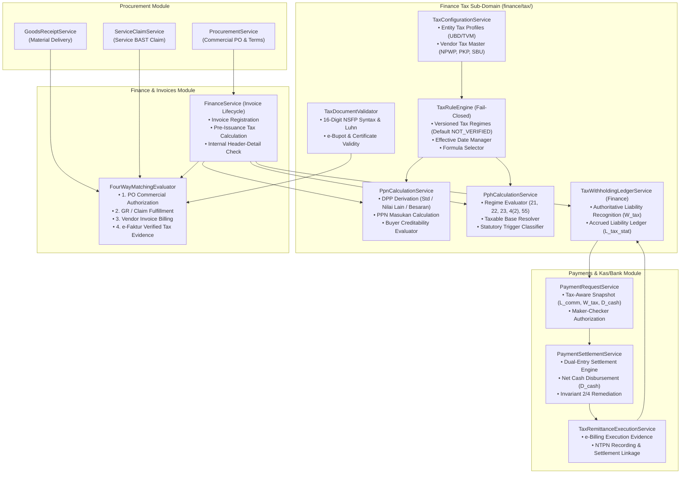
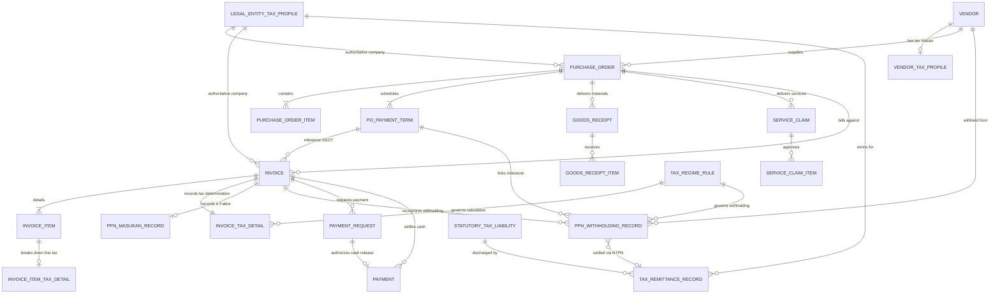
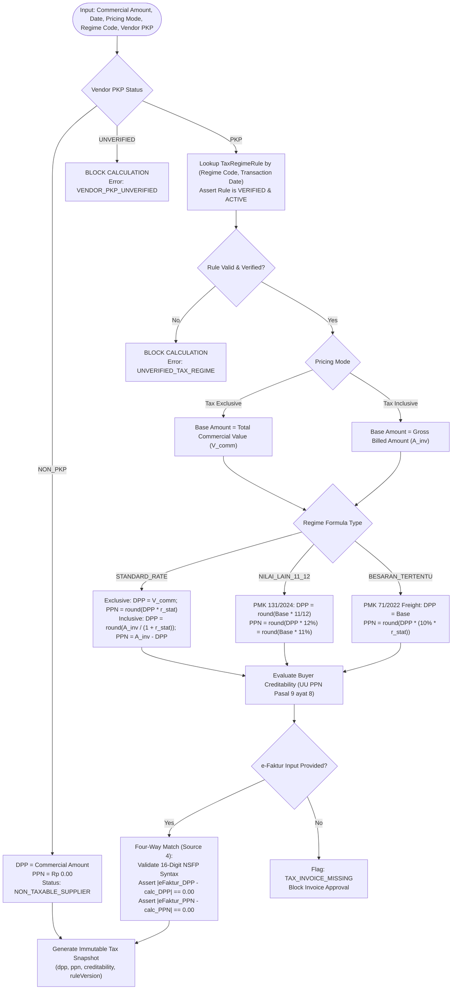

# EPMS UBD & TVM — PHASE 2B STEP 2
# PPN / PPh TECHNICAL DESIGN SPECIFICATION
## Integrated Indonesian VAT (PPN) and Withholding Tax (PPh) Architecture, Data Model, Calculation Engine, and Settlement Contract

**Document Version:** 1.1.1 (Governance Consistency Baseline)  
**Governance Workstream:** EPMS UBD & TVM Enterprise Project Management System  
**Document Path:** `docs/audit/EPMS_PHASE_2B_STEP_2_PPN_PPH_TECHNICAL_DESIGN.md`  
**Git Baseline Commit:** `ba8987d5336de10557caa35fc2d9f6547c789bd8` (Branch: `main`)  
**Execution Mode:** STRICT DESIGN-ONLY CHECKPOINT (Zero Source Code or Schema Modified)  
**Authoritative Reference Inputs:**
- [`docs/audit/EPMS_PHASE_1_1_SCOPE_ALIGNMENT_AND_ZAHIR_BENCHMARK_MAPPING.md`](file:///c:/Users/UBDOPS3/Herd/epms_tvmubd/docs/audit/EPMS_PHASE_1_1_SCOPE_ALIGNMENT_AND_ZAHIR_BENCHMARK_MAPPING.md)
- [`docs/audit/EPMS_PHASE_2A_TRANSACTION_CALCULATION_CONTROL_ASSESSMENT.md`](file:///c:/Users/UBDOPS3/Herd/epms_tvmubd/docs/audit/EPMS_PHASE_2A_TRANSACTION_CALCULATION_CONTROL_ASSESSMENT.md)
- [`docs/audit/EPMS_CP1_2_1_IMPLEMENTATION_PLAN.md`](file:///c:/Users/UBDOPS3/Herd/epms_tvmubd/docs/audit/EPMS_CP1_2_1_IMPLEMENTATION_PLAN.md)
- `EPMS PHASE 2B — PPN/PPh STEP 1 TAX READINESS & DESIGN ASSESSMENT REPORT` (Accepted Baseline dated 2026-11-12)

---

## Document Revision History

| Version | Date | Status / Gate | Summary of Key Changes & Findings Addressed |
|---|---|---|---|
| **1.0.0** | 2026-11-12 | Preliminary Design Specification | Initial consolidated technical design specification for PPN and PPh integration. |
| **1.1.0** | 2026-11-12 | Correction & Audit Baseline | Controlled technical design corrections resolving Review Findings F-01 through F-10. |
| **1.1.1** | 2026-11-12 | **Governance Consistency Baseline** | Governance consistency correction: restored canonical DEC-TAX identities, clarified PKP/WAPU status semantics, and separated unresolved legal decisions from technical design rules.<br/>1. **Canonical DEC-TAX Restoration:** Restored canonical identities for DEC-TAX-01 through DEC-TAX-08; preserved exact traceability.<br/>2. **PKP Semantics Hardening:** Clarified that `UNVERIFIED` means unestablished from official evidence; neither UBD nor TVM is assumed PKP nor assumed NON_PKP; PKP/NON_PKP requires verified decree (`DEC-TAX-01`).<br/>3. **WAPU Semantics Hardening:** Clarified that technical default `is_wapu = FALSE` disables withholding functionality until verified, and does not establish a legal conclusion (`DEC-TAX-02`).<br/>4. **Three-Tier Legal Boundary:** Explicitly categorized project design rules, proposed technical treatments, and unresolved legal interpretations (`OPEN — LEGAL VERIFICATION REQUIRED`).<br/>5. **Simplified Decision Register:** Structured practical register displaying confirmation requirements, required evidence, responsible functions, and granular functionality-blocking scopes.<br/>6. **Preservation of F-01 through F-10:** Maintained all 10 hardened technical calculation and architectural controls intact. |

---

## 1. Executive Summary

This document establishes the corrected technical design specification for integrating statutory Indonesian Value Added Tax (**PPN / VAT**) and Withholding Income Tax (**PPh / Withholding Tax**) into the **Enterprise Project Management System (EPMS)** for **PT UBD** and **PT TVM**.

### 1.1 Core Mission & Purpose
EPMS is an enterprise project delivery and procurement management platform. The purpose of this technical design is to embed deterministic, audit-compliant tax calculations and statutory withholding controls directly into existing Procurement, Invoicing, and Payment workflows without destabilizing core project controls or transforming EPMS into a standalone tax accounting package or ERP clone.

### 1.2 Primary Architectural Principles
1. **Strict Segregation of Duties (SoD):**
   - **Procurement Domain:** Owns purely commercial procurement operations: Purchase Requisitions (PR), Requests for Quotation (RFQ), vendor quotations, price negotiation, Purchase Orders (PO), commercial contract values ($V_{\text{comm}}$), Goods Receipts (GR), Service Orders (SPK), and BAST / fulfillment evidence. Procurement is strictly barred from calculating, estimating, or determining PPN, PPh, or vendor net payable amounts. A Purchase Order represents a commercial commitment, not an authoritative tax calculation document.
   - **Finance & Invoices Domain:** Owns invoice registration, verification of supporting tax documents (e-Faktur, SKB, Suket PP 55, SBU), Tax Base (**DPP**) determination, **PPN Masukan** calculation and creditability evaluation, **PPh** classification and calculation, 4-Way Matching, and payable determination. Authoritative tax determination occurs strictly within Finance before invoice approval.
   - **Payments & Kas/Bank Domain:** Owns Payment Requests, Maker-Checker authorization, net cash disbursement to vendors ($D_{\text{cash}}$), execution of sovereign tax remittance ($S_{\text{tax}}$) to the State Treasury (*Kas Negara*), and capture of official remittance execution evidence (NTPN).
2. **Preservation of the Six-Dimension Financial Settlement Model:**
   Commercial debt owed to vendors is strictly decoupled from fiduciary statutory tax liabilities owed to the State Treasury:
   $$L_{\text{comm}} = \text{DPP} + \text{PPN}_{\text{Masukan}}$$
   $$D_{\text{cash}} = L_{\text{comm}} - W_{\text{tax}} - W_{\text{wapu\_ppn}} - P_{\text{ded}}$$
   $$L_{\text{rem\_comm}} = L_{\text{comm}} - \left(D_{\text{cash}} + W_{\text{tax}} + W_{\text{wapu\_ppn}} + P_{\text{ded}}\right) = \text{Rp } 0$$
   $$L_{\text{tax\_stat}} = \sum \left(W_{\text{tax}} + W_{\text{wapu\_ppn}}\right) - \sum S_{\text{tax}}$$
3. **Preservation of CP1.2 Financial Integrity Controls:**
   All decimal-based monetary arithmetic standards (`decimal.js` with `Decimal.ROUND_HALF_UP`, scale 2), server-side authority, strict exact monetary matching, invoice header-to-detail reconciliation, standalone Down Payment / Retention detail generation, and cumulative PO invoice caps remain fully intact.

---

## 2. Accepted Business and Architecture Baseline

### 2.1 Existing Route and Navigation Governance
Tax functionality is an integrated transaction control layer. In accordance with Phase 1.1 and Phase 2A governance, no standalone tax application or top-level tax menu is introduced. All features operate within the existing EPMS frontend routes:
- `/procurement`: Commercial PO management, GR receiving, Service Claims (BAST).
- `/finance/invoices`: Vendor invoice registration, e-Faktur attachment, tax calculation, 4-Way Matching.
- `/finance/payments`: Payment Request creation, Director Maker-Checker approval, net cash payment, tax remittance.
- `/vendors`: Vendor onboarding, 16-digit NPWP, PKP status, tax exemption certificate repository.
- `/reports`: Financial commitments, disbursements, PPN Masukan realization, and PPh withholding summaries.

### 2.2 Mathematical Model of the Six Financial Dimensions
To eliminate settlement imbalances and tax non-compliance, EPMS enforces six explicit financial values:
1. **Gross Commercial Liability ($L_{\text{comm}}$):** Total commercial debt recognized from the vendor invoice:
   $$L_{\text{comm}} = \text{DPP} + \text{PPN}_{\text{Masukan}}$$
2. **Vendor Cash Disbursement ($D_{\text{cash}}$):** Liquid cash transferred to the vendor bank account:
   $$D_{\text{cash}} = L_{\text{comm}} - W_{\text{tax}} - W_{\text{wapu\_ppn}} - P_{\text{ded}}$$
   *(While WAPU functionality remains disabled under the technical default `is_wapu = FALSE`, conditional $W_{\text{wapu\_ppn}} = 0$, so $D_{\text{cash}} = L_{\text{comm}} - W_{\text{tax}} - P_{\text{ded}}$).*
3. **Statutory Withholding Recognized ($W_{\text{tax}}$ & $W_{\text{wapu\_ppn}}$):** Fiduciary sovereign tax liabilities recognized by operation of law upon occurrence of the regime-specific statutory legal trigger.
4. **Actual Sovereign Tax Remittance ($S_{\text{tax}}$):** Cash transferred to the State Treasury via DJP e-Billing and receipt of an official NTPN.
5. **Outstanding Commercial Liability ($L_{\text{rem\_comm}}$):** Remaining commercial debt owed to the vendor:
   $$L_{\text{rem\_comm}} = L_{\text{comm}} - \left(D_{\text{cash}} + W_{\text{tax}} + W_{\text{wapu\_ppn}} + P_{\text{ded}}\right)$$
   *(Upon net cash disbursement and deduction recognition, $L_{\text{rem\_comm}} = \text{Rp } 0$. Mathematical proof: $L_{\text{comm}} - [ (L_{\text{comm}} - W - P) + W + P ] = 0$).*
6. **Outstanding Statutory Tax Liability ($L_{\text{tax\_stat}}$):** Unremitted fiduciary tax liability owed to the State Treasury:
   $$L_{\text{tax\_stat}} = \sum \left(W_{\text{tax}} + W_{\text{wapu\_ppn}}\right) - \sum S_{\text{tax}}$$
   *(Remains active until legally discharged via DJP e-Billing and NTPN, reaching $\text{Rp } 0$).*

### 2.3 Operational Event Separation
The system strictly separates five operational and statutory milestones:
1. **Invoice Verification (Finance):** Accrues gross commercial liability ($L_{\text{comm}}$); administrative internal check; does not establish sovereign tax liability.
2. **Contractual Payment Due Date:** Commercial maturity milestone agreed in PO terms (*jatuh tempo*).
3. **Statutory Tax Withholding Event:** Operation-of-law legal trigger (maturity/due date for PPh 23 or PPh 21; cash payment for PPh Final Construction). Accrues $L_{\text{tax\_stat}}$ and adjusts net commercial payable.
4. **Vendor Cash Payment Execution (Kas/Bank):** Liquid cash transfer ($D_{\text{cash}}$) extinguishing remaining commercial debt owed to the vendor ($L_{\text{rem\_comm}} = \text{Rp } 0$).
5. **Sovereign Tax Remittance Event (Kas/Bank):** Remittance to Kas Negara via e-Billing/NTPN ($S_{\text{tax}}$) extinguishing sovereign tax liability ($L_{\text{tax\_stat}} = \text{Rp } 0$).

---

## 3. Proposed Tax Domain Architecture

### 3.1 Component Architecture Overview
Tax functionality is structured as a dedicated sub-domain within `backend/src/modules/finance/tax/`:

```
+========================================================================================================================+
|                                  EPMS TAX CALCULATION & CONTROL COMPONENT ARCHITECTURE                                 |
+========================================================================================================================+
```



### 3.2 Component Responsibilities & Authoritative Ownership
1. **`TaxConfigurationService` (Finance Master Data):** Manages legal entity tax profiles for PT UBD and PT TVM (NPWP 16, NITKU, KPP Pratama, explicit unverified PKP status, default Non-WAPU flag) and vendor tax profiles.
2. **`TaxRuleEngine` (Finance):** Evaluates versioned tax regimes and rules based on transaction date. Enforces fail-closed activation: unverified rules (`NOT_VERIFIED`) or inactive rules (`is_active = FALSE`) are strictly blocked from calculation execution.
3. **`PpnCalculationService` (Finance):** Deterministic derivation of DPP (Standard, Nilai Lain 11/12 under PMK 131/2024, Besaran Tertentu under PMK 71/2022) and PPN Masukan; assesses buyer-side creditability under UU PPN Pasal 9 ayat (8).
4. **`PphCalculationService` (Finance):** Evaluates withholding regimes (PPh 21, 22, 23, Final Construction PP 9/2022, UMKM PP 55/2022); resolves taxable base and rate; classifies statutory legal trigger.
5. **`TaxDocumentValidator` (Finance):** Validates electronic tax invoice structure: 16-digit NSFP syntax, transaction codes (`01`–`08`), replacement digits, and attachment validity.
6. **`FourWayMatchingEvaluator` (Finance):** Cross-validates the four independent business matching sources: (1) Purchase Order, (2) Fulfillment Evidence (GR/Claim), (3) Vendor Invoice, and (4) e-Faktur Verified Tax Evidence. Internal invoice header-detail equality is audited separately as an internal integrity guard.
7. **`TaxWithholdingLedgerService` (Finance — Tax Accounting):** **Single Authoritative Ledger Owner.** Determines, calculates, and legally recognizes statutory withholding obligations ($W_{\text{tax}}$) and tracks accrued sovereign liabilities ($L_{\text{tax\_stat}}$).
8. **`TaxRemittanceExecutionService` (Payments & Kas/Bank):** Executes sovereign cash transfers to the State Treasury via e-Billing and records official payment execution proofs (NTPN, bank reference), linking them back to Finance's recognized liabilities.

---

## 4. Proposed Conceptual Data Model

> [!IMPORTANT]
> **Implementation Baseline Status (`PROPOSED — NOT YET IMPLEMENTED`):**  
> All 10 data groups, table names, attributes, and relationships defined in Section 4 represent **proposed conceptual tax-domain specifications** for Phase 2B Step 3 schema migration. Zero TypeORM entity files, database tables, or migrations currently exist in the repository for these tax structures. They must not be described as existing application entities.

The conceptual data model defines 10 structured logical data groups. All monetary attributes adhere to `DECIMAL(19, 2)` and arbitrary-precision decimal strings.

```
+========================================================================================================================+
|                                    CONCEPTUAL TAX DATA GROUPS SPECIFICATION                                            |
+========================================================================================================================+
```

### 4.1 Legal Entity Tax Profile (`legal_entity_tax_profiles`)
- **Owning Module:** Governance / Finance Master Data
- **Business Purpose:** Defines the statutory tax registration identity for PT UBD and PT TVM without assuming unverified tax statuses.
- **Attributes:**
  - `id`: `BIGINT UNSIGNED`, PK, auto-increment.
  - `company_code`: `VARCHAR(10)`, Unique, Not Null (`'UBD'` | `'TVM'`).
  - `legal_name`: `VARCHAR(200)`, Not Null (e.g. `'PT Urus Bangun Digital'`).
  - `npwp16`: `VARCHAR(16)`, Nullable (Validated 16-digit unified tax ID / NIK; null if unconfirmed).
  - `nitku`: `VARCHAR(22)`, Nullable (Nomor Identitas Tempat Kegiatan Usaha / branch identifier).
  - `pkp_status`: `ENUM('PKP', 'NON_PKP', 'UNVERIFIED')`, Not Null, **Default `'UNVERIFIED'`** (Correction F-02; `'UNVERIFIED'` denotes status is unestablished from official evidence; status is neither assumed PKP nor assumed NON_PKP).
  - `pkp_confirmation_number`: `VARCHAR(50)`, Nullable (SPPKP decree number; required if `pkp_status = 'PKP'`).
  - `pkp_effective_date`: `DATE`, Nullable.
  - `tax_office_code`: `VARCHAR(10)`, Nullable (Kode KPP Pratama).
  - `is_wapu`: `BOOLEAN`, Not Null, **Default `FALSE`** (Technical default: WAPU functionality disabled until verified; does not constitute a legal conclusion; Correction F-02, DEC-TAX-02).
  - `wapu_appointment_decree`: `VARCHAR(100)`, Nullable (Mandatory KMK appointment decree number if `is_wapu` is enabled).
  - `wapu_effective_date`: `DATE`, Nullable.
  - `created_at`, `updated_at`: `DATETIME`.
- **Validation Rules:** `pkp_status` cannot be set to `'PKP'` without verified SPPKP document and `pkp_confirmation_number`, nor to `'NON_PKP'` without verified non-PKP official evidence; unverified status remains `'UNVERIFIED'`. `is_wapu` cannot be set to `TRUE` without verified KMK appointment decree and Director authorization (`DEC-TAX-02`). Missing or unverified entity tax profile attributes block automatic entity-specific PPN Masukan crediting.

### 4.2 Vendor Tax Profile (`vendor_tax_profiles`)
- **Owning Module:** Procurement (Vendors) / Finance
- **Business Purpose:** Extends existing `vendors` entity with verified statutory tax attributes using explicit unverified states (Correction F-05).
- **Attributes:**
  - `id`: `BIGINT UNSIGNED`, PK, auto-increment.
  - `vendor_id`: `BIGINT UNSIGNED`, FK $\rightarrow$ `vendors.id`, Unique, Not Null.
  - `npwp16`: `VARCHAR(16)`, Nullable (Validated 16-digit number).
  - `nitku`: `VARCHAR(22)`, Nullable.
  - `tax_residency`: `ENUM('DOMESTIC', 'FOREIGN', 'UNVERIFIED')`, Not Null, **Default `'UNVERIFIED'`**.
  - `entity_type`: `ENUM('BADAN', 'ORANG_PRIBADI', 'UNVERIFIED')`, Not Null, **Default `'UNVERIFIED'`**.
  - `pkp_status`: `ENUM('PKP', 'NON_PKP', 'UNVERIFIED')`, Not Null, **Default `'UNVERIFIED'`**.
  - `pkp_confirmation_number`: `VARCHAR(50)`, Nullable.
  - `tax_classification`: `ENUM('STANDARD_CORPORATE', 'CONSTRUCTION_SERVICE', 'MICRO_UMKM', 'EXEMPT', 'UNVERIFIED')`, Not Null, **Default `'UNVERIFIED'`**.
  - `sbu_qualification`: `ENUM('NONE', 'KECIL', 'MENENGAH_BESAR', 'SPESIALIS', 'TIDAK_BERSERTIFIKAT', 'UNVERIFIED')`, Default `'UNVERIFIED'`.
  - `sbu_expiry_date`: `DATE`, Nullable.
  - `has_skb_pph`: `BOOLEAN`, Default `FALSE`.
  - `skb_expiry_date`: `DATE`, Nullable.
  - `has_suket_pp55`: `BOOLEAN`, Default `FALSE`.
  - `suket_pp55_expiry_date`: `DATE`, Nullable.
  - `created_at`, `updated_at`: `DATETIME`.
- **Validation Rules:** Attributes with value `'UNVERIFIED'` block automatic tax calculation if they materially affect the tax determination. `pkp_status = 'PKP'` requires validated `npwp16` and attached SPPKP.

### 4.3 Tax Regime Rule Registry (`tax_regime_rules`)
- **Owning Module:** Finance (Tax Administration)
- **Business Purpose:** Configurable, versioned statutory tax rules with fail-closed activation defaults (Correction F-01).
- **Attributes:**
  - `id`: `BIGINT UNSIGNED`, PK, auto-increment.
  - `regime_code`: `VARCHAR(50)`, Not Null (e.g. `'PPN_NILAI_LAIN_PMK131'`, `'PPH_23_SERVICE'`, `'PPH_FINAL_KONSTRUKSI_KECIL'`).
  - `tax_category`: `ENUM('PPN', 'PPH')`, Not Null.
  - `name`: `VARCHAR(150)`, Not Null.
  - `description`: `TEXT`, Nullable.
  - `formula_type`: `ENUM('STANDARD_RATE', 'NILAI_LAIN_11_12', 'BESARAN_TERTENTU', 'FLAT_RATE', 'PROGRESSIVE_TER')`, Not Null.
  - `statutory_rate`: `DECIMAL(7, 4)`, Not Null.
  - `effective_rate_multiplier`: `DECIMAL(7, 4)`, Nullable (e.g. `0.9167` for 11/12, `0.1000` for Besaran 10%).
  - `governing_regulation`: `VARCHAR(100)`, Not Null.
  - `effective_from`: `DATE`, Not Null.
  - `effective_to`: `DATE`, Nullable.
  - `statutory_trigger_type`: `ENUM('PAYMENT', 'DUE_DATE', 'END_OF_MONTH', 'INVOICE_SUBMISSION')`, Not Null.
  - `verification_status`: `ENUM('VERIFIED', 'NOT_VERIFIED')`, Not Null, **Default `'NOT_VERIFIED'`** (Correction F-01).
  - `is_active`: `BOOLEAN`, Not Null, **Default `FALSE`** (Correction F-01).
  - `version`: `INT`, Not Null, Default `1`.
- **Validation Rules:** Fail-closed barrier: Rules with `verification_status = 'NOT_VERIFIED'` or `is_active = FALSE` cannot be used in production tax calculation. Activation requires formal verification.

### 4.4 Invoice Tax Detail (`invoice_tax_details`)
- **Owning Module:** Finance (Invoices)
- **Business Purpose:** 1:1 relation to `invoices`, recording the immutable authoritative tax determination.
- **Attributes:**
  - `id`: `BIGINT UNSIGNED`, PK, auto-increment.
  - `invoice_id`: `INT`, FK $\rightarrow$ `invoices.id`, Unique, Not Null.
  - `tax_regime_ppn_id`: `BIGINT UNSIGNED`, FK $\rightarrow$ `tax_regime_rules.id`, Nullable.
  - `tax_regime_pph_id`: `BIGINT UNSIGNED`, FK $\rightarrow$ `tax_regime_rules.id`, Nullable.
  - `pricing_mode`: `ENUM('TAX_EXCLUSIVE', 'TAX_INCLUSIVE')`, Not Null, Default `'TAX_EXCLUSIVE'`.
  - `dpp_amount`: `DECIMAL(19, 2)`, Not Null, Default `0.00`.
  - `ppn_rate`: `DECIMAL(7, 4)`, Not Null, Default `0.0000`.
  - `ppn_amount`: `DECIMAL(19, 2)`, Not Null, Default `0.00`.
  - `vat_creditability`: `ENUM('CREDITABLE', 'NON_CREDITABLE', 'EXEMPT')`, Not Null, Default `'CREDITABLE'`.
  - `pph_type`: `VARCHAR(30)`, Nullable (e.g. `'PPH_23'`, `'PPH_4_2'`, `'PPH_21'`).
  - `pph_rate`: `DECIMAL(7, 4)`, Not Null, Default `0.0000`.
  - `pph_amount`: `DECIMAL(19, 2)`, Not Null, Default `0.00`.
  - `gross_commercial_liability`: `DECIMAL(19, 2)`, Not Null (`dpp_amount + ppn_amount`).
  - `vendor_net_payable`: `DECIMAL(19, 2)`, Not Null (`gross_commercial_liability - pph_amount`).
  - `tax_rule_version_snapshot`: `JSON`, Not Null.
  - `created_at`, `updated_at`: `DATETIME`.
- **Validation Rules:** `gross_commercial_liability` must equal `invoices.total_amount` under standard non-WAPU procurement.

### 4.5 PPN Masukan Record (`ppn_masukan_records`)
- **Owning Module:** Finance (Tax Accounting)
- **Business Purpose:** Dedicated registry of Input VAT for SPT Masa PPN reconciliation and tax audit defense.
- **Attributes:**
  - `id`: `BIGINT UNSIGNED`, PK, auto-increment.
  - `invoice_id`: `INT`, FK $\rightarrow$ `invoices.id`, Not Null.
  - `company_code`: `VARCHAR(10)`, Not Null (`'UBD'` | `'TVM'`).
  - `vendor_tax_id`: `VARCHAR(16)`, Not Null.
  - `faktur_pajak_number`: `VARCHAR(20)`, Not Null (16-digit NSFP).
  - `faktur_pajak_date`: `DATE`, Not Null.
  - `transaction_code`: `VARCHAR(2)`, Not Null.
  - `replacement_code`: `VARCHAR(1)`, Not Null, Default `'0'`.
  - `dpp_amount`: `DECIMAL(19, 2)`, Not Null.
  - `ppn_amount`: `DECIMAL(19, 2)`, Not Null.
  - `is_creditable`: `BOOLEAN`, Not Null, Default `TRUE`.
  - `reporting_period_month`: `TINYINT`, Not Null.
  - `reporting_period_year`: `SMALLINT`, Not Null.
  - `spt_masa_status`: `ENUM('UNREPORTED', 'INCLUDED_IN_SPT', 'AUDITED')`, Default `'UNREPORTED'`.
  - `created_at`: `DATETIME`.
- **Validation Rules:** `faktur_pajak_number` must conform to 16-digit NSFP pattern. Unique on `(faktur_pajak_number, replacement_code)`.

### 4.6 PPh Withholding Record (`pph_withholding_records`)
- **Owning Module:** Finance (Tax Accounting) — **Authoritative Owner (Correction F-03)**
- **Business Purpose:** Tracks recognized statutory withholding obligations ($W_{\text{tax}}$) independently of cash disbursement.
- **Attributes:**
  - `id`: `BIGINT UNSIGNED`, PK, auto-increment.
  - `invoice_id`: `INT`, FK $\rightarrow$ `invoices.id`, Not Null.
  - `payment_term_id`: `BIGINT`, FK $\rightarrow$ `po_payment_terms.id`, Nullable.
  - `company_code`: `VARCHAR(10)`, Not Null (`'UBD'` | `'TVM'`).
  - `vendor_id`: `BIGINT UNSIGNED`, FK $\rightarrow$ `vendors.id`, Not Null.
  - `pph_regime`: `VARCHAR(30)`, Not Null.
  - `taxable_base`: `DECIMAL(19, 2)`, Not Null.
  - `withholding_rate`: `DECIMAL(7, 4)`, Not Null.
  - `withheld_amount`: `DECIMAL(19, 2)`, Not Null.
  - `statutory_trigger_type`: `ENUM('PAYMENT', 'DUE_DATE', 'END_OF_MONTH')`, Not Null.
  - `statutory_trigger_date`: `DATE`, Not Null.
  - `recognition_status`: `ENUM('ACCRUED', 'REMITTED', 'CANCELLED')`, Default `'ACCRUED'`.
  - `bukti_potong_number`: `VARCHAR(50)`, Nullable (Official e-Bupot number).
  - `bukti_potong_date`: `DATE`, Nullable.
  - `remittance_record_id`: `BIGINT UNSIGNED`, FK $\rightarrow$ `tax_remittance_records.id`, Nullable.
  - `created_at`, `updated_at`: `DATETIME`.

### 4.7 Tax Supporting Document Repository (`tax_supporting_documents`)
- **Owning Module:** Finance / Procurement
- **Business Purpose:** Storage metadata and validity tracking for tax certificates and electronic proofs.
- **Attributes:**
  - `id`: `BIGINT UNSIGNED`, PK, auto-increment.
  - `document_type`: `ENUM('E_FAKTUR_PDF', 'E_BUPOT_PDF', 'SKB_PPH', 'SUKET_PP55', 'SBU_LPJK', 'WAPU_DECREE')`, Not Null.
  - `entity_type`: `VARCHAR(50)`, Not Null (`'VENDOR'` | `'INVOICE'` | `'COMPANY'`).
  - `entity_id`: `BIGINT UNSIGNED`, Not Null.
  - `document_number`: `VARCHAR(100)`, Not Null.
  - `issued_by`: `VARCHAR(150)`, Nullable.
  - `valid_from`: `DATE`, Not Null.
  - `valid_to`: `DATE`, Nullable.
  - `file_path`: `VARCHAR(255)`, Not Null.
  - `mime_type`: `VARCHAR(50)`, Not Null.
  - `is_verified`: `BOOLEAN`, Default `FALSE`.
  - `verified_by`: `INT`, Nullable.
  - `created_at`: `DATETIME`.

### 4.8 Statutory Tax Liability Ledger (`statutory_tax_liabilities`)
- **Owning Module:** Finance (Tax Accounting) — **Authoritative Owner (Correction F-03)**
- **Business Purpose:** Accumulates unremitted sovereign liabilities ($L_{\text{tax\_stat}}$) owed to Kas Negara per tax regime, period, and company.
- **Attributes:**
  - `id`: `BIGINT UNSIGNED`, PK, auto-increment.
  - `company_code`: `VARCHAR(10)`, Not Null (`'UBD'` | `'TVM'`).
  - `tax_period_month`: `TINYINT`, Not Null.
  - `tax_period_year`: `SMALLINT`, Not Null.
  - `tax_regime`: `VARCHAR(30)`, Not Null.
  - `total_withheld_amount`: `DECIMAL(19, 2)`, Not Null, Default `0.00`.
  - `total_remitted_amount`: `DECIMAL(19, 2)`, Not Null, Default `0.00`.
  - `outstanding_balance`: `DECIMAL(19, 2)`, Not Null, Default `0.00` (`total_withheld - total_remitted`).
  - `status`: `ENUM('OPEN', 'PARTIALLY_SETTLED', 'CLOSED')`, Default `'OPEN'`.
  - `updated_at`: `DATETIME`.

### 4.9 Tax Remittance Record (`tax_remittance_records`)
- **Owning Module:** Payments & Kas/Bank — **Execution Proof Owner (Correction F-03 & F-10)**
- **Business Purpose:** Proves statutory sovereign cash transfer from company bank to State Treasury, capturing official NTPN.
- **Attributes:**
  - `id`: `BIGINT UNSIGNED`, PK, auto-increment.
  - `remittance_number`: `VARCHAR(100)`, Unique, Not Null (Internal tax payment voucher number).
  - `company_code`: `VARCHAR(10)`, Not Null (`'UBD'` | `'TVM'`).
  - `tax_period_month`: `TINYINT`, Not Null.
  - `tax_period_year`: `SMALLINT`, Not Null.
  - `tax_regime`: `VARCHAR(30)`, Not Null.
  - `djp_billing_code`: `VARCHAR(30)`, Not Null (Kode Billing e-Billing DJP).
  - `djp_billing_expired_at`: `DATETIME`, Nullable.
  - `ntpn`: `VARCHAR(30)`, Unique, Not Null (Nomor Transaksi Penerimaan Negara).
  - `remittance_date`: `DATETIME`, Not Null.
  - `remitted_amount`: `DECIMAL(19, 2)`, Not Null.
  - `bank_reference_number`: `VARCHAR(100)`, Not Null.
  - `executed_by`: `INT`, Not Null.
  - `created_at`: `DATETIME`.
- **Traceability Rule:** Execution of tax remittance discharges sovereign tax liability ($L_{\text{tax\_stat}}$) in Finance's ledger, completely separate from vendor commercial debt settlement ($L_{\text{rem\_comm}}$).

### 4.10 Line-Level Invoice Tax Item (`invoice_item_tax_details`)
- **Owning Module:** Finance (Invoices) — **Mixed Transaction Classifier (Correction F-08)**
- **Business Purpose:** Captures line-by-line tax categorization for multi-item and mixed procurement invoices without forcing a single regime across all lines.
- **Attributes:**
  - `id`: `BIGINT UNSIGNED`, PK, auto-increment.
  - `invoice_item_id`: `INT`, FK $\rightarrow$ `invoice_items.id`, Unique, Not Null.
  - `item_tax_category`: `ENUM('TAXABLE_GOODS', 'TAXABLE_SERVICES', 'NON_TAXABLE', 'EXEMPT')`, Not Null.
  - `line_dpp`: `DECIMAL(19, 2)`, Not Null.
  - `line_ppn_rate`: `DECIMAL(7, 4)`, Not Null.
  - `line_ppn_amount`: `DECIMAL(19, 2)`, Not Null.
  - `line_pph_type`: `VARCHAR(30)`, Nullable.
  - `line_pph_rate`: `DECIMAL(7, 4)`, Not Null, Default `0.0000`.
  - `line_pph_amount`: `DECIMAL(19, 2)`, Not Null, Default `0.00`.
  - `created_at`: `DATETIME`.

---

## 5. Proposed Entity Relationship Diagram

The Mermaid ERD below depicts the clean semantic relationships between existing core entities and proposed tax data structures:



---

## 6. PPN Calculation Design

### 6.1 Non-Universal Calculation Pipeline (Correction F-07)
The PPN calculation engine enforces explicit parameters and avoids universal formula assumptions:



### 6.2 Formula Derivations & Statutory Rules
All derivations utilize arbitrary-precision arithmetic (`decimal.js` with `Decimal.ROUND_HALF_UP`, scale 2):

1. **Standard Tax Base (*DPP Harga Jual / Penggantian*) — UU PPN Pasal 8A ayat (1):**
   - *Tax-Exclusive:*
     $$\text{DPP} = V_{\text{comm}}$$
     $$\text{PPN}_{\text{Masukan}} = \left[\text{DPP} \times r_{\text{stat}}(t)\right]_{.00}$$
     $$A_{\text{inv}} = \text{DPP} + \text{PPN}_{\text{Masukan}}$$
   - *Tax-Inclusive:*
     $$\text{DPP} = \left[\frac{A_{\text{inv}}}{1 + r_{\text{stat}}(t)}\right]_{.00}$$
     $$\text{PPN}_{\text{Masukan}} = A_{\text{inv}} - \text{DPP}$$
2. **DPP Nilai Lain under PMK 131/2024 Article 3:**
   Applies to standard BKP and JKP transactions where the statutory rate is 12% applied to a deemed 11/12 base:
   $$\text{DPP}_{\text{NilaiLain}} = \left[V_{\text{comm}} \times \frac{11}{12}\right]_{.00}$$
   $$\text{PPN}_{\text{Masukan}} = \left[\text{DPP}_{\text{NilaiLain}} \times 12\%\right]_{.00} = \left[V_{\text{comm}} \times 11\%\right]_{.00}$$
3. **Besaran Tertentu under PMK 71/PMK.03/2022 (Freight Forwarding):**
   Governed strictly by UU PPN Pasal 9A. Effective rate is $10\% \times r_{\text{stat}}(t)$:
   $$\text{DPP} = V_{\text{comm}}$$
   $$\text{PPN}_{\text{Masukan}} = \left[V_{\text{comm}} \times \left(10\% \times r_{\text{stat}}(t)\right)\right]_{.00}$$

### 6.3 Buyer-Side Input VAT Creditability Engine
In accordance with **UU PPN Pasal 9 ayat (8)**:
- **`CREDITABLE`:** Direct business relation; active PKP vendor; authentic 16-digit e-Faktur with matching figures. Creditable tax asset.
- **`NON_CREDITABLE`:** Lacks direct business relation, personal consumption, exempt supplies, or invalid e-Faktur. Capitalized or expensed.
- **Rule:** EPMS Finance never automates non-creditability purely based on transaction code `05`; purchaser-side statutory facts are evaluated affirmatively.

---

## 7. PPh Classification and Calculation Design

### 7.1 Multi-Regime Classification & Mixed Transactions (Correction F-06 & F-08)
The PPh classification engine evaluates item-level deliverables (`item_category: MATERIAL | SERVICE`) to avoid forcing a single regime across mixed contracts.

> [!NOTE]
> **Governance Taxonomy of Statutory Tax Claims:**
> Statements regarding Indonesian tax treatment are strictly categorized into three boundaries:
> 1. **Established Project Design Rules:** Validated in Phase 1.1.1, Phase 2A, and CP1.2 (Strict SoD, Six-Dimension Financial Model, Decimal precision, exact monetary matching, and 4-Way Matching).
> 2. **Proposed Technical Treatments:** Technical architecture recommendations (data structures, item-level classification, fail-closed rule registry, Dual-Entry interface).
> 3. **Unresolved Legal Interpretations (`OPEN — LEGAL VERIFICATION REQUIRED`):** Specific statutory rates, applicability thresholds, and operational trigger interpretations based on published regulations (PMK/PP) below represent proposed statutory baselines that require formal legal review and sign-off by Corporate Tax Counsel before production enablement. Mentioning a regulation number does not establish legal verification.

```
+========================================================================================================================+
|                                  PPH WITHHOLDING REGIMES & STATUTORY TRIGGERS SPECIFICATION                           |
+========================================================================================================================+
```

| Tax Regime | Statutory Governing Decree | Applicable Scope in EPMS | Taxable Base ($B_{\text{tax}}$) | Statutory Rate ($r_{\text{withhold}}$) | Statutory Trigger Event | Verification & Evidence Dependency | Statutory Governance Status |
|:---|:---|:---|:---|:---:|:---|:---|:---:|
| **PPh Pasal 21** | PMK 168/2023 Pasal 19; PP 58/2023 | Personal services by individuals (freelancers, experts, non-employees) | Gross compensation / fee | TER (Monthly/Daily) or Art 17 progressive | **Saat pembayaran atau saat penghasilan terutang**, whichever earlier | Individual NIK/NPWP; statement of non-employee status | `PROPOSED REGULATION BASELINE` |
| **PPh Pasal 22** | PMK 34/2017 stdtd PMK 41/2022 | Purchase of designated industrial materials (steel, cement) | Gross purchase price (excl. PPN) | Steel 0.3%, Cement 0.25% | **Saat pembayaran** (WAPU) or **saat penjualan** (manufacturer) | Manufacturer invoice; SKB PPh 22 if exempt | `PROPOSED REGULATION BASELINE` |
| **PPh Pasal 23** | PP 94/2010 Pasal 15; PMK 141/2015 | Corporate domestic services (62 service categories); equipment rental | Gross service fee (excl. PPN & verified material proofs) | **2.0%** (4.0% if vendor has no NPWP) | **Akhir bulan saat pembayaran, penyediaan, atau jatuh tempo**, whichever earlier | Corporate NPWP; itemized material receipts under PMK 141 | `PROPOSED REGULATION BASELINE` |
| **PPh Final 4(2) Konstruksi** | PP 51/2008 stdtd PP 9/2022 Pasal 5 | Construction execution, consulting, and integrated EPC works | Gross contractual consideration (excl. PPN) | **1.75%** (Kecil), **2.65%** (Menengah/Besar), **4.0%** (Tidak bersertifikat) | **Dipotong pada saat pembayaran** (upon each cash disbursement) | Active LPJK SBU certificate; rate tier selection dependent on `DEC-TAX-06` | `PROPOSED REGULATION BASELINE` |
| **PPh Final UMKM** | PP 55/2022 Pasal 6 | Qualifying micro/small enterprises ($\le \text{Rp } 4.8\text{B}$ turnover) | Gross billing | **0.5%** PPh Final | **Dipotong pada saat pembayaran penghasilan** | Verified Surat Keterangan (Suket) PP 55 valid on payment date | `PROPOSED REGULATION BASELINE` |
| **PPh Final 4(2) Sewa** | PP 34/2017 Pasal 3 | Lease of land and/or buildings (project site offices, yards) | Gross rental consideration | **10.0%** PPh Final | **Saat pembayaran atau saat terutangnya uang sewa**, whichever earlier | Lease agreement; certificate of ownership | `PROPOSED REGULATION BASELINE` |
| **Commercial Retention Withholding** | Contractual Terms & General PPh | Retained performance guarantee amounts (e.g. 5%) | Retention milestone amount | Follows base regime (e.g. PP 9/2022 or PP 94/2010) | **Unresolved: Upon progress billing vs upon final release (BAPST)** | Contractual retention terms; BAPST release certificate (`DEC-TAX-03`) | `OPEN — LEGAL VERIFICATION REQUIRED` |

### 7.2 Decoupling Statutory Trigger from Internal Approval (Correction F-03 & F-06)
- **Administrative Accrual ($L_{\text{comm}}$):** Internal invoice verification establishes commercial debt owed to the vendor. It **does NOT** create a sovereign tax liability if the legal event has not occurred.
- **Statutory Withholding Recognition ($W_{\text{tax}}$):** Occurs strictly upon the operation-of-law trigger:
  - PPh Final Construction (PP 9/2022) & UMKM (PP 55/2022): Recognized **strictly upon vendor cash payment execution**.
  - PPh 23 (PP 94/2010): Recognized at the **earlier of payment, provision of funds, or contractual maturity date (end of month)**.

---

## 8. Tax Rule Configuration and Versioning

### 8.1 Fail-Closed Activation & Rule Immutability (Correction F-01)
1. **Unverified & Inactive Defaults:** Every new or imported tax rule defaults to:
   - `verification_status = 'NOT_VERIFIED'`
   - `is_active = FALSE`
2. **Explicit Verification Barrier:** A rule cannot transition to `is_active = TRUE` without explicit administrative authorization and reference to an authoritative statutory decree.
3. **Calculation Protection:** If a rule has `verification_status = 'NOT_VERIFIED'` or `is_active = FALSE`, the calculation engine throws `UNVERIFIED_TAX_REGIME` and aborts calculation.
4. **Historical Reproducibility:** Invoices store an immutable JSON snapshot of applied rules. Future rule updates apply strictly to future invoices based on `effective_from` dates.

---

## 9. Finance Invoice Workflow Integration

### 9.1 The 10-Stage Invoice Workflow
Maps directly into existing `/finance/invoices`:
1. **Invoice Registration:** Finance receives vendor invoice; selects PO and Payment Term.
2. **Tax Document Attachment:** User uploads PDF e-Faktur; inputs 16-digit NSFP and date.
3. **Transaction Classification:** Engine resolves line item categories (`MATERIAL` vs `SERVICE`); retrieves vendor tax profile.
4. **DPP Determination:** Computes DPP per line and aggregate based on pricing mode.
5. **PPN Calculation & Creditability:** Calculates PPN Masukan; assesses creditability under UU PPN Pasal 9 ayat (8).
6. **PPh Classification & Calculation:** Identifies PPh regime; calculates withholding amount.
7. **Four-Way Matching Execution:** Engine executes 4-Way Matching across four external sources.
8. **Internal Header-Detail Check:** Validates `detailSumDec.equals(totalInvoiceDec)` (`CP1.2-04`).
9. **Approval Readiness:** Matched invoices transition to `VERIFIED` and unlock Payment Request creation.
10. **Immutable Snapshot & Ledgering:** Persists `InvoiceTaxDetail`; records canonical audit log.

### 9.2 Four-Way Matching Engine Semantics (Correction F-04)
The Four-Way Matching Engine validates four independent business sources:
- **Source 1 (Purchase Order):** Commercial authorization (`invUnitPrice == poUnitPrice`).
- **Source 2 (Fulfillment Proof):** Physical or service fulfillment (`invQuantity <= receivedQuantity` or approved claim capacity).
- **Source 3 (Vendor Commercial Invoice):** Commercial billing amount and vendor identification.
- **Source 4 (e-Faktur / Tax Evidence):** External tax document validation:
  - 16-digit NSFP syntax and checksum.
  - `|eFaktur_DPP - calculated_DPP| == 0.00`.
  - `|eFaktur_PPN - calculated_PPN| == 0.00`.
  - Vendor NPWP matches verified vendor master.
*(Note: Invoice header versus persisted detail equality is an **internal database integrity control** governed by CP1.2-04, not an external matching source).*

---

## 10. Down Payment, Progress Billing, and Retention Treatment

### 10.1 Down Payment (DP) Invoices
- Standalone line items with `poItemId: null` and exact amount matching `paymentTerm.amount` (`CP1.2-04 Rule 4`).
- **PPN Treatment:** PPN is payable upon advance receipt (UU PPN Pasal 13 ayat (1a)); vendor must supply e-Faktur.
- **PPh Treatment:** Governed by regime trigger (cash payment for PP 9/2022; earlier of payment or maturity for PP 94/2010).

### 10.2 Down Payment Amortization / Offset (Finding F-02 Governance)
- **Current Baseline:** DP amortization against subsequent progress invoices is **NOT implemented** in CP1.2.
- **Design Options:**
  - Option A: Gross Progress Invoicing (DP deducted as commercial settlement credit).
  - Option B: Net Progress Invoicing (DP deducted from billing base, establishing net DPP).
- **Governance Gate:** Retained as **`[OPEN BUSINESS DECISION — DEC-TAX-04]`**. Logic remains inactive until formal corporate tax approval.

### 10.3 Commercial Retention Invoicing (Finding F-01 Governance)
- Standalone retention milestones carry `poItemId: null` and do not consume physical PO quantities.
- **Statutory Withholding Timing:** Classified as **`[OPEN LEGAL DECISION — DEC-TAX-03]`**. Configurable trigger timing (progress payment vs retention release payment).

---

## 11. UBD / TVM and Vendor Tax Governance

### 11.1 Authoritative Company Ownership & Multi-Company Partitioning (`DEC-TAX-07`, Correction F-09)
- **Entity Identification Principle:**
  - `company_code` uses strictly two discrete values:
    - PT UBD = `'UBD'`
    - PT TVM = `'TVM'`
  - `company_code` is a lightweight entity identification and data segregation mechanism across transactions. It does **not** instantiate separate tax calculation engines.
- **Shared Tax Calculation Architecture:**
  - EPMS maintains **one single, shared tax calculation architecture** across both PT UBD and PT TVM.
  - **No Duplicate Tax Engines:** There are strictly no separate calculation engines, redundant tax modules, or duplicated services for UBD and TVM.
  - Common statutory tax rules apply equally where statutory tax decrees apply uniformly. Entity-specific statutory configurations (such as verified PKP/WAPU parameters under `DEC-TAX-01` and `DEC-TAX-02`) are managed in entity profiles without assuming identical status.
- **Authoritative Ownership Derivation:**
  - Every Purchase Order and subsequent transaction strictly derives its `company_code` from the authoritative legal ownership of the originating Project or Tender.
  - **Zero User Override:** Downstream users, approvers, and automated processes are strictly barred from assigning, selecting, or changing the company ownership of any transaction.
- **Strict Attribute Orthogonality:**
  - `company_code` and `tax_type` remain strictly distinct, orthogonal attributes:
    - `company_code`: `'UBD'` | `'TVM'` (entity ownership).
    - `tax_type`: `'PPN'` | `'PPh'` (statutory tax regime category).
- **Lifecycle Entity Preservation:**
  - Originating entity ownership is immutably preserved across the complete transaction and tax lifecycle:
    $$\text{Project/Tender} \rightarrow \text{PO} \rightarrow \text{GR / Claim} \rightarrow \text{Invoice} \rightarrow \text{Tax Details / Withholding} \rightarrow \text{Payment Request} \rightarrow \text{Payment} \rightarrow \text{Tax Remittance} \rightarrow \text{Reconciliation}$$
  - Sovereign tax liability ($L_{\text{tax\_stat}}$) and remittance records ($S_{\text{tax}}$) explicitly retain their originating `company_code`.
- **Entity Segregation and Flexible Reporting:**
  - **Access Segregation:** Data filtering strictly enforces company segregation so that operational users access records according to authorized legal entity boundaries.
  - **Multi-Level Reporting (`TARGET BEHAVIOR / IMPLEMENTATION REQUIRED`):** The reporting engine must support three distinct query scopes:
    1. **PT UBD Only:** Filtered strictly by `company_code = 'UBD'`.
    2. **PT TVM Only:** Filtered strictly by `company_code = 'TVM'`.
    3. **Consolidated UBD + TVM:** Combined multi-entity reporting that aggregates metrics across both entities while strictly maintaining the immutable underlying `company_code` on every transaction record (zero merging, loss, or blurring of entity identity).

### 11.1.1 Transaction Lifecycle & Data Model Inheritance Matrix (DIRECT vs INHERITED)

To maintain rigorous architectural discipline, verified existing application entities in the current repository are strictly separated from proposed conceptual tax-domain records.

> [!IMPORTANT]
> **Crucial Architectural Principle: Verified Parent Relationships vs Current Company Ownership:**  
> In the existing codebase, **no entity currently contains a `company_code` column**. While technical parent-child foreign key relationships are verified in source code (`projectId`, `po_id`, `invoice_id`, etc.), **a verified parent relationship does NOT prove that UBD/TVM company ownership is currently inherited**. Because no parent entity in the current codebase possesses a verified `company_code`, no child entity can currently inherit company ownership.  
> 
> Therefore, under the current repository status, company ownership across all 10 existing application entities is strictly classified as **`NOT VERIFIED IN SOURCE`**. The inheritance and direct storage models (`PROPOSED DIRECT — NOT IMPLEMENTED` vs `PROPOSED INHERITED — NOT IMPLEMENTED`) represent the approved target architecture to be introduced in Phase 2B Step 3.

#### Table 11.1.1-A: Verified Existing Application Entities (`CURRENT DOMAIN REPOSITORY ENTITIES`)

| Existing Entity & Table Name | Source File | Current Column Presence | Verified Parent Relation in Source | Current Repository Status | Target Architecture (Step 3 Requirement) | Company Ownership Enforcement Status |
|:---|:---|:---:|:---|:---:|:---:|:---|
| **`Project`** (`projects`) | `backend/src/entities/project.entity.ts` | **NONE** | `contractId?: number` (optional FK to `contracts.id`) | `NOT VERIFIED IN SOURCE` | **`PROPOSED DIRECT — NOT IMPLEMENTED`** (`company_code: VARCHAR(10)`) | `CURRENTLY UNENFORCED` (Step 3/4 Implementation Required) |
| **`Tender`** (`tenders`) | `backend/src/entities/tender.entity.ts` | **NONE** | `customer_id` (FK to `customers.id`) | `NOT VERIFIED IN SOURCE` | **`PROPOSED DIRECT — NOT IMPLEMENTED`** (`company_code: VARCHAR(10)`) | `CURRENTLY UNENFORCED` (Step 3/4 Implementation Required) |
| **`PurchaseRequest`** (`purchase_requests`) | `backend/src/entities/purchase-request.entity.ts` | **NONE** | `projectId` (`project_id` $\rightarrow$ `projects.id`) | `NOT VERIFIED IN SOURCE`<br/>*(Parent relation verified in source, but parent company ownership unverified)* | **`PROPOSED INHERITED — NOT IMPLEMENTED`** (via parent `project.company_code`) | `CURRENTLY UNENFORCED` (Step 3/4 Implementation Required) |
| **`PurchaseOrder`** (`purchase_orders`) | `backend/src/entities/purchase-order.entity.ts` | **NONE** | `purchaseRequestId` (`pr_id` $\rightarrow$ `purchase_requests.id`), `vendorId` | `NOT VERIFIED IN SOURCE`<br/>*(Parent relation verified in source, but parent company ownership unverified)* | **`PROPOSED DIRECT — NOT IMPLEMENTED`** (`company_code: VARCHAR(10)`, derived from PR $\rightarrow$ Project) | `CURRENTLY UNENFORCED` (Step 3/4 Implementation Required) |
| **`GoodsReceipt`** (`goods_receipts`) | `backend/src/entities/goods-receipt.entity.ts` | **NONE** | `poId` (`po_id` $\rightarrow$ `purchase_orders.id`) | `NOT VERIFIED IN SOURCE`<br/>*(Parent relation verified in source, but parent company ownership unverified)* | **`PROPOSED INHERITED — NOT IMPLEMENTED`** (via parent `purchase_orders.company_code`) | `CURRENTLY UNENFORCED` (Step 3/4 Implementation Required) |
| **`ServiceClaim`** (`service_claims`) | `backend/src/entities/service-claim.entity.ts` | **NONE** | `poId` (`po_id` $\rightarrow$ `purchase_orders.id`), `projectId` | `NOT VERIFIED IN SOURCE`<br/>*(Parent relations verified in source, but parent company ownership unverified)* | **`PROPOSED INHERITED — NOT IMPLEMENTED`** (via parent PO & Project) | `CURRENTLY UNENFORCED` (Step 3/4 Implementation Required) |
| **`Invoice`** (`invoices`) | `backend/src/entities/invoice.entity.ts` | **NONE** | `poId` (`po_id` $\rightarrow$ `purchase_orders.id`), `paymentTermId`, `serviceClaimId` | `NOT VERIFIED IN SOURCE`<br/>*(Parent relations verified in source, but parent company ownership unverified)* | **`PROPOSED DIRECT — NOT IMPLEMENTED`** (`company_code: VARCHAR(10)`, derived from parent PO) | `CURRENTLY UNENFORCED` (Step 3/4 Implementation Required) |
| **`PaymentRequest`** (`payment_requests`) | `backend/src/entities/payment-request.entity.ts` | **NONE** | `invoiceId` (`invoice_id` $\rightarrow$ `invoices.id`), `paymentTermId` | `NOT VERIFIED IN SOURCE`<br/>*(Parent relations verified in source, but parent company ownership unverified)* | **`PROPOSED INHERITED — NOT IMPLEMENTED`** (via parent `invoices.company_code`) | `CURRENTLY UNENFORCED` (Step 3/4 Implementation Required) |
| **`Payment`** (`payments`) | `backend/src/entities/payment.entity.ts` | **NONE** | `invoiceId` (`invoice_id` $\rightarrow$ `invoices.id`), `paymentRequestId` | `NOT VERIFIED IN SOURCE`<br/>*(Parent relations verified in source, but parent company ownership unverified)* | **`PROPOSED DIRECT — NOT IMPLEMENTED`** (`company_code: VARCHAR(10)`, derived from parent invoice) | `CURRENTLY UNENFORCED` (Step 3/4 Implementation Required) |
| **`ProcurementReconciliation`** (`procurement_reconciliations`) | `backend/src/entities/procurement-reconciliation.entity.ts` | **NONE** | `projectId`, `prId`, `poId` | `NOT VERIFIED IN SOURCE`<br/>*(Parent relations verified in source, but parent company ownership unverified)* | **`PROPOSED INHERITED — NOT IMPLEMENTED`** (via parent `purchase_orders.company_code`) | `CURRENTLY UNENFORCED` (Step 3/4 Implementation Required) |

#### Table 11.1.1-B: Proposed Conceptual Tax-Domain Records (`PROPOSED TAX-DOMAIN RECORDS — NOT YET IMPLEMENTED`)

> [!NOTE]
> **Implementation Baseline Status:** All records in Table 11.1.1-B represent proposed data structures for Phase 2B Step 3. Zero entities or tables currently exist in the database. Naming has been reconciled: `invoice_tax_details` serves as the canonical 1:1 invoice summary record (reconciling draft references to `invoice_tax_summaries`), while `invoice_item_tax_details` captures line-level tax items.

| Proposed Tax Record & Logical Table Name | Target Storage Approach | Entity Attribute / Parent FK Path | Derivation & Inheritance Rule | Target Anti-Mismatch & Integrity Guard (`PROPOSED CONSTRAINT`) |
|:---|:---:|:---|:---|:---|
| **`LegalEntityTaxProfile`** (`legal_entity_tax_profiles`) | **`PROPOSED DIRECT — NOT IMPLEMENTED`** | `company_code: VARCHAR(10)` (`'UBD'` \| `'TVM'`) | Primary entity master profile defining statutory identity. | Enforces unique `company_code` per registered entity (`DEC-TAX-01`). |
| **`VendorTaxProfile`** (`vendor_tax_profiles`) | **`PROPOSED INHERITED — NOT IMPLEMENTED`** | FK $\rightarrow$ `vendors.id` (`vendor_id`) | Inherited through vendor master relationship. | 1:1 vendor tax profile bound to parent vendor. |
| **`TaxRegimeRule`** (`tax_regime_rules`) | **`SHARED REPOSITORY — NOT IMPLEMENTED`** | `regime_code`, `effective_from` | Common calculation engine rules shared across both entities. | Fail-closed verification barrier applies uniformly (`F-01`). |
| **`InvoiceTaxDetail`** (`invoice_tax_details`) | **`PROPOSED INHERITED — NOT IMPLEMENTED`** | FK $\rightarrow$ `invoices.id` (`invoice_id`) | 1:1 invoice summary inheriting company ownership from parent invoice. | Cannot exist independently of parent invoice; snapshot immutable upon verification. |
| **`InvoiceItemTaxDetail`** (`invoice_item_tax_details`) | **`PROPOSED INHERITED — NOT IMPLEMENTED`** | FK $\rightarrow$ `invoice_items.id` $\rightarrow$ `invoices.id` | 1:1 line extension inheriting company ownership from parent invoice. | Bound strictly to parent invoice line; preserves mixed contract classification (`F-08`). |
| **`PpnMasukanRecord`** (`ppn_masukan_records`) | **`PROPOSED DIRECT — NOT IMPLEMENTED`** | `company_code: VARCHAR(10)`, `invoice_id` | Stored directly for high-performance SPT Masa PPN aggregation and audit defense. | Must assert `ppn_masukan_record.company_code === invoice.company_code`. |
| **`PphWithholdingRecord`** (`pph_withholding_records`) | **`PROPOSED DIRECT — NOT IMPLEMENTED`** | `company_code: VARCHAR(10)`, `invoice_id` | Stored directly for statutory e-Bupot generation and withholding ledgers. | Must assert `pph_withholding_record.company_code === invoice.company_code`. |
| **`StatutoryTaxLiability`** (`statutory_tax_liabilities`) | **`PROPOSED DIRECT — NOT IMPLEMENTED`** | `company_code: VARCHAR(10)` | Accumulated sovereign liability owed to Kas Negara per taxpayer legal entity. | Accumulates solely liabilities with matching `company_code` and tax period. |
| **`TaxRemittanceRecord`** (`tax_remittance_records`) | **`PROPOSED DIRECT — NOT IMPLEMENTED`** | `company_code: VARCHAR(10)`, NTPN | Stored directly alongside NTPN and DJP billing code. | Remittance voucher discharges only `statutory_tax_liabilities` of matching company. |
| **`TaxSupportingDocument`** (`tax_supporting_documents`) | **`PROPOSED INHERITED — NOT IMPLEMENTED`** | Polymorphic `entity_type`, `entity_id` | Inherits company ownership from linked entity (`VENDOR`, `INVOICE`, `COMPANY`). | File and verification metadata strictly bound to parent entity. |

#### Target Architectural Integrity Guarantees:
1. **Prevention of Cross-Company Relationship Mismatches (`PROPOSED CONSTRAINT / MUST ENFORCE`):** System validation in Step 4 services must reject any creation or update where a child record references a parent record belonging to a different `company_code`.
2. **Zero Manual Company Overrides (`TARGET BEHAVIOR / MUST ENFORCE`):** Downstream users, approvers, and automated processes cannot manually reassign or override the `company_code` of any transaction or tax ledger entry.
3. **Child-Parent Invariant Enforcement (`PROPOSED CONSTRAINT / IMPLEMENTATION REQUIRED`):** Planned database foreign keys and Step 4 service validators must assert identical company ownership before committing child entities.
4. **Preservation During Disbursement and Remittance (`PROPOSED CONSTRAINT / MUST ENFORCE`):** Net vendor payments ($D_{\text{cash}}$) and sovereign tax remittances ($S_{\text{tax}}$) must explicitly preserve `company_code`, preventing co-mingling in banking or DJP records.
5. **Consolidated Reporting Identity Preservation (`TARGET BEHAVIOR / PROPOSED ARCHITECTURE REQUIREMENT`):** Consolidated multi-entity reporting must execute set union ($\sum \text{UBD} + \sum \text{TVM}$) without mutating or erasing the originating `company_code` on underlying line items.

### 11.2 Legal Entity Profile Baseline (Correction F-02)
- **Explicit PKP Status Semantics:** Neither PT UBD nor PT TVM is assumed to be PKP, nor are they described or assumed as NON_PKP. Their `pkp_status` is explicitly set to `'UNVERIFIED'` in `legal_entity_tax_profiles` pending official authoritative evidence (SPPKP decree) under canonical decision `DEC-TAX-01`. In EPMS, `'UNVERIFIED'` indicates that status has not yet been established from authoritative evidence; `'PKP'` and `'NON_PKP'` require verified official evidence. Automatic entity-specific PPN Masukan crediting is blocked while status is `'UNVERIFIED'`.
- **WAPU Appointment Semantics:** `is_wapu` is set to `FALSE` as a technical default, meaning WAPU tax withholding functionality remains strictly disabled until authoritative appointment decrees are verified and authorized under `DEC-TAX-02`. This technical default does not constitute a legal conclusion that the entity is non-WAPU. Activation requires authoritative appointment evidence and formal executive authorization.

### 11.3 Vendor Tax Compliance Engine (Correction F-05)
- Vendor tax attributes default to `'UNVERIFIED'`.
- Missing or unverified tax attributes (e.g. unverified PKP status, unverified entity type) block automatic tax calculation if they materially affect the tax determination.
- Verified repository tracks digital copies and expiration dates for SKB PPh, Suket PP 55, and LPJK SBU certificates.

---

## 12. Payment Settlement Integration Contract

### 12.1 Interface Contract: Finance to Payments
Finance delivers an immutable snapshot payload to Payments & Kas/Bank upon Payment Request creation:
```typescript
export interface PaymentRequestTaxSnapshot {
  invoiceId: number;
  invoiceNumber: string;
  paymentTermId: number;
  companyCode: 'UBD' | 'TVM';
  vendorId: number;
  
  // Six-Dimension Financial Values
  grossCommercialLiability: string; // L_comm = DPP + PPN
  dppAmount: string;               // DPP
  ppnMasukanAmount: string;         // PPN Masukan
  withheldPphAmount: string;        // W_tax (statutory withholding)
  withheldWapuPpnAmount: string;    // W_wapu_ppn (0.00 for non-WAPU)
  contractualDeductions: string;    // P_ded
  netVendorPayable: string;         // D_cash = L_comm - W_tax - W_wapu - P_ded
  
  // Tax Compliance References
  taxInvoiceNumber: string;         // 16-digit NSFP
  taxRegimePphCode: string;         // e.g. 'PPH_23_SERVICE'
  statutoryTriggerType: string;     // 'PAYMENT' | 'DUE_DATE'
  taxSnapshotHash: string;          // SHA-256 integrity hash
}
```

### 12.2 Remediation of Payment Invariant 2/4 (Critical Blocker)
- **The Issue:** [finance.service.ts#L968](file:///c:/Users/UBDOPS3/Herd/epms_tvmubd/backend/src/modules/finance/finance.service.ts#L968) enforces `paymentAmount == paymentTerm.amount`. Net vendor cash disbursement ($D_{\text{cash}} < \text{paymentTerm.amount}$) triggers `BadRequestException`.
- **The Remediation (`DEC-SETTLE-01`):** In Phase 2B Step 4/5, upgrade to the **Dual-Entry Settlement Engine**:
  $$\text{Total Settlement Credit} = D_{\text{cash}} + W_{\text{tax}} + W_{\text{wapu\_ppn}} + P_{\text{ded}} == \text{paymentTerm.amount}$$
- **Traceability Guarantee (Correction F-10):** Disbursing $D_{\text{cash}}$ settles commercial debt owed to the vendor ($L_{\text{rem\_comm}} = \text{Rp } 0$), while $W_{\text{tax}}$ remains an active sovereign liability ($L_{\text{tax\_stat}} > 0$) in Finance's ledger until discharged by actual tax remittance ($S_{\text{tax}}$) with valid NTPN.

---

## 13. Validation and Error Handling

| Error Code | HTTP Status | Validation Condition | Trigger Scenario |
|:---|:---:|:---|:---|
| `TAX_INVOICE_MISSING` | 400 | Invoice requires e-Faktur, but NSFP was not supplied | Vendor is PKP billing PPN, but e-Faktur is omitted |
| `INVALID_NSFP_FORMAT` | 400 | NSFP does not match 16-digit numerical pattern | Client supplies malformed tax invoice number |
| `VENDOR_NOT_PKP` | 400 | Non-PKP vendor attempts to bill PPN Masukan | Vendor master `pkp_status = 'NON_PKP'`, but invoice includes PPN |
| `VENDOR_PKP_UNVERIFIED` | 400 | Vendor PKP status is UNVERIFIED | Attempting to calculate PPN on unverified vendor status |
| `TAX_AMOUNT_MISMATCH` | 400 | Vendor e-Faktur PPN/DPP differs from calculated values | e-Faktur PPN differs from EPMS calculated PPN by $> \text{Rp } 0.00$ |
| `EXPIRED_TAX_CERTIFICATE` | 400 | Applied SKB or Suket PP 55 has expired on invoice date | Vendor claims 0% or 0.5% rate with invalid certificate |
| `UNVERIFIED_TAX_REGIME` | 400 | Selected tax rule has `verification_status = 'NOT_VERIFIED'` | Attempting to calculate tax using unverified legal rules |
| `WAPU_NOT_AUTHORIZED` | 403 | Attempting to withhold WAPU PPN without formal decree | User enables WAPU deduction on standard non-WAPU entity |
| `SETTLEMENT_SUM_MISMATCH` | 400 | Cash disbursement + tax withholding $\ne$ Gross liability | Net payment + PPh does not reconcile to term amount |

---

## 14. Audit Trail and Historical Reproducibility

- Canonical audit logs in `audit_logs` record all tax determinations, withholding recognitions, and remittances.
- Transactional outbox events broadcast domain events:
  - `finance.invoice.tax_calculated`
  - `finance.withholding.recognized`
  - `finance.tax.remitted`

---

## 15. Security and Authorization Boundaries

Access enforced via NestJS `RolesGuard` and `@Roles()`:
- `PROCUREMENT`: View commercial PO commitments only; zero tax calculation access.
- `FINANCE`: Tax classification, calculation, e-Faktur validation, invoice verification.
- `DIRECTOR`: Maker-Checker authorization of Payment Requests; barred from cash disbursement.
- `KAS_BANK`: Vendor cash disbursement and sovereign tax remittance execution.
- `TAX_ADMIN`: Configuration of tax rules and verification of vendor tax certificates.

---

## 16. Test Scenario Matrix (21 Mandatory Scenarios)

| Test Case ID | Test Category | Description | Primary Inputs & Conditions | Expected Outcome | Failure Condition |
|:---|:---|:---|:---|:---|:---|
| **TC-TAX-01** | Material Procurement | Standard BKP purchase from active PKP vendor | Material PO; PKP vendor; tax-exclusive; standard 12% PPN | DPP = PO lines; PPN = 12% DPP; PPh = Rp 0.00; 4-Way Match PASS | PPN calculated incorrectly or PPh erroneously deducted |
| **TC-TAX-02** | Service Procurement | Corporate maintenance service from active PKP | Service PO; corporate vendor; tax-exclusive; PPh 23 | DPP = Claim; PPN = 12% DPP; PPh 23 = 2% DPP; Net = DPP + PPN - PPh | PPh 23 omitted or deducted from commercial contract value |
| **TC-TAX-03** | Mixed Procurement | Dual deliverable (equipment + installation) | PO items split MATERIAL and SERVICE; component tax rates | Dual fulfillment verified (GR + BAST); tax base evaluated per line | Single binary domain forced; dual fulfillment blocked |
| **TC-TAX-04** | PKP Vendor Invoicing | Active PKP vendor submitting e-Faktur | `pkp_status = 'PKP'`; valid 16-digit NSFP supplied | Invoice verified; PPN Masukan recorded in tax registry | e-Faktur rejected or NSFP discarded upon submission |
| **TC-TAX-05** | Non-PKP Vendor Invoicing | Non-PKP small vendor billing materials | `pkp_status = 'NON_PKP'`; commercial price only | DPP = Total Amount; PPN = Rp 0.00; e-Faktur not requested | System permits non-PKP vendor to bill PPN Masukan |
| **TC-TAX-06** | DPP Nilai Lain Mechanism | Standard BKP under PMK 131/2024 Article 3 | Transaction date $\ge 2025\text{-}01\text{-}01$; 11/12 deemed base | DPP = 11/12 Total; PPN = 12% DPP (11% effective); exact match | Hardcoded 11% standard DPP applied without 11/12 base |
| **TC-TAX-07** | Besaran Tertentu Mechanism | Freight forwarding services under PMK 71/2022 | Jasa freight forwarding; transaction code 05 | PPN = 1.2% total billing; supplier VAT restricted; buyer assessed | Generic 12% VAT applied to freight forwarding |
| **TC-TAX-08** | Buyer VAT Creditability | Direct business materials vs employee entertainment | Direct operational material vs non-business expense | Operational: `CREDITABLE`; Entertainment: `NON_CREDITABLE` | Automatic creditability without checking business relation |
| **TC-TAX-09** | PPh 21 Personal Services | Individual expert / freelancer fee billing | Vendor `entity_type = 'ORANG_PRIBADI'`; individual NIK | PPh 21 progressive / TER calculated; triggered upon payment/due | Corporate PPh 23 applied to individual contractor |
| **TC-TAX-10** | PPh Final Construction | Certified contractor executing construction work | Vendor has active LPJK SBU (Kecil = 1.75%, Menengah = 2.65%) | PPh Final calculated; triggered strictly upon cash payment | PPh 23 applied or maturity date triggers withholding |
| **TC-TAX-11** | PPh Final UMKM | Small vendor with verified Suket PP 55 | Vendor has valid `has_suket_pp55 = TRUE` | PPh Final 0.5% deducted; triggered strictly upon payment | Standard 2% PPh 23 deducted despite valid Suket |
| **TC-TAX-12** | Effective Date Progression | Invoice dated before vs after statutory tax rate change | Invoice A: 2024 (11%); Invoice B: 2025 (12% x 11/12) | Invoice A calculates 11%; Invoice B calculates 12% on 11/12 | Historical invoice recalculated using newer rate |
| **TC-TAX-13** | Pricing Mode Handling | Inclusive vs Exclusive pricing for identical gross | Exclusive: 100M + 12M = 112M; Inclusive: 112M gross $\rightarrow$ 100M DPP | Extracted DPP and PPN are identical across both modes | Inclusive billing causes gross amount inflation |
| **TC-TAX-14** | Down Payment (DP) Invoicing | Standalone advance billing milestone | DP term (20%); `poItemId: null`; exact amount | PPN e-Faktur required; PPh follows regime trigger; physical qty 0 | Physical PO quantity consumed or DP rejected |
| **TC-TAX-15** | Progress Invoicing | Progress milestone billing against fulfillment | Material: GR allocation; Service: approved claim capacity | Header equals detail sum; cumulative PO cap enforced | Billed amount exceeds received physical or claim value |
| **TC-TAX-16** | Final Delivery Invoicing | Final delivery milestone with residual reconciliation | 100% fulfillment verified; residual billing | Full contract reconciliation; residual balances close cleanly | Residual rounding error prevents final invoice matching |
| **TC-TAX-17** | Retention Invoicing | Standalone retention release post-maintenance | Retention term (5%); `poItemId: null`; BAPST attached | Withholding follows configured retention legal rule | Retention detail consumes physical PO line quantity |
| **TC-TAX-18** | Net Vendor Cash Disbursement | Payment execution with PPh deduction | Invariant 2/4 remediated: cash ($D_{\text{cash}}$) + withholding ($W_{\text{tax}}$) | Cash disbursed = $D_{\text{cash}}$; commercial debt = 0; liability = $W_{\text{tax}}$ | Invariant 2/4 throws exception on net payment |
| **TC-TAX-19** | Sovereign Tax Remittance | Discharging accrued tax liabilities via NTPN | DJP billing code and valid NTPN entered | Sovereign liability $L_{\text{tax\_stat}} = 0$; remittance logged | Remittance alters vendor commercial payment voucher |
| **TC-TAX-20** | Multi-Company Partitioning | Segregation of PT UBD and PT TVM transactions | PO created under UBD; invoice billed under UBD | UBD tax profile attached; TVM access blocked | UBD and TVM tax records co-mingled in reports |
| **TC-TAX-21** | Unverified WAPU Protection | Standard procurement attempting WAPU PPN withhold | Entity `is_wapu = FALSE` | WAPU PPN withholding blocked; full PPN paid to vendor | System withholds PPN without verified KMK decree |

---

## 17. Open Decision Register (Canonical DEC-TAX-01 through DEC-TAX-08)

The canonical Decision Register tracks all business, legal, and architectural decisions required for PPN/PPh integration. In accordance with EPMS governance rules, an unresolved decision blocks **only the specific functionality that directly depends on it**, unless it is a foundational architectural dependency. Unrelated procurement, invoice registration, and payment execution remain unblocked.

| Decision ID | Decision Title | What Must Be Confirmed | Evidence Required | Responsible Function | Current Status | Blocking Scope |
|:---:|:---|:---|:---|:---:|:---:|:---|
| **DEC-TAX-01** | **Entity Taxpayer Identity** | Official 16-digit NPWP, NITKU, KPP Pratama registration, and confirmed PKP vs NON_PKP status for PT UBD and PT TVM. Neither entity is assumed PKP nor NON_PKP. | Official SPPKP (Surat Pengukuhan Pengusaha Kena Pajak) or official SKT from DJP for each legal entity. | CFO / Corporate Tax Lead | `OPEN — UNVERIFIED` | **Specific Functionality Only:** Blocks automated entity-level PPN Masukan crediting and official buyer tax identity generation for the unverified entity; does **not** block general procurement or standard invoice processing. |
| **DEC-TAX-02** | **WAPU Appointment Verification** | Whether PT UBD or PT TVM has been legally appointed as a Tax Withholder (WAPU - Wajib Pungut) under Ministry of Finance decree (KMK/PMK). | Official KMK/PMK Appointment Decree and Corporate Legal confirmation. | Corporate Legal / Finance Director | `OPEN — UNVERIFIED`<br/>*(Technical default: `is_wapu = FALSE`)* | **Specific Functionality Only:** Blocks WAPU PPN withholding functionality ($W_{\text{wapu\_ppn}}$ deduction from vendors); does **not** block standard procurement or invoicing where the vendor collects PPN. |
| **DEC-TAX-03** | **Retention Withholding Timing** | Statutory withholding tax trigger timing for commercial retention: whether PPh withholding occurs at the time of initial progress milestone billing (on gross progress value) or upon formal release and payment of the retention amount post-warranty (BAPST). | Formal written tax opinion from Corporate Tax Counsel / Tax Advisor. | Corporate Tax Counsel | `OPEN — LEGAL VERIFICATION REQUIRED` | **Specific Functionality Only:** Blocks automated tax withholding on retention milestones; does **not** block standard material purchases or progress invoices without retention. |
| **DEC-TAX-04** | **DP Amortization Tax Treatment** | Tax invoice billing baseline for progress claims when an advance Down Payment exists: whether progress invoices bill gross progress value with proportionate DP deduction, or net progress, and how PPN/PPh tax bases reconcile with initial DP tax invoice. | Approved SOP and Tax Advisory confirmation on DP tax invoice matching. | Corporate Tax Counsel / Finance Lead | `OPEN — BUSINESS & LEGAL DECISION` | **Specific Functionality Only:** Blocks automated tax base calculation for progress invoices with DP amortization; does **not** block standalone DP invoices or regular non-DP invoices. |
| **DEC-TAX-05** | **Buyer Input VAT Creditability Policy** | Internal rules and criteria for classifying vendor PPN Masukan as creditable (*Dapat Dikreditkan*) vs non-creditable (*Tidak Dapat Dikreditkan*) under Art. 9(8) UU PPN (e.g. direct production/project expenditure vs non-operational/administrative costs). | Corporate Tax Accounting Policy signed by Head of Tax & Accounting. | Head of Tax & Accounting | `OPEN — BUSINESS DECISION` | **Specific Functionality Only:** Blocks automated classification of Input VAT crediting; does **not** block invoice registration, vendor payable calculation, or payment disbursement. |
| **DEC-TAX-06** | **Construction SBU Verification** | Standard operating procedure and verification workflow for validating vendor LPJK Construction Business Entity Certificates (SBU) to establish applicable PPh Final rate tiers (e.g. 1.75%, 2.65%, 4.00% under PP 9/2022). | Procurement & Vendor Management SOP with LPJK certificate verification workflow and authorized reviewer role. | Head of Procurement & Legal | `OPEN — BUSINESS DECISION` | **Specific Functionality Only:** Blocks automated tier-rate selection for construction services; does **not** block general vendor procurement, material purchases, or standard non-construction services. |
| **DEC-TAX-07** | **Multi-Company `company_code` Partitioning** | Clarification of entity transaction ownership segregation between PT UBD (`UBD`) and PT TVM (`TVM`) using an immutable `company_code` attribute across core transaction and tax records. Confirmation that: (1) `company_code` strictly uses `'UBD'` and `'TVM'`, derived from authoritative project/tender ownership with zero user override; (2) a single shared tax calculation engine executes calculations for both entities (no duplicate engines); (3) `company_code` and `tax_type` (`PPN` / `PPh`) remain separate orthogonal attributes; (4) existing domain entities lack `company_code` in current source and are classified as `NOT VERIFIED IN SOURCE` for current company ownership (parent FK relationships are verified in source, but parent company ownership is unverified), while future models follow explicit `PROPOSED DIRECT — NOT IMPLEMENTED` or `PROPOSED INHERITED — NOT IMPLEMENTED` patterns (Tables 11.1.1-A and 11.1.1-B); (5) cross-company relationship mismatches must be strictly blocked (`PROPOSED CONSTRAINT`); (6) reporting must support UBD-only, TVM-only, and consolidated multi-entity reporting without merging underlying identity.<br/>*(Governance Note: The architectural design clarification is documented, but the formal decision remains **OPEN** pending explicit approval evidence. Actual database migrations, TypeORM implementation, and tax coding remain strictly **UNAUTHORIZED**).* | Architecture specification and PMO / Finance Lead approval for immutable project-derived `company_code` inheritance and reporting contracts. | Solution Architect & PMO | `OPEN — ARCHITECTURAL DECISION (DESIGN CLARIFIED, PENDING FORMAL SIGN-OFF)` | **Foundational Dependency:** Blocks Phase 2B Step 3 Schema Migration and multi-entity database partitioning; does **not** block current single-tenant baseline operations. |
| **DEC-TAX-08** | **Payment Settlement Invariant Remediation** | Remediation of legacy payment Invariant 2/4 (`finance.service.ts#L968`) to allow net cash disbursement ($D_{\text{cash}}$) when statutory tax withholding ($W_{\text{tax}}$) is recognized, satisfying the Dual-Entry Settlement contract: $D_{\text{cash}} + W_{\text{tax}} == \text{term.amount}$. | Technical Design approval and finance architecture sign-off for the Dual-Entry Settlement Engine. | Lead Financial Systems Architect & Finance Lead | `OPEN — ARCHITECTURAL & TECHNICAL DECISION` | **Specific Functionality Only:** Blocks automated clearing of net vendor cash disbursements where tax is withheld; does **not** block standard gross payments where no tax is withheld ($W_{\text{tax}} = 0$). |

---

## 18. Technical Dependencies

1. **MySQL 8 Schema Migration:** Non-breaking TypeORM migration scripts to add proposed tax entities and columns.
2. **Arbitrary-Precision Arithmetic Library (`decimal.js`):** Standardized across all tax calculation routines.
3. **Frontend Modal Enhancements:** Updating [CreateInvoiceModal.tsx](file:///c:/Users/UBDOPS3/Herd/epms_tvmubd/frontend/src/components/finance/CreateInvoiceModal.tsx) and [ProcessPaymentModal.tsx](file:///c:/Users/UBDOPS3/Herd/epms_tvmubd/frontend/src/components/finance/ProcessPaymentModal.tsx).
4. **Payment Invariant 2/4 Remediation:** Transitioning [finance.service.ts#L968](file:///c:/Users/UBDOPS3/Herd/epms_tvmubd/backend/src/modules/finance/finance.service.ts#L968) to accept net cash disbursements alongside recognized tax withholding credits.

---

## 19. Proposed Implementation Sequence

```
+========================================================================================================================+
|                                    EPMS PHASE 2B TAX IMPLEMENTATION ROADMAP                                            |
+========================================================================================================================+
```


1. **Step 3 — Entity & Schema Migration Specification:** Non-breaking TypeORM migrations creating tax profiles, rules, records, and `company_code` inheritance.
2. **Step 4 — Tax Calculation Engine & 4-Way Matching Implementation:** Implement calculation engine in `finance/tax/`; upgrade `evaluateMatching` with 4-Way Matching.
3. **Step 5 — Dual-Entry Payment Settlement & Withholding Ledger:** Remediate Invariant 2/4 in `createPayment`; implement remittance recording.
4. **Step 6 — Frontend UI & Executive Tax Reporting:** Update invoice and payment modals; enhance AP reporting with tax realization cards.
5. **Step 7 — End-to-End Regression & Final Tax Compliance Gate:** Execute all 21 test scenarios in Section 16; verify zero regressions.

---

## 20. Implementation Authorization Gate

```
+========================================================================================================================+
|                                        IMPLEMENTATION AUTHORIZATION STATUS                                             |
+========================================================================================================================+
```

> [!IMPORTANT]
> **GATE STATUS: DESIGN COMPLETE — IMPLEMENTATION STRICTLY NOT AUTHORIZED**  
> This document represents an architectural and technical specification only. In strict compliance with governance instructions:
> 1. Zero application source code, frontend components, services, controllers, DTOs, entities, or test suites have been modified.
> 2. Zero database migrations or schema modifications have been created or executed.
> 3. No subsequent implementation checkpoint shall commence until authorized management formally reviews this technical design, signs off on the Open Decision Register (Section 17), and issues a separate, explicit implementation authorization.

---
*(End of Technical Design Specification v1.1.1)*
