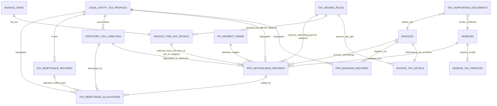
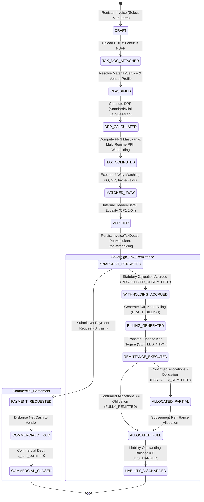

# EPMS UBD & TVM — PHASE 2B STEP 3
# DATABASE SCHEMA SPECIFICATION: PPN & PPh TAX INTEGRATION
## Authoritative Technical Specification for MySQL 8 / TypeORM Finance Tax Data Structures, Relational Invariants, and Transaction Lifecycles

**Document Version:** 1.3.2 (Authoritative Baseline)  
**Specification Status:** SPECIFICATION REVIEW CLOSED — ACCEPTED  
**Pre-Step 4 Gate Status:** BLOCKED — GOVERNANCE APPROVAL REQUIRED  
**Document Path:** `docs/audit/EPMS_PHASE_2B_STEP_3_DATABASE_SCHEMA_SPECIFICATION.md`  
**Governing Architectural Baseline:** [`docs/audit/EPMS_PHASE_2B_STEP_2_PPN_PPH_TECHNICAL_DESIGN.md`](file:///c:/Users/UBDOPS3/Herd/epms_tvmubd/docs/audit/EPMS_PHASE_2B_STEP_2_PPN_PPH_TECHNICAL_DESIGN.md) (v1.1.1)  
**Governance Gate Register Reference:** [`docs/audit/EPMS_PHASE_2B_STEP_3_CLOSURE_AND_GOVERNANCE_GATE.md`](file:///c:/Users/UBDOPS3/Herd/epms_tvmubd/docs/audit/EPMS_PHASE_2B_STEP_3_CLOSURE_AND_GOVERNANCE_GATE.md)  
**Governance Audit Reference:** [`docs/audit/EPMS_PHASE_2B_STEP_2_PPN_PPH_GOVERNANCE_CORRECTION_AUDIT.md`](file:///c:/Users/UBDOPS3/Herd/epms_tvmubd/docs/audit/EPMS_PHASE_2B_STEP_2_PPN_PPH_GOVERNANCE_CORRECTION_AUDIT.md)  
**Git Baseline Commit:** `ba8987d5336de10557caa35fc2d9f6547c789bd8` (Branch: `main`)  
**Execution Mode:** STRICT DESIGN & SCHEMA SPECIFICATION (Zero Application Code, Schema, or Migration Execution Authorized)  
**Date:** November 13, 2026  

---

## 1. Document Control & Executive Summary

### 1.1 Objective & Context
This specification provides an authoritative, repository-grounded database schema specification for integrating Indonesian Value Added Tax (PPN / *Pajak Pertambahan Nilai*) and Withholding Income Tax (PPh / *Pajak Penghasilan*) controls into the existing Enterprise Project Management System (EPMS) serving **PT Urus Bangun Digital (PT UBD)** and **PT Trans Visi Media (PT TVM)**.

This checkpoint transitions the validated architectural requirements from Phase 2B Step 2 into an actionable technical database specification. It defines:
1. How existing core Procurement and Finance tables relate to proposed tax data structures.
2. The detailed schema, attributes, constraints, indexes, and TypeORM mapping types for exactly **11 proposed tax tables** (preserving the approved 11-table architecture without table bloat).
3. The invoice-to-PO reference model, supporting both physical goods consumption and milestone-based Down Payment / Retention invoices under CP1.2-04.
4. The authoritative multi-company ownership derivation mechanism preserving entity identity from originating Projects/Tenders without duplicate tax calculation engines (`DEC-TAX-07`).
5. The decoupled dual-entry cash settlement and sovereign tax remittance reconciliation workflows (`DEC-TAX-08`), with provable relational integrity across withholding records, remittances, and statutory liability ledgers.
6. Absolute formula consistency with the governing Step 2 baseline: the canonical Six-Dimension Financial Settlement Model ($L_{\text{comm}}$, $D_{\text{cash}}$, $W_{\text{tax}}$, $W_{\text{wapu\_ppn}}$, $P_{\text{ded}}$, $L_{\text{rem\_comm}}$, $L_{\text{tax\_stat}}$) is applied without arbitrary adjustment terms (`Correction 1`).
7. Complete audit traceability from individual commercial invoice items to authoritative PPh tax regime rules, enforcing rule category constraints (`tax_category = 'PPH'`), capturing rule versions, and explicitly representing non-withholding deliverables (`Correction 2`).
8. Engine-enforced referential identity locking between `invoice_item_tax_details` and `pph_withholding_records`: an item-derived withholding record is physically prevented from referencing a different PPh rule from the one determined for its originating commercial line deliverable (`Correction v1.3.2`).
9. A rigorous three-tier boundary separating verified repository facts, proposed schema specifications, and unresolved statutory legal decisions.

### 1.2 Mandatory Operational & Governance Constraints
- **Zero Software Implementation:** No backend or frontend application code is modified or staged.
- **Zero Database Migration Execution:** No database schema alterations, DDL scripts, or TypeORM migration runs are authorized during this checkpoint.
- **Decision Status Integrity:** Canonical architectural decision **`DEC-TAX-07` remains strictly `OPEN — ARCHITECTURAL DECISION (DESIGN CLARIFIED, PENDING FORMAL SIGN-OFF)`**.
- **Settlement Invariant Open Status:** Decision **`DEC-TAX-08` remains strictly `OPEN — ARCHITECTURAL & TECHNICAL DECISION`** pending formal approval of the Dual-Entry Settlement Engine.
- **Canonical Decision Fidelity:** Decisions `DEC-TAX-01` through `DEC-TAX-08` are preserved exactly as defined in the governing Step 2 baseline (v1.1.1).
- **Preservation of Existing Worktree:** All existing tracked changes in Procurement and Finance (7 files from completed CP1.2 checkpoints) are preserved untouched.
- **Scope Protection:** No redesign of existing Procurement, Finance, Payment, PMO Assignment, or PM Access Rules is permitted.

---

## 2. Existing Entity and Relation Mapping (Verified Repository Facts)

### 2.1 Repository Entity Baseline
An audit of `backend/src/entities/*.ts` and `backend/src/migrations/*.ts` establishes the existing data architecture across Procurement and Finance. 

> [!IMPORTANT]
> **Verified Repository Fact on Company Ownership:**  
> In the current repository codebase, **zero entities possess a `company_code` column**. While technical parent-child foreign keys (`projectId`, `poId`, `invoiceId`) are verified in source code, **parent relationships do NOT prove that company ownership is currently inherited**, because parents lack `company_code`. Therefore, all existing application entities are classified as **`NOT VERIFIED IN SOURCE`** for current company ownership.

The audit mapped exactly **14 verified existing application and master entities** across Procurement, Warehouse/Engineering, and Finance that interface with the tax subsystem:

| Entity Name | Table Name | Primary Key | Key Foreign Keys in Source | Verified Source Relation Path | Current Company Ownership Status | Planned Step 3/4 Target Ownership Model | Source Entity File |
|:---|:---|:---|:---|:---|:---:|:---:|:---|
| **`Project`** | `projects` | `id` (`INT`) | `contractId` (`contract_id`, `BIGINT UNSIGNED`, nullable) | Optional FK $\rightarrow$ `contracts.id` | `NOT VERIFIED IN SOURCE` | `PROPOSED DIRECT — NOT IMPLEMENTED` | `project.entity.ts` |
| **`Tender`** | `tenders` | `id` (`BIGINT UNSIGNED`) | `customer_id` (`BIGINT UNSIGNED`) | FK $\rightarrow$ `customers.id` | `NOT VERIFIED IN SOURCE` | `PROPOSED DIRECT — NOT IMPLEMENTED` | `tender.entity.ts` |
| **`PurchaseRequest`** | `purchase_requests` | `id` (`INT`) | `projectId` (`project_id`, `INT`) | FK $\rightarrow$ `projects.id` | `NOT VERIFIED IN SOURCE` | `PROPOSED INHERITED — NOT IMPLEMENTED` | `purchase-request.entity.ts` |
| **`PurchaseOrder`** | `purchase_orders` | `id` (`INT`) | `purchaseRequestId` (`pr_id`, `INT`), `vendorId` (`vendor_id`, `BIGINT`) | FK $\rightarrow$ `purchase_requests.id`, FK $\rightarrow$ `vendors.id` | `NOT VERIFIED IN SOURCE` | `PROPOSED DIRECT — NOT IMPLEMENTED` | `purchase-order.entity.ts` |
| **`PurchaseOrderItem`** | `purchase_order_items` | `id` (`INT`) | `purchaseOrderId` (`purchase_order_id`, `INT`), `prItemId` | FK $\rightarrow$ `purchase_orders.id` (CASCADE) | `NOT VERIFIED IN SOURCE` | `PROPOSED INHERITED — NOT IMPLEMENTED` | `purchase-order-item.entity.ts` |
| **`PoPaymentTerm`** | `po_payment_terms` | `id` (`BIGINT`) | `poId` (`po_id`, `BIGINT`) | FK $\rightarrow$ `purchase_orders.id` (CASCADE) | `NOT VERIFIED IN SOURCE` | `PROPOSED INHERITED — NOT IMPLEMENTED` | `po-payment-term.entity.ts` |
| **`GoodsReceipt`** | `goods_receipts` | `id` (`INT`) | `poId` (`po_id`, `INT`) | FK $\rightarrow$ `purchase_orders.id` (RESTRICT) | `NOT VERIFIED IN SOURCE` | `PROPOSED INHERITED — NOT IMPLEMENTED` | `goods-receipt.entity.ts` |
| **`GoodsReceiptItem`**| `goods_receipt_items` | `id` (`INT`) | `grId` (`gr_id`, `INT`), `poItemId` (`po_item_id`, `INT`) | FK $\rightarrow$ `goods_receipts.id`, FK $\rightarrow$ `po_items.id` | `NOT VERIFIED IN SOURCE` | `PROPOSED INHERITED — NOT IMPLEMENTED` | `goods-receipt-item.entity.ts` |
| **`ServiceClaim`** | `service_claims` | `id` (`BIGINT UNSIGNED`) | `poId` (`po_id`, `BIGINT UNSIGNED`), `projectId` (`project_id`) | FK $\rightarrow$ `purchase_orders.id`, FK $\rightarrow$ `projects.id` | `NOT VERIFIED IN SOURCE` | `PROPOSED INHERITED — NOT IMPLEMENTED` | `service-claim.entity.ts` |
| **`Invoice`** | `invoices` | `id` (`INT`) | `poId` (`po_id`, `INT`), `paymentTermId`, `serviceClaimId` | FK $\rightarrow$ `purchase_orders.id`, FK $\rightarrow$ `terms.id`, FK $\rightarrow$ `claims.id` | `NOT VERIFIED IN SOURCE` | `PROPOSED DIRECT — NOT IMPLEMENTED` | `invoice.entity.ts` |
| **`InvoiceItem`** | `invoice_items` | `id` (`INT`) | `invoiceId` (`invoice_id`, `INT`), `poItemId` (`po_item_id`, nullable) | FK $\rightarrow$ `invoices.id` (CASCADE), FK $\rightarrow$ `po_items.id` | `NOT VERIFIED IN SOURCE` | `PROPOSED INHERITED — NOT IMPLEMENTED` | `invoice-item.entity.ts` |
| **`Vendor`** | `vendors` | `id` (`BIGINT`) | None | Master Data Entity | `NOT VERIFIED IN SOURCE` | `SHARED MASTER — NOT RESTRICTED` | `vendor.entity.ts` |
| **`PaymentRequest`** | `payment_requests` | `id` (`INT`) | `invoiceId` (`invoice_id`, `INT`) | FK $\rightarrow$ `invoices.id` (RESTRICT) | `NOT VERIFIED IN SOURCE` | `PROPOSED DIRECT — NOT IMPLEMENTED` | `payment-request.entity.ts` |
| **`Payment`** | `payments` | `id` (`INT`) | `invoiceId` (`invoice_id`, `INT`), `paymentRequestId` | FK $\rightarrow$ `invoices.id`, FK $\rightarrow$ `payment_requests.id` | `NOT VERIFIED IN SOURCE` | `PROPOSED DIRECT — NOT IMPLEMENTED` | `payment.entity.ts` |

---

## 3. Proposed Tax Domain Schema Specification

To integrate Indonesian tax requirements without disrupting existing procurement workflows, **exactly eleven dedicated tax tables** are specified. All tables utilize MySQL 8 InnoDB engine, strict `DECIMAL(19, 2)` monetary columns, arbitrary-precision rate representations, and fail-closed state machines.

### 3.1 Entity Taxpayer Master: `legal_entity_tax_profiles`
- **Owning Module:** Governance & Finance Master Data
- **Business Purpose:** Authoritative tax registration registry for PT UBD and PT TVM. Enforces unverified status defaults until official SPPKP/KMK decrees are validated (`DEC-TAX-01`, `DEC-TAX-02`).

```sql
CREATE TABLE `legal_entity_tax_profiles` (
  `id` BIGINT UNSIGNED NOT NULL AUTO_INCREMENT,
  `company_code` VARCHAR(10) NOT NULL COMMENT 'Strict entity code: UBD or TVM',
  `legal_name` VARCHAR(200) NOT NULL COMMENT 'Registered corporate legal name',
  `npwp16` VARCHAR(16) NULL DEFAULT NULL COMMENT 'Authoritative 16-digit unified tax ID / NIK',
  `nitku` VARCHAR(22) NULL DEFAULT NULL COMMENT 'Nomor Identitas Tempat Kegiatan Usaha (branch identifier)',
  `tax_office_code` VARCHAR(10) NULL DEFAULT NULL COMMENT 'Authoritative KPP Pratama code',
  `pkp_status` ENUM('UNVERIFIED', 'PKP', 'NON_PKP') NOT NULL DEFAULT 'UNVERIFIED' COMMENT 'Statutory PKP status (DEC-TAX-01)',
  `pkp_confirmation_number` VARCHAR(50) NULL DEFAULT NULL COMMENT 'Official SPPKP decree reference number',
  `pkp_effective_date` DATE NULL DEFAULT NULL COMMENT 'Date SPPKP became legally binding',
  `is_wapu` BOOLEAN NOT NULL DEFAULT FALSE COMMENT 'Technical toggle: WAPU functionality disabled until verified (DEC-TAX-02)',
  `wapu_appointment_decree` VARCHAR(100) NULL DEFAULT NULL COMMENT 'Official KMK/PMK appointment decree number',
  `wapu_effective_date` DATE NULL DEFAULT NULL COMMENT 'Date WAPU appointment became legally binding',
  `created_at` DATETIME NOT NULL DEFAULT CURRENT_TIMESTAMP,
  `updated_at` DATETIME NOT NULL DEFAULT CURRENT_TIMESTAMP ON UPDATE CURRENT_TIMESTAMP,
  PRIMARY KEY (`id`),
  UNIQUE KEY `uk_letp_company_code` (`company_code`),
  CONSTRAINT `chk_letp_company_code` CHECK (`company_code` IN ('UBD', 'TVM')),
  CONSTRAINT `chk_letp_npwp16_format` CHECK (`npwp16` IS NULL OR `npwp16` REGEXP '^[0-9]{16}$'),
  CONSTRAINT `chk_letp_pkp_proof` CHECK (
    (`pkp_status` = 'PKP' AND `pkp_confirmation_number` IS NOT NULL AND `npwp16` IS NOT NULL) OR
    (`pkp_status` <> 'PKP')
  ),
  CONSTRAINT `chk_letp_wapu_proof` CHECK (
    (`is_wapu` = TRUE AND `wapu_appointment_decree` IS NOT NULL) OR
    (`is_wapu` = FALSE)
  )
) ENGINE=InnoDB DEFAULT CHARSET=utf8mb4 COLLATE=utf8mb4_unicode_ci;
```

### 3.2 Vendor Tax Profile: `vendor_tax_profiles`
- **Owning Module:** Procurement (Vendors) / Finance
- **Business Purpose:** Extends `vendors` master with verified Indonesian statutory withholding and VAT attributes. Implements explicit `'UNVERIFIED'` defaults.

```sql
CREATE TABLE `vendor_tax_profiles` (
  `id` BIGINT UNSIGNED NOT NULL AUTO_INCREMENT,
  `vendor_id` BIGINT NOT NULL COMMENT 'FK to existing vendors.id',
  `npwp16` VARCHAR(16) NULL DEFAULT NULL COMMENT 'Validated 16-digit NPWP or NIK',
  `nitku` VARCHAR(22) NULL DEFAULT NULL COMMENT '22-digit NITKU branch identifier',
  `tax_residency` ENUM('UNVERIFIED', 'DOMESTIC', 'FOREIGN') NOT NULL DEFAULT 'UNVERIFIED',
  `entity_type` ENUM('UNVERIFIED', 'BADAN', 'ORANG_PRIBADI') NOT NULL DEFAULT 'UNVERIFIED',
  `pkp_status` ENUM('UNVERIFIED', 'PKP', 'NON_PKP') NOT NULL DEFAULT 'UNVERIFIED',
  `pkp_confirmation_number` VARCHAR(50) NULL DEFAULT NULL COMMENT 'SPPKP number if PKP',
  `tax_classification` ENUM('UNVERIFIED', 'STANDARD_CORPORATE', 'CONSTRUCTION_SERVICE', 'MICRO_UMKM', 'EXEMPT') NOT NULL DEFAULT 'UNVERIFIED',
  `sbu_qualification` ENUM('UNVERIFIED', 'NONE', 'KECIL', 'MENENGAH_BESAR', 'SPESIALIS', 'TIDAK_BERSERTIFIKAT') NOT NULL DEFAULT 'UNVERIFIED' COMMENT 'LPJK SBU rating tier (DEC-TAX-06)',
  `sbu_expiry_date` DATE NULL DEFAULT NULL,
  `has_skb_pph` BOOLEAN NOT NULL DEFAULT FALSE COMMENT 'Surat Keterangan Bebas PPh flag',
  `skb_expiry_date` DATE NULL DEFAULT NULL,
  `has_suket_pp55` BOOLEAN NOT NULL DEFAULT FALSE COMMENT 'Surat Keterangan PP 55 (0.5% UMKM) flag',
  `suket_pp55_expiry_date` DATE NULL DEFAULT NULL,
  `created_at` DATETIME NOT NULL DEFAULT CURRENT_TIMESTAMP,
  `updated_at` DATETIME NOT NULL DEFAULT CURRENT_TIMESTAMP ON UPDATE CURRENT_TIMESTAMP,
  PRIMARY KEY (`id`),
  UNIQUE KEY `uk_vtp_vendor_id` (`vendor_id`),
  CONSTRAINT `fk_vtp_vendor_id` FOREIGN KEY (`vendor_id`) REFERENCES `vendors` (`id`) ON DELETE RESTRICT ON UPDATE CASCADE,
  CONSTRAINT `chk_vtp_npwp16_format` CHECK (`npwp16` IS NULL OR `npwp16` REGEXP '^[0-9]{16}$'),
  CONSTRAINT `chk_vtp_skb_expiry` CHECK ((`has_skb_pph` = FALSE) OR (`has_skb_pph` = TRUE AND `skb_expiry_date` IS NOT NULL)),
  CONSTRAINT `chk_vtp_suket_expiry` CHECK ((`has_suket_pp55` = FALSE) OR (`has_suket_pp55` = TRUE AND `suket_pp55_expiry_date` IS NOT NULL))
) ENGINE=InnoDB DEFAULT CHARSET=utf8mb4 COLLATE=utf8mb4_unicode_ci;
```

### 3.3 Tax Regime Rule Registry: `tax_regime_rules` (Correction 2)
- **Owning Module:** Finance (Tax Administration)
- **Business Purpose:** Configurable, versioned statutory tax rules with fail-closed activation barriers (`is_active = FALSE`, `verification_status = 'NOT_VERIFIED'`).
- **Targeted Relational Extension (Correction 2):** Incorporates `UNIQUE KEY uk_trr_id_category (id, tax_category)` enabling composite foreign keys from `invoice_item_tax_details` and `pph_withholding_records` to guarantee that only rules with `tax_category = 'PPH'` can be referenced as PPh withholding rules.

```sql
CREATE TABLE `tax_regime_rules` (
  `id` BIGINT UNSIGNED NOT NULL AUTO_INCREMENT,
  `regime_code` VARCHAR(50) NOT NULL COMMENT 'Canonical identifier, e.g. PPN_STANDARD_11, PPH_23_SERVICE_2',
  `tax_category` ENUM('PPN', 'PPH') NOT NULL COMMENT 'Orthogonal tax regime classification',
  `name` VARCHAR(150) NOT NULL COMMENT 'Display name of statutory regime',
  `description` TEXT NULL DEFAULT NULL,
  `formula_type` ENUM('STANDARD_RATE', 'NILAI_LAIN_11_12', 'BESARAN_TERTENTU', 'FLAT_RATE', 'PROGRESSIVE_TER') NOT NULL,
  `statutory_rate` DECIMAL(7, 4) NOT NULL COMMENT 'Statutory base percentage, e.g. 0.1100, 0.0200, 0.0175',
  `effective_rate_multiplier` DECIMAL(7, 4) NOT NULL DEFAULT 1.0000 COMMENT 'DPP multiplier, e.g. 0.9167 for 11/12, 0.1000 for Besaran 1.1%',
  `governing_regulation` VARCHAR(100) NOT NULL COMMENT 'Statutory decree, e.g. UU PPN Pasal 7 stdtd UU HPP, PMK 141/2015',
  `effective_from` DATE NOT NULL COMMENT 'Statutory effective date',
  `effective_to` DATE NULL DEFAULT NULL COMMENT 'Statutory sunset date (null if active indefinitely)',
  `statutory_trigger_type` ENUM('PAYMENT', 'DUE_DATE', 'END_OF_MONTH', 'INVOICE_SUBMISSION') NOT NULL,
  `verification_status` ENUM('NOT_VERIFIED', 'VERIFIED') NOT NULL DEFAULT 'NOT_VERIFIED' COMMENT 'Fail-closed verification gate',
  `is_active` BOOLEAN NOT NULL DEFAULT FALSE COMMENT 'Operational toggle: inactive until formally verified',
  `version` INT NOT NULL DEFAULT 1 COMMENT 'Optimistic locking and rule versioning',
  `created_at` DATETIME NOT NULL DEFAULT CURRENT_TIMESTAMP,
  `updated_at` DATETIME NOT NULL DEFAULT CURRENT_TIMESTAMP ON UPDATE CURRENT_TIMESTAMP,
  PRIMARY KEY (`id`),
  UNIQUE KEY `uk_trr_code_version` (`regime_code`, `version`),
  UNIQUE KEY `uk_trr_id_category` (`id`, `tax_category`),
  INDEX `idx_trr_category_active` (`tax_category`, `is_active`, `effective_from`),
  CONSTRAINT `chk_trr_rate_bounds` CHECK (`statutory_rate` >= 0.0000 AND `statutory_rate` <= 1.0000),
  CONSTRAINT `chk_trr_effective_dates` CHECK (`effective_to` IS NULL OR `effective_to` >= `effective_from`)
) ENGINE=InnoDB DEFAULT CHARSET=utf8mb4 COLLATE=utf8mb4_unicode_ci;
```

### 3.4 Authoritative Invoice Tax Header Snapshot: `invoice_tax_details` (Correction 1)
- **Owning Module:** Finance (Invoices)
- **Business Purpose:** Immutable 1:1 invoice tax header snapshot recording authoritative tax determination upon invoice verification. Reconciles previous draft references to `invoice_tax_summaries`.
- **Targeted Rectification on Settlement Math (Correction 1):** The database CHECK constraint and column definitions match the governing Step 2 v1.1.1 baseline formula exactly: $D_{\text{cash}} = L_{\text{comm}} - W_{\text{tax}} - W_{\text{wapu\_ppn}} - P_{\text{ded}}$. Non-baseline adjustment terms ($A_{\text{adj}}$) are strictly excluded from the canonical payable computation.

```sql
CREATE TABLE `invoice_tax_details` (
  `id` BIGINT UNSIGNED NOT NULL AUTO_INCREMENT,
  `invoice_id` INT NOT NULL COMMENT '1:1 FK to existing invoices.id',
  `tax_regime_ppn_id` BIGINT UNSIGNED NULL DEFAULT NULL COMMENT 'FK to applied PPN tax_regime_rules.id (null if exempt/non-taxable)',
  `primary_pph_regime_id` BIGINT UNSIGNED NULL DEFAULT NULL COMMENT 'FK to tax_regime_rules.id if single regime applies; null if multi-regime or exempt',
  `has_multiple_pph_regimes` BOOLEAN NOT NULL DEFAULT FALSE COMMENT 'Flag indicating invoice carries multiple PPh regimes across its lines',
  `pricing_mode` ENUM('TAX_EXCLUSIVE', 'TAX_INCLUSIVE') NOT NULL DEFAULT 'TAX_EXCLUSIVE',
  `dpp_amount` DECIMAL(19, 2) NOT NULL DEFAULT 0.00 COMMENT 'Dasar Pengenaan Pajak (Taxable Base)',
  `ppn_rate` DECIMAL(7, 4) NOT NULL DEFAULT 0.0000 COMMENT 'Applied PPN rate',
  `ppn_amount` DECIMAL(19, 2) NOT NULL DEFAULT 0.00 COMMENT 'Calculated PPN Masukan amount',
  `vat_creditability` ENUM('UNVERIFIED', 'CREDITABLE', 'NON_CREDITABLE', 'EXEMPT') NOT NULL DEFAULT 'UNVERIFIED' COMMENT 'Fail-closed creditability status under DEC-TAX-05',
  `total_pph_amount` DECIMAL(19, 2) NOT NULL DEFAULT 0.00 COMMENT 'Aggregate statutory PPh withholding amount across all records (W_tax)',
  `gross_commercial_liability` DECIMAL(19, 2) NOT NULL DEFAULT 0.00 COMMENT 'L_comm = DPP + PPN (matches invoices.total_amount under non-WAPU)',
  `wapu_ppn_amount` DECIMAL(19, 2) NOT NULL DEFAULT 0.00 COMMENT 'W_wapu_ppn (WAPU PPN withheld; default 0.00 until DEC-TAX-02 approved)',
  `contractual_deductions` DECIMAL(19, 2) NOT NULL DEFAULT 0.00 COMMENT 'P_ded (penalties, retention offsets, DP amortization under DEC-TAX-03/04)',
  `vendor_net_payable` DECIMAL(19, 2) NOT NULL DEFAULT 0.00 COMMENT 'Canonical net cash payable to vendor: D_cash = L_comm - W_tax - W_wapu_ppn - P_ded',
  `tax_rule_version_snapshot` JSON NOT NULL COMMENT 'Immutable audit snapshot of applied statutory rule parameters',
  `pph_regimes_summary` JSON NULL DEFAULT NULL COMMENT 'Structured array of all applied PPh regimes, bases, rates, and amounts',
  `created_at` DATETIME NOT NULL DEFAULT CURRENT_TIMESTAMP,
  `updated_at` DATETIME NOT NULL DEFAULT CURRENT_TIMESTAMP ON UPDATE CURRENT_TIMESTAMP,
  PRIMARY KEY (`id`),
  UNIQUE KEY `uk_itd_invoice_id` (`invoice_id`),
  INDEX `idx_itd_ppn_regime` (`tax_regime_ppn_id`),
  INDEX `idx_itd_primary_pph_regime` (`primary_pph_regime_id`),
  CONSTRAINT `fk_itd_invoice_id` FOREIGN KEY (`invoice_id`) REFERENCES `invoices` (`id`) ON DELETE CASCADE ON UPDATE CASCADE,
  CONSTRAINT `fk_itd_ppn_regime` FOREIGN KEY (`tax_regime_ppn_id`) REFERENCES `tax_regime_rules` (`id`) ON DELETE RESTRICT ON UPDATE CASCADE,
  CONSTRAINT `fk_itd_primary_pph_regime` FOREIGN KEY (`primary_pph_regime_id`) REFERENCES `tax_regime_rules` (`id`) ON DELETE RESTRICT ON UPDATE CASCADE,
  CONSTRAINT `chk_itd_positive_monetary` CHECK (
    `dpp_amount` >= 0.00 AND `ppn_amount` >= 0.00 AND `total_pph_amount` >= 0.00 AND
    `gross_commercial_liability` >= 0.00 AND `wapu_ppn_amount` >= 0.00 AND
    `contractual_deductions` >= 0.00 AND `vendor_net_payable` >= 0.00
  ),
  CONSTRAINT `chk_itd_gross_commercial_math` CHECK (
    `gross_commercial_liability` = `dpp_amount` + `ppn_amount`
  ),
  CONSTRAINT `chk_itd_net_payable_math` CHECK (
    `vendor_net_payable` = `gross_commercial_liability` - `total_pph_amount` - `wapu_ppn_amount` - `contractual_deductions`
  )
) ENGINE=InnoDB DEFAULT CHARSET=utf8mb4 COLLATE=utf8mb4_unicode_ci;
```

### 3.5 Line-Level Invoice Tax Extension: `invoice_item_tax_details` (Correction 2 & v1.3.2)
- **Owning Module:** Finance (Invoices)
- **Business Purpose:** Captures line-by-line tax categorization for multi-item procurement invoices without creating conflicting data structures or table bloat.
- **Architectural Specification on Item-Level PPh Rule Traceability & Candidate Key Definition (v1.3.2):**
  Under Indonesian tax regulations (UU PPh stdtd UU HPP, PP 55/2022, and PMK 141/2015), each commercial line deliverable represents a distinct taxable event. The schema enforces comprehensive audit traceability from commercial items to authoritative tax rules:
  1. **Commercial Line Identity Preservation:** Each commercial deliverable line recorded in `invoice_items` retains its exact original line identity, quantities, and agreed unit prices. It is never artificially split or duplicated into artificial lines.
  2. **1:1 Line Tax Determination:** `invoice_item_tax_details` maintains a strict 1:1 relationship with `invoice_items` via `UNIQUE KEY uk_iitd_invoice_item_id (invoice_item_id)`.
  3. **Composite Candidate Key for Referencing Withholdings:** The table exposes `UNIQUE KEY uk_iitd_item_rule_category (invoice_item_id, pph_tax_regime_rule_id, pph_tax_category)`. This candidate key enables `pph_withholding_records` to reference the exact item-level tax determination directly via foreign key, physically preventing any withholding record from referencing a different PPh rule from its originating invoice item.
  4. **Enforcing `tax_category = 'PPH'` at Database & Service Layers:**
     - *Database Engine Layer (InnoDB):* The table defines `pph_tax_category ENUM('PPN', 'PPH') NULL DEFAULT NULL`. Check constraint `chk_iitd_pph_category_guard` enforces that when `pph_tax_regime_rule_id IS NOT NULL`, `pph_tax_category` must equal `'PPH'`. Composite foreign key `fk_iitd_pph_rule_category` references `tax_regime_rules (id, tax_category)`. Because `tax_regime_rules` defines `UNIQUE KEY uk_trr_id_category (id, tax_category)`, InnoDB physically blocks referencing any rule where `tax_category = 'PPN'`.
     - *Transactional Service Layer:* Before persisting tax determination, `TaxDeterminationService` validates that the referenced rule is verified and active: `SELECT * FROM tax_regime_rules WHERE id = :id AND tax_category = 'PPH' AND is_active = TRUE AND verification_status = 'VERIFIED'`. Attempting to link a PPN rule throws `INVALID_PPH_REGIME_CATEGORY`.
  5. **Explicit Representation of Non-Withholding Lines:** When an item is not subject to withholding (e.g. material goods supply, exempt services under SKB, or below statutory thresholds), `pph_tax_regime_rule_id` and `pph_tax_category` are `NULL`, `line_pph_rate = 0.0000`, `line_pph_amount = 0.00`, and `non_withholding_reason` is explicitly populated with an authoritative reason code (`'MATERIAL_SUPPLY'`, `'SKB_EXEMPT'`, `'PP55_FINAL_05'`, `'NON_TAXABLE_OBJECT'`, `'BELOW_THRESHOLD'`).
  6. **Immutable Rule Version Snapshot:** Column `line_tax_rule_snapshot JSON NOT NULL` captures an immutable audit record of `{ ruleId, regimeCode, version, statutoryRate, effectiveRateMultiplier, governingRegulation, effectiveFrom, effectiveTo }` at invoice verification, guaranteeing that subsequent updates or sunsetting of `tax_regime_rules` cannot alter past tax calculations.
  7. **Technical Boundary on Composite Commercial Lines:** In the 11-table architecture, each commercial line item maps to exactly one tax classification row. If a vendor submits a composite lump-sum line that bundles distinct statutory regimes without itemizing them, Indonesian tax rules (PMK 141/2015) mandate that the entire unbundled line is taxed at the higher service withholding rate unless split into distinct items.

```sql
CREATE TABLE `invoice_item_tax_details` (
  `id` BIGINT UNSIGNED NOT NULL AUTO_INCREMENT,
  `invoice_item_id` INT NOT NULL COMMENT '1:1 FK to existing invoice_items.id',
  `item_tax_category` ENUM('TAXABLE_GOODS', 'TAXABLE_SERVICES', 'NON_TAXABLE', 'EXEMPT') NOT NULL,
  `pph_tax_regime_rule_id` BIGINT UNSIGNED NULL DEFAULT NULL COMMENT 'FK to tax_regime_rules.id for line PPh rule (null if non-withholding)',
  `pph_tax_category` ENUM('PPN', 'PPH') NULL DEFAULT NULL COMMENT 'Category guard: strictly PPH when rule attached; null for non-withholding',
  `line_pph_regime_code` VARCHAR(50) NULL DEFAULT NULL COMMENT 'Canonical PPh regime code matching tax_regime_rules.regime_code (e.g. PPH_23_SERVICE, PPH_FINAL_KONSTRUKSI)',
  `line_pph_rule_version` INT NULL DEFAULT NULL COMMENT 'Exact applied version from tax_regime_rules.version',
  `non_withholding_reason` ENUM('MATERIAL_SUPPLY', 'SKB_EXEMPT', 'PP55_FINAL_05', 'NON_TAXABLE_OBJECT', 'BELOW_THRESHOLD') NULL DEFAULT NULL COMMENT 'Documented reason when pph_tax_regime_rule_id IS NULL',
  `line_dpp` DECIMAL(19, 2) NOT NULL DEFAULT 0.00,
  `line_ppn_rate` DECIMAL(7, 4) NOT NULL DEFAULT 0.0000,
  `line_ppn_amount` DECIMAL(19, 2) NOT NULL DEFAULT 0.00,
  `line_pph_rate` DECIMAL(7, 4) NOT NULL DEFAULT 0.0000,
  `line_pph_amount` DECIMAL(19, 2) NOT NULL DEFAULT 0.00,
  `line_tax_rule_snapshot` JSON NOT NULL COMMENT 'Immutable audit snapshot capturing rule id, code, version, rate, and regulation at verification',
  `created_at` DATETIME NOT NULL DEFAULT CURRENT_TIMESTAMP,
  `updated_at` DATETIME NOT NULL DEFAULT CURRENT_TIMESTAMP ON UPDATE CURRENT_TIMESTAMP,
  PRIMARY KEY (`id`),
  UNIQUE KEY `uk_iitd_invoice_item_id` (`invoice_item_id`),
  UNIQUE KEY `uk_iitd_item_rule_category` (`invoice_item_id`, `pph_tax_regime_rule_id`, `pph_tax_category`),
  INDEX `idx_iitd_pph_rule` (`pph_tax_regime_rule_id`),
  INDEX `idx_iitd_pph_regime` (`line_pph_regime_code`),
  CONSTRAINT `fk_iitd_invoice_item_id` FOREIGN KEY (`invoice_item_id`) REFERENCES `invoice_items` (`id`) ON DELETE CASCADE ON UPDATE CASCADE,
  CONSTRAINT `fk_iitd_pph_rule_category` FOREIGN KEY (`pph_tax_regime_rule_id`, `pph_tax_category`) REFERENCES `tax_regime_rules` (`id`, `tax_category`) ON DELETE RESTRICT ON UPDATE CASCADE,
  CONSTRAINT `chk_iitd_positive_monetary` CHECK (
    `line_dpp` >= 0.00 AND `line_ppn_amount` >= 0.00 AND `line_pph_amount` >= 0.00
  ),
  CONSTRAINT `chk_iitd_pph_category_guard` CHECK (
    (`pph_tax_regime_rule_id` IS NULL AND `pph_tax_category` IS NULL AND `line_pph_rate` = 0.0000 AND `line_pph_amount` = 0.00 AND `non_withholding_reason` IS NOT NULL) OR
    (`pph_tax_regime_rule_id` IS NOT NULL AND `pph_tax_category` = 'PPH' AND `line_pph_regime_code` IS NOT NULL AND `line_pph_rule_version` IS NOT NULL AND `non_withholding_reason` IS NULL)
  )
) ENGINE=InnoDB DEFAULT CHARSET=utf8mb4 COLLATE=utf8mb4_unicode_ci;
```

### 3.6 Input VAT Registry: `ppn_masukan_records`
- **Owning Module:** Finance (Tax Accounting)
- **Business Purpose:** Dedicated Input VAT registry for SPT Masa PPN aggregation, e-Faktur 16-digit NSFP validation, and tax audit defense.
- **Creditability Policy vs Procedural e-Faktur Verification:** `creditability_status` is governed strictly by corporate policy under `DEC-TAX-05` (*Buyer Input VAT Creditability Policy* under Art. 9(8) UU PPN). Procedural verification rules (16-digit NSFP regex, PDF upload, 4-way matching) are technical validation checks kept strictly separate from the corporate creditability policy decision.

```sql
CREATE TABLE `ppn_masukan_records` (
  `id` BIGINT UNSIGNED NOT NULL AUTO_INCREMENT,
  `invoice_id` INT NOT NULL COMMENT 'FK to existing invoices.id',
  `company_code` VARCHAR(10) NOT NULL COMMENT 'Entity ownership: UBD or TVM (DEC-TAX-07)',
  `vendor_tax_id` VARCHAR(16) NOT NULL COMMENT 'Vendor 16-digit NPWP/NIK',
  `faktur_pajak_number` VARCHAR(20) NOT NULL COMMENT '16-digit Nomor Seri Faktur Pajak (NSFP)',
  `faktur_pajak_date` DATE NOT NULL COMMENT 'Official date stated on e-Faktur',
  `transaction_code` VARCHAR(2) NOT NULL COMMENT '2-digit e-Faktur transaction code (01 standard, 02 WAPU, 07/08 exempt)',
  `replacement_code` VARCHAR(1) NOT NULL DEFAULT '0' COMMENT '0 normal, 1 replacement (Faktur Pengganti)',
  `dpp_amount` DECIMAL(19, 2) NOT NULL DEFAULT 0.00,
  `ppn_amount` DECIMAL(19, 2) NOT NULL DEFAULT 0.00,
  `creditability_status` ENUM('UNVERIFIED', 'CREDITABLE', 'NON_CREDITABLE', 'EXEMPT') NOT NULL DEFAULT 'UNVERIFIED' COMMENT 'Fail-closed creditability status under DEC-TAX-05',
  `creditability_verified_by` BIGINT UNSIGNED NULL DEFAULT NULL COMMENT 'User ID of Tax Officer authorizing creditability',
  `creditability_verified_at` DATETIME NULL DEFAULT NULL,
  `creditability_decision_basis` VARCHAR(150) NULL DEFAULT NULL COMMENT 'Corporate tax policy reference under DEC-TAX-05',
  `reporting_period_month` TINYINT UNSIGNED NOT NULL COMMENT 'Tax period month (1-12)',
  `reporting_period_year` SMALLINT UNSIGNED NOT NULL COMMENT 'Tax period year (e.g. 2026)',
  `spt_masa_status` ENUM('UNREPORTED', 'INCLUDED_IN_SPT', 'AUDITED') NOT NULL DEFAULT 'UNREPORTED',
  `validation_status` ENUM('VALID', 'INVALID_NSFP', 'AMOUNT_MISMATCH', 'VENDOR_MISMATCH') NOT NULL DEFAULT 'VALID',
  `created_at` DATETIME NOT NULL DEFAULT CURRENT_TIMESTAMP,
  `updated_at` DATETIME NOT NULL DEFAULT CURRENT_TIMESTAMP ON UPDATE CURRENT_TIMESTAMP,
  PRIMARY KEY (`id`),
  UNIQUE KEY `uk_pmr_nsfp_replacement` (`faktur_pajak_number`, `replacement_code`),
  INDEX `idx_pmr_invoice` (`invoice_id`),
  INDEX `idx_pmr_company_period` (`company_code`, `reporting_period_year`, `reporting_period_month`, `creditability_status`),
  CONSTRAINT `fk_pmr_invoice_id` FOREIGN KEY (`invoice_id`) REFERENCES `invoices` (`id`) ON DELETE RESTRICT ON UPDATE CASCADE,
  CONSTRAINT `chk_pmr_company_code` CHECK (`company_code` IN ('UBD', 'TVM')),
  CONSTRAINT `chk_pmr_nsfp_pattern` CHECK (`faktur_pajak_number` REGEXP '^[0-9]{16}$'),
  CONSTRAINT `chk_pmr_period_month` CHECK (`reporting_period_month` BETWEEN 1 AND 12),
  CONSTRAINT `chk_pmr_positive_monetary` CHECK (`dpp_amount` >= 0.00 AND `ppn_amount` >= 0.00)
) ENGINE=InnoDB DEFAULT CHARSET=utf8mb4 COLLATE=utf8mb4_unicode_ci;
```

### 3.7 Statutory PPh Withholding Ledger: `pph_withholding_records` (Correction 1, 2, 4 & v1.3.2)
- **Owning Module:** Finance (Tax Accounting) — **Authoritative Owner**
- **Business Purpose:** Authoritative detailed withholding ledger. Supports multiple PPh withholding records per invoice. Decoupled from direct remittance linkage (settled via many-to-many allocations).
- **Targeted Relational Correction Applied (Item-to-Withholding PPh Rule Lock - v1.3.2):**
  1. **Direct Referential Lock to Item Determination:** The composite foreign key `fk_pwr_item_tax_determination` references `invoice_item_tax_details (invoice_item_id, pph_tax_regime_rule_id, pph_tax_category)`. This physically guarantees at the database engine level that `tax_regime_rule_id` in `pph_withholding_records` **must exactly match** `invoice_item_tax_details.pph_tax_regime_rule_id`. A withholding record can never reference a different rule from its originating invoice item.
  2. **Non-Withholding Item Lock:** Because non-withholding items have `pph_tax_regime_rule_id = NULL` in `invoice_item_tax_details`, attempting to insert a withholding record with `tax_regime_rule_id NOT NULL` against that `invoice_item_id` fails foreign key evaluation, physically preventing non-withholding items from generating withholding obligations.
  3. **Milestone / Unitemized Withholding Validation Path:** When an invoice is an advance down payment or retention milestone without PO line consumption (`invoice_item_id IS NULL` under CP1.2-04 Rule 4), MySQL MATCH SIMPLE treats the composite foreign key `fk_pwr_item_tax_determination` as satisfied. In that case, `fk_pwr_regime_rule_category` on `(tax_regime_rule_id, pph_tax_category)` independently validates that the rule exists in `tax_regime_rules` and has `tax_category = 'PPH'`.
  4. **Direct Association with `statutory_tax_liabilities`:** Incorporates `statutory_tax_liability_id` and derived period attributes (`tax_period_month`, `tax_period_year`).
  5. **Multi-Dimensional Integrity Constraint:** Implements composite foreign key matching `(company_code, tax_period_year, tax_period_month, pph_regime)` against `statutory_tax_liabilities`.
  6. **Multi-Column Unique Key for Allocation Composite FK:** Defines `uk_pwr_id_dim_liability` on `(id, company_code, tax_period_year, tax_period_month, pph_regime, statutory_tax_liability_id)`.
  7. **Cancellation Invariant:** `chk_pwr_outstanding_math` and `chk_pwr_recognition_status_rules` enforce `outstanding = 0.00` and `total_remitted = 0.00` upon cancellation, while preserving positive `withheld_amount` for audit and requiring audit fields.

```sql
CREATE TABLE `pph_withholding_records` (
  `id` BIGINT UNSIGNED NOT NULL AUTO_INCREMENT,
  `invoice_id` INT NOT NULL COMMENT 'FK to existing invoices.id (1:N support for multiple PPh regimes)',
  `invoice_item_id` INT NULL DEFAULT NULL COMMENT 'Optional FK to specific invoice_items.id for line-derived withholding',
  `tax_regime_rule_id` BIGINT UNSIGNED NOT NULL COMMENT 'FK to authoritative tax_regime_rules.id capturing regime and version',
  `pph_tax_category` ENUM('PPN', 'PPH') NOT NULL DEFAULT 'PPH' COMMENT 'Category guard: strictly PPH',
  `payment_term_id` BIGINT NULL DEFAULT NULL COMMENT 'FK to existing po_payment_terms.id',
  `company_code` VARCHAR(10) NOT NULL COMMENT 'Entity ownership: UBD or TVM (DEC-TAX-07)',
  `vendor_id` BIGINT NOT NULL COMMENT 'FK to existing vendors.id',
  `pph_regime` VARCHAR(30) NOT NULL COMMENT 'Regime code matching invoice_item_tax_details.line_pph_regime_code',
  `tax_period_month` TINYINT UNSIGNED NOT NULL COMMENT 'Month (1-12) derived from trigger date',
  `tax_period_year` SMALLINT UNSIGNED NOT NULL COMMENT 'Year (e.g. 2026) derived from trigger date',
  `statutory_tax_liability_id` BIGINT UNSIGNED NOT NULL COMMENT 'FK to statutory_tax_liabilities.id',
  `taxable_base` DECIMAL(19, 2) NOT NULL DEFAULT 0.00 COMMENT 'DPP for withholding',
  `withholding_rate` DECIMAL(7, 4) NOT NULL DEFAULT 0.0000,
  `withheld_amount` DECIMAL(19, 2) NOT NULL DEFAULT 0.00 COMMENT 'Historical statutory withholding amount (W_tax)',
  `total_remitted_amount` DECIMAL(19, 2) NOT NULL DEFAULT 0.00 COMMENT 'Cumulative valid confirmed remittance allocated to this record',
  `outstanding_withheld_amount` DECIMAL(19, 2) NOT NULL DEFAULT 0.00 COMMENT 'Remaining unremitted statutory obligation (0.00 when CANCELLED)',
  `statutory_trigger_type` ENUM('PAYMENT', 'DUE_DATE', 'END_OF_MONTH') NOT NULL COMMENT 'Operation-of-law trigger type',
  `statutory_trigger_date` DATE NOT NULL COMMENT 'Date operation-of-law obligation arose',
  `recognition_status` ENUM('RECOGNIZED_UNREMITTED', 'PARTIALLY_REMITTED', 'FULLY_REMITTED', 'CANCELLED') NOT NULL DEFAULT 'RECOGNIZED_UNREMITTED',
  `bukti_potong_number` VARCHAR(50) NULL DEFAULT NULL COMMENT 'Official DJP e-Bupot number',
  `bukti_potong_date` DATE NULL DEFAULT NULL,
  `cancellation_reason` VARCHAR(255) NULL DEFAULT NULL COMMENT 'Documented business reason for cancellation',
  `cancelled_by` BIGINT UNSIGNED NULL DEFAULT NULL COMMENT 'User ID of Finance Officer authorizing cancellation',
  `cancelled_at` DATETIME NULL DEFAULT NULL,
  `created_at` DATETIME NOT NULL DEFAULT CURRENT_TIMESTAMP,
  `updated_at` DATETIME NOT NULL DEFAULT CURRENT_TIMESTAMP ON UPDATE CURRENT_TIMESTAMP,
  PRIMARY KEY (`id`),
  UNIQUE KEY `uk_pwr_id_dim_liability` (`id`, `company_code`, `tax_period_year`, `tax_period_month`, `pph_regime`, `statutory_tax_liability_id`),
  INDEX `idx_pwr_invoice` (`invoice_id`),
  INDEX `idx_pwr_item` (`invoice_item_id`),
  INDEX `idx_pwr_rule` (`tax_regime_rule_id`),
  INDEX `idx_pwr_liability` (`statutory_tax_liability_id`),
  INDEX `idx_pwr_company_regime_status` (`company_code`, `pph_regime`, `recognition_status`),
  INDEX `idx_pwr_vendor` (`vendor_id`),
  CONSTRAINT `fk_pwr_invoice_id` FOREIGN KEY (`invoice_id`) REFERENCES `invoices` (`id`) ON DELETE RESTRICT ON UPDATE CASCADE,
  CONSTRAINT `fk_pwr_item_tax_determination` FOREIGN KEY (`invoice_item_id`, `tax_regime_rule_id`, `pph_tax_category`)
    REFERENCES `invoice_item_tax_details` (`invoice_item_id`, `pph_tax_regime_rule_id`, `pph_tax_category`)
    ON DELETE RESTRICT ON UPDATE CASCADE,
  CONSTRAINT `fk_pwr_regime_rule_category` FOREIGN KEY (`tax_regime_rule_id`, `pph_tax_category`)
    REFERENCES `tax_regime_rules` (`id`, `tax_category`)
    ON DELETE RESTRICT ON UPDATE CASCADE,
  CONSTRAINT `fk_pwr_term_id` FOREIGN KEY (`payment_term_id`) REFERENCES `po_payment_terms` (`id`) ON DELETE RESTRICT ON UPDATE CASCADE,
  CONSTRAINT `fk_pwr_vendor_id` FOREIGN KEY (`vendor_id`) REFERENCES `vendors` (`id`) ON DELETE RESTRICT ON UPDATE CASCADE,
  CONSTRAINT `fk_pwr_statutory_liability` FOREIGN KEY (`statutory_tax_liability_id`) REFERENCES `statutory_tax_liabilities` (`id`) ON DELETE RESTRICT ON UPDATE CASCADE,
  CONSTRAINT `fk_pwr_liability_dimensions` FOREIGN KEY (`company_code`, `tax_period_year`, `tax_period_month`, `pph_regime`) REFERENCES `statutory_tax_liabilities` (`company_code`, `tax_period_year`, `tax_period_month`, `tax_regime`) ON DELETE RESTRICT ON UPDATE CASCADE,
  CONSTRAINT `chk_pwr_company_code` CHECK (`company_code` IN ('UBD', 'TVM')),
  CONSTRAINT `chk_pwr_tax_category` CHECK (`pph_tax_category` = 'PPH'),
  CONSTRAINT `chk_pwr_period_month` CHECK (`tax_period_month` BETWEEN 1 AND 12),
  CONSTRAINT `chk_pwr_positive_monetary` CHECK (`taxable_base` >= 0.00 AND `withheld_amount` >= 0.00),
  CONSTRAINT `chk_pwr_rate_bounds` CHECK (`withholding_rate` >= 0.0000 AND `withholding_rate` <= 1.0000),
  CONSTRAINT `chk_pwr_outstanding_math` CHECK (
    (`recognition_status` != 'CANCELLED' AND `outstanding_withheld_amount` = `withheld_amount` - `total_remitted_amount`) OR
    (`recognition_status` = 'CANCELLED' AND `outstanding_withheld_amount` = 0.00)
  ),
  CONSTRAINT `chk_pwr_remitted_bounds` CHECK (`total_remitted_amount` >= 0.00 AND `total_remitted_amount` <= `withheld_amount`),
  CONSTRAINT `chk_pwr_recognition_status_rules` CHECK (
    (`recognition_status` = 'RECOGNIZED_UNREMITTED' AND `total_remitted_amount` = 0.00 AND `outstanding_withheld_amount` = `withheld_amount` AND `withheld_amount` > 0.00 AND `cancellation_reason` IS NULL) OR
    (`recognition_status` = 'PARTIALLY_REMITTED' AND `total_remitted_amount` > 0.00 AND `total_remitted_amount` < `withheld_amount` AND `outstanding_withheld_amount` > 0.00 AND `cancellation_reason` IS NULL) OR
    (`recognition_status` = 'FULLY_REMITTED' AND `total_remitted_amount` = `withheld_amount` AND `outstanding_withheld_amount` = 0.00 AND `cancellation_reason` IS NULL) OR
    (`recognition_status` = 'CANCELLED' AND `total_remitted_amount` = 0.00 AND `outstanding_withheld_amount` = 0.00 AND `withheld_amount` > 0.00 AND `cancellation_reason` IS NOT NULL AND `cancelled_by` IS NOT NULL AND `cancelled_at` IS NOT NULL)
  )
) ENGINE=InnoDB DEFAULT CHARSET=utf8mb4 COLLATE=utf8mb4_unicode_ci;
```

### 3.8 Sovereign Tax Liability Ledger: `statutory_tax_liabilities` (Correction 1 & 2)
- **Owning Module:** Finance (Tax Accounting) — **Authoritative Owner**
- **Business Purpose:** Accumulates unremitted sovereign liabilities ($L_{\text{tax\_stat}}$) owed to Kas Negara per legal entity, tax regime, and tax period. Closed/discharged only when `outstanding_balance == 0.00` and all allocations are verified with valid NTPN proofs.
- **Targeted Corrections Applied:**
  1. **Strict Settlement State Invariant:** Implements `chk_stl_status_invariants` preventing premature `DISCHARGED` status unless `outstanding_balance == 0.00` and `total_withheld_amount > 0.00`.
  2. **Multi-Dimensional Unique Keys:** Adds `uk_stl_id_dimensions` supporting composite foreign keys matching `(id, company_code, tax_period_year, tax_period_month, tax_regime)` from `tax_remittance_allocations`.

```sql
CREATE TABLE `statutory_tax_liabilities` (
  `id` BIGINT UNSIGNED NOT NULL AUTO_INCREMENT,
  `company_code` VARCHAR(10) NOT NULL COMMENT 'Entity ownership: UBD or TVM (DEC-TAX-07)',
  `tax_period_month` TINYINT UNSIGNED NOT NULL COMMENT 'Month (1-12)',
  `tax_period_year` SMALLINT UNSIGNED NOT NULL COMMENT 'Year (e.g. 2026)',
  `tax_regime` VARCHAR(30) NOT NULL COMMENT 'Regime code, e.g. PPH_23_SERVICE, PPH_FINAL_KONSTRUKSI, PPN_WAPU',
  `total_withheld_amount` DECIMAL(19, 2) NOT NULL DEFAULT 0.00 COMMENT 'Cumulative statutory obligations accrued',
  `total_remitted_amount` DECIMAL(19, 2) NOT NULL DEFAULT 0.00 COMMENT 'Cumulative sovereign remittances executed to Kas Negara',
  `outstanding_balance` DECIMAL(19, 2) NOT NULL DEFAULT 0.00 COMMENT 'Remaining sovereign debt owed to state',
  `status` ENUM('OPEN', 'PARTIALLY_SETTLED', 'DISCHARGED') NOT NULL DEFAULT 'OPEN',
  `created_at` DATETIME NOT NULL DEFAULT CURRENT_TIMESTAMP,
  `updated_at` DATETIME NOT NULL DEFAULT CURRENT_TIMESTAMP ON UPDATE CURRENT_TIMESTAMP,
  PRIMARY KEY (`id`),
  UNIQUE KEY `uk_stl_company_period_regime` (`company_code`, `tax_period_year`, `tax_period_month`, `tax_regime`),
  UNIQUE KEY `uk_stl_id_dimensions` (`id`, `company_code`, `tax_period_year`, `tax_period_month`, `tax_regime`),
  CONSTRAINT `chk_stl_company_code` CHECK (`company_code` IN ('UBD', 'TVM')),
  CONSTRAINT `chk_stl_period_month` CHECK (`tax_period_month` BETWEEN 1 AND 12),
  CONSTRAINT `chk_stl_monetary_balances` CHECK (
    `total_withheld_amount` >= 0.00 AND `total_remitted_amount` >= 0.00 AND
    `outstanding_balance` >= 0.00 AND
    `outstanding_balance` = `total_withheld_amount` - `total_remitted_amount`
  ),
  CONSTRAINT `chk_stl_status_invariants` CHECK (
    (`status` = 'OPEN' AND `total_remitted_amount` = 0.00 AND `outstanding_balance` = `total_withheld_amount`) OR
    (`status` = 'PARTIALLY_SETTLED' AND `total_remitted_amount` > 0.00 AND `outstanding_balance` > 0.00) OR
    (`status` = 'DISCHARGED' AND `outstanding_balance` = 0.00 AND `total_withheld_amount` > 0.00) OR
    (`status` = 'OPEN' AND `total_withheld_amount` = 0.00 AND `total_remitted_amount` = 0.00 AND `outstanding_balance` = 0.00)
  )
) ENGINE=InnoDB DEFAULT CHARSET=utf8mb4 COLLATE=utf8mb4_unicode_ci;
```

### 3.9 Tax Remittance Execution Proof: `tax_remittance_records` (Correction 2 & 3)
- **Owning Module:** Payments & Kas/Bank — **Execution Proof Owner**
- **Business Purpose:** Captures bank disbursement proofs and official state receipt numbers (NTPN) for remittances to the State Treasury (*Kas Negara*).
- **Targeted Corrections Applied (Voucher Reversal & Boundary Separation):**
  1. **Draft Billing Support:** NTPN, actual remittance date, bank reference, and executed_by are nullable while in `DRAFT_BILLING`.
  2. **Multi-Dimensional Unique Key:** Adds `uk_trr_id_dimensions` supporting composite foreign keys matching `(id, company_code, tax_period_year, tax_period_month, tax_regime)` from `tax_remittance_allocations`.
  3. **Strict Settled Invariant:** When `remittance_status = 'SETTLED_NTPN'`, valid NTPN, remittance date, bank reference, executed_by, and positive remitted amount are strictly required.
  4. **Strict Reversed Invariants & Database/Service Boundary:**
     - *Single-Row Database Constraint (`chk_trr_status_dependent_fields`):* Enforces that on the remittance row itself, when `remittance_status = 'REVERSED'`, `allocated_amount` must equal `0.00`, `unallocated_amount` must equal `remitted_amount`, and `reversal_reason`, `reversed_by`, and `reversed_at` must be populated.
     - *Cross-Table Transactional Service Guarantee:* Reversal is orchestrated by the Tax Remittance Domain Service as an **atomic, pessimistic write-locked database transaction** (`FOR UPDATE`), deactivating child allocations, decrementing withholdings and liabilities, updating the voucher row, and executing complete rollback on failure.

```sql
CREATE TABLE `tax_remittance_records` (
  `id` BIGINT UNSIGNED NOT NULL AUTO_INCREMENT,
  `remittance_number` VARCHAR(100) NOT NULL COMMENT 'Internal remittance voucher number, e.g. REM-UBD-2026-11-001',
  `company_code` VARCHAR(10) NOT NULL COMMENT 'Entity remitting: UBD or TVM (DEC-TAX-07)',
  `tax_period_month` TINYINT UNSIGNED NOT NULL,
  `tax_period_year` SMALLINT UNSIGNED NOT NULL,
  `tax_regime` VARCHAR(30) NOT NULL,
  `djp_billing_code` VARCHAR(30) NOT NULL COMMENT '15-digit Kode Billing DJP',
  `djp_billing_expired_at` DATETIME NULL DEFAULT NULL,
  `ntpn` VARCHAR(30) NULL DEFAULT NULL COMMENT '16-character NTPN; NULL while in DRAFT_BILLING',
  `remittance_date` DATETIME NULL DEFAULT NULL COMMENT 'Timestamp when funds cleared bank to state; NULL while in DRAFT_BILLING',
  `remitted_amount` DECIMAL(19, 2) NOT NULL COMMENT 'Exact cash amount transferred (S_tax)',
  `allocated_amount` DECIMAL(19, 2) NOT NULL DEFAULT 0.00 COMMENT 'Sum of active allocations to specific withholding records',
  `unallocated_amount` DECIMAL(19, 2) NOT NULL DEFAULT 0.00 COMMENT 'Remaining cash balance available for allocation',
  `bank_reference_number` VARCHAR(100) NULL DEFAULT NULL COMMENT 'Originating bank transaction reference; NULL while in DRAFT_BILLING',
  `bank_account_number` VARCHAR(50) NOT NULL COMMENT 'Disbursing company bank account',
  `remittance_status` ENUM('DRAFT_BILLING', 'SETTLED_NTPN', 'REVERSED') NOT NULL DEFAULT 'DRAFT_BILLING' COMMENT 'Default state for newly generated billing code',
  `executed_by` BIGINT UNSIGNED NULL DEFAULT NULL COMMENT 'User ID of Kas/Bank officer executing payment; NULL while in DRAFT_BILLING',
  `reversal_reason` VARCHAR(255) NULL DEFAULT NULL COMMENT 'Mandatory audit justification for voucher reversal',
  `reversed_by` BIGINT UNSIGNED NULL DEFAULT NULL COMMENT 'User ID of officer authorizing voucher reversal',
  `reversed_at` DATETIME NULL DEFAULT NULL,
  `created_by` BIGINT UNSIGNED NOT NULL COMMENT 'User ID of officer generating draft billing',
  `created_at` DATETIME NOT NULL DEFAULT CURRENT_TIMESTAMP,
  `updated_at` DATETIME NOT NULL DEFAULT CURRENT_TIMESTAMP ON UPDATE CURRENT_TIMESTAMP,
  PRIMARY KEY (`id`),
  UNIQUE KEY `uk_trr_remittance_number` (`remittance_number`),
  UNIQUE KEY `uk_trr_ntpn` (`ntpn`),
  UNIQUE KEY `uk_trr_id_dimensions` (`id`, `company_code`, `tax_period_year`, `tax_period_month`, `tax_regime`),
  INDEX `idx_trr_company_period` (`company_code`, `tax_period_year`, `tax_period_month`, `tax_regime`),
  CONSTRAINT `chk_trr_company_code` CHECK (`company_code` IN ('UBD', 'TVM')),
  CONSTRAINT `chk_trr_period_month` CHECK (`tax_period_month` BETWEEN 1 AND 12),
  CONSTRAINT `chk_trr_positive_amount` CHECK (`remitted_amount` > 0.00),
  CONSTRAINT `chk_trr_allocation_balances` CHECK (
    `allocated_amount` >= 0.00 AND `allocated_amount` <= `remitted_amount` AND
    `unallocated_amount` = `remitted_amount` - `allocated_amount`
  ),
  CONSTRAINT `chk_trr_status_dependent_fields` CHECK (
    (`remittance_status` = 'DRAFT_BILLING' AND `ntpn` IS NULL AND `remittance_date` IS NULL AND `allocated_amount` = 0.00 AND `reversal_reason` IS NULL) OR
    (`remittance_status` = 'SETTLED_NTPN' AND `ntpn` IS NOT NULL AND `remittance_date` IS NOT NULL AND `bank_reference_number` IS NOT NULL AND `executed_by` IS NOT NULL AND `remitted_amount` > 0.00 AND `reversal_reason` IS NULL) OR
    (`remittance_status` = 'REVERSED' AND `allocated_amount` = 0.00 AND `unallocated_amount` = `remitted_amount` AND `reversal_reason` IS NOT NULL AND `reversed_by` IS NOT NULL AND `reversed_at` IS NOT NULL)
  )
) ENGINE=InnoDB DEFAULT CHARSET=utf8mb4 COLLATE=utf8mb4_unicode_ci;
```

### 3.10 Tax Remittance Allocation Ledger: `tax_remittance_allocations` (Correction 1, 2, 3, 4)
- **Owning Module:** Finance (Tax Accounting) / Payments
- **Business Purpose:** Explicit many-to-many allocation ledger resolving the relationship between tax remittances and withholding records/statutory liabilities. Supports single remittances settling multiple withholdings and single withholdings settled across multiple partial remittances.
- **Targeted Corrections Applied (Exact Relational Integrity & Historical Cycles):**
  1. **Enforce Exact Withholding-to-Liability Identity:** Composite foreign key `fk_tra_withholding_dimensions` links `(withholding_record_id, company_code, tax_period_year, tax_period_month, tax_regime, statutory_liability_id)` directly to `pph_withholding_records(id, company_code, tax_period_year, tax_period_month, pph_regime, statutory_tax_liability_id)`.
  2. **Enforce Complete Period & Regime Matching:** Composite foreign keys `fk_tra_remittance_dimensions`, `fk_tra_liability_dimensions`, and `fk_tra_withholding_dimensions` enforce identical `company_code`, `tax_period_year`, `tax_period_month`, and `tax_regime` across the remittance voucher, statutory liability, and withholding record natively in InnoDB.
  3. **Virtual Generated Column for Active Allocation Uniqueness & Historical Cycles:** Virtual generated column `active_allocation_token` (`CASE WHEN allocation_status = 'ALLOCATED' THEN CONCAT(remittance_record_id, '-', withholding_record_id) ELSE NULL END`) indexed by `UNIQUE KEY uk_tra_single_active_allocation` permits unlimited historical `REVERSED` rows (NULL token) while strictly preventing duplicate `ALLOCATED` rows at the engine level.
  4. **Pessimistic Concurrency Locking:** The transactional service executes `SELECT ... FOR UPDATE` on both the remittance voucher and the withholding record prior to allocation insertion, ensuring concurrent requests cannot race.

```sql
CREATE TABLE `tax_remittance_allocations` (
  `id` BIGINT UNSIGNED NOT NULL AUTO_INCREMENT,
  `remittance_record_id` BIGINT UNSIGNED NOT NULL COMMENT 'FK to tax_remittance_records.id',
  `withholding_record_id` BIGINT UNSIGNED NOT NULL COMMENT 'FK to pph_withholding_records.id',
  `statutory_liability_id` BIGINT UNSIGNED NOT NULL COMMENT 'FK to statutory_tax_liabilities.id (locked to withholding record liability)',
  `company_code` VARCHAR(10) NOT NULL COMMENT 'Entity ownership: UBD or TVM (DEC-TAX-07)',
  `tax_period_month` TINYINT UNSIGNED NOT NULL COMMENT 'Tax period month matching remittance and withholding',
  `tax_period_year` SMALLINT UNSIGNED NOT NULL COMMENT 'Tax period year matching remittance and withholding',
  `tax_regime` VARCHAR(30) NOT NULL COMMENT 'Tax regime matching remittance, withholding, and liability',
  `allocated_amount` DECIMAL(19, 2) NOT NULL COMMENT 'Monetary portion of remittance applied to withholding record',
  `allocation_date` DATETIME NOT NULL DEFAULT CURRENT_TIMESTAMP,
  `allocation_status` ENUM('ALLOCATED', 'REVERSED') NOT NULL DEFAULT 'ALLOCATED',
  `active_allocation_token` VARCHAR(64) GENERATED ALWAYS AS (
    CASE WHEN `allocation_status` = 'ALLOCATED' THEN CONCAT(`remittance_record_id`, '-', `withholding_record_id`) ELSE NULL END
  ) VIRTUAL COMMENT 'Unique token populated only for active allocations; NULL for REVERSED to permit repeated historical cycles',
  `allocation_notes` VARCHAR(255) NULL DEFAULT NULL,
  `reversal_reason` VARCHAR(255) NULL DEFAULT NULL COMMENT 'Documented reason for allocation reversal',
  `reversed_by` BIGINT UNSIGNED NULL DEFAULT NULL COMMENT 'User ID of officer authorizing reversal',
  `reversed_at` DATETIME NULL DEFAULT NULL,
  `created_by` BIGINT UNSIGNED NOT NULL COMMENT 'User ID of officer recording allocation',
  `created_at` DATETIME NOT NULL DEFAULT CURRENT_TIMESTAMP,
  PRIMARY KEY (`id`),
  UNIQUE KEY `uk_tra_single_active_allocation` (`active_allocation_token`),
  INDEX `idx_tra_withholding` (`withholding_record_id`),
  INDEX `idx_tra_liability` (`statutory_liability_id`),
  INDEX `idx_tra_dimensions` (`company_code`, `tax_period_year`, `tax_period_month`, `tax_regime`),
  CONSTRAINT `fk_tra_remittance_id` FOREIGN KEY (`remittance_record_id`) REFERENCES `tax_remittance_records` (`id`) ON DELETE RESTRICT ON UPDATE CASCADE,
  CONSTRAINT `fk_tra_withholding_id` FOREIGN KEY (`withholding_record_id`) REFERENCES `pph_withholding_records` (`id`) ON DELETE RESTRICT ON UPDATE CASCADE,
  CONSTRAINT `fk_tra_liability_id` FOREIGN KEY (`statutory_liability_id`) REFERENCES `statutory_tax_liabilities` (`id`) ON DELETE RESTRICT ON UPDATE CASCADE,
  CONSTRAINT `fk_tra_remittance_dimensions` FOREIGN KEY (`remittance_record_id`, `company_code`, `tax_period_year`, `tax_period_month`, `tax_regime`) REFERENCES `tax_remittance_records` (`id`, `company_code`, `tax_period_year`, `tax_period_month`, `tax_regime`) ON DELETE RESTRICT ON UPDATE CASCADE,
  CONSTRAINT `fk_tra_liability_dimensions` FOREIGN KEY (`statutory_liability_id`, `company_code`, `tax_period_year`, `tax_period_month`, `tax_regime`) REFERENCES `statutory_tax_liabilities` (`id`, `company_code`, `tax_period_year`, `tax_period_month`, `tax_regime`) ON DELETE RESTRICT ON UPDATE CASCADE,
  CONSTRAINT `fk_tra_withholding_dimensions` FOREIGN KEY (`withholding_record_id`, `company_code`, `tax_period_year`, `tax_period_month`, `tax_regime`, `statutory_liability_id`) REFERENCES `pph_withholding_records` (`id`, `company_code`, `tax_period_year`, `tax_period_month`, `pph_regime`, `statutory_tax_liability_id`) ON DELETE RESTRICT ON UPDATE CASCADE,
  CONSTRAINT `chk_tra_company_code` CHECK (`company_code` IN ('UBD', 'TVM')),
  CONSTRAINT `chk_tra_period_month` CHECK (`tax_period_month` BETWEEN 1 AND 12),
  CONSTRAINT `chk_tra_allocated_positive` CHECK (`allocated_amount` > 0.00),
  CONSTRAINT `chk_tra_reversal_audit` CHECK (
    (`allocation_status` = 'ALLOCATED' AND `reversal_reason` IS NULL) OR
    (`allocation_status` = 'REVERSED' AND `reversal_reason` IS NOT NULL AND `reversed_by` IS NOT NULL AND `reversed_at` IS NOT NULL)
  )
) ENGINE=InnoDB DEFAULT CHARSET=utf8mb4 COLLATE=utf8mb4_unicode_ci;
```

#### 3.10.1 Explicit Remittance Allocation Enforcement Design
MySQL 8 table-level `CHECK` constraints are strictly evaluated on single rows; they cannot execute subqueries or compute multi-row aggregates across tables. To ensure mathematical and legal integrity without claiming unsupported database features, the mandatory allocation invariants are enforced through a strict division of responsibilities:

| Invariant Rule | Enforcement Layer | Implementation Mechanism & Technical Design |
|:---|:---:|:---|
| **1. Exact Withholding-to-Liability Identity** | **Database Engine Layer** | Enforced natively by composite foreign key `fk_tra_withholding_dimensions`. The database engine physically rejects any allocation where `allocation.statutory_liability_id != withholding.statutory_tax_liability_id`. |
| **2. Full Dimensional Matching (Company, Period, Regime)** | **Database Engine Layer** | Enforced natively by InnoDB composite foreign keys `fk_tra_remittance_dimensions`, `fk_tra_liability_dimensions`, and `fk_tra_withholding_dimensions`. Rejects UBD $\leftrightarrow$ TVM mismatch, month mismatch, or PPh 23 $\leftrightarrow$ PPh 4(2) mismatch. |
| **3. Active Allocation Uniqueness & Historical Cycles** | **Database Engine Layer** | Enforced by virtual generated column `active_allocation_token` with `UNIQUE KEY uk_tra_single_active_allocation`. Permits multiple `REVERSED` rows (NULL token) while strictly preventing duplicate `ALLOCATED` rows. |
| **4. Remittance Capacity Cap:** $\sum \text{allocated} \le \text{remitted\_amount}$ | **Transactional Service Layer** | Lock remittance record: `SELECT * FROM tax_remittance_records WHERE id = ? FOR UPDATE`. Recalculate: `active_allocations = SELECT COALESCE(SUM(allocated_amount), 0) FROM tax_remittance_allocations WHERE remittance_record_id = ? AND allocation_status = 'ALLOCATED'`. Assert `active_allocations + new_allocated <= remitted_amount`. Update `allocated_amount` and `unallocated_amount`. |
| **5. Withholding Obligation Cap:** $\sum \text{allocated} \le \text{withheld\_amount}$ | **Transactional Service Layer** | Lock withholding record: `SELECT * FROM pph_withholding_records WHERE id = ? FOR UPDATE`. Recalculate: `active_allocated = SELECT COALESCE(SUM(allocated_amount), 0) FROM tax_remittance_allocations WHERE withholding_record_id = ? AND allocation_status = 'ALLOCATED'`. Assert `active_allocated + new_allocated <= withheld_amount`. Update `total_remitted_amount` and `outstanding_withheld_amount`. |
| **6. Settled NTPN Source Only** | **Database & Service Layers** | Database: `chk_trr_status_dependent_fields` enforces `allocated_amount = 0.00` if `remittance_status = 'DRAFT_BILLING'`. Service: Assert `remittance.remittance_status === 'SETTLED_NTPN'`. Reject drafts and reversed vouchers. |
| **7. Atomic Reversal & Allocation Deactivation** | **Transactional Service Layer** | Service executes atomic multi-table transaction with pessimistic locks (`FOR UPDATE`): sets child allocation status to `'REVERSED'`, decrements withholding and liability settled totals, restores unallocated cash on voucher, and updates voucher status to `'REVERSED'`. |
| **8. Concurrency Protection & Non-Overlapping** | **Database & Transaction Layer** | Pessimistic write locks (`SELECT ... FOR UPDATE`) on both `tax_remittance_records` and `pph_withholding_records` serialize concurrent allocation requests, preventing race conditions and double-spending of remittance cash. |

### 3.11 Tax Supporting Document Repository: `tax_supporting_documents`
- **Owning Module:** Finance / Procurement
- **Business Purpose:** Electronic repository and validity tracking for tax certificates (SKB PPh, Suket PP 55, LPJK SBU, SPPKP, WAPU Appointment Decrees, PDF e-Faktur, PDF e-Bupot).

```sql
CREATE TABLE `tax_supporting_documents` (
  `id` BIGINT UNSIGNED NOT NULL AUTO_INCREMENT,
  `document_type` ENUM('E_FAKTUR_PDF', 'E_BUPOT_PDF', 'SKB_PPH', 'SUKET_PP55', 'SBU_LPJK', 'SPPKP_DECREE', 'WAPU_DECREE') NOT NULL,
  `entity_type` ENUM('VENDOR', 'INVOICE', 'COMPANY') NOT NULL COMMENT 'Polymorphic target type',
  `entity_id` BIGINT UNSIGNED NOT NULL COMMENT 'ID of target vendor, invoice, or legal_entity_tax_profile',
  `document_number` VARCHAR(100) NOT NULL COMMENT 'Official external certificate/decree number',
  `issued_by` VARCHAR(150) NULL DEFAULT NULL COMMENT 'Issuing authority, e.g. KPP Pratama, LPJK',
  `valid_from` DATE NOT NULL COMMENT 'Start of validity period',
  `valid_to` DATE NULL DEFAULT NULL COMMENT 'Expiration date (null if permanent)',
  `file_path` VARCHAR(255) NOT NULL COMMENT 'Storage path / S3 key for digital proof',
  `mime_type` VARCHAR(50) NOT NULL DEFAULT 'application/pdf',
  `file_size_bytes` BIGINT UNSIGNED NOT NULL,
  `is_verified` BOOLEAN NOT NULL DEFAULT FALSE COMMENT 'Administrative validation gate',
  `verified_by` BIGINT UNSIGNED NULL DEFAULT NULL COMMENT 'User ID of reviewer verifying validity',
  `verified_at` DATETIME NULL DEFAULT NULL,
  `created_at` DATETIME NOT NULL DEFAULT CURRENT_TIMESTAMP,
  PRIMARY KEY (`id`),
  INDEX `idx_tsd_polymorphic` (`entity_type`, `entity_id`, `document_type`),
  INDEX `idx_tsd_validity` (`valid_from`, `valid_to`, `is_verified`),
  CONSTRAINT `chk_tsd_validity_dates` CHECK (`valid_to` IS NULL OR `valid_to` >= `valid_from`)
) ENGINE=InnoDB DEFAULT CHARSET=utf8mb4 COLLATE=utf8mb4_unicode_ci;
```

---

## 4. Relationships, Constraints, and Integrity Invariants

### 4.1 Cross-Table Relationship Matrix

| Source Table | Source Column(s) | Target Table | Target Key | Cardinality | ON DELETE | ON UPDATE | Business Intent |
|:---|:---|:---|:---|:---:|:---:|:---:|:---|
| `vendor_tax_profiles` | `vendor_id` | `vendors` | `id` | 1:1 | `RESTRICT` | `CASCADE` | Vendor tax extension |
| `invoice_tax_details` | `invoice_id` | `invoices` | `id` | 1:1 | `CASCADE` | `CASCADE` | Authoritative invoice tax header snapshot |
| `invoice_tax_details` | `tax_regime_ppn_id` | `tax_regime_rules` | `id` | N:1 | `RESTRICT` | `CASCADE` | Applied PPN statutory rule |
| `invoice_tax_details` | `primary_pph_regime_id` | `tax_regime_rules` | `id` | N:1 | `RESTRICT` | `CASCADE` | Single primary PPh rule (nullable if multi-regime) |
| `invoice_item_tax_details` | `invoice_item_id` | `invoice_items` | `id` | 1:1 | `CASCADE` | `CASCADE` | Line-item tax classification |
| `invoice_item_tax_details` | `pph_tax_regime_rule_id, pph_tax_category` | `tax_regime_rules` | `id, tax_category` | N:1 | `RESTRICT` | `CASCADE` | Line PPh statutory rule (strictly category PPH; null for non-withholding) |
| `ppn_masukan_records` | `invoice_id` | `invoices` | `id` | N:1 | `RESTRICT` | `CASCADE` | Input VAT registry link |
| `pph_withholding_records` | `invoice_id` | `invoices` | `id` | N:1 | `RESTRICT` | `CASCADE` | Statutory withholding link (supports 1:N multi-regime) |
| `pph_withholding_records` | `invoice_item_id, tax_regime_rule_id, pph_tax_category` | `invoice_item_tax_details` | `invoice_item_id, pph_tax_regime_rule_id, pph_tax_category` | N:1 | `RESTRICT` | `CASCADE` | **Item-Level PPh Rule Identity Lock (v1.3.2):** Guarantees withholding uses the exact rule assigned to the invoice item; null for milestone invoices |
| `pph_withholding_records` | `tax_regime_rule_id, pph_tax_category` | `tax_regime_rules` | `id, tax_category` | N:1 | `RESTRICT` | `CASCADE` | Direct PPh rule category validation (strictly category PPH for all withholdings) |
| `pph_withholding_records` | `payment_term_id` | `po_payment_terms` | `id` | N:1 | `RESTRICT` | `CASCADE` | Milestone link (nullable) |
| `pph_withholding_records` | `vendor_id` | `vendors` | `id` | N:1 | `RESTRICT` | `CASCADE` | Vendor withholding target |
| `pph_withholding_records` | `statutory_tax_liability_id` | `statutory_tax_liabilities` | `id` | N:1 | `RESTRICT` | `CASCADE` | Direct sovereign liability bucket association |
| `pph_withholding_records` | `company_code, tax_period_year, tax_period_month, pph_regime` | `statutory_tax_liabilities` | `company_code, tax_period_year, tax_period_month, tax_regime` | N:1 | `RESTRICT` | `CASCADE` | Multi-dimensional constraint preventing cross-entity/period mismatch |
| `tax_remittance_allocations` | `remittance_record_id` | `tax_remittance_records` | `id` | N:1 | `RESTRICT` | `CASCADE` | Remittance voucher source |
| `tax_remittance_allocations` | `withholding_record_id` | `pph_withholding_records` | `id` | N:1 | `RESTRICT` | `CASCADE` | Target withholding obligation discharged |
| `tax_remittance_allocations` | `statutory_liability_id` | `statutory_tax_liabilities` | `id` | N:1 | `RESTRICT` | `CASCADE` | Target sovereign liability ledger discharged |
| `tax_remittance_allocations` | `remittance_record_id, company_code, tax_period_year, tax_period_month, tax_regime` | `tax_remittance_records` | `id, company_code, tax_period_year, tax_period_month, tax_regime` | N:1 | `RESTRICT` | `CASCADE` | Composite FK locking company, period, and regime across remittance and allocation |
| `tax_remittance_allocations` | `statutory_liability_id, company_code, tax_period_year, tax_period_month, tax_regime` | `statutory_tax_liabilities` | `id, company_code, tax_period_year, tax_period_month, tax_regime` | N:1 | `RESTRICT` | `CASCADE` | Composite FK locking company, period, and regime across liability and allocation |
| `tax_remittance_allocations` | `withholding_record_id, company_code, tax_period_year, tax_period_month, tax_regime, statutory_liability_id` | `pph_withholding_records` | `id, company_code, tax_period_year, tax_period_month, pph_regime, statutory_tax_liability_id` | N:1 | `RESTRICT` | `CASCADE` | Composite FK enforcing identical dimensions AND exact statutory liability identity |

### 4.2 Comprehensive ERD of Proposed Tax Architecture



### 4.3 Relational Invariants & Exact Identity Guarantees
The tax schema establishes five provable database engine invariants across withholding, invoicing, and remittance:
1. **Direct Cardinality (1:N):** One `statutory_tax_liabilities` record aggregates multiple `pph_withholding_records` entries.
2. **Exact Liability Identity Invariant:** Through `fk_tra_withholding_dimensions`, `tax_remittance_allocations.statutory_liability_id` is foreign-keyed directly to `pph_withholding_records.statutory_tax_liability_id`. It is physically impossible for an allocation to reference a liability different from the one assigned to the withholding record.
3. **Dimensional Equality Invariant:** The allocation's `(company_code, tax_period_year, tax_period_month, tax_regime)` must match the remittance voucher, the withholding record, AND the statutory liability. If any dimension differs, the insert is rejected by MySQL InnoDB foreign keys.
4. **Historical Cycle & Reversal Support:** Virtual generated column `active_allocation_token` (`CASE WHEN allocation_status = 'ALLOCATED' THEN CONCAT(remittance_id, '-', withholding_id) ELSE NULL END`) allows any number of `REVERSED` allocation entries to be retained in the audit history (since NULLs in MySQL UNIQUE keys never collide), while strictly enforcing that at most one active `ALLOCATED` record can exist for a given pair at any time.
5. **Item-to-Withholding PPh Rule Exact Identity Invariant (`v1.3.2`):**
   Through composite foreign key `fk_pwr_item_tax_determination`, `pph_withholding_records (invoice_item_id, tax_regime_rule_id, pph_tax_category)` references `invoice_item_tax_details (invoice_item_id, pph_tax_regime_rule_id, pph_tax_category)`:
   - **Exact Rule Identity:** When a withholding record is derived from an invoice item (`invoice_item_id IS NOT NULL`), `tax_regime_rule_id` is physically forced by InnoDB to match `invoice_item_tax_details.pph_tax_regime_rule_id`. A withholding record can never reference a different rule from the originating line deliverable.
   - **Non-Withholding Item Lock:** In `invoice_item_tax_details`, non-withholding items have `pph_tax_regime_rule_id = NULL`. Because `tax_regime_rule_id` is NOT NULL in `pph_withholding_records`, attempting to insert a withholding record for a non-withholding item fails foreign key evaluation, physically preventing non-withholding lines from generating withholding records.
   - **MySQL 8 MATCH SIMPLE Semantics for Milestones:** For unitemized milestone invoices (Down Payment or Retention under CP1.2-04 Rule 4, where `invoice_item_id IS NULL`), MySQL InnoDB evaluates the composite foreign key `fk_pwr_item_tax_determination` as satisfied (due to the NULL component). Independent composite foreign key `fk_pwr_regime_rule_category` on `(tax_regime_rule_id, pph_tax_category)` then validates that the milestone rule exists in `tax_regime_rules` and has `tax_category = 'PPH'`.
   - **Company & Invoice Scope Verification:** In the transactional service layer, `TaxDeterminationService` strictly asserts `withholding.invoice_id === invoice_item.invoice_id` and `withholding.company_code === invoice.company_code`, preventing cross-invoice or cross-entity item linkages.

---

## 5. Invoice-to-PO References and Transaction Ownership

### 5.1 Invoice Line Item References (`invoice_items`)
EPMS invoices reference Purchase Orders through two established structural patterns governed by CP1.2-04:
1. **Standard Physical / Service Consumption:**
   - `invoice_items.po_item_id` is non-null and references `purchase_order_items.id`.
   - `invoice_items.quantity` is validated against available capacity (`receivedQuantity` on Goods Receipt for materials; approved claim capacity on Service Claim for services).
   - Commercial unit price equality is asserted: `invoice_items.unit_price == purchase_order_items.unit_price`.
2. **Standalone Advance Down Payment & Retention Milestones (`po_item_id: null`):**
   - In accordance with CP1.2-04 Rule 4, Down Payment and Retention invoices operate without physical PO line consumption.
   - `invoices.po_id` is non-null and references `purchase_orders.id`.
   - `invoices.payment_term_id` references `po_payment_terms.id`.
   - Single milestone line item has `po_item_id: null`.
   - `invoice_tax_details` applies tax rules directly to the milestone value, creating `pph_withholding_records` linked to `invoice_id` and `payment_term_id`.

---

## 6. Multi-Company Ownership Derivation (`DEC-TAX-07`)

### 6.1 Multi-Entity Ownership Architecture
Under `DEC-TAX-07`, transaction ownership is strictly segregated between **PT Urus Bangun Digital (`company_code = 'UBD'`)** and **PT Trans Visi Media (`company_code = 'TVM'`)**.
- Both entities utilize **one shared tax calculation engine**.
- Company code values are strictly `'UBD'` and `'TVM'`.
- `company_code` is derived from the authoritative originating Project or Tender with zero user override.

### 6.2 Proposed Direct vs Inherited Ownership Classification
Because existing repository entities lack `company_code`, their future target ownership is classified into two distinct patterns:

#### Proposed Direct Entities (Anchor Records)
Receive an explicit, indexed `company_code VARCHAR(10) NOT NULL`:
1. `legal_entity_tax_profiles.company_code` (Root Entity Profile)
2. `projects.company_code` (Project Anchor)
3. `tenders.company_code` (Tender Anchor)
4. `purchase_orders.company_code` (Direct Procurement Anchor)
5. `invoices.company_code` (Direct Billing Anchor)
6. `payment_requests.company_code` (Direct Treasury Anchor)
7. `payments.company_code` (Direct Disbursement Anchor)
8. `ppn_masukan_records.company_code` (Direct Tax Registry)
9. `pph_withholding_records.company_code` (Direct Tax Ledger)
10. `statutory_tax_liabilities.company_code` (Direct Tax Ledger)
11. `tax_remittance_records.company_code` (Direct Remittance Voucher)
12. `tax_remittance_allocations.company_code` (Direct Remittance Ledger)

#### Proposed Inherited Entities (Dependent Records)
Derive company ownership strictly from their parent entities:
1. `purchase_order_items` $\rightarrow$ Inherited from `purchase_orders.company_code`
2. `po_payment_terms` $\rightarrow$ Inherited from `purchase_orders.company_code`
3. `goods_receipts` $\rightarrow$ Inherited from `purchase_orders.company_code`
4. `goods_receipt_items` $\rightarrow$ Inherited from `goods_receipts` $\rightarrow$ `purchase_orders.company_code`
5. `service_claims` $\rightarrow$ Inherited from `purchase_orders.company_code`
6. `invoice_items` $\rightarrow$ Inherited from `invoices.company_code`
7. `invoice_item_tax_details` $\rightarrow$ Inherited from `invoice_items` $\rightarrow$ `invoices.company_code`

### 6.3 Orthogonal Attributes: Company Code vs Tax Type
`company_code` and `tax_type` remain strictly distinct, orthogonal dimensions:
- `company_code`: `'UBD'` | `'TVM'` (entity ownership).
- `tax_type`: `'PPN'` | `'PPh'` (statutory tax regime category).
There are no hybrid attributes (e.g. no `UBD_PPN` or `TVM_PPH` columns).

### 6.4 Cross-Company Relationship Mismatch Guard (`PROPOSED CONSTRAINT`)
At the database and service layers, cross-company references are strictly blocked:
```sql
-- Conceptual Assertion for Step 4 Services:
ASSERT child.company_code === parent.company_code
```
Any operation attempting to link an Invoice of `'UBD'` to a PO of `'TVM'` or remit tax for `'UBD'` against a `'TVM'` liability is rejected with `CROSS_COMPANY_RELATIONSHIP_MISMATCH`.

### 6.5 Multi-Level Reporting Query Architecture
The reporting engine supports three distinct query scopes without altering underlying line-item ownership:
1. **PT UBD Scope:** Filtered strictly by `WHERE company_code = 'UBD'`.
2. **PT TVM Scope:** Filtered strictly by `WHERE company_code = 'TVM'`.
3. **Consolidated Scope:** Aggregated set union ($\sum \text{UBD} + \sum \text{TVM}$) preserving the immutable `company_code` attribute on every underlying transaction line (zero loss or blurring of identity).

---

## 7. Invoice-to-Tax Lifecycle & State Transitions

The EPMS tax architecture enforces a clean separation between **Commercial Vendor Debt Settlement** and **Statutory Sovereign Tax Remittance**. Vendor commercial settlement does not wait for sovereign tax remittance; conversely, sovereign tax obligations persist as unremitted state liabilities until formally discharged with validated NTPN proofs.



### 7.1 State Machine Transition Preconditions & Mutation Points

| Stage | State Identifier | Trigger Event | Preconditions Required | Database Mutation Point |
|:---:|:---|:---|:---|:---|
| 1 | `DRAFT` | User registers invoice | Selected PO and Payment Term active; PO status `APPROVED` | Insert into `invoices` (`match_status: 'PENDING'`) |
| 2 | `TAX_DOC_ATTACHED` | Tax document uploaded | NSFP 16-digit format valid; PDF attached | Insert into `tax_supporting_documents` |
| 3 | `CLASSIFIED` | Classification resolved | Item categories (`MATERIAL` vs `SERVICE`) established | Prepare `invoice_item_tax_details` |
| 4 | `DPP_CALCULATED` | Pricing mode resolved | Rule effective dates match invoice date | Compute `line_dpp` and aggregate `dpp_amount` |
| 5 | `TAX_COMPUTED` | Calculation engine run | Active verified rules; vendor tax profile checked | Calculate PPN Masukan and line-level PPh withholdings |
| 6 | `MATCHED_4WAY` | 4-Way matching run | `invPrice == poPrice`, `invQty <= grQty`, `invTax == eFakturTax` | Set `invoices.match_status = 'MATCHED'` |
| 7 | `VERIFIED` | Finance review complete | Header-detail exact equality verified (`CP1.2-04`) | Set `invoices.status = 'VERIFIED'` |
| 8 | `SNAPSHOT_PERSISTED` | Immutable lock | Status `VERIFIED` confirmed | Insert `invoice_tax_details`, `ppn_masukan_records` (`creditability_status: 'UNVERIFIED'`), `pph_withholding_records` (`recognition_status: 'RECOGNIZED_UNREMITTED'`), increment `statutory_tax_liabilities` |
| 9 | `PAYMENT_REQUESTED` | Payment request created | Invoice verified; no existing active payment request | Insert `payment_requests` with financial snapshot ($D_{\text{cash}}$, $W_{\text{tax}}$, $L_{\text{comm}}$) |
| 10 | `COMMERCIALLY_PAID` | Vendor net cash transfer executed | Approved Payment Request; Net cash payment $D_{\text{cash}}$ matches `vendor_net_payable` | Insert into `payments`, set `invoices.payment_status = 'PAID'`, close commercial debt ($L_{\text{rem\_comm}} = 0$). **Statutory tax liabilities remain outstanding.** |
| 11a | `SOVEREIGN_REMITTED_PARTIAL` | Cash remitted to Kas Negara & partial allocation confirmed | NTPN confirmed on source voucher; valid allocation $> 0$ but $< \text{withheld\_amount}$ | Insert `tax_remittance_allocations` (`allocation_status: 'ALLOCATED'`); update `pph_withholding_records` (`recognition_status = 'PARTIALLY_REMITTED'`); update `statutory_tax_liabilities` (`status = 'PARTIALLY_SETTLED'`). **Liability remains open.** |
| 11b | `SOVEREIGN_REMITTED_FULL` | Cash remitted to Kas Negara & full allocation confirmed | NTPN confirmed on source voucher; cumulative valid allocations $== \text{withheld\_amount}$ | Insert `tax_remittance_allocations` (`allocation_status: 'ALLOCATED'`); update `pph_withholding_records` (`recognition_status = 'FULLY_REMITTED'`); when `outstanding_balance == 0.00`, update `statutory_tax_liabilities` (`status = 'DISCHARGED'`). |
| 12 | `WITHHOLDING_CANCELLED` | Invoice cancelled prior to tax remittance | `total_remitted_amount == 0.00`; active allocations count == 0; non-null reason, user, timestamp | Update `pph_withholding_records` (`recognition_status = 'CANCELLED'`, `outstanding_withheld_amount = 0.00`); atomically decrement `statutory_tax_liabilities.total_withheld_amount` and `outstanding_balance`. |
| 13 | `REMITTANCE_REVERSED` | Remittance voucher voided/recalled | Voucher was `SETTLED_NTPN`; non-null reason, user, timestamp | Execute atomic reversal transaction: set all active allocations to `REVERSED`, decrement settled totals on withholdings and liabilities, restore voucher unallocated amount, set voucher `remittance_status = 'REVERSED'`. |

---

## 8. Payment & Tax Settlement Lifecycle (Decoupled Dual-Entry Engine)

### 8.1 Six-Dimension Financial Settlement Model & Exact Step 2 Consistency (`Correction 1`, `DEC-TAX-08`)
Under Indonesian tax law, commercial vendor payment ($D_{\text{cash}}$) and sovereign tax remittance ($S_{\text{tax}}$) are fundamentally distinct economic and legal events. The EPMS Dual-Entry Settlement Engine formally decouples them using the authoritative Six-Dimension Financial Settlement Model defined in Step 2 Section 1.2:

#### Authoritative Settlement Formulation (Verbatim Step 2 v1.1.1):
$$L_{\text{comm}} = \text{DPP} + \text{PPN}_{\text{Masukan}}$$

$$D_{\text{cash}} = L_{\text{comm}} - W_{\text{tax}} - W_{\text{wapu\_ppn}} - P_{\text{ded}}$$

$$L_{\text{rem\_comm}} = L_{\text{comm}} - \left(D_{\text{cash}} + W_{\text{tax}} + W_{\text{wapu\_ppn}} + P_{\text{ded}}\right) = \text{Rp } 0$$

$$L_{\text{tax\_stat}} = \sum \left(W_{\text{tax}} + W_{\text{wapu\_ppn}}\right) - \sum S_{\text{tax}}$$

#### Reconciliation Identity:
$$L_{\text{comm}} == D_{\text{cash}} + W_{\text{tax}} + W_{\text{wapu\_ppn}} + P_{\text{ded}}$$

Where:
- $L_{\text{comm}}$: **Gross Commercial Liability** ($L_{\text{comm}} = \text{DPP} + \text{PPN}_{\text{Masukan}}$, matching `invoices.total_amount` under standard non-WAPU procurement).
- $W_{\text{tax}}$: **Recognized Statutory Tax Withholding** ($\sum \text{withheld\_amount}$ across all applicable withholding records in `pph_withholding_records`; identical to $W_{\text{pph}}$).
- $W_{\text{wapu\_ppn}}$: **Withheld WAPU PPN** (Statutory VAT withheld from vendor; strictly **0.00** as technical default until `DEC-TAX-02` appointment is formally approved).
- $P_{\text{ded}}$: **Contractual Deductions** (Approved contractual penalties, retention milestone withholdings under `DEC-TAX-03`, or DP amortizations under `DEC-TAX-04`).
- $D_{\text{cash}}$: **Net Vendor Cash Payable** (Authoritative cash disbursement transferred to vendor bank account; recorded in `payments.amount_paid`).
- $L_{\text{rem\_comm}}$: **Remaining Commercial Debt** (Discharged to exactly Rp 0 upon net cash transfer $D_{\text{cash}}$).
- $L_{\text{tax\_stat}}$: **Cumulative Sovereign Tax Debt** (Accrued upon statutory trigger; discharged via remittances $S_{\text{tax}}$).

> [!NOTE]
> **Governance Boundary on Commercial Adjustments ($A_{\text{adj}}$):**  
> The governing Step 2 baseline defines the canonical Six-Dimension Financial Settlement Model without a discretionary adjustment term. Any commercial dispute or post-settlement adjustment ($A_{\text{adj}}$) outside contractual deductions ($P_{\text{ded}}$) is **NOT** part of the canonical settlement baseline. Discretionary adjustments cannot silently modify the authoritative $D_{\text{cash}}$ formula and would require separate governance approval before implementation. In this specification, the net payable calculation strictly adheres to $D_{\text{cash}} = L_{\text{comm}} - W_{\text{tax}} - W_{\text{wapu\_ppn}} - P_{\text{ded}}$.

### 8.2 Distinct Statutory Event Boundaries
To prevent the conflation of commercial, contractual, and sovereign obligations, EPMS preserves five strictly distinct event boundaries:
1. **Invoice Verification:** Internal Finance approval of commercial invoice, 3-way/4-way matching, DPP determination, Input VAT creditability evaluation, and computation of tax withholdings. Commercial debt $L_{\text{comm}}$ is recognized in Accounts Payable.
2. **Contractual Payment Due Date:** Date agreed in commercial contract/PO payment terms by which vendor payment should be made. Commercial due date does not automatically constitute sovereign cash remittance or withholding settlement.
3. **Statutory Withholding Trigger (`statutory_trigger_date`, `statutory_trigger_type`):** Under Indonesian tax law (Art. 23 UU PPh, PP 94/2010 Art. 15, PP 55/2022), the withholding tax obligation legally arises at the earlier of: cash payment date (`PAYMENT`), contractual payment due date (`DUE_DATE`), or accounting accrual / end of month (`END_OF_MONTH`). When this trigger event occurs, the withholding obligation is formally recognized into `pph_withholding_records` and `statutory_tax_liabilities`.
4. **Vendor Cash Payment ($D_{\text{cash}}$):** Actual cash transfer from company bank account to vendor bank account, satisfying the commercial AP debt ($L_{\text{rem\_comm}} = 0$).
5. **Sovereign Tax Remittance ($S_{\text{tax}}$):** Cash disbursement to Kas Negara via bank transfer with DJP Billing Code and capture of 16-character NTPN, discharging fiduciary tax liabilities ($L_{\text{tax\_stat}}$) via allocations.

### 8.3 Four Independent Settlement Status Dimensions
EPMS tracks four distinct, orthogonal status dimensions:

1. **Commercial Vendor Payment Status (`invoices.payment_status` / `payments`):**
   - `UNPAID`: No cash disbursed to vendor.
   - `PARTIALLY_PAID`: Partial cash installment disbursed ($0 < \sum \text{amount\_paid} < D_{\text{cash}}$).
   - `PAID`: Full net cash amount ($D_{\text{cash}}$) transferred to vendor bank account. Commercial vendor debt is fully satisfied ($L_{\text{rem\_comm}} = \text{Rp } 0.00$). **This status is achieved independently of whether tax has been remitted to the government.**

2. **Statutory Withholding Recognition Status (`pph_withholding_records.recognition_status`):**
   - `RECOGNIZED_UNREMITTED`: Statutory tax withholding obligation accrued upon operation-of-law trigger; valid confirmed allocations equal zero ($\text{total\_remitted\_amount} == \text{Rp } 0.00$).
   - `PARTIALLY_REMITTED`: A portion of the withheld amount has been settled via valid confirmed allocations ($0 < \text{total\_remitted\_amount} < \text{withheld\_amount}$). Reversed allocations do not count.
   - `FULLY_REMITTED`: Statutory obligation 100% discharged ($\text{outstanding\_withheld\_amount} == \text{Rp } 0.00$) and substantiated by confirmed NTPN. Partial remittance never marks a record as fully remitted.
   - `CANCELLED`: Withholding voided due to authorized invoice cancellation. **Allowed ONLY when `total_remitted_amount == 0.00`** (all active allocations reversed), `cancellation_reason`, `cancelled_by`, and `cancelled_at` are recorded, and the corresponding liability aggregate is decremented.

3. **Tax Remittance Voucher Status (`tax_remittance_records.remittance_status`):**
   - `DRAFT_BILLING`: Initial state for newly created billing voucher. DJP Kode Billing generated; awaiting treasury bank execution. NTPN and remittance date are null; **allocated amount is strictly 0.00**. Cannot be treated as proof of sovereign payment.
   - `SETTLED_NTPN`: Cash successfully transferred to Kas Negara; valid 16-character NTPN, clearance date, and bank reference confirmed. **Sole valid source for remittance allocation.**
   - `REVERSED`: Remittance voucher voided, recalled, or rejected by state treasury. **Allowed ONLY when `allocated_amount == 0.00`** (all active allocations reversed via atomic service transaction), `reversal_reason`, `reversed_by`, and `reversed_at` are recorded. Reversal locks the voucher and bars it from future allocation.

4. **Outstanding Statutory Liability Status (`statutory_tax_liabilities.status`):**
   - `OPEN`: Period liability accrued; zero remittances allocated ($\text{total\_remitted\_amount} == \text{Rp } 0.00$).
   - `PARTIALLY_SETTLED`: Remittances allocated, but outstanding debt remains ($0 < \text{total\_remitted\_amount} < \text{total\_withheld\_amount}$). Partial remittance never discharges the liability.
   - `DISCHARGED`: Sovereign liability fully discharged ($\text{outstanding\_balance} == \text{Rp } 0.00$) and all linked allocations verified with confirmed NTPN proofs.

### 8.4 Remittance Allocation & Asynchronous Tax Settlement Workflow

```mermaid
sequenceDiagram
    autonumber
    actor Fin as Finance Officer
    participant Inv as Invoice & Tax Subsystem
    actor Kas as Payments / Kas-Bank
    participant Bank as Originating Bank
    participant DJP as DJP / Kas Negara
    
    Note over Fin,Inv: Phase 1: Commercial Accrual & Multi-Regime Tax Recognition
    Fin->>Inv: Verify Invoice & Lock Snapshot
    Inv->>Inv: Insert PphWithholdingRecords (Status: RECOGNIZED_UNREMITTED)
    Inv->>Inv: Increment StatutoryTaxLiability (Outstanding Balance)
    
    Note over Fin,Kas: Phase 2: Dual-Entry Vendor Commercial Settlement (Independent)
    Fin->>Kas: Submit Payment Request (Gross L_comm, Net D_cash, Withholdings W_tax)
    Kas->>Bank: Execute Net Vendor Cash Transfer (D_cash)
    Bank-->>Kas: Payment Confirmation Reference
    Kas->>Inv: Record Payment (D_cash Settled)
    Note over Inv: Commercial Vendor Debt Closed (L_rem_comm = 0; Invoice Status: PAID)
    Note over Inv: Sovereign Tax Liability Remains OPEN in Statutory Ledger
    
    Note over Kas,DJP: Phase 3: Sovereign Tax Remittance & Partial/Full Allocation
    Kas->>DJP: Generate e-Billing Code (Creates TaxRemittanceRecord as DRAFT_BILLING)
    Kas->>Bank: Transfer Sovereign Tax to Kas Negara (S_tax)
    Bank-->>Kas: Return Valid NTPN & Clearance Reference
    Kas->>Inv: Update TaxRemittanceRecord (Status: SETTLED_NTPN, NTPN Captured)
    
    alt Partial Settlement Allocation
        Kas->>Inv: Allocate Amount < Withholding Obligation (Lock records FOR UPDATE)
        Inv->>Inv: Insert TaxRemittanceAllocations (Status: ALLOCATED, Composite FK Enforces Dimensions & Liability)
        Inv->>Inv: Update PphWithholdingRecord (Status: PARTIALLY_REMITTED, Balance > 0)
        Inv->>Inv: Update StatutoryTaxLiability (Status: PARTIALLY_SETTLED, Balance > 0)
        Note over Inv: Statutory Obligation Remains Partially Outstanding
    else Full Settlement Allocation
        Kas->>Inv: Allocate Amount == Withholding Obligation (Lock records FOR UPDATE)
        Inv->>Inv: Insert TaxRemittanceAllocations (Status: ALLOCATED, Composite FK Enforces Dimensions & Liability)
        Inv->>Inv: Update PphWithholdingRecord (Status: FULLY_REMITTED, Balance = 0)
        Inv->>Inv: Update StatutoryTaxLiability (Status: DISCHARGED, Balance = 0)
        Note over Inv: Sovereign Tax Liability Fully Closed
    end
    
    Note over Kas,Inv: Phase 4: Atomic Remittance Reversal & Allocation Deactivation
    alt Voucher Reversal Workflow
        Kas->>Inv: Request Voucher Reversal (Reason, User)
        Inv->>Inv: BEGIN WORK; SELECT FOR UPDATE on Remittance, Allocations, Withholdings, Liabilities
        Inv->>Inv: Set TaxRemittanceAllocations (Status: REVERSED, populate audit)
        Inv->>Inv: Decrement total_remitted_amount on PphWithholdingRecords & restore balance
        Inv->>Inv: Decrement total_remitted_amount on StatutoryTaxLiabilities & restore balance
        Inv->>Inv: Update TaxRemittanceRecord (Status: REVERSED, allocated_amount: 0.00, unallocated: remitted)
        Inv->>Inv: COMMIT WORK (On failure: ROLLBACK leaves state intact)
    end
```

---

## 9. Required Validation States and Audit Trails

### 9.1 Validation States Across the Tax Subsystem

| Domain Entity / Process | State Machine / Values | Operational Guard / Impact |
|:---|:---|:---|
| **`legal_entity_tax_profiles.pkp_status`** | `'UNVERIFIED'`, `'PKP'`, `'NON_PKP'` | Default `'UNVERIFIED'` blocks automated entity-level PPN Masukan crediting. `'PKP'` requires verified SPPKP decree. |
| **`legal_entity_tax_profiles.is_wapu`** | `FALSE`, `TRUE` | Default `FALSE` blocks WAPU VAT withholding from vendors. `TRUE` requires official KMK decree. |
| **`vendor_tax_profiles.tax_residency`** | `'UNVERIFIED'`, `'DOMESTIC'`, `'FOREIGN'` | Default `'UNVERIFIED'` blocks automatic PPh rate determination if materially affected. |
| **`vendor_tax_profiles.sbu_qualification`**| `'UNVERIFIED'`, `'NONE'`, `'KECIL'`, `'MENENGAH_BESAR'`, `'SPESIALIS'`, `'TIDAK_BERSERTIFIKAT'` | Controls PP 9/2022 tier rate (1.75%, 2.65%, 4.00%). Unverified defaults to fail-closed rate. |
| **`tax_regime_rules.verification_status`**| `'NOT_VERIFIED'`, `'VERIFIED'` | Rules with `'NOT_VERIFIED'` throw `UNVERIFIED_TAX_REGIME` upon calculation execution. |
| **`tax_regime_rules.is_active`** | `FALSE`, `TRUE` | Inactive rules cannot be selected or applied to production invoices. |
| **`invoice_tax_details.vat_creditability`**| `'UNVERIFIED'`, `'CREDITABLE'`, `'NON_CREDITABLE'`, `'EXEMPT'` | Default `'UNVERIFIED'`. Blocks automated crediting while `DEC-TAX-05` remains OPEN. |
| **`ppn_masukan_records.creditability_status`**| `'UNVERIFIED'`, `'CREDITABLE'`, `'NON_CREDITABLE'`, `'EXEMPT'` | Default `'UNVERIFIED'`. Requires affirmative verification by authorized tax officer under corporate policy `DEC-TAX-05`. |
| **`ppn_masukan_records.spt_masa_status`** | `'UNREPORTED'`, `'INCLUDED_IN_SPT'`, `'AUDITED'` | Tracks inclusion in official monthly SPT Masa PPN filing. |
| **`pph_withholding_records.recognition_status`** | `'RECOGNIZED_UNREMITTED'`, `'PARTIALLY_REMITTED'`, `'FULLY_REMITTED'`, `'CANCELLED'` | `RECOGNIZED_UNREMITTED` on recognition. `PARTIALLY_REMITTED` when valid allocations $> 0$ and $< \text{withheld\_amount}$. `FULLY_REMITTED` only when confirmed allocations $== \text{withheld\_amount}$. `CANCELLED` permitted only when allocations $= 0$ and audit logged. |
| **`tax_remittance_records.remittance_status`** | `'DRAFT_BILLING'`, `'SETTLED_NTPN'`, `'REVERSED'` | Default `'DRAFT_BILLING'`. NTPN/date null in draft. Allocations blocked until `'SETTLED_NTPN'`. `'REVERSED'` requires atomic allocation deactivation. |
| **`tax_remittance_allocations.allocation_status`**| `'ALLOCATED'`, `'REVERSED'` | Tracks validity of many-to-many application. Virtual token prevents duplicate active allocations while permitting unlimited historical reversals. |
| **`statutory_tax_liabilities.status`** | `'OPEN'`, `'PARTIALLY_SETTLED'`, `'DISCHARGED'` | `OPEN` when remitted = 0. `PARTIALLY_SETTLED` when balance > 0. Closed/discharged only when outstanding balance reaches 0.00 and verified with NTPN. |
| **`tax_supporting_documents.is_verified`**| `FALSE`, `TRUE` | Unverified documents cannot grant statutory tax exemptions or special rates. |

### 9.2 Audit Logging Specification (`audit_logs`)
Tax-critical events are recorded in the existing `audit_logs` table (`backend/src/entities/audit-log.entity.ts`) using standardized structured JSON payloads:

```typescript
export interface TaxAuditEventPayload {
  eventType: 'TAX_RULE_OVERRIDE' | 'TAX_REGIME_ACTIVATED' | 'TAX_SNAPSHOT_LOCKED' | 'TAX_REMITTANCE_RECORDED' | 'TAX_REMITTANCE_REVERSED' | 'TAX_ALLOCATION_EXECUTED' | 'TAX_ALLOCATION_REVERSED' | 'WITHHOLDING_CANCELLED' | 'EXEMPTION_APPLIED';
  companyCode: 'UBD' | 'TVM';
  userId: number;
  timestamp: string;
  entityName: string;
  entityId: number;
  details: {
    previousState?: Record<string, any>;
    newState?: Record<string, any>;
    reason?: string;
    statutoryBasis?: string;
    authorizedBy?: string;
  };
}
```

---

## 10. Three-Tier Separation: Facts, Proposed Schema, and Unresolved Decisions

To ensure absolute governance clarity, all items in this specification are partitioned into three distinct tiers:

### 10.1 Tier 1: Verified Repository Facts (Current Code Reality)
- **Zero Company Code in Codebase:** No TypeORM entity currently stores a `company_code` column. Current company ownership is `NOT VERIFIED IN SOURCE`.
- **Existing Relations:** Parent-child foreign keys (`projectId`, `poId`, `invoiceId`) are verified in source code.
- **Monetary Precision:** Decimal precision standards (`DECIMAL(19, 2)` / `decimal.js`) are established across Finance and Procurement.
- **Exact Reconciliation:** Invoice header-to-detail exact equality is validated (`CP1.2-04`). Standalone Down Payment and Retention milestone invoices operate with `po_item_id: null`.
- **Approval Snapshots:** `payment_requests.approval_snapshot` captures immutable commercial JSON payloads.

### 10.2 Tier 2: Proposed Technical Schema Specification (Step 3 Design)
- **11 Proposed Tax Tables:** Detailed DDL specifications for `legal_entity_tax_profiles`, `vendor_tax_profiles`, `tax_regime_rules`, `invoice_tax_details`, `invoice_item_tax_details`, `ppn_masukan_records`, `pph_withholding_records`, `statutory_tax_liabilities`, `tax_remittance_records`, `tax_remittance_allocations`, and `tax_supporting_documents` (preserving exactly 11 tables without bloat).
- **Relational Integrity:** Foreign key paths, cascade rules, composite foreign keys for entity partitioning, period matching, regime matching, exact liability identity matching, and item-to-withholding PPh rule locks specified in Section 3 and 4.
- **Fail-Closed Engine:** Tax rules default to `is_active = FALSE` and `verification_status = 'NOT_VERIFIED'`. PPN creditability defaults to fail-closed `'UNVERIFIED'`. Draft remittance defaults to `'DRAFT_BILLING'`.
- **Decoupled Dual-Entry Settlement Engine:** Reconciling net cash vendor disbursement with recognized statutory withholding ($L_{\text{comm}} == D_{\text{cash}} + W_{\text{tax}} + W_{\text{wapu\_ppn}} + P_{\text{ded}}$).
- **Single Shared Calculation Engine:** Serving both PT UBD and PT TVM with zero duplicate calculation code.

### 10.3 Tier 3: Unresolved Statutory / Legal Decisions (Open Decision Register)
The eight canonical decisions remain strictly **OPEN** and assigned to their respective corporate authorities exactly as defined in the governing Step 2 baseline (v1.1.1):

| Decision ID | Canonical Title | Governance Question & What Must Be Confirmed | Responsible Authority | Current Status | Granular Functionality-Blocking Scope |
|:---:|:---|:---|:---:|:---:|:---|
| **DEC-TAX-01** | **PKP Registration Status** | Verification of active PKP (Pengusaha Kena Pajak) status for PT UBD and PT TVM under respective KPP Pratama. Neither entity is assumed PKP nor NON_PKP. | Corporate Tax & Accounting / Legal | `OPEN — LEGAL & TAX DECISION` | Blocks automated entity-level PPN Masukan crediting and official buyer tax identity generation. |
| **DEC-TAX-02** | **WAPU Appointment Verification** | Whether PT UBD or PT TVM has been legally appointed as a Tax Withholder (WAPU - Wajib Pungut) under Ministry of Finance decree (KMK/PMK). | Corporate Legal / Finance Director | `OPEN — UNVERIFIED`<br/>*(Technical default: `is_wapu = FALSE`)* | Blocks WAPU PPN withholding functionality ($W_{\text{wapu\_ppn}}$ deduction from vendors); does not block standard non-WAPU procurement. |
| **DEC-TAX-03** | **Retention Withholding Timing** | Statutory withholding tax trigger timing for commercial retention: whether PPh withholding occurs at initial progress billing or upon warranty release (BAPST). | Corporate Tax Counsel | `OPEN — LEGAL VERIFICATION REQUIRED` | Blocks automated tax withholding on retention milestones; does not block progress invoices without retention. |
| **DEC-TAX-04** | **DP Amortization Tax Treatment** | Tax invoice billing baseline for progress claims when advance Down Payment exists: gross progress billing vs net progress billing. | Corporate Tax Counsel / Finance Lead | `OPEN — BUSINESS & LEGAL DECISION` | Blocks automated tax base calculation for progress invoices with DP amortization. |
| **DEC-TAX-05** | **Buyer Input VAT Creditability Policy** | Internal rules and criteria for classifying vendor PPN Masukan as creditable (*Dapat Dikreditkan*) vs non-creditable (*Tidak Dapat Dikreditkan*) under Art. 9(8) UU PPN. | Head of Tax & Accounting | `OPEN — BUSINESS DECISION` | Blocks automated classification of Input VAT crediting; does not block invoice registration or vendor payable disbursement. |
| **DEC-TAX-06** | **Construction SBU Verification** | Standard operating procedure for validating vendor LPJK Construction Business Entity Certificates (SBU) for PP 9/2022 tier rates (1.75%, 2.65%, 4.00%). | Head of Procurement & Legal | `OPEN — BUSINESS DECISION` | Blocks automated tier-rate selection for construction services; does not block general procurement. |
| **DEC-TAX-07** | **Multi-Company `company_code` Partitioning** | Clarification of entity ownership segregation between PT UBD (`UBD`) and PT TVM (`TVM`) using an immutable `company_code` attribute across core transaction and tax records under one shared tax calculation architecture. | Solution Architect & PMO | `OPEN — ARCHITECTURAL DECISION (DESIGN CLARIFIED, PENDING FORMAL SIGN-OFF)` | **Foundational Dependency:** Blocks Phase 2B Step 4 Migration and multi-entity database partitioning. |
| **DEC-TAX-08** | **Payment Settlement Invariant Remediation** | Remediation of legacy payment Invariant 2/4 (`finance.service.ts#L968`) to allow net cash disbursement ($D_{\text{cash}}$) alongside recognized tax withholding ($W_{\text{tax}}$). | Lead Financial Systems Architect & Finance Lead | `OPEN — ARCHITECTURAL & TECHNICAL DECISION` | Blocks automated clearing of net vendor cash disbursements where tax is withheld. |

---

## 11. Implementation Readiness Assessment & Pre-Migration Checklist

### 11.1 Accurate Schema Readiness Matrix
In accordance with rigorous financial system audit standards, tables are not labeled with blanket "ready" claims while technical integrity designs, concurrency handlers, and governance sign-offs remain pending. The matrix below accurately distinguishes specification status, technical integrity validation, governance status, and migration authorization:

| Table Specification | Specification Status | Internal Consistency | Technical Integrity & Concurrency Design | Governance Approval Status | Migration Authorization |
|:---|:---:|:---:|:---:|:---:|:---:|
| `legal_entity_tax_profiles` | **Specification Complete** | **Validated** | Standalone master; fail-closed constraints specified | **Pending** (`DEC-TAX-01`, `DEC-TAX-02`) | **NOT AUTHORIZED** |
| `vendor_tax_profiles` | **Specification Complete** | **Validated** | 1:1 extension; `RESTRICT` cascade protection | **Pending** (`DEC-TAX-06`) | **NOT AUTHORIZED** |
| `tax_regime_rules` | **Specification Complete** | **Validated** | Versioning, date bounds, and `(id, tax_category)` unique key | **Pending** (`DEC-TAX-03`, `DEC-TAX-04`) | **NOT AUTHORIZED** |
| `invoice_tax_details` | **Specification Complete** | **Validated** | Canonical Step 2 math check constraints ($D_{\text{cash}}$) specified | **Pending** (`DEC-TAX-05`, `DEC-TAX-07`) | **NOT AUTHORIZED** |
| `invoice_item_tax_details` | **Specification Complete** | **Validated** | 1:1 line classification; `uk_iitd_item_rule_category` candidate key; version snapshot | **Pending** (`DEC-TAX-07`) | **NOT AUTHORIZED** |
| `ppn_masukan_records` | **Specification Complete** | **Validated** | NSFP format & period validation specified | **Pending** (`DEC-TAX-05`, `DEC-TAX-07`) | **NOT AUTHORIZED** |
| `pph_withholding_records` | **Specification Complete** | **Validated** | Engine lock to item rule `fk_pwr_item_tax_determination`; rectified cancellation invariants | **Pending** (`DEC-TAX-07`) | **NOT AUTHORIZED** |
| `statutory_tax_liabilities` | **Specification Complete** | **Validated** | Dimensional keys & status invariants specified; concurrency locking required | **Pending** (`DEC-TAX-07`) | **NOT AUTHORIZED** |
| `tax_remittance_records` | **Specification Complete** | **Validated** | Draft vs Settled vs Reversed invariants; atomic reversal service specified | **Pending** (`DEC-TAX-07`, `DEC-TAX-08`) | **NOT AUTHORIZED** |
| `tax_remittance_allocations` | **Specification Complete** | **Validated** | Virtual token active uniqueness; exact liability & dimensional composite FKs | **Pending** (`DEC-TAX-08`) | **NOT AUTHORIZED** |
| `tax_supporting_documents` | **Specification Complete** | **Validated** | Polymorphic document repo specified | **Pending** (Doc Storage Policy) | **NOT AUTHORIZED** |

### 11.2 Pre-Migration Governance Gate Checklist
Before any TypeORM migration files are created or executed in Phase 2B Step 4:
- [ ] Official SPPKP and KPP Pratama documentation verified for PT UBD and PT TVM (`DEC-TAX-01`).
- [ ] Official WAPU appointment verification completed (`DEC-TAX-02`).
- [ ] Legal opinion on commercial retention withholding timing delivered (`DEC-TAX-03`).
- [ ] SOP for Down Payment amortization tax matching approved (`DEC-TAX-04`).
- [ ] Corporate Tax Accounting Policy on Buyer Input VAT Creditability approved (`DEC-TAX-05`).
- [ ] SOP for LPJK SBU certificate verification approved (`DEC-TAX-06`).
- [ ] Formal written approval of `DEC-TAX-07` signed by PMO, Lead Architect, and Finance Director.
- [ ] Formal written approval of `DEC-TAX-08` signed by Financial Systems Architect and Finance Lead.
- [ ] Formal written Directive authorizing software implementation of Phase 2B Step 4 issued.

---

## 12. Final Conclusion, Specification Verdict, and Governance Gate Status

### 12.1 Specification Verdict & Closure Status
**SPECIFICATION STATUS: SPECIFICATION REVIEW CLOSED — ACCEPTED**  
**PHASE 2B STEP 4 STATUS: BLOCKED — GOVERNANCE APPROVAL REQUIRED**  
**GOVERNANCE SIGN-OFF REGISTER:** [`docs/audit/EPMS_PHASE_2B_STEP_3_CLOSURE_AND_GOVERNANCE_GATE.md`](file:///c:/Users/UBDOPS3/Herd/epms_tvmubd/docs/audit/EPMS_PHASE_2B_STEP_3_CLOSURE_AND_GOVERNANCE_GATE.md)

This document establishes the completed, validated, and closed database schema specification for PPN and PPh tax integration in the EPMS Finance module:
1. All 11 proposed tax tables, columns, data types, indexes, and MySQL 8 check constraints are rigorously defined, preserving the approved 11-table architecture without introducing unnecessary mapping tables or table bloat.
2. The invoice-to-PO reference structure correctly accommodates both physical goods delivery and milestone-based advance/retention invoices under CP1.2-04.
3. The settlement formulas match the authoritative Step 2 v1.1.1 baseline verbatim without discretionary adjustment terms: $L_{\text{comm}} = \text{DPP} + \text{PPN}_{\text{Masukan}}$, $D_{\text{cash}} = L_{\text{comm}} - W_{\text{tax}} - W_{\text{wapu\_ppn}} - P_{\text{ded}}$, $L_{\text{rem\_comm}} = L_{\text{comm}} - (D_{\text{cash}} + W_{\text{tax}} + W_{\text{wapu\_ppn}} + P_{\text{ded}}) = \text{Rp } 0$, and $L_{\text{tax\_stat}} = \sum(W_{\text{tax}} + W_{\text{wapu\_ppn}}) - \sum S_{\text{tax}}$.
4. Commercial line item tax determinations are unambiguous, and item-to-withholding PPh rule consistency is enforced at the database engine level via composite foreign key `fk_pwr_item_tax_determination` referencing `invoice_item_tax_details (invoice_item_id, pph_tax_regime_rule_id, pph_tax_category)`, physically preventing rule mismatches between line deliverables and withholding ledger records (`Correction v1.3.2`).
5. Non-withholding invoice items are locked at the engine level: having `pph_tax_regime_rule_id = NULL` prevents child withholding record creation under MySQL InnoDB foreign key rules. Unitemized milestone invoices are explicitly supported via MySQL MATCH SIMPLE semantics and validated against `tax_regime_rules(id, tax_category)` via `fk_pwr_regime_rule_category`.
6. Relational integrity and state invariants are provably enforced: composite foreign keys guarantee exact liability and dimensional identity across withholding records, remittances, and statutory liabilities; virtual generated column unique tokens support repeated historical reversal cycles without collision.
7. The mathematical contradiction in `pph_withholding_records` cancellation is resolved: active records strictly enforce `outstanding = withheld - remitted`, while cancelled records retain positive historical `withheld_amount` for audit, set `outstanding = 0.00`, require `total_remitted_amount = 0.00`, and mandate audit fields.
8. All 8 canonical decisions `DEC-TAX-01` through `DEC-TAX-08` remain strictly `OPEN`.
9. Zero application source code, TypeORM entities, migrations, or database structures were created or modified during this turn. Documentation completion does not constitute migration authorization.

### 12.2 Pre-Step 4 Governance Gate Summary
Technical database specification for Phase 2B Step 3 is formally **CLOSED and ACCEPTED**. However, transition to Phase 2B Step 4 (software implementation and database migration script creation) is **HARD-BLOCKED**. In accordance with enterprise financial controls:
- Every decision `DEC-TAX-01` through `DEC-TAX-08` remains strictly `OPEN` until formally approved by its designated authority.
- No TypeORM migration files (`backend/src/migrations/*.ts`) may be authored, committed, or executed until formal written approvals and executive sign-offs are logged in [`docs/audit/EPMS_PHASE_2B_STEP_3_CLOSURE_AND_GOVERNANCE_GATE.md`](file:///c:/Users/UBDOPS3/Herd/epms_tvmubd/docs/audit/EPMS_PHASE_2B_STEP_3_CLOSURE_AND_GOVERNANCE_GATE.md).

---
*(End of Database Schema Specification Report v1.3.2 — SPECIFICATION REVIEW CLOSED — ACCEPTED)*
