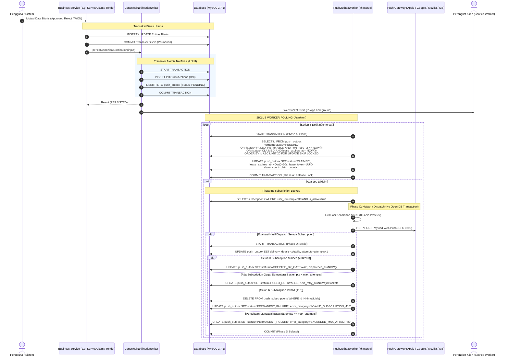
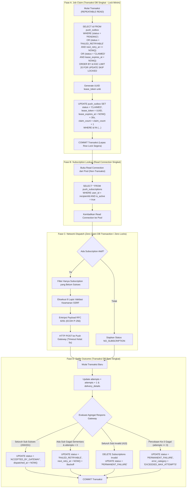

# EPMS — WEB PUSH NOTIFICATION
# FINAL TECHNICAL DESIGN SPECIFICATION
## ARSITEKTUR OPSI B: MYSQL TRANSACTIONAL OUTBOX & POLLING WORKER

```text
STATUS DOKUMEN       : FINAL TECHNICAL DESIGN SPECIFICATION (DESIGN REVIEW CLOSED)
TANGGAL DITERBITKAN   : 2026-10-28
MODE OPERASIONAL     : READ-ONLY — NO IMPLEMENTATION — NO MIGRATION — NO PROVISIONING
STATUS OTORISASI     : STAGE 3 STRICTLY NOT AUTHORIZED (MENUNGGU PERSETUJUAN SYSTEM OWNER)
DOKUMEN ACUAN PRIMER : docs/audit/EPMS_WEB_PUSH_PRE_IMPLEMENTATION_READINESS.md
```

---

## 1. RINGKASAN EKSEKUTIF & REKOMENDASI DESAIN

Dokumen ini menetapkan spesifikasi desain teknis final implementasi Web Push Notification pada platform EPMS UBD–TVM menggunakan **Opsi B: MySQL Transactional Outbox + Polling Worker**. 

Spesifikasi ini dirancang berdasarkan arsitektur aktual repository `epms_tvmubd`, memanfaatkan modul penjadwal bawaan NestJS (`@nestjs/schedule`) dan engine MySQL 9.7.1 yang sudah beroperasi di lingkungan produksi, tanpa menambahkan service broker eksternal baru seperti Redis.

### Poin Kunci Keputusan Desain:
1. **Pemisahan Tegas Tingkat Atomisitas & Domain Gap Prerequisite (`RECOMMENDED`):**  
   - *Atomisitas Lokal Bell–Outbox:* Terjamin secara lokal di dalam [`CanonicalNotificationWriter.persistCanonicalNotification`](file:///c:/Users/UBDOPS3/Herd/epms_tvmubd/backend/src/modules/notification/canonical-notification.writer.ts#L46-L121) dalam satu transaksi database TypeORM (INSERT entitas `Notification` + INSERT record `push_outbox`).
   - *Atomisitas Transaksi Bisnis–Notifikasi:* **TIDAK TERJAMIN SECARA ATOMIK**. Caller bisnis saat ini memanggil writer setelah transaksi bisnis selesai di-commit (`await queryRunner.commitTransaction()`). Kegagalan server tepat setelah commit bisnis dapat menyebabkan notifikasi tidak tertulis (*silent omission*). Penutupan gap ini melalui integrasi penuh dengan `outbox_events` ditetapkan sebagai **Prasyarat Implementasi untuk Notifikasi Approval Kritis**.
2. **Pemisahan Batas Transaksi & Manajemen Koneksi Pool (`RECOMMENDED`):**  
   Worker memisahkan proses menjadi 4 fase eksplisit: (A) *Claim & Lease* dalam transaksi DB singkat berindeks `FOR UPDATE SKIP LOCKED`, (B) *Subscription Lookup* melalui query pembacaan singkat yang segera melepas koneksi, (C) *Dispatch Network HTTP* tanpa menahan transaksi database atau row lock terbuka, dan (D) *Settle Outcome* dalam transaksi DB singkat baru. Pola ini mencegah terjadinya *database connection starvation*.
3. **Pembedaan Counter Claim dan Counter Dispatch HTTP (`RECOMMENDED`):**  
   Counter percobaan pengiriman jaringan (`attempts`) **hanya dinaikkan saat dispatch HTTP benar-benar dieksekusi**, bukan saat klaim awal. Crash worker sebelum network request dilacak melalui `claim_count` dan dipulihkan via *orphan recovery* tanpa menghanguskan jatah retry jaringan. Batas percobaan pengiriman jaringan ditetapkan konsisten **tepat 3 kali percobaan total** (`max_attempts = 3`).
4. **Jaminan Pengiriman Realistis (`RECOMMENDED`):**  
   Sistem secara eksplisit **tidak menjamin** *At-Least-Once Delivery Mutluk* maupun *Strict Exactly-Once Delivery*. Jaminan sistem adalah **`Bounded Retry with Possible Duplicate Delivery and Possible Delivery Failure`**.
5. **Diferensiasi Semantik Status Pengiriman (`RECOMMENDED`):**  
   Status `ACCEPTED_BY_GATEWAY` dan timestamp `dispatched_at` secara ketat menandakan bahwa push service vendor (Apple/Google/Mozilla/MS) telah menerima payload HTTP 200/201, **BUKAN BUKTI** bahwa perangkat klien fisik telah menerima atau menampilkan notifikasi di layar.
6. **Aturan Tunggal Agregasi Multi-Subscription Per Penerima (`RECOMMENDED`):**  
   Pengiriman ke penerima dengan banyak perangkat aktif dilacak per subscription dalam kolom `delivery_details`. Partial retry hanya menyasar perangkat yang gagal tanpa mengirimkan duplikat ke perangkat yang sukses. Penghapusan subscription invalid (410) diisolasi per perangkat tanpa menghapus subscription perangkat lain milik pengguna. Job outbox tidak akan ditandai sukses agregat selama masih ada perangkat yang menunggu retry.
7. **Integritas Audit Trail & Pencegahan Cascade Data Loss (`RECOMMENDED`):**  
   Relasi foreign key ke tabel notifikasi menggunakan `ON DELETE RESTRICT` (bukan `CASCADE`), menjamin bahwa log audit pengiriman push outbox tidak terhapus secara tidak sengaja ketika entitas notifikasi di-soft-delete atau dibersihkan.
8. **Isolasi Mutlak dari Mock Queue (`RECOMMENDED`):**  
   Komponen `PushOutboxService` dan `PushOutboxWorker` diletakkan di dalam modul notifikasi terisolasi, tanpa mengubah konfigurasi [`QueueModule`](file:///c:/Users/UBDOPS3/Herd/epms_tvmubd/backend/src/modules/queue/queue.module.ts#L9-L33) yang saat ini me-mock antrean email dan PDF.

---

## 2. FAKTA REPOSITORY TERVERIFIKASI & REFERENSI KODE AKTUAL

Tabel berikut menyajikan pemetaan fakta kode aktual yang menjadi fondasi teknis perancangan ini:

| Komponen / Berkas | Lokasi Kode | Status Verifikasi | Implikasi Teknis Terhadap Desain |
| :--- | :--- | :---: | :--- |
| **Scheduler NestJS** | [`backend/src/app.module.ts#L27`](file:///c:/Users/UBDOPS3/Herd/epms_tvmubd/backend/src/app.module.ts#L27) | `VERIFIED` | `ScheduleModule.forRoot()` sudah aktif secara global di root application. Tidak perlu registrasi scheduler baru. |
| **Pola Scheduled Worker & Lock** | [`backend/src/modules/executive-analytics/executive-materializer.service.ts#L24-L39`](file:///c:/Users/UBDOPS3/Herd/epms_tvmubd/backend/src/modules/executive-analytics/executive-materializer.service.ts#L24-L39) | `VERIFIED` | Kode aktual menggunakan `@Cron('0 */5 * * * *')` dan `SELECT GET_LOCK(?, 0)` non-blocking. Terbukti aktif di [`logs/nest.log`](file:///c:/Users/UBDOPS3/Herd/epms_tvmubd/backend/logs/nest.log). |
| **Domain Outbox Relay Eksisting** | [`backend/src/modules/system/outbox-relay.service.ts#L24-L123`](file:///c:/Users/UBDOPS3/Herd/epms_tvmubd/backend/src/modules/system/outbox-relay.service.ts#L24-L123) | `VERIFIED` | Repo sudah memiliki pola outbox untuk event bisnis (`outbox_events`). Menggunakan `@Cron('*/5 * * * * *')` dan `pessimistic_write` lock. Relay memancarkan event ke `EventEmitter2`. |
| **Canonical Notification Writer** | [`backend/src/modules/notification/canonical-notification.writer.ts#L46-L121`](file:///c:/Users/UBDOPS3/Herd/epms_tvmubd/backend/src/modules/notification/canonical-notification.writer.ts#L46-L121) | `VERIFIED` | Titik tunggal persistensi Bell notification. Menggunakan `notificationRepo.save(notif)`. Belum menerima `QueryRunner` atau `EntityManager` eksternal dari caller. |
| **Pola Caller Notifikasi** | [`backend/src/modules/procurement/service-claim.service.ts#L939,L1130`](file:///c:/Users/UBDOPS3/Herd/epms_tvmubd/backend/src/modules/procurement/service-claim.service.ts#L939) | `VERIFIED` | Caller memanggil `persistCanonicalNotification` **setelah** transaksi mutasi bisnis berhasil di-commit (`await queryRunner.commitTransaction()`). Tidak ada rollback bisnis jika notifikasi gagal. |
| **Notification Consumer** | [`backend/src/modules/notification/canonical-notification.consumer.ts#L29-L1265`](file:///c:/Users/UBDOPS3/Herd/epms_tvmubd/backend/src/modules/notification/canonical-notification.consumer.ts#L29-L1265) | `VERIFIED` | Menangkap event bisnis via `@OnEvent` (asinkron dari event-emitter) lalu memanggil `writer.persistBatch()`. |
| **Status QueueModule** | [`backend/src/modules/queue/queue.module.ts#L9-L33`](file:///c:/Users/UBDOPS3/Herd/epms_tvmubd/backend/src/modules/queue/queue.module.ts#L9-L33) | `VERIFIED` | Antrean email dan PDF di-mock (`mockQueueProvider`). Processor di-comment out. |
| **Dependensi S3 pada PDF Worker** | [`backend/src/modules/queue/pdf.processor.ts#L11-L17,L55-L60`](file:///c:/Users/UBDOPS3/Herd/epms_tvmubd/backend/src/modules/queue/pdf.processor.ts#L11-L17) | `VERIFIED` | `PdfProcessor` bergantung pada AWS S3 bucket. Mengaktifkan BullMQ global tanpa kredensial AWS akan menyebabkan runtime error pada antrean PDF. |
| **Versi Database Server** | Live MySQL Instance | `VERIFIED` | Berjalan pada **MySQL 9.7.1** (mendukung penuh sintaks `FOR UPDATE SKIP LOCKED`, CTE, JSON columns, dan locking non-blocking). |
| **Frontend Stack & PWA** | [`frontend/package.json#L21-L38`](file:///c:/Users/UBDOPS3/Herd/epms_tvmubd/frontend/package.json#L21) | `VERIFIED` | Next.js 14.2.15 App Router, React 18.2.0, Socket.io-client 4.8.3. Belum terpasang wrapper webpack PWA (`next-pwa`). |

---

## 3. ANALISIS INTEGRASI NOTIFIKASI & DOMAIN RECOVERY GAP

### 3.1. Pemisahan Dua Batas Atomisitas
Terdapat perbedaan arsitektural mendasar antara atomisitas domain bisnis dengan atomisitas notifikasi kanonis:

1. **Layer 1: Transaksi Mutasi Bisnis $\rightarrow$ Notifikasi (Non-Atomik Saat Ini)**
   - *Fakta Kode:* Caller pada domain service (contoh: [`ServiceClaimService#L939-L947`](file:///c:/Users/UBDOPS3/Herd/epms_tvmubd/backend/src/modules/procurement/service-claim.service.ts#L939)) menjalankan:
     ```ts
     await queryRunner.commitTransaction();
     // Pemanggilan notifikasi kanonis berada DI LUAR transaksi bisnis:
     if (this.notificationWriter) {
       try {
         await this.notificationWriter.persistCanonicalNotification({ ... });
       } catch (notifErr) {
         this.logger.warn(`Failed to project canonical notification: ${notifErr.message}`);
       }
     }
     ```
   - *Konsekuensi Arsitektur:* Mutasi bisnis telah berstatus **permanen (COMMITTED)** di database sebelum notifikasi mulai ditulis. Jika server mengalami crash, node restart, atau kegagalan koneksi database tepat di antara kedua baris kode tersebut, mutasi bisnis tetap sah tetapi notifikasi Bell dan Outbox **tidak pernah tercipta (Silent Notification Omission)**.
2. **Evaluasi Domain Event Outbox Eksisting untuk Rekonsiliasi:**
   - Platform EPMS **sudah memiliki mekanisme outbox domain**, yaitu tabel `outbox_events` dan [`OutboxRelayService`](file:///c:/Users/UBDOPS3/Herd/epms_tvmubd/backend/src/modules/system/outbox-relay.service.ts#L24).
   - Pada alur bisnis yang sudah matang (misal sebagian modul Legal/Finance), mutasi bisnis menulis `OutboxEvent` di dalam transaksi bisnis yang sama. `OutboxRelayService` me-relay event tersebut ke `EventEmitter2`, yang kemudian ditangkap oleh `CanonicalNotificationConsumer` via `@OnEvent` untuk memanggil `CanonicalNotificationWriter`.
   - *Solusi Rekonsiliasi Tanpa Duplikasi:* Untuk notifikasi approval kritis, sistem **TIDAK BOLEH** bergantung pada pemanggilan manual `persistCanonicalNotification` di luar transaksi. Alur mutasi bisnis wajib menulis `OutboxEvent` di dalam transaksi database bisnisnya.
3. **Status Prasyarat Implementasi (Implementation Prerequisite):**
   - Mengingat beberapa caller (seperti `ServiceClaimService`) saat ini masih memanggil writer secara langsung di luar transaksi setelah commit, maka **pemulihan otomatis untuk seluruh notifikasi approval kritis belum sepenuhnya tertutup di kode saat ini**.
   - Penutupan gap ini (memastikan seluruh mutasi approval kritis melewati transaksi `outbox_events`) ditetapkan sebagai **PRASYARAT IMPLEMENTASI** yang wajib diselesaikan sebelum fitur Web Push dinyatakan layak operasional penuh untuk modul persetujuan kritis.
4. **Layer 2: Notifikasi Bell $\rightarrow$ Web Push Outbox (Atomik Lokal)**
   - *Solusi Desain:* Di dalam [`CanonicalNotificationWriter.persistCanonicalNotification`](file:///c:/Users/UBDOPS3/Herd/epms_tvmubd/backend/src/modules/notification/canonical-notification.writer.ts#L46-L121), penulisan entitas `Notification` dan penulisan baris `push_outbox` dibungkus dalam satu transaksi database lokal TypeORM:
     ```ts
     await this.dataSource.transaction(async (entityManager) => {
       const savedNotif = await entityManager.save(Notification, notif);
       const outboxRecord = this.buildPushOutboxRecord(savedNotif, input);
       await entityManager.save(PushOutbox, outboxRecord);
     });
     ```
   - *Jaminan:* Menjamin bahwa baris Outbox tidak akan pernah tercipta tanpa adanya baris Bell yang sah, dan kegagalan penulisan Outbox akan membatalkan penulisan Bell (mencegah *phantom push* dan *orphan Bell*).

---

## 4. DIAGRAM ALUR ARSITEKTUR & SIKLUS HIDUP WORKER

Diagram sequence berikut mengilustrasikan alur pemrosesan dari komitmen mutasi bisnis hingga respons push service gateway:



---

## 5. SKEMA LOGIS DATABASE DAN ATURAN IDEMPOTENSI

### 5.1. Tabel `push_outbox`

```sql
CREATE TABLE push_outbox (
    id BIGINT UNSIGNED AUTO_INCREMENT PRIMARY KEY,
    
    -- Relasi ke Notifikasi Kanonis (ON DELETE RESTRICT untuk Integritas Jejak Audit)
    notification_id INT UNSIGNED NOT NULL,
    recipient_id INT UNSIGNED NOT NULL,
    
    -- Identitas Pelacakan Event Bisnis
    event_id VARCHAR(100) NOT NULL,
    purpose VARCHAR(100) NOT NULL,
    dedupe_key VARCHAR(191) NOT NULL,
    
    -- State Machine Pengiriman
    status ENUM(
        'PENDING',
        'CLAIMED',
        'ACCEPTED_BY_GATEWAY',
        'FAILED_RETRYABLE',
        'PERMANENT_FAILURE',
        'NO_SUBSCRIPTION'
    ) NOT NULL DEFAULT 'PENDING',
    
    -- Pemisahan Counter Klaim vs Counter Percobaan Dispatch HTTP
    claim_count INT UNSIGNED NOT NULL DEFAULT 0,
    attempts INT UNSIGNED NOT NULL DEFAULT 0,
    max_attempts INT UNSIGNED NOT NULL DEFAULT 3,
    next_retry_at DATETIME NULL,
    
    -- Fencing Lease untuk Concurrency & Orphan Recovery
    lease_token VARCHAR(64) NULL,
    lease_expires_at DATETIME NULL,
    
    -- Payload Notifikasi Ringkas (Data Minimization)
    payload_preview JSON NOT NULL,
    
    -- Rincian Pelacakan Multi-Subscription (JSON)
    delivery_details JSON NULL,
    
    -- Klasifikasi Error Diagnostik Aman (Sanitized)
    error_category ENUM(
        'NONE',
        'NETWORK_TIMEOUT',
        'CONNECTION_RESET',
        'GATEWAY_5XX',
        'RATE_LIMIT_429',
        'INVALID_SUBSCRIPTION_410',
        'SSRF_REJECTED',
        'VAPID_ERROR',
        'EXCEEDED_MAX_ATTEMPTS',
        'POISON_PILL_CLAIM_EXCEEDED',
        'UNKNOWN_ERROR'
    ) NOT NULL DEFAULT 'NONE',
    last_error_message VARCHAR(500) NULL,
    
    -- Audit Timestamps
    created_at DATETIME NOT NULL DEFAULT CURRENT_TIMESTAMP,
    updated_at DATETIME NOT NULL DEFAULT CURRENT_TIMESTAMP ON UPDATE CURRENT_TIMESTAMP,
    dispatched_at DATETIME NULL,
    
    -- Constraints & Indexes (Hipotetis - Wajib EXPLAIN di Stage 3)
    CONSTRAINT fk_push_outbox_notification FOREIGN KEY (notification_id) REFERENCES notifications(id) ON DELETE RESTRICT,
    CONSTRAINT uk_push_outbox_dedupe UNIQUE (dedupe_key),
    INDEX idx_push_outbox_claim (status, next_retry_at, lease_expires_at, id),
    INDEX idx_push_outbox_recipient (recipient_id, status),
    INDEX idx_push_outbox_purge (status, dispatched_at, created_at)
) ENGINE=InnoDB DEFAULT CHARSET=utf8mb4 COLLATE=utf8mb4_unicode_ci;
```

### 5.2. Aturan `dedupe_key` & Penanganan Panjang String
- **Format Dasar:** `${eventId}:${recipientId}:${purpose}:PUSH`
- **Evaluasi Panjang Kolom (Batas MySQL utf8mb4: 191 Karakter):**  
  Jika `eventId` (100 char) + `recipientId` (10 char) + `purpose` (100 char) diisi penuh, panjang string mencapai 218 karakter, yang akan memicu *data truncation error*.
- **Aturan Idempotensi Deterministik:**
  ```ts
  const rawKey = `${eventId.trim()}:${recipientId}:${purpose.trim().toUpperCase()}:PUSH`;
  let dedupeKey: string;
  if (rawKey.length <= 191) {
    dedupeKey = rawKey;
  } else {
    // Fallback deterministik bebas truncasi: Prefix 126 char + SHA-256 (64 hex char)
    const hash = crypto.createHash('sha256').update(rawKey).digest('hex');
    dedupeKey = `${rawKey.slice(0, 126)}:${hash}`; // Tepat 191 karakter
  }
  ```
  Constraint `UNIQUE (dedupe_key)` menjamin satu event bisnis tidak akan pernah menduplikasi antrean push outbox.

### 5.3. Aturan Tunggal Agregasi Multi-Subscription
Jika penerima (`recipient_id`) memiliki lebih dari satu perangkat aktif terdaftar:
1. **Penyimpanan Status Per Subscription:** Hasil pengiriman ke masing-masing perangkat dicatat di dalam kolom `delivery_details`:
   ```json
   {
     "total_subscriptions": 3,
     "dispatched_count": 2,
     "pending_retry_count": 1,
     "results": [
       { "subscriptionId": 12, "endpoint_hash": "a1b2...", "status": "ACCEPTED_BY_GATEWAY", "httpCode": 201 },
       { "subscriptionId": 14, "endpoint_hash": "c3d4...", "status": "INVALID_410", "httpCode": 410 },
       { "subscriptionId": 15, "endpoint_hash": "e5f6...", "status": "FAILED_RETRYABLE", "error": "ETIMEDOUT" }
     ]
   }
   ```
2. **Partial Retry Policy:** Pada siklus retry berikutnya, worker **HANYA** mengirimkan ulang notifikasi ke subscription yang berstatus `FAILED_RETRYABLE` (`subscriptionId: 15`). Subscription yang telah sukses (`subscriptionId: 12`) **TIDAK DIKIRIM ULANG**, mencegah duplikasi notifikasi pada perangkat yang sudah menerima pesan.
3. **Isolasi Subscription Invalid:** Subscription yang menghasilkan `404 Not Found` atau `410 Gone` dihapus secara individual dari tabel `push_subscriptions`. **Penghapusan ini tidak mempengaruhi subscription perangkat lain milik pengguna yang masih valid**.
4. **Aturan Status Agregat Job (`push_outbox.status`):**
   - *Penerima Tanpa Perangkat Terdaftar:* Ditandai **`NO_SUBSCRIPTION`**.
   - *Seluruh Subscription Sukses:* Ditandai **`ACCEPTED_BY_GATEWAY`**.
   - *Masih Ada Subscription yang Membutuhkan Retry (dan `attempts < max_attempts`):* Ditandai **`FAILED_RETRYABLE`**. Status agregat job **DILARANG** ditandai sebagai sukses selama masih ada subscription yang menunggu retry.
   - *Seluruh Subscription Invalid / Gagal Permanen:* Ditandai **`PERMANENT_FAILURE`**.
   - *Jatah Retry Habis Tetapi Sebagian Perangkat Sukses:* Ditandai **`PERMANENT_FAILURE`** (dengan rincian perangkat yang berhasil tetap terdokumentasi di dalam `delivery_details`).

---

## 6. TRANSACTION BOUNDARY & ALUR WORKER

Proses worker polling dibagi menjadi 4 fase terisolasi:



### Evaluasi Concurrency, Lease, & Penggunaan Koneksi Pool:
1. **Batas Transaksi dan Koneksi Database:**  
   - Transaksi database **TIDAK DITAHAN** selama panggilan HTTP ke push gateway berlangsung.
   - Pembacaan subscription pada Fase B menggunakan query `SELECT` standar tanpa transaksi panjang dan koneksi pool langsung dikembalikan sebelum Fase C dimulai.
   - Fase C berjalan murni di memori Node.js tanpa membuka transaksi database atau menahan row lock.
2. **Crash Recovery & Pencegahan Penghangusan Kuota Percobaan:**  
   - Jika worker mengalami crash atau container restart saat Fase A atau Fase B (sebelum HTTP dispatch dikirim), counter `attempts` **tidak bertambah**.
   - Ketika lease kedaluwarsa (`lease_expires_at < NOW()`), job akan diambil kembali oleh worker berikutnya melalui mekanisme *orphan recovery*.
   - Jika sebuah job mengalami crash berulang kali sebelum dispatch hingga `claim_count > 5`, job ditandai sebagai `PERMANENT_FAILURE` dengan kategori `POISON_PILL_CLAIM_EXCEEDED` untuk mencegah crash-loop tanpa batas.
3. **Pencegahan Race Condition saat Lease Kedaluwarsa:**  
   Jika Fase C berlangsung lambat (>30 detik) dan lease kedaluwarsa sehingga job diklaim oleh worker lain, Fase D worker pertama wajib memverifikasi kepemilikan token:  
   `UPDATE push_outbox SET status = ... WHERE id = :id AND lease_token = :myLeaseToken`.  
   Jika `affectedRows === 0`, update dibatalkan (*aborted*) karena hak eksekusi telah diambil alih worker kedua.

---

## 7. MATRIKS RETRY, ERROR HANDLING, LEASE, DAN RECOVERY

Tabel penanganan status respons push gateway dan strategi pemulihan:

| Kategori Respons / Kejadian | HTTP Code / Skenario Error | Tindakan Worker Outbox | Status Akhir Job | Penanganan Subscription |
| :--- | :--- | :--- | :---: | :--- |
| **Gateway Acceptance** | `200 OK` (Apple/MS)<br>`201 Created` (Google/Mozilla) | Payload diterima gateway untuk diteruskan ke OS klien. Catat `dispatched_at`. | `ACCEPTED_BY_GATEWAY` (Jika seluruh sub sukses) | Dipertahankan sebagai subscription aktif. |
| **Subscription Expired / Invalid** | `404 Not Found`<br>`410 Gone` | Endpoint tidak berlaku atau telah di-revoke oleh browser. | `PERMANENT_FAILURE` (Jika seluruh sub invalid) | **Hapus seketika** dari tabel `push_subscriptions`. Perangkat lain milik pengguna tidak terpengaruh. |
| **Rate Limiting Gateway** | `429 Too Many Requests` | Kuota pengiriman gateway terlampaui. Baca header `Retry-After`. | `FAILED_RETRYABLE` (Jika attempts < 3)<br>`PERMANENT_FAILURE` (Jika attempts $\ge$ 3) | Jadwalkan ulang sesuai header `Retry-After` (default: 60s). |
| **Gateway Downstream Error** | `500 Internal Error`<br>`502 Bad Gateway`<br>`503 Service Unavailable`<br>`504 Gateway Timeout` | Gangguan infrastruktur vendor push service. | `FAILED_RETRYABLE` (Jika attempts < 3)<br>`PERMANENT_FAILURE` (Jika attempts $\ge$ 3) | Jadwalkan ulang dengan Exponential Backoff bertingkat. |
| **Network Timeout / Connection Reset** | ETIMEDOUT, ECONNRESET, ESOCKETTIMEDOUT | **`OUTCOME_UNKNOWN`**. Gateway mungkin sudah menerima pesan tetapi koneksi putus sebelum server EPMS menerima ACK. | `FAILED_RETRYABLE` (Jika attempts < 3)<br>`PERMANENT_FAILURE` (Jika attempts $\ge$ 3) | Lakukan pengiriman ulang. Potensi duplikasi push diakui dan dimitigasi via browser notification `tag`. |
| **SSRF Policy Violation** | Exception Lapis 1–8 SSRF Guard | Endpoint mengarah ke IP privat, metadata service, atau port terlarang. | `PERMANENT_FAILURE` | Tandai subscription `BLOCKED_MALICIOUS`. Hapus dan catat log audit keamanan level WARN/ERROR. |
| **VAPID / Auth Configuration Error** | `400 Bad Request`<br>`401 Unauthorized`<br>`403 Forbidden` | Kredensial VAPID salah, token signature invalid, atau subject tidak sah. | `PERMANENT_FAILURE` | Jangan me-retry. Catat error kritis ke system logger untuk investigasi administrator. |
| **Worker Crash Pre-Dispatch** | Server mati sebelum Fase C selesai | Worker mati sebelum HTTP request dimulai. | `CLAIMED` $\rightarrow$ Pulih otomatis via Orphan Recovery | Kuota `attempts` tetap utuh; `claim_count` bertambah. |

### Aturan Bounded Retry & Formula Backoff (Konsisten 3 Kali Percobaan Total):
- **Batas Maksimal Percobaan (`max_attempts = 3`):**  
  - Percobaan 1 (Initial attempt): Saat HTTP request pertama kali dieksekusi (`attempts = 1`). Jika gagal sementara $\rightarrow$ `FAILED_RETRYABLE`, `next_retry_at = NOW() + 30s`.
  - Percobaan 2 (Retry ke-1): Saat HTTP request kedua dieksekusi (`attempts = 2`). Jika gagal sementara $\rightarrow$ `FAILED_RETRYABLE`, `next_retry_at = NOW() + 60s`.
  - Percobaan 3 (Retry ke-2): Saat HTTP request ketiga dieksekusi (`attempts = 3`). Jika gagal $\rightarrow$ batas `max_attempts` tercapai, status beralih permanen ke `PERMANENT_FAILURE` (tidak ada retry lanjutan).
- **Formula Exponential Backoff:**
  $$\text{Delay}_{\text{seconds}} = \min(300, 30 \times 2^{\text{attempts} - 1})$$
  - Setelah Gagal Attempt 1: Jeda 30 detik.
  - Setelah Gagal Attempt 2: Jeda 60 detik.
  - Setelah Gagal Attempt 3: Berhenti (Gagal Permanen).

---

## 8. STRATEGI INDEKS, POLLING, MONITORING, DAN RETENSI DATA

### 8.1. Evaluasi Indeks Database (Status: Hipotetis - Wajib Verifikasi)
Indeks komposit berikut dirancang berdasarkan pola query, namun **wajib diverifikasi menggunakan `EXPLAIN` pada data uji realistis di Stage 3**:
1. `idx_push_outbox_claim (status, next_retry_at, lease_expires_at, id)`:  
   Mendukung query filter Fase A. *Catatan:* Perilaku optimizer MySQL terhadap klausul `OR` majemuk wajib dievaluasi agar tidak terjadi index skip.
2. `idx_push_outbox_purge (status, dispatched_at, created_at)`:  
   Mendukung scheduled cron purge untuk membersihkan data lama tanpa full-table scan.

### 8.2. Parameter Polling Worker (`RECOMMENDED - TO BE BENCHMARKED`)
- **Interval Polling:** 5 detik (`@Interval(5000)`).
- **Batch Size:** 20 record per siklus polling.
- **Worker Concurrency Limit:** Maksimal 10 HTTP requests konkuren per instance (`p-limit: 10`).
- **Connection Pool Overhead:** Worker menahan 1 koneksi pool saat Fase A dan Fase D. Query pembacaan Fase B melepas koneksi segera. Durasi query wajib di-benchmark pada saat uji beban Stage 3.

### 8.3. Kebijakan Retensi Data & Integritas Jejak Audit (`OWNER DECISION REQUIRED`)
1. **Pencegahan Data Loss Audit Trail:**  
   Relasi foreign key `notification_id` menggunakan `ON DELETE RESTRICT` (bukan `CASCADE`). Hal ini mencegah terhapusnya riwayat log audit pengiriman outbox secara tidak sengaja ketika entitas notifikasi Bell di-soft-delete atau dihapus oleh pengguna.
2. **Retensi Record `ACCEPTED_BY_GATEWAY`:**  
   Rekomendasi teknis: Dihapus otomatis melalui cron harian jika berusia lebih dari **7 hari** (atau 30 hari jika kepatuhan audit internal mewajibkan histori pengiriman tersimpan lebih lama).
3. **Retensi Record `PERMANENT_FAILURE`:**  
   Rekomendasi teknis: Dipertahankan selama **30 hari** untuk keperluan investigasi teknis tim operasional.
4. **Pembersihan Bertahap (Chunked Purge):**  
   `DELETE FROM push_outbox WHERE status = 'ACCEPTED_BY_GATEWAY' AND dispatched_at < DATE_SUB(NOW(), INTERVAL ? DAY) LIMIT 500;` dijalankan berkala untuk menghindari lonjakan lock InnoDB.

---

## 9. KONTROL KEAMANAN WEB PUSH (SSRF & CRYPTOGRAPHIC STANDARDS)

### 9.1. Pengelolaan Kunci Kriptografi VAPID (RFC 8292)
- Menggunakan pasangan kurva eliptik P-256 (*prime256v1*).
- Kunci privat (`VAPID_PRIVATE_KEY`) tersimpan aman di `.env` server backend dan tidak pernah terekspos.
- Subject VAPID (`VAPID_SUBJECT`) wajib berupa URI kontak valid (`mailto:admin-epms@perusahaan.com`).

### 9.2. Delapan Lapis Proteksi SSRF Terpadu (`RECOMMENDED`)
Mengacu pada spesifikasi desain pada dokumen acuan ([`EPMS_WEB_PUSH_PRE_IMPLEMENTATION_READINESS.md#L467-L567`](file:///c:/Users/UBDOPS3/Herd/epms_tvmubd/docs/audit/EPMS_WEB_PUSH_PRE_IMPLEMENTATION_READINESS.md#L467)):
1. **Lapis 1 — Skema Protokol:** Wajib `https:`.
2. **Lapis 2 — Port Standar:** Wajib port `443` (atau string kosong).
3. **Lapis 3 — Userinfo:** Dilarang memuat kredensial (`!url.username && !url.password`).
4. **Lapis 4 — Hostname Allowlist Regex:**
   - Google: `fcm.googleapis.com`
   - Mozilla: `updates.push.services.mozilla.com`
   - Apple APNs: `^(?:[a-zA-Z0-9](?:[a-zA-Z0-9-]{0,61}[a-zA-Z0-9])?\.)+push\.apple\.com$`
   - Microsoft WNS: `^(?:[a-zA-Z0-9](?:[a-zA-Z0-9-]{0,61}[a-zA-Z0-9])?\.)+(?:notify\.windows\.com|wns\.windows\.com)$`
5. **Lapis 5 — Disable Redirects:** `maxRedirects: 0` pada HTTP agent (mencegah redirect 3xx ke intranet).
6. **Lapis 6 — DNS Hook & Filter IP RFC 6890:** Resolusi DNS manual dan verifikasi SELURUH record A dan AAAA terhadap rentang khusus (Loopback, RFC 1918, Cloud Metadata `169.254.169.254`, CGNAT, IPv6 mapped).
7. **Lapis 7 — Socket IP Pinning:** Koneksi soket dibuka langsung ke IP publik yang tervalidasi dengan mempertahankan Server Name Indication (TLS SNI) asli.
8. **Lapis 8 — Egress Firewall:** Aturan firewall OS/cloud membatasi outbound backend hanya ke port 443 internet.

### 9.3. Isolasi Lintas Pengguna (Cross-User Isolation)
Subscription selalu diikat ke `user_id` JWT. Pengambilan subscription saat dispatch selalu memfilter `WHERE user_id = :recipientId AND is_active = true`.

---

## 10. ACCEPTANCE CRITERIA (AC-OUTBOX-01 s.d. AC-OUTBOX-11)

Seluruh kriteria berikut dirancang untuk diverifikasi secara objektif pada saat pengujian teknis dijalankan:

| ID Kriteria | Deskripsi Pengujian | Metode Verifikasi Teknis | Hasil yang Diharapkan | Status Saat Ini |
| :---: | :--- | :--- | :--- | :---: |
| **AC-OUTBOX-01** | **Penulisan Atomik Lokal Notifikasi & Outbox** | Panggil `persistCanonicalNotification`. Periksa tabel `notifications` dan `push_outbox`. | Tepat 1 baris di `notifications` dan 1 baris berstatus `PENDING` di `push_outbox` tercipta dalam transaksi lokal yang sama. *Catatan: Tidak membuktikan atomisitas mutasi bisnis ke notifikasi.* | `NOT VERIFIED` |
| **AC-OUTBOX-02** | **Rollback Konsistensi Lokal saat Error** | Simulasikan error database saat insert `push_outbox` (misal constraint violation buatan). | Seluruh transaksi lokal di-rollback. Tidak ada entitas `Notification` yatim piatu tanpa baris outbox yang tersisa. *Catatan: Tidak membuktikan rollback mutasi bisnis jika notifikasi gagal.* | `NOT VERIFIED` |
| **AC-OUTBOX-03** | **Pencegahan Concurrent Claim** | Jalankan dua worker paralel terhadap 50 record `PENDING`. | Setiap record hanya diklaim dan diproses oleh tepat satu worker (`lease_token` unik). Nol duplikasi klaim. | `NOT VERIFIED` |
| **AC-OUTBOX-04** | **Orphan Recovery Pasca Crash Pre-Dispatch** | Matikan worker mendadak (`SIGKILL`) di Fase B sebelum HTTP dispatch dikirim. Tunggu hingga `lease_expires_at` terlampaui. Jalankan worker baru. | Record berstatus `CLAIMED` yang kedaluwarsa otomatis diklaim ulang. `attempts` tetap 0 (belum terpakai), `claim_count` bertambah, dan job diproses hingga tuntas. | `NOT VERIFIED` |
| **AC-OUTBOX-05** | **Bounded Retry (3 Kali Percobaan Total)** | Simulasikan push gateway merespons `500 Internal Error`. Amati siklus hidup percobaan job. | Worker mencoba total 3 kali dispatch (Initial attempt + 2 retry) dengan jeda bertingkat, lalu beralih permanen ke `PERMANENT_FAILURE`. | `NOT VERIFIED` |
| **AC-OUTBOX-06** | **Penanganan `OUTCOME_UNKNOWN`** | Simulasikan koneksi putus (ETIMEDOUT) sebelum HTTP response gateway diterima. | Job beralih ke `FAILED_RETRYABLE`, `attempts` naik, dan payload menyertakan `tag` untuk deduplikasi visual di browser. | `NOT VERIFIED` |
| **AC-OUTBOX-07** | **Idempotensi Dedupe Key & Hash Fallback** | Panggil `persistCanonicalNotification` dua kali dengan raw key > 191 karakter yang identik. | Pemanggilan kedua tertahan oleh constraint `uk_push_outbox_dedupe`. Format hash fallback mencegah data truncation. | `NOT VERIFIED` |
| **AC-OUTBOX-08** | **Pembersihan Subscription Kedaluwarsa** | Simulasikan respons `410 Gone` dari push service vendor. | Subscription terkait otomatis dihapus dari database `push_subscriptions`. Subscription perangkat lain milik pengguna tetap utuh. | `NOT VERIFIED` |
| **AC-OUTBOX-09** | **Isolasi Mutlak dari QueueModule** | Jalankan siklus penuh outbox worker saat `QueueModule` tetap menggunakan mock. | Seluruh notifikasi push diproses lancar tanpa memicu runtime error pada `PdfProcessor` atau antrean email mock. | `NOT VERIFIED` |
| **AC-OUTBOX-10** | **Multi-Subscription Partial Retry & Agregasi** | Simulasikan penerima memiliki 2 perangkat (Perangkat A sukses 201, Perangkat B timeout). | Status agregat job tetap `FAILED_RETRYABLE` (belum sukses). Saat retry berikutnya, worker HANYA mengirimkan ulang payload ke Perangkat B. | `NOT VERIFIED` |
| **AC-OUTBOX-11** | **Pemeliharaan Retensi & ON DELETE RESTRICT** | Jalankan cron pembersihan terhadap data `ACCEPTED_BY_GATEWAY` berusia > 7 hari. Foreign key diuji saat notifikasi dihapus. | Data lama terhapus bertahap (chunked); penghapusan notifikasi tidak menghapus outbox secara cascading (`ON DELETE RESTRICT`). | `NOT VERIFIED` |

---

## 11. PRASYARAT IMPLEMENTASI, RISIKO TERSISA, DAN HAL YANG BELUM DIKETAHUI

### 11.1. Prasyarat Implementasi (Wajib Diselesaikan Sebelum Operasional Penuh)
1. **Penutupan Domain-to-Notification Recovery Gap untuk Approval Kritis:**  
   Untuk seluruh alur persetujuan kritis (misal Service Claim, Tender Approval, Contract Revision), modul bisnis wajib menulis `BusinessEvent` ke tabel `outbox_events` di dalam transaksi database bisnisnya, agar jika terjadi server crash setelah commit bisnis, event tetap direlai ulang oleh `OutboxRelayService` menuju `CanonicalNotificationWriter`.
2. **Ketersediaan Staging HTTPS Publik:**  
   Penyediaan domain/subdomain staging ber-HTTPS publik yang dapat diakses oleh perangkat fisik penguji (iPhone/Android) di luar localhost.
3. **Validasi Rencana Eksekusi Query (`EXPLAIN` Benchmark):**  
   Pengujian rencana eksekusi indeks `idx_push_outbox_claim` pada dataset volume realistis di lingkungan staging.

### 11.2. Risiko Teknis Tersisa
1. **Risiko Polling Overhead pada MySQL:**  
   Query klaim setiap 5 detik menambah beban pembacaan index pada MySQL. Wajib dipantau jika CPU database meningkat saat jam sibuk operasional.
2. **Risiko Notifikasi Ganda pada Network Timeout:**  
   Pada skenario `OUTCOME_UNKNOWN`, pengiriman ulang ke push gateway dapat menghasilkan notifikasi ganda pada perangkat klien jika browser tidak mengaktifkan penimpaan berbasis `tag`.

### 11.3. Hal yang Belum Diketahui (*Unverified / Open Items*)
1. **Dukungan Root Hostname Microsoft WNS:** Status dukungan channel URI root apex (`notify.windows.com`) masih berstatus `OPEN / UNVERIFIED` dan memerlukan verifikasi empiris channel URI aktual saat pengujian runtime Edge di Stage 3.

---

## 12. KEPUTUSAN YANG MEMBUTUHKAN PERSETUJUAN SYSTEM OWNER

```text
+----------------------------------------------------------------------------------------------------+
| DAFTAR KEPUTUSAN WAJIB BAGI SYSTEM OWNER                                                           |
+-------------------+--------------------------------------------------------------------------------+
| ID Keputusan      | K-OWNER-OUTBOX-01                                                              |
| Judul             | Persetujuan Arah Arsitektur: Adopsi Opsi B (MySQL Outbox)                      |
| Pilihan           | [ ] SETUJU (Menggunakan MySQL Outbox, Rp 0 lisensi, tanpa menambah Redis)       |
|                   | [ ] TOLAK  (Wajibkan penggunaan Redis / Opsi A dengan provisioning service)    |
| Implikasi Bisnis  | Memungkinkan fitur berjalan di atas infrastruktur server yang ada saat ini.    |
+-------------------+--------------------------------------------------------------------------------+
| ID Keputusan      | K-OWNER-OUTBOX-02                                                              |
| Judul             | Penyediaan Lingkungan Staging Ber-HTTPS untuk Uji Coba Perangkat Mobile        |
| Pilihan           | [ ] Menggunakan subdomain staging ber-SSL resmi perusahaan (Rp 0)              |
|                   | [ ] Menggunakan secure tunnel sementara (Cloudflare Tunnel gratis / sejenisnya)|
|                   | [ ] Pengadaan domain/SSL baru berbayar khusus staging                          |
| Implikasi Bisnis  | Web Push pada iPhone fisik dan Android fisik WAJIB HTTPS agar dapat diuji.     |
+-------------------+--------------------------------------------------------------------------------+
| ID Keputusan      | K-OWNER-OUTBOX-03                                                              |
| Judul             | Kebijakan Retensi Riwayat Pengiriman Notifikasi & Jejak Audit                  |
| Pilihan           | [ ] Hapus log sukses setelah 7 hari (Rekomendasi - Ramping DB)                 |
|                   | [ ] Simpan log sukses selama 30 hari (Audit Kepatuhan Menengah)                |
|                   | [ ] Simpan permanen ke tabel arsip histori pengiriman                          |
| Implikasi Bisnis  | Menentukan alokasi kapasitas ruang disk database operasional MySQL.            |
+-------------------+--------------------------------------------------------------------------------+
| ID Keputusan      | K-OWNER-OUTBOX-04                                                              |
| Judul             | Batas Toleransi Duplikasi Notifikasi saat Jaringan Terputus                    |
| Pilihan           | [ ] SETUJU (Toleransi push ganda saat sinyal buruk demi jaminan pesan sampai)  |
|                   | [ ] HANYA SEKALI (Jika koneksi putus jangan kirim ulang, risiko alert hilang)  |
| Implikasi Bisnis  | Berdampak pada tingkat kepercayaan notifikasi persetujuan (approval alert).    |
+-------------------+--------------------------------------------------------------------------------+
```

---

## 13. PERNYATAAN PENUTUP & STATUS OTORISASI

Dokumen spesifikasi desain teknis ini telah menyelesaikan seluruh rangkaian telaah desain (*Design Review Closed*). Penerbitan revisi final ini **BUKAN MERUPAKAN OTORISASI** untuk memulai penulisan kode sumber, pembuatan file migrasi database, instalasi dependensi npm, maupun modifikasi skema data operasional.

Seluruh tahapan penulisan kode implementasi (Stage 3) **TETAP BERSTATUS STRICTLY NOT AUTHORIZED** hingga seluruh keputusan pada Bab 12 disetujui secara tertulis oleh System Owner.

```text
================================================================================
FINAL DESIGN REVIEW CLOSED — DOCUMENT ONLY — NO SOURCE CODE CHANGED — NO MIGRATION — NO PROVISIONING
STAGE 3 STRICTLY NOT AUTHORIZED
================================================================================
```
