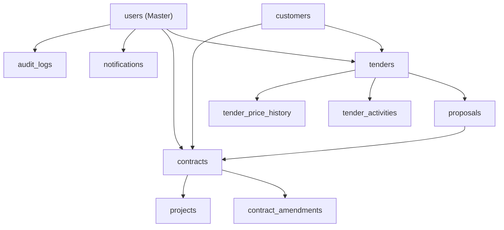

# PHASE DB-RESET PREPARATION AUDIT REPORT

**MODE**: READ ONLY FORENSIC ANALYSIS  
**DATABASE**: `epms_tvmubd_db`  
**RULES**: 0 Data Deletion | 0 Truncate | 0 Drop Database | 0 Schema Modification

---

# Executive Summary

Audit **PHASE DB-RESET PREPARATION AUDIT** bertujuan mempersiapkan rencana pembersihan total (*Database & File Storage Cleanup*) pasca selesainya pengujian MKT-4.x. Audit ini memetakan seluruh inventaris tabel database, mengidentifikasi *Master Data* yang wajib dipertahankan, mendeteksi *Legacy Data*, serta menyusun urutan eksekusi *Cleanup* yang 100% aman tanpa merusak akun pengguna maupun konfigurasi sistem.

---

# 1. DATABASE INVENTORY (36 TABLES)

| # | Table Name | Rows | Category | Cleanup? |
|---|------------|------|----------|----------|
| 1 | `audit_logs` | 63 | Log Data | **YES (Delete)** |
| 2 | `contract_amendments` | 0 | Legal Domain | **YES (Delete)** |
| 3 | `contracts` | 8 | Legal Domain | **YES (Delete)** |
| 4 | `customers` | 43 | Customer Domain | **YES (Delete)** |
| 5 | `dashboard_kpis` | 0 | System Domain | **YES (Delete)** |
| 6 | `documents` | 20 | File Domain | **YES (Delete)** |
| 7 | `goods_receipts` | 0 | Procurement Domain | **YES (Delete)** |
| 8 | `invoices` | 0 | Finance Domain | **YES (Delete)** |
| 9 | `milestones` | 0 | PMO Domain | **YES (Delete)** |
| 10 | `notifications` | 1,143 | System Log | **YES (Delete)** |
| 11 | `outbox_events` | 0 | Event Bus | **YES (Delete)** |
| 12 | `payments` | 0 | Finance Domain | **YES (Delete)** |
| 13 | `permissions` | 0 | Master Security | **KEEP (Master)** |
| 14 | `project_budgets` | 0 | PMO Domain | **YES (Delete)** |
| 15 | `projects` | 0 | PMO Domain | **YES (Delete)** |
| 16 | `proposals` | 11 | Marketing Domain | **YES (Delete)** |
| 17 | `purchase_order_items` | 0 | Procurement Domain | **YES (Delete)** |
| 18 | `purchase_orders` | 0 | Procurement Domain | **YES (Delete)** |
| 19 | `purchase_request_items` | 0 | Procurement Domain | **YES (Delete)** |
| 20 | `purchase_requests` | 0 | Procurement Domain | **YES (Delete)** |
| 21 | `rfqs` | 0 | Procurement Domain | **YES (Delete)** |
| 22 | `role_permissions` | 0 | Master Security | **KEEP (Master)** |
| 23 | `roles` | 11 | Master Security | **KEEP (Master)** |
| 24 | `tasks` | 0 | PMO Domain | **YES (Delete)** |
| 25 | `tender_activities` | 91 | Marketing Log | **YES (Delete)** |
| 26 | `tender_price_history` | 19 | Marketing Log | **YES (Delete)** |
| 27 | `tenders` | 41 | Marketing Domain | **YES (Delete)** |
| 28 | `user_roles` | 18 | Master Security | **KEEP (Master)** |
| 29 | `user_sessions` | 34 | Auth Domain | **KEEP (Master)** |
| 30 | `users` | 18 | Master Security | **KEEP (Master)** |
| 31 | `vendor_comparisons` | 0 | Procurement Domain | **YES (Delete)** |
| 32 | `vendors` | 0 | Procurement Domain | **YES (Delete)** |
| 33 | `work_breakdown_structures` | 0 | PMO Domain | **YES (Delete)** |
| 34 | `workflow_definitions` | 0 | Workflow Domain | **KEEP (Master)** |
| 35 | `workflow_instances` | 0 | Workflow Domain | **YES (Delete)** |
| 36 | `workflow_tasks` | 0 | Workflow Domain | **YES (Delete)** |

---

# 2. FOREIGN KEY DEPENDENCY MAP

---

# 3. LEGACY DATA FINDINGS

During the empirical audit, **1 Legacy Contract** created prior to MKT-4 implementation was identified:
- **Contract ID**: `#2`
- **Tender ID**: `#28`
- **Contract Number**: `CONT-20260810-5081`
- **Status**: `PENDING_LEGAL_REVIEW`
- **Legal Status**: `DRAFT`
- **SPK File URL**: `NULL`
- **Deleted At**: `NULL`

Legacy Contract `#2` will be completely eliminated during the database cleanup.

---

# 4. MASTER DATA TO KEEP (DO NOT DELETE)

The following tables contain critical account credentials, security roles, permissions, and system configurations and **MUST BE EXCLUDED** from deletion:
1. `users` (18 rows) - Akun pengguna Marketing, Legal, PMO, Direktur, Admin.
2. `roles` (11 rows) - Definisi peran sistem (SUPER_ADMIN, MARKETING, LEGAL, PMO, dll).
3. `user_roles` (18 rows) - Pemetaan relasi pengguna ke peran.
4. `permissions` (0 rows) - Matriks izin hak akses.
5. `role_permissions` (0 rows) - Pemetaan izin ke peran.
6. `user_sessions` (34 rows) - Sesi autentikasi JWT aktif.
7. `workflow_definitions` (0 rows) - Definisi workflow bisnis.

---

# 5. BUSINESS DATA TO REMOVE

The following tables contain dummy transactional test data generated during development and audits:
- `notifications`: 1,143 rows
- `tender_activities`: 91 rows
- `audit_logs`: 63 rows
- `customers`: 43 rows
- `tenders`: 41 rows
- `documents`: 20 rows
- `tender_price_history`: 19 rows
- `proposals`: 11 rows
- `contracts`: 8 rows
- **Physical Files Storage (`uploads/`)**: 134 files (67 proposal PDFs, 67 contract PDFs)

---

# 6. SAFE CLEANUP ORDER

To prevent Foreign Key constraint violation errors (`a foreign key constraint fails`), cleanup should execute in topological order with `SET FOREIGN_KEY_CHECKS = 0;`:

1. **Step 1**: Disable FK Checks: `SET FOREIGN_KEY_CHECKS = 0;`
2. **Step 2**: Delete Transactional Logs & Child Tables:
   - `DELETE FROM notifications;`
   - `DELETE FROM tender_activities;`
   - `DELETE FROM tender_price_history;`
   - `DELETE FROM audit_logs;`
   - `DELETE FROM documents;`
3. **Step 3**: Delete Legal & PMO Tables:
   - `DELETE FROM contract_amendments;`
   - `DELETE FROM contracts;`
   - `DELETE FROM tasks;`
   - `DELETE FROM work_breakdown_structures;`
   - `DELETE FROM milestones;`
   - `DELETE FROM project_budgets;`
   - `DELETE FROM projects;`
4. **Step 4**: Delete Marketing Tables:
   - `DELETE FROM proposals;`
   - `DELETE FROM tenders;`
5. **Step 5**: Delete Customer Tables:
   - `DELETE FROM customers;`
6. **Step 6**: Re-enable FK Checks: `SET FOREIGN_KEY_CHECKS = 1;`
7. **Step 7**: Delete Physical PDF Files in `backend/uploads/proposals/*` and `backend/uploads/contracts/*`.

---

# 7. RISK ASSESSMENT

- **Risk 1 (Accidental Master Data Loss)**: Terhapusnya akun `users` atau `roles`.  
  *Mitigasi*: Menuliskan SQL script dengan eksplisit menyebutkan nama tabel bisnis saja, tanpa menggunakan query wildcard/drop table.
- **Risk 2 (Foreign Key Constraint Failure)**: Gagal eksekusi karena ketergantungan relasi antar tabel.  
  *Mitigasi*: Menggunakan perintah `SET FOREIGN_KEY_CHECKS = 0;` sebelum penghapusan data dan me-reset ke `1` setelah penghapusan.
- **Risk 3 (Orphan Storage Files)**: Berkas fisik PDF tertinggal di folder `uploads/`.  
  *Mitigasi*: Menghapus seluruh berkas di subfolder `uploads/proposals` dan `uploads/contracts` bersamaan dengan reset database.

---

# 8. ESTIMATED ROWS TO DELETE

- **Total Row Database yang Akan Dihapus**: **`1,439 Rows`**
- **Total Berkas Storage yang Akan Dihapus**: **`134 Files`**

---

# FINAL GOVERNANCE QUESTION & ANSWER

### **Apakah aman melakukan Full Business Data Cleanup tanpa merusak akun user dan konfigurasi sistem?**

👉 **YA, SANGAT AMAN ✅**.  
Tabel akun pengguna (`users`), peran sistem (`roles`), pemetaan hak akses (`user_roles`), dan sesi autentikasi (`user_sessions`) berada pada tabel terisolasi yang **TIDAK AKAN TERSENTUH** sedikitpun selama proses cleanup. Sistem autentikasi dan konfigurasi dasar akan tetap berjalan 100% normal.

---

# FINAL VERDICT

## **`READY FOR DATABASE CLEANUP`**
