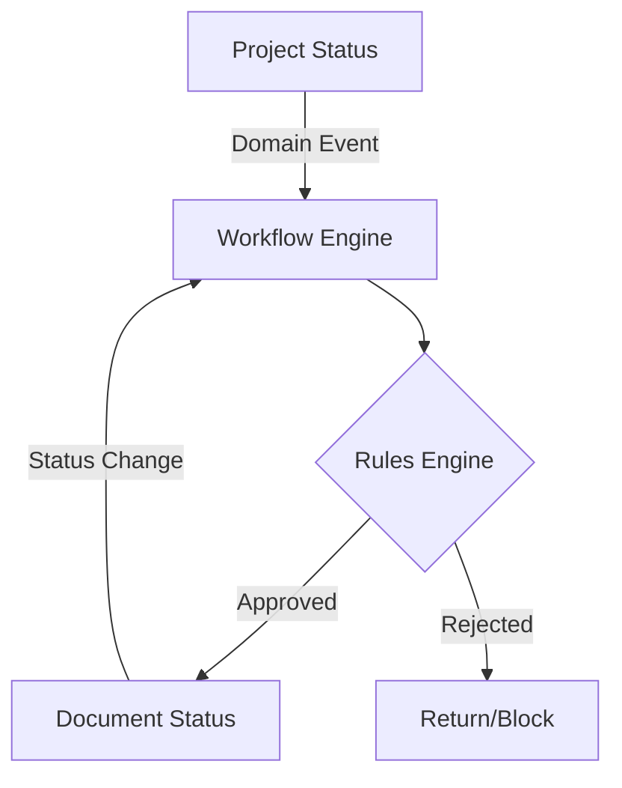

# EPMS ENTERPRISE WORKFLOW FOUNDATION
## Audit & Target Architecture Report

This report provides a complete architectural blueprint for migrating the EPMS system from hardcoded, prototype-based logic to an Enterprise Workflow Engine, ensuring strict domain separation and a fully backend-driven Single Source of Truth (SSOT).

---

## 1. Current Architecture Map & Gap Analysis

### 1.1 Existing Workflow Engine Assessment
*   **Database Schema**: A rudimentary schema exists (`workflow_definitions`, `workflow_instances`, `workflow_tasks`), indicating early intent to build an engine.
*   **Service Layer (`workflow.service.ts`)**: Completely **hardcoded**.
    *   Approval matrices are static `if/else` blocks (`amount < 10000000 = PROCUREMENT_MANAGER`).
    *   BPMN definitions are hardcoded strings (`generateSampleBpmnXml`).
    *   Missing true rule evaluation, dynamic routing, and transition state management.
*   **Gap**: The backend simulates a workflow engine rather than executing real node transitions based on defined rules.

### 1.2 Hardcoded Workflow & LocalStorage Inventory
*   **Hardcoded Logic**:
    *   `workflow.service.ts`: `amount` thresholds and target roles.
    *   `cost-estimate.validator.ts`: `CATEGORY_GROUP_MAP` heavily assumes rigid structures.
*   **LocalStorage Dependency**:
    *   Historically, `epms_pr_approval_*`, `epms_po_*`, `epms_gr_*`, `epms_invoice_*`, and `epms_payment_*` were used globally. (Note: PR creation has been successfully migrated to backend SSOT in Phase 11, but downstream approvals and PO/GR still carry legacy frontend logic).
    *   Frontend computes gate readiness based on mocked statuses instead of backend-emitted state.

### 1.3 Domain Boundary Confusion
Currently, statuses are conflated. We must enforce strict separation:
*   **PROJECT STATUS**: Lifecycle of the project itself (`PLANNING`, `READY_FOR_PROCUREMENT`, `IN_PROGRESS`, `CLOSED`).
*   **DOCUMENT STATUS**: Specific to procurement/finance entities (PR `SUBMITTED`, PO `ISSUED`, Invoice `PAID`).
*   **WORKFLOW STATUS**: State of the approval engine (`TASK_PENDING`, `APPROVED`, `REJECTED`).
*   **Gap**: Frontend UI often derives Project Status directly from Document Status (e.g., if PR > 0, Project = In Progress).

---

## 2. Target Enterprise Domain Separation

To support ERP-like scalability, statuses must operate independently and trigger each other via Domain Events.



---

## 3. Cost Classification Model (Target Rule)

The existing `cost_items` table utilizes `assignment_scope` (`WBS`, `PROJECT`, `UNASSIGNED`) and `category_key`. The target rule engine must formalize this:

| Assignment Scope | Category | Implied Flow | Workflow Trigger |
| :--- | :--- | :--- | :--- |
| **WBS** | MATERIAL, EQUIPMENT, etc. | **PROCUREMENT ROUTE** | `PR_REQUESTED` → PO → GR |
| **PROJECT** | PERMIT, OPERATIONAL | **DIRECT FINANCE ROUTE**| `EXPENSE_REQUESTED` → Invoice/Reimbursement |

*Recommendation*: The backend must explicitly flag `procurementRequired = boolean` on the `cost_items` DTO based on `assignmentScope === 'WBS'` to remove ambiguity.

---

## 4. Target Architecture: Workflow & Rule Engine

### 4.1 Node-Based Workflow Designer
Workflows will be modeled as JSON/BPMN 2.0 objects stored in `workflow_definitions.bpmn_json`.

**Node Types Supported:**
*   `START` / `END`
*   `USER_TASK` (Review/Approval)
*   `SYSTEM_TASK` (Auto-update DB, send email)
*   `GATEWAY_EXCLUSIVE` (If/Else Routing)

### 4.2 Rule Engine (Configurable)
Rules evaluate context payload and determine transitions.
*Example Rule Payload:*
```json
{
  "condition": "amount > 50000000",
  "action": "ROUTE_TO",
  "targetRole": "DIRECTOR",
  "fallbackRole": "GENERAL_MANAGER"
}
```
**SoD (Segregation of Duties) Rule**: `IF requesterId == approverId THEN REASSIGN (Supervisor)` must be built into the base engine, not the specific workflow.

### 4.3 Versioning Strategy
*   `workflow_definitions` must support `version` (int).
*   When a definition is updated, it creates `v2`.
*   Active `workflow_instances` retain `workflow_definition_id` pointing to `v1`. They do not forcefully migrate mid-flight unless manually aborted.

---

## 5. Domain Event / Event Bus (Target Model)

The NestJS `EventEmitter2` will be the backbone. Components must decouple via events instead of direct service injections.

**Target Event Registry:**
*   `project.status_changed`
*   `document.pr.submitted` (Triggers Approval Workflow)
*   `workflow.task.completed` (Triggers Next Node or Document Status Update)
*   `finance.payment.recorded` (Triggers Project Actual Cost Update)

---

## 6. Implementation Roadmap (Phases 1-9)

To ensure **ZERO-IMPACT** on the current operational features during development, the rollout must be phased:

### Phase 1: Workflow Definition & Versioning
*   Finalize Schema (`WorkflowDefinition`, `WorkflowNode`, `WorkflowTransition`).
*   Implement CRUD APIs for Workflow Definitions (No UI yet, API only).
*   *Risk*: Low. Isolated tables.

### Phase 2: Workflow Designer UI
*   Frontend canvas to generate Node/Transition JSON.
*   Connect to Phase 1 APIs.
*   *Risk*: Low. UI only.

### Phase 3: Rule Engine Foundation
*   Develop expression evaluator (e.g., using `json-rules-engine`).
*   Map Domain Context (`amount`, `role`, `procurementRequired`) to Rule Engine variables.
*   *Risk*: Medium. Requires robust unit testing.

### Phase 4: Workflow Runtime & Context
*   Refactor `workflow.service.ts` to read from DB instead of hardcoded statements.
*   Implement `WorkflowInstance` and `WorkflowTask` state machine.
*   *Risk*: High. Core engine replacement.

### Phase 5: Procurement Workflow Integration
*   Remove frontend approval logic.
*   Wire `PR_SUBMITTED` event to start Procurement Workflow.
*   *Risk*: High. Touches business-critical flow.

### Phase 6: Finance Workflow Integration
*   Wire non-procurement expenses (Permits/Project-level) to bypass PR and go directly to Finance Task.

### Phase 7: Invoice / Payment Integration
*   Migrate remaining downstream localStorage logic to backend Event Bus.

### Phase 8: Project Cost Actualization
*   `PAYMENT_RECORDED` event automatically updates `project_cost_actuals` table.

### Phase 9: Audit, Reporting & Optimization
*   Build traceability matrix UI (Who approved what, when).
*   Optimize database indices for high-volume tasks.

---

## Conclusion & Next Steps

The existing system possesses the necessary foundational schema for an Enterprise Workflow, but relies heavily on mock implementations and hardcoded routing. 
By migrating to a strict **Event-Driven, Node-Based Engine**, EPMS can achieve ERP-grade flexibility.

**Status:** Audit & Design Complete. No data mutations or schema changes have been executed as per strict instructions. Waiting for authorization to proceed to Implementation (Phase 1).
